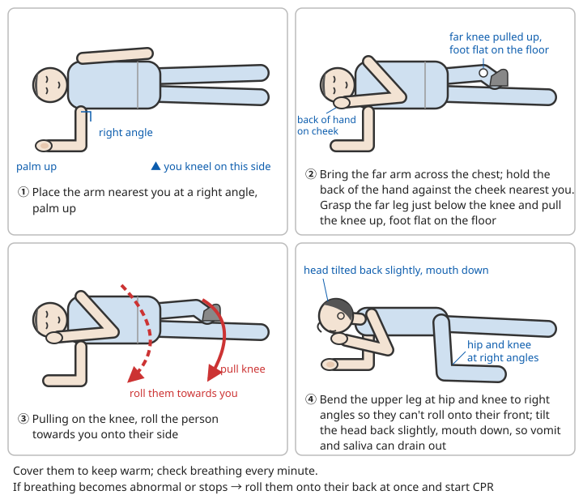
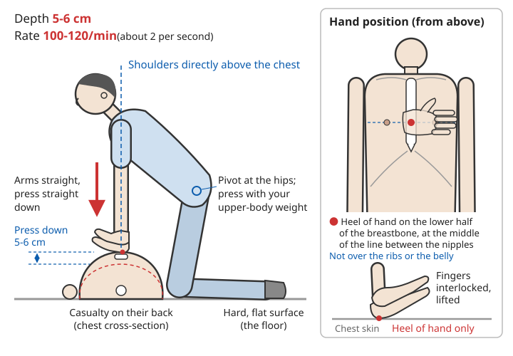
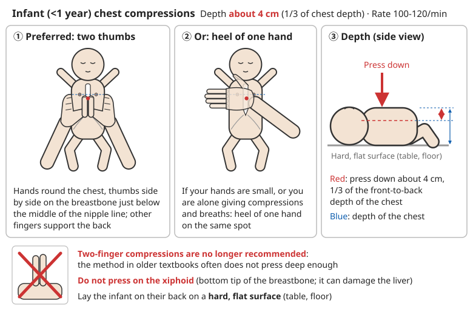
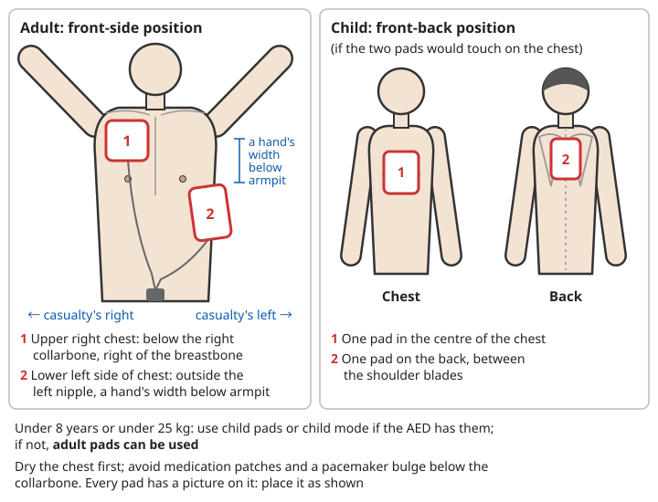
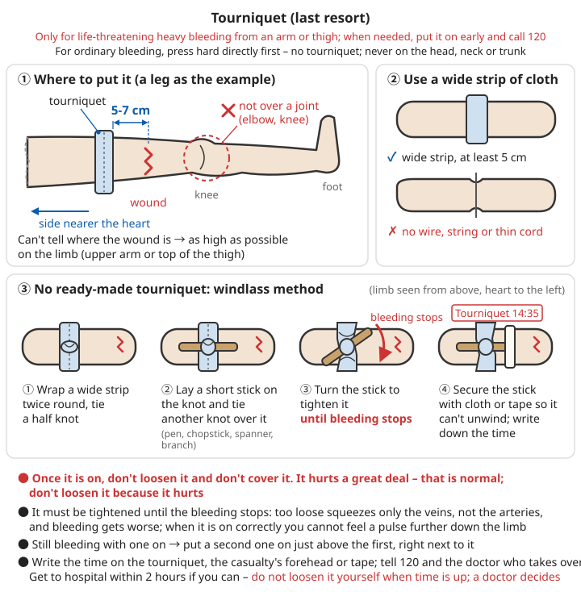
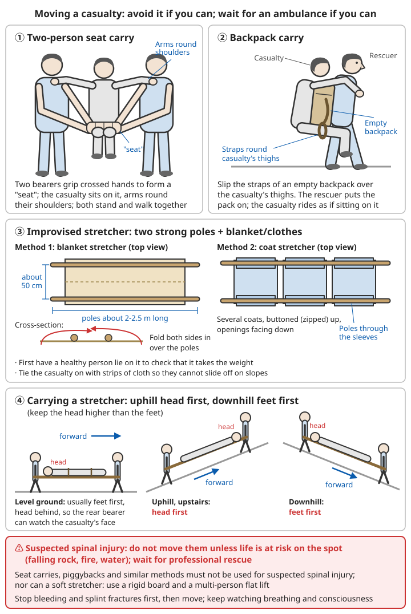

# Basic First Aid

> ⚠️ This chapter is an introduction to first aid. It does not replace proper training. In a life-threatening situation, **the first thing to do is call 120** and follow the dispatcher's instructions. Skills such as CPR and using a tourniquet are best learned on a hands-on course run by the Red Cross or a similar organisation, practising on a manikin.

## Contents
- [Scene Assessment and Calling for Help](#scene-assessment-and-calling-for-help)
- [Assessing Vital Signs](#assessing-vital-signs)
- [Airway and the Recovery Position](#airway-and-the-recovery-position)
- [Cardiopulmonary Resuscitation (CPR)](#cardiopulmonary-resuscitation-cpr)
- [Stopping Bleeding](#stopping-bleeding)
- [Managing Shock](#managing-shock)
- [Moving a Casualty](#moving-a-casualty)

---

## Scene Assessment and Calling for Help

### Step 1: Make Sure the Scene Is Safe

Before you help anyone, take a few seconds to look around. **If the rescuer gets hurt, the casualty loses a helper and there is one more casualty.**

| Danger at the scene | What to do first |
|----------|----------|
| On a road | Switch on your hazard warning lights, put a warning triangle out towards oncoming traffic (about 150 m back on an expressway), wear a reflective vest; do not stand in the traffic |
| Electric shock | Cut the power first (switch off at the mains, pull the plug), or push the wire away with a dry wooden stick; do not touch the casualty until the power is off. See [Electric Shock](05-acute-symptoms.md#electric-shock-injuries) |
| Smell of gas, smoke, fire | Do not switch electrical appliances on or off and do not make phone calls; open the windows or get out first, and call once you are somewhere safe |
| Confined spaces (cellars, biogas digesters, cesspits, wells) | Do not rush in. Ventilate first and call professional rescuers; accidents where several people go in one after another to help and all die are common |
| In water | Prefer "shout, reach, throw"; if you are not trained in water rescue, do not go into the water. See [Drowning](05-acute-symptoms.md#drowning) |
| Unknown toxic substance | Keep away, stay upwind, do not give mouth-to-mouth breaths |
| Blood and body fluids | Wear gloves if you have them; if not, cover your hands with plastic bags; wash your hands afterwards |

### Step 2: Check the Casualty

```
1. Tap both shoulders and shout into both ears: "Are you all right? Can you hear me?"
   (Infant: tap the soles of the feet)
2. At the same time, watch the chest and belly for rising and falling, for 5-10 seconds
3. Glance quickly for heavy bleeding (clothes soaked over a large area, a pool of blood on the ground)

  No response + not breathing, or only agonal gasps → call for help now, start CPR
  No response + breathing normally                → call for help, put in the recovery position, keep watching
  Heavy bleeding                                  → call for help, stop the bleeding at once
  Awake                                           → ask where it hurts and what happened
```

**Agonal gasps**: these look like sighing or sobbing. They are slow and irregular, and the mouth opens and closes. They are common in the first few minutes after cardiac arrest. **This is not normal breathing**; treat it as no breathing. In someone who collapses suddenly during exercise, the first breaths may look almost normal or like heavy panting. Do not let that reassure you either: if you cannot wake them, call 120 first, keep watching their breathing while you wait, and if in doubt treat it as not breathing normally.

### Step 3: Call for Help

```
1. Shout for help: "Help! Someone has collapsed here!"
2. Give specific people specific jobs (do not say "someone call for help" - nobody will move):
   "You, sir, in the red top - please call 120!"
   "You - go and get the AED!" (often found in shopping centres, metro stations, airports)
3. If you are on your own:
   - You have a phone: call 120, put it on speaker beside you, and follow the dispatcher's instructions while you do compressions
   - No phone, and the casualty is an adult: leave to make the call and fetch an AED first, then come back and do CPR
   - No phone, and the casualty is a child or infant, or has drowned: do about 2 minutes of CPR first, then go for help
     (in these people, cardiac arrest is usually caused by lack of oxygen, so getting oxygen in first matters more)
   - Exception: if the child collapsed suddenly in front of you (with no earlier choking, inhaling water or other cause of lack of oxygen),
     the problem is most likely in the heart itself; treat as an adult: go and call first, and fetch an AED
```

### What to Say When You Call 120

**The most important thing is the address.** A dropped call or an unclear description of the casualty can be put right later; with the wrong address, the ambulance cannot find you.

```
1. Exact address: district, street, name of the housing estate, building number, entrance, floor, flat number
   - On a road: road name + nearest junction, shop, bus stop, or roadside marker post number
   - In the wild: coordinates from your phone's map app, or an obvious landmark
2. What happened: "A man of about 50 suddenly collapsed. We can't wake him and he isn't breathing"
3. How many people are hurt and how they are now: conscious or not, breathing or not, heavy bleeding or not
4. What you have already done: "We are already doing CPR"
5. Your phone number - keep the line free
6. Answer the dispatcher's questions, and only hang up when they tell you to
```

After the call:

- Send someone to the estate gate or the road junction to meet the ambulance, and to open the stairwell doors and hold the lift
- Gather the casualty's medical records and current medicines and hand them to the ambulance crew
- Write down when the illness started and what you did (for example, when a tourniquet went on)

For other emergency numbers, see [Main Contents - Emergency Numbers](../../README.md). If you cannot speak on the phone, you can report to the police by text message to 12110.

---

## Assessing Vital Signs

Vital signs (consciousness, breathing, pulse, skin, temperature, blood pressure) tell you how much danger the casualty is in **now**, and **whether they are getting better or worse**. A single reading means less than a series: measure every 5-15 minutes, write down the time and the values, and give them to the doctor.

### The ABC Principle

In any first-aid situation, check these first:

> ⚠️ If the casualty is **unresponsive and not breathing normally**, do not go through the checks one by one. Call for help and start CPR at once. Current guidelines put resuscitation in the order **C-A-B (compressions first)**; see below.

Also, **if there is life-threatening heavy bleeding from a limb, stop the bleeding first** (a fatal amount of blood can be lost within minutes), then check the airway and breathing.

#### A - Airway
- **Check**: is the airway open?
  - Can talk or cry → airway is open
  - Snoring or gurgling sounds → the tongue has fallen back, or secretions or vomit are blocking it
  - Cannot talk, cannot cough, hands clutching the throat → possibly a complete blockage by a foreign body; see [Something Stuck in the Throat / Choking](04-foreign-bodies-and-choking.md#foreign-bodies-in-the-throat--airway-obstruction)
- **What to do**:
  - Remove objects from the mouth (only ones you can see; do not sweep blindly with your fingers)
  - Tilt the head back and lift the chin (see [Airway and the Recovery Position](#airway-and-the-recovery-position))
  - Lie them on their side so vomit does not block the airway

#### B - Breathing
- **Check**: are they breathing?
  - Look: chest rising and falling
  - Listen: breathing sounds
  - Feel: air on your cheek
- **Normal**: adults 12-20 breaths per minute
- **How to count**: one rise and fall of the chest or belly counts as one breath; count for 30 seconds and multiply by 2. Do not tell them you are counting (people breathe differently once they notice)
- **Danger signs**: in adults, more than 30 or fewer than 10 breaths per minute; cannot finish a sentence; blue lips; hunching the shoulders with each breath, or the skin between the ribs sucking in

#### C - Circulation
- **Check**: pulse and bleeding
  - Carotid artery: 2-3 cm to the side of the Adam's apple
  - Radial artery: the thumb side of the wrist
- **Normal**: adults 60-100 beats per minute
- **How to count**: press lightly with your index and middle fingers (not your thumb, which has its own pulse); count for 30 seconds and multiply by 2. If the pulse is irregular, count for a full 60 seconds and notice whether the beats are equally strong
- **What it tells you**: if you can feel the pulse at the wrist, blood pressure is not yet very low; if you cannot feel it at the wrist and only at the neck, the situation is serious
- **Capillary refill**: press on a nail bed for 5 seconds and let go; normally it turns pink again within 2 seconds. Longer than 2 seconds suggests poor circulation (unreliable in the cold)
- Lay people often get it wrong when they feel the carotid pulse to decide whether the heart has stopped. **Do not delay CPR to look for a pulse**

### Level of Consciousness (AVPU)

- **A - Alert**: awake, can talk normally
- **V - Voice**: responds to your voice
- **P - Pain**: responds only to a painful stimulus
- **U - Unresponsive**: no response at all

**How to use it**:
- Even if someone is awake, ask "What is your name? Where are you? What is the date today?" Wrong answers mean their consciousness is already affected
- Painful stimulus: squeeze the muscle on top of the shoulder hard, or press a pen against a nail bed, and watch for a frown or a pulling away
- Anything below A (they only wake when spoken to, or cannot be woken) means call 120. A change from A towards V, P or U means they are getting worse; tell the ambulance crew
- Put anyone with reduced consciousness who is breathing normally in the recovery position, so the tongue does not fall back and they do not inhale vomit

### Normal Ranges for Vital Signs

| Age | Breathing (per minute) | Heart rate (per minute) | Notes |
|------|--------------|--------------|------|
| Newborn to 1 year | 30-60 | 100-160 | In infants, count breaths by watching the belly rise and fall |
| 1-3 years | 24-40 | 90-150 | |
| 3-6 years | 20-30 | 80-120 | |
| 6-12 years | 18-30 | 70-120 | |
| Over 12 years and adults | 12-20 | 60-100 | Athletes' resting heart rate can be as low as about 50 |

Guidelines differ slightly on children's values; the table gives approximate ranges. Crying and fever raise them clearly, so measure when the child is calm.

| Item | Normal in adults | Watch out |
|------|----------|----------|
| Temperature (armpit) | 36.0-37.0°C | Above 37.3°C is fever; below 35°C is hypothermia |
| Blood pressure (upper arm) | Systolic 90-139 mmHg, diastolic 60-89 mmHg | Systolic below 90 mmHg with dizziness and cold, clammy skin → possible shock; above 180/110 mmHg → see a doctor |
| Blood oxygen (fingertip pulse oximeter) | 95%-100% | Below 94%, see a doctor; below 90% is an emergency (readings are unreliable with cold hands or nail polish) |
| Skin | Warm, dry, normal colour | Pale, cold and clammy (shock); blue (lack of oxygen); flushed and hot (heatstroke, fever) |

For how to take a temperature and how fever is graded, see [Common Illnesses - Fever](01-common-illnesses.md#fever); for hypothermia, see [Hypothermia](05-acute-symptoms.md#hypothermia).

### Head-to-Toe Check

Once you are sure there is nothing immediately life-threatening, examine a conscious or stable casualty from head to toe to find injuries you might have missed:

```
1. Ask: Where does it hurt? What happened? Any illnesses? What medicines do you take? Any allergies?
       When did you last eat?
2. Look and feel from head to toe, comparing both sides each time:
   head and neck → chest → belly → pelvis → both legs → both arms → back (if they can be turned)
3. Look for: bleeding, swelling, deformity, wounds, whether both pupils are the same size
   Feel for: tenderness, grating of broken bone, skin temperature
4. If you suspect a spinal injury, do not turn the head, neck or body while you examine
5. Write down what you found and the time
```

---

## Airway and the Recovery Position

### Opening the Airway: Head Tilt, Chin Lift

When an unconscious person lies on their back, the base of the tongue falls back and blocks the throat. This is the most common cause of suffocation in unconscious people.

```
1. Casualty lying on their back
2. Put one hand on the forehead and press backwards and down with the palm, tilting the head back
3. Put the index and middle fingers of your other hand on the bone of the chin (the jawbone) and lift it
   - Do not press on the soft tissue under the chin; that pushes the tongue into the throat
4. Adults: tilt the head back until the line from the angle of the jaw to the earlobe is vertical to the ground
   Children: tilt back less
   Infants: keep the head in the "sniffing position" (as if sniffing something); do not tilt too far back.
         You can put a folded towel under the shoulders
```

**Suspected neck injury**: professionals use the "jaw thrust" (both hands hold the angles of the jaw and lift them up, without tilting the head back). But if the jaw thrust does not open the airway, **breathing matters more than the neck**: use head tilt, chin lift anyway.

### The Recovery Position (Lying on the Side)

**Use for**: people who are unresponsive but breathing normally (drunk, after a seizure, unconscious from low blood sugar, poisoned and so on). **Do not use for**: people who are not breathing normally (they need CPR).

```
1. Kneel beside the casualty; remove their glasses and any hard objects from their pockets
2. Place the arm nearest you out at a right angle, palm up
3. Bring the far arm across the chest and hold the back of that hand against the cheek nearest you
4. With your other hand, grab the far leg just below the knee and pull the knee up, foot flat on the ground
5. Pull on the knee to roll the casualty towards you onto their side
6. Bend the hip and knee of the upper leg to right angles so they cannot roll onto their front
7. Tilt the head back slightly with the mouth pointing down, so vomit and saliva can drain out
8. Cover them with clothes to keep them warm; check their breathing every minute
9. If they stay on their side for more than 30 minutes, turn them to the other side so the lower arm is not injured by pressure
```



*Figure: How to place someone in the recovery position (seen from above; the rescuer is at the bottom of the picture)*

- Pregnant women (with a clearly visible bump): preferably on the **left side**, to reduce pressure of the womb on the large blood vessels
- Infants: hold the infant along your arm, face down, head slightly lower than the body, supporting the chin and head
- If you suspect a spinal injury but must put the person on their side (for example, they are vomiting, or you are alone and must leave to get help): work with others and roll them as one unit, keeping the head, neck and trunk in a straight line
- As soon as breathing becomes abnormal or stops → roll them onto their back at once and start CPR

---

## Cardiopulmonary Resuscitation (CPR)

After cardiac arrest, the brain begins to suffer irreversible damage after 4-6 minutes without blood. Every minute of delay cuts the chance of survival by about 7%-10%. Even in cities, an ambulance usually takes more than 10 minutes to arrive, and **during that time it is up to the people on the spot**. Good chest compressions keep up a minimum of blood flow to the brain and heart and buy time for defibrillation and professional care.

### When to Start CPR
- No response
- Not breathing, or only agonal gasps
- Lay rescuers do not need to check for a pulse (it is easy to get wrong and delays rescue); if both of the above apply, start compressions

Right after collapsing, the person may jerk for a few seconds, which is easily mistaken for epilepsy. **If they are not breathing once the jerking stops, it is cardiac arrest.**

Do not worry that "their heart may still be beating and compressions will hurt them": serious harm from compressing someone who is not in cardiac arrest is rare, while failing to compress someone who needs it is almost always fatal.

### Adult CPR Step by Step

#### 1. Check Safety and Call for Help
```
1. Make sure the scene is safe
2. Tap the shoulders: "Are you all right?"
3. If there is no response, call for help at once
4. Call 120 for an ambulance
```

At the same time, send someone for an AED. Lay the casualty on their back on a **firm, flat surface**, ideally the floor. If they are on a soft bed: if there are helpers and you can move them to the floor in a few seconds, do so; if you cannot move them on your own, **do not delay compressions to move them**. Take away the pillow and do compressions on the bed, pressing harder to make up for the mattress sinking (the American Heart Association 2025 guidelines stress a firm, flat surface; the European Resuscitation Council 2025 guidelines advise that it is not necessary to move the person from a bed to the floor for this).

#### 2. Chest Compressions
- **Where**: the lower half of the breastbone, at the middle of the line between the nipples
- **Depth**: 5-6 cm
- **Rate**: 100-120 per minute
- **How**:
  ```
  1. Kneel beside the casualty
  2. Put the heel of one hand on the breastbone
  3. Put the heel of the other hand on top
  4. Keep your arms straight and press straight down
  5. Let the chest come all the way back up after each compression, but keep your hands in place
  ```

**Key points**:
- Undo or cut open the top so your hands are directly on the skin of the chest; that is the only way to find the right spot
- Interlock your fingers and lift them, pressing only with the heel of the hand so your fingers do not press on the ribs
- Keep your shoulders directly above the casualty's chest and pivot at the hips, using the weight of your upper body rather than the strength of your arms
- Rhythm: count out loud "one, two, three ...", about 2 compressions per second
- **Keep interruptions to a minimum**: when changing rescuers, giving breaths or while the AED analyses, never stop for more than 10 seconds
- With two or more rescuers, change the person compressing every 2 minutes (about 5 cycles of 30:2), and make the change within 5 seconds; the person compressing often does not notice they are tired and pressing too shallow



*Figure: Body position and hand position for adult chest compressions*

**What doing it right looks like**: the chest clearly sinks with each compression and springs fully back when you release; someone beside you counts the rhythm and the number.

**Broken ribs**: in older people you will often hear a "crack" while compressing. This is a rib or cartilage breaking. **Do not stop.** Check that your hands have not slipped out of position and carry on. A fracture can be treated; a stopped heart cannot.

#### 3. Rescue Breaths (If You Know How)
- After every 30 compressions, give 2 rescue breaths
- Blow for 1 second each time, just until you see the chest rise
- If you do not know how or do not want to, compressions alone are fine

**How**:
```
1. Open the airway with head tilt, chin lift
2. With the hand on the forehead, pinch the casualty's nose
3. Take a normal breath (not a deep one) and seal your mouth completely over the casualty's mouth
4. Blow for about 1 second, watching from the corner of your eye to see whether the chest rises
5. Take your mouth away and release the nose to let the air out, then give the second breath
6. The two breaths together should take no more than 10 seconds; then go straight back to compressions
```

- If the chest does not rise: reposition the head and try again; if it still does not work, do not keep trying - go back to compressions (before the next breaths, glance into the mouth for any object)
- Blowing too hard or too much forces air into the stomach and causes vomiting
- Use a CPR face shield or barrier film if you have one; do not give mouth-to-mouth directly to a poisoned person (especially pesticide or cyanide poisoning)
- If the casualty vomits: turn the head and body to the side together, clear the mouth, roll them back and continue

#### Compressions Without Breaths (Hands-Only CPR)

- **For**: people who are untrained, or do not know how or do not want to give rescue breaths; sudden cardiac arrest in an adult who collapses
- How: compress **continuously** at the position, depth and rate given above, without pausing, until the AED arrives or the ambulance crew takes over
- In the first few minutes of a sudden cardiac arrest in an adult, the blood still contains oxygen, so compressions alone work almost as well as standard CPR
- **Cardiac arrest in children and infants, or caused by drowning, suffocation or poisoning** comes from lack of oxygen in the first place, so rescue breaths matter more; if you know how, always give them. See [Drowning - After Getting Out of the Water](05-acute-symptoms.md#2-care-once-out-of-the-water)

#### 4. Keep Going
- Continue at a ratio of 30:2
- Until:
  - the ambulance crew arrives
  - the casualty starts breathing again and has a pulse
  - you are too exhausted to continue

**How to tell they have recovered**: lay rescuers do not need to feel for a pulse. If the casualty **starts to move, opens their eyes, coughs or starts breathing normally**, you can stop, put them in the recovery position and watch them closely. If they stop breathing normally again, start compressions again at once.

**Other times when you may stop**:
- A new danger appears at the scene (fire, a collapse, oncoming traffic) and rescuers must get out
- There are clear signs of death: the body is already cold and stiff, there is lividity (purple patches where blood settles), or there are injuries no one can survive, such as a severed head
- Where there is no professional help to wait for at all (remote areas, after a disaster), if good CPR has continued for about 30 minutes or more and the casualty has shown no sign of life throughout, the chance of successful resuscitation is extremely low and stopping is an acceptable decision. **People who are very cold or have drowned in cold water are an exception** and you should keep going longer; see [Hypothermia](05-acute-symptoms.md#hypothermia)

### Pregnant Women, Older People and Special Situations

- **Pregnant women**: the hand position and technique are the same as for other adults. When the bump is clearly visible (from about the fifth month of pregnancy), a second person stands on the casualty's left and uses both hands to push the womb towards the casualty's left side, to reduce its pressure on the large blood vessels. Tell 120 that the casualty is pregnant
- **Older people**: their bones are brittle and break more easily, but do not press any less deeply because of this
- **Removable dentures**: before giving rescue breaths, take out loose dentures; see [Dental Problems](09-dental-problems.md)
- **On a bed or in a car**: if you can move them to the floor quickly, do so; if not, do not delay compressions to move them. On a bed, press deeper, and if there is a rigid board, slide it under their back during the few seconds when rescuers change over
- In cardiac arrest caused by poisoning, electric shock, drowning, suffocation or allergy, CPR is the same, but watch out for the rescuers' own safety

### How CPR Differs for Children and Infants

| Item | Adult | Child (1 year to puberty) | Infant (<1 year) |
|------|------|-------------|------------|
| Compression depth | 5-6 cm | About 5 cm (1/3 of the depth of the chest) | About 4 cm (1/3 of the depth of the chest) |
| Compression method | Two hands | One or two hands | Two thumbs with both hands encircling the chest<br>or the heel of one hand |
| Compression position | Lower half of the breastbone | Lower half of the breastbone | Just below the line between the nipples |
| Compression rate | 100-120/min | 100-120/min | 100-120/min |
| Compressions to breaths | 30:2 | 30:2 (one rescuer)<br>15:2 (two rescuers) | 30:2 (one rescuer)<br>15:2 (two rescuers) |
| How to give breaths | Mouth to mouth | Mouth to mouth | Your mouth covers the infant's mouth and nose together |
| Breath volume | Just until the chest rises | Just until the chest rises | Only a small puff of air from your cheeks, just until the chest rises slightly |
| Alone, without a phone | Get help first, then CPR | About 2 minutes of CPR first, then get help<br>(collapsed suddenly in front of you: get help and an AED first) | About 2 minutes of CPR first, then get help<br>(collapsed suddenly in front of you: get help and an AED first) |

**Checking whether an infant responds**: tap the soles of the feet and call out loudly. Do not shake them.

**Infant compressions**:
```
1. Lay the infant on their back on a firm, flat surface (a table, the floor)
2. Preferred: encircle the infant's chest with both hands and press with both thumbs side by side
   on the breastbone just below the middle of the line between the nipples, with your other fingers supporting the back
3. If your hands are small, or you are alone and must give both compressions and breaths: use the heel of one hand on the same spot
   (the "two-finger" method in older textbooks often does not press deep enough and is no longer recommended in the latest guidelines)
4. Do not press on the xiphoid process at the very bottom of the breastbone (it can easily damage the liver)
5. A very small infant can be supported on your forearm for compressions, but keep the head and neck level
```



*Figure: Two ways to give infant chest compressions, and the compression depth*

- From puberty (breast development, Adam's apple, underarm hair) onwards, treat as an adult
- For a newborn who does not cry or breathe at birth, see [Emergency Childbirth and Newborn Care](11-emergency-childbirth-and-newborn-care.md#if-the-baby-does-not-cry-or-breathe)
- Cardiac arrest in children is mostly caused by lack of oxygen from suffocation, drowning, severe infection and so on, so **rescue breaths matter even more than in adults**
- Parents should learn CPR for children and first aid for choking; see [Child Safety](14-child-safety.md) and [Something Stuck in the Throat / Choking](04-foreign-bodies-and-choking.md#foreign-bodies-in-the-throat--airway-obstruction)

### Using an Automated External Defibrillator (AED)

If there is an AED at the scene:

```
1. Switch on the AED
2. Follow the voice prompts
3. Tear open the clothes and dry the chest
4. Stick on the pads (in the positions shown in the pictures)
5. Make sure nobody is touching the casualty
6. Press the "Analyse" button
7. If it says a shock is needed, press the "Shock" button
8. Continue CPR immediately
```

**What an AED is**: in many cardiac arrests the heart is in "ventricular fibrillation" (the heart muscle quivers chaotically and does not pump). Only an electric shock can restore a normal rhythm. An AED analyses the heart rhythm automatically and **only allows a shock when one is needed**. It will not shock a normal person by mistake, and an untrained person can use it. The sooner the shock the better: defibrillation within 3-5 minutes of collapse greatly improves survival.

**Where they are usually found**: airports, metro stations, railway stations, shopping centres, sports halls, schools, office building lobbies. The sign is usually a green or red heart with a lightning bolt. The 120 dispatcher may also tell you where the nearest one is.

**Where to put the pads**:
```
Adults (front-and-side position; each pad shows a picture):
- One pad on the upper right chest: below the right collarbone, to the right of the breastbone
- One pad low on the left side of the chest: outside the left nipple, about a hand's width below the armpit
```



*Figure: Where to stick the AED pads (for children, see "Children and infants" below)*

**Key points**:
- When the AED arrives, **stick the pads on while compressions continue**; do not stop compressions to wait
- If thick chest hair stops the pads sticking, press them down firmly; if you have a razor, shave the area quickly
- Avoid medicine patches on the skin (peel them off and wipe the skin clean) and the bulge of a pacemaker under the collarbone
- If the casualty is lying in water or snow, first drag them somewhere drier and dry the chest; lying on a metal floor is generally fine
- When analysing and shocking, shout "Everyone stand clear!" and check that nobody is touching the casualty
- Many AEDs analyse automatically and you do not need to press "Analyse"; some fully automatic models deliver the shock themselves - just follow the prompts
- After a shock, do not check for a pulse; **go straight back to 2 minutes of compressions**, and the AED will analyse again by itself
- If it says "No shock advised", also continue CPR immediately
- Once the pads are on, do not remove them, even if the casualty starts breathing again, until the ambulance crew takes over

**Children and infants**:
- For children under 8 or weighing less than 25 kg, use child pads or child mode (a key or switch) if available
- If there are no child pads, **you can use adult pads**; if the two pads would touch on the front of the chest, put one in the middle of the front of the chest and the other on the back between the shoulder blades
- An AED can also be used on infants; a model with a child mode is preferred

### Common CPR Mistakes

| Mistake | Result | Do this instead |
|------|------|----------|
| Spending a long time feeling for a pulse or listening for a heartbeat | Compressions are delayed | Unresponsive + not breathing normally: start compressions within 10 seconds |
| Taking agonal gasps for breathing | The chance to save them is missed | Slow, irregular, sighing → treat as not breathing |
| Pressing gently on a soft bed or sofa | The mattress sinks and compressions are not deep enough | Move them to the floor if you can do it quickly; if not, press harder on the bed - do not delay to move them |
| Pressing too shallow or too slowly | Not enough blood flow | At least 5 cm, at least 100/min, using the weight of your upper body |
| Hands slipping onto the ribs or belly | Fractures, damage to internal organs, ineffective compressions | Lower half of the breastbone, pressing with the heel of the hand |
| Not letting the chest come fully up after each compression | The heart cannot fill | Let the chest spring fully back, hands staying in place |
| Frequent interruptions | Blood pressure drops to zero with every pause and has to be built up again | Interruptions no longer than 10 seconds |
| Afraid to press for fear of hurting them | The casualty will almost certainly die | Start immediately - doing it wrong is better than not doing it |

---

## Stopping Bleeding

An adult has about 5 L of blood. Losing about 1 L in a short time (about 2/3 of a large bottle of mineral water) causes shock. **A torn major artery in an arm or leg can kill within minutes.** You must stop the bleeding immediately; you cannot wait for the ambulance.

### How Serious Is the Bleeding?

| Type | What you see | What to do |
|------|------|------|
| Capillary bleeding | Oozing, small amount | Clean it, press for a few minutes, dress it; see [Wounds and Injuries - Cuts and Grazes](02-wounds-and-injuries.md#cuts-and-grazes) |
| Venous bleeding | Dark red, flowing steadily | Direct pressure, pressure bandage |
| Arterial bleeding | Bright red, spurting with each heartbeat | Press hard directly at once; if it does not stop, use a tourniquet; call 120 at the same time |
| **Life-threatening bleeding** | Blood will not stop flowing, spurting, a pool forming on the ground, clothes soaking through quickly, a limb cut off, or the casualty already in shock | Do everything you can to stop the bleeding now; call 120 |

When dealing with blood, wear gloves if possible, or cover your hands with plastic bags or cling film, to protect against blood-borne diseases such as hepatitis B and HIV/AIDS.

### 1. Direct Pressure (First Choice)

**For**: most bleeding

**How**:
```
1. Press clean gauze or cloth directly on the wound
2. Keep pressing hard for at least 10 minutes
3. Do not keep lifting it to look
4. If blood soaks through, add another layer of gauze and keep pressing
5. Secure it with a bandage
```

**Key points**:
- **Press hard**: use the heel of your hand or both hands one on top of the other, pressing the wound against the bone beneath; for heavy bleeding you can press with your knee
- Without gauze, use a clean towel, clothing or sanitary pads (very absorbent); if you have none of these, press with your bare hand
- Do not remove gauze that has soaked through (it would pull away the clot that has just formed); add more on top
- For very deep wounds (such as deep wounds at the top of the thigh, in the armpit or in the neck, where a tourniquet cannot be used): **pack gauze or strips of cloth deep into the wound until it is full**, then press hard on top for at least 3 minutes (wound packing); then keep up the pressure and get to hospital immediately
- If an object is stuck in the wound (a knife, a steel bar, a stick): **do not pull it out**. Press on both sides of the object, pad around it with rolled-up cloth to hold it still, and then bandage

**Pressure bandage**: once pressure has stopped the bleeding, wrap a bandage tightly to take over from your hand:
```
1. Cover the wound with a thick gauze pad (or folded cloth)
2. Start the bandage at the end further from the heart; each turn covers half of the one before.
   Wrap it firmly, with a few extra turns over the wound
3. Tie it off away from the wound
4. Check: fingers and toes beyond the bandage should stay warm, normal in colour and able to feel touch;
   blue, cold or numb → it is too tight; loosen it slightly and rewrap
5. Blood seeps through the bandage again → add more gauze on the outside, wrap another layer, and press again with your hand
```

**How to tell it has stopped**: no new blood seeps through or spreads on the outside of the bandage. You can draw a line round the edge of the bloodstain with a pen and check after a few minutes whether it has spread.

### 2. Raise the Injured Limb

**Use together with pressure**:
- Raise the injured limb above the level of the heart
- This helps reduce bleeding
- Keep up direct pressure at the same time

Current first-aid guidelines consider that raising the limb does little and **cannot replace direct pressure**. Do not raise it if you suspect a fracture, if raising it causes severe pain, or if it would get in the way of pressing.

### 3. Pressure Points

**For**: heavy bleeding from a limb when direct pressure has not worked

**Main pressure points**:
- **Upper arm**: brachial artery (inner side of the upper arm)
- **Thigh**: femoral artery (middle of the groin)

**How**: press on the point where the artery pulses with your thumb or palm

> Current international first-aid guidelines no longer recommend pressure points as a routine method: the spot is hard to find, the effect is uncertain, and it takes away a pair of hands that could be pressing on the wound. Only use one as a stopgap **while waiting for a tourniquet when you cannot press directly on the wound for the moment**, and do not ease off pressure on the wound itself because of it.

### 4. Tourniquet (Last Resort)

⚠️ **Only use one when**:
- Severe bleeding from a limb threatens life
- Other ways of stopping the bleeding have failed
- The limb is partly cut off

"Last resort" here means: ordinary bleeding does not need, and should not have, a tourniquet. But for **life-threatening heavy bleeding from an arm or leg** (spurting, still pouring despite pressure, a limb cut off, or many casualties at the scene so you must free your hands to help others), put on a tourniquet **early**; do not hesitate until the casualty is in shock. A tourniquet can only be used on **arms and thighs**, never on the head, neck or trunk.

**How to use it**:
```
1. 5-7 cm above the wound (on the side nearer the heart)
2. Use a wide strip of cloth (at least 5 cm wide)
3. Wrap it tightly 2-3 times
4. Write down the time it went on
5. Do not cover the tourniquet
6. Do not loosen it; wait for medical help
7. No longer than 2 hours at most
```

**Key points**:
- Do not put it over a joint (elbow, knee); if you cannot tell exactly where the wound is, put it as high as possible on the injured limb (upper arm or top of the thigh)
- **It must be tightened until the bleeding stops**: if it is not tight enough, it only squeezes the veins and not the arteries, and bleeding actually gets worse. When it is on correctly, you cannot feel a pulse further down the limb
- It hurts a great deal. This is normal; tell the casualty why, and do not loosen it because it hurts
- Still bleeding with one on → put a second one on just above the first, right next to it
- Write the time on the tourniquet, on the casualty's forehead or on a piece of tape, e.g. "Tourniquet 14:35", and tell 120 and the doctor who takes over
- "No longer than 2 hours" means try to get the casualty to hospital for treatment within 2 hours. **It does not mean loosen it yourself when the time is up.** A rescuer loosening it can cause heavy bleeding or a sudden rush of harmful substances back into the circulation; only a doctor can decide this

**Improvised cloth tourniquet (windlass method)**:
```
1. Wrap a wide strip of cloth (a triangular bandage, a tie, torn clothing - at least 5 cm wide) twice round the limb above the wound
2. Tie a half knot
3. Lay a short, strong stick on the knot (a pen, a chopstick, a spanner, a branch)
4. Tie another knot over the stick to hold it
5. Turn the stick to tighten until the bleeding stops
6. Secure the stick with another strip of cloth or tape so it cannot unwind
7. Write down the time
```

If you can, keep a commercial windlass tourniquet in your home and car first-aid kits, and practise on your own leg beforehand, following the instructions.

**Never**:
- ❌ Use wire, string or other thin cord
- ❌ Use it on the trunk
- ❌ Loosen and tighten it repeatedly



*Figure: Tourniquet position and the cloth windlass method (a last resort; call 120 at the same time)*

### Bleeding from Particular Places

#### Nosebleeds
```
1. Sit up with the head tilted slightly forward
2. Pinch the soft part of the nose firmly for 10 minutes
3. Put a cold compress on the forehead and the bridge of the nose
4. Do not tilt the head back (blood will run down the throat)
```

- Pinch **the soft part of the nose** (the nostrils), not the bony bridge; breathe through the mouth and spit out any blood that runs into it
- Do not let go to check within the 10 minutes; if it has not stopped, pinch for another 10 minutes
- For 24 hours after it stops, do not blow or pick the nose hard or exercise strenuously
- **See a doctor** if: it is still bleeding after more than 20 minutes of pinching; bleeding is heavy or pours from both nostrils or the mouth; the nosebleed or a clear watery fluid follows a head injury; the person takes anticoagulants (such as warfarin) or aspirin; it keeps happening; it comes with high blood pressure and headache

#### Signs of Internal Bleeding
- Pale, cold, clammy skin
- Fast, weak pulse
- Fast breathing
- Swollen or rigid belly
- Vomiting blood or blood in the stool

**What to do**: get medical help immediately, keep them lying flat, give nothing to eat

Internal bleeding cannot be seen; you can only infer it from how the injury happened and from signs of shock. In all of these cases, **treat it as internal bleeding and call 120**:
- A fall from a height, a traffic collision, being crushed by something heavy, or a violent blow to the belly or chest - even if they seem "fine" at the time
- Coughing up bright red, frothy blood (lungs), vomiting material like coffee grounds (stomach), black tarry stools (digestive tract)
- A fractured pelvis or thighbone (a single one can cause more than 1 L of internal bleeding); see [Bone and Joint Injuries](03-bone-and-joint-injuries.md)
- A woman of childbearing age with sudden severe lower abdominal pain and fainting (possibly a ruptured ectopic pregnancy)

While waiting, follow [Managing Shock](#managing-shock) and write down each pulse and consciousness reading; if the pulse is getting faster and consciousness worse, tell 120 that the casualty is deteriorating.

---

## Managing Shock

Shock means **the organs of the whole body are not getting enough blood and oxygen**. It is not a disease in itself but the common end point of heavy bleeding, severe allergy, severe infection, a heart attack and so on. Early shock can be reversed with treatment; once it is advanced, it is very hard to save the person even in hospital.

### Recognising Shock

- Pale, cold, clammy skin
- Fast, weak pulse (>100 per minute)
- Fast, shallow breathing
- Restless or apathetic
- Confused
- Thirsty

**Early and late**:

| Stage | Signs | What it means |
|------|------|--------|
| Early | Restless, anxious, thirsty; pale, cool skin; heart rate on the fast side; blood pressure may still be normal | The body is still compensating - **this is the best time to act** |
| Worsening | Pulse fast and weak, hard to feel at the wrist; fast breathing; cold sweat; passing little urine; slower reactions | No longer compensating - a critical situation |
| Late | Confused, cannot be woken; blue lips; heart rate actually slows down | Cardiac arrest may happen at any moment |

- **Normal blood pressure does not rule out shock**: young people can keep their blood pressure up by speeding up the heart, until they suddenly collapse
- In older people and people taking blood pressure medicines (such as beta blockers), the heart rate may not rise noticeably, so shock is easily underestimated
- Children compensate well; by the time signs show, they are often already very ill
- Capillary refill of more than 2 seconds (slow return of colour after pressing on a nail) is a useful early sign

### Treating Shock

```
1. Lay the casualty flat
2. Raise the legs 20-30 cm (not if you suspect an injury to the legs, pelvis or spine)
3. Keep them warm (cover with a blanket)
4. Give nothing to eat or drink
5. If they vomit or lose consciousness, turn them onto their side (recovery position) so they do not inhale vomit
6. Keep monitoring vital signs
7. Call for emergency help immediately
```

**More details**:
- The first priority is **dealing with the cause**: stop heavy bleeding first; for allergy, use an adrenaline (epinephrine) auto-injector first if there is one
- Raising the legs: put a backpack, quilt or chair under the feet; if breathing becomes difficult or pain gets worse after raising them, lower them again
- People with chest pain or difficulty breathing (possibly a heart problem) should not lie flat with legs raised; let them take the half-sitting position that is most comfortable
- Keeping warm: **insulation underneath** matters more than covers on top (the ground draws away a lot of heat); but do not heat the skin directly with hot-water bottles
- No drinks: they may well need an operation under anaesthetic, and people in shock vomit easily and may inhale it. If they are thirsty, moisten their lips with a damp cloth. For long waits in the wild when help cannot come, see [Wilderness Casualty Care and Evacuation](../../../docs/03-野外生存/11-野外伤病处置与转运.md#等待救援时照顾伤员)
- Do not let the casualty stand up, walk about or go to the toilet on their own - they may suddenly faint
- Stay with them and reassure them; avoid saying things like "there's so much blood" - getting upset makes shock worse
- Every 5 minutes, write down consciousness, breathing and pulse

### Types of Shock

| Type | Cause | Key feature |
|------|------|------|
| Haemorrhagic shock | Heavy blood loss | Stop the bleeding first |
| Septic shock | Severe infection | Keep warm |
| Cardiogenic shock | Heart problem | Half-sitting position |
| Anaphylactic shock | Severe allergy | Adrenaline immediately |
| Neurogenic shock | Spinal cord injury | Keep absolutely flat |

More on each type:

- **Haemorrhagic**: includes hidden internal bleeding and fluid loss from severe diarrhoea and vomiting or extensive burns (hypovolaemia). Pale, cold, clammy skin is typical
- **Septic**: fever or abnormally low temperature, shivering, with changes in consciousness, fast breathing and blotchy skin; older people may only seem listless or confused. Common after pneumonia, urinary tract infections, wound infections and infections after childbirth; they need hospital and antibiotics as soon as possible
- **Cardiogenic**: often with chest pain, chest tightness and difficulty breathing; see [Heart Attack and Chest Pain](06-heart-stroke-and-sudden-illness.md#heart-attack-and-chest-pain)
- **Anaphylactic**: within minutes of contact with the allergen: rash, swollen lips and throat, wheezing and breathlessness, falling blood pressure. If the person carries an adrenaline auto-injector, help them inject it into the outer thigh at once and call 120 at the same time; see [Allergic Reactions](05-acute-symptoms.md#allergic-reactions)
- **Neurogenic**: after a spinal cord injury the blood vessels lose their control. Typically blood pressure is low but **the skin may be warm and dry** and the heart rate is not fast, or even slow, with limp, numb arms and legs. Keep the spine still; see moving a casualty below

---

## Moving a Casualty

**Principle: if you can avoid moving them, do not; if you can wait for the ambulance, wait.** Moving someone the wrong way can make fractures and bleeding worse, and can even paralyse someone with a spinal injury. Only move a casualty if the scene is dangerous or moving them really is necessary to save their life. For long-distance evacuation in mountains or the wild, see [Wilderness Casualty Care and Evacuation - Moving a Casualty](../../../docs/03-野外生存/11-野外伤病处置与转运.md#搬运伤员).

### When Not to Move Someone

⚠️ **Do not move the casualty in these cases**:
- Suspected neck or spinal injury
- Unless:
  - The scene is dangerous (fire, explosion and so on)
  - They must be moved before first aid can be given
  - While waiting for professional rescuers

**How to tell there may be a spinal injury**:
```
How it happened (suspect a spinal injury if any one applies):
- A fall from higher than their own height, or tumbling down stairs
- A traffic collision (especially a rollover, being thrown out, a pedestrian being hit, a motorcycle crash)
- Diving into shallow water and hitting the bottom
- A heavy blow to the head, or injuries to the head or face
- Being hit on the back or head by something heavy
- An older person falling and hitting their head

Signs in the body:
- Pain or tenderness in the middle of the neck or back
- Numbness, tingling, weakness or inability to move the hands or feet
- Reduced consciousness (treat anyone who cannot tell you where it hurts as having a spinal injury)
- Loss of bladder or bowel control
```

**Holding the head still by hand while waiting for help**:
```
1. Kneel behind the top of the casualty's head and place your hands on both sides of the head, fingers along the jaw
2. Keep the head still in the position it is in, with the tip of the nose, the chin and the navel in one line
3. Do not pull on it, and do not put a pillow under it
4. Tell the casualty: "Don't move, don't nod or shake your head - answer me by talking"
5. Hold it until the ambulance crew takes over; if you are tired and need to swap, explain clearly to the next person before changing hands
```

For other signs of a suspected spinal fracture, see [Bone and Joint Injuries - Spinal Fractures](03-bone-and-joint-injuries.md#spinal-fracture-extremely-dangerous). For casualties of traffic collisions and removing motorcycle helmets, see [Home and Traffic Accidents](07-home-and-traffic-accidents.md).

### Principles of Safe Moving

1. **Assess**: assess the injuries first
2. **Prepare**: enough people and equipment
3. **Immobilise**: immobilise the injured part first
4. **Protect**: protect the head, neck and spine
5. **Smooth**: move gently and steadily

Some more points:
- **The person holding the head gives the commands for everyone**: "Ready - lift!", and everyone moves at the same moment
- Rescuers lift with their legs, **bending the knees, not the back**, keeping the back straight; if you cannot lift, call more people - do not try to be a hero
- Stop bleeding and splint fractures first, then move
- Keep watching breathing and consciousness while moving, ready to stop and deal with problems
- On a stretcher: usually feet first and head at the back, so the person at the back can see the casualty's face; going upstairs or uphill, head first

### Emergency Drags (When the Scene Is Dangerous)

With fire, toxic gas, a risk of collapse, or a vehicle that might explode, there is no time to wait; even alone, you must drag the casualty to safety:

```
Collar drag:
1. Stand behind the top of the casualty's head
2. Grip the casualty's collar (or the clothing at the shoulders) with both hands, holding the sides of the head between your forearms
3. Drag backwards along the length of the body (head-to-feet line); do not pull sideways

Underarm drag:
1. From behind the casualty, put both your arms under their armpits and grip their forearms, crossed over their chest
2. Drag backwards

Blanket drag:
1. Lay a blanket beside the casualty and roll them onto it as one unit
2. Lift the blanket at the head end and drag along the length of the body

In thick smoke: keep as low as you can, and check breathing as soon as you reach safety
```

Dragging along the length of the body keeps twisting of the spine to a minimum, so use this direction in an emergency even if you suspect a spinal injury.

### Carrying Methods

#### 1. One-Person Carries

**Supported walk** (casualty can walk)
```
1. Stand at the casualty's side
2. Put one hand round their waist and hold their arm with the other
3. Have them put their arm over your shoulders
```

Stand on the casualty's injured side (if the left ankle is sprained, stand on the left) to take some of their weight.

**Cradle carry** (light casualty)
```
1. Support the back with one arm
2. Support behind the knees with the other
3. Lift the casualty
```

Suitable for children or light adults, over short distances.

**Piggyback** (casualty cannot walk but is conscious)
```
1. Crouch in front of the casualty
2. Have them lie against your back
3. Support their buttocks with both hands
4. Their arms go over your shoulders
```

Not for people with chest or abdominal injuries (their chest and belly are squeezed), nor for people with a broken arm who cannot hold on to you.

#### 2. Two-Person Carries

**Two-handed seat**
```
1. The two rescuers face each other and grip each other's wrists to form a "seat"
2. The casualty sits on the "seat"
3. The casualty puts their arms over the rescuers' shoulders
4. Stand up together and walk
```

**Two-person lift**
```
1. One person supports the head, neck and back
2. The other supports the buttocks and legs
3. Stand up together on command
4. Keep in step
```

None of these methods **may be used for anyone with a suspected spinal injury**.

#### 3. Team Lifts (Spinal Injury)

**Rigid board lift**
```
1. At least 3-4 people
2. Use a rigid board stretcher
3. Keep the head, neck and trunk in a straight line
4. Roll together, lift together
5. Secure the head and body
```

**Log roll (rolling the casualty onto a board)**:
```
1. One person kneels at the top of the head and does nothing but hold the head and neck still; they give the commands
2. The other 2-3 kneel on the same side of the casualty, holding the shoulders and waist, the hips and thighs, and the lower legs
3. Place the board on the casualty's other side (or have a fifth person get it ready)
4. "Ready - roll!": everyone rolls the casualty towards themselves onto their side at the same moment;
   the head, shoulders, waist and legs turn together like a single log
5. Place the board against the casualty's back
6. "Ready - down!": lower the casualty back onto the board together, lying flat
7. Pack rolled-up clothes, towels or sandbags firmly on both sides of the head,
   and strap the casualty to the board with cloth bands at the forehead, chest, hips and knees
```

A door, plank or long tabletop can serve as the board; it must be longer than the casualty is tall.

### Improvised Stretchers

**Materials**: two strong poles + a blanket or clothes

**Method 1**: blanket stretcher
```
1. Lay the blanket out flat
2. Place the two poles parallel, about 50 cm apart
3. Fold both sides of the blanket inwards, wrapping them round the poles
4. The casualty lies flat in the middle
```

**Method 2**: coat stretcher
```
1. Push the two poles through the sleeves of several buttoned-up jackets
2. The openings of the jackets face down
3. This makes a simple stretcher
```

- The poles should be about 2-2.5 m long and strong enough (bamboo poles, mop handles, metal pipes); first have a healthy person lie on it to check it can take the weight
- A soft stretcher **must not be used for anyone with a spinal injury**; use a rigid board
- Strap the casualty in with cloth bands so they cannot slide off going up or down slopes



*Figure: Two-handed seat, backpack carry and improvised stretchers; do not use these methods for anyone with a suspected spinal injury*

---

## 📝 Key Points

### Remember the "Four Don'ts"

1. ❌ Do not move someone with a spinal injury unnecessarily
2. ❌ Do not give an unconscious person food or drink
3. ❌ Do not pull out an object stuck in the body
4. ❌ Do not attempt a rescue beyond your abilities

### Remember the "Five Firsts"

1. ✅ Protect your own safety first
2. ✅ Call for professional help first
3. ✅ Deal with life-threatening problems first
4. ✅ Stop bleeding before splinting
5. ✅ Save life before moving

### Order of Priorities

```
1. Make sure the scene is safe
2. Check consciousness and breathing
3. Call for emergency help (120)
4. Control heavy bleeding
5. Treat shock
6. Splint fractures
7. Dress wounds
8. Keep warm and keep watching
```

If they are unresponsive and not breathing normally, start CPR straight after step 2; with spurting heavy bleeding from a limb, stop the bleeding before checking breathing.

### Key Numbers on One Card

| Item | Value |
|------|------|
| Adult compression depth / rate | 5-6 cm / 100-120 per minute |
| Compressions to breaths | 30:2 (15:2 for children and infants with two rescuers) |
| Pauses in compressions | No longer than 10 seconds |
| Change the person compressing | Every 2 minutes |
| Direct pressure on bleeding | At least 10 minutes |
| Tourniquet position | 5-7 cm above the wound, never over a joint |
| Adult normal breathing / heart rate | 12-20 per minute / 60-100 per minute |
| Capillary refill | Within 2 seconds |

---

## 🎓 Training

- Take a proper first-aid course (such as a Red Cross first-aid certificate)
- Review and practise your CPR skills regularly
- Get to know how to use an AED
- Put together a home first-aid kit and check it regularly
- Learn to recognise emergencies

In practice:
- First-aid skills fade if you do not practise; retrain every 1-2 years. The force and rhythm of CPR have to be practised on a manikin - you cannot learn them from a book
- Notice where the AEDs are at your workplace, in your housing estate, and in the metro stations and shopping centres you use often
- If anyone in the family has heart disease, epilepsy, severe allergies or diabetes, everyone in the family should learn the first aid for it
- For a home first-aid kit checklist, see [Wounds and Injuries - Home First-Aid Kit](02-wounds-and-injuries.md#home-first-aid-kit)
- Put up somewhere easy to see at home (such as the fridge door): your full home address, family members' medical history, medicines and allergies, so you can read them out when you call 120

---

**Next chapter**: [Common Illnesses](01-common-illnesses.md)
**Back**: [Part contents](README.md) | [Main contents](../../README.md)
