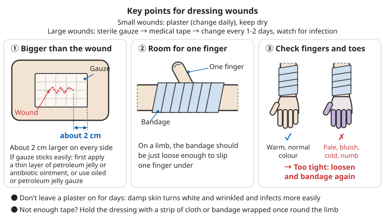
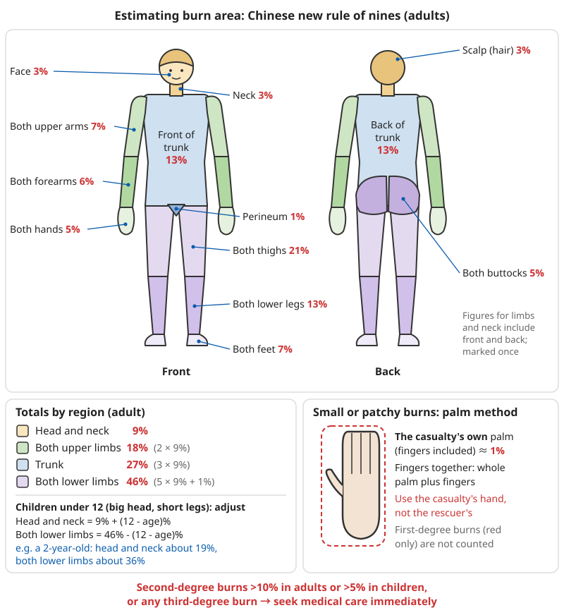

# Wound and Injury Care

## Contents
- [Cuts and grazes](#cuts-and-grazes)
- [Scalds and burns](#scalds-and-burns)
- [Frostbite](#frostbite)
- [Bites](#bites)
- [Puncture wounds](#puncture-wounds)
- [Bruises and contusions](#bruises-and-contusions)

```
⚠️ What this chapter is for:
- This chapter covers what to do between the injury and seeing a doctor,
  and home care for small wounds
- Severe bleeding, large burns, venomous snakebites and injuries that may
  have reached internal organs: call 120 first, then give on-the-spot care
  as described here. Do not delay getting to hospital because "I can handle it myself"
- The medicines mentioned are common over-the-counter drugs; follow the
  package leaflet and your doctor's advice for use and dose
- Wash your hands before treating someone else's wound, and wear gloves if you can
  (so you do not pass germs to them, and their blood does not reach you)
```

For stopping severe bleeding (direct pressure, tourniquet) see [Basic First Aid – Stopping bleeding](00-basic-first-aid.md#stopping-bleeding). If the casualty turns pale, breaks into a cold sweat and has a fast, weak pulse, follow [Treating shock](00-basic-first-aid.md#managing-shock).

---

## Cuts and grazes

### Types of wound

**Minor wounds**:
- Shallow, little bleeding
- Clean, straight edges
- Less than 2 cm long
- Can be treated at home

**Wounds that need a doctor**:
- Deeper than 0.5 cm
- Longer than 2 cm
- Heavy bleeding that will not stop
- Ragged edges
- Badly contaminated with dirt
- Special areas (face, joints, palm)

Some wounds look small but still need a doctor:

| Situation | Why see a doctor |
|------|------|
| The wound gapes and you can see yellow, grainy fat, red muscle, or white tendon or bone | It has gone through the skin; it usually needs stitches |
| After a cut to a finger or palm, a finger cannot straighten or bend, or the fingertip is numb | A tendon or nerve may be cut; it needs surgical repair as early as possible |
| Bleeding has not stopped after 10 minutes of pressure, or blood spurts out in pulses | An artery may be injured |
| A knife, glass or similar has gone into the chest, abdomen or neck | Internal organs and large blood vessels may be injured, even if the wound is small |
| Glass splinters, wood fragments or grit in the wound cannot be washed out | A foreign body left inside causes repeated infection |
| Bitten by an animal or a person | Risk of infection and rabies; see [Bites](#bites) in this chapter |
| The injured person has diabetes, takes anticoagulants (blood thinners) or has weak immunity | Bleeding may not stop, and infection is more likely |

#### Which wounds need stitches, and when

```
Wounds that usually need stitches (or medical glue or skin staples):
- The wound gapes; the two edges of skin do not close on their own
- Longer than about 1-2 cm and reasonably deep
- On the face, lips or eyelids (affects appearance and function)
- Over a joint, where the wound opens every time the joint moves

Time window:
- Ideally stitched within 6-8 hours of the injury
- The face and scalp have a good blood supply; this can stretch to about 24 hours
- For late or very dirty wounds the doctor may clean and dress them for a few days
  first and stitch later (delayed closure). This is not neglect; it avoids
  sealing bacteria inside

Small, clean cuts with straight edges (e.g. a kitchen knife cut on a fingertip):
✓ After stopping the bleeding and rinsing, pull the two edges together with
  wound-closure strips (butterfly strips)
✓ Lay strips across the wound about 3-5 mm apart, just enough to line the
  edges up naturally; do not pull too tight
❌ Do not seal bites, dirty wounds or puncture wounds with strips; let them drain

❌ Do not stitch a wound yourself with needle and thread: stitching needs thorough
   cleaning and local anaesthetic first. Home stitching often traps bacteria inside
   the wound and causes deep infection
```

### Steps

#### 1. Stop the bleeding

```
Minor bleeding:
1. Rinse with clean water
2. Press with clean gauze for 5-10 minutes
3. Raise the injured part (above the heart)

Severe bleeding:
1. Apply pressure immediately
2. Keep pressing for at least 10 minutes
3. If heavy limb bleeding cannot be controlled by pressure, use a tourniquet (last resort)
4. Call for emergency help
```

How to stop bleeding:

```
✓ Fold a whole piece of gauze or clean cloth into a thick pad, put it directly on
  the bleeding point and press firmly with the palm of your hand
✓ Do not lift it to look while pressing (each time you lift it, the fresh clot is pulled off)
✓ If blood soaks through, add another layer on top and keep pressing;
  do not remove the first layer
✓ No gauze: a clean towel, T-shirt or sanitary pad will do; if there is nothing,
  press with your bare hand
✓ Oozing from a small wound is normal; stop it, then clean it. For severe bleeding,
  stop the bleeding first and leave the cleaning to the hospital

⚠️ Use a tourniquet only when severe bleeding from a limb cannot be controlled by
   pressure and is life-threatening; note the time
⚠️ People taking aspirin, clopidogrel, warfarin or similar drugs bleed for longer;
   press for twice as long. If it still does not stop, see a doctor
```

For how to use a tourniquet see [Basic First Aid – Tourniquet](00-basic-first-aid.md#4-tourniquet-last-resort).

#### 2. Clean the wound

```
Steps:
1. Wash your hands (or put on medical gloves)
2. Rinse the wound under running water for at least 5 minutes
3. Remove visible dirt
4. Clean the surrounding skin with mild soapy water
5. Rinse again with clean water

Note:
❌ Do not pour alcohol directly into the wound (it hurts and damages tissue)
❌ Do not let cotton wool touch the wound directly (fibres get left behind)
✓ Povidone-iodine can be used as a disinfectant
```

**Rinsing is the most important step in preventing wound infection**, more important than any medicine you put on it. Bacteria and grit are carried away by the amount and force of the water:

```
How much water:
- Small grazes and small cuts: rinse for at least 5 minutes, or use 0.5-1 L of water
- Larger, dirtier wounds: use several litres, until no grit is visible and the
  wound looks pale and clean
- Animal bites: rinse for at least 15 minutes (see "Bites" in this chapter)

What water:
✓ Drinkable tap water, bottled water, or water boiled and cooled all work about
  as well as saline
✓ Homemade saline: 9 g of table salt (about 1.5 level teaspoons) in 1 L of cooled boiled water
❌ Do not rinse a wound with untreated river, pond or well water

How to get enough force:
- Hold the wound under the tap with the water at medium flow; do not blast it so
  hard that the tissue is torn up
- No tap water: squirt with a syringe (20-50 mL) without a needle;
  or make a small hole in a clean plastic bag or a water-bottle cap, fill with
  water and squeeze to make a thin jet
- While rinsing, gently wipe off stuck-on dirt with clean gauze

Removing embedded grit and fragments:
✓ Pick them out with tweezers that have been boiled or wiped with alcohol
✓ If they will not come out or there are many → see a doctor; they will
  numb the area and clean it out
```

For making saline see [Disinfectants – Saline](../../../docs/06-制药技术/01-消毒剂制备.md#72-配制); for what to do in the wild without clean water see [Wilderness Casualty Care and Evacuation – Wounds](../03-wilderness-survival/11-wilderness-casualty-care-and-evacuation.md#wounds).

#### 3. Disinfect

```
Recommended disinfectants:
- Povidone-iodine (first choice): apply from the centre of the wound outwards
- Hydrogen peroxide: removes dirt; bubbling is normal
- 75% alcohol: only on the surrounding skin; avoid direct contact with the wound
```

```
✓ Povidone-iodine is mild and can go straight on the wound; one application is
  enough, no need to paint on a thick layer again every day
⚠️ Use hydrogen peroxide (3%) only once, on a very dirty wound, to help lift out dirt,
   then rinse it off with clean water; it also damages new tissue. Do not use it
   every day, and do not use it on deep wounds or wounds that have started to heal
⚠️ People with iodine allergy or thyroid disease, pregnant women and newborns
   should avoid using povidone-iodine over large areas for long periods
❌ Do not apply gentian violet, mercurochrome (merbromin), toothpaste, plant ash,
   incense ash, tobacco or sugar
   (some are toxic, some carry germs, some make a hard scab that hides infection)
```

#### 4. Dress the wound

```
Small wounds:
- Adhesive plaster (change daily)
- Keep dry

Large wounds:
1. Cover with sterile gauze
2. Secure with medical tape
3. Change every 1-2 days
4. Watch for signs of infection
```

```
Key points for dressing:
✓ The dressing should be about 2 cm bigger than the wound on every side
✓ If the wound tends to stick to gauze, first apply a thin layer of petroleum jelly
  or antibiotic ointment, or use a non-stick dressing (paraffin gauze, Vaseline gauze)
✓ A bandage on a limb should be loose enough to slide one finger under;
  after bandaging, check the fingers or toes: pale, blue, cold or numb
  → too tight; loosen and re-bandage
✓ Do not leave a plaster on for days: damp skin turns white and wrinkled
  and is more likely to get infected
```



*Figure: Dressing size, bandage tightness and the check after bandaging*

### Changing dressings

```
1. Wash your hands
2. Gently lift off the old dressing (soak it with warm water first)
3. Check the wound
4. Rinse gently with clean water
5. Disinfect again
6. Cover with new sterile gauze
7. Secure it
```

#### How often to change

| Situation | How often to change |
|------|------|
| Clean small wound, dressing dry | Once a day; once the wound has closed (usually after 2-3 days) it can be left uncovered |
| Lots of fluid, dressing soaked | Change whenever wet, possibly 2-3 times a day |
| Dressing wet with water or dirty | Change immediately |
| Already infected, with pus | 1-2 times a day, and see a doctor as soon as possible |
| Stitched wound | As the doctor instructs; usually keep dry for 24-48 hours, after that a short shower is fine; dry it and change the dressing afterwards |

What to look for when changing:

```
Check at every change:
- The area of redness and swelling around the wound: bigger or smaller than last time?
  (you can draw a line with a pen along the edge of the redness to compare)
- Discharge: clear pinkish or pale yellow fluid is normal; cloudy, yellow-green
  or foul-smelling discharge means infection
- Pain: getting less each day is normal; getting worse each day is a warning

If the dressing is stuck:
✓ Soak it with cooled boiled water or saline for a few minutes, and peel it off
  slowly once it has softened
❌ Do not rip it off dry: you will tear off the new tissue and it will bleed again
```

#### When you have no ready-made dressings

```
✓ Cut clean pure-cotton cloth (old sheets, T-shirts) into pieces, boil for 10 minutes,
  then air-dry or iron dry with a hot iron before use
✓ Store wrapped in a clean plastic bag or paper; hold only by the corners when using
✓ Sanitary pads and new disposable nappies can serve as absorbent dressings in an
  emergency (the side that touches the wound is clean)
✓ If you run out of tape, tie a strip of cloth or bandage once around the limb to hold it
❌ Do not cover a wound directly with cotton wool or tissue paper (fibres stick in the wound)
❌ Do not reuse dressings; bag up or burn dressings with blood or pus on them
```

### Special care for grazes

**"Dirty grazes"** (e.g. from a fall on the ground):
```
1. Careful cleaning is essential!
2. Gently brush out embedded grit with a soft brush
3. If you cannot get it all out, you must see a doctor
4. This prevents "traumatic tattooing" and infection
```

```
Caring for grazes:
✓ A graze that is large but shallow: once rinsed clean, apply a thin layer of
  petroleum jelly and cover with a non-stick dressing. A wound kept moist heals
  faster and scars less than one left to dry into a hard scab
✓ Scrubbing hurts; pour cold water over the wound for a few minutes before
  brushing. Children may need to have it done in hospital
⚠️ Large grazes on the face with a lot of embedded grit → see a doctor; it must be
   cleaned out within 24 hours to avoid a permanent "black tattoo"
```

### Stages of wound healing

**Normal healing**:
- Days 1-2: slight swelling, mild pain
- Days 3-7: scab forms, itching
- Days 7-14: scab falls off, new skin forms

**Note**:
- Do not pick the scab (it will scar)
- Keep it moderately moist (helps healing)
- Avoid direct sunlight

```
Things that slow healing:
- Old age, diabetes, smoking, poor nutrition (not enough protein and vitamin C),
  long-term steroid use
  → slower healing and higher infection risk; check the wound more often
- Repeated strain on the wound: reduce movement of wounds over joints;
  use a splint if needed

After the wound has healed:
✓ New skin tans easily for 6 months; cover it or use sunscreen outdoors to reduce
  dark marks
✓ Red, itchy, raised scars are common; most flatten and fade over six months to a year
```

### ⚠️ Signs of infection (see a doctor immediately)

- Redness and swelling spreading
- Pain getting worse
- The area is hot to the touch
- Yellow or green pus
- Red streaks spreading out from the wound
- Fever

Infection usually appears 1-3 days after the injury. This table helps tell a normal reaction from infection:

| | Normal healing | Infection |
|------|------|------|
| Redness and swelling | A narrow pink band (a few mm) along the wound edge, fading day by day | Redness more than about 1-2 cm wide, bigger each day |
| Pain | Less each day | Gets worse from day 2-3, throbbing |
| Discharge | A little clear or pinkish fluid | Cloudy, yellow-green pus, foul-smelling |
| Skin temperature | About the same as surrounding skin | Clearly hot to the touch |
| Whole body | No symptoms | Fever, chills, weakness |

```
What to do about infection:
1. See a doctor soon: an infected wound usually needs antibiotics prescribed by a doctor;
   an abscess needs to be cut open and drained
2. While waiting to see a doctor: change the dressing daily, replace dirty dressings
   promptly, and raise the injured limb
3. Draw a line with a pen along the edge of the redness and write the time;
   compare a few hours later. If it spreads fast (clearly bigger within hours),
   treat it as an emergency
❌ Do not squeeze out pus yourself; it pushes bacteria deeper into the tissue
❌ Do not take leftover antibiotics from home (wrong type and dose, and they hide the illness)
```

#### Danger signs of whole-body infection (call 120 immediately)

```
If an infected wound comes with any of the following, the infection may have spread
through the body (sepsis):
- High fever (≥39°C), or a temperature below 36°C, with shivering
- Fast heartbeat (adult at rest >100 beats/min), fast breathing
- Confusion, slow responses, extreme weakness
- Passing much less urine
- Mottled skin, ice-cold hands and feet

If the wound shows any of the following, it may be a serious deep infection;
also see a doctor immediately:
- Severe pain, out of proportion to how the wound looks
- The skin around the wound turns purple-black or forms blood blisters
- Pressing around the wound gives a crunching feeling like squeezing snow
  (gas under the skin), with foul-smelling discharge
```

### Tetanus prevention

**High-risk wounds**:
- Dirty wounds
- Deep puncture wounds
- Animal bites
- Contaminated with soil
- Not treated for more than 6 hours

**Tetanus vaccine**:
```
Fully vaccinated (≥3 doses):
- Clean minor wound: more than 10 years since last dose → one booster dose
- Dirty/high-risk wound: more than 5 years since last dose → one booster dose
- Immunoglobulin usually not needed

Not vaccinated, history unknown, or fewer than 3 doses:
- Clean minor wound: give the vaccine (and complete the full course)
- Dirty/high-risk wound: vaccine + tetanus immunoglobulin (or antitoxin)
```

Tetanus is caused by toxin from *Clostridium tetani*, which multiplies in wounds without oxygen. Once the disease develops the death rate is high, but it is **entirely preventable by vaccination**. High-risk wounds also include burns, frostbite, open fractures, wounds with dead tissue or foreign bodies, and injuries received in farm fields, animal pens or on building sites.

#### How to tell how many doses you have had

```
- The DTaP (diphtheria-tetanus-pertussis) vaccine in China's childhood immunisation
  programme contains tetanus: from 2025, one dose of DTaP at 2, 4, 6 and 18 months
  of age and at 6 years; before that, 4 doses of DTaP at 3, 4, 5 and 18 months plus
  1 dose of DT (diphtheria-tetanus) at 6 years. People who had them all on time count
  as fully vaccinated, but adults are usually more than 10 years past their last dose
- Most adults cannot say what they have had → treat as "history unknown"
- People who served in the army or had a full tetanus course: bring the vaccination
  record to show the doctor
- Keep the certificate after every vaccination and write it in the family health record

Timing:
✓ The sooner the better, ideally within 24 hours of the injury
✓ After more than 24 hours, even several days, you should still get it as long as
  the disease has not started
⚠️ Tetanus antitoxin (TAT) is made from horse serum and needs a skin test first;
   immunoglobulin does not. The doctor chooses which
```

#### Early symptoms of tetanus

```
The incubation period is usually 3-21 days; the closer the wound is to the head,
the shorter the incubation and the more severe the illness
Early signs:
- Difficulty opening the mouth, tight chewing muscles ("lockjaw")
- Stiff facial muscles, like a forced grin
- Stiff neck and back
- Later, bouts of muscle spasms all over the body, set off by sound, light or touch
⚠️ Difficulty opening the mouth or a stiff neck in the days or weeks after an injury
   → see a doctor immediately and tell them about the injury
   (the wound may have healed long ago, or even been forgotten)
```

---

## Scalds and burns

```
⚠️ Make sure it is safe before you help:
- Clothes on fire: "Stop, drop and roll" – stop running, lie down, cover your face
  with your hands and roll back and forth; bystanders smother the flames with a thick
  blanket or coat, working from head towards feet. Do not use synthetic fabrics
- Electrical burns: cut the power first; chemical burns: protect yourself from the chemical first
- Move casualties from a fire to fresh air first, and check whether they have inhaled smoke
```

For escaping a fire see [Fire](../02-disaster-response/04-fire.md); for preventing scalds in children see [Child Safety – Preventing burns and scalds](14-child-safety.md#preventing-burns-and-scalds).

### Burn depth

#### First-degree burns (superficial)
- **Symptoms**: red, painful skin, no blisters
- **Affects**: the outer layer of skin (epidermis) only
- **Healing**: 3-5 days, no scar
- **Example**: mild sunburn

#### Second-degree burns (moderate)
- **Superficial second-degree**:
  - Red, swollen, very painful, large blisters
  - Base is red and moist
  - Heals in 1-2 weeks, may leave a slight scar
- **Deep second-degree**:
  - Base is pale, or mottled red and white
  - Less painful (nerves damaged)
  - Heals in 3-4 weeks, may leave an obvious scar

#### Third-degree burns (severe)
- **Symptoms**: skin charred black or waxy white, painless (nerves completely destroyed)
- **Affects**: the full thickness of the skin and the tissue below
- **Healing**: needs a skin graft, obvious scarring
- **Must see a doctor**: this is a serious burn

```
A quick on-the-spot test of depth:
- Press the burn lightly with a clean cotton bud or finger, then release:
  quickly turns red again (fast capillary refill) and very painful → usually superficial
  colour does not change, feeling dulled or absent → may be deep second- or third-degree
- In the first 24-48 hours a burn "deepens": what looks superficial second-degree at first
  may be deep second-degree the next day → if in doubt, assume it is more serious
- Boiling water and hot oil usually cause superficial burns; flames, hot metal,
  electricity and chemicals often burn deeper
```

### Estimating burn area

**Palm rule**:
- The casualty's own palm (including fingers) ≈ 1% of body surface area

**Serious burns** (see a doctor immediately):
- Adults: second-degree burns >10% of body surface area
- Children: second-degree burns >5% of body surface area
- Any third-degree burn
- Burns to the face, hands, feet, genitals or joints

```
How to use the palm rule:
- Use the casualty's hand, not the helper's (a child's hand is small, so a child's 1% is small too)
- Fingers together: the whole palm plus fingers is about 1%
- First-degree burns (redness only) do not count towards the area
- For scattered small burns, estimate each patch and add them up
```

#### Using the rule of nines for large burns

For large burns, measuring palm by palm is too slow; estimate by body region instead (the "Chinese new rule of nines" commonly used in China):

| Region | Adult share of body surface area |
|------|------|
| Head and neck (scalp, face, neck 3% each) | 9% |
| Both arms (upper arms 7%, forearms 6%, hands 5%) | 18% (2 × 9%) |
| Trunk (front 13%, back 13%, perineum 1%) | 27% (3 × 9%) |
| Both legs (buttocks 5%, thighs 21%, lower legs 13%, feet 7%) | 46% (5 × 9% plus 1%) |

```
Children have larger heads and shorter legs; adjust (under 12 years):
- Head and neck = 9% + (12 - age)%
- Both legs = 46% - (12 - age)%
Example: a 2-year-old: head and neck about 19%, both legs about 36%
→ the same scald to the head and face covers a much larger share of a child's body than an adult's
```



*Figure: Body surface area of each region by the rule of nines, and the palm rule*

#### Airway burns (more dangerous than area)

```
A fire in an enclosed space, or breathing in hot air or thick smoke, can burn the airway
even when the skin burns are not severe. Within hours the throat swells and blocks
the airway. Call 120 immediately if there is any of the following:
- Burns to the face or around the mouth and nose, singed nose hairs
- Red or blistered mouth or throat, black soot in the spit
- Hoarse voice, coughing, rattling or wheezing breath, difficulty breathing
- Difficulty swallowing, drooling
⚠️ Go to hospital for observation even if breathing is normal now;
   swelling may appear only hours later
```

Fires are often combined with carbon monoxide poisoning; see [Home and Traffic Accidents – Carbon monoxide poisoning](07-home-and-traffic-accidents.md#carbon-monoxide-poisoning).

### Emergency care: "Cool, Remove, Soak, Cover, Transport"

#### 1. Cool – run under cold water

```
Time: at least 15-20 minutes
Water temperature: 15-25°C (tap water is fine)
Method: gentle running cold water

Effects:
✓ Lowers the local temperature
✓ Relieves pain
✓ Limits further tissue damage

Do not:
❌ Put ice directly on the burn (can cause frostbite)
❌ Soak large burns in cold water for a long time (risk of hypothermia)
❌ Smear on soy sauce, toothpaste or the like
```

```
More points:
✓ The sooner the better, but cooling started within 3 hours of the burn still helps
  – cool it even if you are late
✓ Cool for the full time: many people stop after a minute or two once it stops hurting,
  but the heat keeps working its way deeper after they stop
✓ No tap water: keep pouring clean cool water over it, or soak it in a basin and change
  the water when it warms up; or use cold wet towels, changing every 1-2 minutes
✓ Cool only the burned area; keep the rest of the body covered with clothes or a blanket

⚠️ Babies, young children, older people and anyone with burns over more than about 10%
   get hypothermia very easily: cool only the burned area and watch closely; if they
   shiver, their lips turn blue or their skin feels cold, stop cooling and warm them at once
⚠️ While cooling, have someone else call 120; do not delay going to hospital just to
   finish the cooling time – keep applying cold compresses while waiting for the
   ambulance or on the way
```

#### 2. Remove – take off clothing carefully

```
✓ Carefully cut clothing away while cooling with water
✓ Take it off gently
✓ If clothing is stuck to the skin, do not pull it off by force
✓ Leave the stuck parts for the hospital to deal with
✓ Remove rings, watches and similar (before swelling traps them)
```

```
✓ Clothes soaked with hot water or soup keep burning; take them off quickly. Cut
  pullovers off with scissors; do not pull them over the head (this tears blisters on the face)
✓ Take off a nappy soaked with hot water immediately too
✓ Remove rings, bracelets and shoes before swelling starts; once swollen they can only be cut off
```

#### 3. Soak – keep soaking in cold water

```
Time: 10-30 minutes
or until the pain is clearly less

Note:
- Do not soak too long when the burn is large (risk of hypothermia)
- Keep the water temperature steady
```

#### 4. Cover – cover and protect

```
Materials:
✓ Clean, damp gauze or cloth
✓ Cling film (lay it on loosely, do not wrap it round)

Do not:
❌ Apply any ointment, grease, soy sauce or toothpaste
❌ Burst blisters
❌ Apply coloured substances (they make it harder for the doctor to assess the burn)
```

```
✓ Throw away the first one or two turns of cling film (may not be clean); lay it gently
  along the limb. Do not wrap it tightly round and round – burned limbs swell, and a tight
  wrap cuts off the circulation
✓ A burned hand can go inside a clean plastic bag; keep the fingers from touching each other
✓ For facial burns do not cover the mouth and nose; keep the airway clear
✓ Keep the person warm once covered; people with large burns lose body heat very fast
```

#### 5. Transport – get medical care quickly

```
See a doctor for:
- Large second-degree burns
- Third-degree burns
- Burns to the face, hands, feet, genitals or joints
- Burns in children or older people
- Chemical or electrical burns
```

```
Also:
- Signs of smoke inhalation or airway burns (see above)
- Burns that go all the way round a limb or the trunk (swelling tightens and affects
  circulation or breathing)
- Pregnant women, or people with diabetes, heart disease or other chronic illness
- Scalds suspected to be from abuse of a child or older person
- A small burn treated at home shows signs of infection after 2-3 days, or has not
  healed after 2 weeks

On the way to hospital:
✓ Have the casualty lie flat and keep them warm
✓ People with large burns get thirsty. If you have called 120 and help will take a long
  time (more than 1 hour), an adult who is alert, can swallow and is not vomiting may take
  small, frequent sips of oral rehydration salts (ORS) or weak salt water;
  do not give lots of plain water, and no alcohol
✓ If you can reach the hospital, tell them the burn area, location and cause in advance
  so they can prepare
```

For making oral rehydration salts see [Common Illnesses – Diarrhoea](01-common-illnesses.md#diarrhoea).

### Home care for small, minor scalds

**When**: first-degree, or small superficial second-degree (diameter <2 cm)

**What to do**:
```
1. Cool/soak thoroughly in cold water
2. Once clean and dry, apply:
   - Petroleum jelly or aloe vera gel (keeps moist, relieves pain)
   - Antibiotic ointment if the skin is broken or there is a risk of infection
   - Silver sulfadiazine only on a doctor's advice: not on the face; must not be used
     by pregnant women or on babies under 2 months
3. Cover with sterile gauze (optional)
4. Change the dressing 1-2 times a day
```

```
✓ For marked pain take paracetamol (acetaminophen) or ibuprofen, at the dose on the leaflet
✓ First-degree burns and sunburn: cold compresses and moisturiser are enough; drink plenty;
  do not scratch when it itches and peels
✓ Keep newly healed skin out of strong sun for six months
⚠️ For a scald in a baby or young child, even a small one, it is best to have a doctor look at it once
```

**Blisters**:
```
Small blisters (<5 mm):
- Do not burst
- Let them be absorbed naturally

Large blisters (>5 mm):
- Best treated by a doctor
- If you must deal with it yourself:
  1. Disinfect the blister and the skin around it
  2. Pierce the edge with a sterile needle
  3. Press gently to drain the fluid
  4. Leave the blister skin in place (it protects)
  5. Disinfect and cover
```

```
If a blister has burst:
✓ Rinse gently with cooled boiled water or saline
✓ Lay the blister skin back down where possible, as a natural dressing
✓ Apply a thin layer of petroleum jelly, cover with a non-stick dressing, change daily
❌ Do not tear off the blister skin; do not apply gentian violet or other coloured remedies
```

### Special burns

#### Chemical burns

```
Immediate action:
1. Quickly remove contaminated clothing
2. Rinse continuously with plenty of clean water for at least 30 minutes
3. Do not try to neutralise the chemical
4. See a doctor immediately, taking information about the chemical

Note:
- Quicklime: brush it off first, then rinse
- Concentrated sulphuric acid: blot with a dry cloth first, then rinse
```

```
More points:
✓ Helpers put on gloves first (or plastic bags if none); do not touch the chemical directly
✓ Concentrated sulphuric acid: quickly blot the acid off the surface with a dry cloth, taking
  only a few seconds and without rubbing, then immediately rinse with lots of water;
  use plenty of water – too little water releases heat and makes the burn worse
✓ Alkalis (quicklime, caustic soda, wet cement) penetrate deeper than acids; even if it looks
  mild, rinse for the full time – an hour is better; rinse until the skin no longer feels slippery
✓ Make the water run away from other parts of the body and from the eyes; do not let
  contaminated water run onto healthy skin
✓ Take the chemical's packaging or label to hospital; if you do not know what it is,
  take the container

⚠️ Burns from these chemicals need a doctor immediately; rinsing alone is not enough:
- Hydrofluoric acid (glass etching liquid, rust removers, some cleaning agents): may not hurt
  at first, then severe pain hours later; it can damage deep tissue and bone and cause
  whole-body poisoning
- Phenol (carbolic acid), and large burns from strong acids or alkalis
❌ Do not use vinegar to "neutralise" an alkali or baking soda to "neutralise" an acid –
   neutralisation gives off heat, worsens the burn and delays rinsing
```

For chemicals splashed in the eyes see [Foreign Bodies – Chemicals in the eye](04-foreign-bodies-and-choking.md#chemicals-in-the-eye-emergency); for protection at a chemical spill see [Man-made Disasters – Chemical spills](../02-disaster-response/05-man-made-disasters.md#chemical-spills).

#### Electrical burns

```
1. Cut off the power (do not touch the casualty directly)
2. Check heartbeat and breathing
3. CPR if needed
4. All electrical burns need a doctor (internal damage can be serious)
```

```
✓ Current has an "entry" and an "exit" point; find and treat both, usually on the hands and feet
✓ There may be only a small burn mark on the skin while the muscles, blood vessels and
  nerves beneath are badly damaged
✓ Abnormal heart rhythms can follow an electric shock; even if the person feels fine,
  go to hospital for an ECG
```

For cutting the power and rescue at the scene of an electric shock see [Acute Symptoms – Electric shock](05-acute-symptoms.md#electric-shock-injuries).

### Preventing infection

```
✓ Keep the wound clean
✓ Change dressings regularly
✓ Watch for signs of infection
✓ Avoid scratching
✓ Eat well (protein, vitamin C)
```

```
Signs a burn is infected:
- Redness and swelling around the wound spreading, pain getting worse again
- Discharge turning cloudy, yellow-green, foul-smelling
- A wound that was superficial turns darker and deeper
- Fever, low energy; children irritable or unusually sleepy
→ See a doctor soon. The larger the burn, the more dangerous infection is
✓ People with large burns need far more protein and energy than usual; eat plenty of
  eggs, meat and soya products
```

### ❌ Common mistakes

- Smearing on toothpaste, soy sauce, vinegar or alcohol
- Smearing on grease or sesame oil
- Putting ice directly on the burn
- Sprinkling on salt, sugar and the like
- Applying coloured remedies

These can:
- Worsen the damage
- Increase the risk of infection
- Make it harder for the doctor to assess
- Increase scarring

| Common practice | Why it is wrong |
|------|------|
| Toothpaste to "cool" it | The cool feeling is an illusion from the mint; toothpaste traps heat, does not cool, carries germs and is hard to clean off |
| Soy sauce or vinegar | Irritates the wound; the colour hides the depth from the doctor; increases infection |
| Sesame oil, lard or badger oil | Oil traps heat, letting the burn go deeper; it must be scraped off in hospital, which is very painful |
| Ice, or long soaks in ice water | Local frostbite, more tissue death; hypothermia when the burn is large |
| Plant ash, soot from the bottom of a pot, yellow earth | Carry germs, easily cause infection, including tetanus |
| Long-term use of medicated burn creams on your own | Unnecessary, and may delay seeing a doctor; for minor scalds petroleum jelly or aloe vera gel is enough |

---

## Frostbite

```
Frostbite is damage from tissue freezing. It usually happens below 0°C, in wind, or in
damp clothing; alcohol, tiredness, hunger, smoking, diabetes and tight shoes or socks
all increase the risk.
Frostbite and hypothermia often occur together: treat the hypothermia (whole body) first,
then the frostbite (local).
```

For recognising and treating hypothermia see [Acute Symptoms – Hypothermia](05-acute-symptoms.md#hypothermia); for hypothermia outdoors see [River Crossing, Flash Floods and Hypothermia](../03-wilderness-survival/08-river-crossing-flash-floods-and-hypothermia.md#not-only-in-winter-hypothermia-outdoors); for preventing frostbite in snow see [Snow and Polar Survival – Frostbite](../03-wilderness-survival/04-snow-and-polar-survival.md#frostbite).

### Degrees of frostbite

**First degree**: skin red, swollen, stinging
**Second degree**: blisters form
**Third degree**: tissue dies, turns black
**Fourth degree**: reaches the bone

When first frozen, all degrees look much the same (pale, hard, numb). **The true depth only becomes clear 1-2 days or more after rewarming**:

| Degree | Appearance after rewarming | Outcome |
|------|------|------|
| Frostnip (warning stage) | Skin white and numb; recovers fully after rewarming, no blisters | No lasting damage |
| First degree | Red, swollen, stinging, itchy | Recovers in about 1 week, may peel |
| Second degree | Clear blisters within 24 hours, with redness and swelling around them | Heals in 2-3 weeks, usually no obvious lasting damage |
| Third degree | Blood blisters (dark red fluid), skin purple-black | Skin and tissue below it die; needs a doctor |
| Fourth degree | Skin blue-purple, black, dry and hard, no feeling, no blisters | Reaches muscle and bone; dead parts may need to be amputated |

```
Frostnip is the most common stage and the one to catch:
- White patches on the ears, tip of the nose, cheeks or fingers, cold to the touch, numb
- Companions should check each other's faces and act at once if they see white patches
- What to do: cover with your own hand, put fingers in your armpits, breathe on your fingers;
  colour returns in a few minutes
  (it is not frozen yet; warmth is enough – do not rub)
```

### Most vulnerable areas

- Fingers, toes
- Nose, ears
- Cheeks

### Rewarming

#### Mild frostbite (first degree)

```
1. Move to a warm place
2. Remove wet, cold clothing
3. Rewarm by soaking in warm water:
   - Water temperature: 37-39°C (warm, not hot to the hand)
   - Time: 15-30 minutes
   - Until the skin is pink and soft again
4. Pat dry gently
5. Keep warm

Do not:
❌ Use hot water
❌ Warm it at a fire
❌ Rub or massage it
❌ Walk on it after frostbite (frostbitten feet)
```

```
Controlling water temperature without a thermometer:
- The helper tests it with the elbow or inner wrist: it should feel "warm, comfortable
  to keep your arm in"
- The frostbitten part has no feeling; do not let the casualty test the water, or they
  may easily scald themselves
- The frozen part cools the water; keep adding hot water to hold the temperature, taking
  the limb out while you add it

❌ Do not rub with snow (an old, wrong method that makes frostbite worse)
❌ Do not warm it directly at a fire, radiator or hot-water bottle – numb skin cannot feel burning
```

#### Severe frostbite (second degree and above)

```
If you can reach medical care quickly:
1. Keep the frozen part still, wrap it up and keep warm
2. Go to hospital immediately and let them rewarm it

If you cannot get medical care in time (wilderness, remote areas):
1. As long as you can be sure it will not refreeze after rewarming, rewarm as soon as possible
   - Soak in 37-39°C warm water until the skin softens and its colour returns (usually about 30 minutes)
   - Rewarming is very painful; painkillers can be taken
2. After rewarming, dress with dry gauze, with gauze between fingers and toes
3. Do not burst blisters
4. Raise the injured part to reduce swelling

⚠️ If it might refreeze after rewarming, it is better to leave it frozen and rewarm once
   you reach a safe place (damage from repeated freezing and thawing is worse than staying frozen)
```

```
Care after rewarming:
✓ For pain, ibuprofen can be used (it also has some anti-inflammatory effect), at the dose on the leaflet
✓ Check daily; keep dry and clean, bandage loosely
✓ After rewarming frostbitten feet, avoid walking as far as possible; if the person must
  be moved, use a stretcher or carry them
✓ Do not cut off black, dead parts yourself; the boundary between dead and living tissue
  takes weeks to become clear – leave it to a doctor
✓ Stop smoking and drinking (they narrow the blood vessels)
⚠️ Frostbite wounds also carry a tetanus risk; see "Tetanus prevention" in this chapter
```

### Prevention

```
✓ Wear several layers
✓ Keep dry
✓ Cover exposed skin
✓ Avoid tight clothing
✓ Move your limbs regularly
✓ Avoid alcohol and smoking
```

```
More:
✓ Mittens are warmer than gloves; carry a spare pair of dry socks and gloves
✓ Leave room in shoes to wiggle your toes; if wearing two pairs of socks, wear larger shoes
✓ Do not touch metal or petrol with bare hands below freezing (evaporating petrol
  removes heat very fast and causes frostbite)
✓ Eat enough and drink enough hot water; when you feel numbness, stop and deal with it
  at once – do not "keep going a bit longer"
```

### Chilblains and immersion foot (not frostbite)

Both are cold injuries **without freezing**, and both are far more common than frostbite:

| | Chilblains | Immersion foot ("trench foot") |
|------|------|------|
| Cause | Repeated exposure to damp cold at 0-10°C (common in southern China in winter, where homes are unheated) | Feet left for a long time (more than ten-odd hours) in cold, wet shoes and socks, e.g. in floods, rainy seasons, wet boots |
| Signs | Purplish-red swollen lumps on fingers, toes or ears that itch and burn when warmed; may blister and ulcerate | Feet white, wrinkled, swollen and numb; red and very painful after warming; in severe cases the tissue dies |
| Treatment | Keep warm and dry; do not warm at a fire or in hot water; do not scratch them open; if ulcerated, care for as a wound | Change to dry socks, dry the feet, raise them, rewarm slowly; do not massage; see a doctor if blisters or blackening appear |
| Prevention | Keep hands and feet warm, wear gloves, change wet socks often; stay reasonably active to help circulation | Dry your feet and change into dry socks at least once a day; dry off as soon as possible after long wading |

For protection during floods see [Floods](../02-disaster-response/02-weather-disasters.md#floods).

---

## Bites

### Animal bites

#### Immediate care

```
1. Rinse (important!):
   - Immediately rinse under running water for at least 15 minutes
   - Alternate with soapy water
   - Rinse deep into the wound
2. Disinfect:
   - Povidone-iodine or 75% alcohol
3. Cover with sterile gauze
4. See a doctor as soon as possible
```

```
How to rinse (following China's rabies post-exposure requirements):
1. Use soapy water (or another mildly alkaline cleanser) and running water with some
   pressure, alternating, to rinse every bite and scratch for at least 15 minutes
2. For deep wounds, gently open the wound so the water reaches deep inside;
   if possible, flush water into the wound with a syringe or irrigator
3. Then rinse off the soap with saline or clean water
4. Apply povidone-iodine to the wound (povidone-iodine inactivates rabies virus);
   use alcohol only on the surrounding skin
5. Do not bandage too tightly; cover with a clean dressing and go to a rabies
   post-exposure clinic as soon as possible

⚠️ Good rinsing greatly reduces the risk of rabies and bacterial infection,
   but it does not replace vaccination. Still get the injections after rinsing
⚠️ Rinse even small wounds with little bleeding – rabies virus does not need a big wound
❌ Do not squeeze the wound to "get the poison out", do not suck it, do not apply
   chilli, herbs or cigarette ash
```

#### Rabies prevention (critical!)

**High-risk animals**: dogs, cats, bats, foxes, wolves and the like

**Every bite or scratch from a mammal should be assessed for rabies risk!**
(Rodents such as rats and lagomorphs such as rabbits carry very little risk and usually do not need vaccination, but asking a doctor is still advised)

**Vaccination**:
```
When: the sooner the better; within 24 hours is best
Schedule: usually 5 injections
  - Day 0 (the day of the bite)
  - Day 3
  - Day 7
  - Day 14
  - Day 28

Severe bites: rabies immunoglobulin is also needed
```

**When vaccination is essential**:
- Bitten or scratched (skin broken) by a dog, cat, bat or other wild carnivore
- Broken skin licked by an animal
- Mucous membranes contaminated with animal body fluids

Once rabies symptoms appear, the death rate is almost 100% and there is no effective treatment; but **with prompt, proper care after exposure it can almost always be prevented**. The incubation period is usually 1-3 months, as short as under a week or as long as over a year, so **even days or weeks after a bite, as long as there are no symptoms, get vaccinated immediately**.

#### Exposure categories

China grades rabies exposure into three categories by type of contact, which decides the treatment:

| Category | Type of contact | Treatment |
|------|------|------|
| I | Touching or feeding animals; intact skin licked; intact skin in contact with animal secretions | Wash the area of contact; no injections needed |
| II | Bare skin nibbled (marks, no bleeding); minor scratches or abrasions without bleeding | Rinse and treat the wound + vaccination |
| III | Bites or scratches that break the skin (bleeding); broken skin licked; mouth, eyes or other mucous membranes contaminated with saliva; contact with bats | Rinse and treat the wound + vaccination + passive immunisation (rabies immunoglobulin or antiserum) |

```
More notes:
- If you cannot tell whether it is category II or III, treat it as III
- People with severely weakened immunity (e.g. on chemotherapy, long-term high-dose steroids)
  should treat category II as III
- Bites to the head and face, hands, genitals and other areas rich in nerves carry higher
  risk; act especially quickly
- Passive immunisation should be given as early as possible, at the latest within 7 days
  of the first vaccine dose; it is injected into and around the wound
- Bats have tiny teeth and their bites may not be visible; if you wake to find a bat in
  the room, or a child has been alone with a bat, treat it as category III and see a doctor

Another schedule (the four-dose schedule): 2 doses on day 0 (one in each upper arm),
1 on day 7, 1 on day 21.
The vaccination clinic decides which to use; once started, complete the same schedule on time.
```

#### Bitten again after previous vaccination

```
- Exposed again within 3 months of completing a full course: usually no further doses needed
- More than 3 months: one dose on day 0 and one on day 3; immunoglobulin usually not needed
- Did not finish a full course before, or cannot remember: treat as never vaccinated and start again
→ These are general principles; the rabies post-exposure clinic makes the final decision.
  Keep the record of every vaccination
```

```
Common myths:
❌ "Our dog is vaccinated, so I don't need the injections" – the animal's vaccination is not
   always effective; still treat according to the exposure category
❌ "Watch the dog for 10 days and only get injections if it gets sick" – do not delay
   vaccination to observe; start vaccination and observe the animal at the same time,
   and let the doctor decide whether you can stop early
❌ "Pregnant women and babies can't have the rabies vaccine" – rabies is fatal;
   pregnant and breastfeeding women, babies and young children, older people and people
   with chronic illness should all be vaccinated as normal; there are no contraindications
❌ "It's useless after 24 hours" – as long as there are no symptoms, get vaccinated at once
   whenever you discover the exposure
✓ If one dose is a few days late, there is no need to restart; give it as soon as possible
  and shift the later doses by the same intervals
```

#### Wound care principles

```
❌ Do not stitch (except special areas with shallow bites)
✓ Leave open to drain
✓ Watch closely for infection
✓ Antibiotics may be needed
```

```
- Animal mouths carry many bacteria; cat bites are especially prone to infection
  (cats' teeth are long and thin, so the wounds are deep). Cat and dog bites on the hand
  have a high infection rate, and usually need a doctor to decide on antibiotics
- Wounds on the face affect appearance; after thorough cleaning and immunoglobulin
  injection a doctor may stitch them
- Increasing redness, swelling, heat or pain, pus or fever within 24-72 hours of a bite
  → go back to the doctor immediately
- Animal bites also need a tetanus assessment; see "Tetanus prevention" in this chapter
- Bites from large dogs or wild boar may cause deep tears and fractures; deal with the
  bleeding and fractures first
```

For avoiding dogs, monkeys and wild boar outdoors see [Wasps, Ticks and Dangerous Animals – Wild boar, dogs, monkeys and others](../03-wilderness-survival/10-wasps-ticks-and-dangerous-animals.md#wild-boar-dogs-monkeys-and-others); for preventing diseases passed from farm animals to people see [Livestock](../../../docs/04-动植物培育/06-家畜养殖.md).

### Human bites

**Features**: high risk of infection (many bacteria in the mouth)

**What to do**:
```
1. Rinse thoroughly
2. Disinfect
3. You must see a doctor
4. Preventive antibiotics
5. Assessment for hepatitis B and HIV exposure
```

```
Watch especially for the "fight bite": when a fist hits someone's teeth in a fight,
there may be only a small cut over the knuckle, but the tooth may have pierced the joint;
infection then destroys the joint → if a small cut on a knuckle happened this way,
always see a doctor and say how it happened

Bites between children are mostly shallow; rinsing and disinfecting are enough.
If the skin is broken and bleeding, a doctor's assessment is still advised.
```

### Snakebites

#### Identifying venomous snakes

⚠️ **If you cannot be sure whether a snake is venomous, always treat the bite as a venomous snakebite!**

Judging by appearance is unreliable:
- A "triangular head" is not a reliable sign: highly venomous snakes such as the many-banded krait, banded krait and cobra have oval heads
- Bite marks can be a guide: 1-2 deep fang marks suggest a venomous snake, a row of small shallow tooth marks usually a non-venomous one – but this cannot rule out envenomation

**Common venomous snakes in China, by type of venom** (this affects on-the-spot care):
- **Neurotoxic**: many-banded krait, banded krait, sea snakes – few local symptoms, but drooping eyelids and difficulty swallowing and breathing can appear within hours
- **Haemotoxic/cytotoxic**: sharp-nosed pit viper (*wubushe*, "five-pace snake", Deinagkistrodon acutus), mamushi (Gloydius), bamboo pit vipers, brown-spotted pit viper (Protobothrops mucrosquamatus) – severe local pain and swelling, bleeding, tissue death
- **Mixed**: cobra, king cobra

```
Signs of envenomation (any one means venom has entered – every minute counts):
- Local: the wound keeps bleeding, swelling spreads quickly up the limb, severe pain,
  blood blisters, skin turning black
- Neurotoxic: eyelids cannot be lifted, double vision, slurred speech, drooling,
  difficulty swallowing, weak limbs, and finally difficulty breathing – locally there may be
  only slight numbness, without pain or swelling; this is the easiest to miss
- Haemotoxic: bleeding gums, nosebleeds, blood in the urine, large bruises under the skin,
  vomiting blood
- Whole body: nausea and vomiting, dizziness, cold sweat, palpitations

⚠️ No symptoms yet does not mean no envenomation: neurotoxic symptoms may appear only hours later.
   Everyone bitten should go to hospital for observation (usually at least 24 hours)
```

#### Emergency care

```
✓ Do:
1. Move away from the snake immediately
2. Stay calm and keep movement to a minimum
3. Remove jewellery (before swelling)
4. Keep the bitten limb still, at roughly the same level as the heart
5. Remember what the snake looks like (take a photo, but do not try to catch it)
6. Go to hospital immediately

❌ Do not:
- Cut the wound
- Suck out the venom
- Apply ice
- Drink alcohol
- Run
- Use a tourniquet, or tie the limb tightly with rope or rubber bands
```

**Immobilisation**:
```
For a limb:
1. Splint the limb to reduce movement
2. Remove rings, watches and the like before swelling traps them

Pressure bandaging (pressure immobilisation):
✓ Only for confirmed or strongly suspected neurotoxic snakes (many-banded krait, banded krait, etc.)
  - Using a wide elastic bandage, start at the fingers/toes, cover the bite and wrap up
    the whole limb
  - As firm as a bandage for a sprain; you can slip one finger under it
❌ Do not use pressure bandaging for haemotoxic/cytotoxic snakes (sharp-nosed pit viper,
  mamushi, bamboo pit viper, etc.), or when the species is unknown and there is marked
  local pain and swelling
  - It keeps the venom in one place and makes the tissue damage worse
```

#### What to do on the way to hospital

```
1. Call 120, say it is a venomous snakebite, and ask which hospital has antivenom
   (antivenom is the only specific treatment; go to a hospital that has it and can
   resuscitate, not simply the nearest clinic)
2. Note the time of the bite
3. Draw a line with a pen at the edge of the swelling and write the time; repeat every
   15-30 minutes, so the doctor can judge how fast it is progressing
4. The casualty should not walk if possible: carry them by stretcher, on your back or by
   vehicle; if they must walk, walk slowly
5. Have the casualty lie on their side or back; if they vomit, turn them on their side so
   they do not breathe it in
6. If someone bitten by a neurotoxic snake breathes more and more weakly or stops, start
   rescue breaths/CPR at once and keep going until you reach hospital – paralysis of the
   breathing muscles can be survived with breathing support
7. Paracetamol may be taken for pain; do not use aspirin (increases bleeding)
```


*Figure: On-the-spot care for venomous snakebite and the wrong methods (if you cannot be sure, always treat the bite as venomous)*

#### Why the wrong methods are dangerous

| Wrong method | Consequence |
|------|------|
| Cutting a "cross" to let blood out | The venom is in the tissue within seconds and cannot be cut out; it worsens bleeding (haemotoxic venom stops blood clotting) and infection, and cuts nerves and tendons |
| Sucking with the mouth | Removes little venom; anyone with a sore in the mouth may be poisoned too; contaminates the wound |
| Tying tightly with rope or rubber bands | Blocks blood flow; with haemotoxic or cytotoxic bites it can cause limb death or even amputation; when released, the venom rushes in all at once |
| Ice packs, ice-water soaks | Worsen local tissue damage |
| Drinking alcohol to "move the blood" or "detoxify" | Speeds absorption, worsens bleeding |
| Applying herbs, waiting for a "snake doctor" | Wastes the best time for antivenom |
| Chasing and hitting the snake, taking a live snake to hospital | Another bite; even a freshly killed snake's head can still bite. A photo is enough |

For avoiding snakes outdoors see [Wasps, Ticks and Dangerous Animals – Snakes](../03-wilderness-survival/10-wasps-ticks-and-dangerous-animals.md#snakes).

### Insect bites and stings

#### General care

```
1. Remove the sting (honeybee):
   - Scrape it off with a card
   - Do not pinch it (this squeezes in more venom)
2. Wash with clean water
3. Apply ice for 15-20 minutes (reduces swelling)
4. Antihistamine cream
5. Oral antihistamine (if itching is severe)
```

```
✓ A honeybee's sting carries a venom sac; the sooner it is scraped off, the less venom
  goes in. Only honeybees leave their sting behind; wasps and hornets do not, but they can
  sting repeatedly and their venom is stronger
✓ Wrap ice packs in a towel; do not put them directly on the skin
✓ Oral antihistamines such as loratadine or cetirizine, as on the leaflet; children's
  formulations for children
✓ Calamine lotion relieves itching; for severe itching, a mild steroid cream may be used
  briefly (as on the leaflet, not on broken skin)
✓ Take rings and bracelets off a stung hand
❌ Do not scratch them open – scratched bites easily get a secondary bacterial
   infection (impetigo)
```

For wasp and hornet stings (multiple stings can cause kidney failure) see [Wasps, Ticks and Dangerous Animals – After a sting](../03-wilderness-survival/10-wasps-ticks-and-dangerous-animals.md#after-being-stung); for skin infection after scratching bites see [Skin Conditions and Parasites – Impetigo and bacterial skin infections](16-skin-conditions-and-parasites.md#impetigo-and-bacterial-skin-infections).

#### Other common bites and contacts

| Type | Signs | Key care points |
|------|------|------|
| Mosquitoes | Red, itchy wheals; young children may swell over a large area | Cold compresses, calamine lotion; preventing bites matters more than treating them (mosquitoes spread malaria, dengue and Japanese encephalitis) |
| Ticks | Stays attached to the skin, often in the armpits, waist, scalp or groin | With tweezers, grip the tick's head close to the skin and pull straight out at a steady speed; do not burn it with a cigarette or smother it with oil; watch for about 1 month afterwards and see a doctor if fever or rash appears |
| Rove beetles (Paederus) | After being crushed on the skin: streaks of red swelling, blisters, burning pain | If you find one on you, blow it off or remove it with paper – do not slap it; wash with soapy water immediately after contact |
| Caterpillars (stinging hairs) | Stinging pain and patches of red rash where touched | Lift the hairs off the skin with sticky tape, then wash with soapy water; do not rub |
| Centipedes | Two small wounds, severe pain, redness and swelling | Wash with soapy water, cold compress, painkillers; see a doctor for children or if whole-body symptoms appear |
| Scorpions | Severe local pain, numbness | Wash, cold compress; if a child is stung, or there is drooling, muscle twitching or difficulty breathing, see a doctor immediately |
| Spiders | Mostly only local redness and swelling | Wash, cold compress; see a doctor if the centre of the wound turns purple-black and spreads, or muscle cramps or abdominal pain appear |
| Leeches | Attached to the skin; the wound bleeds for a long time after it drops off | Do not pull it off by force; tap it, or use salt or tobacco tar to make it let go; press to stop bleeding |

```
Bites and stings that need a doctor:
- Stung inside the mouth or throat (swelling may block the airway)
- Stung many times at once (10 or more bee stings)
- Local swelling still spreading after 24 hours, or red streaks or fever (infection)
- Any sign of anaphylactic shock (see below)
```

For detailed care of ticks and land leeches see [Wasps, Ticks and Dangerous Animals – Finding a tick attached](../03-wilderness-survival/10-wasps-ticks-and-dangerous-animals.md#finding-a-tick-attached-to-you) and [Land leeches](../03-wilderness-survival/10-wasps-ticks-and-dangerous-animals.md#land-leeches).

#### Watching for allergic reactions

**Mild**: local swelling, itching
**Moderate**: large area of swelling

**Severe (anaphylactic shock)**:
⚠️ Get medical help immediately:
- Difficulty breathing
- Swelling of the throat
- Hives all over the body
- Dizziness, low blood pressure
- Fast heartbeat

**What to do**: use an adrenaline (epinephrine) auto-injector at once (if available) + call for emergency help

```
- Anaphylactic shock usually happens within minutes to half an hour of a sting;
  the faster it comes on, the more dangerous it is
- Swelling at the sting of more than about 10 cm, or a whole arm or leg swollen, without
  whole-body symptoms, is a "large local reaction". It is usually not dangerous: cold
  compresses and antihistamines are enough, but watch for whole-body symptoms
- People who have had a severe reaction to a sting before may react even more strongly
  next time; they should carry an adrenaline auto-injector prescribed by a doctor and
  make sure companions know how to use it
- While waiting for the ambulance: sit up someone who has difficulty breathing; lay flat,
  with legs raised, someone who is dizzy and pale; unconscious and not breathing → start CPR at once
```

For detailed treatment of anaphylactic shock see [Acute Symptoms – Allergic reactions](05-acute-symptoms.md#allergic-reactions).

---

## Puncture wounds

### Shallow puncture wounds

**Small splinters (wood, glass fragments)**:

```
1. Clean:
   - Wash your hands and the surrounding skin with soapy water
2. Remove:
   - Use tweezers (disinfect first)
   - Pull out along the direction it went in
   - If you cannot see it, gently lift the skin with a needle
3. Disinfect the wound
4. Watch for signs of infection
```

```
Tips for removing splinters:
✓ Use good light, and a magnifying glass if you have one; wipe tweezers and needle with
  alcohol or pass them through a flame and let them cool
✓ Grip the end of the splinter that sticks out and pull at the same angle it went in;
  do not pull sideways, or it may break off inside
✓ Many fine cactus spines or glass fibres: press sticky tape on and peel it off, several times
✓ After removal, squeeze out a drop or two of blood, rinse and apply povidone-iodine
⚠️ A wood splinter broken off inside is usually pushed out by the body within a few days,
   or comes out with pus; see a doctor if there is marked redness, swelling or pus
```

**Cannot be removed**:
- See a doctor
- Do not dig it out by force (you may push it deeper)

### Deep puncture wounds

**Features**:
- Small wound, but deep
- Little bleeding
- High risk of infection and tetanus

**⚠️ Do not pull out an embedded object**:
```
If an object has gone into the body:
1. Do not pull it out!
2. Stabilise the object
3. Bandage around it
4. See a doctor immediately
```

```
Why not pull it out: the object may be pressing on a torn blood vessel, and pulling it out
can cause severe bleeding; pulling it also causes further injury

How to stabilise it:
1. Place a roll of gauze or folded cloth on each side of the object to hold it in place
2. Bandage over these two rolls to fix them (do not press on the object itself)
3. If the object is too long, do not saw or snap it off (vibration worsens the injury);
   leave it to the fire service or hospital
4. Keep the casualty still; if the object is in the chest or abdomen, sit them half-upright
   or lay them flat; give nothing to eat or drink
```

**At the hospital**:
```
1. Cleaning and disinfection
2. Checking how deep the wound is
3. Possibly an X-ray (to check for remaining foreign bodies)
4. Antibiotics
5. Tetanus prevention
```

```
Stepping on a nail:
✓ Pull out the nail (small, shallow objects like this can be pulled out), squeeze out
  a little blood, rinse repeatedly, disinfect with povidone-iodine and cover
✓ Check tetanus vaccination status (see "Tetanus prevention" in this chapter)
⚠️ A nail through the sole of the shoe into the foot easily carries bacteria from the shoe
   deep inside; if a few days later the sole is red and swollen, the pain is worse and
   walking hurts → see a doctor
⚠️ Increasing local redness and swelling or fever in the days after a puncture wound
   suggests a deep infection
```

### High-risk puncture wounds

See a doctor immediately for:
- Puncture by rusty metal
- Puncture by a dirty object
- Animal bone spikes or teeth
- Puncture into a joint, the eye or other special areas
- A foreign body that cannot be completely removed

```
Also:
- Needle-stick injury from someone else's used syringe – rinse and see a doctor at once
  (within 24 hours, the sooner the better) for assessment of hepatitis B, hepatitis C and
  HIV exposure; the doctor may need to give post-exposure preventive medication
- High-pressure injection injury (high-pressure grease gun, paint sprayer): only a pinhole
  in the skin, but paint or oil has been forced deep into the tissue; this needs emergency surgery
- Severe pain or spreading redness after a puncture by a fish bone or fin (infections
  from sea fish and seawater bacteria can be serious)
```

---

## Bruises and contusions

### Symptoms

- Pain
- Swelling
- Bruising (bleeding under the skin)
- Reduced function

A contusion is damage to the tissue under the skin and to muscle from a blow by a blunt object, without breaking the skin. Most can be treated at home, but first rule out fractures and internal injuries (see "Bruises to watch out for" below). For sprains and fractures see [Bone and Joint Injuries](03-bone-and-joint-injuries.md).

### The RICE principle

#### R - Rest
```
- Avoid using the injured part
- Especially important in the first 48 hours
```

#### I - Ice
```
When: within 48 hours of the injury
How often: once every 2-3 hours
How long: 15-20 minutes each time
How:
  - Wrap the ice pack in a towel
  - Do not let it touch the skin directly
  - A bag of frozen vegetables can be used instead
Effects:
  - Reduces swelling
  - Reduces pain
  - Reduces internal bleeding
```

```
No ice: use a towel soaked in well or tap water, changed when it warms up; or soak the injured part in cool water
⚠️ People with poor circulation or reduced feeling, such as diabetes or Raynaud's disease:
   shorten icing time and check the skin often
⚠️ Babies and young children: no more than 10 minutes of ice each time
```

#### C - Compression
```
How:
  - Elastic bandage
  - Moderately firm (not affecting circulation)
  - Check: fingers/toes are warm and normal in colour
Effects:
  - Reduces swelling
  - Supports and protects
```

#### E - Elevation
```
Position: above the level of the heart
How long: as much of the time as possible
Especially: when resting and sleeping
Effects:
  - Reduces swelling
  - Helps blood return through the veins
```

### Care after 48 hours

**Warm compresses**:
```
When: from 48 hours after the injury
How:
  - Warm, damp towel
  - Hot-water bottle (wrapped in a towel)
  - Soaking in warm water
How long: 15-20 minutes each time
Effects:
  - Improves circulation
  - Speeds up absorption of the bruise
  - Relaxes muscles
```

```
✓ Before using heat, make sure the swelling is no longer increasing; if it is still swelling
  after 48 hours, do not use heat yet – consider seeing a doctor
✓ The heat should feel warm and comfortable on the skin, about 40-45°C, to avoid scalds
  (take special care with older people and people with diabetes)
```

**Gentle movement**:
```
- Light stretching
- Gradually return to activity
- Do not overdo it
```

### Medicines

**On the skin**:
- *Dieda* (traditional bruise and sprain) ointments
- Gels that reduce swelling and relieve pain
- *Huoxue huayu* remedies (traditional remedies said to "move the blood and disperse bruising")

**By mouth**:
- Ibuprofen (anti-inflammatory and painkiller)
- Paracetamol (painkiller)

```
✓ Apply creams and gels only to unbroken skin, not where the skin is broken
✓ Gels containing diclofenac or similar work fairly well for local pain; use as on the leaflet
⚠️ People with stomach ulcers, kidney disease, aspirin-sensitive asthma, or in late pregnancy
   should not take ibuprofen on their own; use paracetamol instead or ask a doctor
⚠️ Do not exceed the maximum dose on the leaflet for either painkiller; remember that cold
   remedies also contain paracetamol – avoid doubling up
⚠️ Pregnant women should not use *huoxue huayu* remedies on their own
```

### How bruises fade

**Normal course**:
- At first: red
- Days 1-2: blue-purple
- Days 3-5: green
- Days 5-7: yellow-brown
- 1-2 weeks: gone completely

**Helping it fade faster**:
- Warm compresses (after 48 hours)
- Massage (gentle)
- *Huoxue huayu* remedies

```
✓ Massage only after 48 hours, once the swelling has gone down, and gently; early massage
  increases the bleeding
✓ It is normal for a bruise to "run" downwards with gravity (e.g. a bruise appearing at the
  ankle after a blow to the shin)
⚠️ A lump in a bruise that keeps growing and feels fluid when pressed (haematoma), or is
   still hard after several weeks, needs a doctor
```

### Bruises to watch out for

| Location or sign | Possible problem | What to do |
|------|------|------|
| After a blow to the head: worsening headache, repeated vomiting, drowsiness, slurred speech, weakness on one side, unequal pupils | Bleeding inside the skull | Call 120 immediately; someone should stay and watch the person for 24 hours after the injury |
| After a blow to the chest: pain on breathing, shortness of breath | Rib fracture, pneumothorax (collapsed lung) | See a doctor; see [Bone and Joint Injuries – Rib fractures](03-bone-and-joint-injuries.md#rib-fractures) |
| After a blow to the abdomen or lower back: worsening abdominal pain, rigid abdomen, blood in the urine, or turning pale with a fast heartbeat | Rupture of the liver, spleen, kidney or other organs; internal bleeding | Call 120 immediately; nothing to eat or drink |
| After a bruise to the lower leg or forearm: more and more swollen and hard, severe pain not helped by painkillers, severe pain when moving fingers or toes, numb hands or feet | Compartment syndrome (muscle swelling inside tight connective tissue, pressing on blood vessels and nerves) | See a doctor immediately – if not treated within hours, the muscle may die; loosen all bandages, do not raise the limb too high |
| Large bruises without an obvious blow, or with bleeding gums or nosebleeds | Clotting problems, blood disorders, or too much anticoagulant | See a doctor |
| Head injury in an older person or someone taking anticoagulants | Delayed bleeding inside the skull | See a doctor even if they seem fine at the time |
| A child repeatedly has bruises of different ages, in unusual places (back, ears, buttocks) | Possible abuse | See a doctor; report to the police if necessary |

### ⚠️ When to see a doctor

See a doctor immediately if there is:
- Severe pain
- Severe swelling
- Inability to move or bear weight
- Deformity
- Numbness or tingling
- A bruise spreading abnormally
- An open wound as well

---

## 📝 Key points

### The "five steps" of wound care

1. **Stop the bleeding**: press on it
2. **Clean**: rinse under running water
3. **Disinfect**: povidone-iodine (alcohol only on the skin around the wound)
4. **Dress**: cover with sterile gauze
5. **Watch**: look out for signs of infection

```
Remember these numbers:
1. Rinsing a wound: at least 5 minutes; animal bites: alternate soapy water and clean water
   for at least 15 minutes
2. Pressing to stop bleeding: at least 10 minutes, without lifting to look
3. Cooling a burn with cold water: at least 15-20 minutes; still helps if started within 3 hours
4. Rinsing a chemical burn: 30 minutes or more, longer for alkalis
5. Rewarming frostbite: 37-39°C warm water; it must not refreeze after rewarming
6. Palm rule: the casualty's own palm with fingers ≈ 1% of body surface area
7. Tetanus booster: clean minor wound >10 years since last dose, dirty wound >5 years
8. Time window for stitching: ideally within 6-8 hours
```

### When you must see a doctor

- Deep, large or dirty wounds
- Bleeding that will not stop
- Injuries to special areas
- Animal bites
- Signs of infection
- Foreign bodies that cannot be removed
- Severe pain
- Loss of function

### Home first-aid kit

**Wound supplies**:
- Adhesive plasters in various sizes
- Sterile gauze
- Medical tape
- Elastic bandages
- Triangular bandages
- Medical gloves
- Scissors, tweezers
- Povidone-iodine, alcohol
- Petroleum jelly or aloe vera gel (for minor scalds; keeping medicated burn creams for self-treatment is not recommended)
- Antibiotic ointment
- Wound-closure strips, non-stick dressings (Vaseline gauze)
- Disposable syringes (20-50 mL, without needles, for rinsing wounds)
- Saline
- Calamine lotion, oral antihistamines
- Marker pen (to mark the edge of redness and record the time)

```
Check regularly (every six months):
✓ Have the povidone-iodine and ointments expired?
✓ Is the sterile gauze packaging torn or damp?
✓ Replace anything used up
✓ Keep family members' tetanus and rabies vaccination records in the first-aid kit
```

---

**Next chapter**: [Bone and Joint Injuries](03-bone-and-joint-injuries.md)
**Back**: [Chapter index](README.md) | [Main contents](../../README.md)
