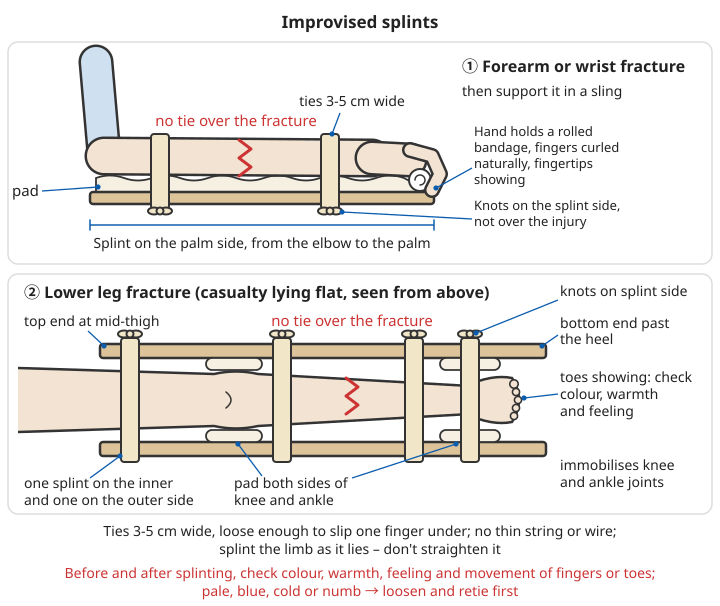
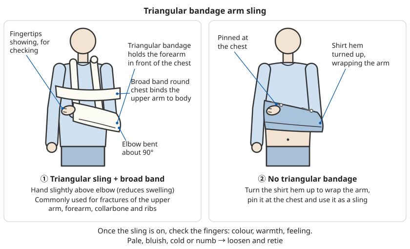

# Bone and Joint Injuries

## Contents
- [Fractures](#fractures)
- [Dislocations](#dislocations)
- [Sprains](#sprains)

```
⚠️ To be clear from the start:
- This chapter covers what to do "before reaching a doctor": assess, stop bleeding,
  immobilise, observe, move
- Setting fractures and dislocations, surgery and plaster casts are the doctor's job
- Suspected fracture, dislocation or severe sprain → immobilise, then see a doctor;
  injuries to the thigh, pelvis, spine or neck, or a casualty going into shock
  → do not move them, call 120
```

---

## Fractures

### Types of fracture

**Closed fracture**: skin intact, the bone has not come through
**Open fracture**: the broken bone end has pierced the skin – serious!

You do not always see bone in an open fracture: if there is a wound near the fracture, even a small cut that is oozing blood, treat it as an open fracture (the bone may have poked out and slipped back in). Open fractures easily infect the bone (osteomyelitis) and bleed more; they must go to hospital the same day.

Other types worth knowing:

| Type | Features | Common in |
|------|------|--------|
| Greenstick fracture | The bone bends like a green twig and cracks on one side without breaking right through; deformity may not be obvious | Children |
| Growth plate injury | Injury to the cartilage at the end of a bone near a joint; if not treated properly it can affect how the bone grows in length | Children, injuries near joints |
| Compression fracture | A vertebra is squashed flat; only back pain, easily mistaken for a "pulled back" | Older people (osteoporosis), falls from a height landing on the buttocks |
| Stress fracture (fatigue fracture) | No obvious injury; tiny cracks from repeated loading over a long time; hurts more the more you walk, eases with rest | Long marches, walking with heavy loads; often in the top of the foot or the lower leg |
| Comminuted fracture | The bone is broken into several pieces | Falls from a height, traffic accidents, crushing by heavy objects |

### Recognising the signs

Definite signs:
- Deformity (abnormal angle or shape)
- Abnormal movement (movement where there should be none)
- Grating sound or feeling of bone ends rubbing (crepitus)

Possible signs:
- Severe pain
- Swelling
- Bruising
- Loss of function (cannot move it)
- Tenderness

```
How to examine (gently – the aim is to assess, not to "confirm"):
1. Ask first: How did it happen? Where does it hurt? Did you hear a "crack"?
2. Look: compare with the other side for deformity, shortening, rotation, swelling, wounds
3. Feel: press gently along the bone with one finger;
   one spot on the bone that is especially painful (bony tenderness) → strongly suspect a fracture
4. Check beyond the injury: colour, temperature, feeling and movement of the fingers
   or toes (see Checking circulation below)

❌ Do not move the injured part back and forth to "listen for grating"
❌ Do not let the casualty "try walking a few steps" (leg injuries)
❌ Do not pull, twist or press on the deformed part
```

#### Telling fractures, dislocations and sprains apart

| | Fracture | Dislocation | Sprain |
|---|------|------|------|
| Location | Middle of a bone or near a joint | At a joint | At a joint (ligaments) |
| Deformity | Bone angled or shortened in the middle | Joint shape clearly changed (e.g. shoulder looks "square", finger joint out of line) | Usually none, only swelling |
| Point of tenderness | Most painful when pressing on the bone | Around the joint | Most painful when pressing on the soft tissue (ligament) beside the joint |
| Movement | Cannot be used; may move abnormally | Joint "stuck", almost no movement | Moves but hurts; with a mild sprain the person can still walk |
| Treatment | Immobilise, see a doctor | Immobilise as it is, see a doctor; do not put it back yourself | Mild to moderate can be treated at home (see Sprains) |

Fractures near joints often occur together with dislocations, and sprains and small fractures are hard to tell apart by eye. **When you cannot tell, treat it as a fracture**: immobilise and get an X-ray.

### Emergency principles

#### 1. Assess the situation

```
Check first:
✓ Level of consciousness
✓ Breathing and heartbeat
✓ Severe bleeding
✓ Other life-threatening injuries

Then deal with the fracture
```

A fracture itself rarely kills quickly, but the way it happened (a fall, a traffic accident, crushing by a heavy object) often injures the head, chest and abdomen too. Do not let a deformed arm or leg take all your attention; first run through the [vital signs assessment](../../../docs/01-日常疾病和伤害/00-基础急救知识.md#生命体征评估). Thigh and pelvic fractures and multiple fractures cause heavy internal bleeding; watch for [signs of shock](../../../docs/01-日常疾病和伤害/00-基础急救知识.md#休克征象识别).

#### 2. Do not move the casualty!

```
❌ Do not:
- Try to set the fracture
- Move the casualty unnecessarily
- Let the casualty stand or walk

✓ Unless:
- The scene is dangerous
- They must be moved to be rescued
```

```
When they must be moved:
1. Immobilise first, then move (if there is no time, at least support the injured part
   above and below with your hands)
2. When moving, support the joints above and below the injury together and move the body
   as one unit; do not drag the injured limb
3. Suspected spinal injury: keep head, neck and trunk in a straight line; several people
   move the casualty together
4. Stop once you reach safety; do not keep shifting them around "to make them comfortable"
```

For moving casualties see [Basic First Aid – Moving casualties](../../../docs/01-日常疾病和伤害/00-基础急救知识.md#搬运伤员).

#### 3. Stop bleeding (open fractures)

```
⚠️ Open fracture:
1. Do not push protruding bone back in
2. Cover the wound with sterile gauze
3. Press to stop bleeding (carefully – not on the fracture)
4. Call for emergency help immediately
```

```
Open fracture, step by step:
1. Put on gloves or use plastic bags to cover your hands
2. Expose the wound: cut the clothing away, do not pull it off
3. Large obvious pieces of dirt (lumps of mud, grass) may be gently lifted off;
   ❌ do not put fingers into the wound, do not pour medicine powder, plant ash or alcohol into it
   If the wait will be very long (several hours or more), you may rinse surface grit away
   with plenty of clean drinking water
4. Cover the whole wound with clean gauze or cloth
5. Stop bleeding: press around the protruding bone, or above the wound (on the side nearer the heart)
   - You can make a "doughnut" ring of rolled gauze around the bone end and then bandage,
     so the pressure falls around it and not on the bone
6. If bleeding cannot be stopped, spurts, and is life-threatening, treat it as severe bleeding
   and use a tourniquet if needed
7. Immobilise "as it lies", with the splint avoiding the wound
8. Note the time of injury and whether the person has had tetanus vaccination, and tell the doctor

⚠️ An open fracture needs thorough cleaning in hospital and antibiotics as early as possible;
   the longer the delay, the higher the risk of infection. It cannot be treated at home
```

For tourniquets see [Basic First Aid – Tourniquet](../../../docs/01-日常疾病和伤害/00-基础急救知识.md#4-止血带最后手段); for tetanus see [Wound and Injury Care – Tetanus prevention](02-wounds-and-injuries.md#tetanus-prevention).

#### 4. Immobilise

**Purpose**:
- Reduce pain
- Prevent further injury
- Reduce bleeding
- Stop a closed fracture becoming an open one

**Principles**:
```
1. Immobilise as it lies (keep the position it was injured in)
2. Immobilise the joint above and the joint below
3. Firm but not too tight
4. Check circulation beyond the injury
```

```
Step by step:
1. Before splinting, check the colour, temperature, feeling and movement of the fingers/toes
   beyond the injury once, and note it down
2. Remove rings, bracelets and watches on the injured side, and take off shoes and socks
   (except for ankle and foot injuries, see below)
   → once swollen they cannot be removed and will constrict like a tourniquet
3. One person holds the limb above and below the fracture with both hands and keeps it
   still; another puts the splint on
4. Splint length: past the joints above and below the fracture
   (forearm fracture → splint from elbow to palm; lower leg fracture → from thigh to foot)
   Fracture or dislocation near a joint → immobilise the bones above and below that joint
5. Padding: put towels, clothing or cotton wool between the splint and the skin;
   pad extra over bony points (both sides of wrist, elbow, knee, ankle) and in the body's
   hollows (under the small of the back, under the knee)
6. Tying: at least one tie above and one below the fracture;
   tie the knots on the splint side, not over the injury; ties 3-5 cm wide – no thin string or wire
7. Tightness: you should be able to slip one finger under each tie
8. After splinting, check beyond the injury again and compare with before
9. If there is no spinal or pelvic injury, raise the splinted arm or leg to reduce swelling

✓ Done right: the casualty feels less pain, and fingers and toes have the same colour
  and temperature as before splinting
⚠️ Getting worse: fingers or toes turn pale, blue, cold or numb, or pain keeps increasing
   → loosen and retie; if no better after loosening → get to hospital urgently (see danger signs below)
```

"Immobilise as it lies" means: do not straighten the limb to make it easier to splint. Only when the limb is so badly deformed it will not fit any splint, or there is no pulse beyond the injury and no medical care will be available for a long time (several hours or more), might it need adjusting by someone trained; this is not covered here. Untrained people should splint it as it is and get to hospital quickly.

### Improvised splints

When no proper splint is at hand, many things will do:

| Material | Suitable for | Notes |
|------|------|------|
| Boards, strips of wood, broom handles, branches | Arms and legs | Remove splinters, wrap in cloth |
| Thick card, cardboard box | Forearm, wrist, lower leg | Folded into a "U" to cradle the limb it is stronger; goes soft when wet |
| Tightly rolled magazines or newspapers | Forearm, wrist | Roll around the limb and secure with tape or strips of cloth |
| Pillows, folded blankets | Ankle, foot | Wrap around both sides of the ankle and the sole and tie firmly ("pillow splint") |
| Umbrellas, trekking poles, sleeping mats | Arms and legs | A sleeping mat rolled around the limb works very well |
| The casualty's own body | Arm against the trunk, injured leg tied to the good leg, injured finger taped to the next finger | Always pad between them |
| Triangular bandages, scarves, sheets torn into strips, belts | Tying, slings | 3-5 cm wide; too thin will cut in |



*Figure: The splint reaches past the joints above and below the fracture, with soft padding; one tie above and one below the fracture, knots on the splint side; fingertips and toes left exposed for checking.*

Without a triangular bandage, fold the lower hem of the shirt up over the arm and pin it at the chest to make a sling. For more methods outdoors see [Wilderness Casualty Care and Evacuation – Improvised immobilisation](../../../docs/03-野外生存/11-野外伤病处置与转运.md#就地取材固定).

### Immobilising each part of the body

#### Upper arm fracture

```
1. Make a sling from a triangular bandage or wide strip of cloth
2. Bend the forearm to 90°
3. Support it in front of the chest
4. Tie another strip around the chest to hold the upper arm
```

```
More:
- If you have a splint, place one on the outside of the upper arm from shoulder to elbow,
  then sling and secure as above
- Put a layer of clothing between the upper arm and the chest wall
- If the elbow will not bend (or bending causes severe pain), do not force it:
  keep the arm straight at the side, splint it with a long splint from armpit to fingers,
  then tie the whole arm to the trunk
- Check: can the wrist lift upwards?
  (upper arm fractures can injure the radial nerve, causing "wrist drop" – the wrist
  cannot be lifted; tell the doctor)
- When an older person falls onto the shoulder, the break is often in the upper arm near
  the shoulder; immobilise with a sling in the same way
```



*Figure: The triangular bandage holds the forearm in front of the chest with the hand slightly higher than the elbow, and a wide band ties the upper arm to the trunk; without a triangular bandage, use the lower hem of the shirt instead.*

#### Forearm or wrist fracture

```
1. Splint: from elbow to palm
2. Rigid material on the palm side; if you have two pieces, one on the palm side and one
   on the back of the hand:
   - Board, stiff card
   - Rolled magazine or newspaper
3. Tie with strips of cloth (avoiding the fracture)
4. Support in a triangular bandage sling
```

```
More:
- Let the casualty hold the injured arm with the good hand and find the most comfortable
  position, usually with the elbow bent and the thumb upwards
- Put the splint on the palm side; put a rolled bandage or a balled-up sock in the palm
  so the fingers stay naturally curled (position of function), with the fingertips showing
  for checking
- In the sling, keep the hand slightly higher than the elbow to reduce swelling
- An older person falling forwards onto an outstretched hand most easily breaks the wrist
  (end of the radius); the wrist takes on a "dinner fork" shape
- After a fall on the hand, tenderness at the base of the thumb on the wrist (in the small
  hollow that appears when you stretch the thumb out): this may be a scaphoid fracture.
  Early X-rays often miss it, it is easily overlooked, and if it does not heal it leaves
  long-term pain → immobilise as a fracture and tell the doctor specifically
```

#### Finger fracture

```
1. Take rings off that hand at once (soap it, raise the hand, then twist the ring off slowly)
2. Buddy strapping: tape the injured finger to the finger next to it, with a layer of
   gauze between them (to stop sweat rubbing the skin raw); do not tape over the joints
3. Or use a tongue depressor, lolly stick or stiff strip of card as a small splint, from
   fingertip to palm
4. Raise the hand and apply ice
5. See a doctor if: the finger is clearly bent or rotated (fingers cross over when making a
   fist), there is a large bruise under the nail, there is a wound, or the last joint will
   not straighten (mallet finger)

❌ Do not try to pull a crooked finger straight yourself
```

#### Thigh fracture

```
1. Long splint: from armpit to heel
2. Short splint: from groin to heel
3. Splints on both sides
4. Tie in several places:
   - Chest, waist, thigh, knee, lower leg, ankle
5. Do not move the casualty
6. Wait for professional rescue
```

```
More:
- The thigh bone (femur) is the thickest bone in the body; breaking it takes great force.
  1-1.5 L of blood can be lost into the thigh, and the casualty will soon go into shock
  → call 120, keep warm, monitor
- Without long splints: pad between the legs (between knees and ankles) with clothing and
  tie the injured leg to the good leg (one tie each at thigh, above the knee, lower leg and
  ankle; at the ankles, tie the two feet together with a figure-of-eight)
- Pass the ties under the body through the natural gaps (under the small of the back,
  under the knees, above the ankles); do not lift the injured leg
- Traction splints used by professionals need training; do not improvise one

⚠️ An older person who has fallen and has pain in the hip (top of the thigh), cannot stand,
   and whose injured leg is shorter with the foot turned outwards → hip fracture. Do not help
   them up; pad between the legs and tie them together, keep warm, call 120
```

For assessing an older person after a fall see [Elder Care – What to do after an older person falls](../../../docs/01-日常疾病和伤害/13-老人照护.md#老人跌倒后怎么办).

#### Lower leg fracture

```
1. Splint: from thigh to heel
2. Include the knee and ankle joints
3. You can use:
   - Boards
   - An umbrella
   - The good leg (tie them together)
```

```
More:
- Put splints on the inner and outer sides of the leg, from mid-thigh to beyond the heel
- Pad under the knee and on both sides of the ankle; keep the foot at a right angle to the
  lower leg; a board under the sole can support it
- The front of the lower leg (shin bone, tibia) has almost no muscle under the skin, so it
  most easily becomes an open fracture; move it especially gently
- The lower leg is the most common site of compartment syndrome; check repeatedly after
  splinting (see danger signs below)
```

#### Knee, ankle and foot fractures

```
Knee (including kneecap/patella fractures):
1. Do not force it straight or bent; immobilise at the angle it was injured
2. Leg straight: one long splint behind the leg, from below the buttocks to the heel,
   with padding under the knee and ankle
3. Leg bent: put a rolled blanket under the knee to keep the angle, and short splints on
   both sides to immobilise the thigh and lower leg

Ankle and foot:
1. Pillow splint: wrap a pillow or folded blanket from under the heel up both sides of the
   ankle and tie firmly with 3-4 strips of cloth, toes left showing for checking
2. If a shoe is already on and not too tight, it can be left on (taking it off may worsen the
   injury, and the shoe itself gives some support); but you must be able to see or feel the
   toes, and cut the shoe off if swelling increases and it gets tight
3. Raise and apply ice
```

For whether someone can walk after twisting an ankle and whether to treat it as a fracture, see [Wilderness Casualty Care and Evacuation – Twisted ankle: can you still walk](../../../docs/03-野外生存/11-野外伤病处置与转运.md#崴脚-还能不能走).

#### Collarbone fracture

```
1. Support the arm on the injured side in a triangular bandage sling (first choice)
2. Or a figure-of-eight bandage around both shoulders
3. Sitting position
```

```
More:
- At the scene, slinging the arm on the injured side in front of the chest with a triangular
  bandage and tying it to the trunk with a wide band is usually enough, and the most comfortable
- Casualties often hold the injured elbow with their good hand and let the shoulder droop
  forwards; this is a normal protective posture
- A figure-of-eight bandage needs good padding in the armpits and must not be too tight;
  loosen it at once if the arm goes numb, cold or changes colour; do not attempt it if you
  do not know how
- Large blood vessels and the top of the lung lie under the collarbone: difficulty breathing,
  rapid swelling at the injury, or a cold arm → call 120 immediately
- Children often fall onto the shoulder; the great majority heal well
```

#### Rib fractures

```
⚠️ Watch for pneumothorax (air around the lung) and haemothorax (blood around the lung)!

Do not:
❌ Bind the whole chest tightly with cloth or bandages "to hold the ribs"
   (current first-aid guidelines advise against it: binding the chest restricts breathing,
   stops the person coughing up phlegm and increases the risk of pneumonia)
```

```
What to do:
1. Let the casualty choose the most comfortable position, usually half-sitting
2. Support the arm on the injured side in a triangular bandage sling to reduce its pull on the chest wall
3. When coughing or breathing deeply, have the casualty hug a pillow or folded clothes
   against the injury to ease the pain
4. Do not deliberately "breathe shallowly": as pain allows, take several deep breaths and
   cough each hour to prevent pneumonia
   (painkillers help a lot here, letting the casualty breathe normally)
5. See a doctor for an X-ray to rule out pneumothorax, haemothorax and internal injuries

Call 120 immediately if:
- Breathing gets more and more difficult and fast, lips turn blue
- One side of the chest does not rise and fall with breathing, or a section of chest wall
  sinks in when breathing in (flail chest)
- Coughing up blood
- A chest wound with a "hissing" air leak as the person breathes → cover lightly with a
  clean dressing; do not seal all four sides of the wound completely with tape or plastic
  (this can make the pneumothorax worse)
- Fractures of the lower ribs with abdominal pain (the liver or spleen may be injured)
- An older person with several broken ribs (even if breathing is fine at first, pneumonia
  and respiratory failure easily follow days later)
```

#### Pelvic fracture

```
When to suspect it:
- Pain in the hip, groin or lower back after a fall from a height, traffic accident or crushing
- Cannot stand, legs of unequal length, swelling and bruising around the genitals, blood in the urine
- Pale, cold sweat, fast pulse → major bleeding inside the pelvis; several litres can be lost

What to do:
1. Call 120 and say "suspected pelvic fracture"
2. ❌ Do not squeeze or rock the pelvis to "check" (this increases bleeding)
3. Lay the casualty flat; do not turn them over, do not let them sit up or stand, do not raise the legs
4. Pad between the knees and between the ankles with clothing and tie the knees and ankles
   together; put a rolled blanket under the knees to keep the legs slightly bent
5. Keep warm, treat for shock, give nothing to eat or drink
6. Only under guidance from the 120 dispatcher, or if trained and the wait is very long,
   wrap a folded sheet around the pelvis at the level of the bony points on the outside of
   both hips (greater trochanters) and tighten it moderately
```

#### Jaw fracture

```
- The teeth do not meet properly, difficulty opening the mouth, loose teeth, bleeding in the mouth
- Have the casualty sit leaning forwards so blood and saliva can drain out and the airway stays clear
- The casualty can support the jaw with a hand; do not tie the mouth shut tightly with a
  bandage (they could choke if they vomit)
- Often comes with a head injury; watch for changes in consciousness and see a doctor soon
```

For mouth injuries see [Dental Problems](../../../docs/01-日常疾病和伤害/09-口腔问题.md).

#### Spinal fracture (extremely dangerous!)

```
⚠️ Symptoms:
- Severe back pain
- Limited movement
- Possibly numbness, weakness
- Possibly loss of bladder or bowel control

What to do:
1. Absolutely do not move the casualty!
2. Keep head, neck and back in a straight line
3. Wait for professional rescue
4. Move on a rigid stretcher (at least 4 people)

Unless:
- There is a threat to life at the scene (fire, etc.)
```

```
When to suspect a spinal injury (even if the casualty says "I'm fine"):
- A fall from a height (more than their own height, or tumbling down stairs)
- Car or motorcycle accidents, being hit by a vehicle
- Diving and hitting the bottom of the pool, or a heavy blow to the head
- Reduced consciousness after a head injury
- Back pain in an older person after a minor fall (osteoporosis, possible compression fracture)

Key points:
- Tell a conscious casualty not to move; do not let them "try turning the neck"
- If they vomit, are not fully conscious or breathing is affected, breathing comes first:
  several people turn the casualty together onto their side like a log ("log roll"),
  without twisting the head and neck
- Keep them warm (someone lying still on the ground gets cold fast); put something under them if possible
- When unsure, always treat as a spinal injury
```

For moving with several people see [Basic First Aid – Multi-person carry](../../../docs/01-日常疾病和伤害/00-基础急救知识.md#3-多人搬运脊柱损伤); for traffic accidents see [Home and Traffic Accidents – At the scene of a traffic accident](../../../docs/01-日常疾病和伤害/07-居家与交通意外.md#车祸现场处理).

#### Neck (cervical spine) fracture

```
The most dangerous! Can cause paralysis or death!

Immobilisation:
1. Hold both sides of the head with your hands
2. Keep head, neck and body in a straight line
3. Do not bend it forwards, backwards or twist it
4. Wait for professional rescue
5. A proper cervical collar is fitted by professionals
```

```
More:
- Kneel behind the casualty's head, place your palms on both sides of the head (over the
  ears), and rest your elbows on the ground or your own knees so you can hold on for a long
  time; to swap helpers, the new person first takes hold firmly, then the first person lets go
- If the head is turned and any movement hurts or meets resistance, do not force it straight;
  hold it in the position you found it
- Without a cervical collar, put a rolled-up garment or blanket on each side of the head to wedge it
- Usually do not remove a motorcycle helmet; see the section on traffic accident scenes
```

### Checking circulation

You must check after immobilising:

```
Check every 15 minutes:

1. Skin colour:
   ✓ Normal: pink
   ⚠️ Pale or blue: may be too tight

2. Temperature:
   ✓ Normal: warm
   ⚠️ Ice-cold: poor circulation

3. Pulse:
   ✓ Can be felt
   ⚠️ Cannot be felt: too tight

4. Feeling:
   ✓ Normal
   ⚠️ Numbness or tingling: a nerve may be compressed

5. Movement:
   ✓ Can move fingers/toes
   ⚠️ Cannot move them: check the immobilisation

If anything is abnormal: loosen the immobilisation slightly
```

```
More:
- Comparing with the uninjured side is the clearest check
- Capillary refill: press the nail for about 5 seconds; after release the colour should return
  to pink within 2 seconds
- Where to feel the pulse: the thumb side of the wrist (radial artery); the middle of the
  top of the foot or behind the inner ankle bone
- In people with dark skin, look at the nails and palms
- Still pale, cold and pulseless after loosening → get to hospital urgently; this is a race against time
- Keep checking on the way to hospital and after arriving
```

### Ice

```
✓ Reduces swelling and pain
- Wrap the ice pack in cloth
- Place it around the fracture
- 15-20 minutes each time
- Once an hour
❌ Do not let it touch the skin directly
```

```
More:
- You can apply ice over the clothing outside the splint; do not undo the immobilisation to apply ice
- No ice: a towel soaked in cold water (change it when it warms), a bag of frozen vegetables,
  a plastic bag of cold water
- Babies and young children, older people, and people with diabetes or reduced feeling in
  the hands and feet get frostbite easily; cut the time to about 10 minutes and check the skin often
- Do not put ice on the wound of an open fracture
```

### Pain relief

```
- Immobilising, raising and icing are themselves the most effective pain relief
- Common over-the-counter drugs: paracetamol (acetaminophen), ibuprofen, at the dose on the leaflet
- Ibuprofen-type drugs (NSAIDs): not for people with stomach ulcers, kidney disease,
  asthma sensitive to these drugs, or in late pregnancy;
  they may slightly affect fracture healing – short-term use is usually fine, but ask a
  doctor before long-term use
- Casualties who may need surgery (thigh, pelvis, open fractures, etc.) should not eat or
  drink, and should not take medicines for now either
- Do not use alcohol for pain
```

For dose guidance see [Common Illnesses – Medicines for fever](../../../docs/01-日常疾病和伤害/01-常见疾病.md#2-药物退烧).

### Life- and limb-threatening danger signs

Most fractures "hurt but are not urgent", but treat the following as emergencies:

#### Compartment syndrome

```
What it is:
The muscles of the lower leg and forearm are wrapped in tough connective tissue (fascia)
in separate "compartments". After a fracture or crushing, the muscles swell and bleed, the
pressure in a compartment keeps rising and squeezes the blood vessels and nerves; within
a few hours the muscles and nerves die, which can lead to amputation

Common with: lower leg fractures, forearm fractures, hands or feet trapped under weight
for a long time, plaster casts or splints that are too tight

The earliest and most important signs:
- Pain out of proportion to the visible injury, not helped by painkillers or immobilisation,
  getting worse and worse
- Severe pain when you gently and passively straighten the casualty's fingers or toes
- The limb is swollen and hard, the skin shiny and tight
Only later: numbness, weakness, pallor, no pulse
(waiting until the pulse disappears is too late)

What to do:
1. Immediately loosen all bandages and splint ties; cut the bandaging outside a plaster cast
2. Keep the injured limb at the same height as the heart (do not raise it further, do not lower it)
3. Do not apply ice
4. Go to hospital immediately and tell the doctor "suspected compartment syndrome"
```

#### Major bleeding from pelvic and thigh fractures

A pelvic fracture can bleed several litres, a thigh fracture 1-1.5 L, with no blood visible outside. Pallor, cold sweat, a fast weak pulse, restlessness or slowed responses after the injury mean shock from blood loss. What to do: call 120, do not move the casualty, immobilise (see Pelvic fracture and Thigh fracture above), keep warm, lie flat, do not raise the legs.

#### Spinal injury

After the injury the hands and feet are numb, weak or cannot move, there is loss of bladder or bowel control, or breathing is laboured (high cervical spinal cord injury). Treat as described above under spinal and neck fractures and wait in place for professional rescue.

#### Crush injury

```
When hands or feet have been trapped under heavy objects for a long time (more than about
1 hour) in an earthquake or collapse, suddenly releasing the pressure lets substances from
dead muscle cause abnormal heart rhythms and kidney failure (crush syndrome)
✓ If possible, wait for professional rescuers before lifting the weight; they will first
  give the casualty fluids
✓ If you must free them yourself: after lifting the weight, lay the casualty flat and keep
  them warm; if conscious and able to swallow, they may take small sips of water; get them
  to hospital quickly and tell the doctor how long they were trapped
```

For what to do when trapped in an earthquake see [Geological Disasters – When trapped](../../../docs/02-灾难应对/01-地质灾害.md#被困时).

#### Fever or pus after a fracture

Fever, increasing redness, swelling, heat and pain at the injury, or pus, days to weeks after an open fracture or surgery may mean a bone infection; see a doctor soon.

### Children, older people and pregnant women

```
Children:
- Bones are soft; greenstick fractures are common and deformity is not obvious – the child
  may simply "refuse to use this hand" or "walk with a limp"
- Injuries near joints may damage the growth plate → any child with a painful, swollen
  joint needs an X-ray
- Pulled elbow: after an adult lifts a young child by the hand or jerks the arm, the child
  cries and lets the arm hang, refusing to use it
  → this is a partial dislocation of the head of the radius; a doctor can easily put it back,
  but fracture must be ruled out first – do not manipulate it yourself
- Repeated fractures, or a fracture that does not match the story of how it happened:
  consider whether the child is being abused
- Children heal fast, usually much faster than adults

Older people:
- With osteoporosis, a minor fall can break a bone, commonly the wrist, hip, shoulder or spine
- Pain may not be obvious; "fell but can walk" may still be a fracture – if pain persists, get an X-ray
- After a hip fracture, long bed rest easily leads to pneumonia, pressure sores and blood clots;
  early hospital treatment and surgery are very important

Pregnant women:
- After a fall or traffic accident, even a minor injury, see a doctor to check the baby
- Lying flat on the back lets the womb press on large blood vessels; in late pregnancy
  (if there is no spinal injury) lie the casualty on her left side, or put padding under
  the right side of her lower back to tilt her body to the left
- Ask a doctor before taking painkillers; do not use ibuprofen in late pregnancy
```

For preventing falls in children see [Child Safety – Preventing falls](../../../docs/01-日常疾病和伤害/14-儿童安全.md#防坠落); for preventing falls in older people and caring for the bedridden see [Elder Care](../../../docs/01-日常疾病和伤害/13-老人照护.md).

### Fracture healing and rehabilitation

Approximate healing times for adult fractures (meaning the bone has joined and can start bearing weight gradually; full strength and function take longer):

| Site | Approximate healing time |
|------|------|
| Fingers, toes | 3-5 weeks |
| Collarbone | 6-10 weeks |
| Ribs | About 6 weeks |
| Forearm, wrist | 6-8 weeks |
| Upper arm | 6-10 weeks |
| Scaphoid (wrist) | 10-12 weeks, often longer |
| Lower leg (tibia) | 3-6 months |
| Thigh (femur) | 3-4 months or more |
| Spinal compression fracture | About 3 months |

Children often need only about half the adult time; old age, smoking, diabetes, poor nutrition, open fractures and repeated movement at the fracture all slow healing.

```
Stages of rehabilitation:
1. While immobilised:
   - Move the joints that are not immobilised every day
     (e.g. with a forearm in plaster, keep using the fingers and shoulder; with the lower leg
     immobilised, move the toes and hip)
   - Do "tighten-relax" exercises with the immobilised limb (muscles working but the joint
     not moving) to reduce muscle wasting
   - With a splint: check the skin every day for pressure marks or rubbing;
     once the swelling goes down the splint becomes loose – re-pad and retie it
   - For long bed rest: prevent pressure sores, take plenty of deep breaths, to prevent
     pneumonia and blood clots
2. After the immobilisation comes off:
   - Stiff joints and thinner muscles are normal
   - First restore range of movement, then build strength, then bear weight gradually;
     for the legs, start with partial weight on crutches and progress to full weight as the
     doctor advises
   - Mild aching during exercise is fine; if pain or swelling clearly increases, do less
3. Diet: enough protein (beans, eggs, meat, fish), calcium (milk, soya products, small fish
   eaten with the bones), vitamin D (sunlight); stop smoking

⚠️ Go back to the doctor if:
- Pain or abnormal movement at the fracture persists for a long time (beyond the expected
  time) → it may not be healing
- The limb gradually bends or shortens → it may be healing out of line
- Sudden swelling and pain in the calf or thigh, or sudden chest pain and shortness of breath
  → may be a blood clot; see a doctor immediately
```

For ensuring protein and vitamins on long-term stored food see [Nutrition and Deficiency Diseases](../../../docs/07-日常生活技能/02-营养与营养缺乏病.md).

```
When no medical care can be obtained (remote areas, long-term isolation after a disaster):
- It is still immobilisation + waiting for healing: immobilise for at least the times in the
  table above; do not bear weight on a broken leg while it is immobilised – use crutches
- Pad splints even more carefully, and check the skin and circulation beyond the injury every day
- Open fractures: change the dressing daily and watch for signs of infection;
  the risk is extremely high – still do everything possible to reach medical help
- Do not try to "set bones" yourself, or straighten a deformity that has already partly healed
```

### ⚠️ See a doctor immediately

All fractures need a doctor!

Especially urgent:
- Open fractures
- Heavy bleeding
- Severe deformity
- Numbness, pallor or no pulse beyond the injury
- Spinal or neck injury
- Fractures of the head, chest or pelvis

Also: thigh fractures, hip fractures, pain that keeps getting worse and is not eased by immobilisation (compartment syndrome), signs of shock, difficulty breathing.

---

## Dislocations

### Definition

The bone ends of a joint are pushed out of their normal position

In a dislocation the ligaments and joint capsule around the joint are always torn, and often there is also a fracture, or pressure on nearby blood vessels and nerves. So a dislocation is not a minor injury that is "fine once the bone is pushed back".

### Common sites

- Shoulder (most common)
- Elbow
- Fingers
- Hip
- Kneecap (patella)
- Jaw

### Symptoms

- Deformed joint
- Severe pain
- Swelling
- Limited or no movement
- Possibly numbness

Typical signs at each site:

| Site | Typical signs |
|------|------|
| Shoulder | The round outline of the outer shoulder is lost and looks "square"; the casualty holds the injured arm with the good hand, the arm held slightly away from the body and unable to come across the chest |
| Elbow | Usually from falling onto an outstretched hand; the back of the elbow sticks out clearly and the elbow is locked half-bent |
| Finger | The joint is clearly out of line and angled; common in ball sports |
| Hip | Most often from the knee hitting the dashboard in a car crash; the injured leg is shorter and turned inwards, the knee slightly bent |
| Kneecap | The kneecap slides to the outside of the knee; the knee is bent and will not straighten |
| Jaw | After yawning or laughing hard, the mouth is stuck open, speech is unclear, drooling |

### Principles of care

```
❌ Absolutely do not:
- Put it back yourself (unless professionally trained)
- Force it to move

✓ Do:
1. Keep it as it is
2. Immobilise the joint
3. Apply ice
4. See a doctor as soon as possible
```

```
More:
1. Let the casualty find the least painful position and immobilise it in that position
   (this is what "keep it as it is" means)
2. Before and after immobilising, check colour, temperature, feeling and pulse beyond the injury
   - Shoulder dislocation: check feeling in a small patch of skin on the outside of the
     shoulder (axillary nerve) and feeling in the fingers
   - Cold, pale and pulseless beyond the injury → a blood vessel is compressed; get to hospital urgently
3. Apply ice, 15-20 minutes each time
4. Nothing to eat or drink (the doctor may need to put it back under anaesthesia or sedation)
5. The earlier it is put back, the easier: the longer the delay, the stronger the muscle spasm
   and the harder it is to reduce. So "see a doctor as soon as possible" really means as soon
   as possible – do not wait until the next day
```

### Immobilisation

**Shoulder dislocation**:
```
1. Put soft padding (e.g. a rolled towel) in the armpit
2. Support the forearm in a sling in front of the chest
3. Tie the upper arm to the trunk with a wide strip of cloth
```

```
More:
- The injured arm often cannot come against the chest; do not force it.
  Fill the gap between arm and chest wall with a thick enough pillow or rolled clothing,
  then sling and secure it
- Sitting up for the journey to hospital is usually more comfortable than lying down
```

**Elbow dislocation**:
```
1. Keep it as it is (do not force it to bend or straighten)
2. Support with soft padding
3. Triangular bandage sling or splint
```

**Finger dislocation**:
```
1. Splint it in the position found
2. Apply ice
3. See a doctor
```

With a finger dislocation, take rings off first as well. Dislocations at the base of the thumb and finger dislocations with a wound are more likely to cause problems; always see a doctor.

**Hip dislocation**:
```
⚠️ Emergency: the blood supply to the head of the femur may be cut off; after a delay of
   several hours the bone may die
1. Call 120; do not move the casualty
2. Keeping the leg in the position it was injured in, pack pillows and blankets firmly under
   and on both sides of the leg to stop it moving
3. Often comes with fractures and other serious injuries; treat as for a thigh fracture and shock
```

**Kneecap dislocation**:
```
1. Keep the knee at the angle most comfortable for the casualty, with a rolled blanket under it
2. Do not force it straight (sometimes the kneecap slides back by itself when the knee
   straightens – nothing to fear, but do not push it back yourself)
3. Immobilise the knee and see a doctor to check for fractures and cartilage damage
```

**Jaw dislocation**:
```
1. Support the jaw with a hand or a wide cloth; do not bind the head and chin tightly with
   a bandage (it would get in the way of clearing the mouth if they vomit)
2. See a doctor as soon as possible; a doctor can usually put it back quickly
```

Even if it has already gone back by itself (e.g. a shoulder that keeps dislocating slipped back in), still immobilise it and see a doctor to check for fractures and nerve damage.

### Reduction (putting the joint back)

⚠️ Only to be done by a doctor!

**Exception**: in remote wilderness, where medical care cannot be reached in time, and:
- Medical help is several hours or more away
- You are professionally trained
- It is a shoulder dislocation and you are experienced

```
Why untrained people should not put joints back:
- What looks like a dislocation may be a fracture near the joint, or a fracture together with
  a dislocation; forcing it back can shift the fracture and drive bone through the skin
- The wrong method or too much force can tear nerves and blood vessels in the armpit or elbow,
  causing permanent paralysis or loss of blood supply
- Putting back hip and elbow dislocations takes great force and often anaesthesia; it is
  practically impossible to do well at the scene

The "exception" above applies only to a few sites such as the shoulder and fingers,
and assumes training in wilderness first aid or medicine;
this book does not give reduction techniques. Untrained people must not try them from videos or text

When no medical care at all can be obtained, an untrained person should:
- Immobilise the joint in the position most comfortable for the casualty, give pain relief, apply ice
- Do everything possible to transport the casualty or contact medical help (even if it takes days)
- If the joint goes back by itself (the casualty suddenly feels a "clunk", the pain clearly
  eases and the shape returns), still immobilise it for 2-3 weeks, then gradually start moving it
```

For deciding on evacuation in the wild see [Wilderness Casualty Care and Evacuation – Wait in place or self-evacuate](../../../docs/03-野外生存/11-野外伤病处置与转运.md#原地等待还是自行撤出).

### Dislocation vs fracture

Sometimes hard to tell apart; the treatment is the same:
- Immobilise
- Apply ice
- See a doctor

After a dislocation has been put back, the joint usually needs immobilising for 2-3 weeks (young people with a first shoulder dislocation have a high rate of recurrence and need to follow the doctor's advice on immobilisation and rehabilitation exercises). The principles for exercise during and after immobilisation are the same as for fracture rehabilitation.

---

## Sprains

A sprain is a stretch or tear of the ligaments (tough fibres joining bone to bone) around a joint. The most common is the outside of the ankle when the foot rolls inwards (a "twisted ankle"), followed by the wrist, knee and fingers.

### Grades

**Grade I (mild)**:
- Slight pain and swelling
- Ligament stretched, not torn
- Can walk

**Grade II (moderate)**:
- Marked pain and swelling
- Ligament partly torn
- Joint unstable
- Difficulty walking

**Grade III (severe)**:
- Severe pain (may later ease)
- Severe swelling and bruising
- Ligament completely torn
- Joint clearly unstable
- Cannot bear weight

A grade III sprain may actually hurt less than grade II (the ligament is completely torn, so nothing is being stretched). Do not judge it as minor because "it doesn't hurt much"; what matters is whether the joint is loose and the person cannot stand steadily.

### Sprain vs fracture

When it is hard to tell, treat it as a fracture!

**Consider a fracture if there is**:
- Severe pain
- Severe deformity
- Inability to move it
- Bony tenderness

```
After a twisted ankle, any one of the following → treat as a possible fracture,
immobilise and get an X-ray:
- Unable to take 4 steps on the injured foot (even limping), both right after the injury
  and when examined
- Severe pain when pressing the back edge or the tip of the bony bump on the inside or
  outside of the ankle (the ankle bones)
  (in the area from the tip up to about 6 cm above it)
- Severe pain when pressing the bony bump in the middle of the outer edge of the foot
  (base of the fifth metatarsal) or the middle of the inner side of the foot

After a knee sprain:
- Rapid, marked swelling (within hours) → bleeding inside the joint; possibly a torn
  ligament or a fracture
- The knee "locks" and will not straighten, or "gives way" when walking → see a doctor
```

### RICE (grade I–II)

RICE means Rest, Ice, Compression and Elevation, used for the first 2-3 days after injury to control swelling and pain.

#### R - Rest

```
- Avoid using the injured joint
- Especially important in the first 48-72 hours
- Use crutches (leg sprains)
```

```
More:
- Rest does not mean keeping completely still: light movement that does not cause marked
  pain (such as moving the toes) can be done from the first day
- Legs: use crutches if it hurts too much to walk normally; the injured foot can touch the
  ground lightly, putting more weight on it as the pain eases
- No crutches: a strong long stick or a broom (pad the top with cloth to go under the armpit,
  or hold it in the hand); hold the crutch in the hand on the uninjured side
```

#### I - Ice

```
First 48 hours:
- Once every 2-3 hours
- 15-20 minutes each time
- Wrap the ice pack in a towel

Effects:
- Reduces swelling
- Reduces pain
- Reduces internal bleeding
```

```
More:
- The earlier you start, the better
- No ice: a bag of frozen vegetables, a towel soaked in cold water, or soaking the foot in
  cold tap water or a stream
- The skin feels cold first, then stinging, then numb → stop when it goes numb; no more than 20 minutes
- People with diabetes, Raynaud's disease (fingers turn white in the cold) or reduced feeling,
  and babies, young children and older people: shorten the time
- Do not sleep with ice on
```

#### C - Compression

```
How:
- Elastic bandage (figure-of-eight)
- From the far end towards the body
- Moderately firm

Check:
- Check circulation every hour
- Toes/fingers warm and normal in colour
- If swelling increases, loosen and re-bandage
```

```
How to do a figure-of-eight ankle bandage:
1. Keep the foot at a right angle to the lower leg
2. Start at the base of the toes and wrap twice around the foot to anchor the end of the bandage
3. Go diagonally from the top of the foot to the back of the ankle, then diagonally from the
   other side back to the top of the foot, making an "8"; each turn covers one-half to
   two-thirds of the turn before
4. Continue up to the lower part of the lower leg (about 10-15 cm above the ankle), leaving the toes showing
5. Slightly firmer at the far end, slightly looser nearer the body, with no single tight spot
6. If the leg is already raised for sleeping, the bandage can be loosened a little

✗ Do not wrap non-breathable tape tightly round and round
✗ Do not bind it until it turns purple in the belief that "tighter means less swelling"
```

#### E - Elevation

```
- Above the level of the heart
- As much of the time as possible
- When resting and sleeping
```

For an ankle sprain, lie down with two or three pillows under the lower leg so the ankle is higher than the heart; sitting with the foot on a chair only counts as "lifted" – it is not high enough and does little for the swelling.

### After 48–72 hours

**Warm compresses**:
```
- Improve circulation
- Speed up healing
- Warm towel or hot-water bottle
- 15-20 minutes each time
```

Start heat once the swelling is no longer increasing and the area no longer feels hot; if heat makes the swelling and pain worse, it is too early – go back to ice. Wrap hot-water bottles in a towel to avoid scalds.

**Gentle movement**:
```
- Gradually restore range of movement
- Stretching exercises
- Should not be painful
```

```
When to start moving and how to exercise (using the ankle as an example):
Current mainstream practice is "early movement, moderate weight-bearing", which leads to
better and faster recovery than long periods of complete immobilisation

1. Start 1-3 days after the injury (once swelling is no longer increasing):
   - Sitting, "write" the numbers 0-9 in the air with the toes, or draw circles; a few minutes
     each time, several times a day
   - As far as you can tolerate, start walking with weight on the injured foot (with crutches
     or an ankle brace if needed)
2. How to judge:
   - Slight aching during and after exercise, no worse the next day → about right
   - Pain clearly worse, more swollen the next day → do less, go back a step
3. With a grade II sprain, it is best to wear high-top shoes or an ankle brace when walking, for protection
```

**Strengthening exercises**:
```
- After 1-2 weeks (depending on recovery)
- Strength training
- Balance training
- Prevent another sprain
```

```
Specific exercises:
- Strength: heel raises (rising onto the toes) 10-15 times × 3 sets; loop an elastic band
  or towel around the foot and push against it in four directions
- Balance: stand on the injured foot alone, starting with a hand on the wall; once you can
  hold for 30 seconds, close your eyes or stand on a soft mat
- Ready to return to sport when: hopping on the injured foot, running fast and sharp turns
  are all pain-free, and strength and balance are about equal on both sides

⚠️ Many people "stop exercising once it stops hurting" and keep twisting the ankle again
   (chronic ankle instability). Keep up the balance training for at least 6 weeks after the injury
```

### Medicines

**By mouth**:
- Ibuprofen (anti-inflammatory and painkiller)
- Paracetamol (painkiller)

**On the skin**:
- Sprays that reduce swelling and relieve pain
- *Dieda* (traditional bruise and sprain) plasters

Use at the dose on the leaflet. Do not apply topical medicines to broken skin; medicines containing *huoxue huayu* (traditional "move the blood and disperse bruising") ingredients (such as safflower oil and similar) are usually advised only 48 hours after the injury, once swelling is stable; pregnant women should be cautious with plasters containing musk and similar ingredients – check the leaflet. For who should not take ibuprofen, see Pain relief in the Fractures section above.

### Recovery time

- **Grade I**: 1-2 weeks
- **Grade II**: 3-6 weeks
- **Grade III**: several months; may need surgery

The ligament takes several more months after the pain has gone to regain its full strength; this is when a repeat sprain is most likely.

### Preventing another sprain

```
✓ Return to sport only after full recovery
✓ Warm up properly
✓ Use supports (ankle brace, wrist support)
✓ Strength and balance training
✓ Choose suitable shoes
✓ Watch the ground
```

### ⚠️ When to see a doctor

See a doctor immediately if there is:
- A grade III sprain
- Inability to bear weight or walk
- Severe deformity
- Numbness or tingling
- A clearly unstable joint
- Severe swelling
- No improvement after 3 days of home care

Also: anything matching the "treat as a possible fracture" list above; persistent pain after a sprain at a joint in a child (possible growth plate injury); repeated sprains of the same joint.

---

## 📝 Key points

### The ABC of bone and joint injuries

**A - Assessment**
- Assess the injury
- Check vital signs
- Decide whether it is a fracture, dislocation or sprain

**B - Be still**
- Do not move the casualty
- Immobilise as it lies
- Protect the injured part

**C - Call for help**
- Get serious injuries to a doctor promptly
- For spinal injuries, wait for professional rescue

### Remember

```
✓ Do not move people with serious injuries
✓ Immobilise the joints above and below
✓ Check circulation
✓ Ice to reduce swelling
✓ See a doctor promptly

❌ Do not try to put bones or joints back
❌ Do not push bone back in
❌ Do not move the injured part
```

```
✓ Save life first, then deal with fractures: breathing, severe bleeding and shock come first
✓ Remove rings and bracelets before immobilising
✓ Pad splints well, keep ties off the injury, and leave room for one finger
✓ Pain getting worse and worse, not eased by immobilisation → think of compartment syndrome
✓ Pelvic and thigh fractures cause heavy internal bleeding → do not move, prevent shock, call 120
✓ Do not bind the chest for rib fractures; the person must be able to breathe deeply and cough
✓ Sprains: RICE early on, then from day 1-3 start moving within what does not make the pain worse
✓ Cannot tell a fracture from a sprain → treat it as a fracture
```

### When to see a doctor immediately

- All fractures
- Severe dislocations
- Grade III sprains
- Spinal or neck injuries
- Obvious deformity
- Severe pain
- Numbness or poor circulation

---

**Next chapter**: [Foreign Bodies and Choking](../../../docs/01-日常疾病和伤害/04-异物处理.md)
**Back**: [Chapter index](../../../docs/01-日常疾病和伤害/README.md) | [Main contents](../../../README.md)
