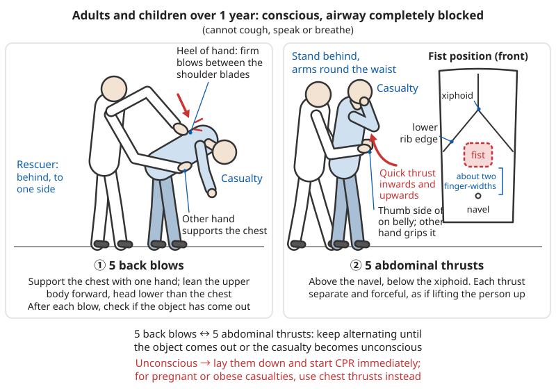
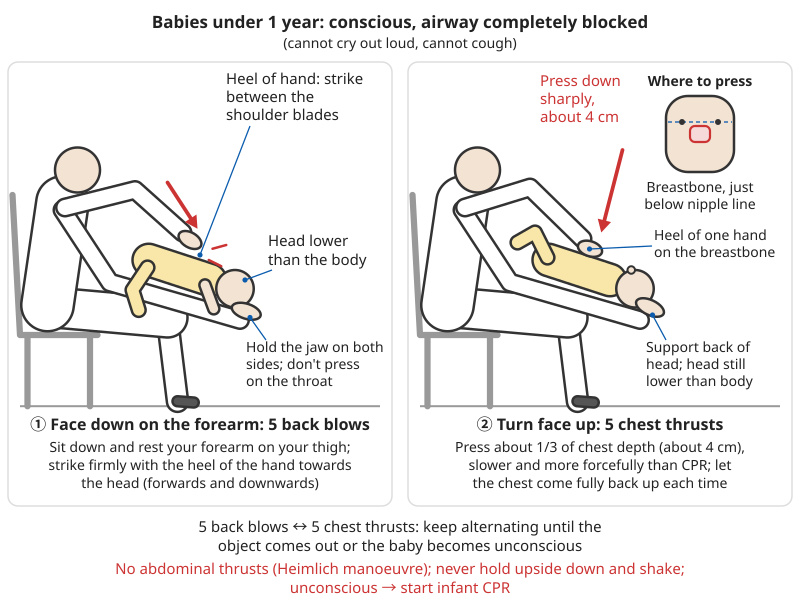

# Dealing with Foreign Bodies

## Contents
- [Foreign bodies in the eye](#foreign-bodies-in-the-eye)
- [Foreign bodies in the ear](#foreign-bodies-in-the-ear)
- [Foreign bodies in the nose](#foreign-bodies-in-the-nose)
- [Foreign bodies in the throat / airway obstruction](#foreign-bodies-in-the-throat--airway-obstruction)
- [Swallowed objects](#swallowed-objects)
- [Foreign bodies in the skin, fish hooks and impaled objects](#foreign-bodies-in-the-skin-fish-hooks-and-impaled-objects)

---

## Foreign bodies in the eye

### Common foreign bodies

- Dust, sand
- Eyelashes
- Small insects
- Wood splinters, metal fragments

### Symptoms

- Stinging, feeling that something is in the eye
- Watering
- Redness
- Frequent blinking
- Blurred vision

**How to judge how serious it is**:

| Situation | Most likely | What to do |
|------|--------|--------|
| Wind blew in sand; better after blinking and tears | Superficial foreign body | Rinse as described below |
| Feeling of something in the eye won't go away, but you can't see anything | Object hidden under the upper eyelid, or the cornea is scratched | Rinse; if no better, see a doctor the same day |
| Something "shot" into the eye while grinding or hammering metal or splitting wood | High-speed fragment; may be embedded in or have pierced the eyeball | **Do not remove it yourself**; cover the eye and get medical help at once |
| A black dot or rust spot is visible on the surface of the eye | Metal particle embedded in the cornea | Do not pick at it; see a doctor |
| Eye misshapen, clear jelly-like fluid leaking, pupil misshapen | Ruptured eyeball | Treat as for "Eyeball pierced" below; get to hospital at once |

### What to do

#### Superficial foreign bodies (dust, eyelashes)

```
1. Wash your hands
2. Do not rub the eye!
   (rubbing drags the grit back and forth across the cornea and turns
    a small problem into a corneal scratch)
3. Let the eye clear it by itself first:
   - Close the eye for 1-2 minutes so tears build up, then blink gently
   - Most dust and eyelashes wash with the tears to the inner corner;
     lift them off with the corner of a clean damp tissue
4. Rinse:
   - Rinse the eye with a steady stream of clean water until the
     gritty feeling is gone (usually a few minutes)
   - Tilt the head towards the affected side and rinse from the inner
     corner towards the outer corner (so the water doesn't run into
     the other eye)
   - Pour slowly from a cup or clean bottle, or use a thin stream
     from a tap
   - Or put the face into a basin of clean water and open and blink
     the eye
   - If wearing contact lenses, take them out before rinsing
5. Pull the eyelid:
   - Look down, take hold of the upper eyelashes, and gently pull the
     upper lid out and down over the lower lid
   - Let the lower lashes brush the object off the inside of the upper lid
6. If you can see the object:
   - Lift it off gently with a moistened cotton bud
   - Only on the white of the eye
   - Turn down the lower lid (look up, gently pull the lower lid down)
     to check underneath

Signs you got it right: the gritty feeling is gone, vision is normal,
and redness and watering are clearly less within 1-2 hours.
Still painful, sensitive to light or watering after the object is
out → the cornea may be scratched; see a doctor.
```

What water to use: tap water, cooled boiled water or bottled water are all fine; saline is more comfortable but not necessary. If there is no clean water, use the cleanest water you can find — don't lose time looking for water.

#### ❌ Do not

```
- Rub the eye
- Touch the eyeball with a dry cotton bud or anything hard
- Try to remove an embedded object
- Touch the cornea (the dark part of the eye)
- Lick the eye (bacteria from the mouth cause infection)
- Use eye drops containing steroids on your own
```

#### Metal, wood and other high-speed fragments

```
Fragments that fly into the eye while grinding, cutting or hammering
metal, splitting wood or cutting weeds travel very fast. They can
embed in the cornea or even enter the eyeball, while the wound on
the surface looks tiny.

1. Do not rub, do not rinse with high-pressure water, do not pick at it
2. Cover the eye lightly with clean gauze or cloth
3. See a doctor the same day (an iron particle starts to rust within
   a few hours and leaves a rust ring)
4. Tell the doctor what you were doing (after striking metal, the
   doctor needs to check whether a fragment entered the eye)

Prevention: wear safety goggles when grinding, chiselling, hammering
or splitting wood.
```

For safety protection when grinding and machining, see [Fitting and machining](../../../docs/05-冶金技术/09-钳工与机械加工.md).

#### Eyeball pierced or object stuck in the eye

```
⚠️ This is an eye emergency. The goal is to save the eye, not to get
   the object out at the scene.

1. Have the casualty lie flat or half-lie, keep quiet and still;
   no bending the head down, no straining
2. Do not pull out an object stuck in the eye, do not rinse, do not
   press on the eyeball
3. Protect the eye:
   - Cover the injured eye with a paper cup or the cut-off bottom of a
     plastic bottle, with the rim resting on the bony eye socket;
     tape it in place
   - The cup must not touch the eyeball or the object
   - Cover the other eye too (both eyes move together; covering the
     good eye reduces movement of the injured one)
4. Nothing to eat or drink (surgery under anaesthesia may be needed)
5. Call 120 or go straight to a hospital eye department
```

### ⚠️ Seek medical help immediately

- Object embedded in the eyeball
- Metal or wood fragments
- Chemical splashed into the eye (rinse for 15-20 minutes first, then get medical help)
- Blow to the eyeball
- Severe pain
- Marked loss of vision
- Object cannot be removed
- Still uncomfortable after removal

### Chemicals in the eye (emergency!)

```
Immediate action:
1. Rinse at once! No delay!
   (nothing matters more than water; rinse first, then phone, then
    look for containers)
2. Rinse under running water for at least 15-20 minutes
3. Hold the eyelids open while rinsing
4. Keep rinsing while someone calls for an ambulance
5. Take the chemical's container or label with you
6. Get medical help

Note:
- Both acids and alkalis cause serious damage
- Time is sight!
- The sooner you rinse, the better
```

**How to rinse effectively**:

```
1. Have the casualty lie down or turn the head, injured eye lowest
   (so contaminated water doesn't run into the good eye)
2. Hold the upper and lower lids apart with two fingers — the casualty
   will squeeze the eye shut because of the pain; you must hold it
   open or the water will never get into the eye
3. Run the water from the inner corner to the outer corner: plenty of
   water, low pressure
   (tap turned low, or pour continuously from a kettle or bottle)
4. While rinsing, have the casualty roll the eye up, down, left and
   right so the water reaches the corners under the lids
5. Contact lenses: rinse for a few minutes, take the lenses out,
   then carry on rinsing
6. If both eyes were splashed, rinse both
7. When the time is up, keep rinsing if it still hurts; keep rinsing
   on the way to hospital if you can
```

| Chemical | Examples | Notes |
|--------|------|------|
| Alkali | Lime, cement, drain cleaner, caustic soda, plant-ash water, lye water | **More dangerous than acid**: keeps penetrating deeper; may be very serious even if it doesn't hurt much at first; rinse for longer |
| Acid | Toilet-bowl cleaner, battery acid, sulphuric acid | Very painful, but most damage is fairly superficial; strong acids can still blind |
| Other irritants | "84" bleach (sodium hypochlorite), washing-up liquid, chilli, petrol | Most improve after rinsing; see a doctor if still painful or vision is blurred |

#### Lime, cement and other powders in the eye

```
Quicklime gives off a lot of heat when it meets water:
1. First gently brush the dry powder off the skin around the eye and
   the eyelids with a clean dry cloth or cotton bud
2. Then rinse with plenty of water (as above, at least 15-20 minutes)
3. Always see a doctor — lime burns are often underestimated at first
```

```
❌ Do not try to "neutralise" with vinegar, milk, soda water etc.
   (neutralisation gives off heat, and it delays rinsing)
❌ Do not go looking for eye drops first; do not rinse for only a
   minute or two
❌ Do not bandage or press on the eye after rinsing
```

For whole-body treatment of pesticide or cleaning-product poisoning, see [Poisoning](12-poisoning.md#general-principles-for-handling-poisoning).

---

## Foreign bodies in the ear

### Common foreign bodies

- Small insects
- Small beads, toy parts (children)
- Cotton wool, balls of paper
- Food
- Beans, seeds (children)
- Button batteries (children; dangerous)

### Symptoms

- Earache
- Reduced hearing
- Ringing in the ear
- Discomfort
- Discharge (insect moving)

A live insect crawling or fluttering in the ear makes a very loud noise and severe pain, and the person will be very frightened. First get them to sit down calmly — this is not life-threatening. Young children may not be able to explain; they may just keep scratching an ear and crying, or have a foul-smelling discharge from one ear.

### What to do

#### Live insect in the ear

```
0. Try first: in a dark place, shine a torch into the ear canal
   opening — some insects will crawl out towards the light
1. Tilt the head (affected ear up)
2. Put in drops of:
   - Warm vegetable oil (olive oil, baby oil)
   - Or warm water
   - A few drops are enough
   - Close to body temperature: test a drop on the inside of the
     wrist — neither hot nor cold
     (liquid that is too cold or too hot in the ear canal causes
      violent dizziness and vomiting)
   - Adults: pull the outer ear up and back; children: pull it down
     and back. This straightens the canal so the oil runs in more easily
3. The insect will float out or die
4. Tilt the head (affected ear down) to let it run out
5. If it doesn't come out, see a doctor to remove it
   (a dead insect left in the ear canal must also be removed or it
    will cause infection)

⚠️ Do not put any liquid in the ear if:
- The ear is bleeding or discharging pus, or was recently injured
  or exposed to a blast
- The person has had a perforated eardrum or grommets (ear tubes)
- The object in the ear is a button battery or a bean
```

#### Visible object

```
If you can see it and it is near the outside of the ear:
1. Tilt the head (affected ear down)
2. Tap gently on the other side of the head
3. It may fall out

Or:
- Use tweezers (very carefully!)
- Only for objects you can see completely
- At the opening of the ear canal
- Only grip soft things with edges you can hold (paper, cotton wool)
- Don't grip round, smooth things (beads, beans) — they slip
  further in when you squeeze
- Don't try if the child won't cooperate or is moving about
```

#### Beans, seeds and other objects that swell in water

```
- Never put in water or oil drops
  (beans swell when they absorb water, jam tighter, hurt more and
   are harder to remove)
- Tilt the head towards the affected side, tap the other side; if it
  doesn't come out, go to a hospital ENT (ear, nose and throat)
  department
- Not an emergency, but it should be removed within 1-2 days
```

### ❌ Do not

```
- Dig in the ear with a cotton bud or anything hard
- Dig deeper (you may push it further in)
- Flush with water (unless it's a live insect)
- Use tweezers blindly
- Try to remove deep objects yourself
```

The outer ear canal is narrow and the eardrum is at the end of it. Reaching in with a hairpin, matchstick or other hard object can easily push the object onto the eardrum or puncture the eardrum.

### ⚠️ Seek medical help immediately

- Object deep in the ear canal
- Battery (corrosive — urgent!)
- Sharp object
- Severe earache
- Bleeding
- Marked loss of hearing
- Cannot remove it yourself
- Dizziness, unsteady walking, drooping face (the inner ear or a nerve may be injured)

---

## Foreign bodies in the nose

### Common objects (mostly children)

- Small toys, beads
- Food
- Paper, cotton wool
- Small batteries (dangerous!)

### Symptoms

- Blocked nose on one side
- Runny nose (may smell bad or be blood-streaked)
- Difficulty breathing
- Nose pain

Children who push something up their nose are often afraid to say so. If **only one nostril** has a long-lasting foul, pus-like or blood-streaked discharge, or there is bad breath with no obvious cause, think of a foreign body in the nose and have a doctor check.

### What to do

#### Visible object

```
Method 1: Blowing the nose
1. Press the unaffected nostril closed
2. Blow gently out of the affected side
3. Don't blow too hard
   (for older children who can blow their nose, and adults:
    breathe in through the mouth, close the mouth, then breathe out
    hard through the affected nostril)

Method 2: The "parent's kiss" (children)
1. Press the unaffected nostril closed
2. The parent gives a quick puff of air into the child's mouth
3. The air may push the object out
   How: the child lies flat or sits on the parent's lap.
   The parent seals their mouth completely over the child's mouth
   and gives one short, sharp puff, as if blowing up a balloon
   (not a long continuous blow).
   The child instinctively closes the glottis, so the air can
   only go out through the nose and pushes the object out.
   Try 2-3 times; if it doesn't work, go to hospital.
   Telling the child beforehand "it's like a kiss" reduces struggling.

Method 3: Tweezers (only if visible from outside)
- Very carefully
- Only at the opening of the nostril
- Don't grip round, smooth objects
```

#### Button batteries and magnets in the nose

```
- A button battery discharges in the moist nose and can eat through
  the nasal septum within a few hours
- Some people put two small magnets on either side of the septum as
  a fake "nose ring"; they crush the tissue in between
- No water or oil drops, don't wait — go to A&E (emergency
  department) at once
```

### ❌ Do not

```
- Poke with anything hard
- Try to hook it out (you may push it further in)
- Let the child sniff hard
- Use tweezers blindly
```

Sniffing hard can suck the object to the back of the nose, from where it can drop into the throat and windpipe — turning a small problem into an airway obstruction. While dealing with it, have the child **breathe through the mouth**.

### ⚠️ Seek medical help immediately

- Battery (at once! corrosive)
- Magnets (especially two)
- Sharp objects
- Cannot be removed
- Difficulty breathing
- Heavy bleeding

For how to stop a nosebleed by pressure, see [Basic first aid – Nosebleeds](00-basic-first-aid.md#nosebleeds).

---

## Foreign bodies in the throat / airway obstruction

Once the airway is completely blocked, a person loses consciousness within a few minutes, and brain damage and death can follow in under 10 minutes. **An ambulance usually cannot arrive in time.** So the people nearby must act immediately. At least one person in every household should learn the methods in this section, ideally on a Red Cross first-aid course with practice on a manikin.

### Judging severity

The most common scenes: at mealtimes (especially when talking and laughing while eating, after drinking alcohol, or when an elderly person's dentures are loose), or a child playing with small objects or eating nuts or jelly — the person suddenly stops and looks terrified. **First ask: "Are you choking?"**

#### Partial obstruction (mild)
**Symptoms**:
- Can cough
- Can speak or cry
- Can breathe (though with difficulty)

**What to do**:
```
✓ Encourage them to cough hard
✓ Do not slap the back or intervene
✓ Keep watching
✓ Be ready to give first aid

If it becomes a complete obstruction, act at once!
```

Why not intervene: a strong cough is the most effective way to clear an object — better than any outside force. Slapping the back, giving water or reaching in with fingers at this stage may loosen the object and lodge it deeper, turning a partial obstruction into a complete one. Stay with them and don't let them wander off alone (many people hide in the toilet and collapse there).

If they have coughed for several minutes and still can't bring it up, keep feeling something there, or an elderly person or child keeps choking and coughing, also get medical help soon.

#### Complete obstruction (severe)
**Symptoms**:
- Cannot cough
- Cannot speak or cry
- Cannot breathe
- Clutching the throat with both hands (the choking sign)
- Face turning blue

**What to do**: give first aid immediately!

| Sign | Partial obstruction | Complete obstruction (or becoming severe) |
|------|----------|------------------------|
| Cough | Strong, loud | None, or silent and getting weaker |
| Speaking/crying | Can | Cannot; can only nod or shake the head |
| Breathing | Yes; may wheeze | No airflow, or a thin high-pitched noise on breathing in |
| Face colour | Flushed red | Blue, grey |
| Consciousness | Alert | Quickly becomes confused, collapses |

⚠️ If the cough **becomes weak or silent**, or there is a high-pitched "hiss" on breathing in, treat it as a complete obstruction — don't wait for the face to turn blue.

### First aid

```
Basic sequence (adults and children over 1 year):

Conscious, complete obstruction → have someone call 120 → 5 back blows → 5 abdominal thrusts → repeat, alternating
                                                   ↓
                                         Object comes out → still get checked by a doctor
                                                   ↓
                                         Loses consciousness → lay flat, start CPR at once
```

Back blows first, or thrusts straight away: the European Resuscitation Council (ERC) and the American Heart Association (AHA, 2025 edition) recommend 5 back blows followed by 5 abdominal thrusts, alternating ("5 and 5"). First-aid education in China and some local Red Cross training also switched to this sequence around 2026; previously China mostly taught abdominal thrusts (the Heimlich manoeuvre) straight away. **Both can save a life; what matters is acting at once without hesitating.** If you only learned the old method, use the one you know.

#### Adults and children over 1 year: the Heimlich manoeuvre

**Back blows (may be done first)**:

```
1. Stand behind and slightly to the side of the casualty
2. Support the chest with one hand and lean them forwards, head lower
   than the chest
   (so a loosened object falls towards the mouth rather than further in)
3. With the heel of the other hand, strike firmly between the
   shoulder blades
4. Give 5 blows, checking after each one whether the object has come out
5. Not out after 5 blows → switch to 5 abdominal thrusts
```

**Casualty standing or sitting**:

```
1. Stand behind the casualty
2. Put both arms around the waist
3. Make a fist and place the thumb side of the fist:
   - Above the navel
   - Below the lower edge of the ribs
4. Grasp the fist with the other hand
5. Pull sharply inwards and upwards
6. Repeat until:
   - The object comes out, or
   - The casualty becomes unconscious

Force:
- Quick and strong
- Inwards and upwards
- Each thrust separate

Details:
- Fist position: about two finger-widths above the navel, below the
  xiphoid process (the pointed lower tip of the breastbone).
  Do not press on the xiphoid or the ribs (risk of fractures and
  injury to internal organs)
- Lean the casualty slightly forwards; stand firm with one foot
  between the casualty's feet. If they lose consciousness you can
  let them slide down to the floor instead of falling stiffly
- Each thrust is a separate, sharp "J"-shaped pull, as if lifting
  the person up — not continuous kneading; mean every thrust to
  force the object out
- Casualty sitting in a chair or wheelchair: hold them from behind
  the backrest and do the same
- Children (about 1-8 years): kneel or crouch to the child's height
  and use correspondingly less force
```



*Figure: ① Stand behind and to the side, support the chest with one hand and lean them forwards, strike between the shoulder blades with the heel of the hand; ② stand behind, arms around the waist, fist above the navel and below the xiphoid, thrust inwards and upwards.*

**Casualty unconscious**:

```
1. Lay them flat
2. Start CPR (chest compressions)
3. Each time before giving rescue breaths:
   - Look in the mouth
   - If you can see the object, remove it
   - Do not sweep blindly
4. Continue CPR until help arrives

Details:
- Support them and lower them slowly onto a hard floor; shout for
  help; have bystanders call 120 and fetch an AED (put the phone on
  speaker beside you)
- No need to check the pulse first; start straight away with chest
  compressions
  (compressions raise the pressure in the chest, which may itself
   push the object out)
- Position, depth and rate of compressions are the same as normal
  CPR: 30 compressions : 2 rescue breaths
- Only use your fingers for an object you can see and can pick out;
  if you can't see it, don't put your fingers in to dig (you will
  push it deeper)
- If breaths won't go in (chest doesn't rise), don't keep trying;
  carry on with compressions
```

For the full CPR steps, see [Basic first aid – CPR](00-basic-first-aid.md#cardiopulmonary-resuscitation-cpr).

**Pregnant or obese casualty**:

```
Chest thrusts:
1. Put both arms around the chest
2. Place the fist on the middle of the breastbone
3. Thrust sharply backwards

Details:
- For: mid to late pregnancy (bump clearly showing), and people
  whose waist is too large to get your arms around
- Pass your arms under the casualty's armpits and around the chest
- Place the fist on the lower half of the breastbone (centre of the
  line between the nipples, the same place as CPR compressions),
  avoiding the xiphoid and the ribs
- Grasp the fist with the other hand and thrust straight back
  (towards yourself), each thrust separate
- If a pregnant woman loses consciousness, also start CPR at once,
  and tell the ambulance crew she is pregnant
```

**Self-rescue** (alone):

```
Method 1: Abdominal thrusts
1. Place your fist on your abdomen
2. Grasp it with the other hand
3. Thrust sharply inwards and upwards

Method 2: Chair-back method
1. Lean over the back of a chair
2. Press your abdomen against the top of the backrest
3. Thrust sharply downwards

Details:
- Call 120 first; if you can't speak, don't hang up — tap the
  handset, make noises, and try to open the door or get to where
  people are (you can't count on the call handler being able to
  locate you)
  or rush to where people are, knock on doors, bang on a table to
  attract attention
- Fist position as above: above the navel, below the lower edge of
  the ribs
- Instead of a chair back you can use the edge of a table, a stair
  rail, the edge of a kitchen worktop or any other firm, fixed,
  waist-high hard edge; don't use a chair that can slide
- Make every thrust hard and fast; repeat until the object comes out
- Even if self-rescue works, get checked by a doctor afterwards
```

#### Babies under 1 year

**Back blows + chest thrusts**:

```
1. Back blows:
   - Lay the baby face down along your forearm
   - Head lower than the body
   - Support the head and neck
   - Strike the back (between the shoulder blades) with the heel of
     your hand
   - 5 times, firmly

2. Turn the baby over:
   - Face up
   - Head still lower than the body

3. Chest thrusts:
   - Place the heel of one hand on the middle of the breastbone
     (just below the line between the nipples)
   - Press down sharply (about 4 cm deep)
   - 5 times

4. Repeat back blows and chest thrusts
   - Until the object comes out
   - Or the baby becomes unconscious

If unconscious:
- Start infant CPR
- Check the mouth for the object
- Call for an ambulance
```

**Technique details**:

```
Position:
- Sit down or kneel on one knee and rest the forearm holding the baby
  on your thigh, so you don't tire and won't drop the baby
- During back blows hold the baby's jaw on both sides (thumb and
  fingers apart, gripping the jawbone); do not squeeze or press on
  the soft tissue of the throat

Force of back blows:
- With the heel of the hand, strike between the shoulder blades
  forwards and downwards (towards the head)
- Strike firmly — hard enough to shake something loose, not the
  gentle pat used to settle a baby to sleep

Turning over:
- Support the back of the baby's head and the back with your other
  hand, "sandwich" the baby between your two forearms and turn them
  over as one unit, without letting the head and neck wobble

Chest thrusts:
- Place the heel of one hand on the breastbone just below the line
  between the nipples
  (the two-finger method of older manuals often doesn't reach enough
   depth; the new guidelines changed to the heel of the hand)
- Press down about one third of the chest depth (about 4 cm) each
  time, slower and more forcefully than CPR compressions, letting the
  chest come fully back up between thrusts
- After each round, glance into the mouth; only hook an object out
  with your little finger if you can see it

Calling for help:
- With a bystander: have them call 120 right at the start
- On your own: call 120 on speakerphone and keep going while you talk
```



*Figure: ① Baby face down along the forearm, head lower than the body, jaw supported, strike between the shoulder blades with the heel of the hand; ② turn face up, press the heel of one hand on the breastbone just below the nipple line, about 4 cm. Do not use abdominal thrusts on babies.*

**Partial obstruction in a baby**: if the baby can cry out loud and cough, let them cough by themselves, keep their head slightly lower and watch. Don't slap the back, don't hold them upside down, don't put your fingers in. If the crying gets weaker, the cough becomes silent or the lips turn blue, act at once as described above.

For how infant CPR differs from adult CPR, see [Differences in child and infant CPR](00-basic-first-aid.md#how-cpr-differs-for-children-and-infants).

#### ❌ Do not (babies)

```
- Do not use the Heimlich manoeuvre (it injures internal organs)
- Do not give back blows with the head up (the object may go deeper)
- Do not sweep the throat blindly
- Do not hold the baby upside down by the feet and shake (injures
  the neck, and is no more effective than proper back blows)
- Do not give water or milk to "wash it down"
```

#### After successful first aid

```
Once the object is out and breathing has recovered, still get checked
by a doctor, especially if:
- Abdominal or chest thrusts were given (they can injure organs or ribs)
- There is still coughing, wheezing, hoarseness or painful swallowing
- You suspect part of the object is still in there
- The casualty is a baby, a pregnant woman or an elderly person

⚠️ Object in the bronchus: a child chokes and coughs on peanuts or
   sunflower seeds, then "gets better", but afterwards keeps
   coughing, wheezing, running fevers, with "pneumonia that won't
   clear up" — a small piece may have dropped into a bronchus.
   Whenever there has been a definite choking episode, tell the doctor.
```

### Prevention

```
✓ Chew thoroughly, eat slowly
✓ Take small mouthfuls
✓ Don't talk and laugh while eating
✓ Children:
  - No nuts (under 3 years)
  - Cut food into small pieces
  - Keep small toys away
  - Supervise meals
✓ Elderly people:
  - Make sure dentures fit securely
  - Cook food soft
✓ Take especially small, slow bites when drinking alcohol or eating
  large pieces of meat
✓ People with swallowing difficulties (after a stroke, bedridden
  elderly people):
  - Sit upright to eat and stay sitting for 30 minutes after
  - Thicken liquids with rice paste or lotus-root starch; they are
    less likely to cause choking than plain water
  - No sticky, slippery foods such as rice cakes, glutinous rice
    balls or jelly
```

For a detailed list of choking-hazard foods for children, see [Child safety – Preventing choking](14-child-safety.md#preventing-choking-and-suffocation); for how to feed bedridden elderly people, see [Elder care – Safe feeding](13-elder-care.md#feeding-safely-and-preventing-choking).

---

## Swallowed objects

### Commonly swallowed objects

- Coins
- Button batteries (dangerous!)
- Magnets (especially several)
- Fish bones, other bones
- Drawing pins, needles
- Toy parts
- Coloured beads that swell in water (water beads, sponge toys; dangerous)
- Dentures, toothpicks, jujube stones (mostly elderly people)

### Symptoms

- May be none
- Difficult or painful swallowing
- Drooling
- Chest or abdominal pain
- Vomiting
- Refusing food

**Where it gets stuck**: swallowed objects most often stick in the oesophagus (behind the breastbone). Typical signs of an object stuck in the oesophagus are **drooling, being unable to swallow saliva, vomiting whenever they eat, and pain behind the breastbone**; a young child may suddenly refuse food, cry and drool. The object must then be removed by a doctor the same day. Once past the oesophagus and into the stomach, most small, round, blunt objects pass out naturally in the stool.

If there is also coughing, wheezing or difficulty breathing, it may have gone into the airway — treat as [airway obstruction](#foreign-bodies-in-the-throat--airway-obstruction).

### What to do

#### Ordinary objects (coins, small round things)

```
If the person:
✓ Can speak
✓ Can breathe
✓ Has no pain or only mild discomfort

What to do:
1. Stay calm
2. Do not make them vomit
3. Nothing to drink or eat
4. Phone a doctor for advice
5. Check the stools (most pass within 1 week)

See a doctor if:
- Pain persists
- Difficulty swallowing
- Vomiting
- Abdominal pain
- Not passed after about 1 week (depending on the size of the object)

Notes:
- No vomiting: while vomiting, the object may come back up from the
  stomach and stick in the oesophagus or drop into the airway
- Nothing to eat for now: if it has to be removed by endoscopy,
  an empty stomach is safer; eat once the doctor says so
- A child who has swallowed a coin usually needs an X-ray to confirm
  where it is
  (coins and button batteries look very similar on an X-ray; a
   doctor must tell them apart)
- Checking stools: collect each stool in a container and break it up
  with chopsticks or in water to check, until you find the object;
  normal diet is fine — no laxatives or "eating chives" needed
```

**Not sure what was swallowed**: a coin-sized disc missing from near the child, the back of the remote control open, a battery missing from a toy — **always treat it as a button battery** and get medical help at once.

#### Dangerous objects (seek medical help immediately!)

**Button batteries**:
```
Extremely dangerous!
- Can cause a severe chemical burn within 2 hours
- Go to A&E at once!
- Do not wait
- Do not make them vomit
- Nothing to eat except honey
- Over 1 year old and within 12 hours of swallowing: on the way to
  hospital you can give 10 mL (2 teaspoons) of honey every 10
  minutes, up to 6 times
  (it coats the battery and reduces the burn; babies under 1 year
   must not have honey)
- Take the battery packaging or an identical battery with you

Why it is so dangerous:
- A battery stuck in the moist oesophagus keeps discharging and
  produces strong alkali on the negative side of the battery
- The alkali eats through the oesophageal wall layer by layer and can
  burn through into the windpipe or the aorta; some cases bleed
  massively days or even weeks after the battery is removed
- The child may have no symptoms at first — you cannot "wait and see"
- Lithium batteries about 2 cm across (e.g. CR2032) are the most
  dangerous
- "Old" flat batteries are also dangerous
```

**Magnets (two or more)**:
```
Extremely dangerous!
- They can attract each other inside the bowel
- Causing bowel perforation
- Seek medical help immediately!

Notes:
- Two magnets attract each other through two loops of bowel wall;
  the trapped bowel wall dies and perforates
- One magnet plus one iron object (coin, iron bead, hairgrip) is
  just as dangerous
- Most dangerous are small strong magnetic balls and the small
  magnets in magnetic building toys
- If you're not sure how many were swallowed, treat it as several
```

**Sharp objects**:
```
Dangerous!
- Fish bones, other bones, needles, drawing pins
- Can pierce the digestive tract
- Seek medical help immediately
- Do not swallow food (trying to push it down)
- Do not make them vomit
```

**Long or large objects, things that swell in water**:
```
- Objects longer than about 6 cm or wider than about 2 cm often
  cannot pass the stomach outlet and the bend of the duodenum and
  must be removed by a doctor; young children have narrower guts,
  so shorter objects can also get stuck
- Water beads and absorbent sponge toys swell several times over in
  the bowel and cause bowel obstruction; they don't show on X-ray —
  if swallowed, get medical help
- Packets of drugs and objects containing lead (lead fishing weights,
  some old paint flakes) also need medical help immediately
```

#### Fish bone stuck in the throat

```
❌ Wrong methods (don't use!):
- Swallowing a ball of rice or steamed bun (may drive it deeper)
- Drinking vinegar (doesn't work)
- Digging with fingers

✓ Correct method:
1. Stop eating
2. If you can see the fish bone, remove it carefully with tweezers
3. If it is deep in the throat:
   - Don't try to deal with it yourself
   - Seek medical help immediately
4. The doctor will:
   - Examine with a laryngoscope
   - Remove the fish bone

Danger signs:
- Severe pain
- Difficulty breathing
- Difficulty swallowing
- Drooling
- Vomiting blood
```

| Folk remedy | Why it doesn't work |
|------|------------|
| Swallowing a ball of rice, steamed bun or chives | Can force the bone hard into the wall of the throat or oesophagus, driving it deeper; fish or chicken bones stuck in the oesophagus can pierce it, causing infection of the mediastinum or even puncturing the aorta |
| Drinking vinegar | A mouthful of vinegar stays in the throat for only a second or two and can't soften a fish bone; drinking a lot also burns the lining of the mouth and oesophagus |
| Digging with fingers, poking with chopsticks | You can't see; easy to push the bone deeper or scratch the throat, and it causes vomiting |
| Coughing hard, retching | Occasionally helps, but too much force can drive the bone in more firmly |

**How to look for yourself**:

```
1. In good light (or with a torch), open the mouth wide and say a
   long "aah"
2. Gently press down the front two thirds of the tongue with the
   handle of a clean spoon (not too far back or it will make them gag)
3. Fish bones most often lodge in the tonsils (the fleshy lumps on
   either side of the throat) and the base of the tongue
4. If you can see it clearly and one end is sticking out: grip it with
   sterilised long tweezers and pull it out along the line it went in
5. Can't see it, can't reach it, or one or two attempts have failed →
   stop and go to a hospital ENT department
   (with a mirror or endoscope the doctor can remove it in minutes)
```

⚠️ After a fish bone has gone down, the scratched part of the throat can feel as if something is there for a while, which is hard to tell apart from a bone still being stuck. **If the feeling doesn't go away, swallowing becomes more painful, or the pain is behind the breastbone**, see a doctor the same day — don't wait a few days to "see if it dissolves". Chicken bones, duck bones and jujube stones are harder and larger than fish bones; get medical help even sooner if they stick.

### ⚠️ Seek medical help immediately

- Button battery
- Several magnets
- Sharp objects
- Larger objects
- Difficulty breathing
- Severe pain
- Difficulty swallowing
- Vomiting (especially blood)
- Drooling
- Fever
- Abdominal pain
- Black or bloody stools
- Swollen abdomen, not passing wind or stools

### Prevention (children)

```
✓ Keep small objects away from children
✓ Check toys (no small parts)
✓ Store button batteries safely
✓ Put coins and magnets away
✓ Supervise meals
✓ Cut food into small pieces
✓ Remove fish bones and other bones
✓ Tape shut or screw closed the battery compartments of remote
  controls, kitchen scales and the like
✓ Clear away used batteries at once; don't leave them lying on a table
✓ Don't hold needles, drawing pins or coins in your mouth (children
  copy what adults do)
```

For more on preventing children swallowing things, see [Child safety – Especially dangerous small objects](14-child-safety.md#especially-dangerous-small-objects).

---

## Foreign bodies in the skin, fish hooks and impaled objects

### Small splinters in the skin

```
Wood, bamboo, cactus spines, glass:
1. Wash with soapy water
2. If one end is sticking out: grip it with sterilised tweezers and
   pull it out at the same angle it went in
3. If it is completely under the skin: gently lift the top layer of
   skin with a sterilised needle to expose one end, then grip it
   (pass the needle and tweezers through a flame or wipe them with
    75% alcohol)
4. Soaking in warm water for about 10 minutes first softens the skin
   and makes removal easier
5. Very fine bristles, glass fibre, fine cactus spines:
   press a strip of wide sticky tape on firmly, then rip it off
   quickly — it pulls out a whole patch of them
6. After removal, wash, put on a plaster and watch for a few days

Can't get it out, it's very deep, under a nail or at a joint → see a doctor
Redness, swelling, heat and pain getting worse after a few days, or
pus → something is left in or it's infected; see a doctor
```

For details, see [Wounds and injuries – Superficial puncture wounds](02-wounds-and-injuries.md#shallow-puncture-wounds).

### Fish hook injuries

Behind the point of a fish hook is a barb. Once it is in, **pulling it straight back out tears out a big piece of flesh**, and it is very painful.

```
Only the point is in, the barb is still outside the skin:
- Back it out the way it went in

The barb is in the skin (push-through-and-cut method):
1. First cut the fishing line; for a multi-point hook (treble hook),
   cut off or cover the other points first
2. Wash; an ice pack for a few minutes first reduces the pain
3. Following the curve of the hook, push the point onwards until the
   point and barb come out through the skin somewhere else
4. With pliers (combination pliers, side cutters), cut off the exposed
   barb together with the point
   (shield it with your hand or a cloth while cutting, so fragments
    don't fly into anyone's eyes)
5. Back the rest of the hook out along the way it went in
6. Wash the wound, disinfect and dress it

Only for: hooks in fleshy places such as fingers, palms, arms and
legs, where you can feel the point lying just under the skin.
```

```
❌ In these cases don't remove it yourself; secure the hook and go
   to hospital:
- In the eye, eyelid, face, ear or genitals
- In or near a joint, tendon or obvious blood vessel
- Very deep, and you can't feel the point
- The casualty is a child who won't cooperate

How to secure it: cut the line, pad several layers of gauze or rolled
cloth around the hook and tape them in place so it can't wobble
with movement.
```

### Large objects impaled in the body

When a steel bar, branch, knife, piece of glass or wooden stake goes into the body, the object itself often plugs the blood vessel it has torn. **Pulling it out can cause sudden massive bleeding** and further injury.

```
1. Call 120
2. Do not pull it out; do not move it about
3. Secure it: pad rolled towels or clothes in a ring around the
   object to "clamp" it, then bind the padding in place with
   bandages or strips of cloth (not pressing on the object)
4. Stop bleeding: press on the wound edges on both sides of the
   object, not on the object itself
5. Keep the casualty still; if it is in the chest or abdomen,
   nothing to eat or drink
6. If the object is too long to transport (e.g. a steel bar), don't
   cut it yourself; wait for the fire and ambulance crews to deal
   with it with their tools
7. Watch for signs of shock: pale face, cold sweat, fast weak pulse,
   restlessness or confusion

The only exceptions: remove it only if it is blocking the mouth or
nose so the person cannot breathe, or if it prevents CPR.
```

For details, see [Wounds and injuries – Deep puncture wounds](02-wounds-and-injuries.md#deep-puncture-wounds); for treating shock, see [Basic first aid – Treating shock](00-basic-first-aid.md#managing-shock).

### Tetanus

Any object that goes into the skin (especially rusty ones, ones soiled with earth or dung, and deep wounds from fish hooks, wood splinters or nails) carries a risk of tetanus. Whether a tetanus injection is needed: see [Wounds and injuries – Tetanus prevention](02-wounds-and-injuries.md#tetanus-prevention).

---

## 📝 Key points

### Principles for foreign bodies

```
✓ Stay calm
✓ Assess how serious it is
✓ Simple, safe methods first
✓ Don't act blindly
✓ Get medical help in good time

❌ Do not:
- Dig blindly
- Poke with anything hard
- Push the object deeper
- Delay getting medical help (dangerous objects)
- Pull out large objects stuck in the eye or the body
```

### Dangerous objects (seek medical help immediately)

- Button batteries
- Several magnets
- Sharp objects
- Chemicals in the eye
- Complete airway obstruction
- Objects stuck in the eye or the body
- Beads that swell in water

### First-aid skills to master

- The Heimlich manoeuvre
- Back blows for babies
- Eye rinsing
- Basic removal of foreign bodies

```
1. Choking: if they can cough, let them cough; can't cough, can't
   speak → 5 back blows + 5 abdominal thrusts, alternating
2. Pregnant women and people you can't get your arms around: chest
   thrusts instead; babies under 1 year: back blows + heel-of-hand
   chest thrusts
3. Loses consciousness → lay flat, CPR at once, look in the mouth
   before rescue breaths
4. Chemical in the eye → rinse first! Hold the lids open and rinse
   for at least 15-20 minutes; brush lime off before rinsing
5. Button battery, several magnets, sharp objects → A&E at once;
   over 1 year old, after swallowing a battery, honey may be given
6. Fish bone in the throat → no rice balls, no vinegar; only remove
   it if you can see it, otherwise go to an ENT department
7. Live insect in the ear: warm oil drops; beans must not get wet;
   object in the nose: have the child breathe through the mouth
8. Don't pull out objects stuck in the body or the eye; secure them
   and get to hospital
```

### Prevention matters most

- Supervise children
- Store small objects safely
- Chew thoroughly, eat slowly
- Prepare food safely
- Wear safety goggles when grinding or splitting wood

---

**Next chapter**: [Acute symptoms](05-acute-symptoms.md)
**Back**: [Chapter list](README.md) | [Main contents](../../README.md)
