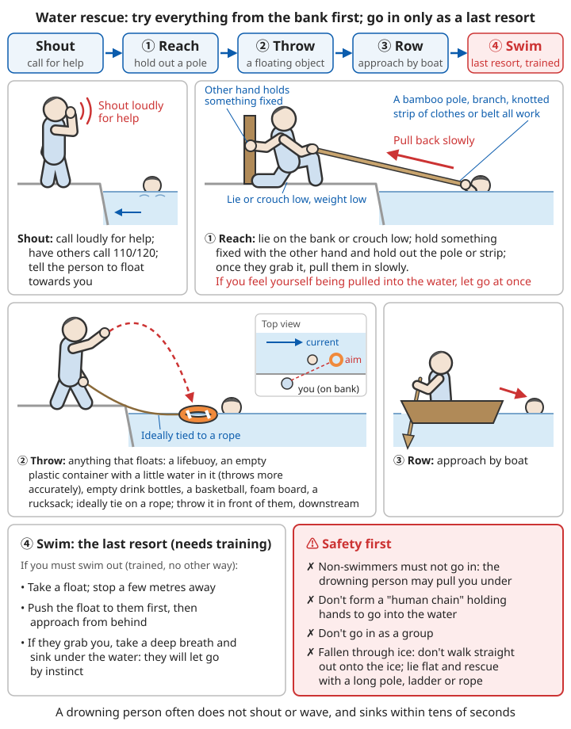

# Dealing with Acute Symptoms

> Each of the five situations in this chapter can become life-threatening within minutes to hours. The first step is the same for all of them: **make sure you are safe, then call 120**, and while waiting for the ambulance give the care described below. This chapter covers first aid while waiting for professional help; it cannot replace diagnosis and treatment in hospital.

## Contents
- [Allergic reactions](#allergic-reactions)
- [Heatstroke](#heatstroke)
- [Hypothermia](#hypothermia)
- [Electric shock injuries](#electric-shock-injuries)
- [Drowning](#drowning)

---

## Allergic reactions

An allergy is the immune system over-reacting to something that is normally harmless (peanuts, bee venom, penicillin and so on). Most allergic reactions are just itchy skin or a rash, but in a few people they develop within minutes into **anaphylactic shock**: the throat swells until they cannot breathe, and blood pressure drops suddenly. Severe food allergy usually starts within 30 minutes of contact; bee stings and injected drugs may take only a few minutes; most deaths happen within 1 hour of onset. So recognise it fast and give the medicine early.

### Severity

#### Mild allergy
- Itchy skin, red rash
- Slight swelling
- Runny nose, sneezing
- Itchy eyes

#### Moderate allergy
- Widespread rash, hives
- Obvious swelling
- Abdominal pain, nausea, diarrhoea
- Mild difficulty breathing

#### Severe allergy – anaphylactic shock (life-threatening!)
⚠️ **Call 120 immediately!**

**Symptoms**:
- Difficulty breathing, wheezing
- Swollen throat, difficulty swallowing
- Severe shortness of breath
- Falling blood pressure
- Fast, weak pulse
- Dizziness, confusion
- Pale or bluish skin
- Hives all over the body

#### How to tell it is anaphylactic shock

Don't wait for all the symptoms to appear. If **within minutes to hours of contact with a possible allergen (eating a certain food, a bee sting, taking a certain medicine)** any one of the following groups appears, treat it as anaphylactic shock:

| Situation | What you see |
|------|----------|
| Skin symptoms + breathing problems | Hives, swollen lips or eyelids, together with wheezing, chest tightness, hoarseness, tight throat |
| Skin symptoms + circulation problems | Rash together with dizziness, unsteadiness, pale face, fainting, loss of bladder or bowel control |
| Skin symptoms + severe gut symptoms | Rash together with severe abdominal pain, repeated vomiting |
| Known severe allergy to something, after contact | Any difficulty breathing or dizziness/fainting, even with no rash |

```
⚠️ Key points:
- About one in ten to one in five cases of anaphylactic shock have no
  rash; "no rash" does not rule it out
- A tight throat, a hoarse voice and difficulty speaking are signs of
  swelling of the larynx — the most dangerous sign
- If in doubt, treat it as anaphylactic shock (adrenaline does very
  little harm to someone who didn't need it; delaying it can be fatal)
```

#### Signs in children and babies

```
Babies and toddlers can't say how they feel. Watch for:
- Sudden inconsolable crying and irritability, or being unusually
  quiet, floppy or drowsy
- Scratching at the mouth, ears or throat
- Hoarse voice, coughing, noisy breathing (stridor)
- Repeated vomiting after eating a new food
- Pale face, bluish lips
When a baby first tries peanuts, eggs, seafood or other common
allergenic foods, give a small amount at home, during the day, with
an adult present, and watch for about 2 hours afterwards.
```

### What to do

#### Mild allergy

```
1. Get away from the allergen
   - Stop eating the suspect food; rinse the mouth
   - Caused by contact (e.g. plants, cosmetics): wash the skin with
     water and soap for more than 10 minutes
   - Stop the suspect medicine; keep the box (show it to the doctor)
   - Bee sting: scrape the sting out of the skin as soon as possible
     (with a fingernail or a card — speed matters more than method)

2. Take an oral antihistamine:
   - Loratadine
   - Cetirizine
   (usual adult dose is generally 10 mg once a day; for children,
    dose by weight and age as in the package leaflet; may cause
    drowsiness, more so with cetirizine — do not drive after taking it)

3. Cool the rash
   - Ice pack wrapped in a towel, or a towel soaked in cold water,
     10-15 minutes at a time
   - Calamine lotion can be applied to itchy areas
   - Don't scratch; don't wash with hot water (it makes the itch worse)

4. Watch how the symptoms change
   - Watch for at least 2 hours after contact with the allergen;
     don't leave the person alone
   - At any sign of breathing problems or dizziness, treat
     immediately as anaphylactic shock
```

⚠️ Antihistamines only relieve itching and rashes. They **cannot prevent anaphylactic shock and cannot treat it**. If there is already difficulty breathing or dizziness, don't wait for an antihistamine to "kick in".

#### Treating a moderate allergy

```
1. Treat as for a mild allergy above
2. Get medical help soon (go to a hospital or clinic the same day),
   with someone accompanying them on the way
3. Keep the person sitting or lying down; don't let them walk about
   alone
4. If there is wheezing or hoarseness, or swelling spreads to the
   lips, tongue or around the eyes
   → this may already be anaphylactic shock: call 120 at once and
     treat as below
5. Someone with asthma who starts wheezing can use their own reliever
   inhaler, but this must not delay adrenaline or calling 120
```

#### Anaphylactic shock (emergency!)

```
Immediate action:

1. Call 120
   (if the person carries an adrenaline (epinephrine) auto-injector,
    inject first, then phone; if someone else is there, one injects
    while the other phones)

2. Use an adrenaline auto-injector (if available):
   - E.g. EpiPen (currently hard to obtain in mainland China;
     high-risk people should ask a doctor in advance)
   - Inject into the outer thigh
   - Hold in place for a few seconds (about 3 seconds for most
     products; it varies by brand — follow the leaflet)
   - Can be repeated (after 5-15 minutes)
   - Note the time of injection and tell the ambulance crew

3. Lay the person flat:
   - Raise the legs
   - If vomiting, on their side
   - If breathing is difficult, half-sitting
   - Pregnant women: lie on the left side (stops the womb pressing on
     the large blood vessels)

4. Check breathing and pulse:
   - If absent, start CPR

5. Keep them warm

6. Do not let them suddenly stand up or walk (can cause a sudden fall
   in blood pressure and cardiac arrest);
   people with difficulty breathing can stay half-sitting

7. Do not give food or drink

8. Keep monitoring until the ambulance arrives
```

**Why position matters so much**: in anaphylactic shock the blood vessels widen and blood pressure is very low. If the person suddenly stands or sits up, blood rushes to the lower body and the heart may "run empty" and stop. Even if they feel better after adrenaline, they must stay lying down and be carried to the ambulance on a stretcher.

**Hospital is still needed after adrenaline**: adrenaline only works for about 10-20 minutes; a few patients have a second attack hours after the symptoms have gone (mostly within 12 hours), called a "biphasic reaction". So however well they seem after the injection, they must be observed in hospital; the doctor decides for how long.

#### How to use an adrenaline auto-injector

Adrenaline is the only first-line emergency medicine for anaphylactic shock; the earlier it is injected, the better it works. Auto-injectors are designed for non-professionals: the patient, family members and teachers can all use them. Different brands look different; **practise regularly with the leaflet or a trainer pen**. Taking a common pen-type product as an example:

```
1. Hold the middle of the pen in a firm fist; don't put your thumb
   over either end
   (identify which end is the needle end — usually marked with a
    colour or an arrow)
2. Pull off the safety cap (the safety cap is at the opposite end
   from the needle)
3. Aim the needle end at the middle of the outer thigh (the thickest
   muscle at the front and outer side of the thigh)
   - You can inject through trousers; no need to undress
   - Do not inject into the buttock, hands or feet, or into a vein
4. Push firmly straight into the thigh until you hear a "click"
5. Hold it pressed in for a few seconds (as the leaflet says), then
   remove it
6. Whether to rub the injection site gently depends on the leaflet
   (the US EpiPen leaflet says rub for about 10 seconds; newer
    leaflets in Australia and elsewhere have dropped this step)
7. Note the time. Give the used pen to the ambulance crew

Injecting a child: an adult first holds the child's leg still so that
movement doesn't make the needle cut the skin.

If symptoms have not improved, or get worse again, after 5-15 minutes:
→ Use a second pen, in the other thigh
```

| Strength | Generally for |
|------|----------|
| 0.15 mg (child) | Children weighing about 15-30 kg |
| 0.3 mg (adult) | Body weight about 30 kg or more |

Which strength to use and how many to carry are prescribed by a doctor based on weight and medical history; don't decide this yourself. Replace the pen promptly if the liquid is discoloured or cloudy, or it is out of date. Store at room temperature; don't leave it in a car in the sun or freeze it in the fridge.

#### Without an adrenaline pen

```
1. Call 120 immediately and say clearly "suspected severe allergic
   reaction, difficulty breathing", giving the location and the
   suspected allergen
2. Position, keep warm and monitor as in steps 3-8 above
3. Someone with asthma can use their own reliever inhaler for wheezing
4. Unconscious and not breathing → CPR at once
5. Antihistamine and steroid tablets take a long time to work and
   cannot replace adrenaline; don't skip calling 120 or going to
   hospital because they've "already taken medicine"
```

For CPR, see [Basic first aid – CPR](00-basic-first-aid.md#cardiopulmonary-resuscitation-cpr); for asthma attacks, see [Acute asthma attack](06-heart-stroke-and-sudden-illness.md#acute-asthma-attack).

### Common allergens

- **Foods**: peanuts, tree nuts, seafood, eggs, milk, soya, wheat
- **Medicines**: penicillin, aspirin, some vaccines
- **Insects**: honeybees, wasps, fire ants
- **Latex**
- **Other**: pollen, dust mites, animal dander

```
Some easily overlooked points:
- Food allergens often hide in processed foods: sauces, cakes and
  pastries, "vegetable protein", nut oils
- If you are allergic to one antibiotic, you may also be allergic to
  others of the same class (e.g. penicillins); tell the doctor
  without being asked
- Someone who had only a large local swelling from one bee sting may
  have a whole-body reaction next time
- Some people only react with "allergenic food + exercise" or
  "+ alcohol or painkillers"
- After anaphylactic shock, go to hospital to identify the allergen,
  or the next attack may be worse
```

For local treatment of insect bites and stings, see [Wounds and injuries – Insect bites and stings](02-wounds-and-injuries.md#insect-bites-and-stings).

### Prevention

```
✓ Know your allergens
✓ Carry with you:
  - An allergy card (stating your allergens)
  - Adrenaline auto-injector (if you have had a severe reaction)
  - Antihistamines
✓ Tell other people about your allergies
✓ Ask about ingredients when eating out
✓ Check the ingredients of medicines
```

**What to write on an allergy card**: name, allergens, the most severe reaction you have had, where your emergency medicines are kept and how to use them, and an emergency contact number. Have one in Chinese and one in English — handier when travelling abroad.

**People who have had anaphylactic shock**:
- Get allergy testing and ask the doctor to write an "allergy emergency plan"; keep a copy at home, at school and at work
- If prescribed, carry 2 adrenaline pens (one may fail or a second dose may be needed); watch the expiry date
- Family, colleagues and children's teachers must all know where the pen is kept and how to use it
- Before taking medicines, having injections or tests (e.g. contrast scans), tell the doctor about your allergies without being asked

---

## Heatstroke

Heat illness is a group of conditions caused when the body produces and absorbs more heat than it can lose, and temperature control breaks down. From mild to severe they are heat cramps, heat exhaustion and heatstroke. The first two recover with prompt rest, cooling and fluids; **heatstroke is an emergency with a high death rate**, and what decides life or death is **whether the body temperature is brought down within the first half hour**.

### Grades of heat illness

First look at the most important difference: **is the person's mental state changed?**

| | Heat cramps | Heat exhaustion | Heatstroke |
|---|---|---|---|
| Consciousness | Alert | Alert (may be irritable, dizzy) | **Altered**: talking nonsense, odd behaviour, seizures, coma |
| Body temperature | Normal or slightly raised | Usually <40°C | Usually ≥40°C |
| Skin | Sweating | Heavy sweating, cold and clammy | Burning hot; may be dry, or may still be sweating |
| Treatment | Rest, replace electrolytes | Shade, cooling, fluids | **Call 120 immediately + rapid cooling on the spot** |
| Severity | Mild | Moderate; can progress to heatstroke | Life-threatening |

```
⚠️ When judging:
- In the heat, ANY change in mental state (slurred speech, irrelevant
  answers, unsteady walking, unusual agitation) — treat as heatstroke
  first; don't wait to take a temperature
- In heatstroke caused by running, training or heavy work in the heat,
  the person is often still sweating heavily; "not sweating" is not
  required for heatstroke
- Household thermometers used under the arm or on the forehead often
  read much lower than the body's internal temperature; a reading
  under 40°C does not rule out heatstroke
```

#### 1. Heat cramps
**Symptoms**: painful muscle cramps (legs, arms, abdomen)

**What to do**:
```
1. Move to shade
2. Rest
3. Replace electrolytes
   - Sports drinks
   - Oral rehydration salts (ORS)
4. Gently stretch the cramping muscle
```

Heat cramps mostly happen in people who sweat heavily and drink only plain water (losing salt).

```
More detail:
- Without ORS, make your own using the home recipe in the "Common
  illnesses" chapter (about 3 g salt in 1 L water), or drink weak
  salt water, or eat something salty
- Calf cramp: straighten the leg and pull the toes back towards the
  body; hold until it eases
- Don't go back to heavy work or hard exercise in the heat that day
- If it hasn't eased after 1 hour's rest, or there is nausea or
  weakness, treat as heat exhaustion
- People with heart disease or on a low-salt diet should see a doctor
  if they get heat cramps
```

For making ORS, see [Common illnesses – Rehydration](01-common-illnesses.md#1-fluids-most-important).

#### 2. Heat exhaustion
**Symptoms**:
- Heavy sweating
- Cold, clammy skin
- Fast, weak pulse
- Nausea, vomiting
- Dizziness, weakness
- Slightly raised temperature (<40°C)

**What to do**:
```
1. Move to shade
2. Lie flat, raise the legs
3. Remove extra clothing
4. Cool:
   - Wipe the body with wet towels
   - Ice packs in the armpits, groin and on the neck
5. Fluids:
   - Small, frequent sips
   - Electrolyte drinks
6. If not better within 30 minutes, get medical help
```

```
How to do it:
- Shade: under trees, an air-conditioned room or car; if none, rig
  shade with clothes or a tarpaulin
- Raising the legs: rest them on a rucksack or clothes, about
  20-30 cm up
- Cooling: wet the skin with cool water, then fan it with a hand fan
  or electric fan (cooling by evaporation is faster than cold packs
  alone)
- Fluids: if alert and not vomiting, give cool (not iced) ORS or a
  sports drink, a few sips every few minutes, about 0.5-1 L within
  1 hour; don't gulp large amounts in one go; no alcohol, strong tea
  or coffee
- Vomiting or unable to keep fluids down: needs intravenous fluids in
  hospital; get medical help soon

If any of the following appears, call 120 at once and treat as
heatstroke:
- Altered mental state (confused, irrelevant answers, agitated, drowsy)
- Temperature ≥40°C
- Seizures
- Getting worse despite treatment
```

After recovering from heat exhaustion, don't go back to working or exercising in the heat that day, and cut down for the next day or two as well.

#### 3. Heatstroke / sunstroke (life-threatening!)
⚠️ **Emergency! Call 120 immediately!**

**Symptoms**:
- Body temperature ≥40°C
- **Dry, burning-hot skin** (may not be sweating)
- Altered mental state (confusion, agitation, coma)
- Seizures
- Rapid breathing
- Fast heartbeat
- Severe headache

(Note: the "dry skin" above is mostly seen in elderly people during hot weather; heatstroke caused by hard exercise often comes with hot, wet skin and continued sweating. The most reliable sign is **hot surroundings + altered mental state**.)

**Two types**:
- **Classic**: mostly in elderly people, babies and young children, and the chronically ill during heatwaves; comes on gradually after a day or two in a stuffy room, and is often mistaken by family for "just confused with age" or "asleep"
- **Exertional**: mostly in healthy young people (military training, long-distance races, physical work in the heat); can develop within an hour or two

**What to do**:

```
Emergency action:

1. Call 120 immediately

2. Cool rapidly (most important!):

   Ice-water immersion (most effective):
   - Ice-water bath
   - Continue until body temperature is down to 38.5°C

   Or evaporative cooling:
   - Remove clothing
   - Spray cool water all over the body
   - Blow air over them with a fan

   At the same time:
   - Ice packs on:
     * Both sides of the neck
     * Armpits
     * Groin

3. Lay on their side (in case of vomiting)

4. Do not give food or water (may lose consciousness)

5. Monitor temperature
   - Target: down to 38.5°C
   - Avoid over-cooling

6. Check breathing and pulse
   - CPR if needed

7. Keep cooling until the ambulance arrives
```

### Cooling methods in detail

The rule is **cool first, and keep cooling while waiting for the ambulance**. Don't give up cooling on the spot in order to "rush them to hospital": the longer the temperature stays above 40°C, the worse the damage to the brain, liver, kidneys and other organs. The methods below are listed from most to least effective; use whatever you have:

| Method | How | Effectiveness |
|------|--------|------|
| Cold-water immersion | Put the body in cold water with only the head and neck out | Fastest; first choice |
| Tarp-assisted immersion | Hold the casualty in a tarpaulin, plastic sheet or shower curtain by its edges and pour in cold water and ice | Nearly as good as immersion; works outdoors |
| Rotating iced towels | Cover the whole body with towels or sheets soaked in iced water; change every 2-3 minutes | Moderate |
| Spray + fan | Remove clothing, keep spraying with cool water while fanning with an electric or hand fan | Moderate; better in dry air |
| Ice packs only | Ice packs on the neck, armpits and groin | Too slow on its own; use only as an extra |

#### How to do cold-water immersion

```
1. A bath, large tub, inflatable paddling pool or water barrel will
   all do; the colder the water the better (add ice). Without ice,
   tap water, river or pond water is still better than no immersion
2. Remove extra clothing; lower the casualty half-lying into the
   water, with water up to the neck
3. Someone must hold the head and armpits the whole time to keep the
   mouth and nose above water
4. Keep stirring the water (to move the warmed water away from the body)
5. When to stop:
   - With a rectal thermometer: take them out at about 38.5°C
     (staying in longer cools them too much)
   - Without a reliable thermometer: about 10-15 minutes in iced
     water, about 15-20 minutes in tap or river water that isn't very
     cold, or when the casualty is clearly more alert or starts to
     shiver — then take them out
6. After taking them out, dry them and keep watching in the shade;
   cool again if the temperature or mental state worsens
```

⚠️ During immersion someone must watch and hold the casualty at all times; an unconscious person can slip under the water.

#### What not to do while cooling

```
❌ Do not give fever-reducing medicine (paracetamol (acetaminophen),
   ibuprofen, etc.)
   - The high temperature of heatstroke is not a "fever"; these
     medicines don't work and may worsen liver and kidney damage
❌ Do not rub the body with alcohol (absorbed through the skin;
   especially dangerous for children)
❌ Do not give water or medicine to someone confused or having a
   seizure (it will go into the windpipe)
❌ Do not cover them with thick quilts to "sweat it out"
❌ Do not skip hospital because the temperature has come down and the
   person has woken up
```

**During a seizure**: move hard objects out of the way, don't hold the limbs down, don't put anything in the mouth; once the seizure stops, put them in the recovery position. See [Epileptic seizures](06-heart-stroke-and-sudden-illness.md#epileptic-seizures).

**All heatstroke needs admission to hospital**: even if the person is alert after cooling, kidney damage, muscle breakdown (urine the colour of strong tea or cola) or clotting problems may already have happened and need hospital tests and treatment.

### High-risk groups

- Babies and young children, elderly people
- People with chronic illness
- Severe obesity
- People taking certain medicines
- People doing strenuous exercise
- First exposure to high heat

```
Why they are at higher risk:
- Babies and young children: poor temperature control, can't say what
  is wrong;
  ⚠️ NEVER leave a child alone in a car, not even for "a few
  minutes" — inside a car parked in the sun the temperature can rise
  by about 10°C in 10 minutes and by more than 20°C in 1 hour
- Elderly people: blunted thirst, sweat less, often reluctant to run
  the air conditioning; if they live alone, no one notices when
  something goes wrong
- Chronic illness: heart disease, diabetes, kidney disease, mental
  illness
- Medicines: diuretics, some blood pressure medicines (e.g. beta
  blockers), antipsychotics, some antidepressants, antihistamines and
  others affect sweating or fluid balance; don't stop them yourself —
  ask a doctor before a heatwave arrives
- People who already have a fever or diarrhoea (already short of
  water) or have been drinking alcohol
- Pregnant women
- Outdoor workers, people in military training, athletes
```

For looking after elderly people in hot weather, see [Elder care – Extreme weather](13-elder-care.md#extreme-weather).

### Prevention

```
✓ Avoid outdoor activity during the hottest hours (10:00-16:00)
✓ Wear light, pale, breathable clothing
✓ Wear a hat and sunglasses
✓ Drink enough:
  - Before, during and after exercise
  - Every 15-20 minutes
  - Don't wait until you're thirsty
✓ Acclimatise to heat gradually (1-2 weeks)
✓ Listen to your body
✓ Avoid strenuous exercise on hot days
```

**How much to drink**:
- When working or exercising in the heat, drink about 150-250 mL (one or two big mouthfuls to a small cup) every 15-20 minutes
- Generally don't drink more than 1-1.5 L an hour. With long periods of heavy sweating, drinking only plain water without replacing salt causes low blood sodium (headache, nausea, confusion); drink sports drinks or weak salt water at the same time, or eat something salty
- Check urine colour: pale yellow means enough water; dark yellow and passing little means you are short of water

**How to acclimatise to heat gradually**: when you first arrive somewhere hot or the weather suddenly turns hot, on the first day do only about half your usual workload or exercise in the heat, then increase it a little each day. After 1-2 weeks the body sweats more effectively and you can return to normal intensity. After a week or two away from the heat, acclimatisation fades noticeably, so build up again gradually when you return.

**At home during a heatwave**:
- Close windows and draw curtains against the sun by day; open windows for ventilation in the cooler night
- Use air conditioning if you have it; about 26°C is enough. Without air conditioning, spend a few hours each day somewhere cool and public such as a shopping centre or library
- In very high temperatures a fan alone helps little; it works better combined with wetting the skin or taking cool showers
- Visit or phone elderly people who live alone at least once a day
- Working in the heat: schedule work for morning and evening, rest in the shade after every spell of work, work in pairs and watch each other

For extreme heat such as deserts, see [Desert survival](../../../docs/03-野外生存/03-沙漠求生.md#中暑).

---

## Hypothermia

### Definition
Core body temperature <35°C

"Core temperature" is the temperature inside the body (around the heart and brain); cold hands and feet do not mean hypothermia. Household thermometers are inaccurate at low temperatures and there is usually no way to take a temperature in the wild, so **judge mainly by shivering and mental state** (see the table below).

Hypothermia doesn't only happen in winter or in snow: at air temperatures of 10-20°C it can still happen whenever someone is **wet from rain or sweat + in strong wind + tired and hungry**; it is even faster after falling into cold water. Elderly people at home in rooms that are too cold, without heating, can also slowly become hypothermic over a few days.

### Severity

#### Mild (32-35°C)
**Symptoms**:
- Violent shivering
- Clumsy fingers
- Mild confusion
- Slightly faster breathing and heartbeat

#### Moderate (28-32°C)
**Symptoms**:
- Shivering weakens or stops
- Stiff muscles
- Slow responses
- Drowsiness
- Breathing and heartbeat slow down

#### Severe (<28°C)
**Symptoms**:
- Unconscious
- Weak pulse
- Shallow, slow breathing
- Dilated pupils
- May appear dead

#### Grading without a thermometer

| Signs | Rough severity | Main treatment |
|------|----------|----------|
| Alert, shivering constantly, clumsy fingers | Mild | Out of the wind, dry clothes, wrap up, hot sweet drinks, food |
| Confused or drowsy, shivering weaker or stopped | Moderate | Call 120, move gently and horizontally, wrap + warm the trunk, no food |
| Can't be woken, but still breathing | Severe | As above; on their side to prevent choking on vomit; keep watching breathing |
| Not breathing (check for up to 1 minute) | Cardiac arrest | CPR at once, until the ambulance crew takes over |

```
⚠️ Two signs that are easy to misread:
- Shivering stops but the person is more confused → not better but
  worse (the body no longer has the strength to shiver)
- "Paradoxical undressing": a severely hypothermic person may feel hot
  and take their clothes off
⚠️ People with hypothermia often don't realise it themselves; watch
   each other. Unable to do up a zip, unable to tie shoelaces, slurred
   speech, stumbling, falling behind the group — all early signs
```

#### Hypothermia in babies and elderly people

```
Babies:
- May not shiver; skin feels cold and looks red, unusually quiet,
  floppy, won't feed
- What to do: remove wet clothing, hold skin to skin against an
  adult's body, wrap a blanket around the outside, put a hat on the
  head, get medical help soon

Elderly people:
- Shivering is often not obvious; they are slow to respond, speech is
  slurred, movements are sluggish — easily mistaken for "just being
  confused"
- Common in those with rooms that are too cold, living alone, poor
  mobility, poor nutrition, an underactive thyroid, or taking sedatives
- Ideally keep indoor temperature above 18°C in winter; check on frail
  elderly people every day
- If you find them in a very cold room and slow to respond → call 120
  and treat as moderate to severe
```

### What to do

#### Mild hypothermia

```
1. Move to a warm, dry place

2. Remove wet, cold clothing

3. Insulate:
   - Dry clothes, blankets
   - Sleeping bag
   - Emergency blanket (metal foil)

4. Warm drinks:
   - Warm sweet drinks
   - No alcohol!
   - No caffeine

5. Warm food:
   - High-energy food
   - Chocolate, sweets

6. Gentle rewarming:
   - A warm room
   - Several layers of covering
   - Body heat (skin contact)

7. Activity:
   - Light activity
   - No strenuous exercise
```

```
How to do it:
- Shelter from wind and rain: in the wild with no building, get behind
  a large rock, into woods, or rig a tarpaulin as a screen
- Insulate from the ground: sit or lie on a rucksack, sleeping mat or
  branches — the ground often takes away more heat than the air
- If there are no dry clothes to change into, put a windproof,
  waterproof jacket over the wet clothes, then wrap up
- Wrap from head to toe, put a hat on, and cover the neck
- Wrap hot-water bottles or bottles of hot water in clothing and place
  them on the chest, armpits and groin (not directly on the skin —
  risk of burns)
- Hot sweet drinks: warm sugar water, brown-sugar ginger water, hot
  chocolate — only if they can hold the cup steady and swallow normally
- Shivering is the body making heat — that's good; it burns a lot of
  energy, so keep eating to top up the "fuel"

Signs of improvement: shivering gradually eases, speech is clear,
fingers work, they can dress themselves.
Even after improving, rest and keep warm for at least a few more
hours; don't carry on with the journey straight away.
Getting more confused and shivering stops despite treatment → treat
as moderate to severe.
```

For recognising and preventing hypothermia in the wild, see [River crossings, flash floods and hypothermia in the wild](../../../docs/03-野外生存/08-涉水山洪与野外失温.md#不只是冬天-野外失温).

#### Moderate to severe hypothermia (emergency!)

```
⚠️ Call 120 immediately

What to do:
1. Handle gently (to avoid triggering abnormal heart rhythms)

2. Move them horizontally (do not stand them up)

3. Insulate:
   - Dry clothing
   - Wrap in blankets
   - Protect the head and neck

4. Do not:
   ❌ Apply direct heat (hot water, fire, heaters)
   ❌ Massage the limbs
   ❌ Give food or drink
   ❌ Let them walk

5. Check breathing and pulse:
   - Check for up to 1 minute (they may be very faint)
   - If absent, start CPR
   - Continue CPR until the ambulance crew takes over (don't give up
     lightly before rewarming in hospital)

6. Wait for professional rescue
```

```
How to "wrap" them (from inside to outside):
1. Cut off wet clothing if you can and remove it gently; if you can't
   remove it, leave it on and add a layer of plastic sheet or an
   emergency blanket over it
2. Put a sleeping mat or blanket underneath to insulate from the ground
3. Place cloth-wrapped hot-water bottles or heat packs against the
   trunk (chest, back, armpits), not on the hands and feet
4. Wrap from head to toe in a sleeping bag or blankets, leaving only
   the face out
5. Wrap a final outer layer of plastic sheet, raincoat or emergency
   blanket (against wind and damp)

"No direct heat" here means: no hot baths, no roasting by a fire,
no electric blankets or heaters blowing directly on them, and no heat
source directly against the skin. A cloth-wrapped heat source placed
on the trunk is allowed — and needed.
```

**Why handle gently**: when body temperature is very low the heart is very "irritable". Rough moving, rubbing, or making the person sit up or walk can all trigger a fatal heart rhythm (ventricular fibrillation).

**CPR and AED**: in severe hypothermia the heartbeat may be too slow to feel, so check for up to 1 minute. Once you are sure there is no breathing, start CPR, and if there is an AED, follow its voice prompts. Cold gives the brain some protection: people whose heart stopped because of hypothermia can still make a full recovery after rewarming, even after long CPR. As the medical saying goes: **"No one is dead until they are warm and dead."**

For CPR, see [Basic first aid – CPR](00-basic-first-aid.md#cardiopulmonary-resuscitation-cpr).

### Special precautions

```
⚠️ Temperature keeps falling after rewarming starts ("afterdrop"):
- As the limbs warm, cold blood flows back to the heart
- This can lower the core temperature further
- Dangerous!

Therefore:
- Warm only the core (trunk)
- Do not massage the limbs
- Professional rewarming is important
```

```
⚠️ People rescued from cold water: lift them out horizontally
- In someone who has been in cold water for a long time, the pressure
  of the water helps maintain blood pressure
- Pulling them out upright, or making them climb out or stand up,
  can make blood pressure crash, causing sudden collapse or even
  cardiac arrest
- When possible, two people lift them out horizontally, one supporting
  the shoulders and back and one the legs; keep them lying flat once
  out of the water
```

**If there is also frostbite**: treat the hypothermia first (to save life), then the frostbite. Rewarm frostbitten hands and feet in warm water (37-39°C) only once the person's overall condition is stable and you are sure the part won't freeze again; see [Wounds and injuries – Frostbite](02-wounds-and-injuries.md#frostbite).

### Prevention

```
✓ Dress in layers (3-layer system):
  1. Inner layer: wicks away sweat
  2. Middle layer: insulation
  3. Outer layer: windproof and waterproof
✓ Stay dry
✓ Protect the head (an exposed head and neck lose a lot of heat; wear
  a hat and scarf)
✓ Enough food and water
✓ Avoid alcohol and smoking
✓ Recognise early symptoms
✓ Carry emergency equipment
```

```
More detail:
✓ Don't wear cotton as the inner layer (it stays wet and loses its
  warmth); wear quick-drying fabric or wool
✓ Take layers off before you overheat (sweat less); put layers on as
  soon as you stop to rest
✓ However good the forecast, take a warm layer and a raincoat into
  the mountains
✓ Don't drink alcohol to "warm up": alcohol widens the skin's blood
  vessels so you feel warm, but you actually lose heat faster
✓ If the weather changes suddenly or a companion shows early signs
  of hypothermia, turn back or take shelter in time; don't push on
✓ Emergency equipment: emergency blanket, hat and gloves, spare dry
  socks, high-calorie food, a bottle that can hold hot water
```

For clothing and shelter in cold environments, see [Snow and polar survival – Keeping warm](../../../docs/03-野外生存/04-雪地极地求生.md#保暖-最关键).

---

## Electric shock injuries

When electric current passes through the body it disrupts the heart and breathing (it can cause ventricular fibrillation or stop breathing), and causes deep burns along the path the current takes. **The skin wound is often small while the internal damage can be severe.** In addition, people are often thrown or fall from a height after a shock, causing fractures and head injuries.

### Emergency action

#### 1. Make sure it is safe

```
⚠️ First rule: protect yourself!

If the casualty is still in contact with the power source:
1. Do not touch them directly!
2. Cut the power:
   - Switch off at the main switch
   - Pull out the plug
3. If you cannot cut the power:
   - Move the source away with something dry and non-conductive
   - A wooden stick, plastic, a thick wad of newspaper
   - Stand on something dry and insulating
4. High voltage:
   - Do not approach!
   - Wait for professionals
```

#### Low voltage versus high voltage

| | Low voltage | High voltage |
|---|---|---|
| Where it is found | Household sockets and appliances (220 V), factory power supply (380 V) | Overhead lines on poles, substations, distribution boxes (box transformers), overhead lines of electrified railways |
| Can you rescue them yourself? | Yes, after cutting the power; if you can't cut it, push the wire away with something dry and insulating | **No.** Wooden sticks and rubber gloves won't protect you; just getting close can get you struck |
| What the rescuer does | Switch off the main switch, pull the plug, then rescue | Stay away, phone for the power company to cut the power, approach only once it is confirmed off |
| Injury pattern | May be "stuck" and unable to let go; risk of abnormal heart rhythms | Deep, extensive burns, limb injuries, often thrown and injured by the fall |

```
Details of low-voltage rescue:
- When pulling a plug, grip the plug itself, not the cable; your own
  hands and feet must be dry
- If you don't know where the main switch is, pull the plug first; if
  you're not sure which appliance is leaking current, the main switch
  is more reliable
- To push a wire away or push the casualty off: use a dry wooden
  stick, broom handle or plastic chair, and stand on a dry wooden
  board, rubber mat, or a stack of thick books or newspaper
- Don't use metal objects or anything damp, and don't grab the
  casualty's body with bare hands
- Casualty lying in live standing water, a bath or a pool: cut the
  power first; don't go into the water until it is off

High voltage and fallen power lines:
- Do not approach fallen wires or a person who has been shocked; keep
  at least 10 m away and stop others approaching
- The ground around the point where a wire touches it is live ("step
  voltage"); walking towards it, the voltage between your two feet
  can kill
- If you are already nearby and feel tingling in your feet:
  keep your feet together and hop away in small jumps, or shuffle
  away in tiny steps without lifting your feet; don't run with long
  strides
- Call the power repair line 95598, plus 120 and 110, give the
  location, and wait for the power company to confirm the power is off
- A car has hit a power pole, or a line is lying on the car: stay
  inside, don't get out;
  if you must get out (the car is on fire), jump clear with feet
  together, without touching the car and the ground at the same time
  as you land, then hop away with feet together
```

For residual-current devices and electrical safety at home, see [Household electrical safety](../../../docs/07-日常生活技能/08-家庭用电安全.md).

#### 2. Check the casualty

```
1. Assess consciousness

2. Check breathing and pulse

3. If no breathing/pulse:
   - CPR at once
   - Call 120
   - Continue CPR until the ambulance arrives

4. If breathing:
   - Recovery position
   - Monitor vital signs
```

```
More detail:
- Once the power is off, the casualty is not live; it is safe to touch
  them
- The most common cause of death from electric shock is cardiac arrest
  (ventricular fibrillation); with prompt CPR + an AED as soon as
  possible, the chance of survival is good. An AED can be used as
  normal; electric shock is not a reason not to use one
- People who fell from a height or were thrown: may have neck or spinal
  injuries — try not to twist the head and neck; but if they are not
  breathing, CPR comes first
- Conscious casualties: have them lie down and rest, don't let them get
  up and walk straight away; check the whole body for burns and
  fractures
```

#### 3. Treat burns

```
Electric shock often causes burns:
1. Cool the burn with cold water
2. Cover with sterile gauze
3. Do not put anything on it
```

```
More detail:
- There is a wound where the current entered and where it left the
  body (often on the hands and feet); find and treat both
- Cool with water as for ordinary burns (15-20 minutes); for large
  areas, keep the person warm to prevent hypothermia
- Remove rings, watches and bracelets (they will constrict as swelling
  develops)
- The wound may look like just a small charred spot while the muscles,
  blood vessels and nerves underneath are badly damaged
- A swollen, very painful, blue or numb limb, or urine turning the
  colour of tea, means serious deep damage that needs emergency care
```

For treating burns, see [Wounds and injuries – Scalds and burns](02-wounds-and-injuries.md#scalds-and-burns).

#### 4. Get medical help

```
Every electric shock injury needs medical attention!

Even if it seems minor:
- There may be internal injuries
- Abnormal heart rhythms may appear later
- ECG monitoring is needed
```

```
In these cases call 120 and send them by ambulance:
- High-voltage shock, lightning strike
- Lost consciousness at any point, or CPR was given
- Chest pain, palpitations, irregular heartbeat, difficulty breathing
- Obvious burns, especially current entry and exit wounds
- Current may have passed through the chest (e.g. hand to hand, hand
  to foot)
- Severe muscle pain, swollen limbs, dark urine
- Pregnant women (even with no symptoms themselves, the baby needs
  checking)

Everyone else, even if they seem fine, should go to hospital for an
ECG as soon as possible; the doctor decides how long to observe them.
While waiting and on the way to hospital, don't leave the casualty
alone.
```

### Special types

#### Lightning strike

```
What to do:
1. You can touch the casualty immediately (they don't carry a charge)
2. Call for an ambulance
3. CPR (if needed)
4. Treat burns
5. Keep warm
6. Get medical help

Features:
- Often causes cardiac arrest
- Vigorous CPR is crucial
- People who appear dead may be saved
```

```
More detail:
- If the thunderstorm hasn't passed, first move the casualty to a
  relatively safe place (inside a building or car) before resuscitating,
  so that rescuers don't get struck too ("lightning never strikes the
  same place twice" is false)
- Lightning often stops breathing for longer than it stops the heart:
  if the heartbeat returns but they are not yet breathing by
  themselves, keep giving rescue breaths, or the heart will stop again
  from lack of oxygen
- When several people are struck at once, help first those who are
  not breathing and look "already dead"; those who can move and shout
  usually survive and can be dealt with later
  (the opposite of the usual order for multiple casualties)
- Lightning victims may have branching, fern-like red patterns on the
  skin that fade within hours to a day or two; there may also be
  temporary limp, cold, blue arms or legs, deafness and blurred vision
- Everyone struck by lightning needs medical attention (checks of the
  heart, eyes, ears and nervous system)
```

For staying safe in thunderstorms, see [Weather disasters – Lightning](../../../docs/02-灾难应对/02-气象灾害.md#雷电).

#### Children biting electric cables

```
A child who bites a live cable or plug burns the corners of the mouth
and the lips:
- Treat as an electric shock injury: cut the power first, check
  breathing, take the child to a doctor (to check the heart and mouth)
- About 1-2 weeks after a burn at the corner of the mouth, when the
  scab falls off, an artery in the lip can suddenly bleed heavily
  → if it bleeds, pinch the corner of the mouth with clean gauze or
     your fingers (thumb and index finger, one inside and one outside),
     keep up the pressure, and call 120 or go to hospital at once
```

### Prevention

```
✓ Electrical safety:
  - Socket covers (if there are children)
  - Don't touch appliances with wet hands
  - Check cables for damage
  - Residual-current device (RCD)
✓ In thunderstorms:
  - Shelter indoors
  - Keep away from windows and metal
  - Don't use a (landline) phone
  - Don't take a bath or shower
  - Outdoors: crouch low, feet together (only a last resort when there
    is nowhere to shelter; it reduces the risk only slightly — as soon
    as you hear thunder, get into a solid building or an enclosed car)
✓ Have a qualified electrician deal with electrical problems
```

```
More detail:
✓ Press the "test" button on the RCD once a month; if it trips, find
  the cause first — never bypass or remove it
✓ No extension leads in the bathroom; keep water heaters and hair
  dryers away from water
✓ Don't fly kites or fish under high-voltage lines (carbon-fibre
  fishing rods conduct electricity); don't climb power poles or
  transformers
✓ Stay away from fallen power lines and report them to the power
  company at once
✓ After floods or standing water, make sure the power is off before
  going in and before dealing with appliances
```

---

## Drowning

A drowning person often **does not shout or wave**, and sinks within tens of seconds; there are only a few minutes from the start of oxygen starvation to irreversible brain damage. Cardiac arrest from drowning is caused by **lack of oxygen**, so the priority in first aid is **getting oxygen in as fast as possible (rescue breaths)** — this is different from ordinary cardiac arrest.

### Emergency action

#### 1. Rescue from the water

```
⚠️ Safety first!

Order of priority:
1. Reach: hold out a pole or branch to the person
2. Throw: throw a lifebuoy or rope
3. Row: approach by boat
4. Swim: last resort (training needed)

Note:
- If you can't swim, don't go in!
- A drowning person may pull you under
- Approaching from behind is safer
```

```
How to do it:
- Shout first: call loudly for help, have bystanders call 110/120,
  and tell the drowning person to drift towards you
- Reach: lie down on the bank or crouch low to keep your centre of
  gravity low, hold on to something fixed with your other hand, and
  hold out a bamboo pole, branch, clothes knotted into a line, or a
  belt; once they grab it, pull them in slowly; if you feel yourself
  being dragged into the water, let go at once
- Throw: anything that floats will do — a lifebuoy, an empty plastic
  container with a little water in it (a little water makes it throw
  more accurately), empty drinks bottles, a basketball, a foam board,
  a rucksack; ideally tie a rope to it; throw it in front of them, on
  the downstream side
- Don't form a "human chain" holding hands into the water; don't go
  in as a group
- If you must swim out (trained, and no other way): take something
  that floats, stop a few metres away, push the float to them first,
  and approach from behind; if they grab hold of you, take a deep
  breath and sink under the water — they will let go by instinct
- Fallen through ice: don't walk straight out onto the ice; lie flat
  and use a long pole, ladder or rope
- Injured after diving (head first into shallow water): the neck may
  be broken; when bringing them ashore, keep the head, neck and body
  in a straight line as far as possible; but if they are not
  breathing, CPR comes first
```



*Figure: First shout for help and call the emergency services from the bank; when holding out a pole or a line, lie down or crouch low and hold on to something fixed with the other hand, and let go at once if you are being pulled into the water; throw something that floats, ideally tied to a rope; swimming out is the last resort and needs training*

For self-rescue if you fall into water, fast-flowing water or cold water, see [River crossings, flash floods and hypothermia in the wild – Swept away by fast water](../../../docs/03-野外生存/08-涉水山洪与野外失温.md#落入急流) and [Falling into cold water](../../../docs/03-野外生存/08-涉水山洪与野外失温.md#落入冷水).

#### 2. Care once out of the water

```
Assess immediately:

1. Call 120

2. Check response and breathing:
   - Look for 10 seconds

3. If unresponsive and not breathing, or only gasping:
   ⚠️ Start CPR at once!

   - Do not try to drain water out first!
   - Drowning is cardiac arrest caused by lack of oxygen: open the
     airway first and give 5 rescue breaths
   - Then continue CPR at 30 compressions : 2 rescue breaths
   - If you can't or are unable to give rescue breaths, at least
     keep up chest compressions
   - Continue until:
     * Breathing returns
     * The ambulance arrives
     * You are exhausted

4. If breathing:
   - Recovery position
   - Keep warm
   - Monitor breathing
   - They may vomit water

5. Keep warm:
   - Remove wet clothing
   - Dry with towels
   - Wrap in blankets
   - Prevent hypothermia
```

```
Key points for rescue breaths:
- Open the airway: one hand on the forehead, the other lifting the
  chin, tilting the head back
- Pinch the nose, seal your mouth over theirs, blow for about
  1 second until you see the chest rise; don't blow hard
- If breaths won't go in: reposition the head and try again; if there
  is an obvious object in the mouth, remove it with your fingers;
  don't waste time trying to "pour the water out"
- Froth coming from the mouth and nose is normal; don't keep wiping
  it away — carry on with CPR
- With an AED: dry the chest, attach the pads and follow the voice
  prompts

In the water: trained rescuers can start rescue breaths in shallow
water; chest compressions are impossible in deep water — get the
person ashore as quickly as possible

Other:
- People rescued from cold water: lift them out horizontally as far
  as possible (see Hypothermia – Special precautions)
- If you are alone: do about 2 minutes (about 5 cycles) of CPR before
  phoning; if you have a mobile phone, put it on speaker and phone
  while you work
```

For the full CPR method, see [Basic first aid – CPR](00-basic-first-aid.md#cardiopulmonary-resuscitation-cpr).

#### Drowning in babies and children

```
- Also give 5 rescue breaths first, then CPR at 30:2
  (two trained rescuers can use 15:2)
- Babies: seal your mouth over the baby's mouth and nose together;
  give small breaths, just enough to see the chest rise slightly.
  Compress with the heel of one hand (or with both hands encircling
  the chest and two thumbs) just below the line between the nipples,
  about 4 cm deep
  (the AHA 2025 edition no longer recommends two-finger compressions)
- Children: compress with one or two hands, about 5 cm deep
- Children drowning in a bath or bucket often need only very shallow
  water and a very short time; even if they are crying after being
  pulled out, take them to hospital to be checked
```

For compression depth and ratios at different ages, see [Differences in child and infant CPR](00-basic-first-aid.md#how-cpr-differs-for-children-and-infants).

### ❌ Common mistakes

```
- Draining water before CPR (wrong!)
  * Delays CPR
  * Wastes the golden minutes
  * Can cause vomiting and inhalation of vomit

Correct:
- Don't drain water; give 5 rescue breaths first, then start CPR
- If they vomit during CPR, turn the head to the side, clear it, and
  carry on with CPR
```

```
Other common mistakes:
- Hanging the person upside down, carrying them over the shoulder and
  jogging, pressing on the belly to "pour out water"
  → the water breathed into the lungs is usually very little and is
     quickly absorbed — it won't pour out; what comes out is mostly
     water from the stomach, which may then be breathed into the
     windpipe
- Using abdominal thrusts (the Heimlich manoeuvre) to "get the water
  out" → only for an object stuck in the throat, not for drowning
- Giving only chest compressions without rescue breaths (when you know
  how to give them) → the underlying problem in drowning is lack of
  oxygen
- Going home after rescue because the person has woken up, without
  going to hospital
- Giving someone just rescued alcohol to "warm them up"
- Untrained people going into the water to rescue someone and drowning
  themselves
```

### Delayed breathing symptoms after drowning

> Commonly called "dry drowning" or "secondary drowning" — both terms have been abandoned by the WHO and the International Life Saving Federation. Breathing symptoms after drowning usually appear within 8 hours; a person with no symptoms will not suddenly "drown" days later.

⚠️ **Even after a successful rescue, get medical observation!**

**Symptoms** (may appear within hours):
- Persistent cough
- Difficulty breathing
- Tiredness, drowsiness
- Unusual behaviour
- Vomiting

**Cause**:
- A small amount of inhaled water irritating the lungs
- Fluid on the lungs (pulmonary oedema)

**What to do**:
- Observe for at least 8 hours after the drowning incident
- If symptoms appear, get medical help at once

```
Go to hospital at once if:
- They lost consciousness in the water, or were given CPR or rescue
  breaths
- After coming out they keep coughing, breathe fast, have chest pain
  or blue lips
- They are listless, drowsy, irritable or speaking unclearly
- They are a baby or young child, elderly, or have heart or lung
  disease

Observing at home (completely normal after coming out, only swallowed
a few mouthfuls of water):
- Someone stays with them for 8 hours, including while they sleep at
  night
- Watch whether the cough gets worse, breathing gets faster or more
  laboured, or they become less alert
- If any of the above symptoms appear, get medical help at once
```

### Prevention

```
✓ Never swim alone
✓ Children must be supervised by an adult
✓ Learn to swim
✓ Wear a lifejacket (on boats and for water activities)
✓ Know the water conditions
✓ Don't overestimate your ability
✓ Don't swim after drinking alcohol
✓ Don't swim when tired
✓ Home swimming pools:
  - Fencing
  - Supervision
  - Remove toys (so children aren't tempted in alone)
```

```
More detail:
✓ Children mostly drown at home and near home: baths, buckets, water
  jars, fish ponds and wells must be covered or emptied straight after
  use; when a child is in or near water, an adult stays within arm's
  reach and off their phone
✓ Don't swim in open water without lifeguards (reservoirs, rivers,
  ponds, flooded quarries); the underwater terrain is complicated, the
  water is cold, and there are hidden currents and weeds
✓ No horseplay by the water; no playing on ice
✓ Sudden leg cramp in open water: don't panic, take a deep breath and
  float on your back, straighten the cramped leg and pull the toes
  back, and call for help at the same time
✓ Warm up before swimming; don't go into the water straight after a
  big meal, when hungry, or after hard exercise
```

For details on preventing child drowning, see [Child safety – Preventing drowning](14-child-safety.md#preventing-drowning).

---

## 📝 Key points

### Recognising acute symptoms

Remember the life-threatening signs:
- Difficulty breathing
- Altered mental state
- Signs of shock
- Abnormal body temperature
- Abnormal heartbeat

### Principles of action

1. **Safety first** – protect yourself
2. **Assess urgency** – the ABC principle
3. **Call for help** – call 120
4. **Give first aid** – within your abilities
5. **Keep monitoring** – until professional help arrives

### The first step in the five situations

| Situation | First step | The single most important thing | Most common mistake |
|------|--------|----------------|--------------|
| Anaphylactic shock | Use the adrenaline pen + call 120 | Lie flat with legs raised; don't stand up | Taking only an antihistamine and waiting to get better |
| Heatstroke | Call 120 + cool at once | Cold-water immersion; cool first | Applying a few ice packs and rushing to hospital |
| Moderate to severe hypothermia | Call 120; move gently and horizontally | Wrap up + warm the trunk | Rubbing hands and feet, hot baths, making them walk |
| Electric shock | Cut the power first, then touch the person | CPR at once if not breathing; everyone needs medical attention | Pulling the person with bare hands, approaching high-voltage lines |
| Drowning | Rescue from the bank; don't go in | 5 rescue breaths first, then CPR | Draining water, hanging upside down |

### Skills you must master

- CPR
- Recognising and treating anaphylactic shock
- Rapid cooling for heatstroke
- Principles of rewarming in hypothermia
- Safe rescue from electric shock
- CPR for drowning

### Prevention awareness

- Recognise risks
- Take preventive measures
- Prepare emergency equipment
- Learn first-aid skills

For cardiovascular and cerebrovascular emergencies (stroke, heart attack, low blood sugar, epilepsy, asthma), see [Heart, stroke and sudden illness](06-heart-stroke-and-sudden-illness.md); for all kinds of poisoning, see [Poisoning](12-poisoning.md); for carbon monoxide poisoning, see [Home and traffic accidents – Carbon monoxide poisoning](07-home-and-traffic-accidents.md#carbon-monoxide-poisoning).

---

**Next chapter**: [Heart, stroke and sudden illness](06-heart-stroke-and-sudden-illness.md)
**Back**: [Chapter list](README.md) | [Main contents](../../README.md)
