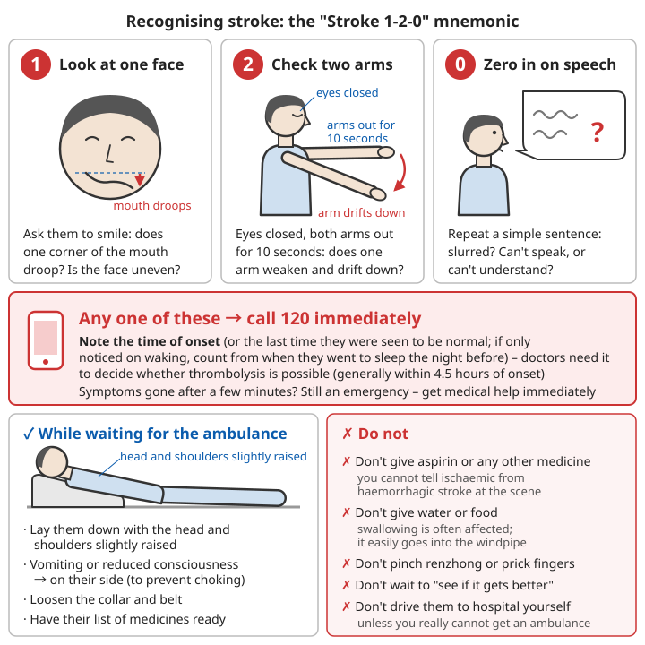

# Heart, Stroke and Sudden Illness

## Contents
- [Stroke](#stroke)
- [Heart attack and chest pain](#heart-attack-and-chest-pain)
- [Hypoglycaemia (low blood sugar)](#hypoglycaemia-low-blood-sugar)
- [Epileptic seizures](#epileptic-seizures)
- [Acute asthma attack](#acute-asthma-attack)

---

## Stroke

There are two kinds of stroke: a blocked blood vessel (ischaemic, about 80% of cases) and a burst blood vessel (haemorrhagic). You cannot tell them apart at the scene. Only a CT scan in hospital can.

### Recognition: the "Stroke 1-2-0" mnemonic

```
1 - Look at one face: ask the person to smile. Does one corner of the mouth droop? Is the face uneven?
2 - Check two arms: ask the person to close their eyes and hold both arms out for 10 seconds. Does one arm weaken and drift down?
0 - Zero in on speech: ask the person to repeat a simple sentence. Is the speech slurred? Can they not speak, or not understand?

Any one of these → call 120 immediately
```

**Other common signs**:
- Sudden numbness on one side of the body
- Sudden blurred or double vision in one or both eyes
- Sudden unsteadiness when walking, dizziness
- Sudden severe headache (common in haemorrhagic stroke)

⚠️ **The symptoms may disappear on their own after a few minutes (a transient ischaemic attack, TIA). This is still an emergency!** The risk of a real stroke in the short time after such an attack is high. Get medical help immediately.



*Figure: The "Stroke 1-2-0" mnemonic and key points while waiting for the ambulance*

### Why every minute counts

- Clot-dissolving drugs (intravenous thrombolysis) for ischaemic stroke generally have to be given **within 4.5 hours of onset**
- The earlier the treatment, the less brain damage and the milder the lasting effects
- Call 120 instead of driving yourself: the ambulance can warn the hospital's stroke centre in advance, and can go straight to a hospital that can give thrombolysis

### While waiting for the ambulance

```
✓ Note the time of onset (or the last time the person was seen to be normal)
  - This is the key information doctors use to decide whether thrombolysis is possible!
  - If the symptoms were only noticed on waking, count from when the person went to sleep the night before
✓ Lay the person down with the head and shoulders slightly raised
✓ Vomiting or reduced consciousness → place on their side (to prevent choking on vomit)
✓ Loosen the collar and belt
✓ Have the person's list of medicines ready
```

### ❌ Do not

```
❌ Do not give aspirin or any other medicine
   - You cannot tell ischaemic from haemorrhagic stroke at the scene
   - Aspirin makes the bleeding worse in a haemorrhagic stroke
❌ Do not give water or food
   - Stroke often causes difficulty swallowing; food or water easily goes into the windpipe
❌ Do not pinch the renzhong point (the groove above the upper lip), prick the fingers to let blood, or needle the shixuan points (the fingertips)
   - These do nothing and only waste time
❌ Do not wait to "see if it gets better"
❌ Do not drive the person to hospital yourself (unless you really cannot get an ambulance)
```

---

## Heart attack and chest pain

### Recognising a heart attack

**Typical symptoms**:
- Crushing, tight or heavy feeling in the centre of the chest (like a large stone pressing down)
- Lasts more than a few minutes and does not ease with rest
- May spread to the left arm, jaw, neck or back
- With heavy sweating, nausea, shortness of breath, dizziness, a feeling of impending death

**⚠️ Atypical symptoms** (common in women, older people and people with diabetes):
- Only upper abdominal pain (easily mistaken for a stomach problem)
- Only shortness of breath or tiredness
- Only toothache, jaw pain, or shoulder or back pain
- Very mild pain, or none at all

**In anyone with heart disease, high blood pressure or diabetes, or who smokes, treat any of the unexplained discomfort above as a heart attack.**

### Act immediately

```
1. Stop all activity immediately
   - Do not walk around; do not walk to hospital or climb stairs
2. Sit down or half lie down (leaning back to rest)
3. Call 120 and say "suspected heart attack"
4. Loosen the collar and belt
5. Consider chewing aspirin (see conditions below)
6. If an AED is available, have it ready; if the person collapses, does not respond and is not breathing normally → start CPR immediately
```

### Aspirin: when it can be used

**How**:
- Chew it, then swallow (absorbed faster than swallowing it whole)
- Dose: 300 mg (if unsure, ask the 120 dispatcher on the phone first)
- Plain tablets are better than enteric-coated ones; if you only have enteric-coated tablets, chew them too

**Do not use it if**:
```
❌ Allergic to aspirin (or aspirin has triggered an asthma attack)
❌ Currently bleeding, or has an active stomach ulcer or a bleeding disorder
❌ Aortic dissection is suspected: sudden severe tearing pain spreading to the back
❌ There are also signs of stroke (drooping mouth, weak limbs, slurred speech)
❌ Pregnant
❌ Under 18 years old
```

### Glyceryl trinitrate (nitroglycerin)

```
✓ Use only if a doctor has prescribed it for this person
✓ Place under the tongue; do not swallow
❌ Do not use if blood pressure is low, or the person is dizzy or their vision is going dark
❌ Do not use if the person has taken a drug for erectile dysfunction (such as sildenafil) in the past 24-48 hours
   - Together they can cause a sudden drop in blood pressure
❌ Do not use someone else's glyceryl trinitrate
```

### Other dangerous chest pain

| Type | Features | Action |
|------|------|------|
| Aortic dissection | Sudden severe tearing pain spreading to the back | 120, **do not give aspirin** |
| Pulmonary embolism | Sudden shortness of breath and chest pain, often after long sitting or bed rest, one leg swollen | 120 |
| Pneumothorax (collapsed lung) | Sudden chest pain on one side and shortness of breath, in tall thin young people or after a chest injury | 120 |

**Rule: treat any chest pain that is sudden, severe, or comes with shortness of breath and sweating as an emergency. Do not decide for yourself that "it's just my stomach".**

---

## Hypoglycaemia (low blood sugar)

This mainly happens in people with diabetes who use insulin or blood-sugar-lowering tablets. A blood sugar below 3.9 mmol/L is hypoglycaemia.

### Recognition

**Early**:
- Pounding heart, shaking hands, sweating
- Strong hunger
- Pale face
- Irritability, anxiety

**Getting worse**:
- Confusion, slow responses
- Slurred speech, strange behaviour (**often mistaken for drunkenness or stroke**)
- Fits, coma

⚠️ **If a person with diabetes behaves strangely or their consciousness changes, think of hypoglycaemia first.** If you cannot tell whether blood sugar is high or low, treating it as low is safer: one dose of sugar does little harm in high blood sugar, but untreated low blood sugar can quickly become life-threatening.

### Treatment: if the person can swallow

**The "15-15" rule**:
```
1. Eat 15-20 g of fast-acting sugar:
   - Glucose tablets: 3-4 tablets
   - Fruit juice or a sugary drink: about 150 mL (⚠️ not sugar-free or "zero" drinks)
   - White sugar or honey: 1 tablespoon
   - Sweets: a few (hard sweets, not chocolate)
2. Wait 15 minutes
3. If you have a blood glucose meter, test again; still below 3.9 or symptoms not better → repeat step 1
4. Once better, eat some starchy food (bread, biscuits, rice)
   - To stop the sugar dropping again

Note:
- Chocolate, milk and nuts contain fat and raise blood sugar slowly; they are not suitable for first aid
- In people taking long-acting insulin or sulfonylurea tablets, hypoglycaemia can come back repeatedly; they should be seen and observed by a doctor
```

### Treatment: if the person is confused or cannot swallow

```
❌ Do not put anything in their mouth (it can easily go into the windpipe and choke them)
1. Call 120
2. Place on their side (recovery position)
3. If a glucagon injection pen or nasal spray is available and you have been trained to use it, use it as instructed
4. Keep watching their breathing; if not breathing → CPR
```

---

## Epileptic seizures

### Recognition

Typical signs of a generalised seizure:
- Suddenly falls to the ground and loses consciousness
- Whole body goes stiff, then the limbs jerk rhythmically
- May froth at the mouth, bite the tongue, wet themselves
- Most stop on their own within 1-2 minutes
- Afterwards there is often a period of confusion and drowsiness

### During a seizure

```
✓ Note the start time (the key to deciding whether to call an ambulance)
✓ Move hard and sharp objects away
✓ Put something soft such as clothing under the head
✓ Loosen the collar
✓ Once the jerking stops, roll them onto their side (recovery position)
✓ Stay with them until they are fully awake
```

### ❌ Do not

```
❌ Do not put anything in their mouth (chopsticks, spoon, towel, fingers)
   - The tongue cannot be "swallowed"
   - Putting things in the mouth can break teeth and cause choking, and the helper's fingers will be bitten
❌ Do not hold the limbs down by force (can cause fractures or dislocations)
❌ Do not pinch the renzhong point
❌ Do not give water or medicine until the person is fully awake
```

### ⚠️ Call 120 immediately

- Fitting lasts more than 5 minutes
- A second seizure starts before the person has woken from the first
- It is the first seizure
- Breathing does not return to normal after the seizure, or the person stays unconscious for a long time
- Injured during the seizure
- The seizure happened in water
- Pregnant women, people with diabetes

### Febrile seizures in children

- Mostly seen in children aged 6 months to 5 years, during a fever
- Handle as above; also loosen clothing to cool the child
- Most are brief and the outlook is good, but **a first febrile seizure must be seen by a doctor** to rule out serious illness such as meningitis
- For care of fever, see [Common illnesses - Fever](01-common-illnesses.md#fever)

---

## Acute asthma attack

### Recognition

- Wheezing (a whistling sound when breathing out), tight chest
- Difficulty breathing, hard work to breathe out
- Coughing

**⚠️ Danger signs** (call 120 immediately):
- Cannot finish a sentence
- Blue lips or nails
- Extreme exhaustion, confusion
- The wheezing gets quieter ("silent chest": very little air is moving; very dangerous)

### What to do

```
1. Sit the person upright (do not lay them down), leaning slightly forward; keep calm
2. Loosen the collar
3. Use the person's own reliever inhaler (usually blue, such as salbutamol (albuterol)):
   - 1 puff every 30-60 seconds
   - Up to 10 puffs
   - Use a spacer if there is one; it works better
4. No better after 10 puffs, or worse at any time → call 120
5. Ambulance has not arrived after 10 minutes and still no better → repeat step 3
```

**Even if the medicine relieves the attack, see a doctor the same day.**

⚠️ If there is no inhaler, there is no effective home substitute: keep the person sitting upright and calm, and call 120 immediately.

If the attack is caused by an allergy (sudden wheezing and breathlessness after contact with an allergen, with a rash or facial swelling), treat it as [anaphylaxis](05-acute-symptoms.md#allergic-reactions).

---

## 📝 Key points

### What these conditions have in common

```
- They all come on suddenly
- They are all a race against time
- They all have widely believed wrong remedies (putting things in the mouth, pinching the renzhong point, bloodletting, giving random medicines)
```

### One table to remember

| Condition | Key signs | First response | Most common mistake |
|------|----------|----------|--------------|
| Stroke | Drooping face, weak arm, slurred speech | 120, note the time of onset | Giving aspirin or water, bloodletting |
| Heart attack | Crushing chest pain, heavy sweating | Stop all activity, 120, chew aspirin if conditions allow | Walking to hospital, assuming it's a stomach problem |
| Hypoglycaemia | Person with diabetes has a pounding heart, sweats, behaves strangely | Give sugar if they can swallow | Mistaking it for drunkenness, or giving sugar water to an unconscious person |
| Epileptic seizure | Falls down and jerks | Protect the head, time it, place on side | Putting things in the mouth |
| Asthma | Wheezing, difficulty speaking | Sit upright, use the inhaler | Laying the person down |

### Prevention

- People with high blood pressure, diabetes or heart disease: take medicines on time and have regular check-ups
- People with diabetes: always carry sugar and a medical information card
- People with asthma: always carry a reliever inhaler
- Family members: learn to recognise the signs above and take a CPR course

---

**Next chapter**: [Home and Traffic Accidents](07-home-and-traffic-accidents.md)
**Back**: [Part contents](README.md) | [Main contents](../../README.md)
