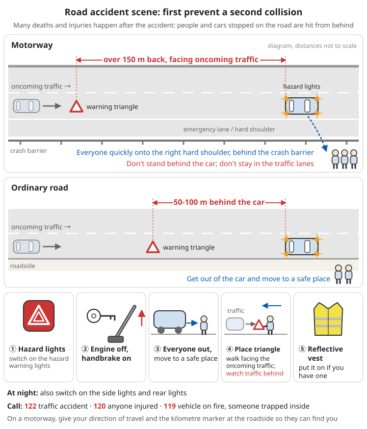

# Home and Traffic Accidents

## Contents
- [Carbon monoxide poisoning](#carbon-monoxide-poisoning)
- [At the scene of a road accident](#at-the-scene-of-a-road-accident)

---

## Carbon monoxide poisoning

Carbon monoxide has no colour and no smell. People are poisoned without noticing, and it is especially dangerous during sleep. Every winter many people die from heating and bathing.

### Common sources

```
- Burning charcoal for heating indoors, coal stoves (especially with doors and windows shut)
- Gas water heaters installed inside the bathroom, or with a poor flue
  - Flueless gas water heaters are banned by the state; if you still use one, replace it with a forced-flue or electric water heater
- Running a car engine in a garage or basement
- Sitting for a long time in a closed-up car with the engine idling and the air conditioning on (especially if the exhaust pipe is blocked by snow)
- Using a generator, gas grill or charcoal hotpot indoors
- Smoke from a fire
```

### Recognition

**Symptoms**:
- Mild: headache, dizziness, nausea, weakness, pounding heart
- Moderate: confusion, vomiting, unsteady on the feet
- Severe: coma, fits, breathing and heartbeat stop

**⚠️ Clues that strongly suggest carbon monoxide poisoning**:
- **Several people** in the same space get headaches and dizziness **at the same time**
- Pets also act strangely
- Symptoms ease after leaving the room and get worse on coming back
- Symptoms appear while a stove, water heater or heater is in use

⚠️ The often-mentioned "cherry-red skin" is not reliable. Most patients do not have it, so its absence does not rule out poisoning.

### Rescue

```
1. Protect yourself first
   - Take a deep breath and hold it before going in; move fast
   - ⚠️ A wet towel over the mouth and nose does nothing against carbon monoxide (it only stops smoke particles)
   - Very high concentration, or open flames or smoke at the scene → do not go in; wait for the fire service

2. Open doors and windows quickly to ventilate

3. Shut off the source
   - Turn off the gas valve, put out the stove
   - If a charcoal brazier or coal stove can be moved, take it outside
   - ⚠️ If you also smell gas: do not switch lights or appliances on or off, and do not make phone calls indoors (see the link below)

4. Move the casualty outside into fresh air

5. Call 120 and say "carbon monoxide poisoning"
   - So they can take the casualty to a hospital with a hyperbaric oxygen chamber

6. Care of the casualty:
   - Conscious: rest quietly, keep warm, do not walk about
   - Unconscious but breathing → place on their side (to prevent choking on vomit)
   - Not responding and not breathing normally → start CPR immediately
```

If you smell gas, see [Gas leaks](../../../docs/02-灾难应对/04-火灾.md#燃气泄漏); for CPR steps see [CPR](../../../docs/01-日常疾病和伤害/00-基础急救知识.md#心肺复苏cpr).

### ⚠️ See a doctor even if the person has come round

- Carbon monoxide poisoning can be followed by **delayed brain damage (delayed encephalopathy)**: days to one or two months after an apparent recovery, the person develops poor memory, slow responses, unsteady walking or personality changes; in severe cases they can no longer look after themselves
- Hyperbaric oxygen treatment is an important treatment for carbon monoxide poisoning. Complete the full course as the doctor advises; do not stop part-way
- Poisoning in pregnancy harms the unborn baby more. See a doctor even if the symptoms are mild

### Prevention

```
✓ Fit a carbon monoxide alarm
  - ⚠️ A gas alarm and a carbon monoxide alarm are not the same thing!
    A gas alarm detects natural gas or LPG leaks; it cannot detect carbon monoxide
  - Fit them near bedrooms and in rooms with gas appliances or stoves
✓ Do not install a gas water heater inside the bathroom; use a forced-flue type
✓ Do not burn charcoal for heating or eat charcoal hotpot in a closed room
✓ Coal stoves must have a chimney; check it regularly for blockages and leaks
✓ Do not run a car engine in a garage
✓ When resting in a car, do not leave the engine idling with the air conditioning on for long; when it snows, clear snow from around the exhaust pipe
✓ Use generators outdoors only, away from doors and windows
```

For checking and maintaining *kang* (heated brick beds), stoves and chimneys, see [Long-term housing - Kang and stoves](../../../docs/07-日常生活技能/05-长期住所.md#火炕与炉灶).

---

## At the scene of a road accident

### Step 1: Prevent a second collision

Many road deaths and injuries happen after the accident itself: people and cars stopped on the road are hit by vehicles coming from behind.

```
1. Switch on the hazard warning lights
2. Turn off the engine and put on the handbrake
3. Everyone gets out of the car and moves to a safe place:
   - Motorway: move quickly onto the right-hand hard shoulder, then behind the crash barrier beyond the emergency lane
   - Do not stand behind the car; do not stay in the traffic lanes
4. Put out the warning sign (warning triangle):
   - Ordinary roads: 50-100 m behind the car
   - Motorway: more than 150 m back, facing the oncoming traffic
   - At night, also switch on the side lights and rear lights
   - Walk facing the oncoming traffic while placing it, and watch for vehicles behind you
5. Put on a reflective vest if you have one
```



*Figure: At a road accident, prevent a second collision first. Warning triangle 50-100 m behind the car on ordinary roads and more than 150 m back on motorways; everyone moves behind the crash barrier; do not stand behind the car*

### Step 2: Call for help

```
- 122: traffic accident
- 120: someone is injured
- 119: vehicle on fire, someone trapped in a vehicle
- On a motorway, give your direction of travel and the kilometre marker at the roadside so they can find you
```

### Step 3: Care for the injured

**First check whether the scene is safe**: fire, leaking fuel, risk from passing traffic.

```
✓ Conscious casualties: tell them to keep still; they should not get out of the car or stand up by themselves
✓ Try not to drag casualties out of the car
  - They may have neck or spinal injuries; moving them wrongly can cause paralysis
  - Exception: the car is on fire, there is a risk of explosion, or CPR cannot be done, so they must be moved
    → keep the head, neck and body in a straight line as far as possible
✓ Heavy bleeding → apply direct pressure (see link below)
✓ Not responding and not breathing normally → CPR (first lay the casualty flat on a hard surface)
✓ Keep them warm, reassure them, keep watching them
✓ Do not give the casualty anything to drink or eat
```

For stopping bleeding see [Bleeding control](../../../docs/01-日常疾病和伤害/00-基础急救知识.md#止血方法); for moving casualties with spinal injuries see [Moving casualties](../../../docs/01-日常疾病和伤害/00-基础急救知识.md#搬运伤员).

**Helmets of motorcycle and e-bike riders**:
```
❌ In general, do not remove the helmet (it can make a neck injury worse)
✓ Exceptions: the rider cannot breathe and the airway must be opened, vomit must be cleared, or CPR is needed
  → two people work together: one holds the head and neck still, the other slowly slides the helmet off along the line of the head
```

### Vehicle fire

```
- Petrol or diesel car starting to smoke or burn: if there is a car fire extinguisher, aim at the base of the flames; if it does not go out, get away immediately
- Electric car battery fire:
  - Do not try to put it out (battery fires are extremely hard to extinguish, keep reigniting and give off toxic gases)
  - Everyone moves immediately to more than 30 m away, upwind
  - Call 119 and say it is an electric vehicle
```

### Minor accidents

- Minor accident with no injuries and cars that can still be driven: take photos to record the scene, then move the cars out of the way of traffic as soon as possible before sorting things out
- Do not argue in the traffic lanes (a common setting for second collisions)

### In-car emergency kit

```
- [ ] Warning triangle (required by law in every car)
- [ ] Reflective vest
- [ ] Fire extinguisher
- [ ] First aid kit
- [ ] Emergency hammer (window breaker)
- [ ] Torch
```

For a fuller in-car emergency kit, see [Disaster response - In-car emergency kit](../../../docs/02-灾难应对/README.md#车载应急包).

---

## 📝 Key points

### Carbon monoxide poisoning

```
1. Several people with headaches and dizziness at the same time → think of carbon monoxide first
2. Hold your breath, go in and out fast; open windows, shut off the source, get the casualty out
3. A wet towel does not stop carbon monoxide
4. See a doctor even after coming round (delayed brain damage)
5. Fit a carbon monoxide alarm (a gas alarm cannot detect it)
```

### At the accident scene

```
1. Hazard lights, engine off, everyone behind the crash barrier
2. Warning triangle: 50-100 m on ordinary roads, more than 150 m on motorways
3. Call: 122 / 120 / 119
4. Do not drag casualties out or remove helmets without good reason
5. Electric car battery fire: get away, do not try to put it out
```

---

**Next chapter**: [Chronic Medication Stockpile](08-chronic-medication-stockpile.md)
**Back**: [Part contents](../../../docs/01-日常疾病和伤害/README.md) | [Main contents](../../../README.md)
