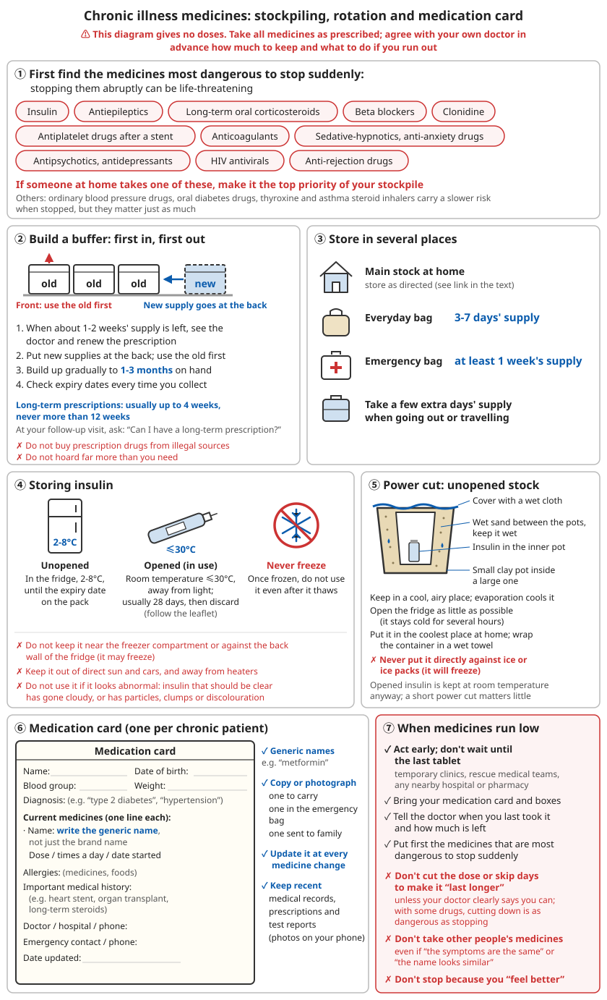

# Chronic Medication Stockpile

## Contents
- [Why stock up in advance](#why-stock-up-in-advance)
- [The most dangerous medicines to stop suddenly](#the-most-dangerous-medicines-to-stop-suddenly)
- [How to keep extra medicine legally](#how-to-keep-extra-medicine-legally)
- [Insulin and other medicines that need refrigeration](#insulin-and-other-medicines-that-need-refrigeration)
- [Medication card](#medication-card)
- [Monitoring equipment](#monitoring-equipment)
- [When medicine is running out](#when-medicine-is-running-out)

---

## Why stock up in advance

Earthquakes, floods, typhoons, closed roads and long power cuts can all keep people away from hospitals and pharmacies for days or weeks. For people with chronic illnesses who take medicine every day, **running out of medicine can itself be an emergency**.

After every major disaster, many of the patients seen by medical teams have not been injured at all. Their high blood pressure, diabetes, asthma or other chronic illness has flared up because they ran out of medicine.

```
The three goals of a stockpile:
1. Always have enough medicine at hand (at least enough to last until the next refill, plus a buffer)
2. Any doctor who gets your information can carry on prescribing for you (medication card)
3. Be able to monitor your condition at home (blood pressure monitor, blood glucose meter)
```

⚠️ **This chapter gives no doses or dose-adjustment plans for any medicine.** Take all medicines as your doctor advises. Discuss with your own doctor in advance how much to keep and what to do if you run out.

---

## The most dangerous medicines to stop suddenly

The risk of running out varies greatly between medicines. **Stopping the following groups suddenly can be life-threatening.** Make sure of these first when stocking up:

| Type of medicine | Common uses | Risk of stopping suddenly |
|----------|----------|----------------|
| **Insulin** | Type 1 diabetes, some type 2 diabetes | A person with type 1 diabetes without insulin can develop ketoacidosis within 1-2 days; fatal without prompt treatment |
| **Anti-epileptic drugs** | Epilepsy | Frequent seizures, even seizures that do not stop (status epilepticus) |
| **Corticosteroids** (long-term tablets, such as prednisone) | Rheumatic and immune diseases, asthma, kidney disease, adrenal insufficiency, etc. | Long-term use suppresses the body's own adrenal glands; stopping suddenly can cause an adrenal crisis: low blood pressure, shock |
| **Beta blockers** (such as metoprolol) | High blood pressure, coronary heart disease, heart failure, abnormal heart rhythms | Rebound fast heart rate and higher blood pressure; can trigger angina or a heart attack |
| **Clonidine** | High blood pressure | Rebound sharp rise in blood pressure within 1-2 days of stopping |
| **Antiplatelet drugs** (after a heart stent) | After a coronary stent | Clot forms inside the stent, causing a heart attack |
| **Anticoagulants** (such as warfarin and the newer oral anticoagulants) | Atrial fibrillation, venous thrombosis, mechanical heart valves | Blood clots, stroke |
| **Sedatives, sleeping pills and anti-anxiety drugs** (such as benzodiazepines) | Insomnia, anxiety | After long-term use, stopping suddenly can cause severe withdrawal, even fits |
| **Antipsychotics and antidepressants** | Mental illness | Relapse; some antidepressants cause dizziness, mood swings and other discontinuation symptoms when stopped |
| **Antivirals** (such as HIV antiretroviral treatment) | HIV infection | Virus rebounds, drug resistance develops |
| **Anti-rejection drugs** | After an organ transplant | Rejection |

**Other common long-term medicines** (the risk of running out builds up more slowly, but they matter just as much):
- Ordinary blood pressure tablets: blood pressure gradually rises, increasing the risk of stroke and heart attack
- Oral diabetes tablets: blood sugar gradually rises
- Thyroxine (underactive thyroid): symptoms gradually worsen over several weeks; overactive thyroid easily relapses when its medicine is stopped
- Asthma preventers (inhaled steroids): more attacks; see [Acute asthma attack](06-heart-stroke-and-sudden-illness.md#acute-asthma-attack)

**If anyone at home uses a medicine from the table above, make that medicine the first priority in your stockpile.**

---

## How to keep extra medicine legally

### Long-term prescriptions

The National Health Commission's *Long-term Prescription Management Standard (Trial)* states:
- Long-term prescriptions are for patients with chronic illness who have a clear diagnosis, a stable medication plan and a well-controlled condition
- A prescription generally covers up to 4 weeks; where conditions allow it can be extended according to the illness, **but never beyond 12 weeks**
- Insulin can be given on a long-term prescription

```
What to do:
✓ At your follow-up visit, ask the doctor directly: "Can I have a long-term prescription for my condition?"
✓ Tell the doctor your real concerns (for example, living far away, poor transport, older relatives to look after at home)
✓ Find out how your local medical insurance reimburses long-term prescriptions
```

⚠️ **The following cannot be given on a long-term prescription**: narcotic drugs, Category I and II psychotropic drugs (most sleeping pills and anti-anxiety drugs fall into these), toxic drugs for medical use, most antibacterial drugs, intravenous drugs, etc.

Many of these are exactly the medicines that cause problems when stopped suddenly (see the table above), so **it is even more important to discuss with your doctor in advance** what to do if you cannot get them for a while.

### Build a buffer

```
Principle: refill your prescription before your medicine runs out, so you always have some extra time's worth in hand

1. At each follow-up, go when about 1-2 weeks of medicine are left
2. Put the newly collected medicine at the back and use the old first (first in, first out)
3. Build up gradually until you have 1-3 months' supply at hand
4. Check the expiry dates every time you collect medicine

❌ Do not buy prescription medicines through illegal channels (unknown source, may be fake)
❌ Do not hoard far more than you need (medicines expire, and hoarding takes supplies from others)
```

### Store in several places

- Main stock at home (keep under the [storage conditions](../../../docs/06-制药技术/02-抗生素制备.md#64-储存条件))
- In your everyday bag: 3-7 days' supply
- In your emergency bag: at least 1 week's supply (see [Disaster response - Household emergency kit](../../../docs/02-灾难应对/README.md#-家庭应急包))
- Take a few extra days' supply when going out or travelling



*Figure: Secure first the medicines that are most dangerous to stop suddenly; refill early, first in first out, store in several places; refrigerate insulin but never freeze it; one medication card per person. No doses are given: discuss medicines and stockpiles with your doctor, and do not reduce or stop medicines on your own*

---

## Insulin and other medicines that need refrigeration

### Storing insulin

| State | Storage | How long |
|------|----------|------|
| Unopened | Refrigerator, 2-8°C | Until the expiry date on the pack |
| Opened (in use) | Room temperature, no higher than 30°C, away from light | Usually 28 days (varies between products; follow the leaflet), then discard |
| Any state | ❌ **Never freeze** | Insulin that has frozen must not be used, even after thawing |

```
⚠️ Do not keep it near the freezer compartment or against the back wall of the fridge (it can freeze there)
⚠️ Do not leave it in direct sunlight, in a car, or next to a heater
⚠️ Do not use it if it looks abnormal: insulin that should be clear has gone cloudy, or has particles, clumps or a colour change
```

### During a power cut

```
✓ Opened pens and cartridges are kept at room temperature anyway, so a short power cut matters little
✓ Unopened stock: keep it as cool as possible
  - Open the fridge door as little as possible; a fridge stays cold for several hours
  - Keep it in the coolest place in the house (basement, north-facing room)
  - Wrap the container in a towel soaked in cold water; evaporation cools it
  - Simple evaporative cooling pot: put a small clay pot inside a large one, fill the gap with wet sand and keep it wet;
    put the insulin in the inner pot, cover the top with a wet cloth, and keep it in a cool, airy place
✓ If possible, get an insulin cooling pouch (water-activated or ice-pack type)

❌ Do not put insulin directly against ice or ice packs (it will freeze)
```

### People with type 1 diabetes need a larger stock

- Insulin is a lifeline for people with type 1 diabetes; 1-2 days without it can be life-threatening
- Also keep: needles, blood glucose test strips, lancets, ketone test strips
- Keep supplies for treating low blood sugar (glucose tablets, etc.; see [Hypoglycaemia](06-heart-stroke-and-sudden-illness.md#hypoglycaemia-low-blood-sugar))
- Discuss with your doctor in advance what to do if insulin runs short

### Other medicines needing refrigeration or special storage

Some biological medicines, injections and eye drops need refrigeration or expire soon after opening, which makes them hard to stockpile. **Ask your doctor whether there is an alternative that is easier to store.**

---

## Medication card

In a disaster you may not be able to see your own doctor, and medicine boxes may be lost. A clearly written card lets any doctor quickly carry on prescribing for you.

```
Medication card (one for each person with a chronic illness):

Name:                 Date of birth:
Blood group:          Weight:
Diagnosis: (e.g. "type 2 diabetes", "high blood pressure", "epilepsy")

Medicines currently taken (one per line):
- Medicine name (write the generic name, not just the brand name):
  Dose:     Times per day:     Started:
- ...

Allergies: (medicines, foods)
Important medical history: (e.g. heart stent, organ transplant, long-term steroids)
Doctor / hospital / phone:
Emergency contact / phone:

Date updated:
```

```
✓ Write the generic name (e.g. "metformin"); brand names from different makers may differ from place to place
✓ Make copies or take photos: one to carry, one in the emergency bag, one sent to family members
✓ Update it every time your medicines change
✓ Keep your latest medical records, prescriptions and test reports (photograph them and keep them on your phone)
```

---

## Monitoring equipment

When you cannot see a doctor, being able to tell at home whether your condition is getting out of control is vital.

```
- [ ] Blood pressure monitor (electronic upper-arm type, spare batteries)
- [ ] Blood glucose meter + plenty of test strips + lancets (test strips expire; rotate them)
- [ ] Thermometer
- [ ] Bathroom scales (in heart failure, a quick gain in weight means fluid build-up is getting worse)
- [ ] Notebook: record blood pressure, blood sugar, etc. every day and bring it to the doctor
```

**Medicines that need regular blood tests to adjust the dose** (for example, warfarin needs regular clotting tests): going without the tests is also dangerous. Discuss with your doctor in advance what to do if you cannot have tests for a long time.

---

## When medicine is running out

```
✓ Act early; do not wait until the last tablet
  - Post-disaster temporary clinics, rescue medical teams, any nearby hospital or pharmacy
  - Bring your medication card and medicine boxes
✓ Tell the doctor when you last took your medicine and how much is left
✓ Give priority to the groups in the table above that are "most dangerous to stop suddenly"

❌ Do not cut the dose or take it every other day to "stretch" it, unless a doctor has clearly told you that you can
   (for some medicines this is fine; for others a lower dose is as dangerous as stopping)
❌ Do not take other people's medicines, even if "the symptoms are the same" or "the name is similar"
❌ Do not stop taking medicine because you "feel better"
```

---

## 📝 Key points: chronic medication stockpile

```
1. First identify the medicines at home that are "most dangerous to stop suddenly": insulin, anti-epileptic drugs, long-term steroids,
   beta blockers, antiplatelet drugs after a stent, anticoagulants, sedatives and sleeping pills, etc.
2. Ask your doctor about a long-term prescription (up to 12 weeks); refill early to build a 1-3 month buffer
3. Refrigerate insulin, never freeze it; once opened, keep it at room temperature no higher than 30°C for about 28 days
4. One medication card per patient, with generic names, kept in several places
5. Have a blood pressure monitor and blood glucose meter ready
6. Get medical help well before you run out; do not cut the dose on your own; do not take other people's medicines
```

---

**Next chapter**: [Dental Problems](09-dental-problems.md)
**Back**: [Part contents](../../../docs/01-日常疾病和伤害/README.md) | [Main contents](../../../README.md)
