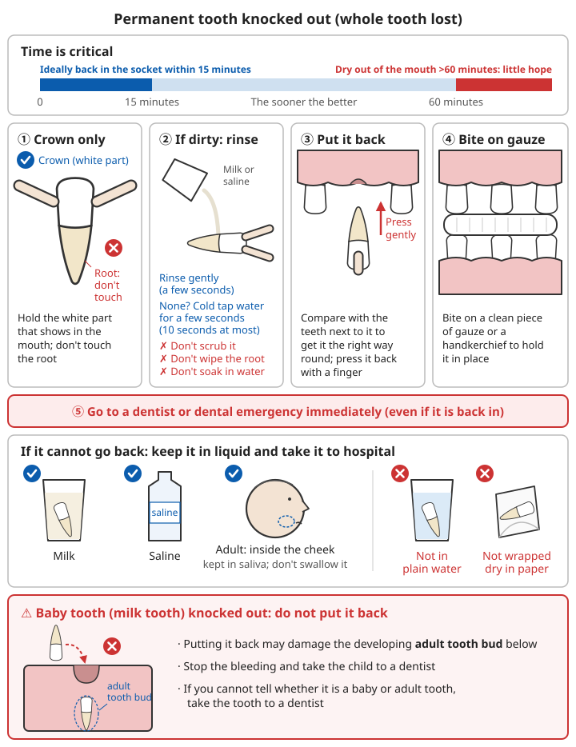

# Dental Problems

## Contents
- [Why dental problems cannot wait](#why-dental-problems-cannot-wait)
- [Toothache](#toothache)
- [Dental abscess and danger signs](#dental-abscess-and-danger-signs)
- [Dental injuries](#dental-injuries)
- [Bleeding after a tooth extraction](#bleeding-after-a-tooth-extraction)
- [Other common problems](#other-common-problems)
- [Oral hygiene without toothpaste or a toothbrush](#oral-hygiene-without-toothpaste-or-a-toothbrush)

---

## Why dental problems cannot wait

Toothache is often treated as a minor matter, but **a tooth infection can spread to the face and neck, press on the airway, and even cause whole-body infection (sepsis)**. When you cannot see a dentist in time (after a disaster, in remote areas, during long-term shortages), one rotten tooth can become a life-threatening problem.

```
Three bottom lines for dental problems:
1. Facial swelling that is spreading, difficulty swallowing or breathing → emergency, get medical help immediately
2. Permanent tooth knocked out → the sooner it goes back in its socket the better, ideally within 15 minutes
3. Prevention is much easier than treatment: brush every day, eat fewer sweet foods
```

---

## Toothache

### Common causes

| Cause | Features |
|------|------|
| Tooth decay (caries) | Sharp pain with cold, hot, sour or sweet food; a black hole may be visible |
| Pulpitis (inflamed tooth nerve) | Severe throbbing pain, worse at night; pain lingers after hot or cold |
| Gum disease (periodontitis) | Red, swollen, bleeding gums; loose teeth; pain on biting |
| Infection around a wisdom tooth (pericoronitis) | Swelling and pain at the very back tooth; difficulty opening the mouth |
| Cracked tooth | Sudden sharp pain when biting on a particular spot |

⚠️ **Toothache can also be a sign of a heart attack** (especially pain in the lower teeth or jaw, with chest tightness, sweating or shortness of breath); see [Heart attack and chest pain](06-heart-stroke-and-sudden-illness.md#heart-attack-and-chest-pain).

### Temporary pain relief (until you can see a dentist)

```
✓ Painkillers by mouth: ibuprofen or paracetamol (acetaminophen), taken as the leaflet says (usual doses: see link below)
✓ Warm salt-water mouthwash: half a teaspoon of salt in a cup of warm boiled water; hold in the mouth for 30 seconds, several times a day
✓ If there is swelling, put a cold compress on the outside of the cheek for 15-20 minutes (with a towel in between)
✓ Remove food stuck between the teeth: gently pick it out with floss or a toothpick
✓ Clove oil (if available): dip a cotton bud in a very small amount and dab it on the painful tooth only; do not spread it over the gum
✓ Avoid very cold, very hot and very sweet food; chew on the other side
✓ Keep the head raised when sleeping
```

For the usual doses of painkillers and precautions, see the "Medicines to bring down a fever" section in [Common illnesses - Fever](../../../docs/01-日常疾病和伤害/01-常见疾病.md#发烧).

### ❌ Do not

```
❌ Do not put aspirin or any other tablet on the gum next to the painful tooth
   - It does not stop toothache; within hours it causes a chemical burn and ulcer on the gum
❌ Do not put a hot compress on a swollen face (it may help the infection spread)
❌ Do not stuff the hole in the tooth with tobacco, Sichuan pepper, garlic, or cotton soaked in baijiu (Chinese spirit), etc.
   - Garlic in direct contact with the lining of the mouth causes a chemical burn
❌ Do not think that taking "anti-inflammatories" will cure it
   - Antibiotics can only hold back the spread of infection for a while; they cannot cure a rotten tooth.
     The real fix is a filling, root canal treatment or extraction
```

For how raw garlic causes burns, see [Antibiotic production - Garlic](../../../docs/06-制药技术/02-抗生素制备.md#32-大蒜以食用为主).

---

## Dental abscess and danger signs

### Recognising a dental abscess

- Constant severe throbbing pain
- A pus-filled swelling on the gum; pressing it may release pus with a bad smell
- The tooth hurts at the slightest touch and feels "too high"
- Swelling of the cheek or jaw
- Possible fever

### ⚠️ Call 120 or go to the emergency department immediately

```
Any one of the following is a possibly life-threatening emergency:

- Swelling of the face or neck that is spreading fast, or has crossed the midline of the face
- Swelling under the tongue or under the chin, with the tongue pushed up
- Difficulty swallowing; cannot swallow saliva, so it drools out
- Muffled speech, as if talking with something in the mouth
- Difficulty breathing, or noisy breathing
- Opening the mouth is getting harder and harder
- High fever, shivering, very unwell
- Swelling around the eye (infection spreading from an upper tooth)
```

A tooth infection that spreads to the floor of the mouth and the neck (called Ludwig's angina) can press on the airway within hours. It must be treated in hospital.

### Ordinary dental abscess

When none of the danger signs above are present:
```
✓ See a dentist as soon as possible (only draining the abscess, root canal treatment or extraction will cure it)
✓ While waiting: warm salt-water mouthwash, painkillers by mouth, cold compress
✓ If you cannot get treatment in time, a doctor may prescribe antibiotics to control the infection
❌ Do not prick or squeeze the abscess yourself (you may push the infection deeper)
```

For stockpiling antibiotics, see [Antibiotic production - Stockpiling advice](../../../docs/06-制药技术/02-抗生素制备.md#六储备建议).

---

## Dental injuries

### Permanent tooth knocked out (whole tooth lost)

**Time is critical: put it back in the socket ideally within 15 minutes. If the tooth has been out of the mouth and dry for more than 60 minutes, there is little hope of saving it.**

```
1. Find the tooth
2. Hold it only by the crown (the white part that shows in the mouth); do not touch the root
3. If it is dirty:
   - Rinse it gently with milk or saline (for a few seconds)
   - If you have no milk or saline, rinse it under cold tap water for a few seconds (no more than 10 seconds)
   - ⚠️ Do not scrub it with a brush, do not wipe the root with tissue, do not soak it in plain water
4. Put it back in its own socket as soon as possible:
   - Make sure it is the right way round (compare with the teeth next to it)
   - Press it back gently with a finger
   - Bite on a clean piece of gauze or a handkerchief to hold it in place
5. Go to a dentist or dental emergency service immediately

If you cannot put it back:
- Keep the tooth in milk or saline and take it to hospital
- An adult can also hold the tooth inside the cheek (stored in saliva; do not swallow it)
- ❌ Do not keep it in plain water; do not wrap it dry in paper
```



*Figure: Permanent tooth knocked out. Hold it only by the crown, put it back in the socket ideally within 15 minutes and bite on gauze; if it cannot go back, keep it in milk or saline and see a dentist immediately. Do not put a knocked-out baby tooth back*

### ⚠️ Do not put a knocked-out baby tooth back

- Putting it back can damage the permanent tooth developing underneath
- Stop the bleeding and take the child to a dentist for a check-up
- If you cannot tell whether it is a baby tooth or a permanent tooth, take the tooth with you to the dentist

### Broken or loose teeth

```
Broken tooth:
- Find the broken piece and also keep it in milk or saline to take to hospital (sometimes it can be glued back)
- Rinse with warm water; use a cold compress to reduce swelling
- See a dentist as soon as possible

Loose or displaced tooth:
- Do not wiggle or bend it with your fingers
- Eat soft food; chew on the other side
- See a dentist as soon as possible to have it fixed in place
```

### Also watch for

- Mouth injuries may come with a broken jaw or head injury; see [Bone and joint injuries](../../../docs/01-日常疾病和伤害/03-骨骼损伤.md)
- For mouth wounds contaminated with soil, think about tetanus prevention; see [Wounds and injuries - Tetanus prevention](02-wounds-and-injuries.md#tetanus-prevention)

---

## Bleeding after a tooth extraction

```
Normal: a little blood in the saliva for up to 24 hours after an extraction

To stop bleeding:
1. Fold clean gauze into a small pad, place it over the socket and bite down firmly for 30-45 minutes
2. Still oozing: bite on a fresh pad, or on a black tea bag that has been soaked and squeezed out (the tannin in tea helps stop bleeding)
3. Rest with the head raised

For the first 24 hours:
❌ Do not keep spitting, do not use a straw, do not smoke
   (the suction pulls the blood clot out of the socket, causing "dry socket", which is very painful)
❌ Do not rinse the mouth hard
❌ Do not poke the wound with your tongue

⚠️ Still bleeding heavily or without stopping after biting on gauze for 1 hour → get medical help as soon as possible
   (take special care if you take anticoagulants or antiplatelet drugs)
```

---

## Other common problems

### Bleeding gums

- The most common cause is gingivitis: brush carefully and use floss, and it usually improves within 1-2 weeks
- **After a long time without fresh fruit and vegetables, swollen and bleeding gums may be an early sign of scurvy**; see [Nutrition and deficiency diseases](../../../docs/07-日常生活技能/02-营养与营养缺乏病.md)
- With other bleeding such as skin bruising or nosebleeds that will not stop, or if you take anticoagulants → see a doctor

### Mouth ulcers

- Most heal on their own in 1-2 weeks
- Rinse with warm salt water; avoid spicy and irritating food
- ⚠️ **Any ulcer that has not healed after 2 weeks, or any white patch, red patch or lump, must be seen by a doctor to rule out mouth cancer**

### Lost filling

- Keep it clean; avoid chewing hard or sweet food on that side
- Pharmacies sell temporary filling material to fill it for now
- See a dentist as soon as possible

### Dentures

- Dentures rubbing the gums sore: stop wearing them for a while, rinse with warm salt water, and wear them again once the sore has healed
- Take them out at night, clean them and keep them in clean water
- In anyone who is unconscious or needs CPR, take out removable dentures first (to stop them blocking the airway)

---

## Oral hygiene without toothpaste or a toothbrush

**The key to cleaning teeth is removing plaque mechanically (brushing, wiping); toothpaste only helps.** Careful brushing without toothpaste still works.

```
No toothpaste:
✓ Brush with plain water for a full 2 minutes
✓ Brush with a little salt or baking soda (not too hard, to avoid wearing down the teeth)

No toothbrush:
✓ Wrap clean gauze or a strip of cloth round a finger and wipe the teeth
✓ Chewing stick: take a willow twig or other non-toxic twig, peel off the bark, chew one end into bristles and brush with it
  (a traditional method; use only tree species you know to be non-toxic)

✓ Floss: if you have no floss, use clean fine thread instead
✓ Rinse with clean water after meals
```

### Prevention matters most

```
✓ Brush every morning and evening, 2 minutes each time
✓ Eat fewer sweet foods and drink fewer sugary drinks, especially before bed
✓ Have regular check-ups; fill small holes early (small fillings are simple; once it becomes pulpitis or an abscess, it is much harder)
✓ Children: start cleaning as soon as the first tooth comes through; do not let them fall asleep with a bottle in the mouth
✓ Wear a mouthguard for sport (contact sports)
```

### Stockpile suggestions

```
- [ ] Toothbrushes (several per person; replace about every 3 months)
- [ ] Fluoride toothpaste
- [ ] Dental floss
- [ ] Temporary filling material
- [ ] Clove oil (small bottle)
- [ ] Painkillers (ibuprofen, paracetamol)
- [ ] Sterile gauze
```

---

## 📝 Key points: dental problems

```
1. Spreading swelling of the face or neck, difficulty swallowing or breathing → emergency, get medical help immediately
2. Permanent tooth knocked out: hold the crown, do not touch the root, do not scrub or wipe it, do not soak it in plain water; put it back within 15 minutes or keep it in milk and go to a dentist
3. Do not put a knocked-out baby tooth back
4. Do not put aspirin on the gum (it burns)
5. "Anti-inflammatories" cannot cure a rotten tooth; the real fix comes from a dentist
6. A mouth ulcer that has not healed after 2 weeks needs a doctor
7. Brushing every day and eating less sugar is the easiest way
```

---

**Next chapter**: [Mental Health](10-mental-health.md)
**Back**: [Part contents](README.md) | [Main contents](../../README.md)
