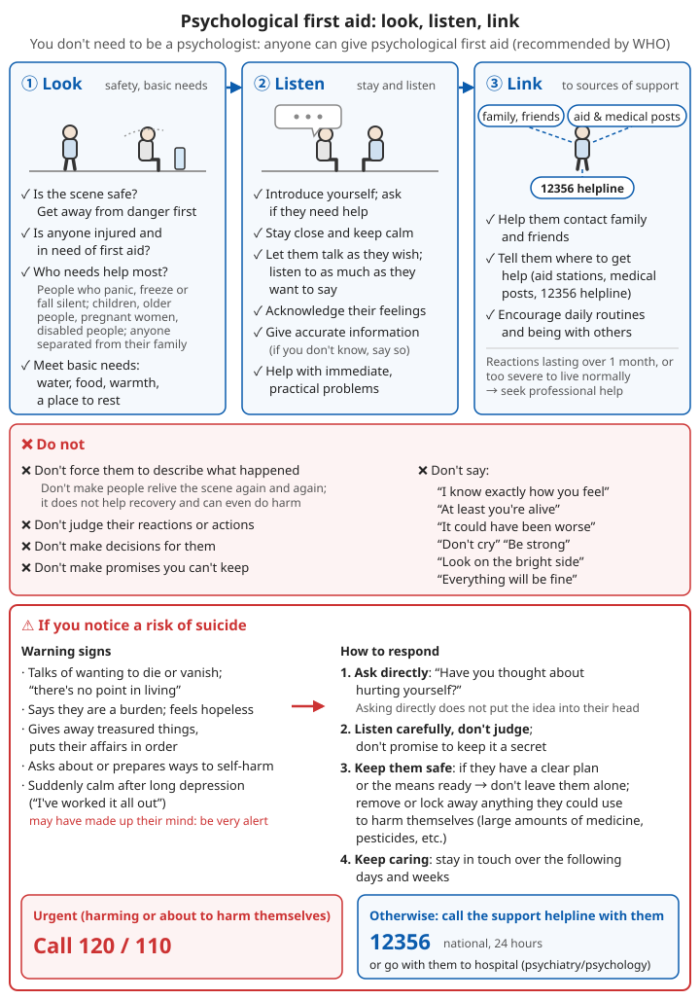

# Mental Health

## Contents
- [Normal reactions after a crisis](#normal-reactions-after-a-crisis)
- [Psychological first aid: how to help people around you](#psychological-first-aid-how-to-help-people-around-you)
- [Suicide risk: recognition and response](#suicide-risk-recognition-and-response)
- [Grief](#grief)
- [Psychological care for children](#psychological-care-for-children)
- [Looking after yourself under long-term stress](#looking-after-yourself-under-long-term-stress)
- [When professional help is needed](#when-professional-help-is-needed)

---

## Helplines

| Situation | Number |
|------|------|
| Psychological support and crisis intervention (national, 24 hours) | **12356** |
| Someone is harming themselves or is about to | **120 / 110** |

---

## Normal reactions after a crisis

After an earthquake, fire, road accident, the death of a loved one or a long disaster, almost everyone has some psychological and physical reactions. **These are normal reactions of normal people to abnormal events. They are not weakness, and they are not "going mad".**

```
Common reactions:

Feelings: fear, anxiety, sadness, anger, guilt ("why did I survive?"), numbness
Thinking: images of the event keep coming back, poor concentration, poor memory
Body: sleeplessness, nightmares, jumpiness, pounding heart, headaches, poor appetite, exhaustion
Behaviour: avoiding places and topics linked to the event, quick temper, withdrawing from people
```

**Most people gradually get better within a few weeks**, especially when they feel safe, their basic needs are met and they have family and friends with them.

⚠️ If these reactions **last more than 1 month**, or are so severe that normal life is impossible, seek professional help; see [When professional help is needed](#when-professional-help-is-needed).

---

## Psychological first aid: how to help people around you

You do not need to be a psychologist. Anyone can give psychological first aid. The psychological first aid recommended by the World Health Organization can be summed up in three words: **Look, Listen, Link**.

### Look: ensure safety and basic needs first

```
✓ Is the scene safe? Get away from danger first
✓ Is anyone injured and in need of first aid?
✓ Who needs help most?
  - People who are clearly panicking, sitting frozen or not speaking
  - Children, older people, pregnant women, people with disabilities
  - People separated from their families
✓ Meet basic needs: water, food, warmth, a place to rest
```

### Listen: stay with them and listen

```
✓ Introduce yourself and ask whether they would like help
✓ Stay by their side and keep calm
✓ Let them talk as they wish; listen to as much or as little as they want to say
✓ Acknowledge their feelings: "After something like this, it's completely normal to feel scared"
✓ Give accurate information (if you don't know, say you don't know)
✓ Help them solve immediate practical problems (finding family, finding shelter, collecting supplies)
```

### Link: connect them with support

```
✓ Help them contact family and friends
✓ Tell them where they can get help (aid points, medical points, the 12356 helpline)
✓ Encourage them to get back to daily routines and to be with the people around them
```

### ❌ Do not

```
❌ Do not press people to describe the details of what happened
   - Do not make people go over the scene again and again ("Tell me exactly what happened")
   - The World Health Organization does not recommend this; it does not help recovery and is sometimes harmful
❌ Do not say things like:
   - "I know exactly how you feel" (you don't)
   - "At least you're alive", "It could have been worse"
   - "Stop crying", "Be strong", "Look on the bright side"
   - "Everything will be fine" (a promise you cannot be sure of)
❌ Do not judge their reactions or what they did
❌ Do not make decisions for them
❌ Do not make promises you cannot keep
```



*Figure: The three steps of psychological first aid (look, listen, link), what not to do, and how to respond to suicide risk: in an emergency call 120/110; otherwise stay with the person while they call the 12356 psychological support helpline*

---

## Suicide risk: recognition and response

### Warning signs

```
What they say:
- Talking about wanting to die or disappear, "life is pointless"
- Saying they are a burden to others
- Saying they feel hopeless and can see no way out

What they do:
- Giving away treasured belongings, putting affairs in order, writing a suicide note
- Looking up or preparing ways to harm themselves
- Saying goodbye to family and friends
- Drinking or using drugs much more
- Cutting themselves off from people, giving up activities they used to enjoy

Mood:
- Suddenly becoming calm after a long depression ("I've worked it out") - they may have made up their mind; be highly alert
```

**High-risk groups**: people who have just lost loved ones, their home or their livelihood; people with depression or other mental illness; people who have attempted suicide before; people who drink heavily over long periods; older people who have just suffered a major blow.

### How to respond

**1. Ask directly**

```
"Have you been thinking lately that you don't want to live?"
"Have you thought about hurting yourself?"

Research shows that asking directly about suicidal thoughts does not put the idea into someone's head.
Instead, it makes them feel understood and more willing to talk.
```

**2. Listen carefully, without judging**

```
✓ Let them talk; do not interrupt
✓ Show you care: "I'm really worried about you", "Thank you for telling me"
❌ Do not lecture: "How can you think like that?", "Think of your family"
❌ Do not argue about whether life is "worth it"
❌ Do not promise to keep it secret
```

**3. Keep them safe**

```
✓ If they have a clear plan, or have already got the means ready → do not leave them alone
✓ Remove or lock away anything that could be used for self-harm (large amounts of medicine, pesticides, etc.)
✓ Get help immediately:
  - Emergency → call 120 or 110
  - Otherwise → stay with them while they call the 12356 psychological support helpline, or go with them to a hospital psychiatry or psychology department
```

**4. Keep caring**

```
✓ In the days and weeks that follow, keep in touch and keep them company
✓ Help them connect with family and professional support
```

⚠️ **Pesticides are a major means of suicide in rural areas.** Lock up pesticides and rat poison at home or keep them where they are hard to reach. This is very effective in preventing impulsive self-harm.

### If you are having these thoughts yourself

```
✓ Tell someone you trust
✓ Call 12356, or go to a hospital
✓ Keep away from things you could use to harm yourself
✓ These thoughts often change with time and circumstances; many people later are glad they asked for help
```

---

## Grief

Grief is natural after losing loved ones, a home or a familiar way of life.

```
Normal grief:
- Sadness, crying, longing; thinking about the person who died again and again
- Guilt ("If only I had..."), anger
- Sleeplessness, poor appetite
- Some days better, then suddenly very sad again (especially on festivals and anniversaries)
- No fixed timetable; everyone is different

How to support someone who is grieving:
✓ Be with them; listen to them talk about the person who died
✓ Offer practical help (cooking, looking after children, dealing with funeral arrangements)
✓ Let them mourn in their own way (including rituals according to custom)
✓ Remember to visit them in the months that follow too
❌ Do not hurry them: "It's time to move on"
❌ Do not say "He's in a better place" or "Please accept my condolences" and then end the conversation
```

⚠️ If after six months to a year the person is still completely unable to live normally, is consumed by grief all day, or has thoughts of suicide, they need professional help.

---

## Psychological care for children

Children react to disaster and loss differently from adults, and often cannot put it into words.

### Common reactions

| Age | Possible signs |
|------|------------|
| Pre-school | Clinging, afraid of being apart from adults, "regression" such as bedwetting or thumb-sucking, fear of the dark, acting out the event again and again in play |
| School age | Fear, nightmares, poor concentration, falling school marks, stomach aches and headaches, tantrums, asking the same questions over and over |
| Teenagers | Avoidance, withdrawal, irritability, risk-taking, drinking, feeling there is "no future" |

### How to help children

```
✓ Keep children with their family as far as possible; do not separate them
✓ Restore daily routines: regular meals and bedtimes; return to school as soon as possible, or have fixed study times
✓ Explain honestly what happened, in words the child can understand (do not make things up, and do not give too many frightening details)
✓ Tell the child: this was not your fault; you are safe now; the grown-ups will look after you
✓ Let the child cry, ask questions, and express themselves through drawing and play
✓ Hug them often and spend time with them
✓ Limit the child's exposure to repeated disaster footage and news
✓ Adults should look after their own feelings first (children pick up safety or panic from adults)

❌ Do not scold children for regression (bedwetting, clinging)
❌ Do not hide the death of a family member from a child (tell them in simple, truthful words)
```

---

## Looking after yourself under long-term stress

During long rebuilding after a disaster, shortages, or caring for someone who is ill, carers can burn out too.

```
✓ Keep a regular routine: get up, eat and go to bed at fixed times
✓ Get as much sleep as you can
✓ Do some physical activity every day (walking, exercises, work)
✓ Stay in touch with people: talk, do things together, help each other
✓ Limit time spent on disaster news and scrolling on your phone
✓ Find things that calm you: housework, growing vegetables, reading, religious activities
✓ Slow breathing to relax: breathe in slowly through the nose for about 4 seconds, then out slowly through the mouth for about 6 seconds; repeat for a few minutes
✓ People caring for others should take turns to rest; do not carry it all alone
✓ Allow yourself to be sad, and allow yourself moments of happiness too

❌ Avoid using alcohol, cigarettes or sleeping pills to "deal with" your feelings (drinking problems often rise noticeably after disasters)
```

---

## When professional help is needed

```
In any of the following situations, seek professional help as soon as possible (call 12356, or go to a hospital psychiatry or psychology department):

- Thoughts of suicide or of harming others (in an emergency call 120/110)
- More than 1 month after the crisis, still:
  - Repeated nightmares and flashbacks, as if living through it again
  - Avoiding anything related at all costs, seriously disrupting life
  - Constantly on edge, easily startled, unable to sleep
- Low mood for more than two weeks, no interest in anything, feeling worthless
- Unable to look after themselves or their children, unable to work
- Heavy drinking or drug misuse
- Hearing voices that are not there, firmly believing things that are not true, clearly abnormal speech or behaviour
```

⚠️ **People taking psychiatric medicines must not suddenly stop them on their own.** Running out of medicine in a disaster can cause a relapse; see [Chronic Medication Stockpile](08-chronic-medication-stockpile.md).

---

## 📝 Key points: mental health

```
1. Fear, sleeplessness, nightmares and similar reactions after a crisis are normal; most improve within a few weeks
2. Helping others: look (safety and needs), listen (stay with them, don't press them), link (family and resources)
3. Do not press people to describe the details of what happened
4. Worried someone may be suicidal: ask directly, listen carefully, do not leave them alone, remove dangerous items, get help
5. Psychological support helpline: 12356; emergencies: 120/110
6. Children: keep them with family, restore routines, explain honestly, limit disaster footage
7. Carers need to look after themselves too
8. Still seriously disrupting life after more than 1 month: seek professional help
```

---

**Next chapter**: [Emergency Childbirth and Newborn Care](11-emergency-childbirth-and-newborn-care.md)
**Back**: [Part contents](../../../docs/01-日常疾病和伤害/README.md) | [Main contents](../../../README.md)
