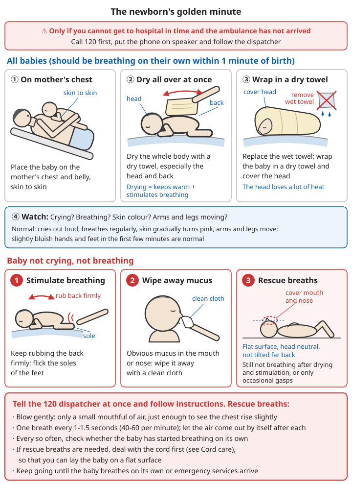
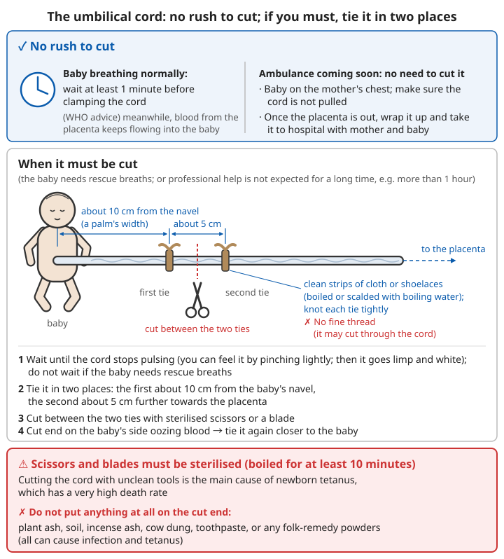

# Emergency Childbirth and Newborn Care

## Contents
- [What this chapter is for](#what-this-chapter-is-for)
- [Danger signs in pregnancy](#danger-signs-in-pregnancy)
- [Deciding: is there time to get to hospital?](#deciding-is-there-time-to-get-to-hospital)
- [When to call for professional help immediately](#when-to-call-for-professional-help-immediately)
- [Delivering the baby when there is no time to reach hospital](#delivering-the-baby-when-there-is-no-time-to-reach-hospital)
- [The golden minute for the newborn](#the-golden-minute-for-the-newborn)
- [Handling the umbilical cord](#handling-the-umbilical-cord)
- [The placenta and postpartum haemorrhage](#the-placenta-and-postpartum-haemorrhage)
- [The mother after birth](#the-mother-after-birth)
- [Newborn care in the first few days](#newborn-care-in-the-first-few-days)

---

## What this chapter is for

```
⚠️ Childbirth should take place in hospital, handled by professionals.

This chapter is only for emergencies when there is no time to reach hospital and the ambulance has not yet arrived.
- The great majority of births go naturally and smoothly; the helper's main job is "not to make things worse"
- A few situations quickly threaten the life of the mother or baby; then the most important thing is to call for professional help as early as possible

Always call 120 first.
The dispatcher will guide you step by step over the phone. Put the phone on speaker and keep it beside you.
```

**Prepare in advance (late pregnancy)**:
- Know the route to the nearest maternity hospital and how long it takes
- Have a hospital bag ready (identity documents, antenatal records, things for mother and baby)
- In remote areas, where transport is poor, or in disaster-prone seasons, move near a hospital before the due date
- Attend antenatal check-ups on time; at check-ups ask clearly whether you have any high-risk factors (baby in the wrong position, placenta praevia, twins or more, etc.)

---

## Danger signs in pregnancy

If any of the following happens during pregnancy, **go to hospital or call 120 immediately**. Do not wait until labour "starts":

```
- Vaginal bleeding
- Severe headache, blurred vision or flashing lights, sudden swelling of the face and hands (possible pre-eclampsia)
- Fits
- Severe abdominal pain, or the belly stays hard and does not relax
- Fever
- The baby's movements clearly decrease or stop
- Waters breaking (fluid coming from the vagina):
  - Before 37 weeks
  - Or the fluid is green or brown, or smells bad
  - Or after the waters break you can feel or see the umbilical cord at the vaginal opening (see cord prolapse below)
- Regular contractions before 37 weeks
```

---

## Deciding: is there time to get to hospital?

### Signs of labour

- Regular contractions: the belly tightens and hurts in waves, closer and closer together, stronger and stronger
- "Show": blood-streaked mucus from the vagina
- Waters breaking

### Signs that birth is imminent

```
- Contractions every 2-3 minutes, each lasting about 1 minute
- The mother has a strong, uncontrollable urge to "open her bowels" or "push"
- The mother says "the baby is coming"
- The baby's head can be seen at the vaginal opening (the top of the head is showing)

When these signs appear, especially once the head can be seen, it is often too late to get to hospital:
→ Do not set off by car (giving birth in a car is more dangerous)
→ Prepare to deliver the baby where you are, and call 120 at the same time
```

**Women who have given birth before** usually have much faster labours and should set off for hospital earlier.

---

## When to call for professional help immediately

These situations are hard for a lay person to handle. **Call 120 immediately and follow the dispatcher's instructions**:

| Situation | Recognition | What to do while waiting |
|------|------|--------------|
| **Cord prolapse** | The umbilical cord comes out of the vagina before the baby | Have the mother kneel with her chest down close to the floor (knee-chest position), hips raised; ❌ do not push the cord back, do not squeeze it; cover the exposed cord lightly with a warm, moist, clean cloth |
| **Breech** (bottom or feet first) | The first part to appear is not the head | Tell the mother not to push too early; ❌ do not pull on the baby's legs or body; follow the dispatcher's instructions |
| **Arm first** | One hand appears first | ❌ Do not pull; the baby cannot be born naturally; get to hospital as fast as possible |
| **Shoulders stuck after the head is born** | The head is born and then pulls back in; the body will not come out | Have the mother lie on her back and pull her knees up towards her chest as far as possible; or change to all fours (hands and knees); ❌ do not pull hard on the head |
| **Heavy bleeding** | Bleeding that will not stop before or after the birth | See postpartum haemorrhage below |
| **Mother has fits** | Fits before or after the birth | Lay her on her side to prevent injury and choking; see [Epileptic seizures](06-heart-stroke-and-sudden-illness.md#epileptic-seizures) for what to do |
| **Premature birth** | Before 37 weeks | Take special care to keep the newborn warm |
| **Twins or more** | Contractions continue after the first baby, the belly is still large | Get ready for the second baby and tell 120 |

---

## Delivering the baby when there is no time to reach hospital

### Preparation

```
1. Call 120 and put the phone on speaker
2. Wash your hands (soap and running water); wear gloves if you have them
3. Get ready:
   - Clean towels, sheets, clothes (at least 3-4, to dry the baby and keep it warm)
   - A clean cloth or plastic sheet to put under the mother
   - A bowl or plastic bag (for the placenta)
   - If the cord needs to be dealt with: two clean strips of cloth or shoelaces, and a pair of scissors or a blade
     (sterilise by boiling for at least 10 minutes, or pass through a flame and let cool before use)
4. Keep the room warm (newborns lose heat very easily)
5. Let the mother choose a comfortable position: half lying (propped up behind) is most common; lying on her side is also fine
```

### The birth

```
1. Let the mother push with each contraction as she feels the urge, and rest between contractions
2. Once the head appears:
   - Rest your palm lightly on the baby's head; do not press, and do not pull
   - Let the head come out slowly (too fast can tear the mother)
   - As the widest part of the head comes out, have the mother switch to short panting breaths and stop pushing
3. Once the head is out:
   - Check whether the cord is round the neck
     - If loose: hook it gently with a finger and slip it over the head
     - If too tight to loosen: do not cut it; let the baby be born with it in place
   - The head will turn to one side on its own
4. With the next contraction, the shoulders and body will be born
   - Support the baby with both hands (newborns are slippery; take care not to drop them)
   - ❌ Do not pull on the baby
5. Note the time of birth
```

### ❌ Do not, while delivering

```
❌ Do not let the mother press her legs together, or try in any way to stop the baby coming out
❌ Do not pull on the baby's head, body or limbs
❌ Do not pull on the cord
❌ Do not put your hand into the birth canal
❌ Do not press down on the mother's belly to push the baby out
```

---

## The golden minute for the newborn

**Within 1 minute of birth, the baby should be breathing on its own. If not, start helping it breathe.**

### All babies

```
1. Place the baby on the mother's chest and belly, skin to skin
2. Dry the whole body straight away with a dry towel, especially the head and back
   - Drying both keeps the baby warm and stimulates breathing
3. Take away the wet towel, wrap the baby in a dry one and cover the head (a lot of heat is lost from the head)
4. Watch: is the baby crying, breathing, what colour is the skin, are the arms and legs moving?
```

Normal: the baby cries out loud, breathes regularly, the skin gradually turns pink and the limbs move. Slightly blue hands and feet are normal for the first few minutes.

### If the baby does not cry or breathe

```
1. Keep rubbing the back firmly and flick the soles of the feet (to stimulate breathing)
2. Obvious mucus in the mouth and nose: wipe it away with a clean cloth
3. Still not breathing after drying and stimulation, or only occasional gasps:
   → Tell the 120 dispatcher immediately and follow the instructions
   → Start rescue breaths:
     - Lay the baby on its back on a flat surface, head in a neutral position (do not tilt it too far back)
     - Cover the baby's mouth and nose together with your mouth
     - Blow gently, only a small mouthful of air from your mouth, just enough to see the chest rise slightly
     - One breath every 1-1.5 seconds (40-60 per minute); after each breath let the air come out by itself
     - Every so often check whether the baby has started breathing on its own
4. If rescue breaths are needed, deal with the cord first (see below) so the baby can be laid on a flat surface
5. Keep going until the baby starts breathing on its own or the ambulance crew arrives
```

When a newborn does not breathe, it is almost always due to lack of oxygen. **Effective rescue breaths are the most important step**, and most babies recover with breaths alone. Professionals add chest compressions only if the heart rate is still below 60 beats per minute after about 30 seconds of effective breaths: hands circling the chest, both thumbs pressing on the lower third of the breastbone, to a depth of about one third of the chest's thickness, with 1 breath after every 3 compressions (3:1, unlike the 30:2 used for older infants by a single rescuer). If no professional is present, follow the 120 dispatcher's instructions; for the infant compression technique see [Basic first aid - How CPR differs for children and infants](00-basic-first-aid.md#how-cpr-differs-for-children-and-infants).



*Figure: The newborn's golden minute. Place the baby on the mother's chest and belly, dry it, change to a dry towel and cover the head; if the baby does not cry or breathe, rub the back, flick the soles and wipe away mucus; if still not breathing, start rescue breaths immediately. Use only when there is no time to reach hospital; call 120 first*

---

## Handling the umbilical cord

### No rush to cut

```
✓ If the baby is breathing normally, wait at least 1 minute (World Health Organization advice) before clamping the cord
  - During this time blood from the placenta keeps flowing into the baby, which is good for the baby
✓ If the ambulance will arrive soon, you do not need to cut the cord yourself
  - Keep the baby on the mother's chest and make sure the cord is not pulled
  - Once the placenta has come out, it can be wrapped up and taken to hospital together with mother and baby
```

### When it must be cut

When it needs to be cut: the baby needs rescue breaths; or professional help is not expected for a long time (such as more than 1 hour).

```
1. Wait until the cord stops pulsing (you can feel the pulse by pinching it lightly with your fingers; once it stops, the cord goes limp and white)
   - Do not wait if the baby needs rescue breaths
2. Tie it in two places with clean strips of cloth or shoelaces (boiled or scalded with boiling water):
   - First tie: about 10 cm from the baby's navel (about the width of a palm)
   - Second tie: about 5 cm further towards the placenta
   - Knot each tie tightly (do not use fine thread, which may cut through the cord)
3. Cut between the two ties with sterilised scissors or a blade
4. Check whether the cut end on the baby's side is oozing blood; if it is, tie it again closer to the baby

⚠️ Scissors and blades must be sterilised (boiled for at least 10 minutes)
   Cutting the cord with unclean tools is the main cause of newborn tetanus, which has a very high death rate
❌ Do not put anything at all on the cut end of the cord: plant ash, soil, incense ash, cow dung,
   toothpaste, or any folk-remedy powders (all can cause infection and tetanus)
```



*Figure: No rush to cut the cord. When it must be cut, tie it in two places with clean strips of cloth (about 10 cm from the baby's navel, then about 5 cm further towards the placenta), cut between the two ties with sterilised scissors, and put nothing on the cut end*

---

## The placenta and postpartum haemorrhage

### Delivery of the placenta

```
- The placenta usually comes out between a few minutes and about 30 minutes after the baby is born
- The mother may feel contractions again and an urge to push
- Let the placenta come out by itself; catch it in a bowl or plastic bag
- Keep the placenta and take it to hospital with mother and baby (the doctor needs to check that it is complete)

❌ Never pull on the cord to help the placenta out
   (this can snap the cord, turn the womb inside out and cause fatal heavy bleeding)
```

### ⚠️ Postpartum haemorrhage: one of the leading causes of maternal death

```
Some bleeding after the birth is normal.
Abnormal: bleeding that will not stop and quickly soaks through several towels or pads;
     or the mother becomes pale, breaks into a cold sweat, has a pounding heart, is dizzy or confused (signs of shock)

What to do:
1. Tell the 120 dispatcher immediately
2. Put the baby to the breast immediately (or stimulate the nipples)
   - Suckling makes the womb contract and reduces bleeding
3. Massage the womb:
   - After the placenta is out, you can feel a round, firm lump about the size of a pomelo below the mother's navel;
     this is the womb
   - If it feels soft, rub it in circles with the palm of your hand until it becomes firm
   - It will hurt quite a lot; tell the mother this is necessary
   - Once it is firm, check again every so often; if it goes soft, massage again
4. Lay the mother flat, raise her legs and keep her warm (as for shock)
5. Bleeding from a tear around the vaginal opening: press firmly on it with a clean cloth pad
6. ❌ Do not put anything into the vagina
```

For recognising and treating shock, see [Basic first aid - Shock](00-basic-first-aid.md#managing-shock).

---

## The mother after birth

### The first few hours

```
✓ Keep her warm; give warm water or a warm sweet drink
✓ Keep mother and baby skin to skin, and start breastfeeding early (within 1 hour of birth)
✓ Check the bleeding and how firm the womb is every so often
✓ Encourage her to pass urine (a full bladder stops the womb contracting properly)
✓ Even if all has gone well, take mother and baby to hospital for a check as soon as possible
```

### Danger signs in the weeks after birth (see a doctor immediately)

```
- Vaginal bleeding suddenly gets heavier, or increases instead of decreasing
- Fever, shivering
- Bad-smelling vaginal discharge
- Severe headache, blurred vision, fits (eclampsia can also happen after birth)
- Chest pain, difficulty breathing
- Swelling, pain and redness in one calf (possible blood clot)
- Red, swollen, hot, painful breast with fever
- Persistent low mood or anxiety, or thoughts of harming herself or the baby (call 12356)
```

For recognising emotional problems and suicide risk after birth, see [Mental Health](10-mental-health.md).

---

## Newborn care in the first few days

### Keeping warm

- Newborns, especially premature and low-birth-weight babies, lose heat very easily
- Being held by the mother, skin to skin, is the best way to keep them warm
- Put on a hat and add an extra layer, but do not wrap them so tightly or thickly that they sweat
- Do not bath them too early (wait at least 24 hours); when bathing, keep the room warm and be quick

### Feeding

```
✓ Start breastfeeding within 1 hour of birth
✓ Colostrum (the small amount of yellowish milk in the first few days) is very precious; always feed it, do not express it and throw it away
✓ Feed whenever the baby wants (feeding on demand), usually 8-12 times a day
✓ Exclusive breastfeeding for the first 6 months; no water needed
❌ Do not give sugar water, rice water or honey (no honey under 1 year old) instead of breast milk
```

For nutrition, see [Nutrition and deficiency diseases - Special groups](../../../docs/07-日常生活技能/02-营养与营养缺乏病.md#特殊人群).

### Cord care

```
✓ Keep the cord stump clean and dry and open to the air (fold the nappy below the stump)
✓ If it gets dirty with urine or stool, wash with clean water and pat dry
✓ It usually falls off by itself in 1-2 weeks; do not pull it
❌ Do not put any folk-remedy substances on it

⚠️ Spreading redness around the navel, pus, a bad smell, or oozing blood → see a doctor
```

### ⚠️ Newborn danger signs (see a doctor immediately)

The World Health Organization lists these newborn danger signs. If any one of them appears, see a doctor immediately:

```
- Not feeding, or feeding clearly less
- Fits
- Fast breathing (60 or more breaths per minute at rest)
- Chest clearly drawing in when breathing in
- Hardly moving, or moving only when stimulated
- Fever (temperature 37.5°C or above)
- Low temperature (below 35.5°C)
- Yellow skin within the first 24 hours of life, or yellow palms and soles at any time
```

Also: lips that stay blue, repeated vomiting (especially green vomit), or a serious infection around the cord also need a doctor immediately.

### Other

- In hospital, newborns are usually given a vitamin K injection (to prevent bleeding) and vaccinations after birth; babies born outside hospital should get these as soon as possible
- If the mother was not vaccinated against tetanus during pregnancy, tell the doctor after a birth outside hospital

---

## 📝 Key points

```
1. Call 120 first, put the phone on speaker and follow the dispatcher's instructions
2. Once the baby's head can be seen, do not travel; deliver where you are
3. Support, do not pull; do not press the legs together, push on the belly, pull the cord or put your hand into the birth canal
4. When the baby is born: place it on the mother's chest, dry it straight away, keep it warm, cover the head
5. The golden minute: still not breathing after drying and stimulation → start rescue breaths immediately
6. The cord: if all is normal wait at least 1 minute; no need to cut if the ambulance is close;
   if cutting, use sterilised tools, tie in two places, put nothing on the cut end
7. Let the placenta come out by itself, do not pull the cord, take it to hospital
8. Postpartum haemorrhage: breastfeed at once, massage the womb, lie flat and keep warm, call for help
9. Keep the newborn warm and give colostrum early; see a doctor immediately if danger signs appear
```

---

**Next chapter**: [Poisoning](12-poisoning.md)
**Back**: [Part contents](README.md) | [Main contents](../../README.md)
