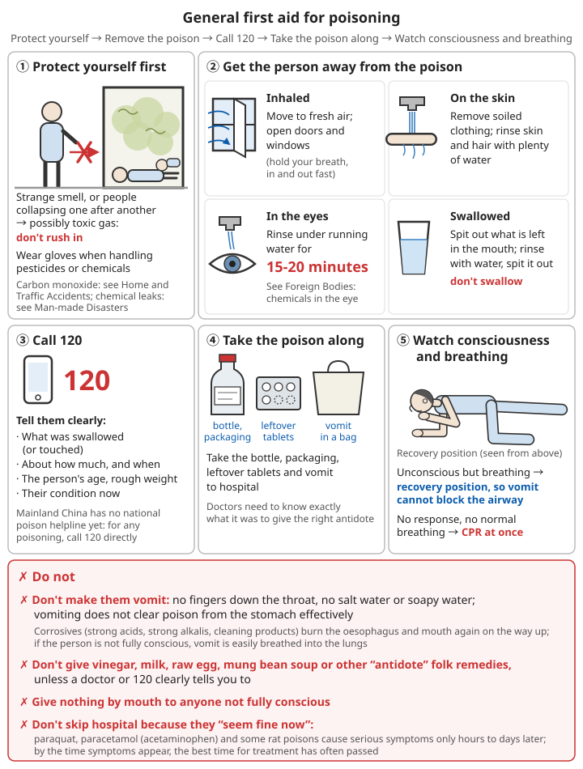

# Poisoning

## Contents
- [General principles for handling poisoning](#general-principles-for-handling-poisoning)
- [Pesticide and rat poison poisoning](#pesticide-and-rat-poison-poisoning)
- [Drug overdose and accidental swallowing](#drug-overdose-and-accidental-swallowing)
- [Alcohol poisoning](#alcohol-poisoning)
- [Cleaning product poisoning](#cleaning-product-poisoning)
- [Other poisonings](#other-poisonings)
- [Preventing poisoning](#preventing-poisoning)

---

## General principles for handling poisoning

### Do immediately

```
1. Protect yourself first
   - Strange smell at the scene, or people collapsing one after another → there may be a toxic gas; do not rush in
   - Wear gloves when touching pesticides or chemicals

2. Get the person away from the poison
   - Breathed in: move them to fresh air
   - On the skin: take off contaminated clothing; rinse skin and hair with plenty of clean water
   - In the eyes: rinse with running clean water for 15-20 minutes
   - Swallowed: spit out whatever is left in the mouth; rinse the mouth with clean water (do not swallow it)

3. Call 120 and tell them clearly:
   - What was swallowed (or touched), roughly how much, and when
   - The person's age, rough weight and current condition

4. Take the bottle, packaging, leftover tablets and any vomit to hospital
   (doctors need to know exactly what it was to give the right antidote)

5. Watch them:
   - Not fully conscious but breathing → lay them on their side (recovery position) so vomit cannot block the airway
   - Unresponsive and not breathing normally → start CPR at once
```

For chemicals in the eye, see [Foreign bodies - chemicals in the eye](04-foreign-bodies-and-choking.md#chemicals-in-the-eye-emergency).

### ❌ Don't

```
❌ Do not make them vomit
   - Sticking fingers down the throat, or giving salt water or soapy water to cause vomiting, is not recommended
   - Vomiting does not remove poison from the stomach effectively
   - Corrosive substances (strong acids, strong alkalis, cleaning products) burn the gullet and mouth a second time on the way up
   - Someone who is not fully conscious can easily breathe vomit into the lungs, causing serious lung damage
❌ Do not give vinegar, milk, raw eggs, mung bean soup or other folk "antidotes", unless a doctor or 120 clearly tells you to
❌ Do not give anything by mouth to someone who is not fully conscious
❌ Do not skip the hospital because the person "looks fine now"
   - Many poisons (paraquat, paracetamol (acetaminophen), some rat poisons) take hours to days to cause serious symptoms;
     by the time symptoms appear, the best window for treatment has often passed
```

⚠️ Mainland China has no national poison information hotline yet. For any poisoning, call 120 directly.



*Figure: General poisoning first aid: protect yourself first, then get the person away from the poison; rinse eyes for 15-20 minutes; do not make them vomit and do not give folk remedies*

---

## Pesticide and rat poison poisoning

A common cause of poisoning in rural areas. Causes include swallowing by mistake (pesticide kept in a drinks bottle and taken for a drink), poor protection while spraying, and suicide.

### Organophosphate pesticides (dichlorvos, dimethoate, trichlorfon, etc.)

```
Recognise:
- Heavy sweating, drooling, watering eyes, runny nose
- Very small pupils (pinpoint)
- Nausea, vomiting, stomach pain, diarrhoea
- Muscle twitching, fits
- Difficulty breathing, tight chest
- Garlic-like smell on the breath or body
- In severe cases, coma and breathing stops

What to do:
1. Rescuers wear gloves (organophosphates are absorbed through the skin; rescuers can be poisoned too)
2. Take off contaminated clothing, shoes and socks at once; bag them and keep them apart
3. Wash skin, hair and under the nails again and again with soapy water and plenty of clean water
4. Call 120 and say it is organophosphate pesticide poisoning (hospitals have a specific antidote; the sooner the better)
5. Take the pesticide bottle to hospital
6. If breathing stops, do CPR (use a face mask or barrier if you have one, so the rescuer does not touch pesticide in the mouth)
```

### Paraquat

```
⚠️ Extremely toxic; there is no specific antidote; one mouthful can kill

- China stopped selling paraquat liquid formulations from 2016, but old stock and illegal supplies remain, and poisonings still happen
- Early on there may be only burning pain in the mouth and throat; it can look "not serious"
- Over a few days, liver and kidney damage and irreversible lung scarring (pulmonary fibrosis) develop

What to do:
- However little was swallowed, with or without symptoms, call 120 at once and get to hospital
- On the skin: take off clothing at once; wash thoroughly with soapy water and clean water
- Tell the doctor it is paraquat; take the bottle
```

### Rat poison

| Type | Features | What to do |
|------|------|------|
| Anticoagulants (e.g. bromadiolone, brodifacoum) | The most common type today. Bleeding starts **several days after** swallowing: bleeding gums, bruises under the skin, blood in the urine, black stools | See a doctor at once even if there are no symptoms at the time; hospitals have a specific antidote |
| Tetramine and similar (banned in China long ago) | Extremely toxic; fits start quickly | Call 120 at once |

If a child has eaten rat poison pellets, even just one or two, take the packaging and see a doctor at once.

### Protection when spraying pesticides

```
✓ Wear long sleeves and long trousers, gloves, a mask and a hat; goggles if possible
✓ Spray standing upwind; never spray into the wind
✓ Do not eat, drink or smoke while spraying
✓ Change clothes and shower straight after spraying; wash the clothes separately
✓ Dizziness, nausea, heavy sweating or blurred vision → stop at once, leave the area, wash, and see a doctor
✓ Pregnant women, breastfeeding women, children and older people should not take part in spraying
```

---

## Drug overdose and accidental swallowing

### Children swallowing things

The things children most often swallow by mistake are household tablets, cleaning products, cosmetics and button batteries.

```
1. Take whatever is left out of the child's mouth at once
2. Find out what was swallowed and how much it might have been (count how many are left in the bottle)
3. Call 120, or take the bottle and packaging and go to hospital at once
4. Do not make the child vomit
5. Do not wait for symptoms before going

⚠️ The following are dangerous even in small amounts; see a doctor at once:
- Button batteries, magnets (see Swallowed objects)
- Diabetes medicines, blood pressure medicines, heart medicines
- Antidepressants, sleeping pills
- Iron-containing supplements
- Adult painkillers (paracetamol etc.)
- Pesticides, rat poison, cleaning products
```

Related chapter: [Swallowed objects](04-foreign-bodies-and-choking.md#swallowed-objects).

### Adult drug overdose

```
- Sleeping pills, sedatives: drowsiness, confusion, slow and shallow breathing → call 120, lay them on their side, watch their breathing
- Diabetes medicines, insulin: signs of low blood sugar (see Low blood sugar)
- Paracetamol (also called acetaminophen; found in many cold remedies):
  ⚠️ For the first 1-2 days after an overdose there may be no obvious symptoms, but the liver is being damaged silently
  → If you suspect an overdose, see a doctor at once (there is a specific antidote, but it must be given early)
  → Taking several cold remedies at once can easily cause an overdose by accident; check the ingredients
```

Related chapter: [Low blood sugar](06-heart-stroke-and-sudden-illness.md#hypoglycaemia-low-blood-sugar).

If the overdose may have been deliberate, deal with the physical problem and also pay attention to the person's mental state; see [Mental health - suicide risk](10-mental-health.md#suicide-risk-recognition-and-response).

---

## Alcohol poisoning

### Danger signs

```
Call 120 at once if any of these appear:
- Cannot be woken, or wakes only briefly
- Vomiting while unconscious
- Slow breathing (fewer than 8 breaths a minute) or irregular breathing, pauses in breathing
- Fits
- Cold, clammy, pale or bluish skin
- Low body temperature
```

### What to do

```
✓ Do not leave a drunk person lying alone to "sleep it off"
  - Alcohol is still being absorbed; things can get worse after drinking stops
  - The most common cause of death is vomiting while asleep and choking on vomit drawn into the airway
✓ Lay them on their side (recovery position) and keep the airway open
✓ Someone stays with them the whole time and checks their breathing regularly
✓ Keep them warm (drunk people get hypothermia easily; passing out drunk outdoors in winter is very dangerous)
✓ Once they can sit up and are alert, they can drink small amounts of water

❌ Do not make them vomit
❌ Do not give coffee or strong tea to "sober them up" (it does not speed up alcohol breakdown and adds strain on the heart)
❌ Do not give them a cold shower (it can cause hypothermia or a fall)
❌ Do not let them walk, cycle or drive on their own
```

### ⚠️ Counterfeit liquor (methanol) poisoning

- After drinking loose liquor of unknown origin or home-brewed liquor, symptoms appear within several hours to a day: **blurred vision, as if looking through a layer of snow**, severe headache, nausea, difficulty breathing
- This is methanol poisoning. It can cause blindness and death. **See a doctor at once**
- Everyone who drank from the same batch must go to hospital to be checked
- For methanol in home-made alcohol, see [Disinfectant preparation - purification by distillation](../../../docs/06-制药技术/01-消毒剂制备.md#13-蒸馏提纯)

---

## Cleaning product poisoning

### ⚠️ Never mix different cleaning products

```
❌ "84" bleach (chlorine bleach) + acidic toilet cleaner
   → produces chlorine gas, which irritates the eyes and airways and can kill in severe cases
❌ "84" bleach + cleaners containing ammonia
   → produces toxic gas
❌ Mixing different drain cleaners
   → violent reaction, splashing

Rule: use only one cleaning product at a time; read the label before use; open the windows when cleaning the bathroom
```

### Breathing in toxic gas

```
1. Leave the area at once and get to fresh air
2. Open doors and windows to air the room (hold your breath, go in and out quickly)
3. Non-stop coughing, tight chest, shortness of breath, difficulty breathing → call 120
4. Even if symptoms ease, they can get worse hours later; anyone with clear symptoms should see a doctor for observation
```

### Swallowing cleaning products or disinfectant

```
1. Do not make them vomit
2. Rinse the mouth with clean water and spit it out
3. Call 120 at once; take the bottle
4. Difficulty swallowing, drooling, chest pain, vomiting blood → there is corrosive injury; get to hospital even faster
```

---

## Other poisonings

| Poisoning | See |
|------|------|
| Carbon monoxide poisoning | [Home and traffic accidents - carbon monoxide poisoning](07-home-and-traffic-accidents.md#carbon-monoxide-poisoning) |
| Food poisoning | [Common illnesses - food poisoning](01-common-illnesses.md#food-poisoning) |
| Bongkrekic acid, botulism, aflatoxin, nitrite | [Food processing and preservation - high-risk foods and food poisoning](../../../docs/07-日常生活技能/01-食物加工与保存.md#高风险食品与食物中毒) |
| Poisonous mushrooms, poisonous plants | Never eat anything you cannot identify; everyone who ate it must see a doctor, taking the leftover mushrooms or plants |
| Venomous snake bites | [Wounds and injuries - snake bites](02-wounds-and-injuries.md#snakebites) |
| Chemical spills | [Man-made disasters - chemical spills](../02-disaster-response/05-man-made-disasters.md#chemical-spills) |

---

## Preventing poisoning

```
Storage:
✓ Keep medicines, pesticides, rat poison and cleaning products out of children's reach, ideally locked away
✓ Keep pesticides and cleaning products in their original packaging
❌ Never put pesticide, petrol or cleaning products in drinks bottles or water bottles (the most common cause of accidental swallowing)
✓ Store pesticides away from food and animal feed
✓ Never reuse empty pesticide bottles for anything else; return or dispose of them according to the rules

Medicines:
✓ Check the drug name and dose; different cold remedies may contain the same ingredient
✓ Do not take medicine in front of children; never say "medicine is sweets"
✓ Get rid of expired and unused medicines promptly

Other:
✓ Do not drink loose liquor of unknown origin
✓ Never mix cleaning products; keep the room aired while using them
✓ Put rat poison where children and pets cannot reach it, and label it clearly
```

---

## 📝 Poisoning: key points

```
1. Call 120; take the bottle, packaging and leftover medicine
2. Do not make them vomit; do not give folk remedies
3. On the skin: remove clothing, wash with soapy water and clean water; rescuers wear gloves
4. Not fully conscious: lay on their side; not breathing: CPR
5. Paraquat, paracetamol, anticoagulant rat poison: see a doctor at once even without symptoms
6. Never leave a drunk person alone to "sleep it off"; lay them on their side and keep watch
7. Never mix "84" bleach with toilet cleaner
8. Never put pesticides or cleaning products in drinks bottles
```

---

**Next chapter**: [Elder care](13-elder-care.md)
**Back to**: [Chapter list](README.md) | [Main contents](../../README.md)
