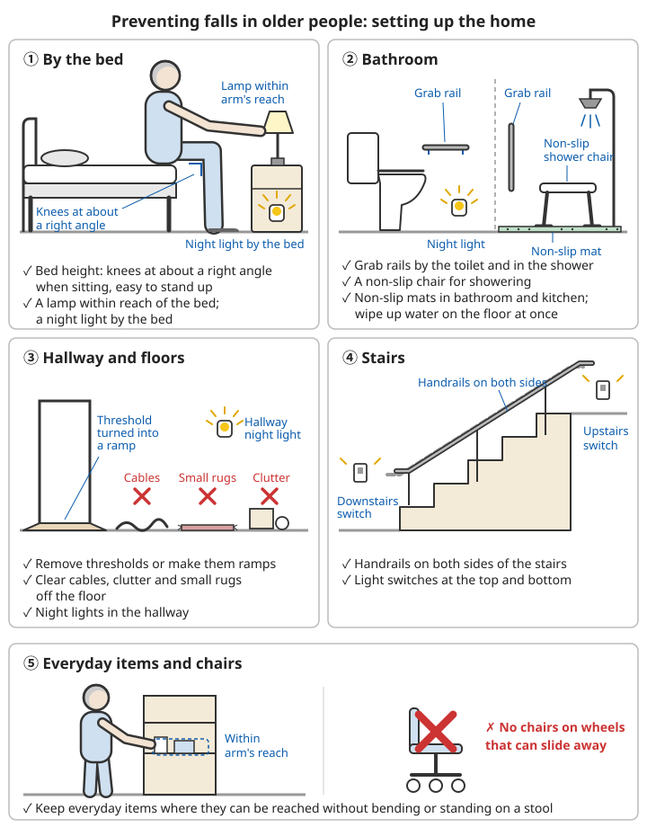
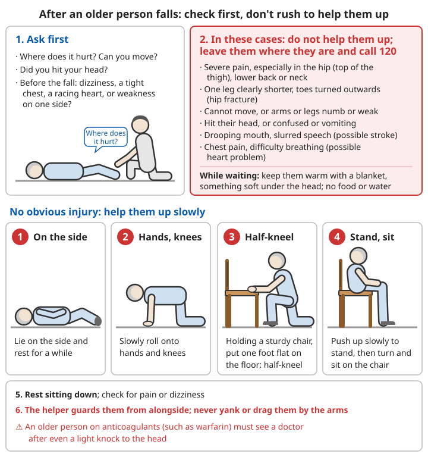
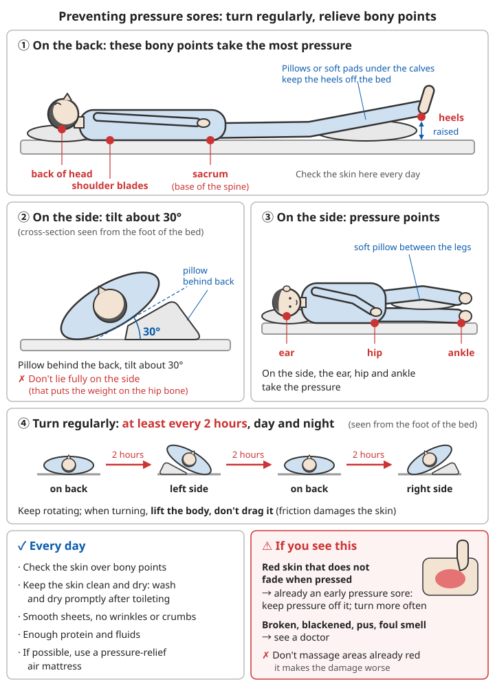

# Elder care

## Contents
- [Preventing falls](#preventing-falls)
- [What to do after an older person falls](#what-to-do-after-an-older-person-falls)
- [Home care for people confined to bed](#home-care-for-people-confined-to-bed)
- [Cognitive impairment and going missing](#cognitive-impairment-and-going-missing)
- [Medication safety](#medication-safety)
- [Extreme weather](#extreme-weather)
- [Look after the carer](#look-after-the-carer)

---

## Preventing falls

Falls are one of the leading causes of injury and injury death in older people. One hip fracture can leave an older person bedridden for good, yet **most falls can be prevented**.

### Setting up the home

```
Floors:
✓ Remove door thresholds or turn them into ramps; clear away cables, clutter and small rugs
✓ Put non-slip mats in the bathroom and kitchen; wipe up water on the floor straight away
✓ Keep everyday items where they can be reached without bending down or standing on a stool

Lighting:
✓ Night lights in the hallway, bathroom and by the bed (getting up at night to use the toilet is when falls happen most)
✓ A lamp by the bed that can be switched on within arm's reach
✓ Light switches at both the top and bottom of the stairs

Grab rails:
✓ Grab rails beside the toilet and in the shower
✓ Handrails on both sides of the stairs
✓ A non-slip shower chair for bathing

Furniture:
✓ Beds and chairs of a suitable height: when seated, knees are at about a right angle and standing up is easy
✓ No chairs on wheels that can slide away
```



*Figure: Beds and chairs of a suitable height, night lights and a lamp within arm's reach; grab rails beside the toilet and in the shower, non-slip mats; thresholds turned into ramps, cables, small rugs and clutter cleared away; handrails on both sides of the stairs and switches at top and bottom*

### For the older person

```
✓ Wear well-fitting, non-slip shoes that enclose the heel; do not wear slippers on the stairs
✓ Get up slowly: lying → sit for 30 seconds → stand for 30 seconds → then walk
  (getting up too fast easily causes dizziness, especially in older people taking blood pressure medicine)
✓ When getting up at night to use the toilet, switch the light on first and sit for a while before standing
✓ When eyesight gets worse, get glasses promptly and have cataracts treated
✓ Use a walking stick or walking frame when needed; do not refuse because it "doesn't look good"
✓ Keep up moderate exercise to build leg strength and balance (walking, tai chi, standing heel raises, etc.)
✓ Avoid going out in rain or snow or on wet, slippery ground
```

### Medicines that make falls more likely

Sleeping pills, sedatives, anti-anxiety medicines, some blood pressure medicines, diabetes medicines, diuretics and others can all cause dizziness, slower reactions, or a drop in blood pressure on standing up.

**If an older person has had a fall, or is often dizzy, ask a doctor to review the medicines they are taking.** Do not stop any medicine on your own.

---

## What to do after an older person falls

### Don't rush to help them up

```
1. First ask clearly:
   - Where does it hurt? Can you move?
   - Did you hit your head?
   - Before falling, did you feel dizzy, a tight chest, a racing heart, or weakness on one side?

2. In these cases, do not help them up; leave them where they are and call 120:
   - Severe pain, especially in the hip (top of the thigh), lower back or neck
   - One leg clearly shorter, with the toes turned outwards (the classic sign of a hip fracture)
   - Cannot move, or arms or legs are numb or weak
   - Hit their head, or is confused or vomiting
   - Drooping mouth or slurred speech (a stroke may have caused the fall; see Stroke)
   - Chest pain or difficulty breathing (a heart problem may have caused the fall)

3. While waiting: keep them warm with a blanket, put something soft under the head, do not give food or water
```

Related chapter: [Stroke](06-heart-stroke-and-sudden-illness.md#stroke).

### No obvious injury: help them up slowly

```
1. Let them first lie on their side and rest for a while
2. Slowly roll onto hands and knees
3. Next to a sturdy chair, holding the chair, put one foot flat on the floor to half-kneel
4. Push up slowly to stand, then turn and sit down on the chair
5. Rest sitting down; check for pain or dizziness
6. The helper stays alongside to guard them; never yank or drag the older person by the arms
```



*Figure: Check first, then decide whether to help them up; with no obvious injury, get up slowly in this order: lie on the side → hands and knees → half-kneel holding a chair → sit on the chair*

### ⚠️ Stay alert after a fall

- **An older person on anticoagulants (such as warfarin) must see a doctor after even a light knock to the head**: bleeding inside the skull can appear hours to days later (worsening headache, drowsiness, changes in consciousness)
- Lying on the floor for a long time unable to get up (common in older people living alone) can lead to dehydration, hypothermia and pressure sores; get medical care as soon as possible
- Older people living alone: agree with family to make contact at a fixed time every day; if possible, wear a one-button emergency alarm

For splinting fractures, see [Bone and joint injuries](03-bone-and-joint-injuries.md).

---

## Home care for people confined to bed

### Preventing pressure sores (bedsores)

When the body presses on the same spot for a long time, the skin and the tissue underneath lose their blood supply and die, forming a pressure sore. Once formed, it heals very slowly, and in severe cases it can cause infection throughout the body.

```
✓ Turn them on a schedule: at least every 2 hours, day and night
  - Lying on the back → left side → back → right side, in rotation
  - When on their side, put a pillow behind the back so the body is tilted at about 30° (not fully on the side, pressing on the hip bone)
  - Lift the body when turning; do not drag it (friction damages the skin)
✓ Bony areas are where pressure sores form most easily; check them every day:
  - Tailbone (lower back above the buttocks), hips, heels, ankles, shoulder blades, back of the head, ears
✓ Use pillows or soft pads to lift the heels clear of the bed; put a soft pillow between the legs
✓ Keep skin dry and clean: wash and dry promptly after the toilet; keep sheets smooth, without wrinkles or crumbs
✓ Use an anti-pressure-sore air mattress if available
✓ Eat enough protein and drink enough water (poorly nourished people get pressure sores more easily)

⚠️ Red skin that does not turn pale when pressed → this is already an early pressure sore
   Keep all pressure off this spot and turn them more often
⚠️ Broken, blackened or pus-filled skin, or a bad smell → see a doctor
❌ Do not massage areas that are already red (it makes the damage worse)
```



*Figure: Lying on the back, pressure falls on the back of the head, shoulder blades, tailbone and heels; lying on the side, on the ears, hips and ankles; when on the side, a pillow behind the back tilts them at about 30°, a soft pillow goes between the legs and the heels are lifted clear; turn at least every 2 hours*

### Feeding safely and preventing choking

Older people confined to bed often swallow less well. Food going down the windpipe causes aspiration pneumonia, a common cause of death in older people confined to bed.

```
✓ Sit them as upright as possible to eat (raise the head of the bed fully, or help them sit up, well supported at the back)
✓ Keep them sitting up for about 30 minutes after eating; do not lie them down straight away
✓ Feed small mouthfuls slowly; wait until one mouthful is swallowed before giving the next
✓ Make food soft or puréed; thin liquids cause choking most easily and can be thickened a little
✓ No talking or TV distractions while eating
✓ Do not feed someone who is confused or very drowsy

⚠️ Coughing often while eating, a "wet", gurgly voice after eating, repeated fevers
   → choking may be happening often; ask a doctor to assess their swallowing
```

### Other daily care

```
Mouth:     brush the teeth every day, or wipe the mouth with gauze dipped in water (a dirty mouth can also cause pneumonia);
           take out dentures and clean them every day
Toilet:    remind them to pass urine at regular times; prevent constipation with plenty of water, vegetables and gentle tummy massage;
           with incontinence, change and wash promptly and protect the skin with barrier cream
Joints:    help move every joint of the arms and legs several times a day to prevent stiffness and deformity
Breathing: pat the back regularly (cup the palm, pat gently from bottom to top) and encourage coughing up phlegm
           (method in Common illnesses - cough)
Mood:      keep them company and talk with them; let them take part in whatever they still can
```

Related chapter: [Common illnesses - cough](01-common-illnesses.md#cough).

---

## Cognitive impairment and going missing

### Early signs

```
Changes to watch for:
- Memory clearly getting worse, especially for recent events (asking the same question again and again)
- Getting lost in familiar places
- Unable to do things they used to do well (cooking, handling money)
- Personality changes, suspicion, irritability
- Poorer judgement (easily scammed)

If these changes appear, ask a doctor to check: some causes (such as thyroid problems, vitamin deficiencies or side effects of medicines) can be treated.
```

### Preventing them from getting lost

```
✓ Give them a wristband or badge with their name and a family phone number, or sew contact details into their clothes
✓ Keep a contact card in their pocket
✓ Keep recent full-length and front-facing photos of them
✓ If possible, have them wear a GPS watch or wristband
✓ Fit the front door with a lock that is hard to open, or a door alarm
✓ Tell neighbours and estate security and ask them to keep an eye out
✓ When going out, have someone go with them whenever possible
```

### If they go missing

```
⚠️ Call 110 (police) at once; there is no need to wait 24 hours!
   The first few hours after someone goes missing are the most important for finding them

At the same time:
- Give photos, what they are wearing, what they look like, and where they might go
- Search nearby first: places they often go, former homes, former workplaces, familiar routes
- Tell relatives, friends, neighbours and the local community
```

---

## Medication safety

Older people often take several medicines at once and easily miss doses, take too much, or take the wrong one.

```
✓ Use a pill organiser with compartments, sorted by day and by meal
✓ Write a medication list (drug name, dose, time), put it up where it is easy to see, and take it to appointments
✓ When seeing a new doctor or a different department, tell them every medicine being taken (including Chinese medicines and supplements)
✓ Do not add, stop or switch medicines on your own
✓ For older people with poor eyesight or memory, family members help manage the medicines
```

For stockpiling medicines for chronic conditions, see [Chronic medication stockpile](08-chronic-medication-stockpile.md).

---

## Extreme weather

Older people feel heat and cold less sharply and regulate their body temperature less well, so they are at greater risk in both heat waves and severe cold.

```
Heat:
✓ Drink water at regular times without waiting to feel thirsty
✓ Open windows indoors and use a fan or air conditioning; do not tough it out to save electricity
✓ Avoid going out around midday
✓ Check on older people living alone every day
→ For recognising and treating heatstroke, see Heatstroke

Cold:
✓ Keep the home warm; add extra bedding at night
✓ Watch out for carbon monoxide poisoning from heating; see Carbon monoxide poisoning
✓ Go out less on rainy or snowy winter days (to prevent falls)
→ For hypothermia, see Hypothermia
```

Related chapters: [Heatstroke](05-acute-symptoms.md#heatstroke), [Carbon monoxide poisoning](07-home-and-traffic-accidents.md#carbon-monoxide-poisoning), [Hypothermia](05-acute-symptoms.md#hypothermia).

---

## Look after the carer

Caring long-term for an older person who is confined to bed or has cognitive impairment is very hard work, and carers themselves can easily burn out or become depressed.

```
✓ Family members take turns caring; do not carry it all alone
✓ Find out about home care services and respite care offered by the local community or street office
✓ Make sure you get enough sleep and regular meals
✓ Allow yourself to have feelings; find someone to talk to
✓ When you feel you cannot go on, get help (you can call the 12356 psychological support hotline)
```

For more, see [Mental health - looking after yourself under long-term stress](10-mental-health.md#looking-after-yourself-under-long-term-stress).

---

## 📝 Elder care: key points

```
1. Preventing falls: non-slip floors, grab rails, night lights, well-fitting shoes, get up slowly, review medicines
2. After a fall: severe hip pain, leg shortened and turned out, head injury, signs of stroke → do not help them up, call 120
3. Older people on anticoagulants who knock their head must see a doctor even without symptoms
4. Confined to bed: turn at least every 2 hours, check bony areas, keep dry
5. Feed sitting upright, sit up for 30 minutes after meals, small mouthfuls slowly
6. Cognitive impairment: contact wristband, keep photos; if they go missing call 110 at once, no need to wait 24 hours
7. Manage medicines with a pill organiser
8. Carers must look after themselves too
```

---

**Next chapter**: [Child safety](14-child-safety.md)
**Back to**: [Chapter list](README.md) | [Main contents](../../README.md)
