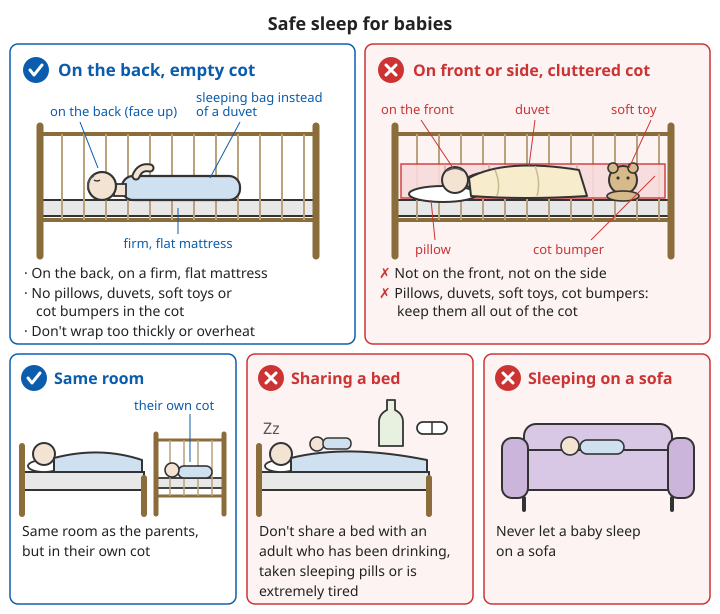

# Child safety

## Contents
- [Why prevention gets its own chapter](#why-prevention-gets-its-own-chapter)
- [Preventing drowning](#preventing-drowning)
- [Preventing falls](#preventing-falls)
- [Preventing poisoning and swallowed objects](#preventing-poisoning-and-swallowed-objects)
- [Preventing choking and suffocation](#preventing-choking-and-suffocation)
- [Preventing burns and scalds](#preventing-burns-and-scalds)
- [Car safety](#car-safety)
- [Preventing children getting lost](#preventing-children-getting-lost)
- [Other](#other-1)

---

## Why prevention gets its own chapter

Most other chapters in this handbook are about "what to do when something has happened". But with children, many accidents are too late to fix once they happen: a few minutes of drowning causes irreversible harm, and a fall from a window is often fatal.

**Accidental injury is a major cause of death in children, and most of it can be prevented.** Prevention does not come from first aid afterwards. It comes from making the surroundings safe beforehand, putting dangerous things away, and not getting distracted while watching children.

```
Three general rules:
1. Supervision: the younger the child, the more they must be within arm's reach; no phone while supervising
2. Surroundings: make the home a place where "even if you look away for a moment, the child is unlikely to get hurt"
3. Teaching: as children grow, teach them to recognise danger and how to ask for help
```

---

## Preventing drowning

**Drowning is the leading cause of accidental injury death in children aged 1-14 in China.**

### Young children (mainly at home and near home)

Young children often drown when an adult "steps away for a moment", and **a few cm of water is enough to drown a young child**.

```
✓ An adult stays beside the child the whole time during bathing; never leave a child alone in the bath, not even for a minute
✓ Empty baths, buckets and basins as soon as you have finished with them
✓ Cover water jars, wells and storage tanks with lids the child cannot lift
✓ Keep the toilet lid closed
✓ If there are ponds, ditches or fish ponds near the home, fence them off and do not let young children play outside alone
```

### School-age children and teenagers (mainly in open water)

Drowning death rates are clearly higher for rural children than for urban children. Most cases happen in the summer holidays, in rivers, ponds and reservoirs with no safety equipment.

```
Teach children the "six don'ts":
✓ Don't go into the water to swim without permission
✓ Don't go swimming with friends without permission
✓ Don't swim without a parent or teacher in charge
✓ Don't swim in water with no safety equipment and no rescuers
✓ Don't swim in water you don't know
✓ Don't go into the water to rescue someone if you are not a strong swimmer

✓ Learn to swim (but being able to swim does not mean you cannot drown)
✓ If a friend falls into the water: shout for help loudly, call 110/120; lie low on the bank and hold out a bamboo pole or branch,
  or throw a life ring, rope or anything that floats;
  do not form a human chain into the water; children must not go into the water themselves
```

For the order and key points of rescue from the bank (shout, reach, throw, row), see [Drowning - rescue from the water](../../../docs/01-日常疾病和伤害/05-急性症状.md#1-水中救援).

### Real drowning does not look like drowning

```
A drowning person usually:
- Does not shout or wave (they barely have time to open their mouth and breathe)
- Bobs up and down at the surface, body upright, as if "climbing a ladder" in the water
- Goes under within tens of seconds

So "going to help when you hear a cry for help" is too late; you must keep your eyes on children near water at all times.
```

For first aid for drowning, see [Acute symptoms - drowning](../../../docs/01-日常疾病和伤害/05-急性症状.md#溺水).

---

## Preventing falls

```
Windows and balconies:
✓ Fit window restrictors (opening only about 10 cm) or window guards
✓ Do not put chairs, beds, sofas, boxes or anything a child can climb under windows or on balconies
✓ Gaps in balcony railings must be too narrow for a child to squeeze through, with no horizontal bars to climb
✓ Insect screens will not hold a child; they are not a safety barrier
❌ Do not leave a child home alone, even if you will "be back in a moment"

At home:
✓ Fit safety gates at the top and bottom of stairs
✓ When changing a baby's nappy or putting them on a bed, always keep one hand on them
✓ Keep cot sides raised
✓ Fix tall furniture (bookcases, wardrobes, TV units) to the wall so it cannot tip over when a child climbs it
```

---

## Preventing poisoning and swallowed objects

### Put dangerous things away

```
Lock away or keep up high, out of children's reach:
- All medicines (including vitamins, iron tablets, adults' blood pressure and diabetes medicines)
- Cleaning products, laundry liquid (especially brightly coloured laundry pods), disinfectant
- Pesticides, rat poison, insecticides
- Alcohol, cigarettes, e-cigarette liquid
- Cosmetics, nail polish, nail polish remover

❌ Do not put cleaning products, pesticides or petrol in drinks bottles
❌ Do not take medicine in front of children; never say "medicine is sweets"
```

### Especially dangerous small objects

```
- Button batteries (in remote controls, toys, watches): can burn through the gullet within 2 hours of being swallowed
- Small magnets (magnetic toys): two or more swallowed can attract each other through the bowel wall and perforate the bowel
- Coins, small parts, pieces of balloon
```

For swallowed button batteries and magnets, see [Swallowed objects](../../../docs/01-日常疾病和伤害/04-异物处理.md#误吞异物); for swallowed medicines and chemicals, see [Poisoning](12-poisoning.md).

---

## Preventing choking and suffocation

### Food

Children under 3 (and, for some foods, up to 4-5) cannot yet swallow well, and these foods easily block the airway:

```
- Whole nuts, peanuts, seeds
- Whole grapes, cherry tomatoes, cherries (cut into small pieces first)
- Jelly (especially jelly sucked from a pouch or cup)
- Hard sweets, chewing gum
- Popcorn
- Large pieces of meat or sausage (cut into thin strips)

✓ Children sit down to eat; no eating while running or laughing
✓ An adult watches nearby
```

For the Heimlich manoeuvre, see [Foreign bodies - object in the throat / airway obstruction](../../../docs/01-日常疾病和伤害/04-异物处理.md#喉咙异物气道梗阻). Every parent must learn it.

### Safe sleep for babies

```
✓ Sleep on the back (not on the front or side)
✓ Sleep on a firm, flat mattress
✓ No pillows, duvets, soft toys or cot bumpers in the cot
  (use a baby sleeping bag instead of a duvet)
✓ Same room as the parents, but in their own cot
✓ Do not wrap them too thickly or let them get too hot
❌ Do not share a bed with an adult who has been drinking, taken sleeping pills or is extremely tired
❌ Do not let a baby sleep on a sofa
```



*Figure: The baby sleeps on its back on a firm, flat mattress, with no pillows, duvets, soft toys or cot bumpers in the cot; same room as the parents, but in its own cot*

### Other

```
✓ Tie up curtain cords and blind cords, cut them short or fasten them high (they can wrap around a child's neck)
✓ Keep plastic bags and cling film where children cannot reach them
✓ Do not put necklaces on babies and toddlers; dummy chains must not be too long
✓ Keep disused fridges, cupboards and car boots shut and locked (a child who climbs inside can suffocate)
```

---

## Preventing burns and scalds

```
Kitchen:
✓ Children stay out of the kitchen while you cook
✓ Turn pan handles inwards; never let them stick out over the edge of the hob
✓ Put kettles, hot soup and hot food in the middle of the table; do not use a tablecloth (a child pulling the cloth can bring hot soup down)

Hot water:
✓ For a bath, run cold water first, then hot; test with your elbow (warm, not hot)
✓ Do not drink hot drinks or carry hot soup while holding a child
✓ Do not set the water heater too hot

Other:
✓ Put lighters and matches away
✓ Fit guards on heaters and electric heaters; keep them away from beds and curtains
✓ Fit socket covers
```

For treating burns and scalds, see [Wounds and injuries - scalds and burns](../../../docs/01-日常疾病和伤害/02-外伤处理.md#烫伤与烧伤).

---

## Car safety

```
✓ Use a child car seat suited to the child's age and weight
  - The Law on the Protection of Minors requires guardians to take measures such as fitting a child car seat
  - Babies use rear-facing seats (facing the back of the car); the longer they stay rear-facing, the safer
✓ Children under 12 do not sit in the front passenger seat (clearly required by regulations in many places)
✓ Adults must not hold a child on their lap in a car (in an emergency stop you simply cannot hold on)
✓ Check for traffic behind before opening a car door; children get out on the kerb side

❌ Never leave a child alone in a car, not even for a few minutes
   - In summer, a car parked in the sun can reach deadly temperatures very quickly
   - Look back and check the back seat before you get out
```

---

## Preventing children getting lost

```
✓ In crowded places (shopping centres, tourist sites, stations), always hold their hand or keep them in sight
✓ Teach children to remember: their own name, their parents' names and phone numbers, and their home address
✓ For young children, sew in or put a card with a parent's phone number in their clothes
✓ Agree: if we get separated, stay exactly where you are, or ask a uniformed staff member, a police officer, or a mother with children for help
✓ Teach children: do not go with strangers, do not eat anything a stranger gives you, and if someone tries to drag you away, shout loudly "I don't know you"
✓ Take a photo of what the child is wearing that day before you go out

If your child goes missing:
⚠️ Call 110 (police) at once; there is no need to wait 24 hours!
- At the same time, tell staff on site (shopping centres and tourist sites can make announcements and close exits)
- Give a photo and what they are wearing that day
```

---

## Other

```
Electric shock:
✓ Fit socket covers or use safety sockets
✓ Keep cables tidy; do not let children play with cables and chargers
→ For electric shock first aid, see Electric shock injuries

Animals:
✓ Do not leave young children alone with a dog, even the family dog
✓ Teach children not to tease or chase unfamiliar dogs and cats
→ For treating bites and preventing rabies, see Wounds and injuries - bites

Cycling and play:
✓ Wear a helmet when riding a bicycle or scooter or roller skating
✓ Do not play by the roadside or in car parks
```

Related chapters: [Electric shock injuries](../../../docs/01-日常疾病和伤害/05-急性症状.md#电击伤), [Wounds and injuries - bites](../../../docs/01-日常疾病和伤害/02-外伤处理.md#咬伤).

---

## 📝 Child safety: key points

```
1. When supervising, stay within arm's reach; no phone
2. Drowning: empty baths and buckets, cover water jars, the "six don'ts" for open water, no human chains into the water to rescue a friend
3. Fit window restrictors or guards, no climbable furniture under windows, never leave a child home alone
4. Lock away medicines, cleaning products and pesticides, never in drinks bottles; put button batteries and magnets away
5. Under 3: no whole nuts, jelly or whole grapes; babies sleep on their back in their own cot
6. Keep hot soup and hot water away from the table edge; run cold water first for a bath
7. Use a child car seat; never leave a child in a car
8. If a child goes missing, call 110 at once; no need to wait 24 hours
9. Parents learn the Heimlich manoeuvre and child CPR
```

---

**Next chapter**: [Infectious disease at home](15-infectious-disease-at-home.md)
**Back to**: [Chapter list](../../../docs/01-日常疾病和伤害/README.md) | [Main contents](../../../README.md)
