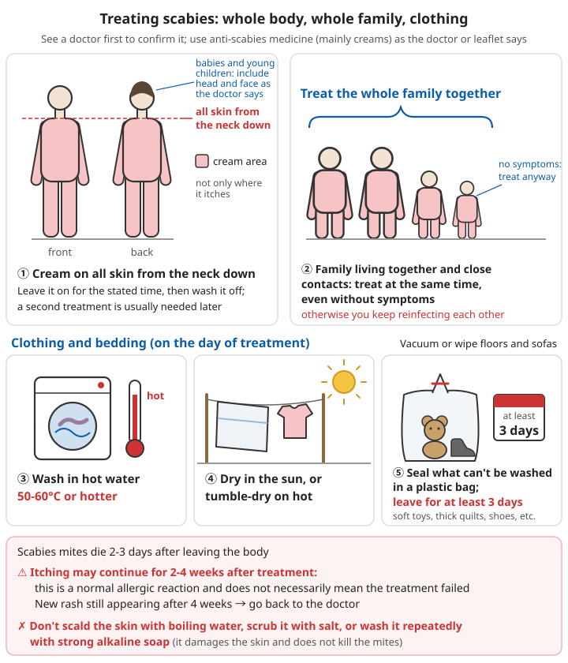

# Skin conditions and parasites

## Contents
- [Why they matter](#why-they-matter)
- [Scabies](#scabies)
- [Head lice](#head-lice)
- [Bedbugs](#bedbugs)
- [Tinea (fungal infections)](#tinea-fungal-infections)
- [Impetigo and bacterial skin infections](#impetigo-and-bacterial-skin-infections)
- [Prickly heat, eczema and nappy rash](#prickly-heat-eczema-and-nappy-rash)
- [Prevention](#prevention)

---

## Why they matter

In relief camps, dormitories and places where water is short and people rarely wash, scabies, head lice and skin infections spread fast.

Most of them are not life-threatening in themselves, but:
- Intense itching ruins sleep and wears people down
- Scratched, broken skin easily picks up a secondary bacterial infection, which in severe cases can develop into cellulitis or even infection throughout the body
- When one person has it, the whole family or the whole dormitory often catches it

⚠️ **Danger signs of skin infection (see a doctor at once)**: redness and swelling spreading fast, skin hot and very painful, a red line spreading up the limb, fever and shivering, skin turning black or blood blisters.

---

## Scabies

Caused by the scabies mite (a tiny creature almost invisible to the naked eye) burrowing into the skin. It spreads through prolonged skin contact (sharing a bed, caring for someone who has it).

### Recognise

```
- Intense itching, especially bad at night
- Small red bumps and small blisters; sometimes thin wavy lines can be seen (the mites' burrows)
- Typical sites: between the fingers, wrists, inside the elbows, armpits, waist, around the navel,
  buttocks, genitals, around women's breasts
- In babies and young children it can appear on the head and face, palms and soles
- Others at home or living together are itchy too
```

### What to do

```
✓ See a doctor to confirm it; use anti-scabies medicine (mainly creams) as the doctor or the leaflet says
  - Apply the cream to all the skin from the neck down (for babies and young children, include the head and face as the doctor says), not just the itchy areas
  - Leave it on for the stated time before washing it off; usually a second treatment is needed after an interval
✓ **Family members living together and close contacts must be treated at the same time**, even without symptoms
  (otherwise you keep reinfecting each other)

Clothing and bedding (deal with them on the day of treatment):
✓ Wash in hot water (50-60°C or hotter); dry in the sun or tumble-dry on a hot setting
✓ Things that cannot be washed (soft toys, thick quilts, shoes): seal in a plastic bag and leave for at least 3 days
  (scabies mites die 2-3 days after leaving the body)
✓ Vacuum or wipe floors and sofas

⚠️ Itching may continue for 2-4 weeks after treatment; this is a normal allergic reaction and does not necessarily mean treatment failed
   If new rash is still appearing after 4 weeks, go back to the doctor
❌ Do not scald the skin with boiling water, scrub with salt, or wash repeatedly with strong alkaline soap (this damages the skin and does not kill the mites)
```



*Figure: Treating scabies. Apply cream to the whole body from the neck down, treat everyone living together at the same time, and deal with clothing and bedding on the same day*

---

## Head lice

### Recognise

```
- Itchy scalp, especially behind the ears and at the back of the neck
- Small insects visible in the hair (the size of a sesame seed, greyish brown, move fast)
- Small white or yellowish-brown eggs (nits) stuck near the roots of the hair, which cannot be flicked off easily like dandruff
- Most common in children; spread by head-to-head contact and sharing combs and hats
```

### What to do

```
Wet combing (no medicine, suitable for everyone):
1. After washing the hair, apply conditioner and keep the hair wet
2. Comb section by section from roots to tips with a fine-toothed comb (a special nit comb)
3. After each stroke, wipe the comb on a white tissue and check for lice
4. Comb every 3-4 days for at least 2 weeks, until several sessions in a row find no live lice

✓ You can also buy head lice treatment from a pharmacy and use it as the leaflet says; usually a second application is needed 7-10 days later
✓ Check everyone else at home; treat anyone with lice at the same time
✓ Hats, pillowcases, towels and combs used in the past 2 days:
  - Wash in hot water or scald
  - Seal what cannot be washed in a plastic bag and leave for 2 weeks
✓ Cutting the hair short makes treatment easier

❌ Never put petrol, kerosene or insecticide on the hair (risk of poisoning and fire)
```

---

## Bedbugs

```
Recognise:
- Bitten at night; in the morning there are rows or clusters of very itchy red bumps on the body
- Flat reddish-brown insects, small black dots (droppings) and shed skins can be seen in mattress seams, bed-board cracks and wall cracks
- They do not spread disease, but they badly disturb sleep

What to do:
✓ Wash sheets and duvet covers in hot water; tumble-dry hot or dry in strong sun
✓ Scald the cracks in the mattress and bed frame with boiling water, or vacuum them again and again
✓ Stand the bed legs in dishes of water to stop bedbugs climbing onto the bed
✓ For serious infestations, call in professional pest control
✓ Check second-hand furniture and luggage brought in from outside first

After bites: cold compress for itching, do not scratch them open; anti-itch cream or oral antihistamines
```

---

## Tinea (fungal infections)

| Site | Common name | Appearance |
|------|------|------|
| Feet | Athlete's foot | White, peeling, itchy skin between the toes, blisters |
| Body | Ringworm (tinea corporis) | Round or ring-shaped red patches with clear edges, scaling, paler in the middle |
| Groin | Jock itch (tinea cruris) | Red, itchy patches at the top of the thighs |
| Scalp | Scalp ringworm (tinea capitis) | Mostly children; patchy hair loss, broken hairs, scaling on the scalp |
| Nails | Fungal nail infection | Nails thickened, discoloured, brittle |

```
What to do:
✓ Keep the affected area dry and aired (fungi like damp, hot, stuffy conditions)
✓ Pharmacies sell antifungal creams; keep applying as the leaflet says, and carry on for 1-2 weeks after symptoms disappear
  (stopping too early easily brings it back)
✓ Scalp ringworm and fungal nail infections often need tablets; see a doctor
✓ Do not share towels, slippers, socks or combs
✓ Change shoes and socks often and air them in the sun

❌ Do not put steroid creams (such as those whose names end in "-sone") on fungal infections; they make it spread
❌ Do not soak in vinegar or scald with hot water
```

---

## Impetigo and bacterial skin infections

### Impetigo (commonly called "yellow water sores")

```
- Most common in children, mostly in summer
- Blisters and pus spots around the mouth and nose and on the limbs, which burst and form honey-coloured crusts
- Highly contagious; spread by scratching to other parts of the body and to other people

What to do:
✓ See a doctor; usually an antibacterial cream is needed, and tablets if it covers a large area
✓ Cut fingernails short; avoid scratching
✓ Wash the affected area with soapy water and gently remove the crusts
✓ Keep towels and clothing separate and wash them separately
✓ Stay away from nursery and school until healed
```

### Folliculitis and boils

- Small ones can be treated with warm compresses; keep them clean
- ❌ Do not squeeze them, especially around the nose and upper lip (the "danger triangle"; squeezing can carry the infection into the skull)
- Keeps coming back, spreading, or with fever → see a doctor

For danger signs of serious infections such as cellulitis, see [Antibiotic preparation - natural antibacterial substances](../../../docs/06-制药技术/02-抗生素制备.md#三天然抗菌物质).

---

## Prickly heat, eczema and nappy rash

```
Prickly heat:
- Dense small red spots and tiny blisters that appear in hot weather with heavy sweating
- What to do: cool down, sweat less, wear loose, breathable clothes, have a lukewarm bath and pat dry
- Do not wrap babies too thickly

Eczema:
- Dry, red, itchy, flaky skin that keeps coming back
- What to do: bathe in lukewarm water (not too hot), use little soap, apply moisturiser straight after washing
- See a doctor if severe

Nappy rash:
- Redness in a baby's nappy area
- What to do: change nappies often, wash with warm water and pat dry each time, leave the bottom uncovered for a while, apply barrier cream
- Pus spots, spreading, or small red dots at the edges (possibly a fungal infection) → see a doctor
```

---

## Prevention

```
✓ Wash and change clothes regularly when you can; when water is short, at least wipe the armpits, groin and feet with a damp cloth
✓ Do not share towels, combs, hats, clothing or slippers
✓ Air bedding and clothing in the sun often
✓ Keep fingernails short and clean
✓ Relief camps and dormitories: keep space between beds; check newcomers with itching or rashes early
✓ Keep skin dry, especially the feet and skin folds
```

For general control of infectious diseases, see [Infectious disease at home](15-infectious-disease-at-home.md).

---

## 📝 Skin conditions and parasites: key points

```
1. Scabies: intense itching at night, rash between the fingers and similar places; treat the whole family at the same time;
   wash clothing in hot water, seal what cannot be washed in a bag for 3 days
2. Head lice: wet combing; wash clothing in hot water, seal what cannot be washed in a bag for 2 weeks; no petrol or kerosene
3. Bedbugs: wash bedding in hot water, scald or vacuum the cracks
4. Tinea: keep dry, keep applying antifungal cream, no steroid creams
5. Impetigo is highly contagious; see a doctor and stay away from school until healed
6. Do not squeeze boils in the "danger triangle"
7. Redness spreading fast, red line spreading, fever → see a doctor at once
```

---

**Next chapter**: [Menstrual hygiene and contraception](17-menstrual-hygiene-and-contraception.md)
**Back to**: [Chapter list](README.md) | [Main contents](../../README.md)
