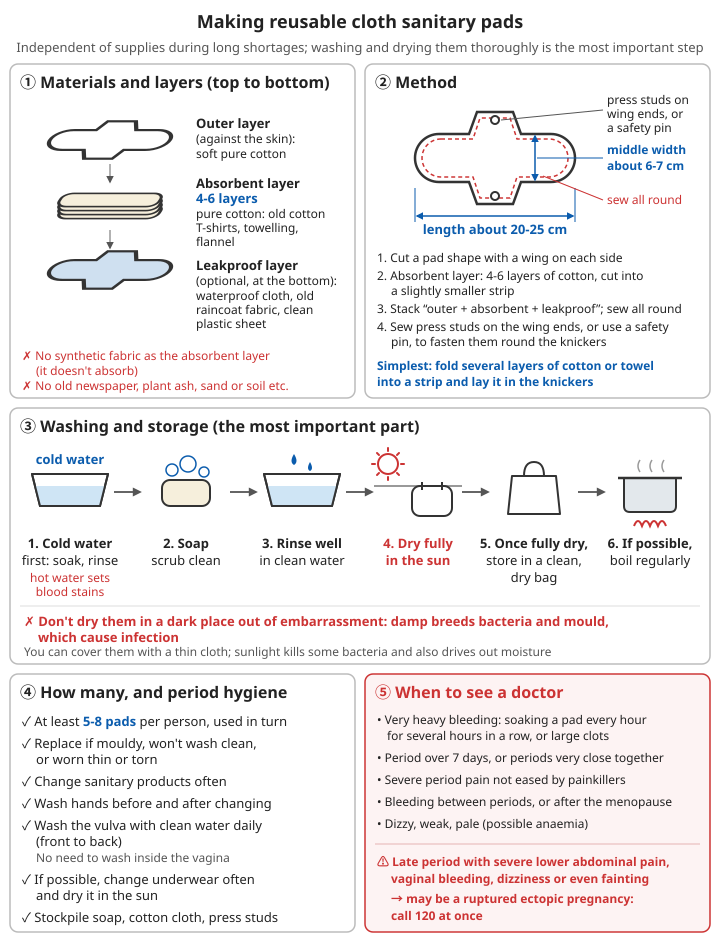

# Menstrual hygiene and contraception

## Contents
- [Menstrual products](#menstrual-products)
- [Making reusable cloth pads](#making-reusable-cloth-pads)
- [Health problems during periods](#health-problems-during-periods)
- [Contraception](#contraception)
- [Emergency contraception](#emergency-contraception)
- [Stockpiling advice](#stockpiling-advice)

---

## Menstrual products

After a disaster or during a long break in supplies, menstrual products are a real, major problem for women, yet they are often left off emergency supply lists.

| Product | Features | Key points for use |
|------|------|----------|
| Disposable sanitary pads | The most convenient; throw away after use | Usually change every 4-6 hours, more often on heavy days |
| Tampons | Small and easy to carry | Change at the time stated in the leaflet; do not leave in too long (see toxic shock below) |
| Menstrual cup | Made of silicone, reusable for years, does not depend on supplies | Rinse with clean water each time you empty it; boil to sterilise at the end of each period; empty at the time stated in the leaflet |
| Cloth pads | Can be home-made, reusable | See the next section |
| Period pants | Reusable | Wash as the instructions say |

**For long-term stockpiling**: menstrual cups and cloth pads do not depend on a continuous supply and suit long-term stockpiling. Try out a menstrual cup in normal times first and get used to it.

---

## Making reusable cloth pads

### Materials

```
✓ Absorbent layer: pure cotton fabric (old cotton T-shirts, towelling, flannel), several layers stacked
✓ Top layer (against the skin): soft pure cotton fabric
✓ Leakproof layer (optional): waterproof fabric, old raincoat fabric, clean plastic sheet (as the bottom layer)
❌ Do not use synthetic fabric for the absorbent layer (it does not absorb); do not use old newspaper, plant ash, sand or soil
```

### How to make them

```
1. Cut out a pad shape (about 20-25 cm long, about 6-7 cm wide in the middle), with wings on both sides
2. For the absorbent layer, stack 4-6 layers of cotton cut into a slightly smaller strip
3. Stack "top cotton layer + absorbent layer + leakproof layer" and sew all the way round the edge
4. Sew a press stud on the ends of the wings, or use a safety pin, to fasten them round the underwear

Simplest version: fold several layers of cotton cloth or towel into a long strip and put it in the underwear
```

For sewing stitches, see [Textiles, mending and tanning - mending](../../../docs/07-日常生活技能/07-纺织缝补与鞣皮.md#缝补).

### Washing and storage (the most important part)

```
1. After changing, first soak and rinse in cold water (hot water sets bloodstains)
2. Scrub clean with soap
3. Rinse well in clean water
4. Dry completely in the sun (sunlight kills some bacteria and drives off damp)
   - Do not hang them in a dark corner out of embarrassment; damp breeds bacteria and mould and causes infection
   - You can cover them with a thin cloth
5. Once completely dry, store in a clean, dry bag
6. Boil them from time to time if you can

✓ Prepare at least 5-8 pads per person and use them in rotation
✓ Replace them when mouldy, when they cannot be washed clean, or when worn thin or torn
```



*Figure: Several layers of pure cotton, sewn all the way round the edge; soak in cold water first, then wash with soap, and dry completely in the sun; see a doctor at once if bleeding is very heavy or ectopic pregnancy is suspected*

---

## Health problems during periods

### Period hygiene

```
✓ Change menstrual products often
✓ Wash the vulva with clean water every day (front to back); there is no need to douche inside the vagina
✓ Wash hands before and after changing menstrual products
✓ Change underwear often if you can, and dry it in the sun
```

### ⚠️ Toxic shock syndrome

A rare but dangerous condition linked to leaving tampons or menstrual cups in for too long.

```
While using a tampon or menstrual cup, sudden onset of:
- High fever
- Aches all over and headache, like a bad flu
- Vomiting, diarrhoea
- Dizziness, vision going dark on standing up (low blood pressure)
- A rash that looks like sunburn

→ Remove the tampon or cup at once and get medical help at once (call 120)
```

Prevention: change at the time stated in the leaflet; do not leave a tampon in overnight; choose the lowest absorbency that meets your needs.

### When to see a doctor

```
- Very heavy bleeding: needing to change a pad every hour for several hours in a row, or large clots
- Periods lasting more than 7 days, or very short gaps between periods
- Severe period pain not relieved by painkillers
- Bleeding outside your period, or bleeding again after the menopause
- Dizziness, tiredness, pale face (possibly anaemia; see Nutrition and nutritional deficiency diseases)

⚠️ A late period together with severe lower abdominal pain, vaginal bleeding, dizziness or even fainting
   → may be a ruptured ectopic pregnancy, which is life-threatening; call 120 at once
```

Related chapter: [Nutrition and nutritional deficiency diseases](../../../docs/07-日常生活技能/02-营养与营养缺乏病.md).

For period pain, apply warmth to the lower abdomen and rest; for painkiller use, see the medicines part of [Common illnesses - fever](01-common-illnesses.md#fever).

---

## Contraception

When doctors and medicines are scarce for a long time, one unplanned pregnancy or one birth without a doctor present can put the lives of mother and baby at risk (see [Emergency childbirth and newborn care](11-emergency-childbirth-and-newborn-care.md)). Contraception is an important part of protecting women's health.

### Comparing common methods

| Method | Reliability | Features |
|------|--------|------|
| Condoms | Fairly reliable when used correctly | **The only method that also prevents sexually transmitted infections**; easy to obtain and stockpile |
| Intrauterine device (IUD, "coil") | Very reliable | One fitting lasts for years, suitable for the long term; must be fitted and removed by a doctor |
| Contraceptive implant | Very reliable | One fitting lasts for several years; must be done by a doctor |
| Contraceptive pill | Very reliable when taken on time | Must be taken every day and depends on a continuous supply; a doctor must assess whether it is suitable |
| Lactational amenorrhoea method | Fairly reliable when all conditions are met | See below; strict conditions |
| Safe period, withdrawal | **Not reliable** | High failure rate; not recommended as a main method |

### Condoms

```
✓ Use one for the whole of every act of intercourse
✓ Check the expiry date; do not use one if the packet is damaged
✓ Store in a cool, dry place away from heat (do not keep them in a wallet or car for long periods)
✓ Use only water-based lubricant
  ❌ Petroleum jelly, baby oil, cooking oil and other oily substances make latex condoms break
✓ Use each one only once
```

China's national basic public health services provide contraceptives free of charge to people of reproductive age; ask at a community health service centre or township health centre to collect them.

### Lactational amenorrhoea method

Exclusive breastfeeding after giving birth can prevent pregnancy under certain conditions, but **all three of the following conditions must be met at the same time**:

```
1. Periods have not yet returned since the birth
2. Exclusive or almost exclusive breastfeeding
   (no more than 4 hours between feeds in the daytime, no more than 6 hours at night, no other food given)
3. The baby is under 6 months old

If any one condition is not met → switch to another method of contraception at once
```

### Considerations for long-term survival

- An IUD or implant, fitted once, works for many years without depending on a continuous supply; if you are planning for the long term, discuss it with a doctor while normal medical care is still available
- Condoms are the easiest method to stockpile; pay attention to storage conditions and expiry dates
- The contraceptive pill depends on a continuous supply; protection wears off quickly once you stop taking it

---

## Emergency contraception

```
For: when no contraception was used, or contraception failed (condom broke or slipped off)

✓ Take the emergency contraceptive pill within 72 hours of intercourse; the sooner, the more effective
✓ Available from pharmacies; take as the leaflet says
✓ If your next period is more than a week late after taking it, check whether you are pregnant

⚠️ The emergency contraceptive pill is only a back-up; it cannot replace regular contraception; do not use it repeatedly
⚠️ If you get severe lower abdominal pain after taking it, see a doctor promptly
```

---

## Stockpiling advice

```
Menstrual products:
- [ ] Disposable sanitary pads (work out per person per month; at least several months' worth)
- [ ] Menstrual cup (try it out in normal times first)
- [ ] Cloth pads, or pure cotton fabric and press studs for making them
- [ ] Underwear (keep several extra pairs)
- [ ] Soap (for washing cloth pads)

Contraception:
- [ ] Condoms (watch expiry dates and storage conditions)
- [ ] Emergency contraceptive pills (watch expiry dates)
- [ ] If you take the contraceptive pill, discuss stockpiling with your doctor

Other:
- [ ] Painkillers (for period pain)
- [ ] Iron-rich foods or iron supplements (for women with heavy periods)
```

⚠️ In post-disaster relief camps and shared accommodation, giving women a private place to change and wash menstrual products, space to dry them, and lighting at night is very important for both their health and their safety.

---

## 📝 Menstrual hygiene and contraception: key points

```
1. Menstrual cups and cloth pads do not depend on supplies and suit long-term stockpiling
2. Cloth pads: several layers of pure cotton; soak in cold water first, then wash with soap, and dry completely in the sun
3. Sudden high fever, rash or dizziness while using a tampon or menstrual cup → remove it at once and see a doctor
4. Late period + severe lower abdominal pain + bleeding → possible ectopic pregnancy; call 120 at once
5. Condoms are the only method that also prevents sexually transmitted infections; no oil-based lubricants
6. The safe period and withdrawal are not reliable
7. Take the emergency contraceptive pill within 72 hours, the sooner the better; it cannot replace regular contraception
```

---

**Back to**: [Chapter list](README.md) | [Main contents](../../README.md)
