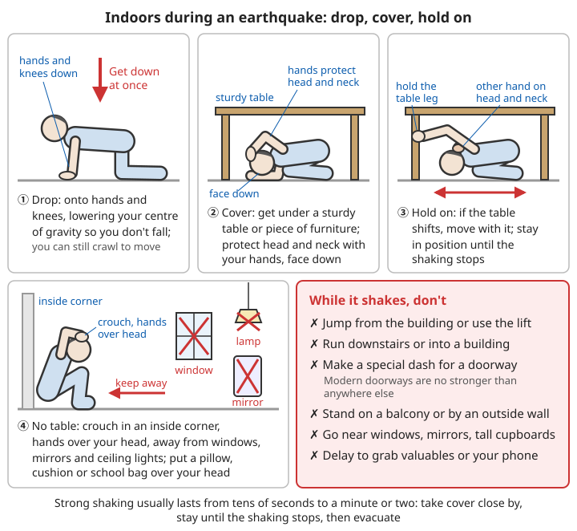

# Geological Disasters Guide

## Contents
- [Earthquakes](#earthquakes)
- [Debris flows](#debris-flows)
- [Landslides](#landslides)
- [Ground collapse](#ground-collapse)
- [Volcanic eruptions](#volcanic-eruptions)

---

## Earthquakes

China has many earthquakes. The earthquake itself seldom injures people directly; **the great majority of deaths and injuries come from collapsing buildings and falling objects**: toppling cabinets, flying glass, falling ceiling lights and facade decorations. So responding to an earthquake comes down to three things:

```
1. Before: secure anything at home that can topple, fall or fly; prepare an emergency kit;
   agree as a family what to do and where to meet
2. During: take cover where you are, protect your head and neck; do not run about,
   do not jump from the building, do not use the lift
3. After: move quickly and in order to open ground; guard against aftershocks, gas and
   electricity, and secondary injuries; if trapped, save your strength and wait for rescue
```

This section follows the order "warning signs → during the quake → after the quake → preparation". **If you are short of time, read [Earthquake safety preparation](#earthquake-safety-preparation) and [What to do during an earthquake](#what-to-do-during-an-earthquake) first.** The advice below is based on the mainstream recommendations in earthquake-preparedness materials published by the Ministry of Emergency Management, the China Earthquake Administration and similar bodies.

### Earthquake warning signs (not reliable)

- Animals behaving strangely (restless, fleeing)
- Unusual groundwater (changing colour or smell, welling up)
- Earthquake lights, earthquake sounds
- Frequent small tremors

⚠️ **Do not rely on warning signs! Preparation matters most!**

These things really have been recorded before large earthquakes, but they are also often caused by ordinary things such as weather, the season or pollution, and science **cannot yet predict earthquakes from them**. Treat any message going around that "a big earthquake will hit such-and-such a place on such-and-such a day" as a rumour unless the government issued it; in China only the State Council and provincial people's governments have the authority to issue earthquake predictions.

### Earthquake early warning: a few seconds to a few tens of seconds snatched back

Earthquake early warning is **not a prediction**: it is issued after the earthquake has already happened. Because electrical signals travel faster than seismic waves, it can sound an alarm a few seconds to a few tens of seconds before the damaging waves arrive. The closer you are to the epicentre, the less time you get; near the epicentre there may be no time to warn at all.

```
Ways to receive a warning:
- Mobile phone (some phone systems have built-in earthquake warning; switch it on in settings)
- Television, radio, emergency broadcasting, school and community sirens

How to use those few seconds after a warning:
✓ Very little warning time (under about ten seconds): do not run downstairs; take cover
  where you are immediately (Drop, Cover, Hold on)
✓ More time, and you are in a single-storey house or on the ground floor with the door
  right beside you: you can run quickly out to open ground
✓ Driving: slow down, turn on the hazard lights, pull over somewhere safe
✓ Cooking on a flame: turn it off on your way (only if it is to hand; do not take risks for it)
✓ Up high, on a ladder, at an operating table, next to machinery: first get yourself out of
  the dangerous position

❌ Do not run for lifts, crowded stairs or exits because of a warning
```

### What to do during an earthquake

Strong shaking from the main shock usually lasts only a few tens of seconds to a minute or two. **In those seconds, people in multi-storey buildings basically cannot get out**, and while running you are most likely to be thrown over or hit by falling objects. So, apart from a few cases such as a single-storey house or being at a ground-floor door, the rule is "take cover where you are, evacuate after the shaking".

#### Indoors

**"Drop, Cover, Hold on"**

This is the standard protective action recommended in materials from the Ministry of Emergency Management and the China Earthquake Administration (and used internationally). It is sometimes translated into Chinese in slightly different words, but the meaning is the same.

```
1. Drop:
   - Get down at once onto your hands and knees
   - This lowers your centre of gravity so you are not thrown over and hurt; in this
     position you can still crawl to a better spot

2. Cover:
   - Get under a sturdy table or piece of furniture
   - Protect your head and neck with your hands
   - If there is no table: cover your head and neck with one arm and hold on to something
     solid nearby with the other hand; you can grab a pillow, cushion or school bag to
     hold over your head
   - Keep your face down; do not look up, so broken glass and falling objects do not
     injure your eyes

3. Hold on:
   - Hold on to the furniture
   - Move with the shaking (if the table is shaken away, shuffle along with it)
   - Stay in position until the shaking stops

If there is no table:
- Crouch in a corner against an interior wall
- Protect your head with both hands
- Keep away from windows, mirrors and ceiling lights
```

**How to choose where to take cover**:

```
✓ Relatively safe:
- Under or beside a solid table, bed or low cabinet that will not easily topple
- At the foot of an interior wall, in a corner (interior walls are usually stronger than
  exterior walls)
- A small room with support, the nearest such place to you

✗ Dangerous:
- Beside windows, glass doors, glass partitions, mirrors
- Under ceiling lights, ceiling fans, suspended ceilings
- Beside tall bookcases, wardrobes, fridges, televisions, water heaters (they topple and fall)
- Against exterior walls, on balconies (exterior walls and balconies are the most likely
  to collapse and fall)
- Stairwells, doorways

About doorways: the idea that "standing in a doorway is safest" comes from old
earth-and-timber houses. In modern buildings the door frame is no stronger than anywhere
else, and the door can swing back and forth and crush your hand. Do not go out of your way
to stand in a doorway.
```



*Figure: When the shaking starts, take cover under the nearest sturdy table: drop, protect your head and neck, hold on to a table leg and stay there until the shaking stops. With no table, crouch in a corner against an interior wall, protect your head with both hands, and keep away from windows, mirrors and ceiling lights*

**In different places**:

**In bed**:
- Stay in bed
- Protect your head with a pillow
- If there are no windows or tall furniture beside the bed, you can roll off onto the floor and lie close against the side of the bed, again protecting your head and neck
- After the quake, **put your shoes on first** before getting out of bed; the floor is very likely covered in broken glass (so keep a pair of shoes and a torch by the bed at all times)

**In the kitchen**:
- Keep away from the cooker
- Keep away from wall cabinets
- Crouch beside a solid piece of furniture
- If a flame is on and the shaking is not yet violent, turn it off on your way; if the shaking is already strong, do not reach for it; shut the main gas valve after the quake

**In the bathroom**:
- Do not run to the bathroom to take cover (there is no basis for "the bathroom is safest"; tiles, mirrors and glass easily cause injuries)
- If you are already in the bathroom: drop where you are and protect your head and neck
- Keep away from mirrors and glass partitions

**In a tall building**:
- Do not jump!
- Do not use the lift!
- Take cover where you are
- After the quake, evacuate by the stairs

Tall buildings sway more, and for longer, than low floors. Bookcases, televisions and even fridges can be thrown across the room, so find an interior corner or solid furniture nearby and take cover. Do not rush for the stairs while it is shaking; the stairwell is often the place that shakes worst and is most crowded. Before going downstairs after the quake, check whether the stairs are visibly broken; if you meet smoke, follow [Escaping a fire](../../../docs/02-灾难应对/04-火灾.md#火场逃生).

**In a lift** (if you happen to be in a lift during an earthquake):

```
1. Press the buttons for all floors; get out at the first floor where the lift stops and
   use the stairs instead
2. If trapped in the lift: do not force the doors open, do not climb out through the roof
3. Call for help with the lift intercom or alarm button, or your phone; stay calm, crouch
   and protect your head, and wait for rescue
```

**In a single-storey house or on the ground floor**:

```
✓ The door is right beside you and open ground is a few steps away: you can run out quickly
  to open space away from buildings and utility poles
✓ No time to get out, or outside the door there is only a narrow alley and high walls:
  take cover next to a solid table, bed or in an interior corner
❌ Do not stop under eaves, beside courtyard walls or on doorsteps (eaves, roof tiles and
   the tops of walls are the most likely things to hit you)
❌ Mud-brick houses and old brick houses are the most likely to collapse completely when
   shaken; get out if you can. If there is no time, take cover beside the edge of the
   kang (heated brick bed), a solid bed or furniture, and protect your head and neck
```

**At school**:

```
During lessons:
1. Follow the teacher's instructions; get under or beside your desk quickly and protect
   your head and neck with your school bag
2. Pupils by the windows move away from them
3. Do not run about; do not rush for the door or the stairs

After the quake:
1. Move in order, organised by the teacher, to the playground or other open ground; do not
   push, and do not go back to the classroom for belongings
2. On the playground, keep away from school buildings, walls and flagpoles
3. Wait for your parents at the agreed place; do not leave on your own

On the playground: crouch where you are and protect your head; keep away from buildings and
tall objects such as basketball hoops
```

Parents should find out in advance about the school's emergency arrangements and where to collect children; see [Emergency communication and finding family – family communication plan](../../../docs/02-灾难应对/06-应急通信与寻亲.md#灾前-家庭通信计划). **Do not all rush into the school after the quake**: it blocks evacuation and rescue routes.

#### Outdoors

```
✓ Run to open ground
✓ Keep away from buildings
✓ Keep away from utility poles and street lights
✓ Keep away from flyovers and elevated roads
✓ Crouch down and protect your head

Avoid:
❌ Beside buildings (falling objects)
❌ Narrow streets
❌ Beside walls and fences
❌ Cliff edges, riverbanks
```

Further notes:

- In the street, the greatest danger is **glass from building facades, advertising boards, air-conditioner outdoor units and flowerpots on balconies** being thrown down. If you are walking beside a building and there is no open space nearby, protect your head with a bag and get as close as you can to the inside of a solid building entrance, rather than walking along the outside wall
- Do not go into a building to "shelter", and do not run into a building to find your family while it is still shaking
- Keep away from petrol stations, chemical plants, transformers and high-voltage lines
- On a bridge: hold the railing tightly, and get off the bridge as soon as possible after the quake

**In the mountains**:

```
In the mountains the greatest danger in an earthquake is falling rocks, rockslides and
landslides, not buildings:
✓ Leave at once the areas below steep slopes and cliffs, the foot of slopes and gully floors
✓ If you see falling rocks: move sideways, at right angles to the direction the rocks are
  travelling; do not run down the slope
✓ If there is no time to get out of the way: shelter behind a solid large tree, large
  boulder or gully bank (with your back to the direction the rocks come from), crouch and
  protect your head
✓ After the quake, do not travel along steep mountain roads; collapses and rockfalls along
  the way may continue for many days
✓ Downstream in a river valley: watch for landslides blocking the river and forming a
  "landslide dam lake" (barrier lake); if it bursts, a sudden flood hits downstream.
  If the river suddenly stops flowing, move to high ground on either side
```

After an earthquake the risk of landslides and debris flows in mountain areas lasts for many years; see [Debris flows](#debris-flows) and [Landslides](#landslides) below.

#### Special places

**In a vehicle**:
```
1. Slow down, turn on the hazard lights and pull over (avoid bridges, flyovers, tunnel
   entrances, power lines, tall buildings and steep slopes)
2. Stay in the vehicle
3. Keep your seat belt fastened
4. Get down low, protect your head and neck, and wait for the shaking to stop (do not get
   out and run beside buildings or under bridges)
5. Drive carefully after the quake (check the road)
   - Go around cracks, subsidence and bridge joints that have shifted; do not drive onto
     a bridge you are unsure about
   - If the road is blocked, park at the roadside and leave the key in the vehicle so
     rescue vehicles can get through

On a bus, train or underground train:
- Hold the handrail, lower your centre of gravity, stay near the seats; do not jump off
- After it stops, follow the instructions of the staff; do not force the doors open or
  jump down onto the track
```

**In theatres, shopping centres and other public places**:
```
1. Do not crowd towards the exits
2. Crouch beside seats or pillars
3. Protect your head
4. Follow instructions
5. Evacuate in order after the quake

In shopping centres and supermarkets also:
✓ Choose a spot beside a solid counter, a pillar or an interior corner
✗ Keep away from glass shop windows, tall shelves (goods will fall), ceiling lights and
  hanging advertising signs
✗ Do not rush to the lifts
✓ On an escalator: hold the handrail tightly, crouch low, and walk off only after the
  escalator has stopped
✓ In a theatre or stadium: crouch between the seats, protect your head with a bag, and
  after the shaking stops leave in order following the evacuation signs
```

The danger of a crowd crush is often greater than the earthquake itself. If you are caught in a crowd, move with the flow; do not go against it and do not bend down to pick things up. Cross your arms in front of your chest to protect it and leave room to breathe; if you are knocked down, try to curl up on your side and protect your head and neck with both hands.

**At the seaside**:
```
⚠️ An earthquake may trigger a tsunami!
1. Move to high ground immediately after the quake
2. Get at least 3 km away from the coast
3. Climb to high ground (at least 30 m)

If you feel strong or long-lasting shaking at the seaside, do not wait for an official
warning; start heading for high ground on your own.
If you see the sea suddenly draw back a long way, likewise evacuate at once.
```

For detailed tsunami response see [Ocean disasters – Tsunamis](../../../docs/02-灾难应对/03-海洋灾害.md#海啸).

### ❌ What not to do during an earthquake

```
- Do not jump from the building
- Do not use the lift
- Do not go near windows
- Do not crowd or push
- Do not linger in narrow passages
- Do not use naked flames
- Do not run downstairs or into a building while it is shaking
- Do not stand on a balcony or against an exterior wall
- Do not delay taking cover to grab valuables or look for your phone
```

In every major earthquake some people have been killed or injured by jumping from buildings or being knocked down and trampled on the stairs, while the building they were in did not collapse.

### What to do after an earthquake

#### Immediate actions

Once the shaking stops, **people in buildings should get out to open ground quickly and in order**, because fairly strong aftershocks are likely within minutes to hours, and damaged buildings may collapse in an aftershock.

**1. Check for injuries**:
```
- Yourself first, then others
- Give first aid
- Do not move the seriously injured (unless they are in danger)
```

For severe bleeding, apply pressure first; see [Basic first aid – Stopping bleeding](../../../docs/01-日常疾病和伤害/00-基础急救知识.md#止血方法). Do not move anyone you suspect has a spinal injury (neck or back pain, numb or weak hands and feet) unless necessary; see [Bone injuries – Spinal fractures](../../../docs/01-日常疾病和伤害/03-骨骼损伤.md#脊柱骨折极其危险).

**2. Check for hazards**:
```
- Smell: gas leaks
  * If you smell gas, open the windows to ventilate
  * Shut the main valve
  * Do not switch electrical appliances on or off (to avoid sparks)
  * Leave and report it

- Look: damaged electrical wiring
  * Switch off the main power switch
  * Keep away from fallen wires

- Check: burst water pipes
  * Shut the water inlet valve

- Look: is anything on fire?
  * Put out small fires at once; if the fire spreads, leave and call 119
```

For full handling of gas leaks see [Fire – Gas leaks](../../../docs/02-灾难应对/04-火灾.md#燃气泄漏); for how to restore power safely once supply returns see [Household electrical safety – Restoring power after a disaster](../../../docs/07-日常生活技能/08-家庭用电安全.md#灾后恢复用电).

**3. Be ready for aftershocks**:
```
✓ Aftershocks may continue for days or even months
✓ They may be as strong as the main shock
✓ Stay alert
✓ Keep using the "Drop, Cover, Hold on" position

✓ Aftershocks are most frequent and strongest in the first few days after a large
  earthquake, then gradually decrease
✓ If an aftershock comes while you are outdoors: keep away from buildings, walls and
  slopes; indoors: take cover where you are, as during the main quake
✓ When sleeping at night: keep shoes, a torch and outer clothes within reach; do not sleep
  in a damaged building
```

**4. Evacuate**:
```
- Use the stairs (not the lift)
- Take the emergency kit
- Turn off water, electricity and gas
- Lock the door (against theft)
- Go to a safe place

- Protect your head with your hands, a bag or a book on the way downstairs, against
  objects falling in an aftershock
- Keep to the wall side going downstairs, do not push; take older people, children and
  neighbours with limited mobility with you
- Go to a nearby emergency shelter or open ground (park, square, school playground),
  away from tall buildings, walls, power lines, slopes and riverbanks
- When you arrive, tell your family you are safe as agreed
```

For how family members contact each other, agree on meeting points and search for each other, see [Emergency communication and finding family](../../../docs/02-灾难应对/06-应急通信与寻亲.md).

#### When can you go back inside?

After an earthquake many people hurry back inside for their belongings and are then injured in an aftershock. **Whether a building is fit to live in should, in principle, be decided by the building safety assessment of the local government and professionals.** In many places signs are posted at the door of each building; follow what they say.

Before the professionals arrive, use the table below to make a first judgement yourself:

| What you see | Judgement | What to do |
|------|------|------|
| The building is visibly tilted or partly collapsed; load-bearing walls, beams or columns are broken or have diagonal cracks right through them (often in an "X" shape); floor slabs have fallen | Dangerous | Never go in; outside, also keep clear of the area where it could fall |
| Fairly wide cracks in walls, loose wall corners, bricks falling out, doors and windows badly distorted and jammed, large areas of roof tiles slid off | Possibly dangerous | Do not go in; wait for a professional assessment |
| Only plaster or tiles cracked or fallen off, fine hairline cracks, doors and windows open and close normally | Mostly minor damage | Once aftershocks have died down and officials allow it, you can go in briefly, take what you need and come out quickly |
| You smell gas, see wires sparking or hear the building creaking | Dangerous | Leave immediately and report it |

```
Even if you judge the damage to be minor, when you go back in:
✓ Go in during daylight; do not use a naked flame for light (use a torch)
✓ Look from the doorway first to make sure there is no smell of gas and no hanging wires
✓ Go in pairs, with one person waiting outside
✓ Be quick; take only essentials (medicines, documents, clothes, bedding)
✓ In the first few days when aftershocks are frequent, sleep outdoors, in a tent or in a
  car where possible
❌ Do not go into the rubble of collapsed parts to search for belongings
```

**Mud-brick houses, old brick houses and houses on hillsides** are often more damaged after an earthquake than they look; it is better to wait a few more days. For earthquake-resistant methods when building your own house, see [Long-term housing – Earthquake resistance](../../../docs/07-日常生活技能/05-长期住所.md#抗震-生土房屋的生死线).

#### If you are trapped

```
If you are trapped under rubble:

✓ Stay calm
✓ Save your strength
✓ Look for water and food
✓ Make space to survive
✓ Call for help at intervals:
  - Tap on pipes and walls
  - Blow a whistle
  - Do not shout loudly (it wastes strength and you breathe in dust)
✓ Use your phone:
  - Send text messages (uses less battery)
  - Switch it on at set times
✓ Cover your mouth and nose (against dust)
✓ Wait for rescue

Avoid:
❌ Do not light a flame (it uses up oxygen and may cause an explosion)
❌ Do not move about carelessly (to avoid further collapse)
```

**In more detail**:

```
1. Steady yourself and protect yourself first
   - Check whether you are bleeding; if so, press clothing on the wound to stop it
   - Clear dust and dirt from around your mouth and nose; cover your mouth and nose with a
     damp towel or clothing to breathe in less dust
   - If you smell gas or a sharp smell: cover your mouth and nose with a damp cloth; never
     light a flame or switch electrical appliances on or off

2. Keep space to breathe
   - Use bricks, sticks or furniture within reach to prop up anything above your head and
     in front of your chest that could fall in
   - Do not let your chest be pressed; leave room for it to rise and fall
   - Clear loose debris around you that can be moved, but do not pull at large pieces that
     are carrying weight (this can cause another collapse)
   - Move slowly towards light and moving air; if you cannot move, do not force it

3. Call for help the right way
   - Most of the time, rest quietly with your eyes closed to save strength
   - Tap at set times: knock on water pipes, steel bars or walls with something hard;
     the sound can travel a long way along pipes and through rubble
   - If you have a whistle, blow it; use the rhythm "three short blasts, pause, repeat"
     (the international distress signal)
   - When you hear people walking or talking outside, or machinery, concentrate your tapping
     and shouting then
   - Phone: first send a text giving your location and situation, then switch the phone off
     or to power-saving mode, and switch it on to check every few hours

4. Water and food
   - Ration any drinking water and food you can find; drink first, eat later
   - Water matters far more than food: you can usually last quite a long time without
     eating, but without water your life is in danger within a few days
   - If there is no other water, you may drink water you are unsure is clean (such as
     water from water pipes or heating pipes); surviving matters more. Tell the doctor
     after you are rescued
   - Talking little, moving little and not letting yourself overheat all reduce water loss

5. Keep your confidence
   - Earthquake rescue in China continues searching for many days, and there are cases of
     people rescued after being buried for more than a week
   - Give yourself things to do: count, tap at set times, think of your family; this helps
     you stay alert and hopeful
```

⚠️ **If your hands, feet or body are pinned under something heavy for a long time**: do not struggle desperately to free yourself. When you are rescued, suddenly releasing a limb that has been crushed for a long time can cause **crush syndrome**, with a risk of abnormal heart rhythm, kidney failure and even sudden death. Make sure the rescuers know how long you have been pinned. See [Bone injuries – Crush injuries](../../../docs/01-日常疾病和伤害/03-骨骼损伤.md#挤压伤).

For more ways of signalling for help see [Disaster response – Distress signals](../../../docs/02-灾难应对/README.md#-求救信号); for ways to communicate when the signal is weak see [Emergency communication and finding family – During a disaster](../../../docs/02-灾难应对/06-应急通信与寻亲.md#灾中-怎样让消息发出去).

#### Principles for rescuing others

In the first few dozen hours after an earthquake, large numbers of buried people are rescued by **family and neighbours nearby**; professional rescue teams often take some time to arrive. But digging without method can make the rubble collapse again, injuring the trapped person and yourself.

```
Order of priority (the principles commonly given in earthquake-preparedness materials):
1. Rescue those nearby first, those further away later (do not pass over the near to
   reach the far)
2. Rescue those who are easy to reach first, the difficult ones later
3. Rescue young and able-bodied adults and medical staff first (once rescued they can
   join in and save more people)
4. First keep them "alive", then get them "out": first let the buried person breathe
   (uncover the head, clear dust from the mouth and nose), then dig the whole body out;
   do not spend so long digging one person out that several others go without air

How to find people:
- First ask survivors and neighbours: how many people were in the home, and which room
  they were in when the earthquake struck
- Call out, then be quiet and listen for tapping and groaning
- Concentrate on places where a space may have formed: beside beds, in corners, under
  tables, in stairwells

How to dig:
✓ First find where the trapped person's head is; uncover the head and chest first
✓ Clear debris bit by bit with hands and small tools; use only your hands when you get
  close to the body
❌ Do not hack away with pickaxes or sharp tools
❌ Do not pull at or lever the large beams and floor slabs holding the rubble up
   (prop with timber as you dig, to prevent a second collapse)
❌ Do not pull hard on the trapped person's arms and legs; if they are caught, first clear
   whatever is catching them

After getting them out:
✓ For someone trapped for a long time, cover their eyes with cloth to protect them from
  bright light
✓ Someone who is conscious and can swallow may take small sips of water; do not let them
  drink or eat a lot at once
✓ Keep them warm
✓ If you suspect a neck or lower-back spinal injury, carry them steadily on a door or
  other rigid board; do not carry them on your back or in your arms
✓ Hand them over to medical staff as soon as possible, and tell them how long the person
  was pinned and which part of the body was pinned

⚠️ Your own safety comes first:
- Do not go in when the building is tilted, aftershocks are frequent, you smell gas or
  wires are live
- Wear gloves and sturdy shoes, and a hard hat if you have one
- When a professional rescue team arrives, follow their instructions
```

⚠️ **For someone pinned under something heavy for a long time (generally more than about 1 hour), wait if at all possible for professional rescuers before moving the weight**: they give the casualty fluids first and then release the pressure, which greatly reduces the risk of death from crush syndrome. Only move the weight yourself when the person must be got out at once (for example aftershocks or fire); for care after the weight is removed see [Bone injuries – Crush injuries](../../../docs/01-日常疾病和伤害/03-骨骼损伤.md#挤压伤).

If you cannot find relatives and need to register a missing person, see [Emergency communication and finding family – How to search after being separated](../../../docs/02-灾难应对/06-应急通信与寻亲.md#家人失散后怎样寻找); for handling those who died see [Handling the dead after disasters](../../../docs/02-灾难应对/07-灾后遗体处理.md); for how to care for family members and children frightened by the quake see [Mental health – Psychological first aid](../../../docs/01-日常疾病和伤害/10-心理健康.md#心理急救-怎样帮助身边的人).

### Earthquake safety preparation

#### Preparing your home

**Secure furniture**:
```
✓ Fix bookcases and wardrobes to the wall
✓ Put heavy things low down
✓ Fit latches on cabinet doors
✓ Secure the water heater and fridge
✓ Do not hang heavy things over the bed

How:
- Fix tall furniture to a structural wall (not a plasterboard partition) with L-shaped
  metal brackets or anti-tip straps
- Put heavy things on the lower shelves of cabinets; do not keep glassware, bottles or jars
  on high open shelves
- Nail a lip along the front edge of shelves so things cannot slide off
- Secure televisions and computer monitors with anti-tip straps, or keep them low
- Fix gas water heaters with a metal bracket; connect gas cookers with an approved
  flexible hose and replace it regularly
- Window glass and cabinet-door glass can be covered with safety film to reduce flying
  broken glass
```

**Bedrooms and passages**:
```
✓ Do not put beds under windows, under ceiling lights or beside tall furniture
✓ Do not hang picture frames or put heavy things above the head of the bed
✓ Keep a pair of shoes, a torch and a whistle by the bed
✓ Keep doorways, corridors and stairs clear of clutter so you can get out at once
✓ Know where the main gas valve, the main electrical switch and the main water valve are,
  and how to turn them off
```

**Safe spots at home**: go through each room together as a family and find where you can take cover (under a solid table, in an interior corner) and where is dangerous (by windows, beside cabinets, under ceiling lights). Let children actually crawl under the table and try it.

**Emergency supplies**:
- See [Family emergency kit](../../../docs/02-灾难应对/README.md#-家庭应急包)
- Keep them by the door, in the car and at work

In earthquake-prone areas you can add to the emergency kit: a whistle (one per person), gloves, face masks, sturdy shoes, a hard hat or helmet, and a tent or tarpaulin (you may live outdoors for a while after the quake). People with chronic illnesses should keep enough of their regular medicines; see [Chronic medication stockpile](../../../docs/01-日常疾病和伤害/08-慢性病用药储备.md). Keep the emergency kit by the door where you can grab it in one go; check it every six months and replace water, food and batteries that are out of date.

**Make a plan**:
- Where to take cover
- Evacuation routes
- Meeting places
- Out-of-town contact

```
An earthquake family plan should make clear:
1. At home: where to take cover in each room; after the quake, who turns off the gas, who
   takes the children and older people, who grabs the emergency kit
2. Evacuation routes: at least two routes from home to open ground below
3. Meeting points:
   - First meeting point: open space below the building or outside the front door (away
     from buildings and power lines)
   - Second meeting point: an emergency shelter, school playground or park near your
     neighbourhood
4. During the day when everyone is at work or school: who collects the children; where
   each person goes to meet up if you cannot get in touch
5. Out-of-town contact: everyone in the family reports to them that they are safe
6. Family members with limited mobility (older people, disabled people, pregnant women,
   babies and young children): name one person to be responsible for each
```

For how to write a family communication plan and meeting points, and how to search for people, see [Emergency communication and finding family – Family communication plan](../../../docs/02-灾难应对/06-应急通信与寻亲.md#灾前-家庭通信计划); for the full family emergency plan see [Disaster response – Family emergency plan](../../../docs/02-灾难应对/README.md#-家庭应急计划). Find out in advance where your neighbourhood's emergency shelter is (it often has a green sign).

**Regular drills**:
- Family earthquake drill
- At least 2 times a year

In a drill, really do it: shout "Earthquake!" → everyone takes cover where they are → get up after one minute → one person turns off the main gas valve, one grabs the emergency kit → go down the stairs along the route → count heads at the meeting point. People who have practised react much faster in a real earthquake.

#### Building safety

**Seismic strengthening**:
- Have old buildings assessed for earthquake resistance
- Strengthen them if necessary
- Meet seismic design standards

```
❌ Do not remove or alter load-bearing walls yourself, cut large openings in them, or
   convert a balcony and then load it with heavy things
❌ Do not add storeys to an existing building as you please
✓ Build self-built rural houses to the local seismic requirements, with experienced builders
✓ If you find cracks in walls or a sinking foundation, have a professional assess it
```

For earthquake-resistant measures when building your own earth-and-timber house (ring beams, ties at wall corners, light roofs, etc.) see [Long-term housing – Earthquake resistance](../../../docs/07-日常生活技能/05-长期住所.md#抗震-生土房屋的生死线).

**Know your building's structure**:
- Where the load-bearing walls are
- Relatively safe areas

### Earthquake intensity reference

> Magnitude expresses how much energy an earthquake releases; each earthquake has only one magnitude. Intensity expresses how strongly a particular place is affected and damaged; the further from the epicentre, the lower the intensity. The intensities in the table are rough equivalents near the epicentre, for reference only.

| Magnitude | Intensity near the epicentre (approx.) | Felt effects and damage |
|------|------|------------|
| <3 | I-II | Basically not felt |
| 3-4 | III-IV | Felt indoors; hanging objects swing |
| 5-6 | VI-VIII | Destructive earthquake; buildings damaged |
| 7-8 | IX-XI | Major earthquake; severe damage |
| >8 | XII | Great earthquake; devastating |

Each increase of 1 in magnitude means about 30 times more energy released. For earthquakes of the same magnitude, the shallower the focus, the closer to towns and the less earthquake-resistant the buildings, the greater the damage.

---

## Debris flows

A debris flow is a torrent in a mountain gully or valley in which heavy rain or melting snow and ice sweeps up large amounts of mud, sand and rock together. It is **thicker, heavier and hits harder than a flash flood**; it can destroy houses and bury villages, and it arrives extremely fast.

### Characteristics

- After heavy rain or prolonged rain
- Valleys or gullies
- Muddy water carrying mud and sand
- Accompanied by a roaring sound
- Fast-moving (up to several tens of km/h)

Debris flows often happen not when the rain is heaviest, but when **a downpour follows several days of continuous rain**; they may also happen soon after the rain stops. For several years after an earthquake, loose soil and rock in mountain gullies increases greatly, and debris flows become noticeably more frequent.

### Warning signs

- River suddenly stops flowing or the water level drops suddenly
- A roaring sound (like a train)
- Ground shaking
- Cracks in the hillside
- Animals unusually frightened

```
How to read these warning signs:
- The stream in the gully suddenly stops or suddenly gets much smaller: upstream has very
  probably been blocked by a landslide or sediment, and the trapped water, mud and rock
  could rush down together at any moment. This is one of the most dangerous signs; it does
  not mean "the rain has stopped"
- The stream suddenly becomes very muddy and thick, carrying a lot of plants, wood and foam
- A continuous roar like a train or thunder comes from upstream, and you can feel the
  ground shaking under your feet
- Rocks are falling or the slopes on either side of the gully are collapsing

⚠️ If any one of these appears, leave the gully at once and move to high ground on either
   side; do not wait to watch
```

### What to do

#### Prevention in advance

**Know the risks**:
```
High-risk areas:
- Mountain valleys and gullies
- After heavy rain
- Areas where vegetation has been destroyed
- Earthquake-hit areas
```

How to recognise a "debris-flow gully": at the mouth of the gully there is a fan-shaped deposit of mud and rock (an alluvial fan) with stones of all sizes jumbled together; there are huge boulders in the gully bed; tree trunks on both banks have scars where mud and rock have scraped them. For how to read the landscape see [Geology, minerals and soil – Reading landforms and strata](../../../docs/08-基础科学知识/06-地质矿物与土壤.md#六读懂地形和地层).

**Avoid**:
- Do not linger in gullies during heavy rain
- Do not camp at the mouth of a gully
- Pay attention to the weather forecast

```
Choosing a site for a house or camp:
❌ Do not build or camp at the mouth of a gully, on a gully floor, on an alluvial fan, or
   on the outside of a river bend (the cut bank)
❌ Do not dump rubbish, spoil or waste rock in gullies (it blocks the channel and becomes
   material for a debris flow)
✓ Choose a stable terrace on either side of the gully, clearly higher than the gully bed,
  without a steep slope behind it
✓ Work out in advance an escape route from where you live to high ground on the slopes
  on either side, one you can follow at night

In the rainy season:
✓ Watch for heavy-rain warnings and geological-hazard weather risk warnings; when a warning
  comes, evacuate early; do not wait until you see the debris flow
✓ During heavy rain at night, have someone keep watch and listen for the sound of water and
  roaring
✓ Agree the village's danger signals (gong, whistle, loudspeaker) in advance
```

For more principles on choosing a campsite and on dealing with flash floods see [River crossings, flash floods and hypothermia in the wild](../../../docs/03-野外生存/08-涉水山洪与野外失温.md#山洪-溪谷里最大的危险); for choosing a site for a long-term home see [Long-term housing – Choosing a site](../../../docs/07-日常生活技能/05-长期住所.md#选址).

#### When it happens

```
⚠️ Act at once!

1. Run up the slopes on either side!
   ✓ At right angles to the direction of the debris flow
   ✓ Run uphill
   ✓ Run to the sides

   ❌ Do not run down the gully
   ❌ Do not run into the gully

2. Drop your belongings
   - Throw away heavy items
   - Keep the essentials

3. Do not climb trees
   - They may be swept over

4. Do not shelter in hollows on the slope
   - You may be buried

5. Do not shelter below steep slopes, earth banks or behind large boulders
   - The debris flow will push them along with it, and steep slopes may collapse at the
     same time

6. Do not stop on bridges, at the edge of the gully or on the outside of bends
   - At bends the debris flow surges higher and overflows
```

Debris flows often come in surges; after the first wave a bigger one can follow. **Once you have reached high ground, do not come down to look, and do not go back for belongings**; after the rain stops, still wait a while, and return only after the local authorities say so.

