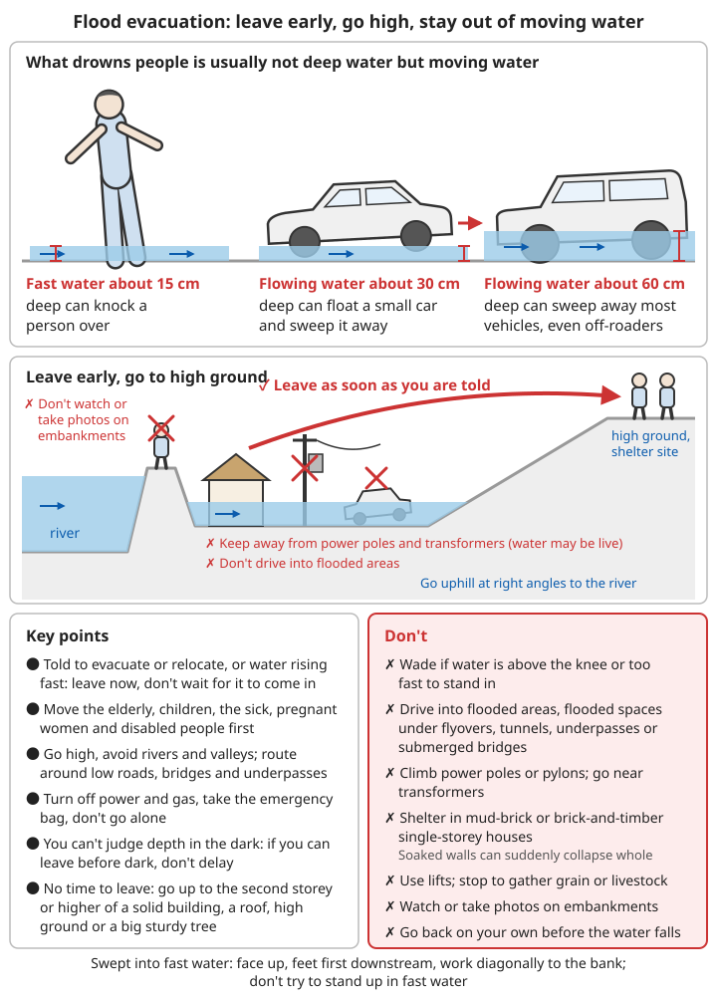
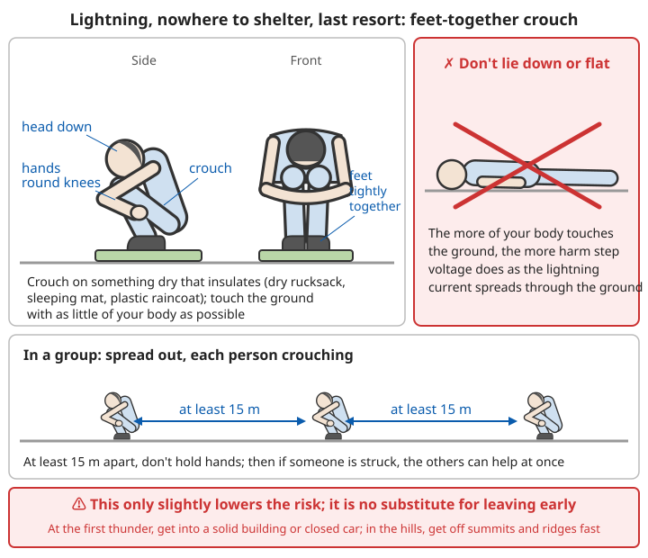

# Weather Disasters Guide

Most weather disasters **are forecast and warned of**: you can see a typhoon's track several days ahead, and warnings for heavy rain, cold waves and heat are issued a day or two in advance. Unlike earthquakes, the great majority of deaths and injuries happen to people who "knew it was coming but did not take it seriously". This chapter is based on the mainstream recommendations in official public-education material from China's Ministry of Emergency Management, the China Meteorological Administration and similar bodies; for specific actions, follow the notices of your local government and meteorological department.

## Contents
- [Warning signals: understanding the colours and levels](#warning-signals-understanding-the-colours-and-levels)
- [Typhoons/hurricanes](#typhoonshurricanes)
- [Floods](#floods)
- [Blizzards](#blizzards)
- [Tornadoes](#tornadoes)
- [Hail](#hail)
- [Heatwaves](#heatwaves)
- [Drought](#drought)
- [Sandstorms](#sandstorms)
- [Lightning](#lightning)

---

## Warning signals: understanding the colours and levels

China's weather disaster warning signals cover typhoons, heavy rain, heavy snow, cold waves, strong winds, sandstorms, high temperatures, drought, lightning, hail, frost, heavy fog, haze, icy roads and more; each type is graded by colour according to severity. For the channels through which you receive warnings, see [Emergency communication and finding family – Getting official information](06-emergency-communication-and-family-reunification.md#getting-official-information).

### What the four colours mean

| Colour | Level | Meaning | What ordinary people should do |
|------|------|------|------------------|
| 🔵 Blue | Level IV (general) | Hazardous weather possible; general impact | Follow later forecasts; check your emergency kit and charge your phone; cancel unnecessary trips outdoors |
| 🟡 Yellow | Level III (fairly serious) | Considerable impact | Prepare defences: secure things, bring things in, store water; consider stopping outdoor work and group activities; people in danger zones get ready to move |
| 🟠 Orange | Level II (serious) | Serious impact | Stop outdoor work and open-air group activities, stay in a safe building as far as possible; people in danger zones **move at once as instructed**; schools may close |
| 🔴 Red | Level I (extremely serious) | The disaster has caused or is about to cause serious damage | Stay in a safe part of a solid building; never go out unless essential; work, schools and businesses close; follow the government's unified command |

```
⚠️ Some common misunderstandings:
1. Not every type of warning has all four colours
   - For example lightning, high temperature and sandstorm have only yellow, orange and
     red; drought and hail have only orange and red
   - So "only yellow" does not necessarily mean "the lowest level"; it depends on which
     disaster it is
2. A warning is a notice that something is "about to happen", not a report afterwards
   - The standard for a red heavy-rain warning is "rainfall will exceed 100 mm within
     3 hours"; by the time you see rain that heavy, low-lying places may already be
     flooding
3. Warnings can be upgraded, and they can be lifted
   - When a warning is upgraded, step up what you do; until you receive notice that it
     has been "lifted", do not assume it is over
4. The exact standards and required responses differ slightly from place to place;
   follow what is issued locally
5. "Relocation notices" and "school closure notices" issued by the local government are
   more specific than the warning colour; act on them first
```

### Standards for some common warnings (for reference)

| Type | Blue | Yellow | Orange | Red |
|------|------|------|------|------|
| Heavy rain | ≥50 mm rainfall within 12 h | ≥50 mm within 6 h | ≥50 mm within 3 h | ≥100 mm within 3 h |
| Typhoon | Mean wind ≥force 6 or gusts ≥force 8 within 24 h | Mean ≥force 8 or gusts ≥force 10 within 24 h | Mean ≥force 10 or gusts ≥force 12 within 12 h | Mean ≥force 12 or gusts ≥force 14 within 6 h |
| Cold wave | Temperature drop ≥8°C within 48 h, minimum ≤4°C | Drop ≥10°C within 24 h, minimum ≤4°C | Drop ≥12°C within 24 h, minimum ≤0°C | Drop ≥16°C within 24 h, minimum ≤0°C |
| High temperature | — | Maximum ≥35°C for 3 d in a row | Maximum ≥37°C within 24 h | Maximum ≥40°C within 24 h |

For how wind "force" relates to wind speed (m/s), see [Weather observation and forecasting – Wind force scale](../../../docs/08-基础科学知识/07-天气观测与预报.md#34-风力等级).

---

## Typhoons/hurricanes

The harm from a typhoon comes from three things: **strong wind** (blowing down trees, advertising boards and makeshift buildings; objects falling from height), **heavy rain** (waterlogging, flash floods, landslides) and **storm surge** (sea water flooding in along the coast). Historically, most typhoon deaths have come from the last two, not from the wind itself.

### Typhoon categories (Chinese standard)

| Category | Wind speed | Impact |
|------|------|------|
| Tropical depression | <17.2 m/s | Slight |
| Tropical storm | 17.2-24.4 m/s | Moderate |
| Severe tropical storm | 24.5-32.6 m/s | Considerable |
| Typhoon | 32.7-41.4 m/s | Serious |
| Severe typhoon | 41.5-50.9 m/s | Extremely serious |
| Super typhoon | ≥51.0 m/s | Devastating |

```
When reading a typhoon forecast:
- The track forecast is a "fan-shaped" area, not a line; you can be seriously affected even
  if you are not on the centre line
- To the right of the landfall point (looking in the direction the typhoon is moving) the
  wind is usually stronger and the storm surge higher
- After landfall the wind weakens, but rain may continue for several days; flash floods and
  landslides in inland mountains often happen after landfall
- A slow-moving typhoon, or one that "stalls and circles", gives particularly large
  rainfall totals
```

### Before the typhoon arrives

**24-48 hours before**:
```
Follow the forecasts:
✓ Meteorological bureau warnings
✓ Typhoon track
✓ Expected time and place of landfall
✓ Area affected
✓ Local government notices on relocation, school closures and work stoppages

Prepare supplies:
✓ Food and water (at least 3 days)
  - Drinking water about 2-3 L per person per day; also fill the bath and buckets for
    flushing the toilet and washing if the water is cut off
  - Food that needs no cooking: bread, biscuits, tinned food, instant food
✓ Emergency kit
✓ Torch, batteries
✓ Radio (the most reliable source of information when power and internet are down)
✓ First aid kit
✓ Medicines (people with chronic illnesses should keep more than a week's supply)
✓ Important documents kept waterproof (in sealed bags)
✓ Fully charged (phone, power bank)
✓ A little cash (electronic payment will not work during a power cut)
✓ Fill the vehicle with fuel; do not park under large trees or advertising boards, in
  low-lying places or in underground car parks that flood easily
```

For what goes in the emergency kit see [Disaster response – Family emergency kit](README.md#-family-emergency-kit).

**12-24 hours before**:
```
Secure the house:
✓ Shut doors and windows tightly and bolt them; fix loose windows temporarily with
  battens and nails
✓ Glass windows: draw the curtains and keep people away from windows
  - Taping a star pattern on the glass does little: it cannot stop the glass breaking and
    only slightly reduces flying fragments. Do not stay near a window just because it is
    taped
  - Large windows facing the street or the wind: if you can, board them up from outside
    with planks or storm shutters
✓ Bring in flowerpots, clutter and clothes-drying poles from balconies, windowsills and
  roofs (objects falling from height can kill)
✓ Check that air-conditioner outdoor units, solar water heaters, advertising boards and
  awnings are firmly fixed
✓ Clear drains, floor drains and balcony drain outlets
✓ Secure outdoor items that could blow away
✓ In the countryside:
  - Tie down sheet-metal, asbestos-cement and coloured steel-sheet roofs with ropes, or
    weigh them down with sandbags
  - Strengthen or take down flimsy sheds and frames and greenhouse plastic
  - Move livestock to solid pens on higher ground
✓ On the coast: fishing boats return to harbour for shelter; people on boats and on
  offshore fish-farm rafts come ashore

Prepare to evacuate:
✓ If you are in a danger zone, evacuate as directed
✓ Low-lying areas
✓ Unsafe buildings
✓ Coastal areas
✓ Take your emergency kit
```

### When you must evacuate

```
People in the following places should leave as soon as they receive a relocation notice;
do not wait until the wind and rain are strong:
- Low-lying coastal land and near sea walls (storm surge can push sea water several km
  inland)
- Downstream of rivers and reservoirs; low-lying villages and housing estates that have
  flooded before
- Mountain areas at the mouths of gullies, below steep slopes, by rivers (flash floods,
  landslides, debris flows)
- Unsafe buildings, mud-brick houses, portable cabins, work sheds, makeshift huts,
  coloured steel-sheet buildings
- People living in basements and semi-basements
- On boats, offshore fish-farm rafts, in tents by the sea

Why leave early:
- Once the wind reaches force 8 or more, it is hard to walk outdoors, and flying debris
  can kill
- Roads may be flooded or blocked by fallen trees and landslides, and rescue vehicles
  cannot get in either
- Evacuating at night is far more dangerous than by day

When evacuating:
✓ Take your emergency kit, medicines, documents, phone and power bank
✓ Switch off the main power switch and the gas valve, and lock the door
✓ Follow the designated route to the designated shelter, and tell relatives and friends
  where you have gone
✓ Help older people, children, sick people, pregnant women and neighbours with limited
  mobility
❌ Do not go back on your own to fetch things before the warning is lifted
```

For storm surge see [Ocean disasters – Storm surge](03-ocean-disasters.md#storm-surges); for flash floods and landslides see [Debris flows](01-geological-disasters.md#debris-flows) and [Landslides](01-geological-disasters.md#landslides).

### During the typhoon

**Indoors**:
```
✓ Keep away from doors and windows
✓ Shelter in an interior corner or the bathroom (a small room with no windows and walls
  on all four sides is safest)
✓ If water gets into the house or wiring is damaged, switch off the main power switch
  (do not stand in water to do it)
✓ Use electrical appliances as little as possible during thunderstorms and strong wind
✓ Store water (the supply may be cut)
✓ Keep communications open: save phone battery, listen to the radio for news
✓ In tall buildings: the wind is stronger higher up; you can stay in an interior room on
  a lower floor
✓ If doors or windows are blown open: do not try to hold the door shut or close the
  window (in strong wind the glass may suddenly burst); take shelter in an interior room

❌ Do not:
- Go out (including to watch the sea, take photos, rush to bring in things, or "see how
  the car is doing")
- Go near windows
- Use naked flames (use a torch during power cuts; gas may be leaking)
- Use the lift (you will be trapped if the power fails)
```

**The eye of the typhoon**:
```
⚠️ Beware the eye of the typhoon!
- When the eye passes, the wind and sea go calm, and you may even see blue sky
- But the second half of the storm soon arrives
- Do not go out thinking the typhoon has passed
- Keep sheltering

Why it is especially dangerous:
- The "eye" at the centre of a typhoon is usually several tens of km across, and takes
  from several tens of minutes to an hour or two to pass a given place, long enough for
  people to walk out, go to the seafront or climb onto the roof to make repairs
- After the eye has passed, the wind suddenly comes from the **opposite direction**, as
  strong as in the first half
- Roofs, doors, windows and trees already loosened in the first half are now pushed from
  the other side, and are most likely to collapse and blow away
- The storm surge may also be highest in the second half

How to tell that the typhoon has really passed:
✓ Go by the official lifting or downgrading of the warning
✓ If the wind and rain stopped less than an hour or two ago and you are on the path of
  the typhoon's centre, it is very likely just the eye
```

**Outdoors** (caught out):
```
1. Find a solid building to shelter in (reinforced-concrete buildings are best; do not go
   into makeshift huts or work sheds)
2. Avoid:
   ❌ Under large trees
   ❌ Under advertising boards
   ❌ Temporary structures, scaffolding, tower cranes
   ❌ Near utility poles and transformers
   ❌ Below the balconies and windows of buildings (objects falling from height)
   ❌ The seashore, riversides, bridges
3. Lie flat on low ground (but not in ditches that will fill with water or by rivers)
4. Hold on to something fixed
5. Protect your head
6. Bend over, turn side-on and take small steps; do not run in strong wind
```

**In a vehicle**:
```
- Stop at once
- Keep away from trees, power lines and advertising boards
- Do not stop in low-lying places, under bridges or in underpasses (they may flood)
- Stay in the vehicle
- Keep your seat belt fastened
- Get down low and protect your head
- When the wind and rain ease a little, drive to a nearby solid building (a petrol-station
  shop, shopping centre, multi-storey car park) to shelter
```

### After the typhoon

```
Check:
✓ The building structure (do not go in if walls are cracked, the roof has fallen in or the
  foundations have been washed out)
✓ Gas leaks (if you smell gas: do not switch electrical appliances on or off, do not light
  a flame; open the windows and phone from outside)
✓ Damaged wiring (have an electrician check wiring and appliances that have been in water
  before switching the power back on)
✓ Water safety

Clean up:
✓ Standing water (against mosquitoes and other insects)
✓ Fallen debris
✓ Clean and disinfect

Take care:
❌ Do not touch fallen power lines (stay at least 10 m away, and report them to the power
   company)
❌ Do not drink untreated water
❌ Do not rush back into danger zones
❌ Do not use generators or charcoal fires indoors for heating or cooking (carbon monoxide
   poisoning)
✓ Watch for secondary disasters (landslides, floods), which can still happen in the
  mountains for several days after the typhoon
✓ Work at height, such as clearing fallen trees and repairing roofs, needs at least two
  people working together, to prevent falls and injuries from falling objects
```

For cleaning and disinfecting a house after flooding see [After a flood](#after-a-flood) below; for checks before the power comes back on see [Household electrical safety – Restoring power after a disaster](../../../docs/07-日常生活技能/08-家庭用电安全.md#灾后恢复用电).

---

## Floods

Floods are among the weather disasters that kill and injure the most people in China. **It is often not deep water that drowns people, but moving water**: fast-flowing water about 15 cm deep can knock a person over, in knee-deep fast water you basically cannot stay on your feet, and vehicles are swept away in shallow flowing water.

### Types of flood

**Rainstorm floods**: short bursts of intense rain
**River floods**: prolonged rain, flood water released from reservoirs upstream
**Flash floods**: sudden floods in mountain areas; extremely dangerous
**Urban waterlogging**: the drainage system is overwhelmed

For the warning signs of flash floods in mountain valleys and how to escape them, see [River crossings, flash floods and hypothermia in the wild](../03-wilderness-survival/08-river-crossing-flash-floods-and-hypothermia.md#flash-floods-the-biggest-danger-in-stream-valleys).

### Before a flood

**Follow warnings**:
```
✓ Weather forecasts
✓ River levels
✓ Official warnings
✓ Rainfall upstream
✓ Reservoir release notices (the river downstream may rise sharply within a few hours)
```

**Preparation**:
```
✓ Keep the emergency kit where it is easy to grab
✓ Plan evacuation routes (at least two, avoiding low-lying roads, bridges and underpasses)
✓ Know where the high ground is (nearby high ground, solid multi-storey buildings,
  designated evacuation shelters)
✓ Prepare life jackets / flotation aids
  (without life jackets: empty plastic drums with lids screwed on tight, foam boards, tyre
  inner tubes and wooden tubs all work)
✓ Move important items up high
✓ Ground-floor and basement residents: prepare sandbags or flood boards to block the door;
  carry household appliances and grain upstairs
✓ If you have an underground car park: when a heavy-rain warning is issued, move the car
  in advance to an above-ground car park on higher ground
```

### During a flood

**Evacuation**:
```
Evacuate immediately if:
- You receive an evacuation order
- The water is rising fast
- Water is getting into the house
- The area around you is already flooded

Key points for evacuating:
✓ Head for high ground
✓ Avoid river channels and valleys
✓ Take your emergency kit
✓ Switch off the power and gas
✓ Do not go alone
✓ Take routes you know; after dark you cannot see water depth or the road surface, so if
  you can leave before dark, do not put it off
```

**Wading safety**:
```
⚠️ Wading is extremely dangerous!

If you must wade:
- Water above the knee: do not risk it
- Current too strong to stand firm: do not wade
- Probe ahead with a stick (under flood water there may be manhole covers knocked off,
  ditches and collapsed road surface)
- Hold on to fixed objects
- Hold hands as a group (more stable)
- Keep your shoes on; do not go barefoot (broken glass, nails)
- Keep away from utility poles, lamp posts and transformers (the water may be live)

Remember:
- Fast-flowing water about 15 cm deep can knock a person over
- Flowing water about 30 cm deep can float a car and sweep it away
- Flowing water about 60 cm deep can sweep away most vehicles, including SUVs
```



*Figure: All water depths are approximate; it is usually moving water that drowns people. Do not wade or drive through when the water is flowing or you cannot see how deep it is*

For judging and making river crossings in the wild, see [Deciding whether you can cross](../03-wilderness-survival/08-river-crossing-flash-floods-and-hypothermia.md#deciding-whether-you-can-cross).

**Driving in a flood**:
```
❌ Never:
- Drive into flooded areas
- The thought "I can drive through" is very dangerous!
- Drive into flooded underpasses under flyovers, tunnels, underpasses or low-water bridges
  (the most common places where people die)

If trapped in the vehicle:
1. Abandon the vehicle immediately
2. Head for high ground
3. If the vehicle is floating:
   - Open the window / break the window
   - Climb onto the roof
   - Wait for rescue
```

For specific advice on driving through water and on cars going into water, see [Urban waterlogging](#urban-waterlogging-underground-spaces-driving-through-water-and-manhole-covers) and [Escaping a car in water](#escaping-a-car-in-water) below.

**Trapped in a building**:
```
1. Move upwards (to the roof)
   - If you go into a loft, always take a tool that can break through the roof, so you are
     not trapped in the loft if the water rises
2. Take:
   - Mobile phone
   - Whistle
   - Brightly coloured clothing
   - Drinking water, food, torch
3. Send distress signals
   - By day: wave brightly coloured clothes or sheets on the roof; spread them out with
     "SOS" written on them
   - At night: flash a torch or phone light on and off
   - Whistle: blow three short blasts, pause, then blow again
   - Call 110/119/120 to report your location, how many people there are, and whether
     there are injured or sick people, older people or children
4. Do not get into the lift
5. Do not try to swim to safety lightly (the current is fast)
6. When the rescue boat comes, follow instructions and board one at a time; do not all
   rush at once
```

**Self-rescue in fast water**:
```
If you are swept into fast water:
1. Face up, feet downstream
2. Float on your back
3. Feet first to fend off obstacles
4. Go with the current
5. Move diagonally towards the bank
6. Grab floating objects
7. Grab anything you can reach on the bank

❌ Do not try to stand up in fast water (your foot can get stuck in rocks or debris and
   the water pushes you under)
❌ Do not cling to fallen trees or piles of debris in front of bridge piers (the water can
   force you underneath)
```

For more detail and how to rescue someone from the bank, see [Falling into fast water](../03-wilderness-survival/08-river-crossing-flash-floods-and-hypothermia.md#falling-into-fast-water); for first aid once they are out see [Drowning](../01-first-aid-and-family-health/05-acute-symptoms.md#drowning).

### Urban waterlogging: underground spaces, driving through water and manhole covers

In a city, a short downpour can flood low-lying roads and underground spaces within half an hour. In the extreme rainstorm in Zhengzhou in July 2021, a metro train was trapped in a tunnel and the Jingguang Expressway tunnel was flooded; people died in both.

**Underground car parks, basements, underground shopping centres**:
```
⚠️ Underground spaces fill with water far faster than you would think, and have only a
   few exits

✓ When a heavy-rain warning is issued: move cars out of low-lying underground car parks
  in advance; people living in basements and semi-basements move above ground
❌ Once the car park has started to flood: do not go back down to move the car or rescue
   belongings
   - Water pours in down the entrance ramp, so walking out means going uphill against the
     current
   - After a power cut, roller shutters, powered doors and lifts may not open
✓ If you are already underground when water starts coming in:
  1. Abandon the car and belongings immediately
  2. Go up by the pedestrian stairs, not the lift
  3. If a door is held shut by water pressure and will not open, do not force it; find
     another exit or stay up high and call for help
  4. Once the water is above the knee, hold on to the wall or railings as you walk, so you
     do not slip
```

**The metro**:
```
✓ On rainstorm days, before going out, check whether the metro is suspended or limiting
  passengers; do not go into a station if water is pouring in at the entrance
✓ Inside a station: follow the staff's instructions and head for a street exit; do not
  linger on platforms or in low parts of passages
✓ If the train is stuck in a tunnel:
  - Stay calm; listen to the announcements in the carriage and follow the staff
  - Do not force the doors open or break a window and jump onto the track (some lines
    have a live power rail beside the track, and there may be water and passing trains in
    the tunnel)
  - If evacuation is needed, walk as directed along the evacuation walkway or the track to
    the nearest station, looking after each other
  - If water gets into the carriage, stand on the seats and use your phone to report the
    train number, carriage number, location and number of people
  - If the air is bad, talk and move as little as possible to save strength
```

**Driving through water**:
```
If you can avoid crossing, do not cross. The official advice: if the water is more than
half way up the tyres, or you cannot see how deep it is, do not cross.

✗ Never cross in these cases:
  - The water is flowing (even a shallow layer)
  - Under flyovers, in tunnels, underpasses, low-water bridges
  - You cannot see the road surface and kerb, and do not know whether there are holes or
    manhole covers underneath
  - The car in front has stalled in the water

✓ If it really is only shallow standing water and you must cross:
  1. Stop first and watch how high the water comes on other cars as they cross
  2. Use a low gear and drive through at a steady speed in one go; do not stop, change gear
     or stamp on the accelerator halfway (it throws up a wave and water gets into the engine
     through the air intake)
  3. Keep your distance from the car in front; do not drive in its wave
  4. Once across, press the brakes lightly a few times to dry the brake pads, and check the
     brakes work normally

⚠️ If the car stalls in water: do not try to start it again (restarting an engine with water
   in it will wreck it completely); if the water is rising or flowing, get out at once and
   head for high ground; do not stay in the car and wait
```

**Pedestrians and manhole covers**:
```
Under flood water you cannot see manhole covers that have been knocked off, drain openings
or construction pits; if you fall into one there is almost no chance of survival.

✓ Avoid walking in flood water as far as possible; if you must:
  - Walk along the building side, on raised pavements; do not walk in the middle of the road
    or on low ground at the roadside
  - Probe ahead with a long stick or umbrella, testing each step
  - Go with others, holding on to each other
✓ Keep well away from places where the water swirls, "sucks" downwards or bubbles up
  (these are usually open manholes or drains)
✓ Keep away from utility poles, street lights, transformers, electrical cabinets and
  advertising boards (electrical leakage)
  - If you see wires in the water or sparks, or someone nearby suddenly collapses, do not go
    near; hop away on one foot or with both feet together, and call the police
❌ Do not let children play in flood water
```

### Escaping a car in water

After a car plunges into a river or deep water, it usually floats for a short while first (from several tens of seconds to a minute or two). This is the best time to escape.

```
1. Undo your seat belt at once (your own first, then help the children)
2. Open the window immediately
   - Electric windows usually still work until water gets into the wiring; do not hesitate
   - Window first, phone call later (call the police once you are out)
3. If the window will not open, break a side window
   - Use the car's safety hammer, or pull out a seat headrest and use its metal prongs
   - Hit the corner of the side-window glass (the four corners break most easily), not the
     middle; do not hit the windscreen (laminated glass will not break)
   - Note: in some cars the side windows are also laminated and very hard to break; in that
     case go to the next step
4. Climb out through the window: children first (older children first, then pass the
   younger ones out), adults after
5. Once out, climb onto the roof and wait for rescue, or swim to the bank; do not go back
   into the car for belongings
6. If neither windows nor doors will open:
   - Do not thrash around in the car and use up your strength
   - When the water is nearly over your head, the water pressure inside and outside the car
     is nearly equal; take a deep breath and push the door hard, or get out through the
     broken window

❌ Do not start by pushing the door: the water pressure outside is high, the door will not
   open, and you waste the most precious time
✓ Keep a safety hammer beside the driver's seat at all times, and make sure you can reach it
```

### Rural floods: moving out and getting to high ground

```
In normal times:
✓ Find out the village's relocation routes, where the shelter is, and who is responsible for
  raising the alarm (loudspeaker, gong, megaphone, phone)
✓ Decide in advance who in the family carries the older people and who carries the children
✓ In houses by rivers or at gully mouths, put the emergency kit by the door before going to
  bed during the flood season

When you receive a relocation notice or hear the alarm:
1. Leave at once; do not wait for water to come into the house, and do not first go to
   gather grain or drive the livestock
2. Move older people, children, sick people, pregnant women and disabled people first
3. Follow the designated route to the shelter or nearby high ground; if there is no
   designated route, head uphill at right angles to the river channel
4. Livestock: drive them to high ground if there is time; if not, untie them and open the
   pens so they can escape on their own
5. When you reach the shelter, report to the village officials so they know you are safe
6. Do not go back to the village on your own before the water goes down (people have died
   when the water rose again or houses collapsed)

If there is no time to leave and you are trapped:
✓ Get up high: the first floor or above of a solid building, a roof, high ground, a sturdy
  large tree
❌ Do not shelter in mud-brick houses or single-storey brick-and-timber houses: once soaked,
   the walls can suddenly collapse in whole sections
❌ Do not climb utility poles or pylons; do not go near transformers
✓ Keep things that float beside you: doors, wooden tubs, plastic drums, tyres, foam boards,
  wooden bed boards
✓ Only leave, holding a float, when the water is about to cover where you are and there is
  nowhere higher
✓ Send distress signals (see "Trapped in a building" above)

Embankments:
✓ If you see an embankment seeping, water spurting out of it (piping), cracks or subsidence,
  report it at once to the village officials and keep away from below the embankment
❌ Do not stand on river embankments watching the water or taking photos
```

### After a flood

```
Before returning:
✓ Wait for official notice
✓ Make sure it is safe

Check the house:
✓ Structural damage
✓ Electrical safety (get a professional)
✓ Gas leaks

Clean up:
✓ Drain water (slowly, to avoid structural damage)
✓ Clean and disinfect
✓ Throw away contaminated food
✓ Do not drink well water (contaminated)

Health:
✓ Prevent disease (cholera, typhoid)
✓ Avoid contact with flood water
✓ Clean wounds
✓ Guard against mosquitoes and other insects
```

#### Checking and cleaning the house

```
1. Look from outside before going in: do not go in if walls are tilted, there are large
   cracks, the foundations have been washed out or the roof is sagging
2. Go in by day with a torch; do not light a flame; open doors and windows to ventilate
   first
3. Switch off the main power switch first (do not stand in water); have an electrician
   check wiring and appliances that have been in water before switching the power back on
4. When shovelling out mud, wear rubber boots or wellingtons and gloves, and keep your skin
   out of the muddy water as far as possible; watch for broken glass and nails in the mud,
   and snakes and rats washed into the house
5. Water in the basement: do not pump it all out at once. The soil outside is still
   waterlogged and pressing hard; pumping it empty at once can push the walls in. Pump out
   about one third each day
6. Prevent mould: try to dry the house within a day or two (open windows, fans)
   - Soaked mattresses, sofas, carpets, paper items and plasterboard walls usually have to
     be thrown away
   - Hard surfaces (floors, walls, furniture, tableware): first wash clean with water and
     detergent, then wipe or soak with chlorine disinfectant
   ⚠️ Never mix chlorine disinfectant ("84" bleach, household bleach) with acidic cleaners
      such as toilet cleaner; it produces toxic chlorine gas
7. Wear a mask while cleaning; people with asthma or allergies should not help clean
   mouldy rooms
```

For making up disinfectant and its strength see ["84" bleach (chlorine disinfectant)](../01-first-aid-and-family-health/15-infectious-disease-at-home.md#84-bleach-chlorine-based-disinfectant); for checks before the power comes back on see [Restoring power after a disaster](../../../docs/07-日常生活技能/08-家庭用电安全.md#灾后恢复用电).

#### Food and drinking water

```
✓ Throw away all food that has been in flood water, including food in bags, cartons, glass
  jars and screw-top bottles
  - The only exception: metal tins that are undamaged and not bulging. Tear off the label,
    wash them, soak them in disinfectant, then write the contents on the tin with a pen
✓ If the fridge has been without power for more than half a day and the meat, milk and
  leftovers in it are no longer cold, throw them away
✓ Drinking water: until the water company says supply is restored, drink bottled water or
  boiled water
✓ A well that has been flooded: first pump the well dry and clear out the mud, then
  disinfect it; drink from it only after testing it or watching it for a few days
✓ Pots, pans, bowls, utensils and baby bottles that have been soaked: wash them, then boil
  them or soak them in disinfectant
```

For how to disinfect a well see [Water sources and supply – Disinfecting well water](../../../docs/07-日常生活技能/10-水源工程与供水.md#井水消毒).

#### Preventing disease

```
Common health problems after floods:
- Diarrhoea, dysentery and other intestinal infections → drink only boiled water, wash your
  hands before eating and after using the toilet, do not eat food that has been in water
- Skin problems: feet and legs soaked for a long time turn white and wrinkled, red, swollen
  and itchy → spend as little time in water as possible; wash and dry them every day and
  keep them dry
- Wound infection, tetanus → rinse even the smallest wound clean; after an injury consider a
  tetanus booster
- Leptospirosis: from a few days to two weeks after contact with flood water or mud, a
  sudden high fever, aching muscles all over (pain in the calves is especially marked) and
  red eyes → see a doctor at once, and tell them you were in contact with flood water
- More mosquitoes (dengue fever, Japanese encephalitis) → get rid of standing water, use
  mosquito nets and repellent
- Carbon monoxide poisoning: from using generators or burning charcoal indoors during
  power cuts

⚠️ High fever, diarrhoea that will not stop, passing little urine, or a wound that is red,
   swollen and oozing pus: see a doctor promptly or call 120
```

Related chapters: [Diarrhoeal infections](../01-first-aid-and-family-health/15-infectious-disease-at-home.md#diarrhoeal-infections), [Preventing tetanus](../01-first-aid-and-family-health/02-wounds-and-injuries.md#tetanus-prevention), [Carbon monoxide poisoning](../01-first-aid-and-family-health/07-home-and-traffic-accidents.md#carbon-monoxide-poisoning). Being unable to sleep and repeatedly reliving the scene after a flood are common reactions; see [Mental health](../01-first-aid-and-family-health/10-mental-health.md).

---

## Blizzards

### Dangers

- Poor visibility, getting lost
- Hypothermia
- Transport cut off
- Power and water cut off
- Buildings collapsing under the weight of snow
- Avalanches (in mountains)
- Falls and road accidents caused by freezing rain and icy roads
- Carbon monoxide poisoning and fires caused by unsafe heating (in winter, more people often come to harm at home than outdoors)
- Cold and shovelling snow triggering heart attacks and strokes

### When a cold wave arrives

A cold wave is a large mass of cold air moving south, making the temperature plunge by ten degrees or more within a day or two, often with strong winds, rain, snow and freezing. Many houses in southern China have no heating and poor insulation, so cold waves are just as dangerous there.

```
People:
✓ Older people, babies and young children, and people with heart, blood-vessel or chronic
  lung disease need the most attention
  - Cold weather raises blood pressure; heart attacks and strokes rise noticeably during
    cold waves
  - People with chronic illnesses should take their medicines on time and not stop them on
    their own; take special care to keep warm when getting up in the morning and going out
  - Sudden chest pain, weakness in the arm and leg on one side, or slurred speech: call 120
    at once
✓ Hat, scarf, gloves: protect the head, neck, hands and feet
✓ Check on older people living alone every day, to make sure their home is warm enough and
  their heating is safe

House and heating:
✓ Seal gaps round doors and windows with draught strip or strips of cloth; hang thick
  curtains at the windows
✓ Coal stoves must have a chimney with a wind cowl, and the chimney joints must be tight;
  when banking the fire for the night, still leave ventilation
✓ Do not burn a charcoal brazier in a room with the doors and windows shut, or take long
  showers with a gas water heater
✓ Do not run electric heaters off extension leads; keep them away from sheets and clothes;
  do not use any heater under the bedcovers other than an electric blanket

Keeping water pipes from freezing:
✓ Wrap pipes and water meters outdoors or in unheated places with insulation, old clothes
  or straw
✓ On especially cold nights, leave a tap dripping slowly, or turn off the main valve and
  drain the pipes before going to bed
✓ If a pipe is already frozen: thaw it slowly by pouring warm water over it or wrapping it
  in a hot towel; do not heat it with a flame or pour boiling water on it (it will crack)

Farming:
✓ Strengthen greenhouses and cover them with straw mats; shield livestock and poultry pens
  from the wind, bed them with dry straw, and make sure their drinking water does not freeze
✓ For frost protection see the "Frost" section of the weather observation chapter
```

Related chapters: [Carbon monoxide poisoning](../01-first-aid-and-family-health/07-home-and-traffic-accidents.md#carbon-monoxide-poisoning), [Elder care – Extreme weather](../01-first-aid-and-family-health/13-elder-care.md#extreme-weather), [Frost](../../../docs/08-基础科学知识/07-天气观测与预报.md#五霜冻).

### Freezing rain and icy roads

```
Freezing rain: raindrops freeze into ice the moment they land on the ground and on objects.
Power lines and branches coated with ice snap under the weight, and roads become as slippery
as a mirror.

On foot:
✓ Stay in as much as possible, especially older people
✓ Wear non-slip shoes; if you have none, tie straw rope, old socks or snow chains round your
  shoes
✓ Take small steps, put your foot down flat, lean slightly forward, and keep your hands out
  of your pockets (so you can catch yourself if you fall)
✓ Avoid steps, slopes, manhole covers, bridges and shady places (the ice is thickest there)
✓ Keep away from ice-coated power lines, trees and eaves (icicles and broken branches can
  fall)

Driving:
✓ Do not drive if you can avoid it; if you must: slow down, leave a bigger gap, brake gently
  and do not turn the wheel sharply
✓ Bridges, elevated roads and tunnel entrances and exits ice over first
✓ If you skid: ease off the accelerator, steer gently in the direction the back of the car
  is sliding, and do not slam on the brakes
```

### Before a blizzard

```
Preparation:
✓ Store food and water (at least 1 week)
✓ Back-up heating equipment (safe)
✓ Emergency lighting
✓ Batteries, radio
✓ Medicines
✓ Plenty of fuel (vehicle, generator)
✓ Snow-shovelling tools
✓ In the car: blankets, warm clothing, shovel, torch, food and water, snow chains, a
  brightly coloured strip of cloth

The house:
✓ Check the heating system
✓ Insulating materials
✓ Clear drains and gutters
✓ Trim branches (so they do not break and bring down power lines)
✓ Check whether roofs and greenhouses can bear the load; prop up or take down dilapidated
  sheds and carports in advance
```

### During a blizzard

**At home**:
```
✓ Stay indoors
  - If you must go out (to feed livestock, fetch firewood), tie a rope from the door to where
    you are going and follow it; tell your family where you are going and how long you will
    be. In a blizzard you may not find your way back even a few tens of m from home
✓ Keep warm:
  - Several layers of clothing (several thin layers are warmer than one thick one; do not
    wear damp padded clothes as the inner layer)
  - Heat one closed room: the whole family gathers in one small south-facing room with few
    windows, and the doors of other rooms are kept shut
  - Block the gap under the door with a towel
  - Hang blankets or nail plastic sheeting over windows; put mats on the floor; wear a hat
    to sleep at night
✓ Save fuel
  - Estimate your stock: from how much you use each day, work out how many days it will
    last; if it is not enough, cut heating time and combine cooking early on
✓ Prevent carbon monoxide poisoning:
  - Do not burn charcoal indoors for heating
  - Keep the room ventilated when heating with fuel
  - Never use generators, gas heaters or charcoal hotpots indoors or in a garage
  - If the whole family has a headache, dizziness, nausea and drowsiness at the same time
    → open the windows at once, leave the room and call 120
  - For recognition and rescue see 01-first-aid-and-family-health/07-home-and-traffic-accidents.md
✓ Store water (pipes may freeze and burst)
  - If the water is cut off you can melt snow, but boil snow water before drinking it
✓ Clear snow from the roof regularly (to prevent collapse; for safe methods see "Clearing
  snow from roofs and greenhouses" below)
✓ During power cuts use a torch and as few candles as possible; put candles on a
  non-flammable dish and put them out when you leave the room
```

For recognising and treating carbon monoxide poisoning see [Carbon monoxide poisoning](../01-first-aid-and-family-health/07-home-and-traffic-accidents.md#carbon-monoxide-poisoning).

**Trapped in a vehicle**:
```
1. Stay in the vehicle!
   - The vehicle is your shelter
   - Outside you easily get lost

2. Signal:
   - Tie a brightly coloured strip of cloth to the aerial
   - Turn on the hazard lights at intervals
   - Sound the horn now and then

3. Keep warm:
   - Run the engine for 10 minutes every hour for heat
   - Make sure the exhaust pipe is not blocked by snow (to prevent carbon monoxide poisoning)
     Before each time you run the engine, get out and clear the snow from around the
     exhaust; while it runs, open a window on the sheltered side a crack
   - Keep moving your body
   - Huddle together with others

4. Stay awake:
   - Take turns to sleep
   - Do not fall asleep and get frostbitten
   - While one person sleeps, another stays awake and watches for anyone getting a headache
     or drowsy while the engine runs (carbon monoxide)

5. Save:
   - Fuel
   - Food
   - Batteries
   - Phone: make one call to report your location, vehicle and number of people, then
     switch it off or to power-saving mode, and switch it on at set times to check messages

6. Drink and eat:
   - Eat small amounts often; your body needs energy to make heat
   - If you do not have enough water, melt snow to drink (in a cup or with body heat); do
     not eat mouthfuls of snow directly

⚠️ Leave the vehicle only when you can see houses or rescuers within a few tens of m and the
   wind and snow have eased
```

**Outdoors**:
```
⚠️ Going out in a blizzard is extremely dangerous!

If you are caught outdoors:
1. Find or build a shelter:
   - Natural shelter (cave, rocks)
   - Snow cave
   - Windbreak wall

   - The smaller the shelter, the warmer it is; put the entrance away from the wind and lie
     on branches or a rucksack to keep off the snow
   - Poke a ventilation hole in the roof of a snow cave and check often that it has not
     been blocked by snow

2. Stay dry:
   - Wet clothes kill
   - Brush the snow off yourself before going into the shelter (snow melts with body heat
     and soaks your clothes)
   - Take off wet clothes and put on dry ones; if you have no dry clothes, put a windproof,
     waterproof layer over the wet ones
   - Sweating while working soaks your underwear: take off layers and slow down; better to
     go a little slower than to sweat heavily

3. Keep warm:
   - Several layers of clothing
   - Protect your head (you lose a lot of heat when your head and neck are exposed)
   - Cover your mouth and nose (to warm the air you breathe in)
   - Keep moving (wiggle fingers and toes, march on the spot, but do not work hard enough to
     sweat)
   - When there are several of you, huddle together and share sleeping bags and blankets

4. Do not:
   ❌ Eat snow (it lowers your body temperature; when you need to drink, melt the snow first)
   ❌ Drink alcohol (it feels warming but actually cools you down)
   ❌ Sleep (hypothermia comes easily; if there is no way to keep warm in the shelter, take
      turns to sleep and wake each other)
   ❌ Wander blindly in a white-out (you easily walk in circles or fall into a ditch)

5. Companions watch each other: constant shivering, clumsy hands, slurred speech, stumbling
   → early hypothermia; deal with it at once
```

For how to make snow caves and snow walls see [Snow and polar survival](../03-wilderness-survival/04-snow-and-polar-survival.md); for treating hypothermia and frostbite see [Hypothermia](../01-first-aid-and-family-health/05-acute-symptoms.md#hypothermia) and [Frostbite](../01-first-aid-and-family-health/02-wounds-and-injuries.md#frostbite).

### Clearing snow from roofs and greenhouses

```
Heavy snow collapsing roofs, coloured steel-sheet sheds and vegetable greenhouses, and
people falling while clearing snow from roofs, are common causes of death and injury in
heavy snow.

✓ When the snow is thick, and especially when it is wet and heavy, clear it early; do not
  wait until it builds up further
✓ First try to push the snow off from the ground with a long pole or snow pusher; avoid
  going up on the roof as far as possible
✓ If you must go up on the roof: at least two people, tied on with a safety rope, wearing
  non-slip shoes; do not stand at the edge of the eaves
✓ Greenhouses: in heavy snow, take turns sweeping snow all night; if the frame is already
  bending or creaking, get out at once and do not go in to save it
✓ When clearing snow, watch for power lines underfoot and people below the eaves
❌ Do not shelter from the snow in makeshift huts, carports or greenhouses loaded with snow
```

### After a blizzard

```
✓ Go out carefully (slippery roads, poor visibility)
✓ Avoid overexertion (shovelling snow is heavy physical work)
  - Work a little, rest a little; push the snow rather than lifting and throwing it; shovel
    a little at a time
  - People with heart disease or high blood pressure, and older people, should avoid
    shovelling snow
  - If you get chest pain, chest tightness or breathlessness while shovelling, stop at once
    and call 120
✓ Watch for avalanche risk (in mountains)
✓ Check for frostbite
✓ Take in fluids and energy
✓ When the snow melts, watch for icicles falling from eaves and for meltwater pooling and
  flooding
```

---

## Tornadoes

### Tornadoes in China

```
- China has tornadoes every year, mostly from April to September, more often in plains,
  river networks and delta areas such as Jiangsu, Anhui, Guangdong, Hubei and Shandong
- They often occur in severe thunderstorms, and also in the rain bands on the edges of
  typhoons
- In 2016 a violent tornado in Funing, Yancheng, Jiangsu killed nearly a hundred people,
  mainly through buildings collapsing
- Tornadoes are small (usually from a few tens to a few hundred m wide), arrive fast and do
  not last long; it is very hard to forecast the exact place several hours in advance, so
  you must act as soon as you receive a warning
```

### Recognising one

**Cloud features**:
- Churning dark clouds: the base of the cumulonimbus is jet black, and the cloud mass is rotating fast and boiling up and down
- Funnel cloud: a funnel-shaped or trunk-shaped column of cloud reaching down from the cloud base; once it touches the ground it is a tornado
- Low-hanging cloud: one part of the cloud base is clearly lower than the rest and bulges downwards
- A rotating "wall cloud" hanging below the cloud base

**Other signs**:
- Green sky: in the afternoon or evening the sky turns bluish-green, common with severe thunderstorms
- Frequent lightning: almost continuous flashes
- Large hail: heavy hail may be followed by a tornado
- A loud, continuous roar (like a train): it goes on and on, not passing like a roll of thunder
- Sudden calm (before a tornado): a sudden drop in wind and rain during a violent storm does not mean it is over
- A rotating column of dust and debris on the ground (already very dangerous even before the funnel fully reaches the ground)
- At night you cannot see the funnel; you can only go by warnings and sound

```
⚠️ If you see any of the above, do not stop to watch or film it; take cover at once as
   described below.
   Tornadoes usually move at several tens of km/h; from the moment you see one to its
   arrival may be only a few minutes.
```

### Tornado alerts

**Watch**: conditions are right; a tornado may form
**Warning**: a tornado has been spotted; act now!

```
The above is the US system. In China:
- When the meteorological department issues a warning for thunderstorms with strong wind,
  hail or severe convective weather, think of the possibility of a tornado
- Guangdong, Jiangsu and some other places issue separate tornado warnings; when you
  receive one, take cover at once as described below
- If you see a funnel cloud or hear a roar like a train, do not wait for a warning; take
  cover at once
```

### What to do

**At home**:
```
Act at once!

Best places:
1. Basement:
   - Safest
   - Shelter under a sturdy workbench
   - Keep away from windows

2. No basement:
   - Lowest floor
   - Interior room (bathroom, cupboard)
   - No windows
   - Away from exterior walls

Position:
✓ Crouch or lie flat
✓ Hold your head with both hands
✓ Protect your head and neck
✓ Cover yourself with thick cushions or a mattress
✓ If you have a helmet (bicycle or motorcycle helmet), put it on: most deaths in tornadoes
  are head injuries from flying debris and collapsing structures
✓ Put your shoes on and keep a torch and phone with you (afterwards you will have to walk
  over rubble and call for help)
✓ Hold babies and young children underneath you to protect them

❌ Do not:
- Stay in a mobile home
- Stay in portable cabins, coloured steel-sheet buildings, work sheds or makeshift
  single-storey huts (these are lifted off whole; if you can move to a nearby solid
  building before the tornado arrives, do so at once)
- Open windows to "equalise the pressure" (wrong!)
- Shelter in a car
- Run outside to watch or film
```

**In schools / public buildings**:
```
✓ Interior corridors (lowest floor)
✓ Small rooms
✓ Away from windows and halls
✓ Crouch and protect your head
✓ Follow instructions
❌ Do not stay in spaces with wide-span roofs such as sports halls, auditoriums or the
   middle of large supermarkets (the whole roof can easily fall in)
```

**Outdoors**:
```
1. Find a solid building

2. No building:
   - Lie flat in a low spot
   - A ditch or hollow
   - Hold your head with both hands
   (Note: in heavy rain ditches can suddenly fill with water)

3. Do not:
   ❌ Shelter under a bridge (funnelling effect makes the wind stronger)
   ❌ Shelter under a tree
   ❌ Try to outrun the tornado

4. Keep away from:
   - Utility poles
   - Trees
   - Vehicles
```

**In a vehicle**:
```
⚠️ Cars are not safe!

As the tornado approaches:
1. Abandon the vehicle!
2. Lie flat in a nearby low spot
3. Get some distance from the vehicle (so it does not land on you)

If there is nowhere to go:
- Keep your seat belt fastened
- Get down below the level of the windows
- Protect your head with your hands or a blanket

✓ If the tornado is still far off and the road is clear, you can drive away at right angles
  to the direction it is moving and get into the nearest solid building
```

### After a tornado

```
✓ Check for injuries
✓ Keep away from collapsed buildings
✓ Keep away from fallen power lines
✓ Use a torch (no naked flames)
✓ Help others
✓ Follow the rescuers' instructions
✓ Wear sturdy shoes, long sleeves and long trousers; the rubble is full of nails and broken
  glass
✓ If you smell gas, leave at once and report it
```

---

## Hail

Hail often comes together with lightning and strong wind, and usually lasts only a few minutes to a quarter of an hour or so. Hailstones the size of eggs can injure people and smash car windows, and they are especially destructive to crops. Hail warnings have only two levels: orange (hail possible within 6 hours) and red (hail very likely within 2 hours).

```
Indoors:
✓ Shut doors and windows; keep away from windows and skylights (the glass may be smashed)
✓ Do not go out to bring things in or cover the car

Outdoors:
✓ Get into a solid building at once
✓ If there is no time: protect your head and the back of your neck with a rucksack, school
  bag or clothing, and shelter under solid eaves or against a wall (with your back to the
  direction the hail is coming from)
❌ Do not shelter under large trees (hail often comes with lightning, and large trees are
   easily struck; broken branches can also hit you)
❌ Do not shelter in flimsy sheds or under advertising boards

In a vehicle:
✓ Find somewhere you can park and stop properly (not in the middle of the road); stay in
  the vehicle
✓ Keep away from the windows, turn your back to them, and protect your head and face with
  clothing or a blanket
✓ If there is a petrol-station canopy or multi-storey car park nearby, drive in to shelter
❌ Do not get out during the hail and run for a distant building

Afterwards:
✓ Roads covered with hailstones are slippery; drive and walk carefully
✓ Thunderstorms and strong wind may follow straight after hail; watch for further warnings
```

**After crops are damaged**:
```
✓ Promptly raise flattened plants and cut off smashed leaves and shoots, to reduce infection
  by disease
✓ Apply a quick-acting top dressing of fertiliser to help recovery
✓ If the damage is severe and there is still time in the season, resow or switch to a crop
  with a short growing period
✓ In orchards and vegetable plots that are often hit by hail, you can put up anti-hail nets
```

For field management of different crops see [Grain crops](../../../docs/04-动植物培育/02-粮食作物.md) and [Vegetable growing](../../../docs/04-动植物培育/01-蔬菜种植.md).

---

## Heatwaves

Several days in a row with maximum temperatures above 35°C (the threshold for a high-temperature warning), without cooling at night, are especially dangerous for older people, babies and young children, people with chronic illnesses and outdoor workers. Every major heatwave clearly increases the number of deaths, many of them older people who fall ill from the heat alone at home.

```
When you receive a high-temperature warning:
✓ Yellow (≥35°C for 3 days in a row): cut down outdoor activity around midday; plan
  drinking water and heat precautions
✓ Orange (≥37°C): shorten outdoor work, avoid midday, rest in rotation
✓ Red (≥40°C): stop open-air outdoor work except essential work

✓ Avoid going out in the hottest hours (10:00-16:00)
✓ Drink at regular times; do not wait until you are thirsty; when sweating heavily,
  replace salt as well
✓ By day close the windows and draw the curtains; ventilate in the cool of the evening;
  if you have air conditioning, turn it on; do not suffer to save electricity
✓ Visit or phone older people living alone every day
❌ Never leave children, older people or pets alone in a car, even for a few minutes
✓ Outdoor work: schedule it for morning and evening, work for a while then rest, work in
  pairs and watch each other

⚠️ Dizziness, nausea, heavy sweating that suddenly stops, very high body temperature,
   confusion or fits → this may be heatstroke; call 120
   at once, and meanwhile move the person into the shade and cool them quickly
```

For the grades of heat illness, cooling methods, high-risk groups and how much to drink, see [Acute symptoms – Heatstroke](../01-first-aid-and-family-health/05-acute-symptoms.md#heatstroke); for caring for older people see [Elder care – Extreme weather](../01-first-aid-and-family-health/13-elder-care.md#extreme-weather).

**Keeping cool during a power cut**:
```
✓ Stay in the coolest room in the house (north-facing, downstairs, in shade); keep doors
  and windows tightly shut by day to keep the heat out
✓ Wipe yourself down with a damp towel, take cool showers, soak your feet in cool water
✓ Hang a wet sheet at the window to cool the air by evaporation (works well when the air is
  dry, poorly when it is very humid)
✓ When the temperature is very high a fan just blows hot air; it helps only if you also wet
  your skin
✓ Go to a community cooling centre or a cool public place
```

---

## Drought

Drought comes slowly and lasts a long time. It does not kill suddenly as floods do, but step by step it causes water shortages, lower harvests and even total crop failure. As a drought develops, **the earlier you start saving water, the more options you will have later**.

### Effects

- Water shortage: well and spring levels fall, ponds and streams dry up; both people and livestock struggle for drinking water
- Crop failure: seeds cannot be sown, seedlings come up poorly, and water shortage at key growth stages greatly reduces yields
- Food shortage: one failed season affects the following year; plan food stocks early (see "Farming in drought" below)
- Higher fire risk: vegetation is dry, and a single cigarette end or burning of stubble can start a wildfire
- Health problems: lack of water worsens hygiene and increases intestinal infections; water sources become concentrated and water quality worsens; drought often comes with heat, so more heat illness

```
Drought is a "slow" disaster. Signs that a drought is developing:
- Noticeably little rain for a month or two; wells lower than at the same time in previous
  years
- Soil still dry when you dig down ten-odd cm; crops wilt at midday and have not recovered
  by morning
- River and pond levels lower week by week
→ When you see these signs, start saving and storing water; do not wait until the well is
  dry to start worrying
```
### What to do

**Priorities for water use**:
```
When water is short, secure it in this order:
1. Drinking and cooking water for people (about 2-3 L per person per day for drinking, more
   in hot weather and during work)
2. Handwashing and basic hygiene (to prevent infectious disease)
3. Drinking water for livestock
4. Watering crops at critical stages (see below)
5. Other uses (laundry, cleaning, watering flowers, washing the car)

✓ When the community is short of water, ration it centrally, put named people in charge
  of water sources, and look after older people, children and sick people first
```

For estimating how much water each person uses, see [Water sources and supply – How much water you need](../../../docs/07-日常生活技能/10-水源工程与供水.md#需要多少水).

**Saving water**:
```
Daily life:
✓ Shorter baths and showers (wash from a basin instead)
✓ Fix leaks (a dripping tap can waste ten-odd L a day)
✓ Reuse water (water from washing vegetables for the flowers)
  - Vegetable-washing water → flush the toilet, water the garden; clean water from the last
    rinse of the laundry → the first wash of the next load
✓ Collect rainwater
✓ Wash the car less
✓ Use water-saving fittings
✓ Before washing up, wipe grease off dishes with paper or a scraper, then wash them in one
  basin of water

Farming:
✓ Drip irrigation (drips water straight onto the roots and uses less than half the water of
  flood irrigation; without drip tubing you can bury plastic bottles with small holes
  punched in them beside the plants)
✓ Choose drought-tolerant crops
✓ Mulch to keep moisture in
✓ Water at better times (morning and evening; most water given at midday evaporates)
For details see "Farming in drought" below
```

**Finding water**:
```
✓ Dig wells deeper
✓ Rainwater collection systems
✓ Share water resources
✓ Bring water in from far away
✓ Springs: in the dry season some springs flow less but do not stop; clear out the spring
  and build a small basin to store water
```

For how to dig wells, find springs and collect rain, see [Water sources and supply](../../../docs/07-日常生活技能/10-水源工程与供水.md).

### Safe drinking water in drought

```
⚠️ In drought, pollutants in water sources become "concentrated", and water quality is often
   worse than usual

✓ Boil or disinfect all water before drinking it
✓ Keep water brought in by truck or cart in clean containers with lids; do not use drums
  that have held pesticides, fertiliser or oil
❌ Do not drink pond or reservoir water that is green, has green scum or a paint-like film
   floating on it, or smells fishy or foul (it may be a cyanobacteria [blue-green algae]
   bloom, and boiling does not remove its toxins)
✓ Washing hands matters even more when water is short: one basin of water with soap can be
  used by several people in turn, and the leftover water can still flush the toilet
```

For water that ordinary methods cannot make safe, see [Water sources and supply – Water that ordinary methods cannot treat](../../../docs/07-日常生活技能/10-水源工程与供水.md#不能用一般方法处理的水).

### Farming in drought

```
Conserving soil moisture (reducing evaporation from the soil):
✓ After rain or watering, hoe the surface shallowly as soon as you can, breaking the
  capillaries at the surface to reduce evaporation
✓ Cover the ground with straw, weeds or plastic mulch film
✓ Weed promptly (weeds compete with crops for water)

Watering:
✓ When water is short, water first at the critical stages: sowing and emergence, jointing
  and booting, heading and flowering (water shortage at these stages affects yield most)
✓ Water in the morning and evening, at the roots; furrow and hole watering use less water
  than flood irrigation
✓ One thorough soaking is better than a little every day (it makes the roots grow down)

Adjusting:
✓ If sowing is delayed, switch to drought-tolerant crops with a short growing period
  (foxtail millet, sorghum, sweet potato, mung beans and so on)
✓ If you have too many livestock, sell or slaughter some early and keep the breeding stock
```

**Protecting health**:
```
✓ Secure drinking water: first make sure each person gets their daily drinking amount;
  check urine colour: dark yellow urine and passing little means not enough water
✓ Prevent heatstroke: drought often comes with heat; do physical work in the morning and
  evening
✓ Pay attention to hygiene (infectious disease spreads easily when water is short)
  - However short of water you are, still wash hands before eating and after using the
    toilet; one basin of water with soap can be shared by several people in turn
  - Keep toilets and manure pits at least 30 m from water sources; in drought you can switch
    to dry toilets
  - Cook food fresh and eat it straight away; reheat leftovers thoroughly
✓ Nutrition: when harvests are poor, make sure children, pregnant women, breastfeeding
  women and older people are fed first; grow more fast-growing vegetables, and make sure
  wild plants are edible before eating them
⚠️ Diarrhoea that will not stop, passing very little urine, listlessness (especially in
   babies, young children and older people) → see a doctor promptly
```

**Preventing fires**:
```
✓ Clear away flammable material (dry grass, fallen leaves and piles of firewood and straw
  around the house)
✓ Ban fires outdoors (burning off land, burning straw, burning paper offerings at graves,
  cooking outdoors)
✓ Have firefighting tools ready (buckets, shovels, sand and soil, brooms; keep them in one
  place in the village with named people in charge)
✓ Clear a firebreak round the house free of dry grass and woodpiles
✓ Report a fire at once (call 119) and organise people to put it out while it is small;
  if the fire is large or the wind strong, leave at once; do not try to fight it
```

For siting toilets and hygiene see [Sanitation](../../../docs/07-日常生活技能/03-卫生设施.md); for preventing nutritional deficiencies see [Nutrition and deficiency diseases](../../../docs/07-日常生活技能/02-营养与营养缺乏病.md).

For preventing and escaping wildfires see [Forest fires](04-fire.md#forest-fires).

---

## Sandstorms

Sandstorms mostly happen in spring in north-west and north China. Strong winds lift sand and dust, visibility can drop to a few hundred m or even below a few tens of m, and the greatest harm is to the airways, the eyes and traffic. Sandstorm warnings have three levels: yellow (visibility under 1000 m), orange (severe sandstorm, under 500 m) and red (extremely severe sandstorm, under 50 m).

```
Indoors:
✓ Shut doors and windows; block gaps round them with draught strip or damp towels
✓ If you have an air purifier, keep it running
✓ Children, older people and people with asthma, chronic bronchitis or heart disease should
  stay in as much as possible and keep their usual medicines to hand

If you must go out:
✓ Wear a mask (KN95 or N95 types protect much better than ordinary masks; without one,
  cover your mouth and nose with a damp gauze scarf or towel)
✓ Wear goggles or glasses; do not wear contact lenses
✓ Wear long sleeves and wrap your hair in a gauze scarf
✓ Keep away from advertising boards, temporary structures, hoardings, scaffolding, large
  trees and high-voltage lines (strong wind can blow them over)
✓ Riding a bicycle or e-bike is unsafe; walk instead where possible, or stop and shelter
✓ When you get home, wash your face, rinse your mouth, clean your nose and change your outer
  clothes

Driving:
✓ Turn on dipped headlights, fog lights and side lights; slow down and leave a bigger gap
✓ When visibility is very low, stop at the nearest service area, exit or safe place at the
  roadside
✓ If forced to stop on the hard shoulder of an expressway: turn on the hazard warning lights,
  get out on the right, and move behind the crash barrier; do not stay in the car or stand
  behind it

In the open country:
✓ Turn your back to the wind and shelter on the lee side of a large rock or earth bank
✓ Wrap your head, mouth and nose in clothing; lie or crouch down and wait for the dust to pass
❌ Do not keep travelling in the dust (you easily get lost or fall down a bank)

Sand in the eyes: do not rub; rinse with clean water; if it will not wash out, see a doctor
```

For dealing with sand in the eye see [Foreign bodies in the eye](../01-first-aid-and-family-health/04-foreign-bodies-and-choking.md#foreign-bodies-in-the-eye); for sandstorms in the desert see [Desert survival](../03-wilderness-survival/03-desert-survival.md).

---

## Lightning

Every year in China many people are killed or injured by lightning, mostly **in fields in the countryside, on hills and by water**, usually on summer afternoons and evenings. For the signs that a thunderstorm is forming, see [Weather observation and forecasting – Signs of a thunderstorm](../../../docs/08-基础科学知识/07-天气观测与预报.md#23-雷暴的征兆).

### Lightning dangers

- Direct strike (deadly)
- Side flash
- Touch voltage
- Step voltage

```
Explanation:
- Direct strike: lightning hits the person directly; mostly people in open areas or on high
  ground
- Side flash: lightning hits a large tree or utility pole, then "jumps" from the trunk to a
  person standing beside it
  → this is the main reason people sheltering from rain under large trees are struck
- Touch voltage: touching an object that is struck (iron railings, wire fences, metal gates,
  utility poles)
- Step voltage: lightning current spreads out through the ground in all directions; when a
  person stands with feet apart there is a voltage difference between the two feet
  → livestock nearby and people standing side by side are often killed or injured in groups
  this way; it is the most common cause of lightning deaths and injuries
```

### Lightning safety outdoors

**Find a safe place**:
```
✓ Inside a solid building
✓ Inside an enclosed car
✓ Away from tall objects

Only two kinds of place are truly safe:
1. Inside a solid building that has lightning protection or complete electrical wiring and
   water pipes
2. Inside a hard-topped metal vehicle (car, bus, with the windows shut)

These places look as if they shelter you from the rain but are actually not safe:
- Pavilions, gazebos, bus shelters, awnings, tents, straw huts, isolated melon-watching huts
- Under large trees, cave mouths (deep inside a cave is somewhat better, but keep away from
  the walls and the entrance)
- Convertibles, motorcycles, e-bikes, bicycles, the driving seat of a tractor
```

**Last-resort position** (nowhere to shelter):

⚠️ There is nowhere truly safe outdoors. This position only slightly reduces the risk, and the US National Weather Service no longer recommends it. As soon as you hear thunder, get into a solid building or an enclosed car.

```
Feet-together crouch:
1. Put your feet right together
2. Crouch down
3. Hug your knees
4. Keep your head down
5. Touch the ground with as small an area as possible

Purpose:
- Reduces the chance of being struck
- Reduces injury from step voltage

Further notes:
- If you have something dry and insulating (a dry rucksack, sleeping mat, plastic raincoat),
  you can crouch on it
- Do not lie down or lie flat (the larger the area of your body touching the ground, the
  greater the injury from step voltage)
- This is the last resort when there is no time to shelter; it does not replace leaving
  early. If you can move, get off hilltops and open ground as soon as possible and head for
  buildings or vehicles lower down
```

**Avoid**:
```
❌ Open ground, hilltops, open water
❌ Under large trees (the further away the better, at least 5 m, a rule of thumb)
❌ Near metal objects
❌ Utility poles, flagpoles
❌ Isolated huts, pavilions
❌ In the water (swimming, fishing)
❌ Wire fences, iron railings, metal washing lines, railway lines
❌ Anything held up high: umbrellas with metal tips, hoes, fishing rods, walking poles (put
   them down and move away from them)
❌ Riding a bicycle, motorcycle or e-bike (get off and move away from it)
```

**In different places**:
```
Working in the fields, herding:
✓ When you see cumulonimbus clouds growing taller or hear thunder, stop work and go back to
  the village at once; do not wait for the rain
✓ Put farm tools down; do not carry them on your shoulder; do not shelter in huts at the
  edge of the field
✓ Do not tie livestock under large trees or to wire fences

On or by water:
✓ People swimming, fishing or boating should get ashore at once and move away from the water
✓ If a boat cannot reach the shore in time, get down low and keep away from masts and metal
  parts

On hills and mountains:
✓ Get off summits and ridges as quickly as possible, heading down
✓ Do not shelter in isolated buildings, pavilions or under signal towers on summits
✓ When hill-walking, set out early and come down early; leave the summit before the
  afternoon thunderstorms
```

For thunderstorms in the mountains see [Mountain survival – Lightning](../03-wilderness-survival/05-mountain-survival.md#lightning).

**Groups sheltering from lightning**:
```
- Spread out (at least 15 m apart)
- Do not hold hands
- Each person crouches
- That way, even if someone is struck, the others can help them at once
```



*Figure: The feet-together crouch is only a last resort when there is no time to shelter, and only slightly reduces the risk; as soon as you hear thunder, get into a solid building or an enclosed car*

### Lightning safety indoors

```
✓ Shut doors and windows
✓ Unplug electrical appliances
✓ Do not use the (landline) phone
✓ Do not bathe or shower
✓ Keep away from water pipes and metal pipes
✓ Keep away from windows
✓ Do not lean against walls

Further notes:
- Lightning can travel into the house along power lines, phone lines, network cables, water
  pipes and aerials
- Unplug the power cables, network cables and aerials of televisions, computers, routers and
  so on; do it beforehand, not during the thunderstorm (that is dangerous)
- If you have a solar water heater, do not shower during a thunderstorm
- A mobile phone does not itself "attract lightning"; using one indoors is generally safe;
  the danger outdoors comes from where you are
- Rural single-storey or brick-and-timber houses without lightning protection: much safer
  than outdoors, but keep further away from doors, windows, walls and electrical appliances
```

### Lightning safety in a vehicle

```
✓ Relatively safe (the metal body forms a Faraday cage)
✓ Shut the windows
✓ Do not touch metal parts
✓ Stop the vehicle; do not get out
✓ Wait for the thunderstorm to pass

⚠️ Convertibles, soft-top vehicles, vehicles with fibreglass bodies, and motorcycles, e-bikes
   and tractors do not give this protection
```

### First aid for lightning strikes

```
⚠️ It is safe to touch someone who has been struck by lightning (they carry no charge)!

1. Check breathing and heartbeat at once
2. If absent, start CPR at once
3. People struck by lightning have a high resuscitation rate
4. Keep up CPR until the ambulance arrives
5. Treat burns
6. Everyone struck by lightning should see a doctor

Further notes:
- Call 120 straight away
- If the thunderstorm has not yet passed, first move the casualty to a relatively safe place
  before resuscitating, so the rescuer is not struck as well
- When several people have been struck, help first those who are not breathing and look
  "already dead"
```

For detailed treatment see [Acute symptoms – Lightning strike](../01-first-aid-and-family-health/05-acute-symptoms.md#lightning-strike).

### Judging how far away a thunderstorm is

```
Flash-to-bang method:
1. Start counting when you see the lightning
2. Stop when you hear the thunder
3. Seconds ÷ 3 ≈ distance (km)

Example: 9 seconds = about 3 km

If <30 seconds (10 km), take shelter at once!
Wait 30 minutes after the last thunder before leaving shelter
```

```
The "30-30 rule":
- The first 30: if the time from lightning to thunder is under 30 seconds, the thunderstorm
  is within 10 km and you are already within striking range; get to a safe place at once
- The second 30: after the last thunder, wait another 30 minutes before leaving the safe
  place (as a thunderstorm moves away, its rear can still produce lightning)

⚠️ It is safer still to "take shelter as soon as you hear thunder": thunder can usually be
   heard ten-odd km away, so if you can hear thunder you are already within the range
   lightning may reach. Lightning can strike under clear sky ten-odd km from the rain area;
   "it isn't raining yet" does not mean you are safe.
```

---

## 📝 Key points

### Principles common to all weather disasters

```
1. Follow warnings in advance (warning texts on your phone, radio, official accounts)
2. Prepare emergency supplies (water, food, lighting, medicines, documents)
3. Evacuate in time (people in danger zones leave as soon as they are told)
4. Follow official direction
5. Do not take risks (do not wade, do not drive into flood water, do not stay outdoors in
   thunderstorms)
6. Know the colours: blue → pay attention, yellow → prepare, orange → stop outdoor activities
   and move out of danger zones, red → stay somewhere safe
7. Leave as soon as you receive a relocation notice; do not wait until the wind and rain are
   strong or water is in the house
```

### Priorities for each disaster

**Typhoons**: secure the house, evacuate danger zones; the calm of the eye is not the end
**Floods**: head for high ground, do not wade, do not drive into flooded underpasses or under bridges, do not go down into underground car parks to move the car
**Blizzards**: stay in shelter, keep warm, prevent carbon monoxide poisoning
**Tornadoes**: basement / interior room, protect your head
**Hail**: get into a building, keep away from windows, protect your head
**Heatwaves**: avoid midday, drink at regular times, check on older people living alone, never leave children in a car
**Drought**: secure drinking water first, save water early, boil water
**Sandstorms**: shut windows, wear a mask and goggles; when visibility is low, stop and move behind the crash barrier
**Lightning**: get indoors or into an enclosed vehicle as early as possible

### Remember

```
✓ Life > property: do not go back and take risks to bring things in, move the car or check
  on it
✓ Prevention > response: act when the warning is issued; do not wait until the wind and rain
  are strong or water is in the house
✓ Be well prepared: emergency kit, water and food for 3 days or more, radio, power bank,
  regular medicines
✓ Stay calm: trust only information from official channels, and act on official notices
✓ Help others: look after older people living alone, sick people, children and neighbours
  with limited mobility
```

---

**Next chapter**: [Ocean disasters](03-ocean-disasters.md)
**Back**: [Chapter index](README.md) | [Main contents](../../README.md)
