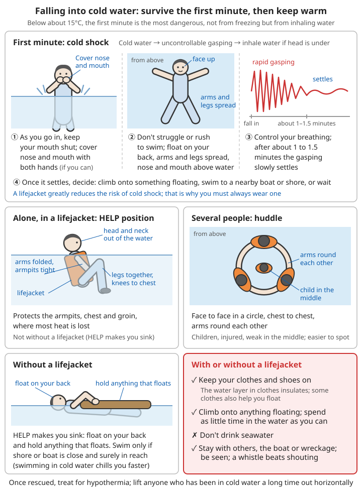

# Ocean Disasters

## Contents
- [Tsunamis](#tsunamis)
- [Storm surges](#storm-surges)
- [Rip currents](#rip-currents)
- [Falling overboard and boats in distress](#falling-overboard-and-boats-in-distress)
- [Red tides and toxic seafood](#red-tides-and-toxic-seafood)
- [Staying safe at the seaside](#staying-safe-at-the-seaside)

> The advice in this chapter is based on official guidance from China's Ministry of Natural Resources (ocean warnings) and Ministry of Emergency Management, and on international recommendations (the Intergovernmental Oceanographic Commission of UNESCO, the US National Oceanic and Atmospheric Administration, the Japan Meteorological Agency, and others). In an emergency call 110 or 120; for emergencies at sea or on the water call **12395** (the dedicated water search-and-rescue number). Always follow the instructions of the local government and rescuers on the spot.

---

## Tsunamis

### What is a tsunami

A tsunami is a huge sea wave caused by an undersea earthquake, a volcanic eruption, an undersea landslide or similar. It is extremely destructive.

**Features**:
- Fast (up to 700-800 km/h in the deep ocean, close to a jet airliner)
- Long wavelength (hundreds of km)
- Rises suddenly near the shore (up to tens of m)
- Comes in a series of waves (the first is not necessarily the biggest)
- Enormously destructive

**How it differs from an ordinary wave**:

Ordinary waves are raised by the wind and only stir the top layer of the sea; they break on the shore and run back. In a tsunami the whole body of water, from the seabed to the surface, is lifted at once. When it comes ashore it is more like a "wall of water" that keeps pushing forward, or a fast-rising "tide" that keeps pouring inland, and it lasts several minutes to over ten minutes before it drains away. The water carries cars, boats, pieces of houses, mud and sand. **Tsunami water a few tens of cm deep can knock an adult over; about 1 m is enough to kill.** So never judge the danger by "the wave isn't high".

**Local and distant tsunamis**:

| Type | Source | Arrival time | Can you wait for a warning? |
|------|------|----------|--------------|
| Local (near-source) tsunami | Earthquake in nearby waters | A few minutes to a few tens of minutes | **No**: the warning may arrive after the wave |
| Distant tsunami | Large earthquake thousands of km away | Several hours | There is usually an official warning; evacuate as instructed |

Most of mainland China's coast faces a shallow, wide continental shelf, so the tsunami risk is lower overall than in Japan or Indonesia. But Taiwan, the south-east coast and the South China Sea (towards the Manila Trench) can still have tsunamis, and you need this section even more when you travel to coasts abroad.

### Tsunami warning signs

#### Natural warnings (extremely important!)

```
⚠️ If you see any of the following, evacuate immediately!

1. A strong earthquake (in a coastal area):
   - Lasting more than 20 seconds
   - Violent shaking
   - Hard to stand up
   Any one of these counts:
   Very strong shaking, even if short → evacuate
   Not strong, but long and slow, like swaying → evacuate as well
   (Some "tsunami earthquakes" feel weak but cause a large tsunami)

2. Unusual sea behaviour:
   - The sea suddenly draws far back (exposing the seabed)
   - The sea level rises fast
   - The water churns and swirls
   - Strange noises

3. Other signs:
   - A distant roar (coming from the sea, like a train, an aircraft or gunfire)
   - Unusual rise and fall of sea level
   - Unusual animal behaviour (birds suddenly taking flight)
```

**Remember**:
- A tsunami from a nearby earthquake may arrive within minutes to tens of minutes (the closer the epicentre, the sooner). **There is no fixed "safe time".**
- The sea drawing back is the most obvious sign a tsunami is coming, but a tsunami **does not always draw back first**; it may simply rise. Do not wait to see the sea draw back before you run.
- Do not go and look at the "spectacle". Run for your life now!

```
The most common fatal mistakes when the sea draws back:
❌ Walking out to pick up fish or shells, or to take photos
   → In the 2004 Indian Ocean tsunami many people were swept away on the exposed seabed
❌ "Let's wait and see how big the wave is"
   → By the time you can see the wave clearly, it is usually too late to escape
❌ Thinking that because the earthquake felt weak, all is well
❌ Thinking the tsunami is over because the first wave was small
```

#### Official warnings

```
✓ Mobile phone warning messages
✓ Television and radio
✓ Siren systems
✓ Community loudspeakers
```

**Tsunami warnings in China**:
- The Tsunami Warning Center of the Ministry of Natural Resources issues tsunami information and warnings. Warnings are graded **red, orange and yellow** by the expected wave height on China's coast: red ≥3 m, orange 1-3 m, yellow 0.3-1 m. If the expected height is under 0.3 m, or there is no tsunami, only "tsunami information" is issued. Warnings are also sent out by local government and emergency-management text messages and broadcasts
- If you receive a tsunami warning of **any colour** and you are on the beach, in a harbour or in low ground near a river mouth: go to high ground first, then follow further news
- Wait for an official notice that the warning has been "lifted". Do not decide for yourself because "it's been a while"

**Do not wait for a warning: judge for yourself and run immediately**:

```
⚠️ Core rule: natural signs > official warnings

- With a local earthquake, the warning system may be too slow, or may not sound
  because of power cuts or earthquake damage
- If you feel a strong or long earthquake at the coast, or see unusual sea behaviour,
  you do not need anyone to tell you, and you do not need to phone to check first:
  run to high ground immediately
- Look at your phone and listen to the radio once you are somewhere safe
- If you run and no tsunami comes, you have lost nothing; if you wait for a warning
  and are too late, you may lose your life
```

### Before a tsunami arrives

**Evacuate immediately** (every second counts!):

```
1. Run to high ground!
   Aim for:
   - At least 30 m above sea level (about 10 storeys)
   - Or more than 3 km from the coast
   - The higher and further, the better

2. Run inland!
   - At right angles to the coastline
   - Away from beaches and harbours
   - Away from rivers (a tsunami travels up rivers)

3. Take:
   - Essentials only
   - Do not waste time packing
   - Life > all possessions

4. Route:
   - Plan your escape routes in advance
   - Know where the high ground is
   - Know the nearest solid tall building
```

**What to do while evacuating**:

```
1. As a rule, evacuate on foot or running
   - After an earthquake roads may be cracked or blocked; in a car you can easily
     get stuck in traffic and caught by the sea
   - Only consider driving if high ground is very far away, you are taking elderly,
     sick or disabled people who cannot walk well, and the roads are clearly open,
     and abandon the car and walk as soon as you hit a jam
2. Follow "tsunami evacuation route" signs
   (Common sign: a person running up a slope with a wave behind;
    abroad, look for the words TSUNAMI EVACUATION ROUTE)
3. Run in a direction away from river channels; do not follow riverbanks or cross bridges
4. Shout to others as you go, "Tsunami, get to high ground", and take children near you with you
5. When you reach your target, do not stop at the edge to watch the sea; keep going higher
6. Do not go home for your things, and do not go back for family members who are elsewhere
   (see "When family members are apart" below)
```

**If you cannot reach high ground**:
```
Last resort:
- Climb a solid tall building (at least 3 storeys)
- Reinforced concrete is best
- Avoid wooden and temporary buildings
- Go to the top floor
```

#### Vertical evacuation

On a flat coastal plain, if you cannot get 30 m up or 3 km away within a few minutes, going **up** is faster than going **far**. This is called "vertical evacuation".

```
How to choose a building:
✓ First choice: tsunami evacuation buildings or emergency shelters designated by the local government
✓ Next: reinforced-concrete schools, hospitals, hotels, shopping centres, multi-storey car parks
✓ The higher the floor the better, at least the 3rd floor; go up to the roof if you can
✓ The further from the sea the better; the side facing away from the sea is safer
❌ Avoid: wooden buildings, single-storey brick-and-tile houses, prefabricated huts,
   old or unsafe buildings, basements
❌ Do not shelter in underground shopping centres, underground car parks or tunnels

If there is no building (last resort):
- Climb a strong, large tree (as high as possible; tie yourself on)
- Hold on to a large floating object
```

#### When family members are apart

A tsunami comes fast. Everyone running to high ground from wherever they are is the most effective way to save the whole family. In Japan's Sanriku region this experience is summed up as "when the tsunami comes, everyone flees on their own" — on condition that the family has **agreed this in advance**:

```
Agree in advance:
- Everyone knows: when an earthquake hits, run straight to high ground from where
  you are; do not wait for the family
- Agree which high ground to meet at afterwards, and whom to contact
  (an out-of-area contact) if you cannot reach each other by a set time
- When children are at school, the school will evacuate them; parents should not
  head towards the sea to collect them
- If someone at home has limited mobility: arrange in advance with neighbours and
  the community who will help, and identify the nearest evacuation building to your home
```

For how to make a family communication plan see [Emergency Communication and Family Reunification – Before a disaster: family communication plan](06-emergency-communication-and-family-reunification.md#before-a-disaster-family-communication-plan).

### During a tsunami

**In a building**:
```
✓ Top floor
✓ Away from windows
✓ Hold on to something fixed
✓ Protect your head
✓ If you are already on the roof, do not go down just because the water has gone out
```

**On a boat**:
```
- In a harbour, or in a small boat near the shore: abandon the boat, go ashore and run to high ground
  (In a harbour the water rises and falls violently and boats smash into each other;
   it is more dangerous than the open sea)
- Already at sea, with a distant-tsunami warning and enough time:
  follow the maritime authority's instructions, head to deep water away from
  harbours and bays, wait offshore, and do not return to port until the warning is lifted
- Do not go back to port to save the boat
```

**Swept away by the water**:
```
Extremely dangerous! Do everything you can to:

1. Grab:
   - Something that floats (timber, a door)
   - Something fixed (a tree, a post)

2. Protect:
   - Your head (from impacts)
   - Keep your mouth and nose above water

3. Wait:
   - For the current to weaken
   - For rescue to arrive

4. Watch out for:
   - The dangerous backflow
   - Floating debris
```

```
Also:
- Do not try to swim against the current; try to climb on top of something that
  floats so less of your body is in the water
- The backflow (water draining back) is often as violent as the incoming water and
  drags people out to sea; hold on even more tightly to something fixed or floating
- If you are carried out to sea, hold on to something that floats and wait for rescue;
  by day wave brightly coloured clothing, at night shout when you hear a boat
```

### After a tsunami

**Do not go back straight away!**

```
⚠️ Key point: a tsunami is usually not a single wave!

- More waves follow the first
- They come minutes to hours apart
- Later waves may be bigger
- Wait at least 8-12 hours
- Follow official notices
```

**Why the first wave is often not the biggest**:
- A tsunami is a train of waves, often ten-odd minutes to more than an hour apart. In between, the sea may draw far back and the surface goes calm, so it looks as if it is over
- The biggest wave is often the second or third, or even arrives hours later; in bays and harbours the water sloshes back and forth, so the danger lasts longer
- In the 2011 Japan tsunami, people died going home for their things after the first wave

**When you can go back**:

```
Conditions for going back (all must be met):
✓ The tsunami warning has been officially lifted
✓ The local government allows people back into the area
✓ Roads and bridges have been checked and are passable

If there is no official news at all (communications are down):
- Wait at least 8-12 hours; a large distant tsunami may last more than a day
- And there must have been no unusual rise and fall of the sea for several hours in a row
- Better to wait longer than to "just go and have a look"
```

**When going back**:
```
✓ Officials have declared it safe
✓ Watch for structural damage to buildings
✓ Keep away from fallen power lines
✓ Do not enter damaged buildings
✓ Beware of contaminated water sources
✓ Check for gas leaks
✓ Photograph the damage (for insurance)
```

```
Also:
- Standing water may hide live power lines, sharp debris and manholes with their
  covers washed off; wear thick-soled shoes and probe the way with a stick
- A house that has been flooded by the sea: turn off the electricity and gas first and
  make sure the structure is sound before going in; have appliances and wiring checked
  by a professional before switching the power back on
- Watch out for snakes and other animals washed in and hiding in the rubble
- If the tsunami was caused by an earthquake, also watch out for aftershocks
```

**Health and safety**:
```
✓ Boil drinking water
✓ Avoid contact with dirty water
✓ Clean wounds
✓ Prevent infectious diseases
✓ Counselling for psychological trauma
```

```
When to see a doctor:
- Anyone who was in tsunami water or inhaled water, and later develops a cough,
  fever, fast breathing or chest pain
  → What they inhaled was dirty water mixed with mud, oil and bacteria, which can cause
    severe pneumonia (so-called "tsunami lung"); symptoms may only appear days later
- Cuts and puncture wounds from debris: rinse with plenty of clean water as soon as
  possible; see a doctor immediately if the wound becomes red, swollen, very painful,
  oozes pus, or there is fever; get a tetanus booster if needed
- People with chronic illnesses whose medicines were washed away: go to a relief
  point or medical post as soon as possible and explain
```

For wound care and tetanus see [Wound and Injury Care – Tetanus prevention](../01-first-aid-and-family-health/02-wounds-and-injuries.md#tetanus-prevention); for drinking-water treatment see [Weather Disasters – After a flood](02-weather-disasters.md#after-a-flood); for psychological reactions after a disaster see [Mental Health](../01-first-aid-and-family-health/10-mental-health.md).

### Preparing for tsunamis

**Coastal residents**:
```
Essential knowledge:
✓ Know your tsunami risk
✓ Plan evacuation routes (at least 2)
✓ Know where the high ground / shelters are
✓ A family drill plan
✓ An out-of-area contact

Essential supplies:
✓ Emergency kit
✓ Important documents kept waterproof
✓ Emergency medicines
```

```
In practice:
- Find out the elevation of your home, your workplace and your children's school,
  and whether they lie in a locally mapped tsunami / storm-surge flood zone
- Walk your evacuation route and note how many minutes it takes on foot from home
  to high ground; walk it at night too (street lights go out in a power cut)
- Keep the emergency kit by the door so you can pick it up and go; do not delay
  evacuating to fetch it
- Take part in tsunami drills organised by your community
```

For what goes in the emergency kit see [Disaster Response index – Family emergency kit](README.md#-family-emergency-kit).

**Visitors**:
```
✓ Ask your hotel about tsunami evacuation routes
✓ Learn about the warning system
✓ Recognise evacuation signs
✓ Evacuate immediately if you feel an earthquake
✓ Do not underestimate the danger
```

```
Also:
- When checking in to a seaside hotel, take note: how many storeys it has, whether it
  is reinforced concrete, and how far the nearest high ground is
- If you feel an earthquake on the beach, do not go back to your hotel room for your
  things; head straight for high ground
- Install the local warning app on your phone or turn on emergency alerts
```

### Special reminders

**Teaching children**:
```
Teach children:
- After an earthquake, run to high ground immediately
- Do not wait for adults
- Follow the crowd uphill
- Remember the meeting place
```

**Tsunamis at night**:
```
More dangerous:
- Hard to see changes in the sea
- Evacuate as soon as you hear unusual noises
- Do not hesitate
```

**Elderly people, pregnant women and people with limited mobility**:
```
- People who cannot walk fast should go to the evacuation building nearest home
  (vertical evacuation) rather than distant high ground
- Keep wheelchairs, walking sticks and regular medicines where they are easy to grab
  on the way out
- If you cannot carry or push someone, take them up into the nearest, tallest solid
  building around you
```

---

## Storm surges

### What is a storm surge

An abnormal rise in sea level caused by a strong atmospheric disturbance (a typhoon, a cold wave, etc.).

Typhoon or cold-wave winds keep pushing seawater towards the shore, and the very low pressure at the centre of a typhoon "sucks" the sea surface up. The sea can rise 1 m to several m above the normal tide, for a few hours to a day or two. Unlike a tsunami, a storm surge **can be forecast in advance**, so there is time to prepare; most of the deaths it causes come from people "not taking it seriously and refusing to leave".

**Hazards**:
- Seawater flooding inland
- Flooding of coastal areas
- Damage to sea walls
- Making typhoons and floods worse

```
Why storm surges are dangerous:
- The water rises fast: a storm surge combined with big waves can overtop or break
  a sea wall in a very short time
- They cover a large area: low-lying coastal plains, river-mouth cities and fish and
  shellfish farms are flooded over wide areas
- Rivers cannot drain: the seawater holds the river back, so flooding in river-mouth
  cities is worse
- The water is salty: flooded farmland and freshwater wells take a long time to recover
```

In China, Bohai Bay, Laizhou Bay, the Yangtze estuary, Hangzhou Bay, the Zhejiang and Fujian coasts, the Pearl River estuary, the Leizhou Peninsula and the coast of Hainan are all prone to storm surges, which have caused large numbers of deaths in the past.

### Warnings

```
Watch for:
✓ Typhoon warnings (often come with storm surges)
✓ Spring tide dates (usually around the 3rd and 18th of the lunar month)
✓ Ocean forecasts
✓ Local warning messages
```

**Storm surge warnings in China**:
- The Ministry of Natural Resources and the ocean forecasting departments of the coastal provinces issue storm surge warnings in four colours, **red, orange, yellow and blue**, red being the most severe; wave warnings are issued at the same time
- The warning level depends on which local "warning tide level" the tide is expected to reach (each stretch of coast also has blue, yellow, orange and red warning tide levels) — reaching the warning tide level means the sea may overtop the sea wall or flood low ground
- When you see a warning, also note: the expected time of high tide, which stretches of coast are affected, and any evacuation notice from the local government

| Warning received | What to do |
|----------|----------|
| Blue, yellow | Stay away from the beach, tidal flats and sea walls; fishing boats return to port; fish and shellfish farmers secure their equipment; prepare to evacuate low-lying areas |
| Orange, red | Evacuate as the government instructs; people in danger zones leave **before** high tide; do not stay behind to "guard" the house or fish ponds |

### What to do

**Similar to dealing with a typhoon**:

```
Prepare in advance:
✓ Strengthen the house
✓ Prepare emergency supplies
✓ Plan evacuation routes

Evacuate danger zones:
✓ Low-lying coastal areas
✓ Outside (seaward of) sea walls
✓ Follow instructions
✓ Move to higher ground

During the surge:
✓ Keep away from the shore
✓ Do not go to watch the tide
✓ Do not stand on sea walls
```

**In practice**:

```
Evacuating:
- Finish moving several hours before high tide; at high tide the roads may already
  be under seawater
- Go to a shelter designated by the government, or to friends or relatives on high
  ground in a solid building
- Before leaving, switch off the electricity at the main switch and close the gas valve;
  carry valuables and food upstairs
- Do not drive through roads flooded by the sea; about 30 cm of moving water can
  float a car

Staying at home (outside the danger zone, but water may get in):
- Only stay at home if you live on an upper floor of a solid building
- Cut off the electricity; have drinking water and food ready
- If water comes into the house, move upstairs; do not stay on the ground floor or in the basement

During the surge:
❌ Do not go on sea walls, piers or rocks to take photos, watch the tide or fish
   → Big waves over the sea wall can sweep people straight into the sea
❌ Do not go out on the tidal flats to gather shellfish or haul in nets
❌ After a typhoon "weakens" or the sky clears, the sea may still be very high;
   keep away during high tide
```

For protection during a typhoon see [Weather Disasters – Typhoons/hurricanes](02-weather-disasters.md#typhoonshurricanes); for self-rescue when flooded see [Weather Disasters – During a flood](02-weather-disasters.md#during-a-flood).

**After a storm surge**:
```
- Go back only when the government says so
- Have appliances and wiring flooded by seawater checked before switching the power on
- Wells flooded by seawater must first be pumped dry, cleaned and disinfected;
  do not drink from them until tests show they are safe
- Throw away all food that was flooded by seawater
- Wear gloves and rubber boots when clearing silt; keep wounds out of seawater and dirty water
```

### Special points

**Spring tide + typhoon + heavy rain = extreme danger!**

```
When all three coincide:
- The storm surge is at its worst
- Be extra alert
- Take precautions early
- Evacuate in good time
```

Every month, around the 1st-3rd and 15th-18th of the lunar month, there are spring tides and the tide is high anyway. If a typhoon makes landfall or comes close during high tide on those days, and heavy rain also swells the rivers, the three add together and water levels may far exceed historical records. When a forecast says "spring tide period" or "coinciding with a spring tide", prepare as if the danger were one level higher.

**Coastal fish and shellfish farmers**:
```
✓ Watch for warnings
✓ Move supplies early
✓ Secure equipment
✓ Life > property
```

```
Also:
- Everyone in guard huts on sea farms or on fish rafts must evacuate ashore as
  required once a warning is issued
- Do not go out to strengthen net cages or rush to harvest during a storm surge
- Fishing boats return to port as required to shelter from the wind; leave no one on board
```

---

## Rip currents

### What is a rip current

After waves wash up the beach, the water flows quickly back out to sea through a narrow "channel". This flow is a rip current (rip tide). It is one of the main causes of drowning at bathing beaches.

```
Features:
- Width: usually ten-odd m to a few tens of m; quite narrow
- Speed: usually 0.3-0.6 m/s; up to about 2.4 m/s has been measured, faster than
  the fastest competitive swimmer
- Direction: straight out from the shore; it weakens and spreads out once past the
  breaking waves
- Common at: gaps in sandbars, beside breakwaters and rocks, near piers
- Stronger at low tide and when waves are big
- A rip current does not "pull you under"; it only carries you out to sea.
  People drown because they swim hard against it and run out of strength
```

### How to spot a rip current

Stand somewhere high (a dune, an embankment) and watch for a few minutes:

```
Places where there may be a rip current:
- Waves breaking white on both sides, with a stretch in the middle with no waves or
  only small ones (the "calmest-looking" spot is the dangerous one)
- A band of water darker than on either side (the water is deeper)
- A band of murky, sandy water
- Foam, seaweed or floating debris moving steadily out to sea
- A choppy, messy surface with small ripples
```

You cannot always see it. The most reliable way to stay safe is to **swim at a beach with lifeguards, in the area the lifeguards can see**, and to watch the flags and notices on the beach. Signs differ from place to place; the common international ones are:

| Flag | Meaning |
|------|------|
| Red and yellow flags | Lifeguarded swimming area; swim between the two flags |
| Yellow flag | Some risk; take care in the water |
| Red flag | Danger; no swimming |

### If a rip current carries you out

```
1. Do not panic, and do not swim against the current towards the shore
   → Even the best swimmer cannot out-swim a rip current; you will only exhaust yourself
2. Float first: float on your back, save your strength and let the current carry you for a while
3. Raise an arm and wave, and shout for help
4. Swim parallel to the shoreline (sideways) to get out of the narrow current
   (a few tens of m is usually enough)
5. Once out of it, swim diagonally towards the shore, or let the waves carry you back in
6. If you are too tired to swim, keep floating and wait for rescue;
   once past the breaking waves the current weakens and sometimes even carries
   you back near the shore
```

### If you see someone else carried out by a rip current

```
✓ Call a lifeguard immediately; dial 110 or 120 (at sea, 12395)
✓ Keep your eyes on where the person is and point the rescuers to them
✓ Throw them something that floats: a lifebuoy, a surfboard, a foam board, an inflated swim ring
✓ Shout to them: "Don't swim back in, swim sideways", "Float"
❌ If you are not trained and have nothing that floats, do not go in after them
   → In drownings at the seaside, people who go in to rescue often die too
```

For first aid once the person is out of the water see [Acute Symptoms – Drowning](../01-first-aid-and-family-health/05-acute-symptoms.md#drowning).

---

## Falling overboard and boats in distress

### Life jackets: they only help if you wear them

Many people who drown after falling into the sea had a life jacket with them but were not wearing it. Falling in usually happens in an instant, with no time to put one on.

```
✓ On small boats, speedboats, fishing boats, kayaks and paddleboards, put the life jacket
  on and fasten every strap as soon as you get on board
✓ Large passenger ships: after boarding, check where the life jackets are kept and where
  the muster point is, and listen to the safety announcement
✓ Choose a life jacket with an approval mark, in the right size
✓ Check it is on properly: once fastened, have someone grab both shoulders and lift;
  the life jacket must not ride up above your chin or ears

Children:
- Choose a children's life jacket by body weight, preferably with a crotch strap (to stop
  the child slipping out of it) and a head support
- Children and non-swimmers should use inherently buoyant (foam) life jackets
- The gas cylinder of an inflatable life jacket must be checked regularly; inflatable
  jackets are not suitable for children or non-swimmers
```

### The first minute in the water: cold shock

When the water is below about 15°C (possible in China's northern seas in spring and autumn and in the southern seas in winter), the first minute after a sudden fall into the water is the most dangerous — not because you freeze, but because you **inhale water**.

```
Cold water on the skin → involuntary gasping and fast breathing → if your head is
underwater, you breathe in a lot of water
At the same time heart rate and blood pressure shoot up; people with heart disease may
get an irregular heartbeat

What to do:
1. As you go in, try to keep your mouth shut and cover your mouth and nose with your hands (if there is time)
2. As soon as your head is above water, do not struggle and do not rush to swim
3. Float on your back with arms and legs spread, keeping your mouth and nose as high
   out of the water as you can
4. Control your breathing; after about 1 to 1½ minutes the gasping slowly settles
5. Only then decide: climb onto something floating, swim to a nearby boat or shore,
   or stay put and wait for rescue

Wearing a life jacket greatly reduces the risk from cold shock — another reason you must wear one
```

For what happens over the next 10 minutes and the next hour, see the "1-10-1" rule in [Wading, Flash Floods and Hypothermia in the Wild – Falling into cold water](../03-wilderness-survival/08-river-crossing-flash-floods-and-hypothermia.md#falling-into-cold-water).

### Keeping warm while waiting for rescue

```
Alone, wearing a life jacket: the HELP position (Heat Escape Lessening Posture)
- Legs together, knees drawn up to the chest
- Arms crossed over the chest, armpits clamped shut
- Keep your head and neck out of the water as far as possible
→ Protects the armpits, chest and groin, where most heat is lost

Several people: the huddle position
- Form a circle facing inwards, chest to chest, arms around each other
- Put children, the injured and the weak in the middle
- It also makes you easier for rescuers to spot

Without a life jacket:
- The HELP position will make you sink; float on your back instead and hold on to
  anything that floats
- Only swim if the shore or a boat is very close and you are sure you can reach it;
  swimming in cold water makes your body temperature drop faster

In all cases:
✓ Do not take off your clothes and shoes (the water trapped in your clothes keeps you
  warm, and some clothing helps you float)
✓ Get as much of your body as you can onto something floating, out of the water
✓ Do not drink seawater
```

Once rescued, treat for hypothermia. Lift anyone who has been in cold water for a long time **horizontally** ashore or aboard; see [Acute Symptoms – Hypothermia](../01-first-aid-and-family-health/05-acute-symptoms.md#hypothermia).



*Figure: After falling in, first survive the cold shock of the first minute — do not struggle, float on your back, control your breathing. Wearing a life jacket, use the HELP position alone or huddle with others to keep warm; without one, float on your back and hold on to something that floats. Do not take off your clothes and shoes*

### Someone falls overboard

```
1. Shout "Man overboard!" and tell the skipper/helmsman which side they went over
2. Assign one person to do nothing but watch the person in the water, pointing at them
   the whole time without looking away
   (at sea you can lose sight of someone in an instant)
3. Throw a lifebuoy or anything that floats immediately, ideally tied to a rope
4. The helmsman slows down and turns the boat back; keep the propeller at the stern
   away from the person in the water
5. Call 12395 or call for help on the boat's VHF radio, channel 16,
   giving the time and position (latitude and longitude, or a clear landmark)
6. At night throw a lifebuoy with a light, and keep a torch on the person
❌ Do not jump in after them unless you are trained, wearing a life jacket and on a safety line
```

### Boats in distress and abandoning ship

```
When there is danger:
1. Everyone puts on a life jacket immediately
2. Call for help: dial 12395, or call "MAYDAY" (the most urgent distress call) on VHF channel 16,
   giving the boat's name, position, number of people and what has happened
3. Put on extra clothes (especially warm ones); take your phone (in a waterproof bag),
   a whistle, a torch and drinking water
4. Follow the captain's and crew's orders; do not crowd to one side (it can capsize the boat)

Abandoning ship:
- Only abandon ship if it really is sinking or a fire is out of control;
  while the boat still floats, staying on it is safer than being in the sea
- If possible step straight into the life raft; try not to go into the water first
- If you must jump:
  * Jump from as low as possible, after checking there are no people or objects below
  * Cover your mouth and nose with one hand and hold the life jacket down with the other;
    legs together and straight, eyes looking ahead (not down); go in feet first
- Once in the water, swim away from the sinking boat and any burning oil, then move
  towards the life raft or other people

If a small boat capsizes:
- Stay with the upturned boat and try to climb onto its hull
- An upturned boat is much easier to see than a person and more likely to be found
- Do not leave the boat to swim for a shore that looks close (at sea, distances usually
  look much shorter than they are)
```

### Waiting for rescue

```
✓ Stay together: people with people, people with the boat, people with anything floating
✓ Make yourself seen: wave brightly coloured clothing; by day flash sunlight with a mirror
  or phone screen; at night use a torch or phone flashlight; if you have flares, fire them
  only when you hear or see a ship or aircraft
✓ Blowing a whistle takes less effort than shouting, and the sound carries further
✓ Keep your phone in a waterproof bag and save the battery; when you have a signal, call 12395 or 110
❌ Do not drink seawater, do not drink urine — both only dehydrate you faster
```

For finding water, shade and signalling for help during a long wait at sea or on a desert island see [Desert Island Survival – Finding water on an island](../03-wilderness-survival/01-desert-island-survival.md#getting-water-on-an-island) and [Desert Island Survival – Signals and rescue](../03-wilderness-survival/01-desert-island-survival.md#signals-and-rescue).

---

## Red tides and toxic seafood

### What is a red tide

When certain microscopic algae in the sea multiply massively in a short time, they turn the water red, brown, green or yellow; this is a red tide (sometimes the colour is not obvious). Some of these algae produce toxins. Shellfish (oysters, scallops, mussels, clams, cockles, etc.) eat the algae and the toxins build up in them, and people who eat the shellfish are poisoned.

```
Key facts:
- Toxic shellfish look, smell and taste exactly like normal shellfish; you cannot tell
- Shellfish toxins resist heat: boiling, steaming, stir-frying and grilling do not destroy
  them, and neither freezing nor pickling removes them
- After a red tide has gone, toxins may stay in shellfish for weeks or longer
- Red tides are more common in spring and summer along China's East China Sea and South
  China Sea coasts; mass poisonings have occurred in Fujian, Zhejiang, Guangdong and elsewhere
```

### Types of shellfish poisoning

| Type | Onset | Main symptoms | Danger |
|------|----------|----------|----------|
| Paralytic shellfish poisoning | Tens of minutes to a few hours after eating | Numbness and tingling of the lips, tongue and face, spreading to the hands and feet; dizziness, unsteady walking, a "floating" feeling; difficulty speaking and swallowing; in severe cases paralysis of the breathing muscles | ☠️☠️☠️ Can kill within hours by stopping breathing |
| Diarrhetic shellfish poisoning | Half an hour to a few hours after eating | Diarrhoea, nausea, vomiting, abdominal pain | Usually better within a few days; keep up fluids |
| Amnesic shellfish poisoning | Within a day of eating | Vomiting and diarrhoea, then headache, confusion and memory loss; in severe cases seizures and coma | ☠️☠️ Especially dangerous for the elderly |
| Neurotoxic shellfish poisoning | Within a few hours of eating | Numbness around the mouth and in the hands and feet, hot and cold sensations reversed, nausea and diarrhoea | Usually not fatal |

### What to do if seafood poisons you

```
Call 120 or go to hospital immediately if:
- Your lips, tongue, hands or feet go numb after eating shellfish or sea fish
- You feel dizzy, cannot stand steadily, slur your speech, have difficulty swallowing
  or breathing
- Several people who ate the same meal develop symptoms one after another

What to do:
1. Get medical help immediately; tell the doctor what seafood was eaten, where it was
   bought and when it was eaten
2. Everyone who ate at the same table should also go to hospital or be watched closely,
   even if they have no symptoms yet
3. Keep any leftover seafood and packaging and hand them to the doctor and the market
   regulation authority
4. Do not make yourself vomit, and do not take folk remedies
5. On the way to hospital: unconscious but breathing → recovery position (on their side);
   unresponsive and not breathing normally → start CPR immediately

There is no specific antidote for paralytic shellfish poisoning, but with prompt supportive
treatment such as a ventilator most people recover within a day or two — so go to hospital
as soon as you feel numb; do not wait until you cannot breathe
```

For general principles of dealing with poisoning see [Poisoning – General principles of handling poisoning](../01-first-aid-and-family-health/12-poisoning.md#general-principles-for-handling-poisoning); for ordinary bacterial food poisoning see [Common Illnesses – Food poisoning](../01-first-aid-and-family-health/01-common-illnesses.md#food-poisoning).

### Prevention

```
✓ Watch for local government red-tide notices and notices that "harvesting and sale of
  shellfish are prohibited"; while a notice is in force, do not gather, buy or eat
  shellfish from those waters
✓ Do not gather shellfish where the sea is discoloured, smells odd or has dead fish floating
✓ Buy shellfish from regular markets; do not buy shellfish of unknown origin
✓ When eating shellfish remove the innards (the digestive gland, where toxin is most
  concentrated) and eat only small amounts —
  but this only reduces the risk; it does not remove it
✓ During a red tide do not swim in discoloured water, and do not eat dead fish or
  shellfish washed up on the beach
✓ Some red tides make the air at the shore irritate the eyes and airways; people with
  asthma should keep away
```

### Other toxic seafood

| Seafood | Risk | Prevention |
|--------|------|----------|
| Pufferfish | Tetrodotoxin, not destroyed by cooking, no specific antidote; tens of minutes to a few hours after eating, numbness of the lips, mouth, hands and feet and weakness; in severe cases breathing paralysis | Do not catch, buy or prepare wild pufferfish yourself; eat only processed farmed pufferfish in a licensed restaurant |
| Large tropical coral-reef fish (large groupers, humphead wrasse, moray eels, barracuda, etc.) | Ciguatoxin, not destroyed by cooking; within hours of eating, numbness around the mouth and diarrhoea; the hallmark is reversed hot and cold sensation (cold water feels hot); numbness and other nerve symptoms can last weeks to months | Do not eat large reef fish of unknown origin, especially the head, skin, innards and roe |
| Stale tuna, mackerel, skipjack, Pacific saury, etc. | Histamine forms when stored badly; soon after eating, flushing, headache, palpitations and a rash, like an allergy | Refrigerate or freeze sea fish as soon as you get them home; do not eat stale fish; histamine poisoning cannot be cooked away either |
| Raw seafood | *Vibrio parahaemolyticus* and similar cause abdominal pain and diarrhoea; people with liver disease may get serious infections | Cook seafood thoroughly; keep raw and cooked apart; people with liver disease, diabetes or weak immunity should not eat it raw |

---

## Staying safe at the seaside

### Understanding tides

```
Basic tide patterns:
- Most of China's coast has two high tides and two low tides a day;
  two high tides in a row are about 12 hours 25 minutes apart
- Each day's high tide is about 50 minutes later than the day before, so you cannot go
  by "this time yesterday"
- A few coasts, such as the Beibu Gulf, have only one high tide a day
- On a rising tide, the water rises fastest during the middle few hours
- The tidal range (difference between high and low water) varies from place to place,
  from under 1 m to several m; on flat tidal flats with a large range, the incoming
  water can move faster than a person walks

Before you go:
✓ Check that day's tide table (on maritime or ocean forecasting websites, or in weather
  or tide apps)
✓ Note the times of that day's low and high tides and write them in your phone's notes
✓ Check the wave forecast and the weather forecast as well
```

### Gathering shellfish and getting cut off by the tide

Tidal flats, rocks and sandbanks exposed at low tide are good for gathering shellfish, but every year people who "dig for just a bit longer" get cut off by the rising tide.

```
Timing your trip:
- Follow the falling tide out, and start back no later than the time of low tide
- As soon as the sea starts to come back in, return to shore; do not wait until the
  water reaches your feet
- Low ground and tidal creeks (small channels across the flats) behind you fill first
  and cut you off from the shore — remember your way back as you go out, and do not go
  far beyond a tidal creek

Other points:
✓ Go with others; tell your family which beach you are going to and when you will be back
✓ Charge your phone fully and put it in a waterproof bag
✓ Wear non-slip, cut-resistant shoes; do not go barefoot (shells, broken glass and
  oyster shells are very sharp)
✓ Do not go far out on the flats in fog or in the evening (it is easy to get lost)
✓ Do not go to flats or sandbanks you do not know, or where there is nobody else
✓ Keep children within an adult's arm's reach at all times
```

**If you are already cut off by the tide**:

```
1. Call 110 or 12395 immediately and describe your position clearly (nearby landmarks,
   a screenshot of your phone's location)
2. Move to the highest point nearby (high on the rocks, the top of the sandbank, an embankment)
3. Do not try to wade or swim across a filling tidal creek — the incoming current is fast,
   the water is deeper than it looks and the bottom is soft mud
4. By day wave brightly coloured clothing; at night signal towards the shore with your
   phone's torch
5. If you sink into soft mud:
   - Do not try to wrench your legs out (the more you struggle, the deeper you sink)
   - Lean back and spread your arms to increase your contact area, then slowly work one
     leg at a time out by rocking it from side to side; then crawl or move on your back
     towards firmer ground
   - If you have sunk above the knees, do not force your way out; keep your body lying
     flat and call for help immediately
```

### Rocks and the shoreline

```
⚠️ Rocks are one of the places at the seaside where accidents happen most

Dangers:
- Rocks are covered in algae and seaweed and are slippery; a fall easily causes fractures,
  head injuries or a slide into the sea
- On a calm sea, a wave much bigger than the rest can suddenly arrive (a "sneaker wave")
  and sweep people on rocks or breakwaters into the sea; once the wave pulls back it is
  very hard to climb out again
- Currents between the rocks are complex, and it is very hard to rescue someone who falls in

What to do:
✓ Do not take photos, fish or play on rocks, breakwaters or concrete armour blocks
  (four-legged concrete blocks) that waves can reach
✓ First watch from a distance for at least 10-20 minutes to see how far the waves reach,
  and stand higher and further back than that
✓ Never turn your back on the sea
✓ Stay away from rocky areas during wind and wave warnings and before and after typhoons
✓ When fishing from rocks wear a life jacket and non-slip shoes, go with others and use a safety line
❌ Do not climb on armour blocks: the gaps between them are deep, and if you fall in it is
   almost impossible to climb out on your own
```

### Watching tidal bores safely

The tidal bores on the Qiantang River, in Hangzhou Bay and elsewhere arrive with great force and speed, and every year spectators are swept away.

```
✓ Watch only from designated viewing areas, stay behind the railings, and follow the
  staff on site
✓ Do not go down onto the river beach, groynes or the slopes of the embankment
✓ After the bore has passed there may be a "returning bore" (the tide hits the embankment
  and curls back); do not go close to the river right after the bore front has passed
✓ If you see the tide surging ashore, run immediately to higher ground away from the river;
  do not stop to take photos
```

### Swimming and other precautions

```
✓ Swim only at proper beaches with lifeguards, within the marked area
✓ Do not swim alone, after a big meal, after drinking alcohol or when tired
✓ Non-swimmers and children wear life jackets the whole time, within an adult's arm's reach
✓ Inflatable rings, air mattresses and inflatable toys are quickly blown out to sea by
  an offshore wind; do not chase a toy that drifts away
✓ Do not dive from rocks or piers: you cannot judge the depth, and hitting the seabed
  head first can break your neck
✓ Do not dig deep holes in the sand; the sides can suddenly collapse and bury someone
  (especially dangerous for children); fill in any hole before you leave
✓ In a thunderstorm leave the water and the beach immediately
✓ Sun protection: UV is strong at the seaside; between 10 am and 4 pm cover up and
  drink plenty of water
```

```
If something in the sea injures you:
- Cuts from rocks or shells, or punctures from seafood (prawns, crabs, fish bones):
  rinse thoroughly with plenty of clean water;
  if within a few hours to a day or two the wound becomes very painful, quickly red and
  swollen, blistered or purple, or there is fever
  → go to hospital immediately and say the wound was caused by seawater or seafood
  (*Vibrio vulnificus* in seawater can cause a life-threatening infection within a day or two;
   people with liver disease, diabetes or weak immunity are at highest risk and should not
   go into the sea with a wound)
- Jellyfish stings, stepping on a sea urchin: see the links below
- Sea snake bites: treat as a venomous snakebite and get to hospital immediately
```

For jellyfish, sea urchins and other dangerous sea creatures see [Desert Island Survival – Dangers](../03-wilderness-survival/01-desert-island-survival.md#dangers); for snakebites see [Wound and Injury Care – Snakebites](../01-first-aid-and-family-health/02-wounds-and-injuries.md#snakebites); for lightning at the seaside see [Weather Disasters – Avoiding lightning outdoors](02-weather-disasters.md#lightning-safety-outdoors); for heatstroke see [Acute Symptoms – Heatstroke](../01-first-aid-and-family-health/05-acute-symptoms.md#heatstroke); for preventing children drowning see [Child Safety – Preventing drowning](../01-first-aid-and-family-health/14-child-safety.md#preventing-drowning).

---

## 📝 Key points

### Core rules for ocean disasters

**Tsunamis**:
```
1. Feel an earthquake: evacuate immediately
2. Unusual sea: evacuate immediately
3. Run to high ground (30 m or more)
4. Run inland (3 km or more)
5. Do not go back (tsunamis come in several waves)
6. Life > all possessions
```

```
Also:
7. Do not wait for a warning; natural signs are the warning
8. If there is no time to reach high ground, climb the nearest solid tall building (vertical evacuation)
9. The first wave is often not the biggest; go back only after officials lift the warning
```

**Storm surges**:
```
1. Watch for warnings
2. Evacuate low-lying areas
3. Keep away from the shore
4. Strengthen defences
```

**Rip currents**:
```
1. Swim in areas watched by lifeguards
2. If carried out, do not swim back against the current
3. Float and call for help first, then swim out parallel to the shore
4. If you cannot do a rescue, do not go in: throw something that floats and call a lifeguard
```

**Falling into the sea**:
```
1. Put on a life jacket as soon as you board
2. First minute in the water: do not struggle, float on your back, control your breathing
3. HELP position or huddle to keep warm; keep your clothes on
4. Stay with the boat, floating objects and your companions
5. Emergency number 12395
```

**Red tides and seafood**:
```
1. Shellfish toxins cannot be cooked away or seen
2. Obey bans on harvesting and selling
3. If your lips, hands or feet go numb after eating seafood, get medical help immediately
```

**At the seaside**:
```
1. Check the tide table before you go
2. Start back by low tide
3. Stay off rocks the waves can reach; never turn your back on the sea
4. If cut off, call for help early; do not swim across tidal creeks
```

### Remember

```
Time is life:
- Time to escape a tsunami is limited
- Do not hesitate
- Do not pack
- Do not stand and watch
- Run for your life immediately

Preparation:
- Coastal residents must have an evacuation plan
- Practise regularly
- Know the routes
- Teach your family
```

### The tsunami survival chain

```
1. Recognise the warning (natural/official)
   ↓
2. Decide to evacuate immediately
   ↓
3. Run fast to high ground/inland
   ↓
4. Reach a safe place
   ↓
5. Wait for all the waves to pass
   ↓
6. Go back only after an official notice
```

---

**Next chapter**: [Fire](04-fire.md)
**Back**: [Chapter index](README.md) | [Main contents](../../README.md)
