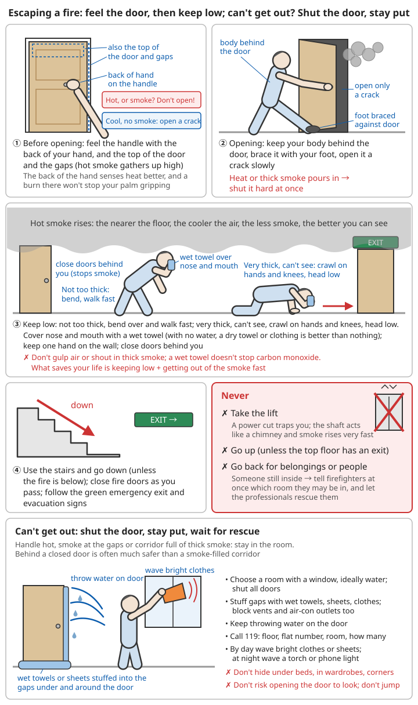
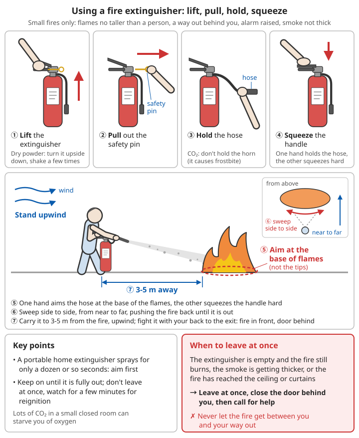

# Fire

The biggest killer in a fire is usually not the flames but the smoke: most fire victims are killed by thick smoke and toxic gases, often in their sleep. This chapter follows the mainstream advice of official fire-safety guidance from the Fire and Rescue Department of China's Ministry of Emergency Management and similar sources. The core comes down to three things: **fit alarms so you find out early; put out small fires, and leave if you can't; in a big fire, forget your belongings, get low and get out fast, and if you can't get out, shut the door and hold your ground.**

## Contents
- [Building fires](#building-fires)
- [Forest fires](#forest-fires)
- [Electrical fires](#electrical-fires)
- [Gas fires](#gas-fires)

---

## Building fires

### Preventing fires

**Home fire-safety check**:
```
Every month:
✓ Smoke alarms: press the test button; it passes only if it sounds
  (how to fit them and when to replace them: see below)
✓ Ageing wiring: insulation hard, cracked, yellowed or blackened; plugs and sockets
  hot, smelling of burning or with scorch marks
✓ Overloaded sockets: do not run several high-power appliances from one extension
  lead at once; do not plug extension leads into each other
✓ Gas pipes: check hoses for ageing, cracks, being squashed or gnawed by rats;
  brush soapy water on joints and look for bubbles
✓ Fire extinguishers: pressure-gauge needle in the green zone (red = under-pressure,
  yellow = over-pressure: both must be sent for inspection),
  not past its expiry date, hose not perished or cracked, kept somewhere visible and easy to reach
✓ Escape routes clear: no clutter and no parked e-bikes in corridors, stairwells or at
  emergency exits; fire doors kept shut (do not prop them open)
✓ Clear the balcony: do not pile cardboard boxes, old furniture or flammable things
  on the balcony or by windows

Every night before bed:
✓ Turn off the gas cooker valve; check that stove fires, cigarette ends, mosquito coils
  and candles are out
✓ Switch off appliances that do not need power; do not charge e-bike batteries indoors
✓ Sleep with the bedroom door shut (a closed door holds back smoke and fire for a while,
  buying time to escape)
```

#### Smoke alarms and gas alarms

```
Smoke alarms (stand-alone, battery-powered; can be bought for under one or two hundred yuan):
✓ Where to fit them: in every bedroom, the corridor outside bedrooms and the living room;
  at least 1 on each floor of a multi-storey home
✓ Fit in the middle of the ceiling, at least 0.5 m from walls and beams;
  not next to air-conditioning vents, doors or windows
❌ Do not fit them in the kitchen or bathroom (cooking fumes and steam cause frequent
  false alarms); in the kitchen fit a heat alarm or a gas alarm instead
✓ Press the test button once a month
✓ If the battery is replaceable, change it once a year; change it immediately when it
  "chirps" for low battery
✓ The alarm itself generally needs replacing as a whole after about 10 years (see the product instructions)
✓ If someone at home is deaf or hard of hearing: choose an alarm with a flashing light
  or a vibrating pillow pad
❌ After a false alarm, do not just take out the battery; fan the alarm or open a window,
  and find the cause

Gas alarms:
✓ Natural gas is lighter than air: fit the alarm within 0.3 m of the ceiling
✓ LPG (liquefied petroleum gas) is heavier than air: fit the alarm within 0.3 m of the floor
✓ Preferably choose one that can automatically shut the gas valve
```

**Fire-safety equipment**:
```
Essentials:
✓ Smoke alarms (see above)
✓ Fire extinguishers: for the home choose 1-2 kg ABC dry powder or water-based
  extinguishers, one in the kitchen and one in the living room
✓ Fire blanket: hang it on the wall by the kitchen door, not far from the cooker
✓ Escape rope (high-rise homes; practise using it)
✓ Smoke hoods (fire escape respirators): one per family member, kept in the bedroom;
  use for the protection time stated on the product; single use; practise putting one on in advance
✓ Emergency torch: one by the bed (for finding your way in a night-time power cut or thick smoke)

Where to keep them:
- Easy to reach; not locked in a cupboard or buried under clutter
- Everyone in the family knows where they are and how to use them
- Check them regularly (along with the monthly fire-safety check)
```

**Escape plan**:
```
Making it:
✓ Draw a floor plan of your home, marking the doors and windows of every room
  and the route to the stairs
✓ At least 2 escape routes: besides the front door, plan a second
  (another staircase, a balcony, a neighbouring unit)
✓ Meeting point (outside the building): fix one place, such as a particular tree or
  street lamp by the estate gate; after escaping, count heads there, and if anyone is
  missing tell the firefighters immediately
✓ An escape route from every room: especially bedrooms; know how to get out from your
  bed if a fire starts at night
✓ Make sure window security grilles have an escape opening that opens from inside,
  with the key kept in a fixed place
✓ A plan to help people with special needs:
  - Babies and toddlers: decide who carries which child
  - Elderly people and those with limited mobility: bedroom as close to an exit as
    possible, with a named helper
  - Deaf or hard-of-hearing people: flashing/vibrating alarms; agree how to wake them
  - Children: teach them "don't hide when there's a fire" — not under the bed, not in the wardrobe

Drills:
✓ Every six months
✓ Night-time drills (fire while asleep is most dangerous)
✓ Drills in the dark (to simulate thick smoke): turn off the lights, close your eyes,
  feel your way along the wall to the door
✓ Time it (out within 2 minutes)
✓ Practise: feeling the door, moving low, shutting doors, reporting at the meeting point,
  what to say when you dial 119
✓ After each drill discuss: where you got stuck, which route was blocked, whether things
  were where they should be
```

### When you discover a fire

**Immediately**:
```
1. Shout "Fire!", wake and warn your family and neighbours
2. Set off the fire alarm (the red manual call point in the corridor: press it or break the glass)
3. Dial 119 (if the fire is very small and you are tackling it, get someone else to call;
   if the fire is big, get out first, then call)
4. Report accurately:
   - Address
   - What is burning
   - How big the fire is
   - Whether anyone is trapped
   - Your name and phone number
5. Send someone to the road junction to meet the fire engines
```

#### What to say when you dial 119

```
Once connected, say clearly (answer whatever the operator asks; do not hang up first):
1. Address: district/county, street, residential estate, building number, entrance,
   floor, flat number
   If you cannot say exactly, give nearby landmarks (a school, a shop, a junction, a bus stop)
2. What is burning: a home, a kitchen, an e-bike, a warehouse, a vehicle...
   Whether there are gas cylinders, petrol, chemicals or other dangerous materials
3. The fire: only smoke or open flames, how far it has spread, which floor
4. Whether anyone is trapped: how many, in which room, whether there are elderly people,
   children or people with limited mobility
5. Your name and phone number; keep your phone free afterwards (firefighters may call
   back to ask the way)

Example:
"Building 5, entrance 2, XX estate, XX Road, XX District. The kitchen of flat 1203 on the
 12th floor is on fire. Flames have reached the living room, and an elderly person is still
 in the bedroom. My name is... my number is..."

After the call:
✓ Send someone to the estate gate or road junction to meet the fire engines and show the way
✓ Tell the property management or security: open the access gates and move vehicles
  blocking the fire lane
✓ Calling 119 is free; you can dial it with "Emergency call" even when the phone is locked
❌ Do not fail to call, or delay calling, because "the fire isn't big", "I don't want to
  cause trouble" or "I'm afraid of paying for it"
❌ Never make a false fire report (it is illegal and ties up rescue resources)
```

**Tackling a small fire**:
```
Only if:
✓ The fire is very small (e.g. a wastepaper bin, a pan, a small patch of carpet)
  and the flames are no taller than a person
✓ You have a fire extinguisher
✓ You have a way out behind you (fight the fire with your back to the exit: fire in front,
  door behind)
✓ The fire has been reported
✓ The smoke is not thick and you can breathe normally

Method:
1. Use a fire extinguisher (see "Using a fire extinguisher" below)
2. Stand upwind
3. Aim at the base of the fire
4. Sweep from side to side
5. If it does not work, leave immediately

When to get out: one extinguisher is empty and the fire is still burning, the smoke is
getting thicker, or the fire has reached the ceiling or curtains
→ Leave immediately, shut the door behind you (keeping fire and smoke inside), then call for help
❌ Never let the fire get between you and your exit while you are fighting it
```

Different things on fire need different methods:

| What is burning | You can use | Never |
|------|------|------|
| Paper, wood, cloth, rubbish | Water, water-based or ABC dry powder extinguisher, cover with a wet cloth | — |
| Cooking oil in a pan or deep fryer | Turn off the heat, put the lid on, fire blanket | Throw water on it, carry the pan away |
| Appliances, sockets, wiring | **Cut the power first**, then a dry powder or CO₂ extinguisher, fire blanket | Water or foam while the power is still on |
| Gas cooker, gas pipe | Close the valve first, then put out what is still burning | Put out the flame before the valve is closed |
| Petrol, alcohol, paint | Dry powder or foam extinguisher, cover with sand or soil | Hose it with water (the burning liquid flows and spreads) |
| E-bike battery, lithium battery | Generally do not tackle it yourself; get out immediately and shut the door | Go near it, move it |

#### Pan fires

```
⚠️ Never throw water on it!
  The oil is far hotter than 100°C. Water turns to steam instantly and blasts the burning
  oil everywhere, making a fireball that burns people and sets the whole kitchen alight

What to do:
1. Turn off the heat (the cooker control or the gas valve)
2. Put the lid on (or a fire blanket, a damp towel of the right size, a chopping board)
   - Slide it on at an angle, pushing forwards from your side; keep your hands and face
     away from directly above the pan
   - You can also tip a large amount of chopped vegetables into the pan to cool it
     (only when the fire has just started and is small)
3. Once it is covered, do not lift it to look; wait until the pan is completely cool
   (lifting it too soon lets it reignite)
4. Do not pick up the pan and run outside (the oil spills, burning you and setting the floor alight)
5. If the fire has spread to the cooker hood or cupboards → use a fire extinguisher;
   if you cannot put it out, leave immediately and shut the kitchen door

Prevention:
✓ Never leave the cooker while stir-frying or deep-frying
✓ Keep a lid that fits next to the cooker, and a fire blanket in the kitchen
✓ Clean grease out of the cooker hood and flue regularly (grease is the "fuse" that lets
  fire travel along the flue)
```

#### Fire blankets

```
Uses: pan fires, small fires, wrapping a person whose clothes are on fire, wrapping
yourself as you escape
How to use:
1. Hold the two tapes hanging below the blanket's pouch and pull down hard
2. Hold the top two corners and keep the blanket in front of you to shield your hands and face
3. Approach the fire and lay the blanket over it, moving forwards from your side,
   covering it completely; do not throw it
4. Once it is covered, leave it in place and turn off the heat and the power
5. Remove it only when everything has cooled completely (a used blanket is usually
   discarded, not reused)

✓ Hang it by the kitchen door, within arm's reach; not directly above the cooker
  (you cannot reach it there when there is a fire)
```

**Escaping a large fire**:
```
Get out immediately! Do not:
❌ Try to put it out
❌ Gather belongings
❌ Look for pets
❌ Cling to your possessions

Priorities:
✓ Life
✓ Escape
✓ Escape
```

Why so fast: modern furniture, mattresses and sofas mostly contain foam plastics and synthetic fibres. Once they burn, a whole room can fill with thick smoke within minutes and get too hot for anyone to survive. **After a fire starts, you often have only two or three minutes to escape safely.** Your phone, wallet and documents are not worth your life.

### Escaping from a fire

#### Escape principles

**1. Decide on your escape route**:
```
Before opening a door:
1. Touch the door handle with the back of your hand (the back of the hand is more
   sensitive to heat, and if it is burnt you can still grip with your palm)
   Also feel the top of the door and the gaps around it (hot smoke gathers high up first)
   - Hot? Do not open the door!
   - Not hot? Open it a crack carefully and look

2. Look at the gaps around the door:
   - Smoke? Do not open the door
   - No smoke? You can open it

   How to open it: stand behind the door, brace it with your foot and open it slowly
   a crack; if heat or thick smoke rushes in, slam it shut at once

3. Choose:
   - If you can get out, go now
   - If you cannot, stay put and wait for rescue
```

**2. Keep low**:
```
In thick smoke:
✓ Bend over or crawl
✓ Cover your mouth and nose with a wet towel
✓ Move along the wall
✓ Shut doors behind you (to stop smoke spreading)

Why keep low: hot smoke rises, so the nearer the floor, the cooler the air, the less smoke
and the better you can see
- Smoke not too thick: bend over and walk quickly
- Smoke very thick, cannot see: crawl on hands and knees, do not raise your head
✓ Keep one hand on the wall as you go and you will not lose your way; following a wall
  always leads to a door
✓ Decide on your direction before you set off and count the doors as you go
  (if you have practised, you will know how many)
❌ In thick smoke, do not gulp air or shout loudly (you breathe in more smoke)
```

**What a wet towel can and cannot do**:
```
It can:
✓ Block some of the smoke particles and ease choking
✓ Give some protection against irritant smoke
✓ Fold it several times and hold it over your mouth and nose; damp but not dripping is
  enough (too wet makes it hard to breathe)

It cannot:
❌ Stop carbon monoxide, hydrogen cyanide or other toxic gases, nor give you oxygen
❌ Let you stay in thick smoke any longer — it only makes the way out a little easier

So:
✓ If water and a towel are to hand, wet it as you go; with no water, a dry towel or
  clothing over your face is better than nothing
❌ When the exit is right in front of you, do not waste time looking for water to wet a towel
✓ What actually saves your life: keeping low + getting out of the smoke fast
✓ If you have a smoke hood (fire escape respirator), put it on before you go;
  it is far more reliable than a wet towel
```

**3. Escape route**:
```
✓ Use the stairs first
✓ Go down (unless the fire is below)
✓ Shut fire doors behind you as you pass
✓ Follow the green "Emergency exit" and evacuation signs

❌ Never:
- Take the lift (a power cut can trap you; the chimney effect)
- Go up (unless there is an exit on the roof)
- Go back for belongings
```

```
Why you must not use the lift:
- The power may fail during a fire, trapping you in the lift as smoke pours down the shaft
- A lift shaft is like a chimney: smoke rises up the shaft very fast, faster than people
  can climb stairs
- The lift may stop and open its doors on the burning floor
- "Firefighting lifts" are for firefighters, not for residents to escape in

Why you must not go back:
- People who have already escaped going back for belongings or to look for someone is a
  common cause of death and injury in fires
- The fire and smoke change dramatically within minutes; the way back may already be cut off
- Someone has not come out → tell the firefighters at once which room they may be in,
  and let the professionals rescue them
```



*Figure: Before opening a door, feel the handle, the top of the door and the gaps around it with the back of your hand; if it is hot or there is smoke, do not open it. In thick smoke bend over or crawl, cover your mouth and nose, shut doors behind you and take the stairs down. If you cannot get out: shut the door, stuff wet cloth into the gaps, splash water on it, dial 119 and call for help from the window (see "If you are trapped" below)*

#### If you are trapped

**High-rise homes: escape if you can, stay put if you can't**:
```
If you can escape (go at once):
- The fire is in your own home → get out immediately, shut your front door behind you,
  call for help once you are downstairs
- There is no smoke, or very little, in the corridor and stairwell → take the stairs down

If you cannot escape (shut the door and stay put):
- The door handle is hot or smoke is coming through the gaps
- You open the door and the corridor is full of thick smoke and you cannot see the stairs
- The fire is on a floor below and smoke is rising
→ Stay in your own home, shut the door and wait for rescue
   Behind a shut door is often much safer than a smoke-filled corridor
   Every year people are overcome by smoke in corridors, while those who stayed home
   behind closed doors are unhurt
```

**If you cannot leave the room**:
```
1. Shut the door (an ordinary room door slows smoke and fire by several minutes;
   a proper fire door resists fire for 0.5-1.5 hours)
2. Block the gaps around the door with strips of wet cloth
3. Splash water on the door and walls to cool them
4. Move to the window
5. Signal for help:
   - Wave brightly coloured clothing
   - Shine a torch
   - Bang on metal
   - Shout for help
6. Wait for rescue
7. Cover your mouth and nose with a wet towel
8. Keep low to breathe in less smoke
```

```
Details of staying put:
✓ Choose a room with a window and preferably water (a bathroom, a bedroom with a window),
  as far from the fire as possible, and shut all the doors once you are inside
✓ Stuff wet towels, wet sheets or wet clothes into the gaps under and around the door;
  block vents and air-conditioning openings too
✓ Keep splashing water on the door to keep the door and the cloth in the gaps wet
✓ Dial 119 at once and say which floor, which flat and which room you are in, and how many people
✓ If there is no smoke outside the window you can open it for air and to call for help;
  if there is smoke outside or flames are rising, shut it
✓ By day wave brightly coloured clothes or sheets at the window; at night wave a torch
  or phone light outwards
✓ Throw pillows and other soft things out of the window to attract attention (do not throw
  hard objects that could hit someone)
❌ Do not hide under the bed, in the wardrobe or in a corner — firefighters searching the
  room will find it hard to find you
❌ Do not risk opening the door to see what is happening
```

**Trapped in a stairwell**:
```
- Stairwells are relatively safe
  (this means enclosed stairwells with fire doors, or smoke-proof stairwells; once a fire
  door is propped open it no longer works)
- If you cannot get down:
  * Wait for rescue
  * Shut the stairwell door
  * Signal
- Open staircases, and staircases without doors, fill with smoke like a chimney;
  do not stay there long
- If the stairs are blocked by smoke and fire, go into the corridor of a floor that is not
  burning, or into someone's flat, and shut the door to shelter
```

**Trapped high up**:
```
⚠️ Do not jump! (fatal from above the 3rd floor)

Options:
1. Stay put in the room (as above)
2. Escape rope (prepared in advance and practised)
3. Knotted bedsheets:
   - Tied securely
   - Only as a last resort
   - Extremely dangerous
4. Wait for rescue
```

```
⚠️ Even from a low floor, do not jump lightly: even from the 2nd floor, jumping often causes
   fractures and spinal and head injuries
   Only consider it on a low floor when the fire has entered the room and there truly is no
   other way out:
   first throw bedding, mattresses and other soft things down, hold on to the window sill
   with both hands and hang your body down to reduce the fall, then let go;
   land with feet together and knees bent
✓ High-rise buildings may have a refuge floor or refuge room (signposted in the stairwell);
  if you cannot get down, wait there
```

#### Escaping with a rope or bedsheets (last resort)

```
☠️ Use this only when the fire is close, staying put behind a shut door will not hold,
   and you will certainly die if you do not get down
   In the vast majority of cases, staying put and waiting for firefighters is far safer
   than climbing down a rope

1. Material: an escape rope is best; without one, tear or twist sheets, duvet covers or
   curtains into wide strips
   Strips twisted into a rope are stronger than flat strips
2. Joining: join two strips or ropes with a sheet bend or a fisherman's knot
   (a double fisherman's knot is stronger)
   ❌ Do not use a reef knot: under load and shaking a reef knot capsizes and comes undone,
     especially when the two ropes differ in thickness or material, and it can easily
     come apart in mid-air
   Pull each knot tight once tied, leave a tail a fist long, and test it with your whole weight
3. Anchoring: tie it to a radiator pipe or a strong load-bearing fixture, not to a bed leg,
   aluminium window frame or clothes-drying pole that could be pulled loose
4. Length: it does not need to reach the ground; reaching the balcony or window sill one or
   two floors down is enough
   (then leave by that flat's or that floor's stairs)
5. Descending: wear gloves or wrap your hands in cloth, grip the rope hand over hand,
   clamp the rope between your feet, face the wall and go down slowly; do not hug the rope
   and slide (your hands get torn and you let go)
6. Children and elderly people who cannot hold the rope themselves: tie a non-slip loop
   with a bowline and put it under their armpits; the person above takes one turn of the
   rope around the anchor, lowers them slowly, then climbs down themselves
```

For how to tie each knot see [Rope and Knots – Sheet bend](../../../docs/07-日常生活技能/17-绳索与结绳.md#接绳结-连接粗细不同的两根绳), [Fisherman's knot](../../../docs/07-日常生活技能/17-绳索与结绳.md#渔人结-连接两根绳子) and [Bowline](../../../docs/07-日常生活技能/17-绳索与结绳.md#单套结称人结-打一个不会收紧的绳圈); for why a reef knot must not be used to join ropes see [Reef knot](../../../docs/07-日常生活技能/17-绳索与结绳.md#平结-只用来捆扎).

### If your clothes catch fire

```
⚠️ Do not run! (oxygen feeds the flames)

Stop, drop and roll:
1. Stop
2. Drop to the ground
3. Cover your face with your hands
4. Roll to put out the flames
5. Or smother the flames with thick clothing or a blanket
```

```
Details:
✓ Cover your face with your hands (to protect your eyes, mouth, nose and airway) and roll
  back and forth until the flames are completely out
✓ If there is a pond, water tank or bath nearby, you can jump in or pour water over yourself
✓ If someone else is on fire: get them on the ground and smother the flames with a thick
  blanket, coat or fire blanket, working from head to feet (so the flames move towards the
  feet, not up to the face); do not use synthetic fabrics (they melt and stick to the skin)
❌ Do not spray a fire extinguisher at a person's face; if there is nothing else, you can
  spray it at their body
✓ Once the flames are out: cool the burns immediately with cold water and treat them as
  burns (see the next section)
✓ Teach children to practise "stop, drop and roll" a few times at home, so they can do it
  when it happens
```

### After you get out: burns and smoke inhalation

```
1. Count heads at the meeting point; if anyone has not come out → tell the firefighters
   which room they may be in
   ❌ Do not go back to look for them yourself
2. Anyone who has inhaled smoke: move to fresh air, sit and rest, keep warm, do not walk about
3. If any of the following, dial 120 (or tell the firefighters or paramedics on the scene):
   - Headache, dizziness, nausea, weakness, confusion (poisoning by carbon monoxide or
     other toxic gases)
   - Coughing that will not stop, hoarseness, difficulty breathing, noisy breathing
   - Burns around the mouth and nose, singed nasal hair, black soot in the phlegm
     (the airway may be burnt)
   - Chest pain, palpitations
   - Pregnant women, babies and young children, elderly people and people with heart or
     lung disease who have inhaled smoke should see a doctor even if symptoms are mild
   ⚠️ Go to hospital to be checked even if you feel fine now: airway swelling may only
      appear hours later
4. Unresponsive and not breathing normally → start CPR immediately
5. Burns: cool immediately under cool running water and follow "cool, remove, soak,
   cover, transport"
   ❌ Do not put on toothpaste, soy sauce or plant ash
6. After the fire is out, do not go back inside until firefighters confirm it is safe
```

For burn care and when to see a doctor see [Wound and Injury Care – Scalds and burns](../../../docs/01-日常疾病和伤害/02-外伤处理.md#烫伤与烧伤) and [Airway burns](../../../docs/01-日常疾病和伤害/02-外伤处理.md#呼吸道烧伤比面积更危险); for carbon monoxide poisoning see [Home and Traffic Accidents – Carbon monoxide poisoning](../../../docs/01-日常疾病和伤害/07-居家与交通意外.md#一氧化碳中毒); for CPR see [Basic First Aid – CPR](../../../docs/01-日常疾病和伤害/00-基础急救知识.md#心肺复苏cpr). For insomnia, nightmares and fear after a fire see [Mental Health](../../../docs/01-日常疾病和伤害/10-心理健康.md).

### Fires in special places

#### High-rise buildings

```
Features:
- Hard to evacuate
- Smoke spreads fast
- Fire engines can only reach so high

What to do:
✓ Know your escape routes
✓ Do not take the lift
✓ Refuge floor (if there is one)
✓ Stay put and wait for rescue (if you cannot get down)
```

```
✓ After moving in, walk the fire stairs once and make sure the stairwell doors are not
  locked and the way is not blocked
✓ People on the burning floor and the one or two floors above are in most danger and must
  get out at once; on floors far from the fire, go down if the corridor is clear of smoke,
  and shut the door and stay put if it is smoky
✓ When going down, keep to one side of the stairs to leave room for firefighters coming up
✓ High-rise fires often also "leap" up via external wall insulation or clutter on balconies;
  if there is fire outside the window, shut the window
```

#### Underground spaces

```
Features:
- Few exits
- Smoke collects
- Hard to tell which way is which

What to do:
✓ Remember where the entrance is
✓ Move along the walls
✓ Go upwards
✓ Follow evacuation signs and emergency lighting; do not blindly follow the crowd
  pushing towards one exit
```

```
Metro (underground railway):
✓ Fire in a carriage: press the emergency alarm button or use the intercom in the carriage
  to tell the driver; there are fire extinguishers in the carriage (usually under the seats
  or by the doors), and you can tackle a small fire
✓ The train will usually carry on to the next station before evacuating; do not force the
  doors or break windows to jump onto the track
✓ On platforms and in tunnels, follow the staff's instructions and use the evacuation walkways
Underground car parks and shopping centres:
✓ Note the two nearest exits when you go in
✓ Smoke rises up ramps and stairs, so keep low as you get out
```

#### Public places

```
Cinemas, shopping centres, karaoke venues, etc.:

✓ Note the emergency exits when you go in
✓ Do not panic or push
✓ Follow instructions
✓ Look for more than one exit
✓ Do not go back for belongings
```

```
✓ The nearest exit is not necessarily the door you came in by; most people only crowd
  towards the door they came in
✓ In a crush, cross your arms in front of your chest to protect it, stay on your feet and
  move with the crowd; do not go against the flow or bend down to pick things up; if
  someone falls, shout loudly for those behind to stop
✓ After checking in to a hotel: look at the evacuation plan on the back of the door and
  count how many doors there are between your room and the emergency exit
  (in thick smoke you cannot see, so count doors by feeling along the wall)
```

### Using a fire extinguisher

**Types**:
- **ABC dry powder**: general purpose (the most common)
- **CO₂**: electrical fires
- **Water-based**: fires in solids
- **Foam**: fires in liquids

| Fire class | What is burning | Suitable extinguisher |
|------|------|------|
| Class A | Wood, paper, cloth, plastics and other solids | Water-based, ABC dry powder, foam |
| Class B | Petrol, diesel, alcohol, paint and other liquids | ABC dry powder, BC dry powder, foam, CO₂ |
| Class C | Natural gas, LPG and other gases | Dry powder (close the valve first) |
| Class D | Magnesium, sodium, potassium and other reactive metals | Special metal-fire agent or dry sand; never water |
| Class E | Live electrical appliances and wiring | Dry powder, CO₂ (cut the power first) |
| Class F | Cooking oil in a pan | Pan lid, fire blanket, water-based extinguisher marked as suitable for Class F |

```
Choosing for the home:
✓ Usually choose an ABC dry powder extinguisher (1-2 kg) or a water-based extinguisher;
  they are light and easy to use
✓ The extinguisher is marked with the fire classes it is suitable for (A, B, C, E...);
  check when you buy
⚠️ Dry powder leaves dust all over the room and can soil and damage appliances, but do not
   let that hold you back when fighting a fire
⚠️ A CO₂ extinguisher releases very cold gas: do not hold the horn (frostbite); used heavily
   in a small closed room it can starve people of oxygen, so leave right after using it
✓ Extinguishers have a service life (generally 6 years for water-based and 10 years for dry
  powder; go by the product marking); when expired or low on pressure, send for inspection
  or replace
```

**How to use it**:
```
Lift - pull - hold - press:
1. Lift the extinguisher
2. Pull out the safety pin
3. Hold the hose
4. Press the handle
5. Aim at the base of the flames
6. Sweep from side to side
7. From 3-5 m away
```

```
Details:
- Before using a dry powder extinguisher, turn it upside down and shake it a few times
  to loosen caked powder
- Carry it to 3-5 m from the fire and stand upwind
- Hold the hose with one hand, aimed at the base of the flames (not the tips), and press the
  handle hard with the other
- Sweep from side to side, working from near to far, pushing the fire back until it is
  completely out
- Do not walk away straight after; watch for a few minutes in case it reignites
- A portable home extinguisher only sprays continuously for ten-odd seconds, so aim before
  you press

This is the same as "PASS", as it is often taught abroad:
  Pull (the pin) - Aim (at the base) - Squeeze (the handle) - Sweep (side to side)
```



*Figure: Lift the extinguisher, pull out the safety pin, hold the hose, press the handle; stand upwind 3-5 m from the fire, aim at the base of the flames and sweep from side to side, near to far. If the fire is still burning when the extinguisher is empty, leave immediately and shut the door behind you*

**Never**:
```
❌ Do not use water on:
- Electrical fires (electric shock)
- Oil fires (spattering and spreading)
- Metal fires (explosion)
```

---

## Forest fires

### Prevention

```
Using fire safely outdoors:
✓ Obey fire bans
✓ Light fires only in designated areas
✓ Dig a fire pit
✓ Put it out completely:
  - Soak it with water
  - Bury it thoroughly with soil
  - Check there are no flames or smouldering embers
✓ Do not:
  - Throw away cigarette ends
  - Burn rubbish
  - Set off fireworks
```

```
✓ Before going into the hills, check the local forest-fire danger rating and fire-season
  rules; during the fire season, outdoor fires are generally banned in forest areas,
  including burning paper offerings at graves, burning off wasteland or field banks, and
  cooking outdoors
✓ Where you light a fire: choose an open spot, clear a circle of bare soil about 3 m across,
  away from trees, dry grass and roots; do not light a fire on a windy day
✓ Keep someone watching the fire the whole time, with water or sand to hand
✓ After putting it out, hold the back of your hand near the ashes: it is only fully out when
  it does not feel hot
  (the humus layer and roots underground can smoulder for a long time and break out in
  flames somewhere else hours later)
✓ At graves, honour the dead with fresh flowers, tree planting or similar instead
```

For firebreaks and fire precautions around forest areas and villages see [Firewood and Woodland Management](../../../docs/04-动植物培育/09-薪柴与林地管理.md); for how to light a fire in the wild see [Basic Survival Skills – Fire-making](../../../docs/03-野外生存/00-基础生存技能.md#生火技术).

### When you discover a forest fire

```
Immediately:
✓ Call the forest fire line: 12119
✓ Report the location and the size of the fire
✓ If the fire is small, you can tackle it
✓ If the fire is big, get away immediately
```

```
When reporting, say clearly:
- Where you are: the name of the mountain, village, road or scenic area, and any clear
  nearby landmarks; if your phone shows your location, give the latitude and longitude
- Which direction the fire is from you and roughly how far, and the colour of the smoke
  (thick black smoke often means it is burning fiercely)
- Which way the wind is blowing and which way the fire is spreading
- Whether there are villages, houses or people nearby
✓ You can call either 12119 or 119
✓ As soon as you have reported it, think about your own escape route; do not stop to take
  photos or watch
```

### Escaping

**Judge the wind direction**:
```
⚠️ Crucial!

Escape:
✓ Into the wind
✓ Towards rivers, lakes, open ground
✓ Towards sparse vegetation
✓ Downhill (fire spreads fast uphill)

❌ Avoid:
- Running with the wind (you cannot outrun the fire)
- Running uphill
- Heading into dense vegetation
```

```
Why go this way:
- Fire spreads fastest with the wind; in strong wind the fire front moves faster than a
  person can run, and the wind blows sparks far ahead to start new fires, so people running
  ahead of a fire are easily surrounded
- On a slope, the fire below dries and preheats the plants above, so fire burns uphill much
  faster than on the flat; running uphill you tire quickly while the fire speeds up
- Ground that has already burnt (the "burnt area") has nothing left to burn, so the fire
  will not come back over it

How to judge the wind direction:
- Watch which way the smoke drifts: where the smoke goes is where the fire is going
- The wind can change suddenly (in the afternoon, in valleys, when a front passes);
  keep looking back at the smoke as you go

Especially dangerous terrain (do not go towards it or stop there):
- Saddles on ridges, narrow valleys, gully mouths (the wind speeds up and sucks the fire in
  like a chimney)
- Places with long grass, thick scrub or many pine trees (resin and oily plants burn
  especially fiercely)
- The top of steep slopes
```

**Get away fast**:
```
1. Drop flammable items (rucksack, etc.)
2. Cover your mouth and nose with a wet cloth
3. Keep low
4. If surrounded:
   - Look for an area that has already burnt and go in where the fire is weakest
   - Wait for the fire to pass
   - ⚠️ "Lighting an escape fire" (setting the grass in front of you alight to make a
     firebreak) is a technique for professional firefighters; ordinary people very easily
     burn themselves; use it only as a last resort when there is no way out at all and the
     fire front is still some way off
5. If there really is no way out:
   - Lie down on bare ground or in a ditch (away from thick vegetation)
   - Feet towards the direction the fire is coming from
   - Scrape away the loose surface soil until you reach damp soil, and keep your face close to it
   - Wrap your head in wet clothing and cover your body with soil
```

```
Also:
- Point 1 means throwing away lighters, fuel canisters, gas cylinders and other flammable or
  explosive items and heavy things that slow you down; keep your water and phone
- Wear cotton or wool, tie your cuffs and collar tight, and cover exposed skin as much as you
  can; synthetic clothes melt in the heat and stick to the skin
- When dashing into the burnt area: choose a place where the flames are low and the fire
  line is narrow, cover your head with wet clothing, hold your breath and go through into
  the wind in one go, without hesitating or stopping
- If there is a river or pond, get into the water, but watch out for thick smoke and heat,
  and do not go into deep or fast water
- Driving into a forest fire: do not force your way through when thick smoke blocks your
  view; if you are trapped in the car, stop on bare ground with no vegetation, shut the
  windows and doors, switch the air conditioning to recirculate, get down low, cover your
  body with clothing, and wait for the fire front to pass before getting out
```

### Fighting the fire safely

```
⚠️ Leave big fires to professionals!

Ordinary people:
✓ Can tackle small fires
✓ Beat out flames (with wet cloth, branches)
✓ Throw soil over the fire
✓ Organise a firebreak
✓ Keep an escape route open
❌ Do not take risks with a big fire
```

```
What counts as a "small fire": it has only just started, is only burning grass and leaves on
the ground, the flames are no higher than your knees, it covers only a few to ten-odd
square metres, and the wind is light
→ Anything bigger, or once the fire has reached the treetops, leave immediately and leave it
  to professional firefighting teams

How to beat it out:
✓ Tie leafy branches into a bundle, or use a wet sack or wet clothing, and beat the base of
  the flames at an angle: strike, then drag back
❌ Do not slam down from above (it fans sparks everywhere and starts new fires)
✓ Beat from the side of the fire, from the burnt side; do not stand right in front of the
  fire front (downwind)
✓ Work in groups of two or three, look out for each other, and keep watching the wind
  direction and your way out
✓ After it is out, leave at least someone to watch and make sure remaining embers,
  smoking stumps and roots are completely out

Who must not fight the fire:
❌ Minors, pregnant women, elderly people, disabled people and anyone unwell must not take
  part in fighting forest fires
❌ Untrained people must not go deep into forest areas to fight fires, or go ahead of the fire front
```

---

## Electrical fires

### Causes

- Ageing wiring, short circuits
- Overloaded sockets
- Faulty appliances
- Unauthorised, makeshift wiring

Also: loose plugs and sockets and loose connections (joints that run hot for a long time and scorch what is around them); cables crushed by heavy objects or gnawed through by rats; electric heaters, bathroom heat lamps and light fittings too close to flammable things; electric blankets used folded; e-bike batteries charged indoors.

### Prevention

```
✓ Check wiring regularly
✓ Do not overload circuits
✓ No unauthorised, makeshift wiring
✓ Replace ageing wiring promptly
✓ Use certified appliances
✓ Switch off appliances at the plug when not in use
✓ Do not:
  - Leave cables under heavy objects
  - Touch appliances with wet hands
  - Leave appliances on standby for long periods
```

For choosing residual-current devices and circuit breakers, using extension leads and cables, precautions with high-power appliances and a monthly checklist, see [Household Electrical Safety](../../../docs/07-日常生活技能/08-家庭用电安全.md); it is not repeated here.

### Putting it out

```
⚠️ Cut the power first!

1. Cut the power:
   - Switch off at the main switch
   - Or pull out the plug

2. Before the power is off:
   ❌ Do not use water
   ❌ Do not use a foam extinguisher
   ✓ Use a dry powder or CO₂ extinguisher

3. After the power is off:
   - You can use water
   - Watch for reignition
```

```
Details:
- A plug or extension lead smoking or on fire: first turn off the wall switch or the circuit
  breaker, then pull out the plug; do not grab a plug that is already burning or hot with
  your bare hand
- A television, computer or other appliance on fire: after cutting the power, cover it with
  a fire blanket or a wet quilt, standing to one side, not facing the screen (it may burst)
- The switchboard is near the fire and out of reach: do not risk going to switch it off;
  use a dry powder or CO₂ extinguisher, and if you cannot put the fire out, leave immediately
- Outdoor power lines or a transformer on fire, power lines down on the ground: keep away,
  do not go near; dial 119 and tell the electricity company, and wait for professionals to
  cut the power
- After the fire is out: have an electrician check the wiring before the power is restored
```

### E-bike and lithium battery fires

```
Once an e-bike battery catches fire:
- It burns extremely fast and very hot, shoots out jets of flame and gives off large amounts
  of thick, toxic smoke
- Ordinary fire extinguishers find it very hard to put out, and it reignites again and again
  after being put out

So:
✓ Get out immediately, shut the door to keep fire and smoke inside, then dial 119
❌ Do not try to put it out, and do not move a battery that is smoking or swollen
❌ If an e-bike in the corridor is on fire, do not run down through the thick smoke;
  follow "if you can't escape, stay put": shut the door and stay where you are

The key to prevention: e-bikes do not go in corridors, homes or lifts;
charge them at a shared charging point; do not charge overnight
```

For detailed rules on charging and parking see [Household Electrical Safety – Charging e-bikes](../../../docs/07-日常生活技能/08-家庭用电安全.md#电动自行车充电); for electric car fires see [Home and Traffic Accidents – Vehicle fires](../../../docs/01-日常疾病和伤害/07-居家与交通意外.md#车辆起火).

Lithium batteries in phones, power banks and similar can also catch fire: do not crush, drop or pierce them; stop using one that has swollen; do not use one while it charges under your pillow or in the bed covers; do not leave it on the bed or sofa while it charges.

---

## Gas fires

### Prevention

```
✓ Check gas pipes regularly
✓ Never leave gas burning unattended
✓ Keep rooms ventilated
✓ Replace ageing pipes promptly
✓ Use certified gas appliances
```

```
In practice:
✓ Choose cookers and water heaters with "flame-failure protection" (they shut off the gas
  automatically if the flame is blown out or put out by a pot boiling over)
✓ The hose to the cooker: preferably replace it with corrugated metal hose; if you use rubber
  hose, keep it no longer than 2 m, do not run it through walls, doors or windows, clamp both
  ends with hose clips, and replace it as soon as it looks perished or cracked
  (replacement about every 18 months is generally recommended)
✓ How to check for leaks: brush soapy water on joints, valves and hoses; bubbles mean a leak
  ❌ Never use a lighter or match to "test for leaks with a flame"
✓ Fit a gas alarm (for where, see "Smoke alarms and gas alarms" above)
✓ Do not sleep in a room with gas pipes in it; do not alter or move gas pipes and meters yourself
✓ LPG cylinders: keep them upright, not upside down or on their side; do not warm them with
  hot water or fire; do not pour out the residue yourself; refill at a licensed filling
  station, and do not use cylinders past their inspection date
✓ When going away for a long time: close the main gas valve
✓ Do not install gas water heaters in the bathroom; for carbon monoxide poisoning from gas
  and stoves see the link below
```

For recognising, treating and preventing carbon monoxide poisoning see [Home and Traffic Accidents – Carbon monoxide poisoning](../../../docs/01-日常疾病和伤害/07-居家与交通意外.md#一氧化碳中毒).

### Gas leaks

**When you find a leak**:
```
If you smell gas:

Immediately:
✓ Open the windows
✓ Close the main gas valve
✓ Get everyone out
✓ Call for help from outside

❌ Never:
- Switch any electrical appliance on or off (sparks)
- Make a phone call (indoors)
- Use a naked flame
- Ring a doorbell
- Turn on the cooker hood
```

```
Why:
- Gas itself has no colour or smell; the "rotten egg" smell is added on purpose, so if you
  smell it, gas is leaking
- Once gas and air mix in the right proportion, a tiny spark can set off an explosion:
  turning a light on or off, pulling out a plug, ringing a doorbell, a phone ringing or
  being used, turning on the cooker hood or an extractor fan can all make sparks
- Do not switch off appliances that are already on either (switching off makes a spark too)

Steps in detail:
1. Gently open doors and windows to let air flow through (do not use electric fans or
   extractor fans)
2. Close the valve before the gas meter (the handle turned across the pipe means closed);
   for an LPG cylinder, turn the valve clockwise until tight
3. Get your family out; do not use the lift; knock on doors (do not ring doorbells) to warn
   neighbours
4. Once outside, away from the leak, call the gas company's emergency line or 119
5. Do not go back inside until professionals have checked and dealt with it and confirmed it is safe

Natural gas and LPG differ:
- Natural gas is lighter than air; it rises and collects near the ceiling
- LPG is heavier than air; it sinks and collects near the floor, in basements, drains and
  low places
  → With an LPG leak, be especially careful that there is no source of ignition near the
    floor, downstairs or in basements

Smelling gas in a corridor or someone else's home:
✓ Do not call the lift, switch on lights or make phone calls in the corridor; get outside
  first, then phone for help
✓ If someone has been overcome and is lying inside, first open the windows, then move the
  person outside; do not switch on lights or make phone calls inside
```

**If it is already burning**:
```
1. Close the gas valve (if you can get to it)
2. Once the valve is closed, put out what is still burning with a wet cloth or extinguisher
3. ⚠️ If the valve cannot be closed, do not put out the gas flame:
   once the flame is out, gas keeps leaking and may explode when it meets a source of ignition.
   Let it burn steadily; only put out, or separate, things around it that have caught fire
4. If you cannot get close, leave immediately
5. Dial 119
6. Get people nearby away
```

```
Fire at the valve or hose of an LPG cylinder:
- If the fire is small: wrap your hand in a wet towel or cloth and quickly close the cylinder
  valve; the fire will go out by itself
- If the cylinder is being heated by fire, its body is hot, or the fire is big: do not go
  near; get well away immediately, move people nearby away, dial 119 and say there is an
  LPG cylinder (a heated cylinder may explode)
❌ Do not lay a burning cylinder down, drag it away or throw it out
```

---

## 📝 Key points

### Seven rules for escaping a fire

```
1. Know your surroundings; remember the exits
2. Stay calm; work out which way to go
3. Put out small fires; it helps everyone
4. Do not go into danger; do not cling to belongings
5. Use simple protection; cover your nose and crawl
6. Use the escape routes; never the lift
7. If your clothes catch fire, do not run in panic
```

### Things never to do when escaping a fire

```
❌ Do not go back for belongings
❌ Do not take the lift
❌ Do not jump without thinking
❌ Do not push and shove
❌ Do not breathe deeply (you breathe in toxic smoke)
❌ Do not run upright (in thick smoke)
❌ Do not throw water on a burning pan
❌ Do not hide under the bed or in the wardrobe
❌ If you smell gas, do not switch appliances on or off, and do not make phone calls indoors
```

### Remember

```
Prevention:
✓ Remove fire hazards
✓ Have fire-safety equipment ready
✓ Make an escape plan
✓ Practise regularly

Escaping:
✓ Time is life
✓ Go down (low floors)
✓ Stay put and wait for rescue (high floors, when you cannot get down)
✓ Keep low
✓ Signal for help

In a nutshell:
- To report a fire: 119 (forest fires 12119); say the address, what is burning and whether
  anyone is trapped
- Fire extinguisher: lift, pull, hold, press; aim at the base of the flames; if you cannot
  put it out, leave and shut the door behind you
- Pan fire: turn off the heat, put the lid on, never throw water
- Appliances: cut the power first, then put out the fire
- Hot door handle: do not open the door; shut it, block the gaps, call for help from the window
- High-rise: escape if you can, stay put if you can't
- Clothes on fire: stop, drop, roll
- Smell of gas: do not touch electrical switches or make phone calls; open windows, close the
  valve, call for help from outside
- Forest fire: go into the wind, towards burnt ground and open spaces; do not run uphill
- After escaping: anyone who inhaled smoke or was burnt must see a doctor

Principle:
Life comes first!
```

---

**Next chapter**: [Man-made Disasters](../../../docs/02-灾难应对/05-人为灾难.md)
**Back**: [Chapter index](../../../docs/02-灾难应对/README.md) | [Main contents](../../README.md)
