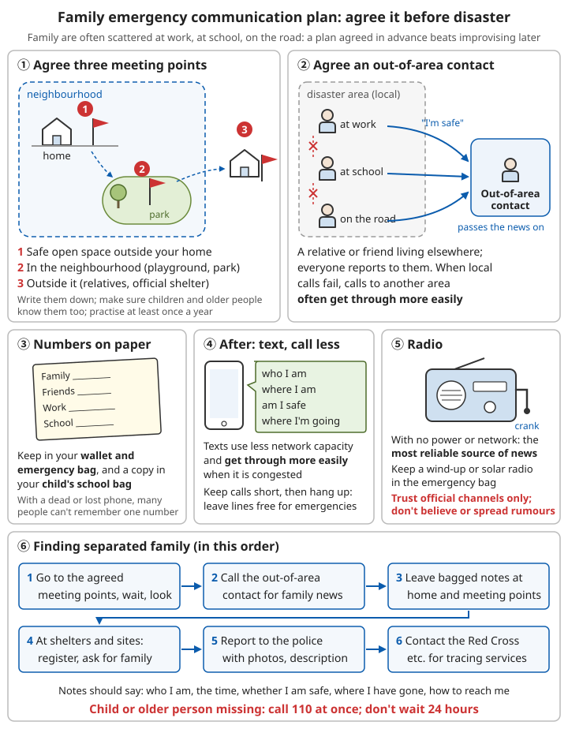

# Emergency Communication and Family Reunification

## Contents
- [Before a disaster: family communication plan](#before-a-disaster-family-communication-plan)
- [During a disaster: getting your message out](#during-a-disaster-getting-your-message-out)
- [Getting official information](#getting-official-information)
- [Saving phone battery](#saving-phone-battery)
- [Walkie-talkies](#walkie-talkies)
- [Finding family members after you are separated](#finding-family-members-after-you-are-separated)

---

## Before a disaster: family communication plan

When disaster strikes, family members are often scattered at work, at school or on the road. **Agreeing things in advance works far better than trying to sort things out afterwards.**

```
1. Write down important phone numbers
   - When their phone dies or is lost, many people find they cannot remember a single number
   - Write the numbers of family, relatives and friends, workplaces and schools on paper
     and keep it in your wallet and emergency kit
   - Put a copy in your children's school bags too

2. Agree on an out-of-area contact
   - Choose a relative or friend who lives in another area
   - When local calls in the disaster area will not connect, calls to another area
     often get through more easily
   - Everyone in the family tells this contact they are safe, and the contact passes
     the news on to the others

3. Agree on meeting places
   - First meeting place: a safe open space outside your home
   - Second meeting place: within your community (a school sports ground, a park)
   - Third meeting place: outside your community (a relative's or friend's home,
     a designated shelter)
   - Write them down and make sure children and elderly people know them too

4. Find out your children's school emergency arrangements
   - How the school evacuates in a disaster, where to collect the children, and who
     is allowed to collect them

5. Practise regularly (at least once a year)
```

For a detailed family emergency plan see [Disaster Response – Family emergency plan](../../../docs/02-灾难应对/README.md#-家庭应急计划).



*Figure: Family emergency communication plan. Agree on three meeting places, from near to far; everyone tells the out-of-area contact they are safe; after separation, go to the meeting place first, then ask the out-of-area contact, leave notes, and register at the relief shelter*

---

## During a disaster: getting your message out

After a disaster, communication networks are often jammed because base stations are damaged, the power is off, or huge numbers of people are calling at once.

```
✓ Send text messages; make fewer calls
  - Texts use less network capacity and are more likely to get through when the network is jammed
  - They are resent automatically when the network comes back
  - Say it all in one text: who I am, where I am, whether I am safe, where I am going next

✓ Keep calls short
  - Hang up once you have said the key information, to leave the lines free for others
    and for emergency calls

✓ When there is internet access
  - Use messaging apps to send messages and share your live location
  - Tell the family group chat you are safe (one message reaches the whole family)

✓ If you are trapped
  - Call 110, 119 or 120 first (emergency calls try to connect through any available
    network even when the signal is weak)
  - If you cannot speak, you can text 12110 to report to the police (add the province
    code after the number)
  - Save battery; switch the phone on at set times to check

✓ Some phones support satellite messaging or BeiDou satellite messaging, and can send
  distress messages even with no ground signal
  - Find out in ordinary times whether your phone supports it and how to use it
```

For distress signals (sound and visual) see [Disaster Response – Distress signals](../../../docs/02-灾难应对/README.md#-求救信号).

---

## Getting official information

```
✓ Radio: the most reliable source of information when the power and network are down
  - Keep a wind-up or solar-charged radio in your emergency kit
  - During a disaster, listen for emergency broadcasts on local radio stations

✓ Warning text messages
  - National emergency warnings are issued through "12379" and other channels
  - Read warning texts carefully when you receive them, and act on them
  - You can also install the official national warning-information app

✓ Official accounts of the local government, emergency management department and
  meteorological department

✓ Announcements and loudspeaker broadcasts from your residents' committee or village committee

⚠️ Trust only information from official channels; do not believe or spread rumours
   (check uncertain news before acting on it; do not forward it without thinking)
```

---

## Saving phone battery

```
✓ Turn on power-saving or low-power mode
✓ Lower the screen brightness and shorten the auto-lock time
✓ Turn off location, Bluetooth, Wi-Fi and background apps you do not need
✓ When the signal is very weak the phone keeps searching for a signal, which drains
  the battery fast
  → When there is no signal, use flight mode, and switch it off at set times
    (e.g. once an hour) to check for messages
✓ Watch fewer videos and spend less time on social media
✓ Cold makes battery charge drop fast: keep your phone warm in a pocket close to your body

Charging:
✓ Keep a power bank (always kept fully charged) and a charging cable in your emergency kit
✓ Wind-up chargers, solar charging panels (see Lighting and Energy – Small-scale solar power)
✓ Charging from a car's cigarette-lighter socket (start the car only outdoors in a
  well-ventilated place, to avoid carbon monoxide poisoning)
```

Related chapter: [Lighting and Energy – Small-scale solar power](../../../docs/07-日常生活技能/06-照明与能源.md#小型太阳能).

---

## Walkie-talkies

When the mobile network is down, walkie-talkies let family members and neighbours talk over short distances.

```
✓ Public walkie-talkies: use the 409 MHz band, transmit at no more than 0.5 W, and need no licence
  - Range is usually a few hundred m to a few km (greatly affected by terrain and buildings)
  - Suitable for family members in the same estate or the same village to stay in touch
✓ Agree in advance which channel to use and when to call (e.g. switch on for 5 minutes
  every hour on the hour)
✓ Keep plenty of spare batteries
✓ Try them out in ordinary times so you know how they work

❌ Amateur radio stations need a licence; do not transmit without permission
❌ Do not use walkie-talkies at airports or on aircraft
```

---

## Finding family members after you are separated

```
1. First go to the agreed meeting place, wait there and check
2. Contact the out-of-area contact and ask whether there is news of other family members
3. Leave a note at your front door and at the meeting place:
   - Write clearly: who I am, the time, whether people are safe, where I have gone now,
     how to contact me
   - Make it waterproof (put it in a plastic bag) and stick it somewhere easy to see
4. Register and make enquiries at shelters and relief sites set up by the local government
   - Register your own details so relatives can find you
   - Ask whether missing family members have registered at another site
5. Report to the police and give them photos and a description of the missing person
6. Contact the Red Cross and other relief organisations about their family-tracing services

If a child or an elderly person goes missing, dial 110 immediately; there is no need to
wait 24 hours
(see Child Safety – Preventing children getting lost)

⚠️ When posting missing-person information online:
- Give the necessary information (name, photo, place last seen, contact details)
- Protect privacy, and beware of people who use missing-person appeals to commit fraud
  (do not transfer money lightly)
```

Related chapter: [Child Safety – Preventing children getting lost](../../../docs/01-日常疾病和伤害/14-儿童安全.md#防走失).

---

## 📝 Emergency communication key points

```
1. Write important phone numbers on paper and keep them in your wallet, emergency kit and
   children's school bags
2. Agree on an out-of-area contact and three meeting places
3. After a disaster, texts get through more easily than calls; keep calls short
4. A radio is the most reliable source of information when the power and network are down
5. With no signal, use flight mode to save battery, and check at set times
6. Public walkie-talkies need no licence and suit short-range contact
7. After separation: meeting place, leave notes, register at relief sites, call the police
```

---

**Next chapter**: [Handling the Dead after Disasters](../../../docs/02-灾难应对/07-灾后遗体处理.md)
**Back**: [Chapter index](../../../docs/02-灾难应对/README.md) | [Main contents](../../README.md)
