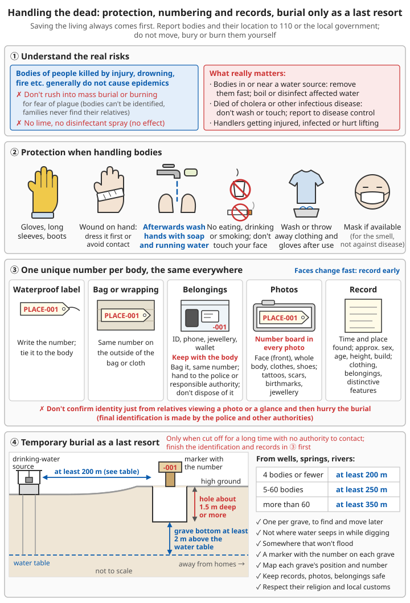

# Handling the Dead after Disasters

## Contents
- [First of all: what this chapter is for](#first-of-all-what-this-chapter-is-for)
- [A common misconception: dead bodies cause epidemics](#a-common-misconception-dead-bodies-cause-epidemics)
- [Protecting yourself when handling bodies](#protecting-yourself-when-handling-bodies)
- [Identification and records](#identification-and-records)
- [Temporary storage](#temporary-storage)
- [Temporary burial when no authority can be reached](#temporary-burial-when-no-authority-can-be-reached)
- [People who died of infectious diseases](#people-who-died-of-infectious-diseases)
- [When someone dies at home in normal times](#when-someone-dies-at-home-in-normal-times)
- [Caring for the bereaved and for yourself](#caring-for-the-bereaved-and-for-yourself)

---

## First of all: what this chapter is for

```
1. Saving the living always comes first: search and rescue, treating the injured, and
   making sure survivors have water and food
2. The dead are handled by the government, police, civil affairs and funeral services
   - If you find a body: report it to 110, the local government or a rescue team,
     and give the location
   - Do not move, bury or burn bodies yourself
3. This chapter applies to:
   - Watching over and recording bodies before rescue teams arrive
   - Helping rescuers and caring for the families of the dead
   - Extreme situations of long isolation from the outside world, with no authority
     that can be contacted
```

---

## A common misconception: dead bodies cause epidemics

The World Health Organization and the International Committee of the Red Cross state: **the bodies of people killed in natural disasters or conflict by injury, drowning, fire and similar causes generally do not cause outbreaks of disease.** These people usually did not carry the germs that cause infectious diseases before they died.

```
Therefore:
❌ Do not rush into mass burial or burning of bodies out of fear of epidemics
   - Hasty mass burial makes bodies impossible to identify
   - When families cannot find their relatives or confirm their death, it causes
     long-lasting suffering, as well as legal problems with inheritance, marriage and so on
❌ There is no need to sprinkle lime or spray disinfectant on bodies (it does nothing to
   prevent disease and wastes people's effort and supplies)

The risks you really do need to watch for:
⚠️ Bodies in or near a water source: they may contaminate drinking water and cause
   diarrhoeal diseases
   → Remove them from the water as soon as possible; boil or disinfect affected water
     before drinking it
⚠️ People who died of cholera or other infectious diseases (see "People who died of
   infectious diseases" below)
⚠️ People handling bodies getting wounds that become infected, or getting hurt while
   carrying them
```

For disinfecting drinking water see [Basic Survival Skills – Finding water](../../../docs/03-野外生存/00-基础生存技能.md#水源获取与净化).

---

## Protecting yourself when handling bodies

```
✓ Wear gloves (rubber gloves, disposable gloves), long sleeves and boots
✓ If you have a wound on your hand, dress it first, or avoid contact
✓ Wash your hands with soap and running water after contact
✓ Do not eat, drink or smoke while handling bodies, and do not touch your face
✓ Wash or throw away clothing and gloves after use
✓ Wear a mask if you can (mainly to ease the discomfort of the smell, not to prevent disease)

Carrying:
✓ Use a stretcher, a door, a body bag or strong cloth, and lift with several people
✓ Look after your own safety: at collapsed buildings and mudslides, first make sure
  there will not be a further collapse
```

For treating injuries and preventing tetanus see [Wound and Injury Care – Tetanus prevention](../../../docs/01-日常疾病和伤害/02-外伤处理.md#破伤风预防).

---

## Identification and records

Identifying the dead is the most important help you can give them and their families. **Facial features change quickly over time, so record them as early as possible.**

```
For every body:
1. Give it a unique number (e.g. "place abbreviation-001")
   - Write it on a waterproof label and tie it to the body
   - Write the same number on the outside of the bag or cloth wrapping the body
2. Take photos (if you have a phone or camera):
   - The number tag must appear in every photo
   - Face from the front, whole body, clothing, shoes
   - Tattoos, scars, birthmarks, jewellery and other features
3. Record:
   - The time and exact place it was found
   - Approximate sex, age, height and build
   - Clothing, belongings, obvious features
4. Personal belongings (ID documents, phone, jewellery, wallet):
   - Do not separate them from the body; put them in a bag marked with the same number
   - Hand them to the police or the responsible authority; do not dispose of them yourself

❌ Do not rush to bury someone after the family has only looked at photos or had a quick
   look and identified them
   (mistaken identification is not unusual; final identification is confirmed by the
   police and other authorities)
```

---

## Temporary storage

```
✓ Keep bodies in a cool, shaded place, away from where people live and from water sources
✓ Wrap them in body bags, plastic sheeting or sheets, with the number stuck on the outside
✓ Refrigerate if you can (refrigerated lorries, cold stores)
✓ Lay bodies side by side; do not stack them
✓ Have someone keep watch to keep animals away and stop people disturbing the bodies
✓ Let families identify and say goodbye with someone accompanying them

⚠️ In hot weather bodies change very quickly; report them as soon as possible and wait
   for professionals to deal with them
```

---

## Temporary burial when no authority can be reached

This applies only when you have been **cut off from the outside world for a long time and there really is no authority you can contact**. Identification and records as described above must be completed before burial.

```
Principle: bury individually; every grave is marked and recorded, so it can be found
and the remains moved later

Choosing the site:
✓ Away from drinking-water sources (wells, springs, rivers):
  - 4 bodies or fewer: at least 200 m
  - 5-60 bodies: at least 250 m
  - More than 60 bodies: at least 350 m
✓ The bottom of the grave must be at least 2 m above the water table: do not bury where
  water seeps in as you dig
✓ Choose higher ground that will not flood
✓ Away from homes

Burial:
✓ Graves about 1.5 m deep or more, to stop wild animals digging them up
✓ Lay each body separately, wrapped, with its number label buried with it
✓ If several people must share a grave, lay the bodies side by side, not stacked,
  with space between each, and draw a plan showing which number is in each position
✓ Put a marker (a wooden board, a stone) on each grave with the number written on it
✓ Draw a simple map recording the position and number of every grave
✓ Keep all records, photos and personal belongings safe, to hand over later to the
  authorities and families

✓ Respect the religious beliefs of the dead and local customs as far as possible
```

---

## People who died of infectious diseases

The bodies of people who died of cholera, Ebola or other dangerous infectious diseases **are infectious**.

```
❌ Do not wash, touch or kiss the body; do not hold a traditional wake or funeral meal
✓ Report immediately to the local disease-control department and health centre,
  and follow their instructions
✓ Anyone who has touched the body or the patient should watch for symptoms
✓ Items used by the deceased and their bodily wastes are treated with strong disinfectant
```

For making up disinfectant see [Preventing Infectious Diseases at Home – Making household disinfectant](../../../docs/01-日常疾病和伤害/15-传染病家庭防控.md#家用消毒液的配制).

---

## When someone dies at home in normal times

```
1. If you are not sure the person is dead: dial 120 immediately; try to resuscitate if possible
2. Death from illness at home:
   - Contact a medical facility or community health service centre to issue a medical
     certificate of death
3. Accident, unknown cause or possibly unnatural death:
   - Dial 110, protect the scene, do not move the body
4. Contact a funeral home to collect the body
5. Use the death certificate to cancel the household registration (hukou) and complete
   other formalities

⚠️ The exact procedure varies from place to place; ask your residents' committee or village committee
```

---

## Caring for the bereaved and for yourself

```
For families of the dead:
✓ Tell families as early as possible where the body is and how to identify it
✓ Respect families' wish to identify and say goodbye, with someone accompanying them
✓ Do not hide things, and do not offer comforts such as "at least they didn't suffer"
✓ Help them get in touch with psychological support and social assistance

For people taking part in handling the dead:
✓ Take turns; do not let one person do it for a long time
✓ Insomnia, the scene coming back again and again, and low mood are normal reactions;
  talk with your companions, and seek professional help if needed
```

Related chapters: [Mental Health – Grief](../../../docs/01-日常疾病和伤害/10-心理健康.md#哀伤), [Mental Health – Psychological first aid](../../../docs/01-日常疾病和伤害/10-心理健康.md#心理急救-怎样帮助身边的人).

---

## 📝 Key points for handling the dead after disasters

```
1. Saving the living comes first; if you find a body, report it to 110 or the local
   government, do not deal with it yourself
2. The bodies of people killed in disasters by injury, drowning and similar causes
   generally do not cause epidemics
3. Do not rush into mass burial or burning; do not sprinkle lime or spray disinfectant
4. Remove bodies from water sources as soon as possible; disinfect affected water before drinking
5. Wear gloves and wash your hands after contact; dress any wound on your hands first
6. Number, photograph and record every body; do not separate belongings from the body
7. Temporary burial only as a last resort: bury individually, mark the graves, draw a map,
   at least 200 m from drinking-water sources (250-350 m when there are many dead; see
   above)
8. People who died of infectious diseases: do not wash or touch them; report to disease control
```



*Figure: The bodies of people killed in disasters by injury, drowning and similar causes generally do not cause epidemics. Wear gloves and wash your hands after contact. Give every body one number and write the same number on the label, the wrapping, the belongings, the photos and the grave marker. If temporary burial is unavoidable, bury individually, at least 200 m from drinking-water sources, with the bottom of the grave at least 2 m above the water table*

---

**Back**: [Chapter index](../../../docs/02-灾难应对/README.md) | [Main contents](../../README.md)
