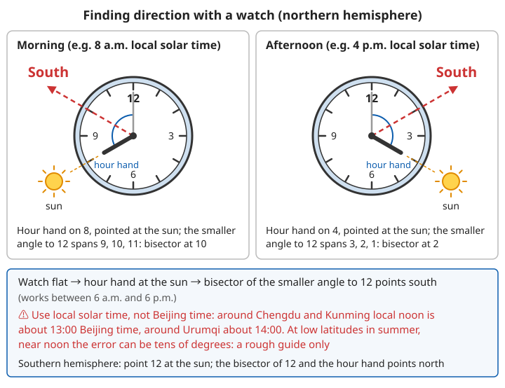
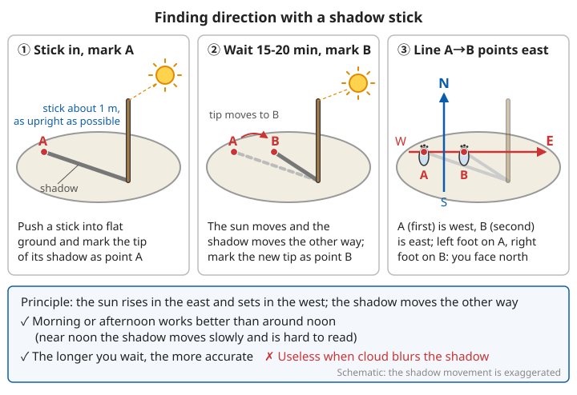
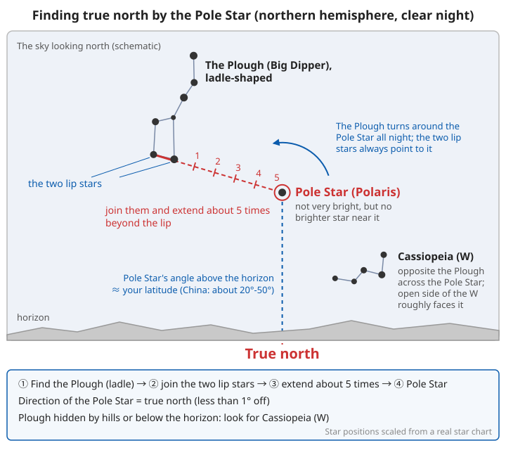
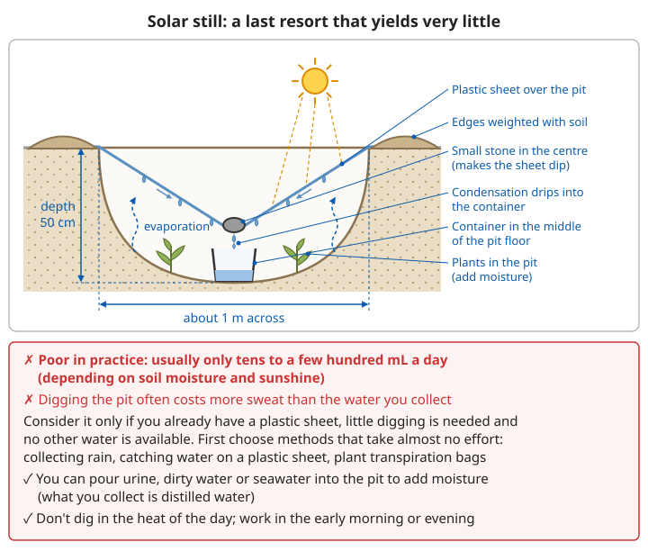
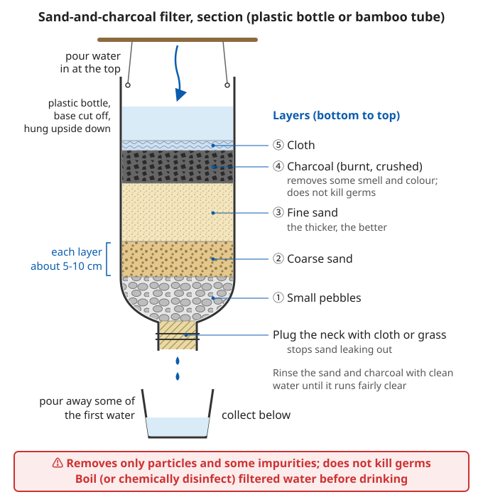
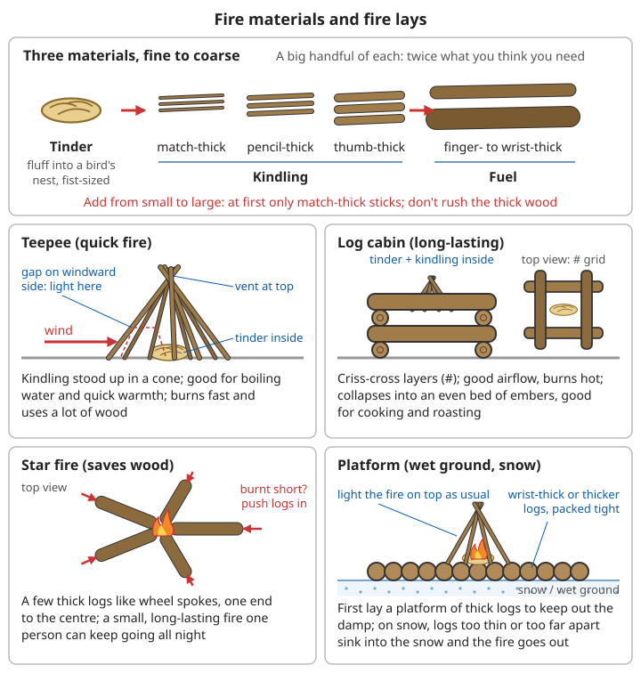
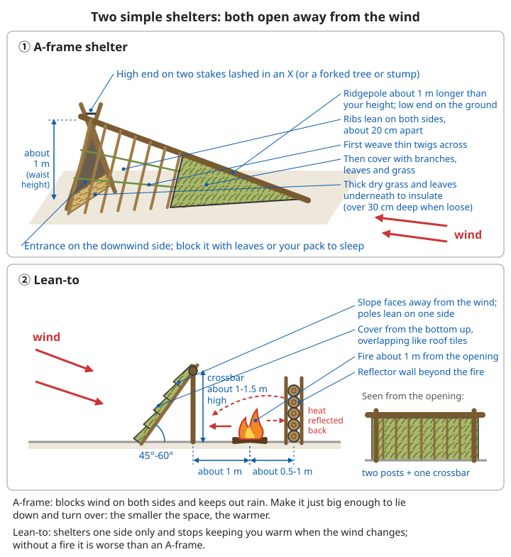
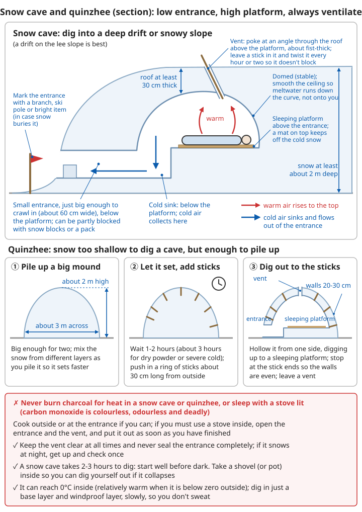
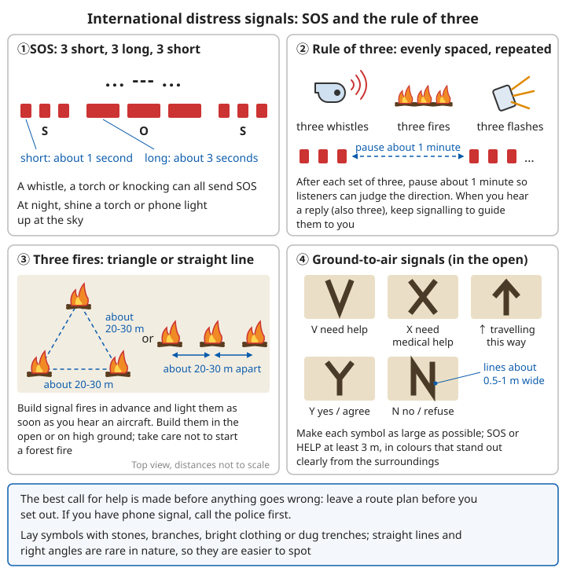

# Basic Survival Skills

## Contents
- [Survival priorities](#survival-priorities)
- [Navigation and orientation](#navigation-and-orientation)
- [Finding and purifying water](#finding-and-purifying-water)
- [Making fire](#making-fire)
- [Building shelters](#building-shelters)
- [Distress signals](#distress-signals)
- [Getting food](#getting-food)
- [Making basic tools](#making-basic-tools)
- [Knots](#knots)

---

## Survival priorities

When ordinary people get into trouble in the wild, it is almost always because they got lost, darkness fell, they were injured or the weather turned bad, and they are usually rescued within a day or two. The skills in this chapter are first of all for **holding out until rescue arrives**, and only secondly for living in the wild for a long time. For preparing before you set out and calling for help when lost, see [Trip Preparation and Calling for Help](../../../docs/03-野外生存/07-户外出行准备与求救.md).

### The rule of threes

```
3 minutes - without air
3 hours   - without shelter in a harsh environment
3 days    - without water
3 weeks   - without food
```

This is an order-of-magnitude rule to help you remember **what to do first**. It is not an exact survival time:

| Threat | Rough time | What it really means |
|------|---------|---------|
| Breathing, severe bleeding | Minutes | A blocked airway, drowning or spurting bleeding must be dealt with at once; everything else waits |
| Cold or extreme heat | Hours | Soaked in wind and rain, low night temperatures or strong sun can cause hypothermia or heatstroke within hours |
| No water | About 3 days | At moderate temperatures and at rest; in hot conditions with heavy sweating it may be only 1–2 days |
| No food | About 3 weeks or more | With water a healthy adult can last weeks, but strength and judgement fall noticeably after a few days |

### Limits of the rule of threes

```
⚠️ Do not treat these numbers as "how much time I have left":
- Severe bleeding, a severe allergic reaction or falling into cold water can kill within minutes
  (for the "1-10-1" rule for cold water, see River Crossings, Flash Floods and Hypothermia in the Wild)
- "3 hours" applies just as much at about 10°C with rain, wind and soaked clothes — not only in winter
- In a desert above 40°C while walking, severe dehydration can set in without water in less than a day
- Children, older people, pregnant women and people with chronic illnesses (especially diabetes) are more
  sensitive to cold, heat, lack of water and lack of food; cut the times accordingly
- These times are the limits for "staying alive", not for "still being able to function":
  dehydration, cold and hunger first make people misjudge things, fall and get hurt — a far more common cause of death
```

For recognising and treating hypothermia, see [River Crossings, Flash Floods and Hypothermia in the Wild – Not only in winter: hypothermia in the wild](../../../docs/03-野外生存/08-涉水山洪与野外失温.md#不只是冬天-野外失温); for heatstroke, see [Acute Conditions – Heatstroke](../../../docs/01-日常疾病和伤害/05-急性症状.md#中暑).

### Order of survival tasks

```
0. Get safe and call for help
   - First get away from the immediate danger (rockfall, rising water, fire, rapids)
   - If your phone has signal, call the police at once (110/119), say where you are, then stay put
1. First aid (treat injuries and illness)
   - Stop bleeding and keep the airway open first, then deal with fractures and wounds
2. Shelter (body temperature)
   - Cold or rain: put on all your clothes, get off the cold wet ground, get out of the wind
   - Heat: get into the shade, move as little as possible by day
3. Water (essential for life)
4. Fire (warmth, cooking, signalling)
   - With a shelter and enough clothes, a fire is not essential; making one uses energy and can start a forest fire
5. Food (energy)
   - In the few days of waiting for rescue, food makes almost no difference to survival
6. Signalling/navigation (being rescued/getting home)
   - Have signals ready to use at any moment; do not wander off when you are not sure of the way
```

**Remember**: people can go weeks without food, but only days without water!

Adjust the order to the situation: an hour or two before dark, prepare for the night first (warmth, insulation from the ground); in good weather with energy to spare, set out your distress signals first. For whether to wait where you are or walk out after an injury in the wild, see [Treating and Evacuating the Sick and Injured in the Wild – Stay put or walk out](../../../docs/03-野外生存/11-野外伤病处置与转运.md#原地等待还是自行撤出).

### Keep calm and save your strength

```
Panic is the most common "second mistake" in the wild: speeding up and wandering after getting lost,
walking on in the dark, taking a short cut down a steep slope, risking a river crossing —
these are often more dangerous than the original situation.

✓ Stop, sit down, drink a few mouthfuls of water, eat something, take a few slow deep breaths
✓ List what needs doing (write it down or say it aloud), and do one thing at a time
✓ Split the work between companions; do not all do the same job
✓ Pace yourself: sweat soaking your clothes is very dangerous in cold weather; take off a layer while working and put it back on when resting
✓ Stop moving before dark, and use the remaining light to prepare for the night
✓ Look after the weakest in the group (children, older people, the injured); they set the pace for everyone
```

For coping with long-term stress, see [Mental Health – Looking after yourself under long-term stress](../../../docs/01-日常疾病和伤害/10-心理健康.md#长期压力下照顾好自己).

---

## Navigation and orientation

Knowing "which way is north" is only useful if you roughly know where you are and in which direction your destination lies. Only consider walking out yourself if you can find the way you came, have a phone location, or are sure there is a road nearby; otherwise call for help first and wait where you are (see [If you are lost](#if-you-are-lost) below).

How reliable each method is:

| Method | Reliability | Main sources of error |
|------|---------|------------|
| Phone map location | High (while the battery lasts) | Flat battery; location does not need signal, but you must download offline maps in advance |
| Compass | High | Near iron or a phone; magnetic declination (about 2°–11° in China) |
| Pole Star | High (clear nights) | Less than 1° off true north |
| Shadow stick | Medium–high | Waiting too short a time, uneven ground |
| Watch method | Medium | Using Beijing time instead of local solar time; large errors near midday in summer at low latitudes |
| Rough position of the sun | Low–medium | The directions of sunrise and sunset change a lot with the seasons |
| Tree crowns, growth rings, moss | **Low** | Almost useless in a forest; do not rely on them |

### Using a compass

```
Basic use:
1. Hold it level
   - Hold it in front of your chest with the dial level, or the needle will stick
2. Let the needle swing freely
   - Keep at least about 1 m away from phones, knives, iron railings, cars and power lines, or it will point wrongly
3. The red needle points north (usually)
   - Some compasses use a white, luminous or "N"-marked end for north; check against the sun before relying on it
   - It points to "magnetic north", a few degrees off true north (magnetic declination); on a hike this can usually be ignored
4. Turn the dial to set the direction
   - Turn the dial's "N" to line up with the red needle, read off the bearing in degrees of the direction you want to go, and note it down
5. Walk on the bearing
   - Look out along the bearing, pick an easy-to-recognise target in the distance (a distinctive tree, a big rock),
     walk to it, then pick the next target; do not keep looking down at the compass as you walk

Checking:
✓ After walking a while, look back: the target on the way you came should be directly behind you (bearing differs by 180°)
✗ Walking by feel: in forest, fog or snow you will almost certainly go round in circles
```

For using a map and compass together, see [Trip Preparation and Calling for Help – Using a map and compass](../../../docs/03-野外生存/07-户外出行准备与求救.md#用地图和指南针); for measuring and correcting for magnetic declination, see [Advanced Celestial Navigation – Magnetic declination](../../../docs/09-进阶科学与工程/09-天文导航进阶.md#24-磁偏角).

**Improvised compass**: rub a sewing needle a few dozen times in one direction on silk or hair (or stroke it in one direction with a magnet), and lay it on a leaf or piece of cork floating on water; when it settles, its ends point north and south. Use the sun to check which end is north.

### Finding direction without a compass

#### Sun methods

**Rough position of the sun** (most of China):
```
- Local noon (not necessarily 12:00 Beijing time): the sun is due south and shadows point due north
- The sun is in the east in the morning and the west in the evening, but it is only due east and due west around the equinoxes
  - Summer: it rises in the north-east and sets in the north-west
  - Winter: it rises in the south-east and sets in the south-west
- The sun moves about 15° an hour; when using it for direction, re-check every half hour
⚠️ South of the Tropic of Cancer (about 23.5° N, around Guangzhou and Nanning), the midday sun in summer may be overhead or to the north
```

**Watch method** (northern hemisphere):
```
1. Hold the watch flat
2. Point the hour hand at the sun
3. The line halfway between the hour hand and 12 o'clock points south
4. Use the smaller of the two angles between the hour hand and 12
   (works between 6 in the morning and 6 in the evening)

⚠️ Use local solar time, not Beijing time directly:
- Beijing time is based on 120° E; for every 15° further west, local noon comes about 1 hour after 12:00 Beijing time
  - Around Chengdu and Kunming: local noon is about 13:00 Beijing time
  - Around Ürümqi: about 14:00 Beijing time
- How: first subtract this difference from Beijing time, then use the watch method
- At low latitudes and around midday in summer this method can be tens of degrees out; use it only as a rough guide
Digital watch: draw a clock face on the ground, mark the hour hand for the current time, and use that

Southern hemisphere: point 12 o'clock at the sun; the line halfway between 12 and the hour hand points north
```



*Figure: Northern hemisphere, local solar time; at 8 a.m. the halfway line is at 10 o'clock, at 4 p.m. it is at 2 o'clock*

**Shadow method**:
```
1. Stand a stick upright
   - About 1 m long, pushed into flat ground, as vertical as possible
2. Mark the tip of the shadow (point A)
3. Wait 15–20 minutes
4. Mark the tip of the shadow again (point B)
5. The line from A to B points east
   (the first mark, A, is west; the second, B, is east)
6. A line at right angles to it points north
   (stand between A and B with your left foot on A and your right foot on B: you are facing north)

Principle: the sun rises in the east and sets in the west, and the shadow moves the opposite way

✓ Works better in the morning or afternoon than around midday (near noon the shadow moves slowly and is hard to read)
✓ The longer you wait, the more accurate it is; to find true north and south precisely, use the "shadow stick" method in Advanced Celestial Navigation
✗ Does not work on overcast days when shadows are faint
```



*Figure: Northern hemisphere in the morning; the shadow's movement is drawn larger than in reality for clarity*

For the precise shadow-stick method, see [Advanced Celestial Navigation – Finding true north and south with a shadow stick](../../../docs/09-进阶科学与工程/09-天文导航进阶.md#23-立杆测影定正南北精确方法).

#### Star methods (at night)

**The Pole Star** (northern hemisphere):
```
How to find it:
1. Find the Big Dipper (Plough, ladle-shaped)
2. Take the line through the two stars at the lip of the ladle
3. Extend it about 5 times (about 5 times the distance between those two stars) beyond the lip
4. That is the Pole Star
5. Direction of the Pole Star = true north

More:
- When the Big Dipper is hidden by mountains or below the horizon: find Cassiopeia (W-shaped); it lies
  on the opposite side of the Pole Star from the Big Dipper, and the open side of the W faces roughly towards the Pole Star
- The Pole Star is not very bright, but there are no brighter stars around it, so it is easy to pick out
- The Pole Star's angle above the horizon ≈ your latitude (about 20°–50° in China)
- The Big Dipper turns round the Pole Star all night; the two stars at the lip always point to it
```



*Figure: The sky facing north, with the relative positions of the stars drawn to scale from a real star chart; the Big Dipper's orientation changes with season and time, but the two lip stars always point to the Pole Star*

**Orion** (winter and spring evenings):
```
Of the three bright stars in a straight line in Orion's Belt, the rightmost (westernmost) rises due east
and sets due west → just after rising or just before setting, it can be used to find east and west
```

**The Southern Cross** (southern hemisphere):
```
1. Find the Southern Cross
2. Extend the long axis of the cross about 4.5 times
3. Drop straight down to the horizon
4. That is due south

Note: next to the Southern Cross is a larger, fainter "False Cross"; the False Cross has no two bright pointer stars
```

For more ways to find direction and measure latitude by the stars, see [Advanced Celestial Navigation](../../../docs/09-进阶科学与工程/09-天文导航进阶.md#二精确定方向).

#### Natural signs

**Trees**:
```
Northern hemisphere:
- Crown: denser on the south side
- Growth rings on a stump: wider on the south side
- Moss: more on the north side
```

⚠️ These methods are **unreliable**: crowns grow towards gaps and away from slopes, the width of growth rings depends mainly on slope, wind and neighbouring trees, and moss grows wherever it is damp and shaded. In a forest they are almost useless; do not choose your direction from one tree or one patch of moss. For why, see [Forest Survival – Why tree crowns, growth rings and moss cannot be trusted](../../../docs/03-野外生存/02-森林求生.md#树冠年轮苔藓为什么靠不住).

More reliable natural clues:
```
✓ Rivers and streams: water flows downhill, and there are often roads and villages along the banks of big rivers
  (but do not follow a steep stream valley downhill; see "If you are lost" below)
✓ Power lines, telecom masts, terraced fields, signs of tree felling, litter, livestock dung: people are active nearby
✓ Dogs barking, cockerels crowing, traffic, chainsaws: sound carries a long way in the quiet of early morning and evening
✓ Look from high ground: climb a nearby ridge or summit with a clear view (do not take risks climbing) to see the lie of the land and any settlements
```

### Estimating distance and time

```
Pacing (measure your own pace on flat ground beforehand):
- One "pace" (the same foot touching down twice) is usually about 1.3–1.6 m for an adult
- On flat ground 100 m is about 65–75 paces; steps get shorter uphill, in woodland and in snow
- Tie a knot in a cord or pick up a pebble for every 100 m walked, to keep track of distance

Time:
- On a good mountain path about 4 km/h, plus about 1 hour for every 500–600 m of climb
- In trackless woodland, scrub or boulder slopes it may be only 1 km/h or even slower
- Going downhill saves effort but makes falls more likely; do not go much faster than uphill
- How long until dark: hold your arm straight out with your hand flat sideways; one hand's width (four fingers together)
  between the bottom of the sun and the horizon is roughly 1 hour (a rough estimate only)
```

### Avoiding getting lost

```
✓ Look back often (remember what the way you came looks like)
  - The view on the way back is completely different from the way out; at every fork turn round, take a look and a photo
✓ Leave markers (strips of cloth, cairns)
  - At forks and turns; markers must be visible from both directions
  - Remove them afterwards where possible; do not carve into tree bark
✓ Keep a straight line (walk towards a chosen distant target)
✓ Record your route (landmarks, directions, times)
  - Turn on track recording on your phone; if you get lost, you can follow the track back
✓ Do not stray too far from water
✓ Set a turnaround time: if you have not reached your destination by then, turn back anyway
```

For trip plans, turnaround times and kit, see [Trip Preparation and Calling for Help](../../../docs/03-野外生存/07-户外出行准备与求救.md#出发前).

### If you are lost

```
The STOP principle:
S - Stop: stop, do not panic
T - Think: think about where you are
O - Observe: look at your surroundings
P - Plan: make a plan

Principles:
✓ Stay where you are (you are easier to find)
✓ Send signals
✓ Find water
✓ Build a shelter
✓ Wait for rescue

In detail:
1. Stop: walking further and further and getting more and more tired is the most common mistake when lost
2. Think: when did you last know where you were, roughly how long have you walked since, and in which direction
3. Observe: does your phone have signal, can it find your location; are there paths, signs of people or high ground nearby
4. Plan:
   - You are sure of the way back and it is safe → go back the way you came
   - You are not sure → call for help, wait where you are, prepare for the night
   - It is nearly dark → stop moving; use the remaining light for shelter and warmth

❌ Do not follow streams or gorges downhill: mountain stream valleys often have waterfalls and cliffs, and flash floods,
   and they usually get steeper and steeper until you can go neither up nor down
❌ Do not walk in the dark: falls at night are one of the most common causes of death and injury among lost people
✓ If you do decide to move, leave a marker and a note where you were (time, direction you went), and mark your route
```

For how to call for help and how to describe where you are, see [Trip Preparation and Calling for Help](../../../docs/03-野外生存/07-户外出行准备与求救.md#报警求救-说清楚你在哪里).

---

## Finding and purifying water

### How much water you need each day

```
Drinking water per person per day (drinking only):
- Moderate temperatures, resting: about 2 L
- Hot weather, or hiking or working: 4–6 L, or even more
- In cold weather you also lose water through breathing and sweating, but you feel less thirsty

Are you short of water? (look at your urine):
✓ Pale yellow, normal amount → about enough
⚠️ Dark yellow, small amount → short of water, drink more
☠️ No urine for more than half a day, dizziness, confusion → severe dehydration, get help as soon as possible
   Babies and young children with no urine for more than 6 hours need a doctor at once

Principles:
✓ When you have water, do not deliberately "ration" it: water is more use in your body than in the bottle,
  so drink when you need to; what you should save is sweat (stay in the shade by day, move less)
✓ When water is very short, eat less, especially meat and salt (digesting them uses water)
❌ Do not drink seawater, urine or alcohol
```

For grading dehydration and oral rehydration, see [Common Illnesses – Diarrhoea](../../../docs/01-日常疾病和伤害/01-常见疾病.md#腹泻); for conserving body fluids in the desert, see [Desert Survival – Rationing water](../../../docs/03-野外生存/03-沙漠求生.md#配给水).

### Finding water

**Clues from the land**:
```
✓ Valleys and hollows
  - On a map, places where the V of the contour lines points uphill are gullies and often have water
✓ Areas of lush vegetation
  - Where reeds, bulrushes, willows, bamboo or ferns grow thickly, there is often water underground
✓ Where animal tracks converge
  - Several game trails joining as they head downhill
✓ The direction insects fly (in the evening)
✓ Birds flying (towards water in the morning and evening)
✓ Seeps and springs at the foot of hills and the base of rock faces
✓ Dry riverbeds: dig down at the outside of bends and at the lowest points; water may seep up under damp sand

Priority (best to worst):
1. Springs, clear streams flowing down from the mountains (with no villages, pasture or mines upstream)
2. Rainwater
3. Flowing river water
4. Lake and pond water
5. Puddles, stagnant water (last resort)
→ Purify all surface water before drinking; looking clear does not mean it is clean
```

**Ice and snow**:
```
✓ Melt it before drinking: eating snow directly uses a lot of body heat and can freeze the mouth
✓ Ice saves fuel compared with snow (more water from the same volume)
✓ When melting snow, put a little water in the bottom of the pot first, or the pot will burn dry and scorch
✓ Water from melted ice and snow must still be boiled or disinfected
```

For how to melt snow, see [Snow and Polar Survival – Melting snow](../../../docs/03-野外生存/04-雪地极地求生.md#融雪).

### Collecting rainwater

```
Methods:
✓ Catch it in clean containers
✓ Collect it on a plastic sheet (low in the middle)
  - Tie the four corners to trees with one corner slightly lower and a container beneath; 1 mm of rain on 1 m² of sheet gives about 1 L
✓ Channel it off large leaves
✓ Dig a hole and line it with plastic sheeting
✓ Tie a band of cloth round a tree trunk with the lower end hanging into a container, to catch rain running down the trunk

The safest source of water!

Note:
- The first few minutes of rain wash down dust and bird droppings; do not collect it yet
- Rainwater channelled off roofs or rocks is best disinfected before drinking
- Have containers ready; looking for them when the rain comes is too late
```

### Collecting dew

```
Early morning:
1. Wipe the grass with absorbent cloth
   - Even better: tie the cloth round your lower legs and walk back and forth through the grass
2. Wring it into a container
3. Repeat

With heavy dew you may collect several hundred mL an hour; usually less
Collect as early as possible before sunrise (dew evaporates quickly)
Avoid fields sprayed with pesticide and grass by the roadside
```

### Getting water from plants

**Collecting transpiration water**:
```
1. Choose a plant with plenty of green leaves
2. Put a clear plastic bag over a leafy branch
3. Tie the mouth of the bag tightly
4. Put a small stone in one corner of the bag (so water collects there)
5. Collect after a few hours

Note:
- Choose non-poisonous plants
  - Do not use plants you do not recognise, plants with milky white sap, or poisonous plants such as oleander
- Do not use dead leaves
- Yield: on a sunny day one bag gives roughly tens to a few hundred mL a day; use several bags
- Put the bags in the sun and move them to a new branch every few hours; the same branch gets "drained"
- The water may taste slightly of the plant; it can usually be drunk as it is, or boiled if you are unsure
```

**Water from bamboo**:
```
1. Green bamboo has water between the joints
2. Shake it and listen for water
3. Cut an opening at the top
4. Pour out and drink

- The water should be clear with no odd smell; do not drink it if it is yellow, cloudy or smelly
- You can also bend a bamboo tip down and tie it, cut off the end and put a container underneath; it collects some water overnight
```

**Climbing plants (vines)**:
```
- For a thick vine, first cut it high up, then cut it through lower down; water will run out of the lower end
- Clear, tasteless liquid can be drunk; do not drink liquid that is milky, coloured, bitter or sticky
- Do not take risks with vines you do not know
```

### Solar still (last resort)

⚠️ Field tests show they work very poorly: usually only tens to a few hundred mL a day, and you often sweat out more water digging the hole than you collect. Consider one only if you already have a plastic sheet, need not dig much, and no other water source is available.

Choose methods that use almost no energy first: collecting rainwater, catching water on a plastic sheet, transpiration bags.

```
Making one:
1. Dig a hole (about 1 m across, 50 cm deep)
2. Put a container in the centre of the bottom
3. You can put plants in the hole (adds moisture)
4. Spread a plastic sheet over the hole
5. Press the edges down firmly with soil
6. Put a small stone in the middle (so the sheet dips down)
7. Condensed water drips into the container

Yield: field tests usually give tens to a few hundred mL a day (depending on soil moisture and sunshine)
✓ You can pour urine, dirty water or seawater into the hole to add moisture (what you collect is distilled water)
✓ Do not dig in the hottest part of the day; do it in the early morning or evening
```



*Figure: The sun heats the soil and plants in the hole; water evaporates, condenses under the plastic sheet, runs down to the lowest point made by the stone and drips into the container; field tests give only tens to a few hundred mL a day*

### Water purification

Dirty water may carry bacteria, viruses and parasites (such as *Giardia* and *Cryptosporidium*), and the diarrhoea they cause makes dehydration worse. **Settle and filter cloudy water first, then disinfect it**: silt blocks UV light and uses up disinfectant.

```
First deal with cloudy water:
1. Settle: leave it in a container for a few hours and take the clearer water from the top
2. Rough filter: fold a cloth (clothing, a headscarf, a sock) several times and pour the water through it
3. Then disinfect it by any of the methods below
```

#### Boiling (most reliable)

```
Method:
- Boil for at least 1 minute
- High altitude (>2000 m): 3 minutes
- Kills all pathogens
  (bacteria, viruses and parasites are all killed; but it does not remove pesticides, heavy metals, fuel or other chemicals)

Key points:
✓ You must see large bubbles rolling continuously; small bubbles on the bottom of the pot are not boiling
✓ Put a lid on to save fuel and keep out ash and dirt
✓ Let it cool and pour it into a clean container; do not touch it again with dirty hands or cups
✓ No pot: use a metal tin, a bamboo tube, or drop hot stones into the water (see Containers below)
✓ If it tastes "flat", pour it back and forth between two containers a few times to get air back into it
```

#### Filtering

```
Home-made filter:
Materials: bottle/bamboo tube

Layers (bottom to top):
1. Small pebbles
2. Coarse sand
3. Fine sand
4. Charcoal (burnt, crushed)
5. Cloth

Use:
- Pour water in at the top
- Collect it at the bottom
- Removes particles and some impurities
- Still needs boiling!

How to make it:
1. Cut the bottom off a plastic bottle, hang it upside down, and plug the neck with a wad of cloth or grass so the sand does not run out
2. Rinse the sand and charcoal with clean water until the water running out is fairly clear
3. Each layer about 5–10 cm thick; the thicker the fine sand layer, the better
4. Throw away the first water that comes through a new filter
5. Charcoal removes some smell and colour; it does not kill germs

Commercial outdoor water filters:
- Hollow-fibre filters with 0.1–0.2 μm pores remove bacteria and parasites, but not viruses
  → Where there is human or animal faecal contamination (downstream of villages, pasture), disinfect after filtering
- Hollow-fibre cartridges can be damaged by freezing without showing it; keep them close to your body in winter
```



*Figure: A plastic bottle with the bottom cut off, hung upside down, with layers from bottom to top of small pebbles, coarse sand, fine sand, charcoal and cloth; filtering is only pre-treatment, and the water still needs boiling or disinfecting*

For a long-term slow sand filter, see [Water Sources and Supply – Purification](../../../docs/07-日常生活技能/10-水源工程与供水.md#净化-从浑水到可以喝的水).

#### Chemical disinfection

```
Iodine/chlorine tablets:
- Use as directed
- Wait 30 minutes
- Kill most pathogens

Bleach (sodium hypochlorite):
- 2 drops per litre of clear water
- 4 drops per litre of cloudy water
- Shake well and wait 30 minutes

Key points:
✓ Use unscented bleach with no added detergent, assumed to contain about 5% available chlorine;
  for products of other strengths, convert using the instructions
✓ After treatment there should be a faint smell of chlorine; if there is none at all, add the same amount again and wait another 30 minutes
✓ When the water is very cold (below about 5°C), double the bleach as for cloudy water, or at least double the waiting time
✓ Rinse the bottle threads and cap with disinfected water too
✗ Chlorine and iodine are almost useless against Cryptosporidium; chlorine dioxide tablets kill it, but you must wait longer as the instructions say
  (usually about 4 hours)
✗ Iodine-treated water: pregnant women, people with thyroid disease and people allergic to iodine should not drink it, and others should use it only short-term
  (a few weeks at most)
✗ Chemical disinfection does not remove pesticides, heavy metals or fuel
```

#### UV disinfection

```
Conditions:
- Clear water
- Clear plastic bottles
- Strong sunlight

Method:
1. Fill clear bottles
2. 6 hours in direct sunlight
3. Or 2 days if cloudy
4. Kills some pathogens

Key points (solar disinfection, SODIS):
✓ Use colourless, clear, unscratched plastic bottles of 2 L or less (PET bottles, i.e. ordinary drinks bottles)
✓ Is it clear enough? Through a full bottle, you should be able to read a large newspaper headline beneath it;
  if not, settle and filter it first
✓ Fill three-quarters full, cap and shake for 30 seconds, then fill to the top
✓ Lay the bottles flat on a sheet-metal roof, a stone slab or dark ground, where nothing shades them
✓ "2 days if cloudy" means 2 days in a row when more than half the sky is cloudy; it does not work in continuous rain —
  boil or use chemical disinfection instead
✓ Drink straight from the bottle; do not pour the water into containers that are not clean
✗ Glass bottles block most UV light and work poorly
✗ Does not remove chemicals
```

#### Distillation

Distillation is the only way in the wild to turn **seawater or brackish water** into fresh water. It also removes silt, pathogens and most salts and heavy metals, but it uses a great deal of fuel.

```
Simple method:
1. Put seawater (or dirty water) in a pot over the fire
2. Turn the lid upside down (top of the lid facing down) so condensed water runs to the middle and drips off
3. Hang a small cup above the water surface in the pot to catch the drips
   - Or put snow or cold water on the lid to make the steam condense faster
Another way: attach a tube (metal or bamboo) to a kettle spout, wrap the tube in a wet cloth to cool it,
             and put a container at the other end
Simplest: stretch a clean cloth over the mouth of the pot, and wring it out when it is soaked with steam

Yield: boiling a whole pot often gives only a few hundred mL; prepare plenty of fuel
⚠️ Volatile substances such as petrol, diesel and some pesticides distil over with the water;
   distilling water contaminated with fuel or chemicals is not safe either
```

For other ways to get fresh water on an island, see [Desert Island Survival – Getting water on an island](../../../docs/03-野外生存/01-荒岛求生.md#海岛取水).

#### Comparing the methods

| Method | Bacteria | Viruses | Parasites (incl. Cryptosporidium) | Chemicals, salt | Main limits |
|------|------|------|-----------------|------------|---------|
| Boiling | ✓ | ✓ | ✓ | ✗ | Needs fuel and a pot |
| Outdoor water filter | ✓ | ✗ | ✓ | ✗ | Damaged by freezing, clogs |
| Home-made sand and charcoal filter | Partly | ✗ | Partly | ✗ | Only good for pre-treatment |
| Chlorine, iodine | ✓ | ✓ | Partly (almost useless against Cryptosporidium) | ✗ | Work poorly in cloudy or cold water |
| Chlorine dioxide | ✓ | ✓ | ✓ (long wait) | ✗ | Long waiting time |
| Solar disinfection | ✓ | Mostly | Mostly | ✗ | Needs clear water and strong sun |
| Distillation | ✓ | ✓ | ✓ | Mostly (except volatiles) | Very fuel-hungry, small yield |

### Water you must not drink

```
❌ Avoid:
- Stagnant or foul-smelling water
- Unusual colour (yellow, red, black)
- Foamy water
- Water near poisonous plants
- Seawater (high salt)
- Urine (concentrated toxins)
- Blood
- Water with dead fish or dead animals beside it, or where nothing grows around it
- Downstream of drainage ditches from mines, factories or farmland (pesticides and heavy metals; boiling does not remove them)
- Water with an oily film or rainbow sheen on the surface
- Alcohol (speeds up dehydration and hypothermia)
```

For how to deal with chemically contaminated water, see [Water Sources and Supply – Water that ordinary methods cannot treat](../../../docs/07-日常生活技能/10-水源工程与供水.md#不能用一般方法处理的水). For diarrhoea after drinking dirty water, see [Treating and Evacuating the Sick and Injured in the Wild – Diarrhoea and vomiting](../../../docs/03-野外生存/11-野外伤病处置与转运.md#腹泻呕吐).

---

## Making fire

Fire gives warmth, dries clothes, boils water to make it safe, serves as a signal and gives comfort. But in the wild, fire is also **one of the main causes of forest fires**.

```
⚠️ The legal and safety bottom line on fire:
- In China, outdoor fires are strictly banned in forest and grassland areas during the fire-prevention season, and many scenic areas and nature reserves ban fire all year
  Normally light fires only where it is allowed; light one in a no-fire area only when life is truly at risk
- Do not light an open fire in strong wind (treetops clearly swaying) or after a long dry spell
- Always have someone watching the fire; put it out completely before leaving or sleeping
- Do not light a fire or burn charcoal in a tent, snow cave or enclosed shelter: you will get carbon monoxide poisoning
```

For recognising and treating carbon monoxide poisoning, see [Home and Traffic Accidents – Carbon monoxide poisoning](../../../docs/01-日常疾病和伤害/07-居家与交通意外.md#一氧化碳中毒); for spotting a forest fire or being trapped by one, see [Fire – Forest fires](../../../docs/02-灾难应对/04-火灾.md#森林火灾).

### The fire triangle

```
Fuel + oxygen + heat = fire

Take away any one and there is no fire!

When lighting a fire: give it plenty of all three
- Fuel: from thin to thick, and dry enough
- Oxygen: leave gaps between the sticks, do not pack them down; when the fire is small, blow gently at its base
- Heat: a small fire must first heat and dry the thin sticks before thicker ones will catch; adding too much wood at once "smothers" it

When putting a fire out: take one away
- Pour on water (removes heat), cover with soil (removes oxygen), rake the wood apart (removes fuel)
```

### Choosing a fire site and safety

```
✓ A flat, sheltered spot where the ground is earth, sand or rock
✓ Clear a space about 3 m across, sweeping away dead leaves and dry grass down to bare earth
✓ At least about 3 m from shelters, tents and trees, with no low branches overhead
✓ You can ring the fire with stones (dry stones only)
✓ Keep a bucket of water or a pile of earth to hand

❌ Not:
- Where dead grass or leaf litter is thick, on peat, or in woodland with a thick humus layer (fire can smoulder underground and flare up again days later)
- On tree roots, beside large trunks or fallen logs
- Ringed with stones taken from rivers or the water's edge (they hold water inside and may burst and fly apart when heated)
```

### Putting a fire out

```
1. Stop adding wood well in advance and let the fire burn down to ash
2. Pour on water until there is no more hissing
3. Stir the ash and embers with a stick, turning up what is underneath
4. Pour on more water and stir again
5. It is out only when you cannot feel heat with the back of your hand held near the ashes (do not touch them)
No water: cover with sand or soil and stir, several times over, and likewise make sure it is completely cold
❌ Covering with a layer of soil and leaving: the embers underneath can smoulder for a long time and then flare up again
```

### Preparing materials

**Before lighting the fire, have all three kinds of material ready, twice as much as you think you need.** If you go looking for wood after the flames are up, the fire has often gone out by the time you get back.

**Tinder** (catches most easily):
```
- Dry fine fibres
- Dandelion fluff, reed fluff
- Dry grass, leaves
- Birch bark
- Cotton wool, paper
- Steel wool

Key points:
- It must catch from a spark or a very small flame; take a big handful (about the size of a fist),
  fluff it up into a bird's-nest shape with a hollow in the middle
- Birch bark contains oil and lights even when wet; peel bark that is already curling off the surface, do not strip a full ring of bark from a living tree
- Dry wormwood or mugwort leaves rubbed to a fluff (mugwort floss) are a traditional tinder
- Bring your own: petroleum-jelly cotton balls (cotton balls smeared with petroleum jelly; each burns for 1–2 minutes), char cloth (see Keeping fire below)
- Steel wool lights when touched across both terminals of a battery
```

**Kindling** (thin fuel):
```
- Thin twigs (pencil-thick)
- Pine needles
- Dry branches
- Wood shavings

Key points:
- Prepare from thin to thick: matchstick → pencil → thumb thickness, a big handful of each
- Only twigs that snap cleanly with a "crack" are dry enough; ones that bend without breaking, or are green inside, are too wet
- Take it from standing dead trees and dead branches still on trees; it is much drier than wood picked up from the ground
- Feather sticks: shave the surface of a dry stick with a knife into a ring of curled thin shavings, not cutting them off;
  in damp weather these catch more easily than twigs
```

**Fuel** (main fuel):
```
- Finger- to wrist-thick branches
- Firewood
- Thick branches

Keeping warm all night takes far more wood than you would think: collect a big pile before dark (at least waist-high)
Thick logs need not be cut up; put one end in the fire and push it further in as it burns down
```

**Choosing wood**:
```
✓ Dry wood
✓ Hardwood burns longer
✓ Softwood lights easily
✓ Pine contains resin (helps burning)

❌ Avoid:
- Wet wood (smokes but does not burn)
- Green wood (hard to light)
- Rotten wood (poor)
- Oleander, lacquer tree and other poisonous plants (the smoke irritates eyes, skin and lungs)
- Plastic, rubber (toxic smoke; use only when you need black smoke for a signal)
```

For the heat value of firewood and drying it, see [Firewood and Woodland Management – Wood must be dry](../../../docs/04-动植物培育/09-薪柴与林地管理.md#柴要干).

### Ways to make fire

#### Modern methods

**Lighters/matches**:
- The simplest
- Keep them dry
- Shield them from the wind
- Lighters will not light at low temperatures: in winter keep one close to your body and warm it in your hand before use
- Keep matches in a sealed bag or small bottle; you can dip the match heads in wax to waterproof them
- When striking, turn your back to the wind and shield the flame with your body and hands; tilt the match head down so the flame burns up the stick
- One match, one attempt: lay out all the tinder and kindling before you strike

**Ferro rod** (magnesium rod):
```
1. Scrape magnesium shavings onto the tinder
2. Strike the rod quickly with the striker
3. Sparks fly
4. They light the magnesium shavings and tinder
5. Add kindling

Technique:
- Hold the striker still against the tinder and pull the rod back, rather than pushing the striker forward
  (pushing forward tends to scatter the tinder)
- The sparks must land on the finest, driest tinder; break up and fluff coarse tinder first
- Works with wet hands and in the cold; the most reliable backup source of fire
```

**Flint and steel** (*huolian*, the traditional method):
```
Strike a piece of high-carbon steel (an old file, the back of a steel knife) at an angle against the sharp edge of flint, quartz or another hard stone;
the sparks fall onto char cloth, mugwort floss or dry tinder fungus (horse's hoof fungus),
first making a dull red ember, which is then wrapped in dry grass and blown into flame
Ordinary tinder cannot catch the sparks; you must use something like char cloth that can "catch a spark"
```

#### Primitive methods

Friction fire-lighting works reliably only in a dry climate, with suitable wood, and after practice. **In damp weather, without practice, the success rate is very low, and it uses a lot of energy.** Carrying a lighter and a ferro rod is far more important than learning to make fire by friction.

**Bow drill**:
```
Tools:
- Bow (curved stick + cord)
- Spindle (hardwood, chopstick-thick, one end sharpened)
- Hearth board (softwood, flat board)
- Handhold (block of wood, held in the hand)
- Tinder

Steps:
1. Cut a V-shaped notch in the hearth board
2. Put tinder under the notch
3. Loop the bowstring once round the spindle
4. Put the tip of the spindle in the socket on the hearth board
5. Press down on the top of the spindle with the handhold
6. Saw the bow quickly (the spindle spins)
7. Friction makes heat
8. Smoke and charred dust appear
9. The dust falls into the tinder
10. Blow gently to get a flame

Key points:
- Wood: the spindle and hearth board both work best in dry, not too hard, non-resinous wood,
  commonly lime (linden), poplar, willow or Chinese fir; spindle about 20–30 cm long and thumb-thick
- First drill a shallow pit in the hearth board, then cut a V-notch at its edge; the notch takes about 1/8 of the circle
  and reaches right to the centre of the pit
- Put a piece of bark or wood under the notch to catch the dust, rather than putting tinder directly there
- Put a little leaf or grease in the handhold socket to lubricate it so the top does not heat up
- You have an "ember" only when black dust has formed and keeps smoking after you stop sawing;
  carefully move it, with the piece of wood, into the tinder nest, wrap it up and blow gently
```

**Hand drill**:
```
Like the bow drill, but spun between the hands:
- Harder work
- Needs practice
- The spindle must be long and straight (about 60 cm), often a dry plant stem
- Rub your palms together, moving down the spindle; at the bottom, return quickly to the top and carry on without a long pause
```

**Fire plough**:
```
1. Cut a groove in a board
2. Take another stick
3. Rub it quickly back and forth in the groove
4. Charred dust forms
5. It lights the tinder

- More common in the tropics; dry softwood works well
- The dust builds up at the front end of the groove; put a piece of wood there to catch it
```

**Focusing with a lens**:
```
Conditions:
- Strong sunlight
- A lens (glasses, magnifying glass, ice lens, water bottle)

Method:
1. Focus sunlight on the tinder
2. Make the smallest bright spot you can
3. Hold it still
4. It starts to smoke
5. Blow gently into flame

- Glasses for short sight (concave lenses) do not work; you need reading glasses, long-sight glasses or a magnifying glass
- A clear plastic bottle or clear plastic bag full of clean water can also focus light, but you must keep adjusting the distance
- Dark tinder (char cloth, powdered burnt wood) lights more easily
- Only works around midday on sunny days
```

### Fire lays

**Teepee** (quick fire):
```
- Tinder in the centre
- Kindling stood round it in a cone
- Leave a vent at the top
- Light the tinder
- Gradually add thicker fuel

- Leave a small gap on the windward side and light it there; the wind will blow the fire in
- Good for boiling water and warming up fast; burns quickly and uses a lot of wood
```

**Log cabin** (long burning):
```
- Stack wood crosswise in a square
- Tinder and kindling in the centre
- Good airflow, burns hot
- Collapses into an even bed of embers, good for cooking and roasting
```

**Star fire** (saves wood):
```
- Lay a few thick logs like the spokes of a wheel, one end of each pointing to the centre
- Light the fire in the centre, and push the logs inwards as they burn down
- Small and long-lasting; good for one person keeping a fire going all night, and saves wood
```

**Platform** (wet ground/snow):
```
- Lay a platform on the bottom (thick logs)
- Keeps out the damp
- Light the fire on top as normal
- On snow the platform must be a layer of logs at least wrist-thick laid close together, or it will sink into the snow and go out
```

**Reflector wall** (for warmth):
```
- Build a wall of stones or logs behind the fire
- Reflects heat
- Makes it much warmer

- Log wall: drive two stakes into the ground and stack thick logs horizontally between them, about 1 m high
- Sit between the fire and the shelter: the fire warms your front and the shelter behind you blocks the wind
- Keep the reflector wall about 0.5–1 m from the fire; too close and it will catch fire
```



*Figure: Tinder → kindling (matchstick → pencil → thumb thickness) → fuel (finger- to wrist-thick), added gradually from small to large; for where to put a reflector wall, see the lean-to shelter diagram above*

### Lighting a fire in wet weather

```
1. Find dry material:
   - Standing dead trees, dead branches still on trees (drier than those on the ground)
   - Dead twigs and dry grass on the sheltered side under big trees and rocks
   - Split wet wrist-thick wood: the heartwood inside is often dry
   - Fatwood: old pine stumps and resin-rich pine heartwood, glossy yellow and smelling of resin; it lights even when wet
   - Birch bark, pine resin
2. Make feather sticks and split thin sticks: the more surface area, the easier it burns
3. Build a platform or lay a layer of bark on the ground first; do not light a fire straight on wet ground
4. Use your body, a raincoat or a tarpaulin to keep rain and wind off from above and on the windward side (leave a way out for smoke)
5. Prepare at least twice the usual amount of tinder and kindling; once the fire catches, burn thin sticks for a while before adding thick ones
6. Put the next batch of wet wood beside the fire to dry (not too close), and add it once dry
7. Always carry a small bag of dry tinder (petroleum-jelly cotton balls, birch bark) and a candle stub in your pack
```

For more on lighting fires with wet wood in a forest, see [Forest Survival – Lighting a fire with wet wood](../../../docs/03-野外生存/02-森林求生.md#湿木生火).

### Fire-lighting tips

```
✓ Prepare enough material (once it is wet you cannot stop to look for more)
✓ Add fuel gradually from small to large
✓ Keep the air supply going (do not pack it down)
✓ Shelter it from the wind (but do not block the wind completely)
✓ Be patient (do not rush to add thick fuel)
✓ Once the tinder is alight, hold it in your hands or put it on the ground and blow gently from underneath until it flames, then put it into the wood
✓ Never add more wood than the flames can "hold"; when the flames have just started, add only matchstick-thin sticks
✓ Thick smoke and shrinking flames → the wood is too wet or too tightly packed; open it up a little, add less wood, blow more
```

### Keeping fire

```
Methods:
- Cover the embers with ash (cuts the oxygen)
- They can last the night
- In the morning rake away the ash and add kindling

Or:
- Make a slow match (cord soaked in resin)
- Carry it smouldering

Key points:
- Before sleeping, put a few thick hardwood logs (oak, pagoda tree, etc.) on the fire; when they have made a layer of red embers, cover them with ash
  about 3–5 cm thick; in the morning rake it open, add tinder and twigs, and a few breaths will light it
- Carrying fire: put a few red embers in a tin with some small holes punched in the sides for air, pack them in dry moss or mugwort floss,
  and carry it by a wire handle; open it now and then, and add a little when it is about to go out
- Dry tinder fungus (horse's hoof fungus) and sun-dried cow dung can smoulder for a long time once lit
- Char cloth: cut pure cotton cloth into small squares and put them in a tin with one small hole; put it on the fire until smoke stops coming from the hole,
  take it off and let it cool before opening; the black squares you get will catch from a single spark — keep them in a sealed tin
```

---

## Building shelters

A shelter's job is to **keep your body heat in**: block wind and rain, separate you from cold, wet ground, and give shade in the heat. The body loses heat in four ways; the one most often overlooked in the wild is **conduction** — sitting or lying directly on cold ground, rock or snow loses heat much faster than losing it to the air.

```
Priorities:
1. Put on all your clothes and change out of wet ones (wet cotton gives almost no warmth)
2. Insulate from the ground: sit and lie on a thick layer of dry material
3. Block wind and rain
4. Make the space small; huddle together
5. Fire (when possible)
```

### Use what is already there

```
✓ Vehicles: if stranded in a vehicle, usually stay with it; a vehicle is much easier to spot than a person
  - If running the engine for heat, run it for about 10 minutes an hour, first check the exhaust is not blocked by snow,
    and leave a window open a crack, to prevent carbon monoxide poisoning
✓ Rock hollows, overhangs: first check above for loose rock and cracks in the roof,
  and inside for signs of animals living there (droppings, bones, fur)
✓ The sheltered side of a fallen tree or big rock: build a lean-to against it and save half the material
✓ Under dense evergreens (pine, fir): low branches keep off wind and snow
❌ In a thunderstorm, do not shelter under a lone tall tree or under rocks on a summit
❌ Do not go into abandoned mines or deep caves (collapse, lack of oxygen, harmful gases)
```

### Choosing a site

```
✓ Fairly high ground (safe from floods)
✓ Good drainage
✓ Near water (but not too near, to avoid mosquitoes)
✓ Near building materials
✓ Out of the wind
✓ Sunny (cold environments)
✓ Shady (hot environments)
✓ Open ground nearby for laying out distress signals where rescuers can see them

❌ Avoid:
- Valley floors (cold air sinks)
- Dry riverbeds (flash floods)
- Isolated high points (lightning)
- The foot of cliffs (rockfall)
- Under dead trees (they fall)
- Near animal dens
- Near ants' nests and wasps' nests (look up into the trees first)
- River beaches, the mouths of gullies, low ground where two streams meet

Checks:
- Lie down to try it: the ground is level, no stones or roots digging in, head slightly higher than feet
- Look up: are there dead branches overhead ("widowmakers" that fall when the wind blows)
- Look down: are there signs of water having flowed there (silt, flattened grass, debris caught in branches)
```

For camping by rivers and the signs of a flash flood, see [River Crossings, Flash Floods and Hypothermia in the Wild – Choosing a campsite](../../../docs/03-野外生存/08-涉水山洪与野外失温.md#露营选址).

### Insulation from the ground matters most

```
How:
1. Collect a lot of dry loose material: dead leaves, dry grass, pine needles, ferns, thin twigs
2. Pile it more than 30 cm thick when loose, so that it is still about 10 cm thick once you lie on it and press it down
   (pressing down with your hand, you should not feel the cold of the ground)
3. If the ground is very wet or snow-covered, first lay a layer of branches or thick logs, then the soft material
4. Backpacks, rope, map cases and empty plastic bottles can all go under you
5. Even when sitting and waiting, sit on your pack or on branches, not directly on the ground or on rock

Is it enough?
✓ After lying for a while your back does not feel cold
⚠️ Back and buttocks feel cold → make it thicker
⚠️ Material is damp → replace it with dry material, or lay a plastic sheet on top and add dry material over it
```

### Types of simple shelter

#### A-frame shelter

```
Structure:
1. Ridgepole: a long pole, one end resting in a tree fork or on a support
2. Ribs: leaned against both sides of the ridgepole
3. Covering: branches, leaves, grass
4. Floor: grass, leaves (insulate from ground damp)

Advantages:
- Simple and quick
- Keeps off rain
- Blocks wind on both sides

Size:
- The ridgepole is about 1 m longer than your height; the high end rests at waist height (about 1 m) in a tree fork, on a stump, or on
  two stakes tied together in a cross, and the low end is on the ground
- Inside, there only needs to be room to lie down and turn over; do not make it big: the smaller the space, the warmer
- Ribs about a hand-span apart (around 20 cm); weave some thin twigs across them first
  so the covering does not fall through
- Put the entrance on the sheltered side, and block it with a pile of leaves or your pack when sleeping
```

#### Lean-to shelter

```
Structure:
1. Two uprights
2. A crossbar joining them
3. Poles leaned against one side
4. A waterproof covering

Advantages:
- Simple
- A reflector wall can be added (for warmth in front of a fire)

Key points:
- Crossbar about 1–1.5 m high, slope about 45°–60°, back to the wind
- Lay the covering from the bottom up, each layer overlapping the one below like tiles
- Light a fire about 1 m in front of the opening, with a reflector wall on the far side of the fire
- It only blocks one side, so it is not warm when the wind changes; without a fire it is worse than an A-frame
```



*Figure: A-frame shelter — ridgepole high end at waist height and low end on the ground, ribs leaned on both sides, a thick bed of dry grass and leaves, entrance away from the wind; lean-to shelter — slope with its back to the wind, fire about 1 m in front of the opening, reflector wall on the far side of the fire*

#### Tarpaulin or raincoat shelters

```
With a tarpaulin (or raincoat, large plastic sheet, bin bags), you can put one up in minutes:
- A-frame tent: tie a line between two trees (about 1 m high), drape the sheet over it,
  and hold down both edges with stones or pegs made from sticks
- Lean-to: tie one edge of the sheet to a high line and stretch the other edge down to the ground, back to the wind
- Pull the line tight and keep the sheet sloping, with no dips where water can pool
- Fold the edges of the sheet under so rain does not run inside
- Emergency blanket (foil blanket): wrap it round you silver side in, to reflect body heat;
  it is very light but tears easily; it can also line the inside of a shelter roof
```

For the taut-line hitch and bowline for tying lines, see [Rope and Knots – Common knots](../../../docs/07-日常生活技能/17-绳索与结绳.md#常用绳结).

#### Debris hut

```
Structure:
1. An A-frame
2. A thick covering of leaves (over 30 cm)
3. Laid from the bottom up (like tiles)
4. Dry leaves inside

Advantages:
- Warm
- Waterproof
- Well hidden

Key points:
- On a cold night the covering must be more than 60 cm thick (about an arm's length)
  to get through the night without a fire; 30 cm only keeps off rain and wind
- Lay some branches on top of the covering so the wind does not blow it away
- Stuff the inside full of dry leaves and crawl in as if into a sleeping bag
- Collecting the material takes an hour or two; start 2–3 hours before dark
```

#### Snow cave (snow)

```
Steps:
1. Find a snowdrift or deep snow
2. Dig the entrance (small, to keep warmth in)
3. Dig upwards (cold air sinks, warm air rises)
4. Inside: sleeping platform higher than the entrance
5. Poke an air hole in the roof (ventilation)
6. Partly block the entrance with snow blocks or your pack

Note:
✓ Keep it ventilated!
✓ Entrance lower than the sleeping platform
✓ Do not let the inside get too wet (body heat melts it)
✓ Shape the inside of the roof into a smooth dome so water runs down the walls instead of dripping on you
✓ The roof at least 30 cm thick, and the walls not dug too thin either, or it will collapse; avoid sweating and soaking your clothes while digging —
  work slowly and take off an outer layer
✓ Put a stick or something brightly coloured outside the entrance as a marker; snow in the night may bury the entrance
✓ Keep a tool you can dig snow with (shovel, pot) inside, so you can dig yourself out if it collapses
❌ In a snow cave, do not light a fire, burn charcoal for warmth or sleep with a stove alight (carbon monoxide poisoning);
  if you must use a stove inside, open the entrance and air hole and put it out as soon as you have finished;
  keep the air hole clear especially when using a candle for light
```



*Figure: Top, a snow cave in cross-section; bottom, a quinzhee — a snow shelter made by piling up snow and hollowing it out when the snow is not deep enough*

For more on snow caves, snow trenches and snow shelters, see [Snow and Polar Survival – Snow caves](../../../docs/03-野外生存/04-雪地极地求生.md#雪洞).

#### Sunshades for hot environments

```
- A daytime shelter is for shade, not for blocking wind
- Make the roof from two layers of cloth about 30 cm apart: the air between the layers insulates,
  making it much cooler than a single layer
- Leave the sides open so the breeze can pass; put the light-coloured cloth on top
- Sand about 30 cm below the surface is much cooler than the surface; you can dig a shallow pit and lie in it (dig only in the early morning or evening)
- Deserts and gravel plains can be very cold at night; be ready to keep warm
```

For sun shelters in the desert, see [Desert Survival – Sun protection (daytime)](../../../docs/03-野外生存/03-沙漠求生.md#防晒白天).

### Improving a shelter

```
✓ Waterproofing:
  - Plastic sheeting, raincoats
  - Thick layers of leaves (like tiles)
  - Bark
  - The roof must be steep (over 45°); a shallow roof leaks

✓ Warmth:
  - Thick covering
  - Make the space smaller (keeps body heat in)
  - Reflective layer (leaves to reflect heat in the tropics, an emergency blanket to reflect body heat in cold regions)
  - Insulating layer underneath (thick leaves, grass)
  - Huddle together, with children in the middle
  - Eat something and drink hot water before sleeping; put tomorrow's clothes and insoles inside your sleeping bag or under you

✓ Keeping insects off:
  - Smoke
  - Netting
  - Site choice (somewhere breezy)

✓ Comfort:
  - Level ground
  - Soft bedding
  - Drainage ditch (dig a trench around it so rainwater does not flow in)

✓ Preventing carbon monoxide poisoning:
  - Do not burn charcoal or use a stove in an enclosed space; if you must, open doors and windows and have someone stay awake to watch
```

For dwellings for a few days to several weeks or longer, see [Long-term Housing](../../../docs/07-日常生活技能/05-长期住所.md).

---

## Distress signals

**The most effective call for help is made before anything happens**: leave a trip plan before you set out, and agree "if you have not heard from me by a certain time, call the police". If something happens and your phone has signal, call for help first. The signals below are for getting found when there is no signal and you are waiting for a search.

### International distress signals

```
SOS: ... --- ... (short short short - long long long - short short short)

The "rule of three" (equally spaced, repeated):
- Three whistle blasts
- Three fires
- Three flashes

How to use:
- A whistle, torch or banging can all send SOS: short about 1 second, long about 3 seconds
- After each group of three, pause about 1 minute and send again, so people have time to work out the direction
- Arrange three fires in a triangle or a straight line, about 20–30 m apart
- When you hear a reply (also three sounds), keep signalling to guide them to you
```



*Figure: For how to make ground markings and ground-to-air signals, see [Signalling methods](#signalling-methods) and [Ground-to-air signals](#ground-to-air-signals) below*

### Signalling methods

```
Visual signals:
- A mirror or reflective object (by day; on a sunny day visible from the air at more than ten-odd km)
- Waving brightly coloured clothing
- Fires (at night)
- Smoke (by day): damp grass and green leaves make white smoke
- Ground markings:
  * SOS, HELP
  * As big as possible (at least 3 m), in strong contrast with the surroundings

Sound signals:
- A whistle (less tiring than shouting, and carries further)
- Banging metal

Electronic signals:
- Mobile phone (go to high, open ground where possible; save battery)
- Satellite communication devices, personal locator beacons
```

**How to aim a mirror**:
```
1. Hold one arm straight out with the index and middle fingers in a V, "holding" the aircraft or distant target between them
2. Hold the mirror just below your eye with the other hand and reflect sunlight onto your outstretched hand
3. Slowly move the mirror until the spot of light is between your fingers, then wobble it slightly from side to side so the light sweeps the target
4. Once the aircraft clearly turns towards you, do not keep shining it at the cockpit, or you may dazzle the pilot
- A phone screen, a CD, aluminium foil, a polished pot lid or a knife blade can all stand in for a mirror
- Even when there is no aircraft, sweep it every so often towards places where people may be (ridges, roads)
```

**Fire and smoke**:
```
✓ Build the signal fire in advance (tinder, twigs and thick wood all in place), covered with bark against rain,
  so it can be lit the moment you hear an aircraft
✓ Keep a big pile of green branches and damp grass beside it to throw on after lighting to make thick smoke
✓ White smoke (green branches, damp grass) shows up against a dark background (forest, rock);
  black smoke (rubber, oily cloth, plastic) shows up against a light background such as snow or sand
  (burning plastic and rubber is toxic; use it only briefly on a signal fire, and stand upwind)
✓ Build signal fires on open or high ground, and take care not to start a forest fire
```

### Being more visible

```
✓ Go to open or high ground
✓ Wear bright clothing
✓ Make contrast (dark colours on snow, light colours on grass)
✓ When you see an aircraft or hear voices, wave clothing, flash a mirror, blow a whistle
✓ In forest: rescuers and aircraft find it very hard to see people under the trees; set out signals in clearings,
  at the edge of river beaches, or on ridges (beware of rising water on river beaches)
✓ At night: shine a head torch, torch or phone flashlight at the sky and towards any sound of movement;
  a torch can also send SOS; save the batteries and use it when you hear something
✓ When you move on, leave a marker and a note (time, number of people, direction)
```

### Ground-to-air signals

```
Lay out large letters on the ground for people in aircraft to see:
✓ V - Require assistance
✓ X - Require medical assistance
✓ ↑ - Proceeding in this direction
✓ Y - Yes/agree
✓ N - No/refuse

How:
- Make them with stones, branches, bright clothing, dug trenches (showing different-coloured soil),
  or deep trenches trampled into snow
- Make each symbol as big as possible, with lines about 0.5–1 m wide
- Put them on open ground with nothing blocking the view from the air
- Straight lines and right angles are rare in nature, so they are more easily recognised as man-made than curves

Body signals (to an aeroplane or helicopter):
- Both arms raised diagonally overhead in a Y → need help
- One arm raised diagonally up, one diagonally down → no help needed
- An aircraft rocking its wings or circling low usually means it has seen you
```

For what to do when a helicopter approaches, see [Treating and Evacuating the Sick and Injured in the Wild – Helicopter rescue](../../../docs/03-野外生存/11-野外伤病处置与转运.md#直升机救援).

For how to call for help and how to describe where you are, see [Trip Preparation and Calling for Help](../../../docs/03-野外生存/07-户外出行准备与求救.md#报警求救-说清楚你在哪里).

---

## Getting food

See the chapters on each environment for details. Basic principles:

### Food priorities in the wild

```
1. In the few days of waiting for rescue, you do not need to look for food: with water a healthy adult can go weeks without eating,
   and hunger fades after a day or two; save your strength for keeping warm, drinking and signalling
2. Ration the food you carry by the day, but eat a little every day to keep up strength and judgement
3. If you must find food, go in order of "least effort, lowest risk, can be identified":
   ① Plants and fruit you can identify with 100% certainty (ones local people commonly eat)
   ② Insects, earthworms (must be cooked)
   ③ Fish, snails, shellfish (must be cooked)
   ④ Small animals (normally illegal, and they take time and energy; what you get is often less than what you put in)
4. Getting food must not use more energy than it gives: spending half a day chasing a bird is not worth it

⚠️ Do not eat: mushrooms and plants you do not recognise, animals that died of disease or unknown causes, anything rotten or spoiled
⚠️ When water is short, eat less, especially high-protein food
```

For why you must not eat mushrooms and wild greens you do not recognise, see [Poisonous Mushrooms and Wild Plants](../../../docs/03-野外生存/09-毒蘑菇与野菜误食.md); for Chinese law on hunting and fishing, see [Forest Survival – The law on hunting and fishing](../../../docs/03-野外生存/02-森林求生.md#关于狩猎和捕鱼的法律).

### Edibility test for plants

⚠️ Emergencies only! Many plants are poisonous!

⚠️ This test cannot detect delayed-acting toxins (poisonous mushrooms and some alkaloids may take hours to days to act),
   and it does not apply to mushrooms. Many wilderness medicine experts no longer recommend it for ordinary people.
   Eat only plants you can identify with 100% certainty; if you do not know it, do not eat it (people can go weeks without food).

This test is only for the extreme case where **you cannot be rescued for a long time and there really is no other source of food**. Never use it in the few days of waiting for rescue.

```
Do not test — reject outright:
❌ All mushrooms and fungi
❌ Plants with milky white or coloured sap
❌ Plants smelling of bitter almonds or peach leaves
❌ Plants with umbrella-shaped flower heads (the carrot and celery family, which includes deadly poisonous hemlocks)
❌ Seeds in pods, brightly coloured berries, white berries
❌ Leaves with fine hairs or spines, or plants that look like cultivated plants but are growing wild
❌ Anything already mouldy or spoiled
⚠️ Even avoiding all these does not guarantee safety: some deadly poisonous plants have no telltale features at all
```

```
Universal edibility test:
1. Make sure only one person tests one plant
2. Separate the parts of the plant (leaves, stems, roots, fruit)
3. Smell: pungent smell? Avoid
4. Skin test: inside of the wrist, wait 15 minutes; redness or swelling?
5. Lips: put it on your lips, wait 3 minutes; irritation?
6. Tongue: tip of the tongue, wait 15 minutes; irritation?
7. Chew: do not swallow, wait 15 minutes; any discomfort?
8. Swallow: a small amount, wait 8 hours, watch for reactions
9. If no discomfort, eat a small amount
10. Wait another 8 hours; only if there is still no discomfort is this part, prepared this way, edible

Test only one at a time!

More:
- For about 8 hours before the test eat nothing else, drinking only purified water, so you can tell what causes any reaction
- At any step, if it is bitter, hot, numbing, burning or stinging → spit it out at once, rinse your mouth, and give up on that plant
- The "small amount" in step 9 means about a small part of a bowl (around 60 mL), then wait 8 hours
- Test cooked and raw separately, and test different parts of the same plant separately
- Pregnant women, children and sick people must not do the test
- The whole test takes at least a day, and is valid only for that one plant and that one part

Signs of poisoning (nausea, vomiting, abdominal pain, diarrhoea, numb mouth, dizziness, palpitations, blurred vision, seizures):
→ Stop eating at once; do not make yourself vomit (vomiting removes little of the poison and the vomit may be breathed into the airway);
  keep the rest of the plant, and get help and medical care as soon as possible
```

For the general management of poisoning, see [Poisoning – General principles of managing poisoning](../../../docs/01-日常疾病和伤害/12-中毒.md#中毒的通用处理原则); for poisonous plants that are easily mistaken, see [Poisonous Mushrooms and Wild Plants – Poisonous plants that are easily mistaken](../../../docs/03-野外生存/09-毒蘑菇与野菜误食.md#容易认错的有毒植物).

### Insects

```
Edible (cooked):
✓ Grasshoppers, crickets
✓ Ants (heads removed)
✓ Termites
✓ Beetle larvae
✓ Worms

Avoid:
❌ Brightly coloured ones
❌ Hairy ones
❌ Ones that smell bad
❌ Spiders, ticks
❌ Flies, mosquitoes, cockroaches (spread disease), centipedes, scorpions
❌ Ones already dead, or found on dung or carrion

Preparation:
- Remove heads, wings and legs
- Boil or roast
- High in protein!

Key points:
- Always boil or roast them (they may carry parasites)
- Grasshoppers' hind legs have barbs that can catch in the throat; always remove them
- Larvae and termites are easiest to find in rotten wood, under bark and under stones; in the cool of early morning grasshoppers do not jump much and are easy to catch
- People allergic to prawns and crabs may also be allergic to insects; try a little first
```

### Fishing

```
Methods:
- Hook and line (make hooks from: bent needles, bone, sharpened wood)
- Spear (quick thrust)
- Traps (trap fish in shallow water)
- By hand (under stones)

Advantages:
- Easy to get
- Nutritious
- Relatively safe

In detail:
- Hooks: a bent safety pin or sewing needle is simplest; or a short piece of bone or hardwood sharpened at both ends
  (tie the line round the middle; when the fish swallows it, a tug turns it sideways and it lodges)
- Line: the inner strands of paracord, sewing thread, thin plant-fibre cord
- Bait: earthworms, insects, larvae; once you catch the first fish, use its guts as bait
- Where: pools, under tree roots along the bank, on the downstream side of big rocks, where two currents meet;
  fish are most active in the early morning and evening
- Night lines: in the evening set a few baited lines tied firmly to the bank, and check them the next morning; no effort needed
- Plastic-bottle fish trap: cut off the neck of a bottle and push it back into the body upside down, add bait, and sink it in shallow water; small fish get in but cannot get out
- In a shallow stream build a V of stones with the opening facing upstream, and drive fish into the narrow end to catch them

Safety:
⚠️ Freshwater fish and snails must be thoroughly cooked: eating them raw or half-raw can give you liver flukes,
   and eating raw snails (especially golden apple snails) can give you rat lungworm (Angiostrongylus cantonensis, which can cause meningitis)
⚠️ Do not eat pufferfish; be careful with sea fish and shellfish you do not know (some are poisonous in certain seasons or waters)
⚠️ Do not go into rapids or deep water to catch fish, and do not step on slippery rocks
⚠️ In normal times: fishing with electricity, poison or explosives is banned; do not fish in closed seasons or closed areas
```

For shellfish and sea fish at the coast, see [Desert Island Survival](../../../docs/03-野外生存/01-荒岛求生.md); for fish farming for long-term survival, see [Aquaculture](../../../docs/04-动植物培育/07-水产养殖.md).

### Other animal foods

```
- Snails, mussels, frogs: must be thoroughly cooked (parasites); toad skin is poisonous, do not eat toads
- Birds' eggs: take only some, and eat them cooked
- Small animals, birds: normally protected by the Wildlife Protection Law; hunting and eating them is banned;
  consider them only after civilisation collapse, when rescue is impossible for a long time
  - Setting traps takes knowledge and time, the catch is very unreliable, and traps can injure other people and pets
  - Wear gloves or wrap your hands when handling wild animals, cook the meat thoroughly, and do not eat animals that died of disease or unknown causes
```

For more ways to get protein while living in the wild long-term, see [Forest Survival – Animal protein](../../../docs/03-野外生存/02-森林求生.md#动物蛋白).

---

## Making basic tools

A good knife is more useful than any home-made tool. Always carry a multi-tool knife; you only need home-made tools when you have no knife or it is not enough.

### Knives

```
Stone knife:
1. Find hard stone (flint, obsidian)
2. Strike the edge with another stone
3. A sharp edge forms
4. Lash it to a stick

Bamboo knife:
1. Cut bamboo at an angle
2. The edge is sharp

Stone tool points:
- Only fine-grained stone that breaks with a smooth, glassy surface (flint, obsidian, quartzite) gives a sharp edge
- Strike the edge of the stone at an angle with a round hard stone (hammerstone); the thin flakes knocked off are knives in themselves,
  and often more useful than the core they came from
- Stone flakes are extremely sharp and also very brittle; do not lever or twist them when cutting
⚠️ When knapping stone: fragments fly off, so protect your eyes (turn your face away, wear glasses),
   and rest the stone on a thigh padded with clothing or on the ground; do not hold it in your palm while striking

Bamboo knife points:
- Dry bamboo is harder than green; split strips along the grain, with the edge on the hard outer-skin side
- It can cut meat and gut fish, but blunts quickly; split a new one as needed

Knife safety:
✓ Always carve away from your body
✓ Do not carve over your thighs (the inner thigh has large blood vessels; a cut there bleeds heavily)
✓ When not using the knife, put it away or stick it somewhere fixed; do not leave it lying on the ground
```

For managing severe bleeding, see [Wound and Injury Care](../../../docs/01-日常疾病和伤害/02-外伤处理.md). For sharpening and looking after tools, see [Woodworking and Tool Maintenance](../../../docs/07-日常生活技能/09-木工与工具维护.md); for forging metal knives, see [Simple Tool Forging](../../../docs/05-冶金技术/03-简易工具锻造.md).

### Containers

```
Bamboo tube:
- The section between joints makes a container
- Boil water in it (not too close to the fire)

Bark:
- Birch bark containers
- Stitch the edges

Leaves:
- Wrap food in large leaves
- Cooking (stone boiling: drop hot stones into water)

Key points:
- Bamboo tube: choose thick green bamboo, saw it off just below a joint, keeping one joint as the bottom;
  always boil with it open — a sealed tube with joints at both ends will burst when heated.
  Lean it against the fire; the part of the tube with water in it will not burn through, and the water will boil
- Bark container: peel a large sheet of bark, fold up the four corners and pin them with thin sticks or bamboo slivers;
  it can hold water; a birch bark container can boil water on embers (keep the part above the water away from flames)
- Stone boiling: put water in a container of bark or hollowed wood, or a hide; pick stones heated in the fire out with sticks and drop them in,
  swapping in several in turn, and the water will boil
  ⚠️ Use only dry stones: stones from rivers or the water's edge, shale and sandstone may burst when heated
- A plastic bottle filled with water can also be heated beside the fire (flames must not touch the part above the water),
  but it will deform; emergency use only
```

### Cordage

```
Materials:
- Plant fibres
- Animal sinew
- Vines

Making it:
1. Take long fibres
2. Twist them into small strands
3. Twist two strands together
4. They form a cord

Key points:
- Useful plant fibres: the inner bark of lime (linden), elm and willow; kudzu vine, reed leaves, bulrush leaves,
  and the stem fibres of nettle and ramie
- Twist each strand one way and twist the two strands together the other way, so the cord does not unravel
- Pulled apart, paracord has fine inner strands you can use as sewing thread, fishing line or bootlaces
- The strength of home-made cord is hard to judge; never use it to lower or hold a person or for climbing
```

For detailed ways of twisting and making cord, see [Rope and Knots](../../../docs/07-日常生活技能/17-绳索与结绳.md).

### Other simple tools

```
- Digging stick: a wrist-thick piece of hardwood with one end cut to a flat bevelled point and hardened over the fire (do not char it);
  for digging roots and tubers, holes and drainage ditches
- Pegs (tent pegs): thumb-thick hardwood sharpened to a point, with a notch near the top for the line, to hold down a tarpaulin
- Fire tongs: a green stick thinned in the middle and bent over, for picking up embers and stones
- Brooms and mats: tie thin twigs or grass in bundles, for tidying the shelter
- Needles: sharpen bone or hard thorns, for mending clothes and bark containers
- Walking staff: a straight stick about chest height, for steep slopes and feeling the way
```

---

## Knots

Learn these four, the knots used most in the wild:

### Basic knots

**Reef knot** (square knot; binding):
```
Use: tying up bundles, tying bandages (binding only)
Method: left over right, right over left
⚠️ It slips easily under load; do not use it to join two load-bearing ropes
   → for joining, use a sheet bend or fisherman's knot
```

**Clove hitch** (securing):
```
Use: tying to a post or tree
Can take a load
- Holds best when both ends are under load; with only one end loaded and pulled back and forth it may slowly work loose —
  add two half hitches with the tail to secure it
```

**Bowline** (rescue):
```
Use: a loop round the waist that does not tighten
Used in rescue
- Also called a "single loop knot"; it does not tighten under load, and is easy to untie afterwards
- Leave a tail at least about 10 times the rope's thickness, or add a stopper knot
```

**Taut-line hitch** (tensioning):
```
Use: tents, tarpaulins
Adjustable tension
```

```
Rope safety:
✓ Before use, check the rope for wear, cuts and rot
✓ Pull the knot tight after tying and check its shape is right; if unsure, tie it again
✗ Do not use unknown or home-made rope to lower or hold a person, for climbing or for crossing rapids
```

For step-by-step instructions for more knots, rope strength and safe use, see [Rope and Knots](../../../docs/07-日常生活技能/17-绳索与结绳.md).

---

## 📝 Summary

### The five pillars of survival

```
1. Shelter - protects the body
2. Water - sustains life
3. Fire - warmth and cooking
4. Food - provides energy
5. Signals - get you rescued

Also: if you can call for help, do that first; leaving a trip plan before you set out is the most effective "distress signal"
```

### Survival mindset

```
✓ Stay positive
✓ Do not panic
✓ Set goals
✓ Focus on the present
✓ Keep busy
✓ Keep hope
```

### Priority of key skills

```
Must master:
1. Making fire
2. Finding water
3. Building shelter
4. Basic first aid
5. Signalling

Advanced:
- Navigation
- Hunting and fishing
- Tool making
- Plant identification

The most important points:
1. If lost, stop first; if you can call for help, do so, then stay where you are
2. Keeping warm (insulate from the ground, block the wind, change out of wet clothes) is more urgent than water, and water more urgent than food
3. Boil water for at least 1 minute (3 minutes above 2000 m) or disinfect it before drinking
4. Stop moving before dark and prepare for the night
5. Do not eat mushrooms or plants you do not recognise
6. Use fire carefully and put it out completely before leaving; no fires in enclosed spaces
```

---

**Next chapter**: [Desert Island Survival](../../../docs/03-野外生存/01-荒岛求生.md)
**Back to**: [Chapter list](README.md) | [Main contents](../../README.md)
