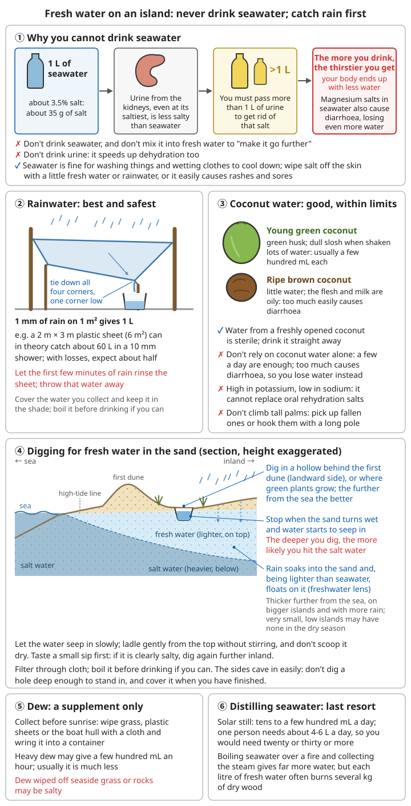

# Desert Island Survival Guide

> In real life, being "stranded on a desert island" usually happens after a boat gets into trouble, a small boat drifts, or someone gathering shellfish is cut off on a sandbar by the tide. Most islands are not far from shipping lanes, fishing grounds or inhabited islands. **The key to staying alive is to keep warm and keep hydrated, make yourself seen, and wait for rescue**, not to settle there for good.
>
> If your phone has signal, call for help first: for distress at sea call 12395; you can also call 110 or 120. For how to give your location clearly when you call, see [Outdoor Trip Preparation and Calling for Help – Calling for help](07-trip-preparation-and-calling-for-help.md#calling-for-help-say-clearly-where-you-are).

## Priorities

### The first 24 hours

```
1. Treat injuries and illness
2. Find/build a temporary shelter
3. Find fresh water
4. Send distress signals
5. Explore your surroundings
```

The list above is a rough order; in practice you will do many things at once. On a tropical island what kills first is usually **the waves, the sun and dehydration**, not hunger.

```
Hour 1: stay alive
1. Get out of reach of the waves and the tide, above the highest drift line
   (see "Shelter – Choosing a site")
2. Count heads; deal with anything life-threatening: press hard on severe bleeding,
   check breathing in anyone who nearly drowned; if they do not respond and are not
   breathing normally, start CPR at once
3. Check everyone's injuries: cuts, fractures, sunburn, chilling; anyone who has been
   in cold water takes off wet clothes and is kept warm
4. Salvage things washed up on the beach, but do not go back into the water for
   things floating in the sea
   (rip currents, breaking waves and reefs are where accidents happen)
5. Try the phone: if there is signal, call for help at once; if not, switch it off
   or put it in flight mode to save the battery

Hours 1–6: shade and water
6. Rest in the shade; do not do heavy work in the hottest part of the day
7. Gather everything that can hold or catch water: bottles, plastic bags, plastic sheet,
   raincoats, tins, coconut shells
8. Set out rain-catchers in advance (tropical showers often come fast and stop fast)
9. If you have fresh water left, drink as you need it; do not force yourself to go
   without (see "Water")

Before dark: getting ready for the night
10. Above the high-tide line, put up a simple lean-to that keeps off sun and rain,
    with the ground raised and kept dry
11. Collect enough dry wood to burn all night and light a fire
    (for warmth, to keep mosquitoes off, and as a night signal)
12. Prepare a signal fire in a conspicuous spot on the beach, ready to light at any time
13. In the cool of early morning or evening, walk a stretch of the shoreline and look for
    people, houses, roads, jetties and fresh water; do not go deep into the jungle alone;
    before you go, tell your companions which way you are going and when you will be back

The first night:
14. Take turns keeping watch over the fire and the signals; watch the tide and the weather
15. Write down the date and what has happened (see "Long-term survival")
```

```
With children, older people or injured people:
- Children and older people dehydrate faster and get sunburn and heatstroke more
  easily than adults; keep them in the shade all the time and give them water first
- Check them every hour or two: are they passing urine, what colour is it,
  are they alert?
- Write down each injured person's condition (when, what injury, what was done)
  and give it to the doctor when rescue comes
```

For assessing the scene, stopping bleeding and CPR see [Basic First Aid](../01-first-aid-and-family-health/00-basic-first-aid.md); for caring for injured people in the wild and recording injuries see [Treating and Evacuating Casualties in the Wild – Write a casualty record](11-wilderness-casualty-care-and-evacuation.md#write-a-casualty-record); for care after someone is pulled out of the water see [Acute Symptoms – Drowning](../01-first-aid-and-family-health/05-acute-symptoms.md#drowning).

## Water

### Why you must not drink seawater

```
Seawater is about 3.5% salt: 1 L of seawater contains about 35 g of salt
Even the saltiest urine your kidneys can make is less salty than seawater
→ After drinking 1 L of seawater you have to pass more than 1 L of urine to get rid of the salt
→ The more you drink, the thirstier you get, and the less water is left in your body
The magnesium salts in seawater also cause diarrhoea, losing still more water

❌ Do not drink seawater, and do not mix seawater into fresh water to "save water"
❌ Do not drink urine: urine is salt and waste the body is getting rid of;
   drinking it back speeds up dehydration just the same
✓ Seawater can be used for washing things and for wetting clothes to cool the body,
  but wipe the salt off your skin with a little fresh water or rainwater where you can,
  or you will easily get rashes and sores
```

### Getting water on an island

**Rainwater** (best):
```
✓ Collect rainwater (containers, plastic sheet)
✓ Channel it with leaves
✓ Dig a pit to collect it
✓ The safest water source
```

```
How much you can collect: 1 mm of rain falling on 1 m² is 1 L
Example: a 2 m × 3 m plastic sheet (6 m²) in a 10 mm shower
         can in theory catch about 60 L; there are losses in practice,
         but catching about half of that is still a lot

How to catch it:
1. Tie the four corners of the sheet to trees or stakes, with one corner low
   and a container underneath
   (or put a stone in the middle to make a dip and poke a small hole under the dip
   to drain it)
2. Lay large palm, plantain or banana leaves at a slant, tips pointing into a container
3. Wrap a strip of cloth round a tree trunk and lead one end into a container;
   it catches the rain running down the trunk
4. Dig a pit in the sand and line it with plastic sheet or several layers of large
   leaves to make a "reservoir"
5. Coconut shells, bamboo tubes and shells can all be containers;
   set them out in advance so they catch water as soon as it rains

Key points:
- Use the first few minutes of rain to rinse the sheet and leaves (they carry sea salt,
  bird droppings and dust); throw that water away and collect after that
- Cover the collected water with a lid or leaves and keep it in the shade,
  so mosquitoes do not lay eggs in it and debris does not fall in
- Boil it before drinking if you can; if you really cannot boil it,
  rainwater caught straight from a clean plastic sheet carries the lowest risk
- Store as much as you can hold: the next rain may be many days away
```

**Dew**:
```
- Wipe the grass with a cloth in the early morning
- Wring it out into a container
```

```
More:
- Collect it before sunrise (it evaporates quickly once the sun is up)
- Dew also forms in the early morning on plastic sheet, boat hulls and sheets of metal;
  wipe it off with a cloth and wring it out
- With heavy dew you may collect a few hundred mL an hour; usually less.
  It can only top up other sources
- Water wiped from salty seaside grass or rocks will taste salty;
  taste it before deciding whether to drink it
```

**Solar still** (last resort, yields very little):
```
1. Dig a pit and put a container in the middle
2. You can put in seawater or wet sand (not touching the container)
3. Spread plastic sheet over it and weigh down the edges firmly
4. Put a pebble in the middle
5. Water evaporates and condenses as fresh water
6. Yield: in real tests usually tens to a few hundred mL a day;
   you may sweat more digging the pit than it produces
   (on an island, collect rainwater first, then use transpiration bags)
```

```
A realistic estimate:
- On a hot island one person needs about 4–6 L of drinking water a day (somewhat less
  if you stay in the shade and move little), more when working and sweating heavily
- One still gives tens to a few hundred mL a day, so you would need twenty or thirty
  or more to supply one person, and digging that many pits costs a great deal of sweat
- So it is only worth it when: you already have clear plastic sheet, little digging
  is needed, and there is no rain or other water source

If you do make one:
- Work in the early morning or evening; do not dig at midday
- By the sea, seawater works better than wet sand: pour seawater into dark dishes or
  tins on the bottom of the pit, and put the collecting container right in the middle
  where seawater cannot splash into it
- The sheet must not touch anything except over the collecting container,
  or the droplets will run back into the pit
- Taste the collected water every day: if it is salty, seawater has splashed in
```

For the general method see [Basic Survival Skills – Solar still](00-basic-survival-skills.md#solar-still-last-resort).

**Distilling seawater over a fire**:
```
When there is plenty of driftwood, boiling seawater over a fire and collecting the steam
gives far more water than a solar still, but uses a lot of wood:
1. Boil seawater in a pot or tin
2. Collect the steam:
   - Lay a cloth over the mouth of the pot; when it is soaked with vapour, wring it out
     into another container; or
   - Let the droplets that condense inside a tilted lid run down it and catch them
     in a container; or
   - If you have a pipe (bamboo or metal), fix one end to the sealed mouth of the pot
     and run the other end through a wet cloth or seawater to cool it;
     condensed water drips from the end
3. The condensed water is fresh water; keep adding seawater to the brine left in the pot
   and boiling it, and keep the salt you get in the end

A realistic estimate: an open fire is very inefficient; each litre of fresh water often
costs several kg of dry wood
Do not let the pot boil dry, and do not let seawater splashing from the boil get into
the collected water
```

**Water from plants**:
```
- Green coconuts (plenty of fresh water)
- Between the nodes of bamboo
- Vines (cut them and the water drips out)
- Transpiration water (a plastic bag over leafy branches)
```

```
Coconut water: good, but within limits
- Young green coconuts (green husk, a dull sloshing sound when shaken) hold plenty of
  water, usually a few hundred mL each; the water in a freshly opened coconut is sterile
  and can be drunk as it is
- Mature brown coconuts hold little water; the flesh and coconut milk are rich in oil
  and eating a lot easily causes diarrhoea
- A few a day is generally enough; do not rely on large amounts of coconut water alone:
  too much causes diarrhoea and loses water; coconut water is high in potassium and low
  in sodium and cannot fully replace oral rehydration salts (ORS)
- Do not climb tall coconut palms (a fall on a desert island can be fatal);
  pick up the ones on the ground or hook down the ones a long pole can reach first

Vine water:
- Only take water that runs out clear, colourless, not bitter and not sticky;
  never drink milky sap or anything bitter or sticky
- Make a cut high on the vine first, then cut it through lower down;
  only then will the water run out

Transpiration bag: tie a clear plastic bag tightly over a sunny branch of green leaves,
        put a small pebble in the lowest corner of the bag, and collect the water after
        a few hours; each bag gives tens to a few hundred mL a day.
        Water collected from a poisonous plant must not be drunk
```

**Groundwater**:
```
On a beach:
1. Dig a pit in a low spot above the high-tide line, behind the first dune
2. Stop as soon as water seeps in (often less than 1 m down); do not keep digging deeper
3. Fresh water may seep in (it is lighter than seawater and floats on top)
4. You must purify it!
```

```
How it works: rain soaks into the sand and, being lighter than seawater, forms a
      "freshwater lens" floating on top of the seawater; the farther from the sea,
      the bigger the island and the more it rains, the thicker this layer is;
      very small, low islands may have none in the dry season

How to dig:
1. Where: behind the first dune (on the landward side), in a hollow,
   or where green plants grow near the shore; the farther from the sea the better
2. Stop as soon as the sand turns damp and water starts to seep in;
   do not keep digging deeper
   (the actual depth depends on the ground; sometimes there is water less than 1 m down;
   the deeper you dig, the more likely you are to reach the salt water below)
3. Wait for the water to seep in slowly; scoop gently from the surface with a container,
   do not stir it up and do not scoop it dry in one go
4. Taste a small sip first: if it is clearly salty, do not drink it;
   dig again farther inland
5. Filter it through cloth, and boil it before drinking if you can
6. The sides collapse easily; do not dig a pit deep enough to stand in;
   cover it after use so nothing falls in

Other clues:
- At low tide you can sometimes see fresh water seeping out of the sand or rock cracks
  on the beach or at the foot of cliffs (flowing towards the sea)
- Where a stream runs into the sea, walk some way upstream and take water where
  the tide cannot reach
```

For purifying water see [Basic Survival Skills – Water purification](00-basic-survival-skills.md#water-purification); for rainwater collection when staying long-term see [Water Engineering and Supply – Collecting rainwater](../../../docs/07-日常生活技能/10-水源工程与供水.md#收集雨水).

**⚠️ Never**:
```
❌ Drink seawater! (you dehydrate faster)
❌ Drink urine! (urine is the salt and waste your body is getting rid of)
```



*Figure: the height of the beach cross-section is exaggerated; stop as soon as water seeps in, because digging deeper may reach the salt water below. Dew and stills yield very little and can only top up other sources*

### How to drink and save water

```
✓ When you have water, drink as you need it; do not force yourself to go without —
  water is better kept in your body than in the bottle
  The real way to save water is to "sweat less":
  - Rest in the shade in the hottest part of the day (about 10:00–16:00);
    leave work for early morning and evening
  - Keep your clothes on and wear a hat; do not sunbathe naked (you sweat more)
  - Talk little and breathe through your nose
  - You can soak your clothes in seawater and put them back on to cool down,
    but watch your skin for rashes
✓ When water is short, eat less, especially meat, fish and salty food
  (digesting them needs more water)
✓ Check your urine every day: pale yellow, several times a day → roughly enough;
  dark yellow, very little, or none all day → you are dehydrated; drinking comes first
❌ No alcohol, no smoking
```

For recognising dehydration see [Common Illnesses – Recognising dehydration](../01-first-aid-and-family-health/01-common-illnesses.md#recognising-dehydration).

## Shelter

On a tropical island, shelter is first of all for **shade and keeping off rain**, then for wind and insects. A single day exposed to the blazing sun is enough to cause severe sunburn and heatstroke.

### Choosing a site

```
✓ Near water
✓ Above the high-tide line!
✓ Sheltered from the wind
✓ Close to the signal area (visible from the beach)
✓ Close to resources (wood, food)

❌ Avoid:
- Places the tide can reach
- Directly under coconut palms (falling coconuts are dangerous)
- Under rocks (flooded at high tide)
```

```
How to judge the high-tide line:
- The lines of seaweed, wood and rubbish on the beach ("drift lines")
  were left by the tide at different times
- The one farthest inland is usually where the sea reached at spring tides or in storms
- The shelter must be above the highest line, with a few more metres to spare;
  best of all behind a dune a few metres above the sea, or at the edge of the woods

Other places to avoid:
- Dry stream beds and hollows (they become channels in heavy rain)
- Below cliffs and steep slopes (falling rocks), under dead or leaning big trees
  (falling branches)
- Places thick with ant nests or crab holes
- Deep in dense jungle: hot and stuffy, full of mosquitoes, and hard to see you

A compromise: where the beach meets the woods, the sea breeze blows the mosquitoes
away, the trees give shade, and the signal area is close
```

### Simple shelters

**Lean-to**:
```
1. Find two trees or put up posts
2. Lay a ridge pole across
3. Lean sticks against it
4. Cover with:
   - Palm leaves (like roof tiles, from the bottom up)
   - Grass
   - Bark
5. Spread dry grass and leaves on the ground
```

```
Key points:
- Turn the open side away from the prevailing wind; in the rainy season dig a shallow
  drainage ditch along the open side
- Lay coconut and palm leaves thickly, at least several layers, overlapping like tiles
  from the bottom up; the fewer gaps, the fewer leaks
- If you have plastic sheet or canvas, lay it under the leaves; it keeps rain out much
  better. But do not use clear plastic sheet for shade
- The roof must be steep enough for rain to run off rather than pool and leak through
- Lash the ridge pole and posts tightly with vines, cloth strips or bark
  (for knots see the chapter on rope and knots)

Quickest shade: stretch a cloth or plastic sheet between two trees, leaving a gap above
                your head; two layers are better (with a small gap between them it
                insulates noticeably better)
```

**Improvements**:
```
✓ Raise it off the ground (against insects, damp and high tides)
✓ Thick covering (against rain)
✓ Smoke to keep off mosquitoes and insects
```

```
Where to sleep:
- Build a sleeping platform of wood or bamboo a few tens of cm off the ground and cover
  it with dry leaves and dry grass; it keeps you away from sand fleas, crabs, ants and
  the damp ground
- Nights by the sea are windy and can be cold, especially after a soaking in the rain;
  have dry covers ready
- If you have a mosquito net or gauze, hang it over the bed;
  in the tropics mosquitoes may carry malaria and dengue
```

For building methods and knots see [Basic Survival Skills – Building shelters](00-basic-survival-skills.md#building-shelters) and [Rope and Knots](../../../docs/07-日常生活技能/17-绳索与结绳.md).

### Protection from storms and big waves

```
Tropical islands often get typhoons (summer and autumn); a simple lean-to will not
stand up to a typhoon

Warning signs:
- The swell at sea grows bigger and longer while the local wind is still light
- High cirrus clouds fan out from one direction across the sky,
  then the cloud grows thicker and lower
- The wind keeps changing direction and gradually strengthens; seabirds fly inland

What to do:
✓ Move water, fire-making materials, tools and food in advance to higher, sheltered
  ground on the island (behind big rocks, hillsides or solid stands of trees;
  not on open beach or under lone big trees)
✓ When the wind and rain are at their worst, lie low on the lee side of rocks or
  earth banks, away from trees that may snap
✓ If the wind suddenly drops and the sky clears, the eye of the typhoon may be passing;
  the wind will soon return from the opposite direction. Do not go out
✓ In thunderstorms, leave the beach and the water's edge

⚠️ If you feel an earthquake, or see the sea suddenly draw back a long way and expose
   seabed you normally cannot see:
   it may be a tsunami. Run at once to the highest point on the island;
   do not go to the beach to look
```

For more on typhoons see [Weather Disasters – Typhoons/hurricanes](../02-disaster-response/02-weather-disasters.md#typhoonshurricanes); for storm surges and tsunamis see [Marine Disasters – Storm surge](../02-disaster-response/03-ocean-disasters.md#storm-surges) and [Marine Disasters – Tsunami](../02-disaster-response/03-ocean-disasters.md#tsunamis); for lightning see [Weather Disasters – Lightning safety outdoors](../02-disaster-response/02-weather-disasters.md#lightning-safety-outdoors).

## Fire

### Lighting a fire

**Tinder**:
```
- Dry coconut husk fibre (excellent)
- Dry bark
- Dry grass
```

```
More:
- The brown fibre of the outer coconut husk, torn into fine threads and fluffed up,
  makes excellent tinder; dry coconut shell itself burns long and works as medium fuel
  once the fire has caught
- Dead dry palm leaves and the net-like fibre on palm trunks also work well
- On sunny days spread tinder and kindling out to dry in advance,
  then keep them inside the shelter
- With glasses, a magnifying glass, the concave reflector of a torch, or a clear bottle
  full of clean water, you can focus sunlight to light a fire on sunny days
```

**Fuel**:
```
✓ Driftwood (plenty)
✓ Dry it in the sun first
✓ Hardwood burns longer
```

```
Note:
- Wood soaked in seawater contains salt; it will still burn once dried,
  but the flame is small and it tends to crackle and spit; dry it by the fire first
- Painted or preservative-treated boards, plastic and rubber give off toxic smoke;
  use them only for signal fires, not for cooking, and never burn them in the shelter
- Put thick driftwood beside the fire to dry while you use it
```

**Protecting the fire**:
```
✓ Shield it from the wind
✓ Shield it from rain (cover)
✓ Keep embers alive (bank them with ash)
```

```
⚠️ Fires on sand: after the fire is out, the charcoal and hot sand buried underneath
   can stay scalding for hours
   → Soak it thoroughly with water before you leave; do not just cover it with sand.
     Someone walking barefoot on it (children especially) can be badly burned
⚠️ Keep the fire well away from the shelter's leaf roof so sparks cannot set it alight
```

For methods of lighting a fire see [Basic Survival Skills – Fire-lighting methods](00-basic-survival-skills.md#ways-to-make-fire); for keeping embers see [Basic Survival Skills – Keeping embers alive](00-basic-survival-skills.md#keeping-fire).

## Food

A person can live for weeks without food, so **do not take risks to find food**, and do not eat much when water is short. By the sea the easiest and safest foods are shellfish, sea snails, crabs and fish, but every one of them carries a risk of poisoning.

### Food from the sea

**Shellfish** (easiest):
```
✓ Oysters and barnacles on rocks
✓ Clams on sandy beaches (dig where you see breathing holes)
✓ Collect at low tide

Safety:
- Cook them thoroughly!
- Avoid red-tide seasons (red-tide toxins are not destroyed by cooking!)
- Eat them fresh
```

```
How to choose:
✓ Only live ones: bivalves shut tight, or open shells that close when touched;
  sea snails withdrawn into the shell, with the lid (operculum) moving when touched
✓ Collect in clear water with a good flow; not near river mouths or sewage outlets,
  and not where dead fish float, the water is discoloured or it smells
❌ Not broken shells, shells that are open and do not close, smelly ones or ones that
   feel light and empty
❌ Never eat dead shellfish or dead fish washed up on the shore
❌ In some tropical areas mussels are often toxic in summer; some survival manuals
   advise against eating mussels in the tropical summer

How to eat them:
- Bring to the boil and keep boiling for a few more minutes until all the shells open;
  throw away any that stay shut after boiling
- Remove the guts (the dark digestive gland, where the toxin is most concentrated),
  and eat only small amounts
- The first time you collect shellfish in a place, eat only a little and watch for
  a few hours

⚠️ If within tens of minutes to a few hours of eating shellfish the lips, tongue or
   fingers go numb or tingle, or you feel dizzy and unsteady:
   it may be paralytic shellfish poisoning (the toxin is not destroyed by cooking)
   → Everyone stops eating that batch of shellfish at once; do everything you can
     to get help
   → Lay the poisoned person on their side and have someone stay with them at all times;
     if breathing gets weaker or stops, start rescue breaths and CPR at once —
     the danger of this poisoning is paralysis of the breathing muscles; as long as you
     keep breathing for them, the toxin is gradually cleared over a day or two
```

**Cone snails**: the pretty cone-shaped shells common on tropical reefs; the live snail inside can fire a venomous dart that can kill. **Never pick up any live cone-shaped snail by hand**.

For red tides, shellfish poisoning and other toxic seafood see [Marine Disasters – Red tides and toxic seafood](../02-disaster-response/03-ocean-disasters.md#red-tides-and-toxic-seafood).

**Fish**:
```
Methods:
- Fish spear (sharpened stick, several prongs)
- Fish hooks (bone, bent wood)
- Tide pools (fish trapped as the tide goes out)
- Improvised net (clothing)

Tips:
- Attract fish with a torch at night
- Fish come into the shallows on the rising tide
```

```
Less effort:
- In the intertidal zone, build a low semicircular wall of stones with the opening
  facing the land; fish swim in on the rising tide and are trapped as it falls
- Use shellfish meat, crab meat or worms as bait; line can be unpicked from clothing
  or backpack straps
- Wear shoes when fishing in the water; do not go in at the edge of a reef or where
  the waves are big, and do not go into the sea at dusk or at night

Fish not to eat:
❌ Pufferfish: can blow themselves up into a ball, spiny or scaleless skin,
   beak-like teeth (pufferfish toxin is not destroyed by cooking;
   a tiny amount can kill)
❌ Boxfish: body like a hard box
❌ Large predatory fish from tropical coral reefs (big groupers, barracuda, moray eels, etc.):
   may carry ciguatera toxin
   → Eat small fish by preference; never eat the guts, liver or roe of any fish
❌ Dead fish washed up on the shore, and fish that are not fresh (dark gills,
   cloudy eyes, flesh that does not spring back when pressed, a bad smell)

Handling:
- In tropical heat fish go off within a few hours; gut them as soon as they are caught
  and boil or roast them as soon as possible
- Cut what you cannot eat into thin slices and sun-dry or smoke them
  (see "Long-term survival")
```

For pufferfish, ciguatera and the like see [Marine Disasters – Other toxic seafood](../02-disaster-response/03-ocean-disasters.md#other-toxic-seafood); for stabs from fish fins and spines see "Dangers" in this chapter.

**Crabs**:
```
- Active at night
- Lure them with a light/torch
- Watch out for the claws
- Cook them thoroughly
```

```
- Do not eat small, brightly coloured or patterned reef crabs; some kinds (such as the
  mosaic reef crab) carry toxins similar to paralytic shellfish toxins that cooking
  does not destroy
- Always cook them right through: crabs (especially land and freshwater crabs)
  may carry parasites
- Do not eat crabs that are already dead
- To catch one, press down on the back of the shell from behind and keep your fingers
  clear of the claws
```

**Seaweed**:
```
- Many green seaweeds (sea lettuce, which looks like thin green lettuce leaves,
  and gutweed), brown seaweeds (kelp, wakame) and laver (nori) are edible
- Only collect fresh, springy seaweed attached to rocks; not rotting seaweed washed ashore
- Rinse it in fresh water or rainwater, and boil it until soft if you can
- Eat only a little: seaweed is very salty and eating a lot makes you thirstier;
  do not eat it when water is short
❌ Do not eat: slimy blue-green "algae" in clumps that look like hair or jelly
   (may be toxic cyanobacteria); seaweed that smells sour or acrid
❌ Do not eat anything you do not recognise
```

### Food on land

**Coconuts**:
```
Getting them:
- Pick them up from the ground (check they are fresh)
- Climb the palm to pick them (dangerous)
- Hook them down with a long pole

Opening a coconut:
1. Find the coconut's "eyes" (three spots)
2. Pierce them with a pointed stone/stick
3. Pour out the water
4. Smash it open to get the flesh
```

```
More:
- First strip off the thick fibrous husk: drive a sharpened hardwood stick or a pointed
  stone firmly into the ground, point up, then slam and lever the coconut onto the point
  and strip the husk off piece by piece; keep the fibre for tinder
- One of the three "eyes" is softer and can be pierced with something pointed
- After drinking the water, tap round the coconut's "waist" with a stone, round and
  round, and it will split in two
- Flesh: young coconut flesh is soft and can be scraped out with a spoon;
  old coconut flesh is hard and oily, so eat only a little
- A sprouted coconut contains a spongy "coconut apple" that is edible
- When choosing coconuts, shake them: reject any with no sound of water,
  a bad smell, or cracks leaking juice
```

**Edible plants**:
```
Common:
- Palm heart (the young shoot)
- Bananas, plantains
- Papaya
- Seaweed (some kinds)

⚠️ If in doubt, do not eat it!
```

```
- Only eat plants you can identify with 100% certainty
- Taking palm heart means cutting out the terminal bud of the whole tree,
  and the tree dies; do it only occasionally
- Some common island plants are deadly poisonous (for example the fruit of the sea mango,
  Cerbera, which looks like a small mango; eating it can be fatal).
  Never try anything that looks like fruit but that you do not recognise
- The universal edibility test is only a last resort in extreme situations;
  it is not safe for deadly poisonous plants and does not work for mushrooms
```

For the limits of the edibility test see [Basic Survival Skills – Testing plants for edibility](00-basic-survival-skills.md#edibility-test-for-plants); for wild greens and mushrooms see [Poisonous Mushrooms and Wild Plant Poisoning](09-poisonous-mushrooms-and-wild-plants.md).

**Insects**:
```
✓ Beetle larvae (in rotting wood)
✓ Termites
✓ Grasshoppers
- Cook before eating
```

```
⚖️ The law: in normal times sea turtles, giant clams, corals, coconut crabs and others are
   protected species and must not be taken; many places also have closed fishing seasons
   and banned fishing methods. The food-gathering methods in this chapter are only for
   genuine survival emergencies
```

## Signals and rescue

On an island, **being seen** is the most important step towards rescue. By day use reflections, smoke and large ground letters; at night use firelight and torches. Keep them ready all the time: a rescue boat or aircraft may be in view for only a minute or two.

### Signalling methods

**Smoke**:
```
Most effective by day:
- Three fires (in a triangle)
- Add damp grass and leaves for thick smoke
- White smoke (damp grass) or black smoke (rubber, oil)
- Keep them burning
```

```
- Three fires in a triangle, about 20–30 m apart, on open beach
  (three fires, three whistle blasts and three flashes are the international distress signal)
- Build each fire in advance: dry tinder and kindling at the bottom, thicker wood on top,
  and a heap of green leaves and wet seaweed on top of that
  (it makes thick smoke and also keeps rain off the dry wood beneath)
- Light them as soon as you see a boat or hear an aircraft engine;
  once they are alight, add green leaves to make more smoke
- Against a pale sky use black smoke (rubber, oil, plastic);
  against dark forest use white smoke (green leaves, damp grass)
- Keep a small fire burning at all times so the signal fires can be lit quickly
```

**Firelight**:
```
At night:
- Three fires
- Tall flames
- On a clear night visible from the air for more than ten-odd km
```

**Reflection**:
```
Materials:
- Mirrors, sheets of metal
- CDs, phone screens
- Polished tins

How to use:
- Sweep across the sky and the horizon
- Signal as soon as you see an aircraft/boat
- Aim with a V-sign
```

```
Aiming with a V-sign:
1. Hold the mirror in one hand just below your eye
2. Stretch out the other arm with the index and middle fingers spread in a V,
   and put the target (boat, aircraft) in the middle of the V
3. Turn the mirror until the bright spot of reflected light falls on the two fingers of the V
4. When the spot is on your fingers, the reflection is pointing straight at the target;
   rock the mirror gently up and down to make it flash
- With a signal mirror that has a hole in the middle, look at the target through the hole
  and adjust until the "light spot" on the mirror is on the target
- On a sunny day a reflection can be seen several km away;
  it is one of the best daytime signals
- When you cannot see a target, sweep back and forth along the horizon now and then;
  someone far away may see you
- Once an aircraft is flying towards you and has clearly seen you,
  do not keep shining it at the cockpit (it dazzles the pilot)
```

**Ground markers**:
```
On the beach/in a clearing:
- SOS (large letters, at least 3 m high)
- HELP
- V (need assistance), X (need medical assistance)
- Lay them out with stones, wood or seaweed
- Make them contrast clearly with the surroundings (dark/light)
```

```
How to make large letters visible from the air:
- The bigger the better: each letter at least 3 m high, 10 m is better;
  strokes about 1 m wide
- Lay them out above the high-tide line on flat, open beach, not hidden by trees
- On white sand use dark seaweed, wood or dark stones; or dig trenches —
  the shadows in them can be seen from the air
- Keep lines straight and corners sharp; nature has few straight lines and right angles
- Check and repair them after high tides, strong wind and rain
```

For the meanings of ground-to-air signals see [Basic Survival Skills – Ground-to-air signals](00-basic-survival-skills.md#ground-to-air-signals).

**Sound**:
```
- Whistle (three short blasts)
- Banging metal
- Shouting
```

**Flags**:
```
- Brightly coloured clothing
- Tied up high
- Waved
```

**Electronic devices**:
```
- Phone: try for signal on high, open ground on the island; if a call will not go
  through, try sending a text (a text needs less signal)
- Normally keep it switched off or in flight mode; switch it on at a fixed time each day
  to try, to save the battery
- If you have a personal locator beacon, satellite communicator or the boat's VHF radio,
  use it as instructed
- At night signal with a torch or phone flashlight towards any ship's lights you see:
  three short, three long, three short (SOS)
```

### Staying visible

```
✓ Keep the beach signal fire ready
✓ Go to the beach to watch regularly
✓ Build a raised lookout
✓ Keep the signal markers clear
```

```
✓ At fixed times every day (morning, noon and evening) someone goes to the beach or
  high ground to watch the sea and sky
✓ Hang a brightly coloured cloth flag at the most conspicuous high point on the island
  (headland, hilltop, tallest tree)
✓ Stay in one place: it is much easier for rescuers to find a fixed camp than a person
  who keeps moving
✓ When you leave camp, leave a sign there (an arrow, a note saying where you went and when)
❌ Do not be quick to build a raft or swim away from the island: distances at sea
   usually look much shorter than they are, and currents, wind and waves, sun and lack
   of water make leaving far more dangerous than staying;
   only consider it if you are sure rescue will not come, the far shore is close and
   clearly visible, and you have a reliable flotation aid
```

For what to do while waiting for rescue at sea see [Marine Disasters – Waiting for rescue](../02-disaster-response/03-ocean-disasters.md#waiting-for-rescue).

## Dangers

### Animals

**Sharks**:
```
Avoid:
- Swimming at dusk/at night
- Going into the water while bleeding
- Murky water
- Swimming alone

If you meet one:
- Stay calm
- Face it
- Move slowly
- If it attacks: hit its nose, eyes, gills
```

```
More:
- Do not go into the water near where fish are cleaned or guts are thrown
- Do not wear shiny jewellery in the water
- If you see a shark, back slowly onto the shore or a rock; do not splash or thrash about
- The greatest danger after a bite is severe bleeding: once ashore, press hard directly
  on the wound at once; if severe bleeding from a limb cannot be controlled by pressure,
  consider a tourniquet
```

For stopping bleeding see [Basic First Aid – Methods of stopping bleeding](../01-first-aid-and-family-health/00-basic-first-aid.md#stopping-bleeding).

**Venomous creatures**:
```
- Jellyfish: keep away; after a sting rinse with seawater (not fresh water) and carefully
  remove the tentacles; vinegar only works for some kinds (such as box jellyfish) and may
  make Portuguese man o' war stings worse
- Sea snakes: highly venomous, do not touch
- Stonefish: camouflaged, look before you step
- Sea urchins: spines go into the skin; pull out visible spines with tweezers; soak the
  area in hot water (about 45°C, not scalding) for 30–90 minutes to ease the pain;
  do not use urine
```

| Creature | How you get hurt | What to do | When to get to hospital fast |
|------|----------|------|----------------------|
| Jellyfish | Touching the tentacles; instant burning pain, red streaks on the skin | Get out of the water; rinse with seawater (fresh water makes the remaining stinging cells keep releasing venom); scrape off remaining tentacles with tweezers, with gloves on or with the edge of a card — not with bare hands and not by rubbing with sand; after removing the tentacles soak in water as hot as can be tolerated (about 45°C) for about 20 minutes for pain; use a cold compress if there is no hot water | Difficulty breathing, chest pain, change in consciousness, rash all over the body (allergy); stings over a large area; children; stings from a translucent box-shaped jellyfish (box jellyfish) in tropical Indo-Pacific waters — can be life-threatening within minutes |
| Sea urchin | Stepping on or putting a hand on one; spines go into the skin and break off | Remove spines that stick out; soak in hot water (about 45°C) for 30–90 minutes; black spots left on the skin may just be staining, do not dig deep with a needle | Spines in a joint or deep in the palm; worsening redness, swelling and pus after a few days |
| Stonefish, lionfish and other venomous fish | Stepping on a stone-like camouflaged fish on a reef, or touching venomous fin spines; severe pain | Rinse the wound, soak in hot water (about 45°C) for 30–90 minutes for pain; keep the limb low and still | Stonefish stings are intensely painful and can cause collapse and difficulty breathing; get to hospital fast |
| Stingray | Stepping on a ray buried in the sand; the serrated spine on its tail goes into the leg or foot; bleeding, severe pain | Press to stop bleeding, rinse, soak in hot water for pain; fragments of the spine may be left in the wound | If the spine is in the chest, abdomen or neck do not pull it out; fix it in place and get to hospital at once; the wound generally needs a doctor to clean it out |
| Cone snail, blue-ringed octopus | Stung or bitten when picked up by hand; may not hurt much at first | Keep the casualty calm and still; if the wound is on a hand or foot, use a wide elastic bandage or cloth strips starting from the fingers/toes, cover the wound and wrap upwards along the whole limb, then splint it (as for a neurotoxic snakebite); there is no antidote | Both can cause paralysis of the whole body and stop breathing → call for help at once; if breathing weakens or stops, keep giving rescue breaths and CPR |
| Sea snake | Bitten in the sea or in a crevice in the reef; the bite itself does not hurt much | Treat as a venomous snakebite; immobilise the limb | Always get to hospital as fast as possible; drooping eyelids and difficulty swallowing and breathing can appear within a few hours |

```
Hot-water soaking, key points:
- About 45°C, judged as "not scalding"; the rescuer tests the temperature with their own
  uninjured hand first
  (the injured area is very painful, so the casualty cannot judge and is easily scalded)
- Top up with hot water as it cools; soak again if the pain comes back
- Do not apply urine, alcohol or raw meat; do not cut or suck the wound

Prevention:
✓ Wear shoes in the water and when walking on reefs and in the shallows
  (even broken shoes or "shoes" tied on from cloth and bark are better than bare feet)
✓ In shallow sandy water, shuffle your feet and prod ahead with a stick to scare rays away
✓ Do not put your hands into reef crevices and holes you cannot see into
✓ Do not pick up live sea snails, and do not touch anything brightly coloured or unknown
  in the sea
✓ Jellyfish washed up on the shore can still sting with their tentacles, even when dead
```

For snakebites see [Wound and Injury Care – Snakebites](../01-first-aid-and-family-health/02-wounds-and-injuries.md#snakebites); for allergic reactions see [Acute Symptoms – Allergic reactions](../01-first-aid-and-family-health/05-acute-symptoms.md#allergic-reactions); for foreign bodies in the body see [Wound and Injury Care – Puncture wounds](../01-first-aid-and-family-health/02-wounds-and-injuries.md#puncture-wounds).

**Dangers on land**:
```
- Snakes: walk carefully
- Scorpions: check shoes and clothes
- Spiders: check the shelter
```

```
More:
- Shake out your shoes and clothes before putting them on in the morning
- At night walk with a torch or flashlight and sweep the grass ahead with a stick
- After a centipede, scorpion or venomous spider bite, rinse and apply a cold compress;
  if there are symptoms all over the body, or a child is bitten, get medical help quickly
- Mosquitoes: use smoke, wear long sleeves, cover up when sleeping;
  in the tropics mosquitoes carry malaria and dengue
```

For snakes and other dangerous animals in the wild see [Wasps, Ticks and Dangerous Animals](10-wasps-ticks-and-dangerous-animals.md).

### The environment

**Sun**:
```
✓ Shade (hat, shelter)
✓ Avoid being outside from 10:00 to 16:00
✓ Stay hydrated
```

```
Sunlight by the sea is stronger than inland: water and white sand reflect ultraviolet,
and you can burn even on a cloudy day

Sun protection:
- Wear long sleeves and long trousers where you can; without a hat, make a head cloth
  that covers the back of the neck and the ears
- Skin coated in salt, or a wet body, burns more easily
- Eyes: staring for a long time at a glittering sea and beach makes the eyes sting,
  water and feel gritty; "goggles" made of bark, cloth strips or coconut shell with only
  a narrow slit to see through help

After sunburn:
- Get into the shade at once, apply cool wet cloths and drink plenty of water
- Do not burst blisters; keep them clean
- Blisters over a large area, fever and chills, headache and nausea → treat it as
  a burn and a heat illness; get medical help quickly

Warning signs of heat illness:
- Heavy sweating, dizziness, nausea, weakness, thirst → heat exhaustion: get into the
  shade at once, drink water, and fan the person with a wet cloth to cool them
- Very high body temperature, confusion, delirium, seizures → heatstroke,
  life-threatening: cool them at once by every means possible (immerse in cool water,
  pour water over them, fan them) and call for help at the same time
```

For treating sunburn see [Wound and Injury Care – Scalds and burns](../01-first-aid-and-family-health/02-wounds-and-injuries.md#scalds-and-burns); for grading heat illness and cooling see [Acute Symptoms – Heatstroke](../01-first-aid-and-family-health/05-acute-symptoms.md#heatstroke).

**Coral cuts and seawater wounds**:
```
Coral, oyster shells and barnacles are extremely sharp; the cuts they make look small but
get infected easily and heal slowly; bacteria in seawater (such as Vibrio vulnificus)
can also cause a severe infection within a day or two

What to do:
1. Rinse with plenty of clean fresh water (ideally boiled and cooled), scrub with soapy
   water if you have soap, and wash out every bit of coral debris and sand
2. Pick out visible debris with sterilised tweezers
3. Disinfect with povidone-iodine if you have it, then cover with a clean cloth;
   check it and change the dressing every day
4. After the injury, try not to soak it in seawater again
5. Look at the wound every day: spreading redness and swelling, more and more pain, pus,
   red streaks, fever
   → infection; on a desert island this is serious — do everything you can to get help
   Severe pain, rapid swelling, blood blisters or purple skin within a few hours to
   a day or two
   → may be a life-threatening infection; call for help at once

✓ Prevention matters more than treatment: wear shoes and gloves (or wrap your hands in cloth),
  do not walk barefoot on reefs, and do not let the waves push you onto the reef
```

For wound care and signs of infection see [Wound and Injury Care – Cuts and grazes](../01-first-aid-and-family-health/02-wounds-and-injuries.md#cuts-and-grazes) and [Treating and Evacuating Casualties in the Wild – Wounds](11-wilderness-casualty-care-and-evacuation.md#wounds); for tetanus see [Wound and Injury Care – Preventing tetanus](../01-first-aid-and-family-health/02-wounds-and-injuries.md#tetanus-prevention); for the dangers of seawater wounds see [Marine Disasters – Swimming and other precautions](../02-disaster-response/03-ocean-disasters.md#swimming-and-other-precautions).

**Tides**:
```
✓ Watch the high-tide line
✓ Do not build a shelter in the tidal zone
✓ Learn the tide times (about every 12 hours)
```

```
How tides work:
- Most coasts have two high tides and two low tides a day; consecutive high tides are
  about 12 hours 25 minutes apart, so high tide each day is about 50 minutes later than
  the day before
- Around new moon and full moon the tide rises highest and falls lowest (spring tides)
- In the first few days, drive a pole in at a fixed spot and note the times and positions
  of high and low tide; after that you can work them out in advance

Dangers linked to tides:
❌ Walking out at low tide to forage on distant sandbars or reef flats,
   then being cut off and drowned as the tide comes in
   → Start back at low tide at the latest; remember that hollows and tidal channels
     behind you fill first
❌ Standing on rocks within reach of the waves with your back to the sea
   (a sudden big wave can sweep you off)
❌ Going into the water where there is a stretch of calm, dark water with waves
   breaking on both sides: it may be a rip current
   → If you are carried away, do not swim against it towards the shore;
     float first, then swim out sideways, parallel to the shore
```

For recognising and escaping rip currents see [Marine Disasters – Rip currents](../02-disaster-response/03-ocean-disasters.md#rip-currents); for tides and being cut off by the tide see [Marine Disasters – Shore gathering and being cut off by the tide](../02-disaster-response/03-ocean-disasters.md#gathering-shellfish-and-getting-cut-off-by-the-tide); for dangers on rocks see [Marine Disasters – On rocks and at the shore](../02-disaster-response/03-ocean-disasters.md#rocks-and-the-shoreline).

## Long-term survival

If you are still not rescued after a few days, turn the temporary camp into somewhere you can live for a long time, and at the same time **never stop signalling, not even for a moment**.

### Managing resources

```
✓ Do not overfish any one spot
✓ Use your sources in rotation
✓ Preserve food (smoking, drying)
✓ Store fresh water (containers)
✓ Keep the fire alive
```

```
Water:
- Fill every container you can whenever it rains; use coconut shells, bamboo tubes,
  hollowed-out logs and pits in the sand lined with plastic sheet as storage, and cover them
- Keep track of how much water you use each day, how much is left and how often it rains,
  so you know where you stand

Food:
- Cut fish into thin slices, rub them with salt (or dip them in concentrated seawater),
  then dry them on a rack in the sun or smoke them
- Keep off flies and rain while drying; dry until hard before storing;
  throw away anything mouldy, slimy or smelly

Salt:
- Boiling seawater, or letting seawater dry out in small hollows in the rocks,
  both give salt; do not use the bitter part that comes out last (bittern)
- Use salt to cure fish and to replace salt lost in sweat; but do not eat more just
  because you have salt, especially when water is short
```

For sun-drying and smoking see [Food Processing and Preservation – Sun-drying and air-drying](../../../docs/07-日常生活技能/01-食物加工与保存.md#晒干与风干) and [Food Processing and Preservation – Smoking](../../../docs/07-日常生活技能/01-食物加工与保存.md#烟熏); for making salt from seawater see [Salt Making – Salt from seawater](../../../docs/07-日常生活技能/15-制盐.md#海水取盐-基本道理) and [Salt Making – Boiling salt](../../../docs/07-日常生活技能/15-制盐.md#煮盐-先浓缩再煮).

### Staying healthy

```
✓ Personal hygiene (prevent infection)
✓ Balanced diet
✓ Enough to drink
✓ Wound care
✓ Avoid overexertion
✓ Stay hopeful and positive
```

```
In practice:
- Dig a latrine pit at least 30 m from camp and the water source, downwind,
  near the high-tide line; cover with soil after each use
  (or go to the water's edge at low tide, far from camp)
- Wash your hands in clean water before meals and before treating wounds where you can;
  if fresh water is short, wash in seawater and rinse with a little fresh water
- Check your feet and skin every day: clean and cover even small cuts;
  feet that stay wet for long rot easily, so let them dry out at night
- When living on fish and shellfish, also eat some fruit you can identify (coconut,
  papaya, banana) and seaweed where you can, for vitamins
- Diarrhoea is one of the commonest illnesses on a desert island, usually from dirty
  water or seafood that is not fresh: boil water where you can and cook seafood
  thoroughly; with diarrhoea drink more, and you can mix a little salt and sugar into
  clean water to rehydrate
```

For diarrhoea and rehydration see [Common Illnesses – Diarrhoea](../01-first-aid-and-family-health/01-common-illnesses.md#diarrhoea); for where and how to make a latrine see [Sanitation](../../../docs/07-日常生活技能/03-卫生设施.md).

```
Mind:
- Loneliness, anxiety and despair are common when adrift or stranded, and they can lead
  to dangerous decisions (such as risking a raft to leave, or drinking seawater)
- Set small goals every day: fix the roof today, make two water containers today
- With companions, share the work and talk things over together every day;
  alone, you can talk to yourself and keep a diary
- Mark the days: cut a notch in wood or a stone every day so you do not lose track of time
```

For coping psychologically see [Mental Health](../01-first-aid-and-family-health/10-mental-health.md).

### Daily routine

```
Set a routine:
- Morning: check signals, collect dew
- Daytime: improve the shelter, forage, make tools
- Evening: prepare food, water and fuel
- Night: keep the fire going, rest
```

```
Adjusted for tropical weather:
- Early morning (around sunrise): collect dew; do heavy work while it is cool (chopping
  wood, moving logs, repairing the shelter); forage at low tide
- Around midday (about 10:00–16:00): rest in the shade and do handwork (making rope and
  containers, mending tools), with someone watching the sea at the same time
- Evening: forage, fish, prepare the next day's wood and tinder
- Night: take turns tending the fire; on clear nights watch for lights at sea,
  ready to signal at any moment
- Every day: check the signal fire and ground letters, check the water store,
  mark the day
- Time your foraging by the tide, using the tide times you recorded earlier
```

## 📝 Desert island survival: key points

```
Priorities:
1. Fresh water (you survive 3 days without it)
2. Shelter (from sun, rain and wind)
3. Fire (cooking, signalling, keeping insects off)
4. Food (the sea is rich in it)
5. Signals (keep at it)

Attitude:
✓ Stay hopeful
✓ Stay busy
✓ Set goals
✓ Keep track of the date
✓ Believe you will be rescued
```

```
The most important points:
❌ Do not drink seawater, do not drink urine
✓ Rainwater is the best source; set out catchers in advance; solar stills yield very little
✓ Build the shelter above the highest drift line; shade comes first
✓ Rest in the hottest part of the day; sweating less matters more than rationing water
✓ Keep the signal fire ready; light it and flash a mirror as soon as you see a boat or aircraft
✓ Do not eat fish, shellfish or plants you do not recognise; if your lips go numb after
  eating seafood, stop eating at once and call for help
✓ Wear shoes in the water and on reefs; wash out coral cuts thoroughly
✓ Stay on the island and wait for rescue; do not be quick to leave on a raft
```

---

**Next chapter**: [Forest Survival](02-forest-survival.md)
**Back**: [Chapter index](README.md) | [Main contents](../../README.md)
