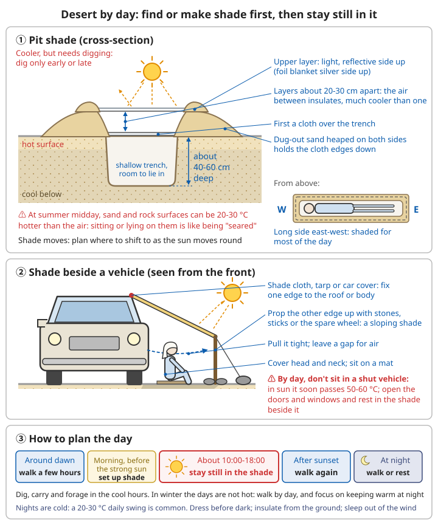

# Desert Survival Guide

## Core challenges

```
- Extreme lack of water
- Heat (day)
- Cold (night)
- Fierce sun
- Losing your way
- Little food
```

What kills in the desert is usually not hunger but **dehydration and heatstroke**, followed by getting lost and the cold at night. China's deserts and gobi lie mainly in the north-west (the Taklamakan, Kumtag, Badain Jaran and Tengger deserts, the Lop Nur area, and large stretches of gobi). Every year people driving or hiking across them get into trouble. Looking back at these accidents, the usual story is almost always the same:

```
How it typically goes wrong:
1. Not enough water was brought, or people thought it was "enough"
2. The vehicle broke down, got stuck in sand, or they got lost
3. They left the vehicle and walked in the daytime sun to look for people or water
4. Within a day or two they collapsed from dehydration and heatstroke,
   a few km to a dozen or more km from the vehicle
   (and the search team often finds the vehicle first)

The keys to surviving are almost always the same too:
✓ Before setting off, leave a trip plan: tell someone your route and latest return time
✓ Bring plenty of water
✓ If something goes wrong, stay by the vehicle, shelter in shade by day, sweat less, signal, and wait for rescue
```

For preparation before setting off (trip plan, equipment, turn-around time, what to do if lost) see [Trip Preparation and Calling for Help](../../../docs/03-野外生存/07-户外出行准备与求救.md). When going into desert or gobi, also note:

```
✓ Never go in with a single vehicle: travel with at least two, so if one breaks down you still have the other
✓ Plan on 4-6 L of water per person per day, plus a few extra days' reserve
  (spare water in the vehicle matters far more than a plan that is "just enough")
✓ Bring satellite communication (a satellite phone, or a satellite beacon that can send messages and your position):
  most of the deep desert has no mobile signal
✓ Bring a shade cloth, shovel, tow rope, air pump, spare tyre, mirror and whistle
✓ Avoid the hottest season (high summer) and the season of frequent sandstorms (spring)
✓ Use established routes, and go with an experienced guide or convoy
```

## Water (the most critical!)

### Conserving body fluids

```
⚠️ Water is 100 times more important than food!

Reduce water loss:
✓ Avoid daytime activity (rest in shade)
✓ Move at night / early morning / evening
✓ Keep your clothes on (protects from sun, keeps moisture in)
✓ Breathe through your nose, keep your mouth closed (less water lost in breath)
✓ Sip water (do not gulp)
✓ When water is short, eat little or nothing (digestion uses water)
✓ Stay calm (anxiety increases water loss)

❌ Do not:
- Walk in the daytime
- Strip off (increases evaporation)
- Drink alcohol
- Smoke
- Overexert yourself
- Talk too much
```

**The core idea: save sweat, not water.** Every drop of sweat has to be replaced by water you drink. So what you can do is **sweat less**, not drink less (see [Rationing water](#rationing-water) below).

#### How fast you sweat

```
Approximate water loss in heat (individuals vary a lot; estimates only):
- Sitting still in shade: you still lose several L a day, more the hotter it is
- Walking or working in strong sun: sweating can reach about 1 L per hour, or even more
- Walking the same distance by day in the sun produces several times more sweat than walking at night

So:
- Staying completely still in shade by day is the most "water-saving" thing you can do
- Walking for one afternoon in strong sun can use up a whole day's water
```

#### How to sweat less

```
1. Shelter in shade by day: from about 10:00 until evening, stay still in shade
   - Under or beside the vehicle, the shady side of rocks, a sunshade you have rigged
   - Do not lie on sun-baked sand or rock: first put down clothes, a mat or branches,
     or scrape away the hot surface sand; the sand a few tens of cm down is noticeably cooler
   - Shade moves with the sun; shift your position every so often
2. Move at night: any walking that must be done, do it in the evening, at night and in the early morning
3. Wear long sleeves and long trousers; do not take clothes off:
   - Clothes block direct sun; sweat stays in the cloth and evaporates slowly, which cools you
   - With clothes off, the sun hits bare skin and sweat is blown dry by the hot dry wind as soon as it appears,
     so the body has to sweat even more to cool down; you lose water faster and get badly sunburnt
   - Light-coloured, loose, breathable clothing is best; always cover your head and the back of your neck
4. Talk little, keep your mouth closed: breathe through your nose; every breath out into dry air carries water away
5. Do nothing unnecessary: digging, carrying things and looking for food all wait for cool hours, and within your strength
6. No alcohol: alcohol makes you pass more urine, speeds up dehydration, and leads to poor judgement
```

#### "Water" you must not drink

```
❌ Urine: the more dehydrated you are, the more concentrated it is; it contains salt and waste the body is getting rid of; drinking it only makes you thirstier
   (you can pour it into a still pit, or use it to wet clothes to help cool you)
❌ Coolant or antifreeze from the vehicle's radiator: poisonous; a small amount can kill
❌ Screen wash (windscreen washer fluid): often contains methanol, poisonous
❌ Seawater, salt-lake water, or brackish water that tastes clearly salty or bitter: the more you drink the thirstier you get, and it worsens dehydration
❌ Alcohol

If you are not sure whether water is drinkable, do not drink it.
```


*Figure: Save the water in your body (sweat less), not the water in your bottle; the sweat figures are rough estimates for hot conditions, and individuals vary a lot*

### Finding water

First be realistic: **in the true heart of a desert, the chance of finding enough water by yourself is small.** The most reliable "water source" is the water you brought and a rescue that arrives quickly. Try the clues below only when conditions allow and it does not cost too much effort; do not walk far in the daytime chasing a clue.

**Terrain clues**:
```
✓ Dry riverbeds (dig at the bottom; there may be groundwater)
✓ Rock crevices (dew in the early morning)
✓ Clusters of vegetation
✓ Animal tracks converging
✓ Direction birds fly (evening)
✓ Bee activity (usually within a few km of water)
✓ Flies (less than 100 m from water)
```

```
Additional notes:
- Green, dense plants (reeds, Euphrates poplars, tamarisk growing in stands) mean the water table is fairly shallow;
  digging at low points in such places has a much better chance than on bare dunes
- In China's gobi and deserts, herders' wells and springs are often the only water nearby;
  where many small paths trodden by livestock (sheep, camels) converge often leads to a well
- The clues about animals, birds, bees and flies are traditional lore; use them only as hints:
  they do not guarantee water, and certainly do not tell you whether the water is safe to drink
- A "lake" in the distance is most likely a mirage (see the navigation section below)
- Water on salt-alkali ground, or water with white salt crust around its edge, is often brackish; do not drink it
```

**Digging for water**:
```
Dry riverbed:
1. Choose the outside of a bend, the low point
2. Dig down to damp sand
3. Keep digging
4. Wait for water to seep in
5. You must purify it!

Features:
- Hard work
- There may be no water
- A last resort
```

```
How to do it:
- Choose the lowest point on the outside of a bend in the channel, or a place where green plants grow
- Dig in the early morning or evening, not at midday (you may sweat out more than you dig up)
- If you are 30-40 cm down and the sand is still completely dry, try somewhere else or give up;
  once you reach damp sand, dig a little deeper and then wait; water will slowly seep into the bottom of the hole
- Scoop the clear water from the top, filter it through cloth, then disinfect it
- A dry riverbed is also a channel for flash floods: you may dig for water in it, but do not spend the night in it
```

For purification methods see [Basic Survival Skills – Water purification](../../../docs/03-野外生存/00-基础生存技能.md#水质净化); for the dangers of camping in a dry riverbed see [River Crossing, Flash Floods and Hypothermia – Choosing a campsite](../../../docs/03-野外生存/08-涉水山洪与野外失温.md#露营选址).

**Collecting dew**:
```
Early morning:
- Wipe rocks and plants with a cloth
- Wring it out into a container
- You can collect a small amount
```

```
Additional notes:
- Collect before sunrise, before the dew evaporates
- Metal car bodies and plastic sheets cool quickly at night and are often covered in dew in the early morning;
  you can wipe this off with a cloth too
- Desert air is dry, and on many nights there is no dew at all; even when there is, the amount is small,
  enough only to wet your mouth, not a main source of water
```

**Water from plants**:
```
Cacti:
⚠️ Be careful! Many are poisonous!
- Barrel cacti (certain species)
- Cut open, mash, squeeze out the juice
- Most cactus juice causes vomiting and diarrhoea, which makes dehydration worse
- You cannot judge whether it is drinkable by "whether it tastes bitter"; a last resort only
```

```
Additional notes:
- China's deserts have almost no wild cacti; desert shrubs such as saxaul, tamarisk and Calligonum
  are not plants you can squeeze water from; do not expect water from them
- Transpiration bag: tie a clear plastic bag over a leafy shrub branch, seal the opening,
  and leave it in the sun; water given off by the leaves condenses in the bag. It costs no effort,
  but desert shrubs have small leaves and yield very little (in practice often only a few tens of mL),
  and you may only use plants confirmed to be non-poisonous
```

For how to make a transpiration bag see [Basic Survival Skills – Water from plants](../../../docs/03-野外生存/00-基础生存技能.md#植物取水).

**Solar still** (a last resort):
```
⚠️ In practice it yields very little; you may sweat out more digging the pit than it produces
   Do not dig it in the daytime; consider it only in the early morning or evening, and only if you already have a plastic sheet

1. Dig a pit (1 m across, 50 cm deep)
2. Put a container in the centre of the bottom
3. Put plants and damp sand in the pit (adds moisture)
4. Cover with clear plastic sheet
5. Press the edges down to seal
6. Put a small stone in the centre (so it sags downwards)
7. Evaporation → condensation → drips into the container

Yield: in practice usually a few tens to a few hundred mL per day
Do not count on it to keep you alive!
```

```
How to make it a little more "worth it":
- Dig only where the soil is already damp (low points of dry riverbeds, near plant roots);
  in dry sand you collect almost nothing
- You can pour urine or brackish water into the pit (not into the collecting container);
  the water that evaporates and condenses again is drinkable
- If you have a tube, put one end in the container and lead the other end outside,
  so you can suck the water out without lifting the sheet each time (the heat escapes as soon as you lift it)
- One person needs several L of water a day; a still can only supply a small fraction
```

### Rationing water

```
Principles:
✓ Do not ration! Drink when you need to!
✓ Dehydration is more dangerous than running out of water
✓ Sip slowly
✓ Keep your mouth moist

Note:
- Going without water does not make you "get used to it"
- It only makes dehydration worse
```

**Why you should not hold back**: water in your bottle cannot cool you; water in your body can. People who hold back become dizzy, weak and less able to think once dehydrated, so they are more likely to make wrong decisions (such as wandering off in the daytime) and get heatstroke sooner. Desert searches have repeatedly found victims with water still in their bottles. **Save the water in your body (sweat less), not the water in your bottle.**

```
How to do it:
- Drink when thirsty; do not wait until very thirsty; ideally drink before you feel thirsty
- Sip slowly: a few mouthfuls at a time, then again after a while;
  this is absorbed better than gulping a whole bottle at once, and is less likely to make you sick
  (wetting your mouth only relieves dryness; it does not replace actually drinking)
- As a rule, do not drink more than about 1-1.5 L per hour
- With heavy sweating over a long time, drinking only plain water loses salt,
  causing headache, nausea, weakness, cramps or even confusion (hyponatraemia);
  if you can, drink oral rehydration salts, a sports drink or weak salt water, or eat something salty with it
- Check your urine: pale yellow means you have enough water; dark yellow and very little means you are already short,
  and not passing urine for most of a day is a danger sign

When water really is short and rescue is still a long way off:
- Still drink as you need to; do not tough it out; put your effort into sweating less
  (stay completely still in shade by day, and do only essential things at night)
- Saving water "for when you need it most" is worse than drinking it now to stay clear-headed
- In a group, share it equally; children, the elderly, the sick and anyone with heatstroke come first
```

For making oral rehydration solution see [Common Illnesses – Rehydration](../../../docs/01-日常疾病和伤害/01-常见疾病.md#1-补液最重要); for how much to drink and hyponatraemia see [Acute Symptoms – Heatstroke](../../../docs/01-日常疾病和伤害/05-急性症状.md#中暑).

## Shelter

### Sun protection (day)

**Top priority!**

```
Choosing a site:
✓ Shade (rocks, gullies)
✓ Avoid open sand (reflected and radiated heat)
✓ Ventilation

Building:
1. Use natural shade
2. Or rig a sunshade:
   - Any cloth or plastic
   - 30-45 cm above the ground (lets air flow)
   - Do not let it touch the ground (heat conduction)
3. Two layers are better (insulation)
```

```
Additional notes:
- At midday in summer the surface of sand and rock can be 20-30 degrees hotter than the air;
  sitting or lying directly on it is like being "branded"; the sand a few tens of cm below the surface is much cooler
- Sunshade beside the vehicle: fix one edge of a shade cloth, tarpaulin or car cover to the roof or side of the vehicle,
  and prop the other edge up with stones, sticks or the spare tyre to make a sloping patch of shade;
  pull the cloth taut and leave a gap at the bottom for air to flow
- Pit shade (cooler, but needs digging; do it only in the early morning or evening):
  1. Dig a shallow trench long enough to lie in, about 40-60 cm deep, with its long side running east-west
     (so it stays shaded for most of the day)
  2. Pile the dug sand along both sides of the trench to weigh down the edges of the cloth
  3. Cover it with one cloth, then a second layer about 20-30 cm above it
     (the air between the two layers insulates; much cooler than one layer)
  4. Light-coloured, reflective side up (silver side of an emergency blanket up)
- Shade in gullies and rock caves is best, but watch for rockfall, snakes and scorpions, and do not pick a gully floor that a flash flood could run through
- Shade moves: plan ahead where you will move once the sun swings round
```



*Figure: The air between the two cloths insulates; put the light, reflective side of the top layer up. Dig and rig in the early morning or evening, stay still in the shade by day, and keep warm at night*

**Daytime activity**:
```
❌ Do not move about in direct sun between 10:00 and 18:00
✓ Stay in shade
✓ Save energy and water
```

```
Additional notes:
- ⚠️ In the daytime do not sit in a parked vehicle with the doors and windows shut: in sunshine the inside of a vehicle
  can reach above 50-60°C in a short time, much hotter than the shade outside;
  open the doors and windows for air, and rest in the shade beside the vehicle
- Do not run the engine for long to use the air conditioning: it soon burns all the fuel;
  if sand buries the exhaust pipe, carbon monoxide from the exhaust can get into the vehicle and poison you
- Even in shade, cover your head and neck, sit on a mat, and do not lie against sun-heated ground
```

### Keeping warm (night)

**Desert nights are cold!**

```
Methods:
✓ Dig a shallow pit (piled sand holds warmth)
✓ Pile up sand as a windbreak
✓ Fire (if there is fuel)
✓ Several layers of clothing
✓ Emergency blanket
✓ Move your body
```

Desert air is dry and there are few clouds, so as soon as the sun sets the ground's heat escapes quickly into the sky; the temperature range over a day is often 20-30 degrees. Heatstroke by day and shivering with cold at night are both common in the desert. **In winter, nights in China's deserts and gobi can fall to -20 to -30°C, and then hypothermia is more dangerous than heatstroke**; prepare following the principles in [Snow and Polar Survival](../../../docs/03-野外生存/04-雪地极地求生.md) and [Hypothermia in the wild](../../../docs/03-野外生存/08-涉水山洪与野外失温.md#不只是冬天-野外失温).

```
How to do it:
- Put clothes on before dark; do not wait until you are shivering
  (clothes still damp from daytime sweat make you colder at night)
- Do not sleep directly on the ground: at night the ground keeps drawing heat out of your body;
  put down mats, clothes, dry grass or shrub branches to separate you from the ground
- Sleeping in the vehicle is warmer than sleeping outside (close the doors and windows, but do not sleep with the engine running for heat)
- In strong wind, sleep on the sheltered side of a dune, rock or the vehicle
- Fuel: dead shrubs (dead branches of saxaul and tamarisk), camel dung, cattle and sheep dung all burn;
  from the vehicle you can use a little engine oil or petrol to start a fire, well away from the vehicle and fuel tank
- When wrapping yourself in an emergency blanket, wrap your whole body, especially your head and neck
- Huddle together for warmth if there are several of you
- Violent shivering, clumsy movements and slurred speech are signs of hypothermia; see the hypothermia sections
```

For fire-lighting methods see [Basic Survival Skills – Fire-lighting](../../../docs/03-野外生存/00-基础生存技能.md#生火技术).

## Navigation

### By day

**Avoid getting lost**:
```
✓ Follow vehicle tracks and paths
✓ Leave markers
✓ Remember the way you came
✓ Watch for landmarks
✓ Use a compass/GPS

⚠️ It is extremely easy to lose your bearings!
- Uniform terrain
- Few landmarks
- Mirages
```

#### Dune terrain

```
- Dunes move and change shape: once the wind blows, footprints and vehicle tracks can be wiped out within hours;
  do not treat any dune as a long-term landmark, and do not expect to follow your footprints back
- Dunes have one gentle side and one steep side: the gentle slope faces the wind, the steep slope (slip face) is downwind;
  within one dune field, the steep slopes mostly face the same way, which can help you judge rough direction,
  but use it only as a hint, together with the sun, stars and a compass
- Walking along the low ground between dunes (interdune corridors) in the direction the dunes run
  takes far less effort than crossing ridge after ridge
- Sand on a steep slip face is loose and very tiring to climb; walking down from the top may set off a slide;
  keep away from the edge of steep faces
- Gobi (gravel desert) is flat and hard and easy to walk on, but has even fewer landmarks;
  mountains that look close may take a day or two to reach
```

#### Mirages and misjudging distance

```
- On hot flat ground a "lake" or "sheet of water" often appears in the distance,
  but there is nothing there when you get close: it is caused by light bending in air over the sun-heated ground, and is a reflection of the sky
- At midday, heat shimmer makes distant things wobble, change shape and appear to float,
  so landmarks are hard to pick out; read the terrain and take bearings in the morning and evening where possible
- Desert air is dry and clear, so distant mountains and buildings look much closer than they are;
  "looks like only a few km" is often a dozen or even several tens of km
- Do not set off in the daytime after a "sheet of water" or a target that "looks very close"
```

#### Using a compass, phone and markers

```
- Before leaving the vehicle, record its position on your phone or GPS (mark a waypoint),
  and make sure you know how to "navigate back to this point"
- When using a compass, stand a few m or more away from the vehicle and large pieces of metal, or the reading will be off
- Along the way, lay stone arrows, stick in branches or tie strips of cloth as markers, pointing back the way you came
- With no phone signal, GPS positioning usually still works (download offline maps in advance),
  but save battery: after each fix, turn off the screen or switch to aeroplane mode
- Every so often look back to see what the way behind you looks like, so you recognise it on the return
```

For finding direction see [Basic Survival Skills – Navigation and orientation](../../../docs/03-野外生存/00-基础生存技能.md#导航与定向); for what to do when lost see [Trip Preparation and Calling for Help – Realising you are lost](../../../docs/03-野外生存/07-户外出行准备与求救.md#发现自己迷路了).

**Sandstorms**:
```
If you are caught in one:
1. Look for shelter immediately
2. Face away from the wind
3. Cover your mouth and nose with cloth
4. Lie down (avoid breathing in dust)
5. Protect your eyes
6. Wait for it to pass
```

```
How to do it:
- Warning signs: a yellow-brown or dark red "wall" appears on the horizon, the wind suddenly picks up,
  and the sky darkens; once you see it, prepare at once; do not try to finish your journey before it arrives
- Shelter on the downwind side of a large rock, earth bank or the vehicle; if you are in the vehicle, close the doors and windows and stay inside
- Lie down or crouch, side or back to the wind, wrap your head in clothing, cover your mouth and nose with a damp cloth or mask,
  and wear goggles or glasses if you have them; if not, close your eyes and cover them with cloth
- On open ground, keep rucksacks and belongings pinned beside or under you so they do not blow away
- Visibility in a sandstorm can drop to a few m; never keep walking or driving on
  (it is easy to get lost, become separated, or fall down a bank); companions should hold on to each other or tie themselves together with rope
- Remember which way you were facing and which way you were going before the sandstorm arrived;
  afterwards the terrain and tracks around you may have completely changed
- If sand gets in your eyes, do not rub; rinse with clean water
```

For more on dealing with sandstorms see [Weather Disasters – Sandstorms](../../../docs/02-灾难应对/02-气象灾害.md#沙尘暴); for sand in the eye see [Foreign bodies in the eye](../../../docs/01-日常疾病和伤害/04-异物处理.md#眼睛异物).

### At night

```
✓ Navigate by the stars (see Basic Skills)
✓ Lower temperatures
✓ You can move (if you must)
✓ Take care with visibility
```

```
Additional notes:
- You sweat much less at night; if you must move, do it at night and in the early morning
- Before setting off, check your direction in daylight; pick a star or the outline of a distant mountain as your target,
  and re-align every so often (the stars move over time)
- Moonlit nights are much easier for walking; with no light, take smaller, slower steps
- Snakes and scorpions come out at night; light your way with a head torch or torch, and do not reach into places you cannot see
- Watch for steep dune edges, gullies and holes; if you cannot see what is ahead, stop and wait for daylight
- When several people walk at night, do not let gaps open up; count heads regularly
```

For finding direction by the stars see [Basic Survival Skills – The star method](../../../docs/03-野外生存/00-基础生存技能.md#星星法夜晚); for more precise methods see [Advanced Celestial Navigation](../../../docs/09-进阶科学与工程/09-天文导航进阶.md#二精确定方向).

### Stay put or not?

**Stay by the vehicle** (if you have one):
```
✓ Easier to spot (a large target)
✓ Shelter
✓ May have water and food
✓ Mirrors, tyres (signals)

Unless:
- You know the direction and distance for certain
- You have enough water
- Otherwise stay!
```

#### Why stay by the vehicle

```
1. Easy to find: seen from an aircraft or drone, a vehicle is much bigger than a person;
   a person walking in the desert is almost impossible to spot
2. Searches start from your route and last position: when someone knows your trip plan,
   the search team first looks for the vehicle along the route; once people walk away, the search area becomes huge
3. The vehicle itself is supplies:
   - The body, and the cloth, seat covers and car cover inside, can make a sunshade
   - The mirrors can be used as signal mirrors; the lights and horn can signal
   - The spare tyre and engine oil can be burnt for black smoke (see the signals section below)
   - At night the inside of the vehicle keeps out the wind and keeps you warm
4. Saves water: staying still in shade, you lose much less water a day than walking in daytime;
   people who walk several tens of km in the heat to get help often get dehydration or heatstroke halfway
5. Once people walk away, they may not even be able to find the vehicle again
```

#### Vehicle stuck in sand

```
- Stop as soon as you are stuck; do not floor the accelerator: spinning wheels only dig you in deeper
- Deal with it in the cool of early morning or evening; at midday, shelter in shade first
- Dig away the sand in front of the wheels (and under the chassis),
  and put recovery boards, floor mats, planks, shrub branches or stones in front of the tyres
- Let some air out of the tyres so they have a bigger contact area with the sand and come out more easily;
  once out, drive slowly to hard ground and re-inflate as soon as possible
- In a low gear, apply power gently and reverse out the way you came (where the tracks have packed the sand)
- Vehicles travelling together can tow you out with a tow rope; stand clear of the rope while towing (a snapping rope can whip back and injure people)
- Do not work yourself to exhaustion and drench yourself in sweat trying to get free; if you cannot get it out, stay by the vehicle and call for help
```

#### If you really must leave

Consider leaving the vehicle only if all of these are true: you know for certain in which direction and how far there are people or water; you are carrying enough water to cover the whole distance; your physical condition allows it; and you know no one will come looking for you (you left no trip plan and cannot contact anyone).

```
If you decide to walk:
- Walk only in the evening, at night and in the early morning; find shade and shelter by day
- Keep to roads, vehicle tracks, power-line poles and pipelines where possible; do not take short cuts across dunes
- Leave a note in the vehicle (somewhere obvious, or on a window): how many people, when you left,
  which direction you went, how much water you took, and where you are heading
- Leave markers along the way, pointing in the direction you are travelling
- Take all the water, the shade cloth, mirror, whistle, torch, and compass or phone
- In a group, do not split up; if someone is injured or ill, they and at least one other person stay by the vehicle,
  and the others who are fit go together to get help
```

For more on deciding whether to wait or get yourself out see [Wilderness Casualty Care and Evacuation – Wait where you are or get yourself out](../../../docs/03-野外生存/11-野外伤病处置与转运.md#原地等待还是自行撤出).

## Moving

### When to move

```
✓ Night, early morning, evening
✓ Lower temperatures
✓ Save energy
✓ Lose less water
```

A typical plan: walk for a few hours around dawn → before the sun gets strong in the morning, find or rig shade and stay there until evening → walk again after sunset, and continue or rest at night depending on the situation. In winter the days are not hot, so you can walk in the daytime, and at night the focus is keeping warm.

### How to walk

```
✓ Steady pace
✓ Do not hurry
✓ Rest regularly
✓ Rest in shade
✓ Drink a little (often)
✓ Avoid heavy sweating
```

```
Additional notes:
- The right pace is one where you "can talk while walking without panting"; rest for a while after about an hour
- In a group, go at the pace of the slowest person, with the slowest person in front; do not let gaps open up
- Walking on sand: tread where the sand is firmer where possible (windward slopes, low ground between dunes, places with plants),
  avoid soft slip faces, and take smaller steps
- Sand in your shoes rubs blisters: tie your trouser cuffs tightly or wrap the shoe opening with strips of cloth, and empty out the sand regularly
- Dizziness, headache, nausea, weakness, stopping sweating or unusual irritability → stop at once
  and rest and cool down in shade (see the heatstroke section below)
```

For dealing with foot blisters see [Wilderness Casualty Care and Evacuation – Blisters on the feet](../../../docs/03-野外生存/11-野外伤病处置与转运.md#脚上的水泡).

### Clothing

```
✓ Keep your clothes on:
  - Sun protection
  - Less evaporation
  - Protection from wind and sand
✓ Light-coloured and loose
✓ Long sleeves and long trousers
✓ Head covering (improvised head cloth)
✓ Sunglasses/eye protection
✓ Sturdy shoes (hot sand)
```

```
Additional notes:
- Head cloth: wrap a large cloth or T-shirt around the top of your head, the back of your neck and the sides; the front can cover your mouth and nose
  (keeps out wind and sand, and reduces water lost in breath); wearing it wet is cooler (when you have water to spare)
- No sunglasses: cut a narrow slit in a strip of cloth or cardboard and hold it in front of your eyes;
  the strong desert light and glare off the sand can burn the eyes, much like snow blindness
- Put sunscreen on exposed skin and lip balm on your lips; severe sunburn causes blisters and fever,
  and itself increases water loss
- Add clothes at night; do not strip off in the daytime because of the heat
- Do not walk barefoot on sand: at midday in summer the sand surface can burn the soles of your feet
```

## Food

### Principles

```
⚠️ Eating nothing is better than eating the wrong thing!

- Food needs water to digest
- When water is short, eat little or nothing
- Water comes first!
```

```
Additional notes:
- A person with water but no food can usually last several weeks; in desert survival you are usually rescued or walk out
  within a few days, and food is not a problem over those days
- When you have enough water you can eat normally; when water is short, eat less,
  especially less high-protein food such as meat, eggs and dried meat, and less very salty food (digesting and getting rid of these needs more water);
  watery fruit and sugary foods are relatively better
- Do not eat plants, mushrooms or fruit you do not know
- Do not go out in the daytime looking for food; the sweat it costs is not worth it
```

### Possible food sources

**Plants** (very few):
```
- Cactus fruit (some edible)
- Seeds of desert plants
- ⚠️ Must be confirmed; most are poisonous or inedible
```

**Animals**:
```
- Lizards, snakes (cooked)
- Insects (ants, beetles)
- Birds' eggs
- Small mammals

Getting them:
- Mostly active at night
- Under rocks
- Simple traps
```

```
⚠️ Additional notes:
- Consider catching wild animals only if you are truly stranded in the desert for a long time and your life is at risk;
  many of China's desert animals (wild camels, goitered gazelles, various toad-headed agamas, etc.) are protected species,
  and in normal times hunting or eating wild animals is illegal
- Catching snakes or turning over rocks for lizards easily gets you bitten or stung by snakes and scorpions, for very little gain
- Always cook wild animals thoroughly; wild animals may carry parasites and disease
```

For insects and the edibility test for plants see [Basic Survival Skills – Finding food](../../../docs/03-野外生存/00-基础生存技能.md#食物获取); for eating the wrong wild plants see [Poisonous Mushrooms and Wild Plants](../../../docs/03-野外生存/09-毒蘑菇与野菜误食.md).

## Signals

```
Prepare signals in advance so you can use them the moment you see an aircraft or vehicle:
- By day: mirror at hand, smoke pile ready
- At night: torch, vehicle lights, fire ready
- Lay out ground markers in the cool hours and leave them in place
When signalling, follow the "rule of three": groups of three, repeated
```

### Visual

**Mirror flashes**:
```
⚠️ The most effective signal in the desert!
- On a sunny day, visible from the air at more than a dozen km
- Sweep it across the sky and the horizon
- Signal as soon as you see an aircraft/vehicle
```

```
How to aim:
1. Hold one arm out straight and make a "V" with your index and middle fingers, framing the target (aircraft, vehicle) between them
2. Hold the mirror in the other hand just below your eye and first throw the spot of reflected light onto your own fingers
3. Slowly move the spot between your two fingers, then wiggle it gently from side to side so the light sweeps across the target
- No mirror: a car's mirror, a phone screen, a CD, a polished piece of metal,
  or the silver side of an emergency blanket all work
- When you see an aircraft, flash continuously; with no target, sweep the horizon in every direction every so often
- Do not keep shining strong light straight into the pilot's eyes; once the aircraft is flying towards you and has rocked its wings in reply,
  switch to intermittent flashes
```

**Smoke**:
```
- Effective by day
- Tyres, oil (black smoke)
- Keep it ready
```

```
Additional notes:
- The desert background is pale, so black smoke stands out more than white;
  add rubber, engine oil or plastic to the fire, or burn a spare tyre (placed well away from the vehicle)
- ⚠️ Smoke from burning tyres and engine oil is toxic; stand upwind; before burning, drive the vehicle away or keep it well away from the fire,
  and clear anything flammable from around the tyre
- Build the fire and have the kindling ready in advance; light it when you hear an aircraft,
  rather than keeping it burning all day and wasting fuel
```

**Ground markers**:
```
- SOS (large stones, dark materials)
- Letters at least 3 m high
- Contrast with the desert
```

```
Additional notes:
- On pale sand, lay them out with dark stones, shrub branches, clothes or seat cushions
- You can also dig trenches in the sand to form the letters: the trenches' shadows are visible from the air
  (dig in the early morning or evening, not at midday)
- Ground-to-air signals: V means assistance needed, X means medical assistance needed
- The bigger the letters the better; lay them out on open flat ground beside the vehicle
```

**Firelight**:
```
- Night
- Three fires
```

```
Additional notes:
- Arrange the three fires in a triangle or a straight line, roughly equally spaced
- At night, flashing vehicle lights or a torch also carries a long way: flash in groups of three
```

### Sound

```
- Whistle
- Shouting (save your energy)
```

```
Additional notes:
- A whistle carries further than shouting and costs no effort or water: three blasts, pause, then blow again
- Car horn: groups of three, but do not flatten the battery (you still need it to start the vehicle and run the lights)
- Use sound signals only when you hear voices or vehicles, or see lights
```

### Emergency calls

```
- If you have signal, call 110 or 120 at once (you can also dial 112), and explain clearly where you are
  (coordinates, the route you took, the colour and model of the vehicle, how many people, any injuries or illness)
- When the signal is weak, a text message often gets through more easily than a call;
  try from nearby high, open ground
- Save phone battery: when not using it, switch off or use aeroplane mode, and switch on at agreed times
- If you have satellite communication, send a distress call and your position as soon as something goes wrong; do not wait until things get worse
```

For detailed distress signal methods see [Basic Survival Skills – Distress signals](../../../docs/03-野外生存/00-基础生存技能.md#求救信号); for how to explain your location see [Trip Preparation and Calling for Help – Calling for help](../../../docs/03-野外生存/07-户外出行准备与求救.md#报警求救-说清楚你在哪里).

## Dangers

### Heatstroke

**Symptoms**:
```
- High body temperature
- Hot, dry skin
- Confusion
- Stops sweating (exertional heatstroke often still involves sweating; sweating does not rule it out)

⚠️ Deadly!
```

```
Check consciousness first:
- Any change in consciousness in the heat (slurred speech, irrelevant answers, unsteady walking,
  unusual irritability or drowsiness, seizures, unconsciousness) → treat as heatstroke; this is an emergency
- Fully conscious, just heavy sweating, dizziness, nausea, weakness, pale face, cold clammy skin
  → most likely heat exhaustion; prompt rest, cooling and fluids bring recovery, but untreated it turns into heatstroke
- If you have no thermometer or cannot get an accurate reading, do not wait to take a temperature; checking consciousness is enough
```

**What to do for heatstroke** (as fast as possible; cool and call for help at the same time):
```
1. Call for help at once (110/120, or a satellite device), and start cooling at the same time
2. Move the person into shade and remove excess clothing
3. Cool them (with whatever you have):
   - With enough water: hold a waterproof sheet or plastic sheet up around the person on all four sides, pour in water,
     and let the body soak in it, with only the head and neck out
   - With little water: wet all the skin with water and fan continuously or let the wind blow over them
     (desert air is dry, so evaporative cooling works very well); wet again when dry
   - Put wet cloths on both sides of the neck, the armpits and the groin
   ⚠️ Using water to save a life now is worth it; do not hold it back
4. Do not give water to anyone who is confused or having seizures; put them in the recovery position on their side so vomit does not go into the airway
5. Keep cooling until consciousness clearly improves and they start shivering; then keep watching,
   and cool again if temperature or consciousness gets worse
6. Even if they come round, they must get to hospital as soon as possible (the kidneys, liver and muscles may already be damaged)

❌ Do not give fever-reducing drugs (heatstroke is not a fever; they do not work and harm the liver and kidneys)
❌ Do not rub the body with alcohol
```

**Heat exhaustion**: lie the person flat in shade, raise their legs, remove excess clothing, wet the skin and fan. If they are alert and not vomiting, give small sips of oral rehydration salts or weak salt water. If they are not better after about half an hour of this, or show changes in consciousness or seizures, treat as heatstroke. Once recovered, they should not be active in the heat again that day.

For the grading table and the details and precautions of cold-water immersion see [Acute Symptoms – Heatstroke](../../../docs/01-日常疾病和伤害/05-急性症状.md#中暑); for care while waiting for rescue in the wild see [Wilderness Casualty Care and Evacuation](../../../docs/03-野外生存/11-野外伤病处置与转运.md#高原反应中暑失温).

**Prevention**:
```
✓ Shade
✓ Drink enough
✓ Avoid daytime activity
✓ Keep air flowing
```

```
Additional notes:
- In the first few days after arriving somewhere hot the body has not yet adjusted (adapting to heat takes about 1-2 weeks);
  this is when heatstroke is most likely, so halve your activity
- Older people, children, people who are obese, have heart disease or other long-term illness, have diarrhoea or fever,
  or take diuretics or similar drugs are at higher risk
- Companions should watch each other: people with heatstroke often do not realise it themselves;
  if you notice someone slowing down or talking strangely, make them stop and cool down at once
- Drinking alcohol, lack of sleep and being dehydrated the day before all raise the risk of heatstroke
```

### Dehydration

**Signs**:
```
Mild:
- Thirst
- Dark urine

Moderate:
- Extreme thirst
- Weakness
- Dizziness
- Little urine

Severe:
- No longer thirsty (danger!)
- No urine
- Confusion
- Dry skin that has lost its elasticity
```

```
Treatment:
- Mild or moderate: rest in shade and take small, frequent sips of water,
  ideally oral rehydration salts or weak salt water (heavy sweating loses not just water but salt too)
- Dizziness, blacking out and a fast heartbeat on standing up mean marked dehydration; stop walking
- Severe (confused, no urine, cannot drink): needs an intravenous drip; call for help at once;
  do not force water into someone who is not fully conscious
- Children and older people dehydrate faster, and older people feel thirst less; make sure they drink
```

For recognising dehydration (including in children) see [Common Illnesses – Recognising dehydration](../../../docs/01-日常疾病和伤害/01-常见疾病.md#脱水症状识别).

### Animals

Most desert snakes, scorpions and spiders come out at night, and by day hide under stones, at the base of shrubs, in holes and in shade — exactly where people shelter by day and walk at night. Most bites and stings happen because someone put a hand or foot where they could not see.

**Scorpions**:
```
- Under rocks, inside shoes
- Check sleeping bags and clothes
- Active at night
- Stings: cold compress, see a doctor
```

```
Additional notes:
- In the morning, turn your shoes and clothes upside down and shake and pat them before putting them on
- Do not walk barefoot; light your way with a torch at night; scorpions glow under an ultraviolet torch
- Do not casually turn over stones or pick up firewood; if you must turn a stone, lever it with a stick and stand on the far side
- When sleeping, zip the sleeping bag closed, and put shoes and clothes in a bag or hang them upside down
- After a sting: wash with clean water and soap, apply something cold for the pain; most stings cause only severe local pain and numbness
- If a child is stung, or there is drooling, muscle twitching, roving eye movements, difficulty breathing,
  heavy sweating or vomiting → call for help and get to hospital at once
```

**Snakes**:
```
- Hide in shade by day
- Active at night
- Probe the way with a stick
- Check rock crevices
```

```
Additional notes:
- If you meet a snake: stop, back away slowly, give it room to pass; do not grab it or hit it
- Look carefully around you before sitting or lying down; do not sit beside piles of stones or shrubs
- After a bite: keep calm and still, remove rings and watches from the bitten limb,
  keep the limb still at roughly the level of the heart, and call for help at once;
  do not cut the wound, do not suck it, do not apply ice or burn it
```

For treating snakebite see [Wound and Injury Care – Snakebites](../../../docs/01-日常疾病和伤害/02-外伤处理.md#蛇咬伤); for prevention see [Wasps, Ticks and Dangerous Animals – Snakes](../../../docs/03-野外生存/10-马蜂蜱虫与危险动物.md#蛇).

**Spiders**:
```
- Check shoes and clothes
- Be careful under rocks
```

```
Additional notes:
- Most spider bites cause only local redness and swelling; rinse and apply something cold
- If the centre of the wound turns purple or black and the area spreads, or there are muscle spasms or abdominal pain → see a doctor
```

For treating stings and bites from scorpions, spiders, centipedes and so on see [Wound and Injury Care – Other common bites and contacts](../../../docs/01-日常疾病和伤害/02-外伤处理.md#其他常见叮咬和接触).

## 📝 Desert survival key points

```
Remember:
1. Water is life! (find water, save water, store water)
2. Shade and sun protection (no activity by day)
3. Keep warm (big temperature swing at night)
4. Do not get lost (markers, landmarks)
5. Stay by the vehicle (if possible)
6. Signals (mirror flashes are most effective)

Priorities:
Water >> shelter >>> everything else

With water but no food:
- You can live about 3 weeks
Without water (in desert heat):
- You may last only 1-2 days

⚠️ Water is everything!
```

```
The most common mistakes:
❌ Not bringing enough water, going into the desert with a single vehicle, not telling anyone the route
❌ Abandoning the vehicle as soon as it breaks down and walking for help in the daytime sun
❌ Holding back on drinking and making poor decisions once dehydrated
❌ Taking clothes off when hot
❌ Heading for a "lake" (a mirage) or a mountain that "looks very close"
❌ Digging, looking for water or looking for food at midday, sweating out more than you gain
❌ Staying in the vehicle with the windows shut by day, or sleeping in it with the engine running
❌ Guarding only against heat and not against cold, and shivering through the night
```

---

**Next chapter**: [Snow and Polar Survival](../../../docs/03-野外生存/04-雪地极地求生.md)
**Back**: [Chapter index](../../../docs/03-野外生存/README.md) | [Main contents](../../README.md)
