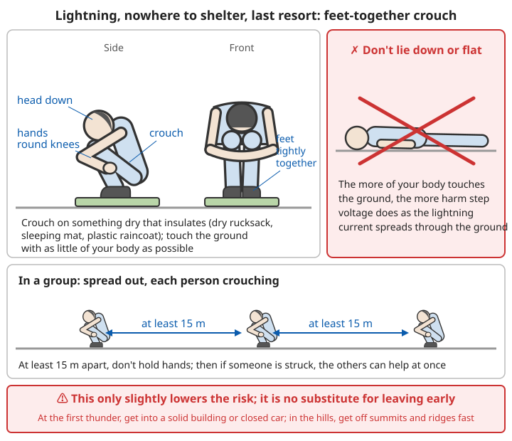

# Mountain Survival Guide

## Core challenges

- Altitude sickness
- Low temperatures, strong wind
- Steep, dangerous terrain
- Easy to get lost or fall
- Changeable weather
- Strong ultraviolet (UV) light

```
Why these are especially deadly in the mountains:
- Altitude sickness: can occur above 2500 m; severe forms (pulmonary oedema,
  cerebral oedema) can kill within a day or two
- Low temperatures, strong wind: for every 100 m of height gained, the air
  temperature drops by about 0.6°C on average;
  30°C at the foot of the mountain may be only about 10°C on a 3000 m summit.
  Add strong wind and rain, and you can become hypothermic even in summer
- Steep terrain: steep slopes, scree, wet rock and grassy slopes; most mountain
  deaths and injuries come from slips, falls and rockfall
- Easy to get lost: mountain paths fork a lot, mist is common,
  and phone signal often comes and goes
- Changeable weather: in summer, afternoon thunderstorms are common; clear sky can
  turn into hail and heavy rain within an hour or two
- Strong UV: the higher you go, the stronger the UV, roughly 10% more for every
  1000 m gained; snow reflects it as well
```

Most mountain accidents are not "bad luck"; they come from poor preparation before setting out and refusing to turn back. For the trip plan, kit and turn-around time before you set out, see [Trip Preparation and Calling for Help](07-trip-preparation-and-calling-for-help.md).

## Altitude sickness

Altitude sickness (acute mountain sickness) is caused by the thin air at height, which leaves the body short of oxygen. **It has little to do with age or fitness.** Strong, active people get it just as often, and because they "feel fit" they tend to push on, which makes it more dangerous.

### The higher you go, the greater the risk

| Altitude | What to expect |
|---|---|
| Below 1500 m | Altitude sickness usually does not occur |
| 1500-2500 m | A few people (especially those who arrive quickly or exercise hard) have mild symptoms; noticeably breathless when exercising |
| 2500-3500 m | Altitude sickness is common; a good proportion of people who arrive directly by plane or car have symptoms |
| 3500-5500 m | Altitude sickness is very common; the risk of pulmonary and cerebral oedema rises clearly |
| Above 5500 m | People cannot adapt long term; stay only for short periods |

```
The risk depends mainly not on "how high you got during the day", but on:
- The altitude you sleep at (breathing becomes shallower at night, so oxygen lack is worst)
- How fast you go up (flying straight into Lhasa at about 3650 m is far riskier than
  walking up gradually over several days)
- People who have had altitude sickness before, especially pulmonary or cerebral
  oedema, are more likely to get it again when they go back up
```

### Symptoms

**Mild**:
- Headache, dizziness
- Tiredness
- Poor sleep
- Poor appetite

**Moderate**:
- Severe headache
- Nausea and vomiting
- Difficulty breathing

**Severe** (dangerous):
- Pulmonary oedema: cough, pink sputum, extreme difficulty breathing
- Cerebral oedema: confusion, loss of coordination (ataxia), coma

```
When symptoms appear:
- Altitude sickness usually starts 6-12 hours after reaching a new height and is
  worst on days 1-2
- Pulmonary oedema usually appears at night on days 2-4 after arrival
- Treat headache, tiredness and nausea at altitude as altitude sickness first.
  Do not put them down to "a cold", "being tired" or "too much sun" unless there is
  clearly another cause

Poor sleep, waking up gasping, breathing that speeds up and slows down
(stops for a few seconds, then big gasps):
- Very common at altitude; on its own it is not necessarily altitude sickness
- But do not take sleeping pills (they suppress breathing and make oxygen lack worse)
```

### Self-scoring

The "Lake Louise score" is used internationally to judge how bad altitude sickness is. The idea is simple: after gaining height you have a **headache**, plus other symptoms, and you score each by severity.

| Symptom | 0 points | 1 point | 2 points | 3 points |
|---|---|---|---|---|
| Headache | None | Mild | Moderate | Severe, unbearable |
| Stomach and gut symptoms | Normal appetite | Poor appetite or nausea | Marked nausea or vomiting | Severe nausea and vomiting, cannot eat |
| Tiredness, weakness | None | Mild | Moderate | Severe, hard to move |
| Dizziness | None | Mild | Moderate | Severe, hard to move |

```
How to use it:
- Headache after gaining height, and the four items add up to ≥3 points
  → treat as altitude sickness
- 3-5 points: mild; 6-9 points: moderate; 10-12 points: severe
- Score morning and evening every day, score each other within the group, and write
  it down in a notebook to see whether things are getting better or worse
- The score is only an aid: whatever the total, if any of the signs of
  "pulmonary or cerebral oedema" below appear, treat it as severe and descend at once

Children (especially toddlers who cannot talk yet) cannot tell you about a headache.
  Watch for fussiness and crying, not wanting to play, eating little, sleeping badly,
  vomiting. At altitude, treat these as altitude sickness
```

### Recognising pulmonary and cerebral oedema

| | High-altitude pulmonary oedema | High-altitude cerebral oedema |
|---|---|---|
| Early | Tires much more easily than companions, cannot keep up uphill; short of breath even at rest; dry cough | Altitude sickness gets worse, severe headache, vomiting; unusually drowsy, listless |
| Worsening | Breathless even lying still, worse lying flat; cough gets worse; lips and nails turn blue | Unsteady walk, as if drunk; slurred speech, answers do not fit the question, unusual behaviour |
| Late | Coughs up pink, frothy sputum; "gurgling" sound in the chest | Confused, cannot be woken, coma |
| Altitude sickness first? | Not necessarily; there may be no obvious headache | Usually altitude sickness comes first and gradually worsens |

```
Heel-to-toe straight-line walking test (checks for loss of coordination):
1. Ask the person to walk along a straight line on flat ground, placing the heel of
   each step right against the toes of the other foot, for 5-6 steps
2. A normal person (even a tired one) can walk more or less straight
3. Swaying, needing support, unable to keep to the line → suspect cerebral oedema
   (rule out drunkenness, severe exhaustion, low blood sugar, etc.)

⚠️ Dangerous mistakes:
- "A good sleep will sort it out": a person with cerebral oedema gets more and more
  drowsy and may be in a coma by the night
- "Let's wait until morning": pulmonary oedema gets worse fastest at night; if you can
  move safely, organise the descent even after dark
- Leaving the sick person alone in camp or letting them descend alone: their judgement
  is already impaired, someone must go with them
```

### Prevention and treatment

```
Prevention:
✓ Above 3000 m: raise your sleeping altitude by <500 m a day
✓ Rest one day to acclimatise for every ~1000 m gained (or every 3-4 days)
✓ Stay hydrated
✓ Avoid strenuous exercise
✓ Eat plenty of carbohydrate

Prevention in practice:
- Go slowly if you can: spend 1-2 nights at 2000-3000 m first, then go higher
- "Climb high, sleep low": by day you can go a little higher than where you sleep,
  then come back down to sleep
- "Sleeping altitude up by no more than about 500 m a day" means the height difference
  between tonight's and last night's sleeping places, not how far you climbed during
  the day; if the terrain forces you to gain more in one day, take an extra rest day later
- A rest day is not a day in bed: you can walk gently nearby, but do not raise your
  sleeping altitude
- Water: drink until your urine is pale yellow and you pass a normal amount; the air at
  altitude is dry and you lose a lot of water by breathing, so you generally need to drink
  a little more than usual each day, but drinking too much does not prevent altitude sickness
- Take it slowly for the first two days: no running or jumping, no fast climbing with
  heavy loads; on the day you arrive, do not bathe and get chilled
- No alcohol, no sleeping pills
- People who have had high-altitude pulmonary or cerebral oedema before, and people with
  heart disease, lung disease or severe anaemia, pregnant women and people travelling with
  babies or toddlers: see a doctor before you go

Mild to moderate:
✓ Rest, go no higher
✓ Drink fluids
✓ Painkillers (for headache)
✓ If it gets worse, go down!

Mild to moderate in practice:
1. Rest where you are and stop climbing until the symptoms have gone completely
   (usually 1-3 days)
2. For headache you can take paracetamol (acetaminophen) or ibuprofen at the dose on the
   package leaflet; do not take more
3. Keep warm; eat small, frequent amounts of easily digested carbohydrate
   (rice porridge, noodles, biscuits, sugar)
4. Re-score every few hours; no improvement within 24 hours, or getting worse → descend
5. Once the symptoms have gone completely, you can carry on climbing at the original
   rate; if they do not go, you must not go higher
✗ Do not keep climbing with symptoms — this is the commonest route to severe illness
✗ Do not suppress the headache with painkillers and keep climbing

Severe:
⚠️ Descend at once! (a matter of life and death)
- Descend 500-1000 m
- Give oxygen (if available)
- Get medical care
```

### Descending

```
1. Call 120 or the police at once, say it is high-altitude pulmonary/cerebral oedema
   and ask for rescue
2. Do not wait for the rescuers before starting down: if the person can walk, walk with
   someone beside them; if not, carry them, or use pack animals or a vehicle
3. Descend until the symptoms clearly improve; 500-1000 m usually brings a clear
   improvement, but severe cases still need hospital
4. On the way down:
   - Pulmonary oedema: the person should exert themselves as little as possible
     (effort makes it worse); keep them warm, half sitting up
   - Cerebral oedema: someone supports the person; if they vomit, turn the head to the
     side to prevent choking
5. Give oxygen if you have it; a portable pressure bag (hyperbaric bag) can also be used,
   but these only buy time for the descent, they do not replace it
6. When weather, darkness or terrain truly make moving impossible: oxygen, warmth, half
   sitting up, and descend or wait for a helicopter as soon as you can
```

Related chapters: [Wilderness Casualty Care and Evacuation – Moving the casualty](11-wilderness-casualty-care-and-evacuation.md#moving-the-casualty), [Helicopter rescue](11-wilderness-casualty-care-and-evacuation.md#helicopter-rescue).

### About medicines

```
- Acetazolamide can be used to prevent and treat altitude sickness, but it is a
  prescription drug with allergies (especially to sulfonamide drugs) and other
  contraindications; a doctor must assess you and prescribe it, and you take it as directed
- There are other prescription drugs for pulmonary and cerebral oedema; use them only
  under a doctor's guidance
- Among over-the-counter drugs, only painkillers (paracetamol, ibuprofen) can be used to
  relieve headache; they do not treat severe illness
- Remedies circulating online such as "rhodiola", "glucose oral solution" or "taking
  antibiotics in advance" have no reliable evidence of preventing altitude sickness;
  do not climb faster because you have taken them
- No medicine replaces "go up slowly, and descend when symptoms get worse"
```

For medicines that people with long-term conditions should prepare before a trip, see [Chronic Medication Stockpile](../01-first-aid-and-family-health/08-chronic-medication-stockpile.md).

## Water sources

```
Mountains have plenty of water:
✓ Streams
✓ Springs
✓ Snowmelt
✓ Rain
✓ Dew

Prefer:
- High-altitude sources
- Flowing water

Purify:
- Boil (longer at high altitude)
- Filter + disinfect
```

```
More:
- "Water high in the mountains is clean" is not reliable: upstream there are often
  grazing cattle, sheep, yaks and wild animals, and even a clear stream can carry germs
  that cause diarrhoea
- Spring water coming straight out of rock cracks or the ground is relatively clean;
  once it has flowed through grassland or pasture, purify it
- Glacier meltwater is often greyish-white (fine rock flour); let it settle in a
  container first, then take the clear water from the top and purify it
- Melt snow and ice before drinking; eating snow lowers your body temperature;
  for how to melt snow, see the snow chapter
- At altitude, water boils below 100°C (about 90°C at 3000 m), but boiling still kills
  germs; above 2000 m, boil for 3 minutes
- At altitude you breathe fast and the air is dry, so you lose more water than in the
  lowlands; drink a few mouthfuls regularly even if not thirsty;
  dark yellow urine and passing little urine mean you are not drinking enough
- In the rainy season, mountain streams can rise suddenly; stand on firm ground on the
  bank to collect water, do not wade into fast water
```

Related chapters: [Basic Survival Skills – Water purification](00-basic-survival-skills.md#water-purification), [Snow and Polar Survival – Melting snow](04-snow-and-polar-survival.md#melting-snow).

## Shelter

### Choosing a site

```
✓ Out of the wind (in a hollow, behind rocks)
✓ Away from summits (strong wind, lightning)
✓ Away from valley floors (cold air collects there)
✓ Away from landslide and rockfall zones
✓ Near water (but not on the riverbank – flash floods)
✓ On level ground

❌ Avoid:
- Isolated high points (lightning)
- Cliff edges
- Dry riverbeds (flash floods)
- Below snow cornices (avalanches)
```

```
How to spot danger:
- Rockfall zones: fresh, sharp-edged, paler rocks scattered below the slope, scars on
  tree trunks, grooves running down the slope — do not camp below one or in line with it
- Cold air: at night cold air flows down the slopes and pools in valley floors and
  hollows, several degrees colder than a terrace halfway up
- Flash floods: choose a terrace clearly higher than the riverbed, with no mud or silt on
  the ground, no flattened grass and no debris caught in the trees
- Avalanches: do not camp below steep slopes or at the outlet of an avalanche chute
  (a treeless lane down the slope)
- Dead trees and big branches: can snap off and fall on people in strong wind

✓ Better sites: a gentle terrace on the sheltered side halfway up the mountain, the
  edge of the woods just below the tree line
✓ Start looking for a camp 1-2 hours before dark; do not search in the dark
```

For more on choosing a campsite, see [River Crossing, Flash Floods and Hypothermia – Choosing a campsite](08-river-crossing-flash-floods-and-hypothermia.md#choosing-a-campsite).

### Using the terrain

```
Natural shelter:
✓ Caves (check they are safe)
✓ Rock overhangs
✓ Behind big boulders (wind break)
✓ Dense thickets

Improve it:
- A stone wall against the wind
- A cover against the rain
- Insulation underneath
```

```
In practice:
- Caves and overhangs: first check the roof for cracks and loose rock, and the floor for
  freshly fallen debris; look for animal droppings and hair (it may be an animal's den);
  during a thunderstorm do not stay in shallow caves or cave mouths
- Do not light a big fire in a small cave: smoke and carbon monoxide cannot escape and
  will poison you; put the fire outside the mouth, downwind
- Stone wall: on the windward side, pile up a low wall of stones, big ones at the bottom
  and small ones on top, just high enough to shield your body lying down;
  do not lever stones off steep slopes (it sets off rockfall)
- Insulation underneath matters most: your body loses more heat to the ground and rock
  than to the air; lay down your rucksack, rope, dry grass, branches or a sleeping mat,
  at least a fist thick
- Put on all your dry clothes and take off wet ones; huddle together
```

For how to build shelters, see [Basic Survival Skills – Types of simple shelter](00-basic-survival-skills.md#types-of-simple-shelter).

## Navigation

### Reading the terrain

```
✓ Map + compass
✓ Obvious landmarks (peaks, rivers)
✓ Watch the terrain
✓ Use rivers to judge the way down (do not blindly follow stream gorges)
```

```
More:
- Download offline maps before you set out and learn to read contour lines: lines close
  together mean steep, far apart mean gentle; a V whose point aims uphill is a valley,
  one whose point aims downhill is a ridge
- Keep checking as you walk: am I on a ridge or in a gully? Which mountain is on my left?
- At every fork, pass and change in the terrain, stop to confirm, and look back at the
  way you came
- In mist you cannot see ridges or valleys; when visibility drops below a few tens of
  metres, stop somewhere safe and wait for it to clear
```

For reading maps and contour lines, see [Trip Preparation and Calling for Help – Reading maps and contour lines](07-trip-preparation-and-calling-for-help.md#reading-maps-and-contour-lines).

### Rules for going down

```
Generally:
✓ Prefer to descend along ridges or existing paths (good view, hard to get lost)
✓ Rivers eventually lead downhill to people, but stream valleys often have gorges,
  waterfalls and cliffs
✓ Turn back at once at gorges or cliffs; do not risk climbing
```

```
More:
- Going down is more accident-prone than going up: tired legs, flagging attention,
  weight forward so you slip easily
- On steep descents keep your knees slightly bent and take small steps, use trekking
  poles or a stick, do not run
- A ridge can also suddenly turn into a cliff; if it keeps getting steeper and you cannot
  get down, go back the way you came
- Do not take a "shortcut" down a steep gully when you cannot see the bottom: many
  people get stranded halfway, unable to go up or down
- Leave time: reach a safe place before dark; if you cannot, prepare to spend the night
  early, do not descend in the dark
```

### Lost

```
✓ If people are searching: stay put and signal (top priority)
✓ If you must get yourself out: look out from higher ground, descend along ridges or paths
✓ Do not blindly follow stream gorges
```

```
Steps when lost:
1. Stop, sit down, drink some water and eat something; do not rush about
2. Think back to the last place you were sure of; if you can safely retrace your route,
   go back the way you came
3. Check your phone for signal: call the police first, turn on location sharing, then turn
   off functions you do not need to save battery
   (where there is no signal, walking a few tens of metres to open, slightly higher ground
   may find one, but do not take risks)
4. If someone already knows your route (you left a trip plan): wait where you are so that
   searchers can find you
5. If it is getting dark or the weather is turning: find shelter from the wind and prepare
   for the night first; keeping warm matters more than finding the way

Why not follow a steep gorge downhill:
- Mountain stream valleys get narrower and steeper the further down you go, often with
  waterfalls, drops and smooth rock walls
- The sides are cliffs; once down, it is hard to climb back out
- When it rains, the gorge is the first place the flash flood comes through
- Woods and valley floors have poor signal and are the hardest places for searchers and
  helicopters to see you

Turn-around time:
- Set a turn-around time before you start (e.g. 2 pm); when it comes, head back whether
  or not you have arrived
- Many people lost in the mountains got there by thinking "it's just a bit further"
```

For more on what to do when lost, see [Trip Preparation and Calling for Help – Realising you are lost](07-trip-preparation-and-calling-for-help.md#realising-you-are-lost) and [Turn-around time](07-trip-preparation-and-calling-for-help.md#turn-around-time); for how to give your location when calling for help, see [Calling for help: say clearly where you are](07-trip-preparation-and-calling-for-help.md#calling-for-help-say-clearly-where-you-are).

## Dangers

### Falls

```
Prevention:
✓ Walk carefully
✓ Test rocks (they may be loose)
✓ Three points of contact (always keep 3 points in contact)
✓ Keep away from cliff edges
✓ Move less in rain and mist
```

```
In practice:
- Walk carefully: look at your feet before each step; do not look at your phone or take
  photos while walking; stop and stand firm before you look at the view or take a photo
- Test rocks: push with your hand, press lightly with your foot, and only put your weight
  on once you are sure it does not move; when grabbing plants, grab near the roots;
  dead branches and small shrubs will not hold your weight
- Three points of contact: where you need hands and feet, move only one limb at a time
  and keep the other three firmly placed; keep your body close to the rock but do not
  hug it flat (moving your weight out actually makes you steadier)
- The most slippery ground: wet rock, mossy stones, steep slopes covered in fallen
  leaves, scree, grassy slopes after rain, thin ice in the shade — slow down and lower
  your centre of gravity on these
- Rest when tired: many falls happen in the second half of the day, on the way down
- Tighten your rucksack straps, do not hang swinging items off it; keep your hands free
  as much as possible
- With children, the child walks on the side next to the rock face, the adult on the
  outside
- Do not try places you cannot climb up or down; climbing and abseiling need professional
  training and equipment, and people without them must not improvise lowering someone on
  a single rope
```

For what rope can and cannot be used for, see [Rope and Knots](../../../docs/07-日常生活技能/17-绳索与结绳.md).

### When you trip or slide

```
If you start sliding down a steep slope:
1. Immediately roll over to face the slope, feet downhill
2. Press elbows, hands, knees and toes hard into the ground to slow down; if you have a
   trekking pole, hold it crosswise and dig it into the slope
3. Do not slide head first or on your back (you cannot brake)

Falling on flat ground or a gentle slope:
- Try to fall sideways, landing on your forearm, shoulder and back to spread the impact;
  do not brace yourself on your wrists
- Tuck your chin in so the back of your head does not hit the ground

If you start tumbling:
- Wrap your arms around your head to protect your head and the back of your neck,
  curl up
- Grab any tree, bush or big rock you can

On snow slopes: using an ice axe to brake needs special training; people without training
and equipment should not walk on steep snow slopes
```

### After an injury

```
1. First make sure no one else gets hurt: the casualty stays where they are, others
   approach by a safe route and watch for rockfall from above
2. Assess: are they conscious and breathing? Any severe bleeding? Can they move their
   hands and feet?
3. Anyone who fell from height, landed on their head or hurt their back: treat as a
   possible spinal injury; do not lift them up or let them walk, unless there is danger
   on the spot such as rockfall or a flash flood
4. Call for help at once, giving the location and injuries clearly
5. Keep them warm: a casualty lying on the ground loses heat fast; even in summer, put
   something under and over them
6. Sprains and minor injuries where the person can walk: descend slowly with someone
   beside them; do not let the injured person go down alone
```

Related chapters: [Wilderness Casualty Care and Evacuation – Step one: safety, assessment, calling for help](11-wilderness-casualty-care-and-evacuation.md#step-one-safety-assessment-calling-for-help), [Waiting where you are or getting yourselves out](11-wilderness-casualty-care-and-evacuation.md#waiting-where-you-are-or-getting-yourselves-out), [Basic First Aid – When not to move someone](../01-first-aid-and-family-health/00-basic-first-aid.md#when-not-to-move-someone), [Bone and Joint Injuries – Fractures](../01-first-aid-and-family-health/03-bone-and-joint-injuries.md#fractures).

### Rockfall / landslides

```
Recognise:
- Loose rock
- Cracks
- Signs of fresh rockfall

Avoid:
✓ Do not stay below steep slopes
✓ Cross danger zones quickly
✓ Take extra care after rain
```

```
More:
- Rockfall is most frequent: during and after heavy rain, on mornings after freeze–thaw
  (ice prises stones loose), in the afternoon when ice and snow melt, and when people or
  animals are moving above
- Crossing a rockfall zone: one person at a time, quickly; do not stop, rest or take
  photos below; others wait somewhere safe, watch above, and shout if they see rocks fall
- A group on scree: do not walk in a line straight up or down (stones kicked loose by
  people above will hit those below); either keep close together or spread out sideways
- If you knock a stone loose, shout "Rock!" at once
- If you hear "Rock!" or noise above: do not look up; immediately press against the rock
  face or get behind a big boulder, and protect your head with your rucksack; if there is
  no time, crouch where you are with the rucksack over your head
- A helmet greatly reduces fatal rockfall injuries; wear one on routes with a lot of rockfall
- New cracks in the path, trees on the slope leaning, a spring suddenly turning muddy or
  stopping, sounds from the mountainside → a landslide may be coming; get away at once
  to higher ground on either side, at right angles to the direction of movement
```

For landslides and debris flows, see [Geological Disasters – Landslides](../02-disaster-response/01-geological-disasters.md#landslides) and [Debris flows](../02-disaster-response/01-geological-disasters.md#debris-flows).

### Lightning

```
Lightning in the mountains is dangerous!

In a thunderstorm:
1. Get down to lower ground
2. Keep away from summits and ridges
3. Do not shelter under isolated trees
4. With nowhere to shelter, crouch with your feet together
   (only reduces the risk slightly)
5. Keep away from metal objects
6. Get into a low hollow (but avoid places where water flows)
```

```
More:
- Act as soon as you hear thunder: if you can hear thunder, you are already within range
  of a strike; do not wait for the rain
- The best approach is to avoid it: start early, reach the summit before midday, and leave
  the summit and ridges before the afternoon storms arrive
- Pavilions on the mountain, summit temples, signal towers and isolated huts are not
  places to shelter from lightning
- Sections where you hold iron chains, cables or railings (many scenic mountain paths
  have them): leave them at once in a thunderstorm
- Put down trekking poles and metal-framed rucksacks and move a few metres away;
  do not hold them above your head
- Shallow caves, under overhangs and cave mouths are not safe (current can jump across
  the mouth through your body); a deeper cave is somewhat better, but do not lean on the
  walls or stand in the mouth
- In woods: shelter among a stand of lower trees, away from the tallest tree
- In a group, spread out at least 15 m apart, so if one person is struck, the others can
  help
- The feet-together crouch is the last resort when there is no time to get away: crouch
  on a dry rucksack or sleeping mat, arms round your knees, head down;
  do not lie down, do not lie flat on your front
- Wait 30 minutes after the last thunder before going back onto ridges and summits
- A person struck by lightning does not carry a charge; you can touch them at once;
  if they are not breathing, start CPR immediately
```



*Figure: The feet-together crouch is only a last resort when there is no time to get away, and reduces the risk only slightly; descend as soon as you hear thunder*

For how lightning works, full lightning-safety advice and first aid for lightning strike, see [Weather Disasters – Lightning](../02-disaster-response/02-weather-disasters.md#lightning); for judging how far away a thunderstorm is, see [Judging the distance of a thunderstorm](../02-disaster-response/02-weather-disasters.md#judging-how-far-away-a-thunderstorm-is).

### Sudden weather changes

```
Mountain weather is changeable:
✓ Keep an eye on the weather
✓ Start early (thunderstorms are common in the afternoon)
✓ Carry rain and cold-weather gear
✓ Do not take risks in bad weather
```

```
In practice:
- Before you set out, check the forecast and warnings, looking at the temperature and
  wind on the summit (not in the county town below)
- Summer mountains often have "afternoon thunderstorms": a clear morning, then around
  midday cumulus clouds grow taller and taller with cauliflower-like tops, and by the
  afternoon there may be thunder, rain and hail — so start early and begin descending
  around midday
- Signs of a change: distant peaks capped in cloud, the wind suddenly colder and stronger,
  cloud getting lower and thicker, thunder in the distance → stop climbing, prepare to descend
- Whatever the season, carry a warm layer and a waterproof layer in your rucksack; even in
  summer, cold rain and strong wind in the high mountains can cause hypothermia
- If visibility suddenly drops (mist, snow): stop somewhere safe; do not feel your way
  along cliff edges or ridges
- In bad weather, "we're not going up today" is always the right choice; the mountain
  is not going anywhere
```

For reading the clouds and signs of thunderstorms, see [Weather Observation and Forecasting – Reading the clouds](../../../docs/08-基础科学知识/07-天气观测与预报.md#二看云识天气) and [Signs of a thunderstorm](../../../docs/08-基础科学知识/07-天气观测与预报.md#23-雷暴的征兆).

### Flash floods

Mountain valleys collect water fast. Heavy rain upstream can send a flood down within minutes while it is still sunny downstream.

```
✓ Do not camp or rest on river beaches, in dry riverbeds, at the mouths of gullies or
  at the bottom of gorges
✓ The stream suddenly turns muddy, rises, or unusually stops flowing; lots of branches
  and grass appear in the water; a roar is heard upstream → run at once to high ground
  on either side of the channel
❌ Do not run downstream along the valley; do not wade across fast water
```

For signs of flash floods and how to wade across rivers, see [River Crossing, Flash Floods and Hypothermia](08-river-crossing-flash-floods-and-hypothermia.md#flash-floods-the-biggest-danger-in-stream-valleys).

### Hypothermia and frostbite

```
A typical mountain hypothermia case: in summer, spring or autumn, climbing in thin
clothing, suddenly hit by cold rain, hail and strong wind, clothes soaked through,
getting colder and colder on the ridge — this is what killed many runners in the 2021
mountain ultramarathon in Baiyin, Gansu

Early signs: shivering, clumsy hands and feet, slurred speech, stumbling, slow reactions,
  unusual mood
Treatment: stop moving on, get out of the wind, change out of wet clothes, put on all dry
  clothes and wrap in a survival blanket, eat and drink something sugary, descend to lower
  ground; if shivering stops while the person gets more and more confused, it is getting worse
Prevention: no cotton clothing; carry a warm layer and a waterproof layer;
  descend early in cold, wet weather
```

Related chapters: [River Crossing, Flash Floods and Hypothermia – Not only in winter: hypothermia outdoors](08-river-crossing-flash-floods-and-hypothermia.md#not-only-in-winter-hypothermia-outdoors), [Acute Symptoms – Hypothermia](../01-first-aid-and-family-health/05-acute-symptoms.md#hypothermia), [Wound and Injury Care – Frostbite](../01-first-aid-and-family-health/02-wounds-and-injuries.md#frostbite).

### UV and snow blindness

```
- Sunburn happens fast at altitude, even on cloudy, cool days
- Wear a wide-brimmed hat and sunglasses, put sunscreen on exposed skin and reapply every
  few hours; protect your lips too
- On snow and glaciers you must wear sunglasses that block UV, or you may become
  snow-blind within a few hours
  (severe eye pain, watering, sensitivity to light, often starting that evening)
- Without sunglasses, cut a thin slit in a strip of cloth, bark or stiff card and tie it
  over your eyes
```

For treating snow blindness, see [Snow and Polar Survival – Snow blindness](04-snow-and-polar-survival.md#snow-blindness); when walking on snow slopes, also beware of [avalanches](04-snow-and-polar-survival.md#avalanches).

## Food

```
High mountains:
- Little vegetation
- Few animals

Possible:
✓ Fish (streams)
✓ Insects
✓ Small animals
✓ Some alpine plants (need identification)
✓ Berries (confirm they are edible)
```

```
More:
- When stranded for a short time, food matters far less than warmth, water and calling
  for help; a healthy adult will not die from going without food for a few days;
  do not climb risky ground or leave your shelter to look for food
- Rule for wild food: do not eat anything you do not know; never eat wild mushrooms
- The "edibility test" is only a last resort when stranded long term with no other way;
  it does not work for mushrooms and is not safe for highly toxic plants
- At altitude your appetite is poor but your body uses a lot of energy: eat small, frequent
  amounts, mainly carbohydrate (biscuits, noodles and bread, sugar, chocolate)
- Hunting or catching wild animals in normal times breaks China's wildlife protection law,
  and many high-mountain animals are protected species; consider it only in a real survival
  crisis, and stick mainly to fish, insects and the like
- At altitude water boils at a lower temperature, so rice, beans and meat do not cook
  through; use a pressure cooker, or cut food small and cook it longer
```

Related chapters: [Poisonous Mushrooms and Wild Plants](09-poisonous-mushrooms-and-wild-plants.md), [Basic Survival Skills – Finding food](00-basic-survival-skills.md#getting-food).

## Signals

```
Mountains:
✓ Mirror flash (visible from far away)
✓ Smoke (rises clearly in gorges)
✓ Whistle (echoes in valleys)
✓ Brightly coloured clothing (contrasts with the background)
✓ Move to open high ground (easier to spot)
```

```
More:
- Phone first: if there is signal, call the police and send a screenshot of your location;
  even without signal, try calling the emergency number
- The international distress signal is "three": three blasts on a whistle, pause, repeat;
  three fires in a triangle; keep repeating at intervals even if no one answers for a long time
- Mirror (or phone screen, piece of metal) flash: sweep it towards aircraft, distant people
  or villages; on a sunny day it can be seen several km away
- Make smoke by day and fire by night, but on bare ground with no dry grass and away from
  woods, to avoid starting a wildfire
- Spread bright clothing or a sleeping bag out in the open; on snow or grassy slopes lay out
  big letters (SOS) with stones or branches
- Move to open ground only if it is safe and needs no climbing; if injured, in the dark or
  in bad weather, stay where you are
- When you hear a helicopter, stand in the open and wave bright clothing; do not signal to a
  helicopter from the top of a ridge or a cliff edge
```

Related chapters: [Basic Survival Skills – Distress signals](00-basic-survival-skills.md#distress-signals), [Trip Preparation and Calling for Help – Waiting for rescue](07-trip-preparation-and-calling-for-help.md#waiting-for-rescue), [Wilderness Casualty Care and Evacuation – Helicopter rescue](11-wilderness-casualty-care-and-evacuation.md#helicopter-rescue).

## 📝 Mountain survival key points

```
Priorities:
1. Acclimatise to altitude (prevent altitude sickness)
2. Avoid falls (walk carefully)
3. Shelter (against wind and cold)
4. Water (relatively easy)
5. Fire, food

Key:
✓ Gain height gradually
✓ Walk carefully
✓ Avoid lightning
✓ When lost, stop first; if people are searching, wait where you are
✓ Watch the weather

Dangers:
⚠️ Altitude sickness (descend!)
⚠️ Falls
⚠️ Hypothermia
⚠️ Lightning
⚠️ Landslides

Remember:
1. Above 3000 m, raise your sleeping altitude by no more than about 500 m a day;
   with symptoms, go no higher
2. Difficulty breathing, pink sputum, unsteady walk, changed consciousness
   → descend at once and call for help at the same time
3. Start early, set a turn-around time, leave summits and ridges before the
   afternoon thunderstorms
4. Descend as soon as you hear thunder; the feet-together crouch is only a last resort
5. When lost, do not follow steep gorges downhill; if someone knows your route, wait
   where you are
6. Carry a warm layer and a waterproof layer even on summer mountains
```

---

**Next chapter**: [Long-term Collapse Survival](06-long-term-collapse-survival.md)
**Back**: [Chapter index](README.md) | [Main contents](../../README.md)
