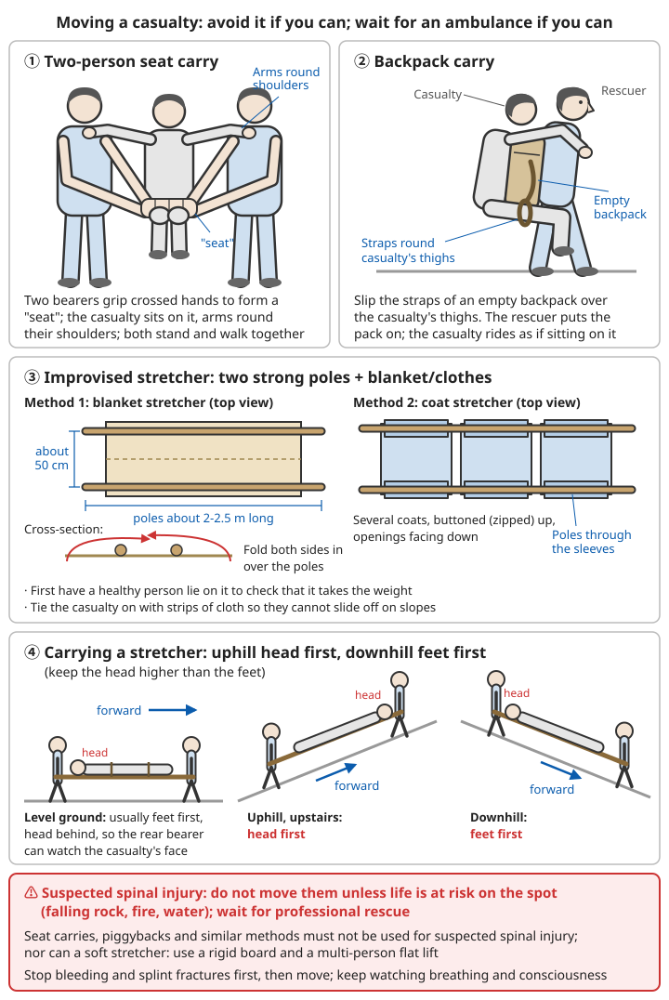

# Wilderness Casualty Care and Evacuation

## Contents
- [How wilderness first aid differs from first aid in town](#how-wilderness-first-aid-differs-from-first-aid-in-town)
- [Step one: safety, assessment, calling for help](#step-one-safety-assessment-calling-for-help)
- [Waiting where you are or getting yourselves out](#waiting-where-you-are-or-getting-yourselves-out)
- [Write a casualty record](#write-a-casualty-record)
- [Caring for the casualty while waiting for rescue](#caring-for-the-casualty-while-waiting-for-rescue)
- [Improvised splinting](#improvised-splinting)
- [Common minor injuries and illnesses outdoors](#common-minor-injuries-and-illnesses-outdoors)
- [Moving the casualty](#moving-the-casualty)
- [Helicopter rescue](#helicopter-rescue)
- [Outdoor first-aid kit](#outdoor-first-aid-kit)

---

## How wilderness first aid differs from first aid in town

In town, an ambulance arrives a dozen or so minutes after you call 120. **In the wild, rescue may take several hours or even a day or two to arrive**, and until then the companions are the casualty's only carers.

```
Extra things to think about in wilderness first aid:
- The casualty has to hold on outdoors for a long time: keeping warm, drinking and
  preventing shock become as important as treating the wound
- You have to make decisions: wait where you are for rescue, or walk out yourselves
- Small injuries become big problems: a blister on the foot or a sprained ankle can stop
  someone getting off the mountain
- Moving a casualty is very hard: carrying someone on a mountain path, even taking
  turns, several people do not get far

This chapter pulls the first-aid methods of Part 1 together for the wilderness setting.
For the first-aid techniques themselves, study the relevant chapters of Part 1 first.
```

Related chapters: [Basic First Aid](../01-first-aid-and-family-health/00-basic-first-aid.md).

---

## Step one: safety, assessment, calling for help

```
1. Make sure it is safe
   - Look around first: is there still danger from rockfall, collapse, water, a swarm
     of wasps, etc.?
   - Do not let the rescuer get hurt too (an injured rescuer makes things twice as bad)
   - If necessary, move the casualty to a safe place first (keeping the head, neck and
     body in a straight line as far as possible while moving)

2. Check for life-threatening problems
   - Do they respond, are they breathing normally? → If not, start CPR at once
   - Severe bleeding? → Apply pressure to stop it at once
   - Signs of shock? (pale face, cold and clammy skin, fast weak pulse, restlessness)

3. Call for help
   - Call the police as early as possible if there is signal, giving the location and
     injuries clearly
   - Do not wait until it is dark or your phone is nearly flat

4. Full-body check
   - Check from head to toe and find every injury
   - Ask the casualty: where does it hurt, how did it happen, any numbness?
   - Find out whether the casualty has any long-term conditions or allergies, and what
     medicines they take
```

Related chapters: [Basic First Aid – Assessing vital signs](../01-first-aid-and-family-health/00-basic-first-aid.md#assessing-vital-signs), [CPR](../01-first-aid-and-family-health/00-basic-first-aid.md#cardiopulmonary-resuscitation-cpr), [Stopping bleeding](../01-first-aid-and-family-health/00-basic-first-aid.md#stopping-bleeding), [Giving your location when calling for help](07-trip-preparation-and-calling-for-help.md#calling-for-help-say-clearly-where-you-are).

---

## Waiting where you are or getting yourselves out

This is the most important decision after an injury in the wild.

### When to wait for rescue

```
⚠️ Do not move the casualty yourselves or force them to walk out if there is:
- Suspected spinal or neck injury (fall from height, blow to the head, severe back pain,
  numb hands or feet)
- A broken thigh bone or pelvis
- Confusion, repeated vomiting after a head injury, increasing drowsiness
- Severe bleeding, signs of shock
- Serious chest or abdominal injury, difficulty breathing
- Severe hypothermia
- Darkness, bad weather, dangerous ground, or not enough people
```

### When you can consider walking out slowly

```
✓ The casualty can walk on their own (a mild sprain, an arm injury once splinted,
  a small wound on the hand)
✓ The route is clear and not far, the weather allows it, and you can get out before dark
✓ Someone goes with them and companions carry the casualty's rucksack
✓ If things get worse on the way, stop at any point and switch to waiting where you are

⚠️ If unsure, waiting where you are for rescue is usually safer
```

### When someone needs to go for help

```
✓ Leave at least one person with the casualty; never leave the casualty alone
✓ Ideally two people go for help together (so the people going for help do not get
  into trouble too)
✓ Take the written location and casualty record (see next section)
✓ Those staying and those going agree: when, where and how to make contact
✓ The people going for help follow a known route and mark it, so they can lead the
  rescue team back
```

---

## Write a casualty record

Write the situation down on paper (or in a phone note) and give it to the rescuers or to the companions going for help. **With this record, doctors and rescue teams can make decisions faster.**

```
Casualty record:
1. Time, place (latitude and longitude or a detailed description)
2. Casualty: sex, approximate age, long-term conditions, allergies, current medicines
3. How the injury happened: fell from what height, hit by what, at what time
4. Injuries found: where, and what they look like
5. Treatment given: dressings, splints, any medicines taken (name, dose, time)
6. ⚠️ If a tourniquet was used, write down clearly the time it was put on
7. Record every 30 minutes to 1 hour:
   - Consciousness: alert / confused / wakes when called / cannot be woken
   - Breaths per minute, pulse per minute
   - Skin colour and temperature
   - Whether they have passed urine
8. Number of people on the spot, equipment, food and water, phone battery
```

---

## Caring for the casualty while waiting for rescue

```
Keeping warm (the most often neglected):
✓ Even in summer, a casualty lying still on the ground gets cold quickly
✓ Put a sleeping mat, rucksack, branches or dry grass under them to insulate them from
  the ground (the ground takes away more heat than the air)
✓ Cover them with clothes, a sleeping bag or an emergency survival blanket, and put a hat on
✓ Change wet clothes
✓ Rig a tarp or branches as a screen against wind, rain and sun

Preventing shock:
✓ Lay the casualty flat; do not move them unnecessarily
✓ Reassure the casualty, stay with them and talk to them

Drinking and eating:
✓ If the casualty is alert, can swallow on their own and has no serious abdominal
  injury, give sips of water and a little food
❌ Do not give food or water to anyone who is not fully conscious
❌ Do not give the casualty alcohol

Position:
✓ Unconscious but breathing: on their side (so vomit does not block the airway)
  If spinal injury is suspected, turn them with several people keeping the head, neck
  and body in a straight line
✓ Difficulty breathing (with no spinal injury): they can sit half upright

Regular checks:
✓ Splinted arms and legs: check the colour, warmth and feeling of fingers and toes;
  loosen if too tight
✓ Check whether dressed wounds are still bleeding through
✓ Record consciousness, breathing and pulse regularly in the casualty record
```

For treating hypothermia, see [River Crossing, Flash Floods and Hypothermia – Not only in winter: hypothermia outdoors](08-river-crossing-flash-floods-and-hypothermia.md#not-only-in-winter-hypothermia-outdoors); for treating shock, see [Basic First Aid – Managing shock](../01-first-aid-and-family-health/00-basic-first-aid.md#managing-shock).

---

## Improvised splinting

Fractures, dislocations and severe sprains must all be immobilised before moving. The rule: **immobilise the joints above and below the injury**, and check the circulation in the fingers and toes before and after splinting.

```
Things that can be used as splints:
- Trekking poles, branches, boards
- A sleeping mat (rolled or folded round the injured arm or leg; works very well)
- Rucksack frame stays, stiff cardboard, rolled-up magazines
- Ties: triangular bandages, bandages, clothing torn into strips, rucksack straps,
  headscarves
  ❌ Do not tie thin string or wire directly against the skin

Arm:
✓ After splinting, support the arm in front of the chest with a triangular bandage or
  a jacket
✓ Without a triangular bandage: turn the hem of the casualty's top up over the arm and
  pin it to the chest with a safety pin

Leg:
✓ Put splints on both sides of the leg
✓ Without splints, tie the injured leg to the good leg, with clothing padded between them

Fingers, toes:
✓ Tape to the neighbouring finger (toe), with a little gauze between them

✓ Pad between the splint and the skin with something soft
✓ Keep ties off the injury; tie above and below it
✓ Check after splinting: fingers or toes pale, blue, cold or numb → too tight; loosen
  and re-tie
```

For splinting each part of the body, see [Bone and Joint Injuries – Splinting each part of the body](../01-first-aid-and-family-health/03-bone-and-joint-injuries.md#immobilising-each-part-of-the-body).

⚠️ Do not try to put dislocations or fractures back in place yourself (see [Bone and Joint Injuries – Reduction](../01-first-aid-and-family-health/03-bone-and-joint-injuries.md#reduction-putting-the-joint-back)).

---

## Common minor injuries and illnesses outdoors

### Twisted ankle: can they still walk?

```
Treat as a possible fracture (splint it, do not walk on it) if:
- After the injury they cannot put that foot down at all and cannot take 4 steps
- Pressing on the back edge and tip of the bony bumps on either side of the ankle is
  very painful
- The foot is visibly deformed

A milder sprain, when you need to walk out:
1. First cool it (cold water, a towel soaked in stream water)
2. Bandage the ankle with an elastic bandage in a figure of eight
3. Keep the shoe on and lace it tightly (a high-topped boot helps support it)
   - Do not take the shoe off: once the foot swells it may not go back on
4. Take some of the weight with a trekking pole or stick
5. Companions carry the rucksack; slow down and rest often
```

For grading and treating sprains, see [Bone and Joint Injuries – Sprains](../01-first-aid-and-family-health/03-bone-and-joint-injuries.md#sprains).

### Blisters on the feet

```
Prevention (far more important than treatment):
✓ Wear well-fitting shoes that are already broken in; do not walk long distances in
  new shoes
✓ Wear suitable socks and keep your feet dry; change wet socks for dry ones
✓ As soon as you feel a warm, rubbing sore spot (a "hot spot"), stop at once
  → put on tape or a blister plaster; do not wait for a blister to form

If a blister has already formed:
✓ Do not burst small blisters; surround them with a gauze pad or tape ring with a hole
  cut in the middle to reduce rubbing
✓ Large, tense, painful blisters that get in the way of walking:
  1. Clean and disinfect
  2. Pierce at the edge of the blister with a sterilised needle and press gently to let
     the fluid out
  3. Leave the blister roof on (it protects the tender skin underneath)
  4. Cover with a dressing and tape it in place
✓ Check every day; redness, swelling, heat, pain or pus → infection, get medical help
  as soon as possible
```

### Wounds

```
The most important thing for a wound outdoors is irrigation:
✓ Rinse the wound with plenty of clean water (drinking water, boiled water) to wash out
  mud and grit (rinsing prevents infection better than putting ointment on)
✓ Remove any visible foreign bodies
✓ Cover with a clean dressing; check and change it every day

❌ Do not stitch a dirty wound yourself (it seals bacteria inside)
❌ Do not put earth, plant ash, toothpaste or other "folk remedies" on a wound
⚠️ Deep wounds, animal bites, wounds from rusty or dirty objects → get medical help as
   soon as possible; think about tetanus and rabies
⚠️ Spreading redness and swelling, red streaks, fever → infection; get medical help as
   soon as possible
```

Related chapters: [Wound and Injury Care – Cuts and grazes](../01-first-aid-and-family-health/02-wounds-and-injuries.md#cuts-and-grazes), [Wound and Injury Care – Tetanus prevention](../01-first-aid-and-family-health/02-wounds-and-injuries.md#tetanus-prevention).

### Diarrhoea and vomiting

```
✓ The biggest danger outdoors is dehydration: give oral rehydration salts in small,
  frequent sips
✓ Drink only boiled or purified water
✓ Severe diarrhoea, vomiting that will not stop, fever, or blood in the stools: stop
  the trip and get medical help as soon as possible
```

Related chapters: [Common Illnesses – Diarrhoea](../01-first-aid-and-family-health/01-common-illnesses.md#diarrhoea), [Basic Survival Skills – Finding and purifying water](00-basic-survival-skills.md#finding-and-purifying-water).

### Altitude sickness, heatstroke, hypothermia

All three can be life-threatening in the wild, and the most important treatment for each is **stopping in time and getting out in time**: descend when altitude sickness gets worse, cool down for heatstroke, warm up for hypothermia.

Related chapters: [Mountain Survival – Altitude sickness](05-mountain-survival.md#altitude-sickness), [Acute Symptoms – Heatstroke](../01-first-aid-and-family-health/05-acute-symptoms.md#heatstroke), [Acute Symptoms – Hypothermia](../01-first-aid-and-family-health/05-acute-symptoms.md#hypothermia).

---

## Moving the casualty

**Carrying a casualty on a mountain path is extremely hard work**: carrying one person on a stretcher usually needs 6 or more people taking turns, progress is very slow, and a fall can cause further injury. So unless you must get out of a dangerous place, or rescue truly cannot reach you, **generally wait where you are for professional rescue**.

```
Can walk but needs help:
✓ One or two people support them on either side
✓ Companions carry the casualty's rucksack

Cannot walk, injuries not serious (no spinal injury or broken thigh bone):
✓ Piggyback: one person carries, the others take turns
✓ Two-person seat: two people grip each other's crossed hands to make a "seat"; the
  casualty sits on it with arms round both carriers' shoulders
✓ Rucksack carry: put the casualty's legs through the two shoulder straps of an empty
  rucksack, one strap round each thigh; the rescuer puts the rucksack on, and the
  casualty is carried as if sitting on the rucksack

Needing a stretcher:
✓ Two sturdy poles or trekking poles + a blanket, sleeping bag or several zipped-up jackets
✓ Strap the casualty securely onto the stretcher so they cannot slide off
✓ Head first going uphill, feet first going downhill (keep the head higher than the feet)
✓ Carriers keep in step and take turns; do not get so tired that you fall

⚠️ Suspected spinal injury: never move the casualty unless there is danger to life on
   the spot (rockfall, fire, water); wait for professional rescue
```

For carrying methods and how to make an improvised stretcher, see [Basic First Aid – Moving a casualty](../01-first-aid-and-family-health/00-basic-first-aid.md#moving-a-casualty).



*Figure: Two-person seat, rucksack carry and improvised stretchers; do not use these methods for anyone with a suspected spinal injury*

---

## Helicopter rescue

```
✓ The rescuers will tell you what to do; follow their instructions
✓ Find a spot that is as flat and open as possible, and clear away tents, tarps,
  clothes and other light items around it (the rotor downwash will blow them up)
✓ Signal with bright clothing or by standing in the open and waving; use a torch at night
✓ When the helicopter comes close, turn your back to the wind, crouch down and protect
  your eyes
❌ Do not approach the helicopter unless the rescuers signal you to
❌ Never walk towards the tail of the helicopter (the tail rotor is extremely dangerous)
❌ Do not approach from the uphill side (on a slope, the uphill side is closer to the
   rotor)
```

---

## Outdoor first-aid kit

```
Wounds:
- [ ] Plasters, gauze pads, medical tape
- [ ] Elastic bandage (for sprains), triangular bandage
- [ ] Povidone-iodine swabs or a small bottle of povidone-iodine
- [ ] Blister plasters

Splinting:
- [ ] Roll-up splint (use a sleeping mat if you do not have one)
- [ ] A few safety pins

Medicines (according to your own needs; watch the expiry dates):
- [ ] Painkiller / fever reducer
- [ ] Oral rehydration salts
- [ ] Antihistamine
- [ ] Your own regular medicines (blood-pressure tablets, asthma inhaler, an adrenaline
      (epinephrine) auto-injector for people with severe allergies), with a few extra
      days' supply

Other:
- [ ] Emergency survival blanket
- [ ] Disposable gloves
- [ ] Small scissors, tweezers (also for removing ticks)
- [ ] Pen and small notebook (for the casualty record)
- [ ] Head torch

✓ Check it before every trip and replace anything used promptly
✓ Learn to use everything in it
```

---

## 📝 Key points

```
1. Rescue in the wild takes hours to days; the companions are the casualty's only carers
2. Make sure you are safe first, then deal with life-threatening problems, and call for
   help early
3. Suspected spinal injury, broken thigh bone, confusion, shock → wait where you are
   for rescue
4. Ideally two people go for help together, one stays with the casualty, and they take
   the casualty record
5. Insulate the casualty from the ground; keeping warm is as important as treating
   the wound
6. Sleeping mats and trekking poles can be splints; immobilise the joints above and
   below the injury
7. After a twisted ankle, cannot take 4 steps or pressing the ankle bone is very painful
   → treat as a fracture
8. With blisters, prevention is key: stop and tape up as soon as you feel a "hot spot"
9. Rinse wounds with plenty of clean water; do not stitch dirty wounds
10. Carrying someone on mountain paths is extremely hard; generally wait for
    professional rescue
```

---

**Back**: [Chapter index](README.md) | [Main contents](../../README.md)
