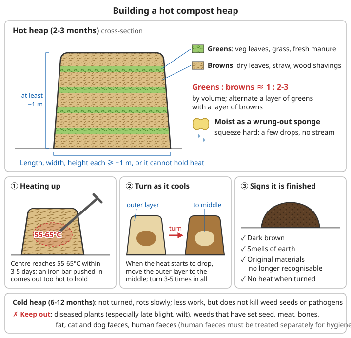
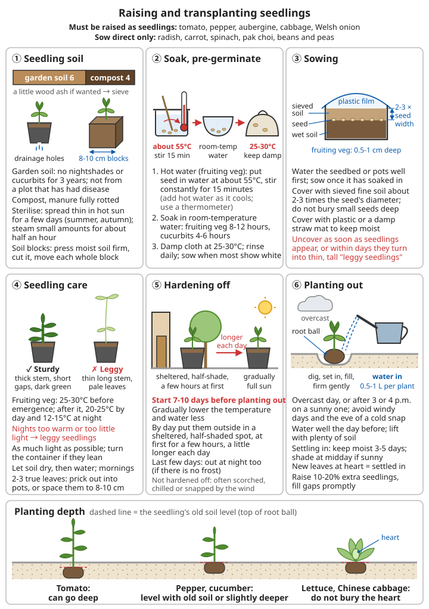

# Vegetable Growing Guide

## Contents
- [Sowing times and germination temperatures](#sowing-times-and-germination-temperatures)
- [Planning the vegetable garden: rotation, intercropping and replant problems](#planning-the-vegetable-garden-rotation-intercropping-and-replant-problems)
- [Preparing the ground, making beds and high yields from small plots](#preparing-the-ground-making-beds-and-high-yields-from-small-plots)
- [Compost and manure](#compost-and-manure)
- [Raising and transplanting seedlings](#raising-and-transplanting-seedlings)
- [Watering, top-dressing and pest and disease control: general rules](#watering-top-dressing-and-pest-and-disease-control-general-rules)
- [Fast-growing vegetables (30-60 days)](#fast-growing-vegetables-30-60-days)
- [Chinese cabbage and cabbage](#chinese-cabbage-and-cabbage)
- [Common fruiting vegetables](#common-fruiting-vegetables)
- [Cucurbits](#cucurbits)
- [Root and tuber crops](#root-and-tuber-crops)
- [Beans and peas](#beans-and-peas)
- [Onions and garlic](#onions-and-garlic)
- [Winter and the lean seasons](#winter-and-the-lean-seasons)
- [📝 Vegetable growing: key points](#-vegetable-growing-key-points)

---

## Sowing times and germination temperatures

The commonest reason vegetables fail is not technique but **sowing at the wrong time**: warm-season crops sown too early are killed by frost, and crops that dislike heat sown too late bolt straight into flower. China's north and south have very different climates, and the sowing date for the same vegetable can differ by two or three months.

### Telling north from south

In this chapter "north" means the North China Plain and "south" means the Yangtze basin; for other regions shift the dates earlier or later using the table below. The frost dates in the table are rough ranges. **The most reliable thing is to record the date of the last spring frost and the first autumn frost in your own area every year** (see [Weather observation and forecasting – Frost](../../../docs/08-基础科学知识/07-天气观测与预报.md#五霜冻)).

| Region | Roughly covers | Last spring frost | First autumn frost | What it means for growing |
|------|----------|----------|----------|----------|
| The Northeast, Inner Mongolia, cold high areas of the Northwest | Heilongjiang, Jilin, Liaoning, Inner Mongolia, northern Xinjiang, the Qinghai-Tibet Plateau | late April to mid-May | mid to late September | Basically one crop a year; warm-season crops must be raised as seedlings |
| North China (this chapter's "north") | Beijing, Tianjin, Hebei, Shandong, Henan, Shanxi, the Guanzhong plain of Shaanxi | early to mid-April | mid to late October | Spring and autumn seasons; in winter only hardy crops survive outdoors |
| Yangtze basin (this chapter's "south") | Shanghai, Jiangsu, Zhejiang, Anhui, Hubei, Hunan, Jiangxi, the Sichuan Basin | mid to late March | mid to late November | Leafy crops in autumn, winter and spring; vegetables are scarce in the heat and storms of midsummer |
| South China | Guangdong, Guangxi, Hainan, southern Fujian, southern Yunnan | Almost frost-free | — | Winter and spring are the best growing seasons; grow heat-tolerant crops in summer |

By their temperature needs, vegetables fall roughly into four groups:

```
Hardy crops: spinach, garlic, Welsh onion, Chinese chives, peas
  - Mature plants survive a few degrees below zero; in North China spinach and
    garlic can overwinter outdoors under a covering
  - Sow as soon as the soil thaws ("sowing on the thaw")
Half-hardy crops: Chinese cabbage, radish, carrot, cabbage, lettuce, potato
  - Best at 15-20°C; tolerate light frost but not hard frost; dislike heat
    (they bolt, fail to form heads, or turn bitter)
  - Sow early in spring; autumn is their main season
Warm-season crops: tomato, pepper, aubergine, cucumber, French bean, yardlong bean
  - Killed by the first frost; growth almost stops below 10-12°C
  - Only sow or plant out after the last frost, once the soil at 10 cm depth
    stays above 12-15°C
Heat-tolerant crops: pumpkin, yardlong bean, sweet potato, amaranth, water spinach, loofah
  - The mainstay of summer; the most heat-tolerant of the warm-season crops
```

Without a thermometer, go by the local traditional farming calendar and your own record of the last frost date. **With warm-season crops, sow a few days late rather than early and lose them to frost.** Test germination before use; see [Seed saving and breeding – Germination test](08-seed-saving-and-breeding.md#germination-testing).

### Germination temperature and sowing depth

| Vegetable | Best germination temperature | Minimum germination temperature | Sowing depth | Days to emerge (d) |
|------|----------|--------------|----------|-------------|
| Lettuce | 15-20°C (hard to germinate above 25°C) | about 4°C | 0.3-0.5 cm | 3-7 |
| Pak choi, Chinese cabbage, cabbage | 20-25°C | about 4°C | 0.5-1 cm | 2-4 |
| Radish | 20-25°C | about 4°C | 1.5-2 cm | 3-5 |
| Carrot | 20-25°C | about 4°C | about 1 cm | 10-15 |
| Spinach | 15-20°C (poor emergence above 25°C) | about 2°C | 1.5-2 cm | 7-10 |
| Tomato | 25-30°C | about 12°C | 0.5-1 cm | 5-10 |
| Pepper, aubergine | 25-30°C | about 15°C | 0.5-1 cm | 7-14 |
| Cucumber | 25-30°C | about 12°C | 1.5-3 cm | 3-5 |
| Pumpkin, courgette | 25-30°C | about 13°C | 3-4 cm | 4-7 |
| French bean, yardlong bean | 20-30°C | about 10-12°C | 3-4 cm | 5-8 |
| Pea | 15-20°C | about 2-5°C | 3-5 cm | 7-14 |
| Welsh onion, Chinese chives | 15-20°C | about 3-5°C | 0.5-1 cm | 7-14 |

```
Rules of thumb:
- Sow at about 2-3 times the seed's diameter; a little deeper in sandy soil,
  a little shallower in clay
- Covering small seeds (lettuce, carrot, onion) too deeply is the number one
  cause of poor emergence
- Below the best temperature, seedlings come up slowly and seed rots easily;
  for fruiting vegetables and cucurbits it is better to pre-germinate and
  raise seedlings indoors
- The figures in the table are a general guide; varieties differ
```

---

## Planning the vegetable garden: rotation, intercropping and replant problems

### Garden size and layout

```
Size: a family of four needs about 50-100 m² to be roughly self-sufficient
  in fresh vegetables (see this part's README); if you also want to grow
  potatoes, sweet potatoes, pumpkins and Chinese cabbage and radish to store
  for winter, add more land

Choosing the site:
✓ At least 6 hours of direct sun a day (fruiting vegetables and cucurbits
  need it most)
✓ Close to water so watering is easy, but a little higher than its
  surroundings so water does not stand after rain
✓ Close to home: easy to check every day, guard against theft, and keep out
  chickens, ducks and wild animals
✓ Away from big trees (roots steal water and nutrients, the canopy blocks light)
✓ Fence it in; free-ranging chickens can peck every seedling bare in a day

Layout:
- Run beds north-south if you can, so both sides get even light
- Put tall crops (trellised cucumbers, beans, tomatoes) on the north or west
  side so they do not shade shorter ones
- Keep perennial Chinese chives, chives and medicinal plants in one fixed
  corner of the garden, outside the rotation
- Leave paths; never walk on the beds
- Draw a plan of the garden and number each bed. Every year record what was
  grown, when it was sown, how much was harvested and what diseases appeared
  - rotation and improvement both depend on this record
```

### Crop rotation

If you grow vegetables of the same family on the same plot year after year, the fungi, nematodes and insects that attack that family build up in the soil. **What matters is the family, not the species**: tomatoes and potatoes look nothing alike, but both are in the nightshade family (Solanaceae) and share diseases such as late blight.

| Family | Common vegetables | Years before this family returns to the same plot |
|----|----------|--------------------------|
| Nightshade family (Solanaceae) | Tomato, pepper, aubergine, potato | 3-4 years; 5 or more on land badly affected by aubergine verticillium wilt |
| Gourd family (cucurbits) | Cucumber, pumpkin, courgette, loofah, wax gourd, watermelon | Cucumber 2-3 years; watermelon 5-7 years |
| Cabbage family (brassicas) | Chinese cabbage, pak choi, radish, cabbage, mustard greens, rape | 2-3 years |
| Legumes | Pea, broad bean, French bean, yardlong bean, soya bean | Pea 3-4 years; others 2-3 years |
| Onion family | Welsh onion, garlic, Chinese chives, onion | 2-3 years |
| Carrot family (Apiaceae) | Carrot, celery, coriander | 2-3 years |
| Daisy family (Asteraceae) | Lettuce, celtuce, garland chrysanthemum | 1-2 years |
| Amaranth family | Spinach, amaranth, beet | 1-2 years |
| Bindweed family (Convolvulaceae) | Sweet potato, water spinach | 2-3 years |

```
Principles for ordering crops:
✓ Legumes first: their root nodules fix nitrogen, so follow them with
  nitrogen-hungry leafy crops or cucurbits
✓ Alternate deep and shallow roots: radish, carrot and tomato root deeply;
  onions, lettuce and pak choi root shallowly
✓ Fruiting vegetables and cucurbits after onions and garlic: traditionally
  land after onions and garlic is thought to carry less disease
✓ Rotate vegetables with grain: growing a season of maize or wheat on the
  vegetable plot every few years works best against soil-borne disease
✓ "Paddy-upland rotation" in the south: alternating vegetables with rice;
  flooding kills large numbers of soil-borne pathogens and nematodes
```

For the four-year rotation plan see [this part's README – Rotation plan](README.md#rotation-plan-4-years); for rotating grain crops see [Staple crops – Rotation schemes](02-grain-crops.md#crop-rotation).

### Intercropping and relay cropping

Growing two or more vegetables on the same plot at the same time, or overlapping, gives an extra harvest and can reduce pests and diseases.

```
Common combinations:
- Tall with short: lettuce or pak choi between rows of trellised cucumbers
  or beans; maize and dwarf beans in alternate rows
- Fast with slow: after planting out tomatoes or aubergines, sow a crop of
  pak choi or small radishes between the rows and harvest it within 30-40 days,
  before the fruiting plants close over the rows
- Sun-lovers with shade-tolerant crops: in midsummer grow lettuce or coriander
  under the cucumber and bean trellises, using them for shade
- Different families together: onions and garlic interplanted with other
  vegetables usually have fewer pest and disease problems
- Relay cropping: sow or plant the next crop between the rows 1-3 weeks before
  the current one is harvested, so no time is lost waiting for the land

Take care:
✗ Do not interplant crops of the same family (pests and diseases pass between them)
✗ Do not crowd them: poor air flow makes downy mildew and blight worse
✓ Run rows of tall crops north-south to reduce shading
```

### Replant problems

Replant problems (soil sickness) are the "worse every year" effect that appears after growing the same type of vegetable on the same plot year after year.

```
Signs:
- Yields fall year after year with the same care
- Seedlings fail to thrive; roots turn black or brown
- Fusarium wilt (cucumber, watermelon), bacterial wilt (tomato, aubergine,
  commoner in the south) or verticillium wilt (aubergine) every year
- Roots covered in lumps and swellings of all sizes → root-knot nematodes
Causes:
- Fungi, bacteria and nematodes that attack this type of crop build up in the
  soil (the main cause)
- Root secretions inhibit plants of the same kind (autotoxicity)
- One crop draws down certain nutrients over the years
Solutions:
1. Rotation: the fundamental fix, for the number of years in the table above
2. Apply plenty of well-rotted organic manure to build up beneficial soil microbes
3. Clear the plot thoroughly after harvest: pull diseased plants out roots and
   all, burn or bury them deep, and keep them out of cold compost heaps
4. Summer solarisation: when the land is empty in July-August, dig deeply,
   soak it, cover with clear plastic sheet and seal the edges with soil.
   Leave it in the sun for 3-4 weeks; the topsoil can reach about 50°C, which
   kills a good share of pathogens, nematodes and weed seeds
5. Use resistant varieties; with experience, cucumbers can be grafted onto
   pumpkin rootstock (against fusarium wilt)
6. Land with bad root-knot nematode: rotate with maize, wheat or other grasses;
   a few crops of marigold have some suppressing effect
```

---

## Preparing the ground, making beds and high yields from small plots

For judging soil texture, acidity and fertility see [Geology, minerals and soil – Soil texture](../../../docs/08-基础科学知识/06-地质矿物与土壤.md#52-简单的土壤质地判断), [Acidity](../../../docs/08-基础科学知识/06-地质矿物与土壤.md#53-酸碱性) and [Soil fertility](../../../docs/08-基础科学知识/06-地质矿物与土壤.md#54-土壤肥力). For liming acid soil see [Lime and building materials – Improving acid soil](../../../docs/07-日常生活技能/16-石灰与建筑材料.md#改良酸性土).

### Flat beds, raised beds and ridges

```
Digging:
- 20-30 cm deep; deeper for root crops (radish, carrot) and potatoes
- When is the soil ready to dig: squeeze a handful into a ball and drop it
  from waist height. It breaks apart → ready to dig
  Will not form a ball → too dry; water and wait a day or two. Lands as a flat
  cake or sticks to your hand → too wet; digging it now makes hard clods
- As you dig, pick out stones and weed roots (especially the rhizomes of cogon
  grass and nutsedge), break up clods and dig in the base fertiliser

Flat beds (dry north):
- Bed surface level with the ground, surrounded by a soil ridge 10-15 cm high
  so you can flood it and hold the water
- 1-1.5 m wide, 5-10 m long; if longer, the two ends get uneven water

Raised beds (rainy south, clay soil, high water table):
- Bed surface 15-25 cm above the furrow bottom, 1-1.5 m wide, furrows 30-40 cm wide
- Bed furrows, cross furrows and perimeter furrows must all connect and lead
  into a drainage ditch, so no water is left in the furrows after rain stops
- In the south, peppers, tomatoes, Chinese cabbage and other crops that cannot
  stand waterlogging must go on raised beds

Ridges (potato, sweet potato, radish, Chinese cabbage):
- Ridges 60-90 cm apart, 15-30 cm high
- Deep, loose soil gives big roots and tubers; the furrows between ridges can
  be used to irrigate and to drain

Bed width rule: standing on the paths on either side you can reach the middle
  of the bed without stepping on it
```

### Deep digging and mulching

When land is short, you get more vegetables from a small area through "deep digging + plenty of fertiliser + close planting + one crop straight after another".

```
Double digging (do it once and it lasts several years):
1. At one end of the bed dig a trench about 30 cm wide and about 25 cm deep
   (one spade deep) and pile the soil to one side
2. Loosen the bottom of the trench another spade deep with a spade or pick
   (loosen only, do not turn it; the subsoil stays below)
3. Spread a layer of compost on the trench bottom
4. Dig a second trench right next to it, throwing its topsoil into the first
   trench; carry on like this along the bed
5. Fill the last trench with the soil from the first one
6. Spread about 3-5 cm of well-rotted compost (about 5-10 kg/m²) over the bed
   and mix it in shallowly
→ Roots can reach 50 cm or more, and you can plant more densely than on an
  ordinary flat bed of the same size
⚠️ Never walk on the bed afterwards, or it will compact again

Close planting:
- On double-dug beds, use the lower end of the spacings in this chapter and
  stagger plants in a triangular (quincunx) pattern
- Target: when grown, the leaves just touch and cover the ground (shading out
  weeds and cutting evaporation), without serious crowding
- Only if water and fertiliser keep up; short of either, close planting
  lowers yields

One crop straight after another:
- Raise seedlings in advance in a nursery bed; the day the previous crop is
  cleared, prepare and fertilise the bed and plant out at once
- One bed can carry 3-4 crops a year (e.g. early spring spinach → tomatoes →
  autumn radish / pak choi)

Mulching:
- Once the soil has warmed, spread 5-10 cm of rice straw, wheat straw, hay or
  fallen leaves between the rows
- Benefits: keeps moisture in (halves watering), smothers weeds, stops rain
  splashing mud (less disease), and rots down into fertiliser
- Do not mulch too early in spring (the soil will not warm up); use material
  free of weed seed

Growing upwards:
- Grow cucumbers, beans, loofahs and pumpkins on fences, walls and trellises;
  they take little ground
- Pots, buckets, wooden boxes and polystyrene boxes also work: make drainage
  holes in the bottom; leafy crops need soil at least 15-20 cm deep, fruiting
  vegetables and cucurbits 30-40 cm; soil in containers dries fast, so water
  daily in summer
```

### Hotbeds

When raising seedlings of fruiting vegetables in the northern spring, it is still cold outside, so you need a seedbed that makes its own heat. The traditional manure-heated hotbed is warmed by fresh livestock dung fermenting.

```
Method:
1. Choose a sunny spot out of the wind and dig a pit running east-west:
   1.2-1.5 m wide, 40-50 cm deep (slightly deeper on the north side),
   as long as you need
2. Put up a windbreak on the north side: an earth wall, straw, or straw mats
3. Fill with heating material: fresh horse, donkey or mule dung is best
   (heats fast and hot); cattle dung heats slowly, so mix in 30-50% chopped
   straw or leaves
   Fill in 2-3 layers, treading each one down and watering it. It should be
   wet enough that water oozes out when you squeeze a handful, but does not
   drip. Total depth 25-35 cm
4. Cover with plastic sheet or old window glass; it starts heating after
   3-5 days (clearly warm when you push a hand in)
5. Spread 10-15 cm of seedling soil on top (or stand pots on it), and sow once
   the bed soil holds steady at 20-25°C
6. Cover with straw mats at night to keep the heat in; uncover by day for light

Checking and adjusting:
- Bed above 35°C: open it to ventilate, or poke holes along the edge and pour
  in water to cool it
- No heat after several days: the dung is too dry, too wet or trodden too
  hard; dig it out and refill
- Spent heating material is already half-rotted and makes very good compost

Other options:
- Beside the stove, at the head of the kang (heated brick bed), or in an inside
  pocket you can pre-germinate seed (not above 35°C)
- Flue-heated hotbeds (a flue built under the bed with a fire) are a fire risk;
  the flue must lead outdoors
```

### Simple low tunnels and plastic mulch

```
Low tunnels:
- Materials: bamboo strips, split bamboo poles, willow rods, thin steel bars;
  bend 2-2.5 m lengths into hoops and push both ends 20-30 cm into the soil
- Hoops 0.5-1 m high, 1-2 m wide (covering one bed), 0.6-1 m apart
- Cover with 0.05-0.1 mm agricultural plastic film, bury the edges in soil all
  round, and tie down with string or bamboo strips over the top against wind
- Effect: plant out about 2-3 weeks earlier than in the open in spring, and
  harvest later in autumn; keeps off light frost but not hard frost
- Care:
  ✓ On sunny mornings the tunnel heats up fast; above 30°C open the film on
    the side away from the wind
    ⚠️ At midday on a sunny day a closed tunnel can go above 40°C and cook the
       seedlings within tens of minutes
  ✓ Close it again before 3 or 4 p.m. to keep the day's heat; on cold nights
    put straw mats over the film
  ✓ Once the weather is reliably warm, open by day and close at night, then
    take the film off after about a week
- No plastic film: straw mats, old glass windows, cut plastic bags joined
  together, or clear plastic bottles with the bottom cut off over single plants

Plastic mulch:
- After making ridges or beds, water thoroughly, lay plastic film, hold the
  edges down with soil, and make holes in the film to sow or plant through
- Raises soil temperature by 2-4°C and holds moisture; black film also
  smothers weeds
- ⚠️ Pick up all old film when you are done; scraps of film do not rot in the
  soil for decades, and the build-up year after year damages the land

Windbreaks and cold frames (northern tradition):
- Windbreak: on the north side of the bed put up a wall of straw or reeds
  1.5-2 m high, leaning slightly south, to block the north wind and reflect sun
- Cold frame (*yangqi*, sun bed): a windbreak plus an earth frame higher on the
  north than the south, covered with glass or plastic by day and straw mats at
  night; grow hardy crops in winter, raise seedlings in early spring
```

---

## Compost and manure

High yields from a vegetable plot come from heavy applications of organic manure year after year. **All manure must be fully rotted before use**: fresh manure burns roots, attracts root maggots, and carries parasite eggs and germs onto the vegetables. For the basic compost recipe see [this part's README – Improving soil](README.md#improving-soil); for why composting kills germs see [Biology and medicine basics – Biology in farming](../../../docs/08-基础科学知识/04-生物与医学基础.md#82-农业中的生物学).

### How to make compost

```
Hot heap (2-3 months):
- At least about 1 m × 1 m × 1 m; smaller heaps cannot hold the heat
- Layer green material (vegetable leaves, fresh grass, fresh livestock dung)
  and brown material (dry leaves, straw, wood chips) at about 1 : 2-3 by volume
- As damp as a wrung-out sponge: water oozes out when squeezed hard but does
  not run
- Within 3-5 days the centre reaches 55-65°C (push an iron rod into the centre;
  it comes out too hot to hold)
- When the temperature starts to fall, turn the heap, bringing the outside to
  the middle; turn it 3-5 times in all
Cold heap (six months to a year): not turned, rots slowly; less work, but does
  not kill weed seeds or pathogens

Signs it is ready: dark brown, smells of earth, the original materials can no
  longer be seen, and it no longer heats up when turned

✗ Keep out: diseased plants (especially late blight and fusarium wilt), weeds
  that have set seed, meat, bones, fat, cat and dog faeces, human faeces
  (human faeces must be treated separately to hygiene standards)

Amount: about 2-5 kg/m² as base fertiliser; the low end for leafy crops,
  the high end for fruiting vegetables and cucurbits
```



*Figure: top, a section through a hot heap (not to scale); bottom, the signs of heating, turning and maturity. For amounts see above*

### Animal manure and human excreta

```
Livestock and poultry manure:
- Compost it with straw: a hot heap for 2-3 months or a cold heap for six
  months or more before use
- Rough order of strength: chicken and duck > sheep, goat and rabbit > pig > cattle
- Chicken manure is the "hottest": use half as much (about 1-2 kg/m²);
  pig and cattle manure (farmyard manure) about 2-5 kg/m²
- Do not use the dung or bedding of animals that died of disease on vegetables

Human faeces and urine (strictly follow the Sanitation chapter):
- Urine: dilute 5-10 times with water and pour on the soil, not the leaves;
  stop using it on leafy crops 1 month before harvest
  → for quick crops that grow in only 30-40 days (pak choi, lettuce), urine can
    only go on as base fertiliser before sowing
- Faeces: store for 1.5-2 years where temperatures are below 20°C, and at least
  1 year in hotter regions; after that use it first on fruit trees and grain
  crops, worked into the soil and covered
✗ Never pour fresh faeces directly onto vegetables
✗ Never use human faeces on vegetables eaten raw (lettuce, cucumber, tomato, etc.)
```

For using human faeces and urine safely see [Sanitation – Using faeces and urine](../../../docs/07-日常生活技能/03-卫生设施.md#粪便与尿液的利用).

### Wood ash and other fertilisers

```
Wood ash (mainly potassium, also calcium):
- Suits potatoes, sweet potatoes, radish, carrots, cucurbits and fruiting vegetables
- As base fertiliser about 100-200 g/m², spread and dug in; a little can also
  be scattered between rows as a top-dressing
✗ Do not store or apply it mixed with human excreta, animal manure or ammonium
  fertilisers (it releases ammonia and the nitrogen is lost)
✗ It is alkaline, so use little on saline-alkaline land; keep it dry - ash that
  has been rained on loses most of its value

Green manure: on land left empty in winter, sow legume green manures such as
  Chinese milk vetch (south), hairy vetch or common vetch; dig them in when they
  flower and plant vegetables 2-3 weeks later
Liquid manure: put weeds and vegetable leaves in a lidded bucket, add water and
  leave for 2-3 weeks; strain off the liquid, dilute it and pour on the roots
  as a top-dressing
Bone meal: burn bones or boil them thoroughly, then pound them and mix into
  compost; adds phosphorus
Traditional soil fertilisers: pond mud (dried), old wall earth, old kang earth,
  turf soil
Lime: only for acid soil; leave 1-2 weeks between liming and applying manure or
  nitrogen fertiliser
```

---

## Raising and transplanting seedlings

```
Must be raised as seedlings: tomato, pepper, aubergine (seedling stage of two
  to three months), cabbage, Welsh onion; sweet potatoes are raised from roots
Can be raised as seedlings or sown direct: cucumber, pumpkin, lettuce,
  Chinese cabbage, Chinese chives
Sow direct only: radish, carrot (transplanting damages the taproot and makes it
  fork), spinach, pak choi, beans and peas
```

Why raise seedlings: you can look after them all in one place, save seed, get a head start in a hotbed, and the main plot can carry another crop meanwhile.

### Seedling soil and sowing

```
Seedling soil:
- 6 parts garden soil that has not grown nightshades or cucurbits for 3 years
  + 4 parts fully rotted compost or farmyard manure, sieved; a little wood ash
  can be mixed in
- Sterilising: in summer or autumn spread it thinly on concrete or plastic
  sheet in hot sun for a few days; small amounts can be steamed for about
  half an hour
- Do not use soil from a vegetable plot that has had disease

Containers: pots, paper cups, bamboo sections, tubes of rolled newspaper, with
  drainage holes in the bottom; or press moist seedling soil firm and cut it
  into 8-10 cm blocks ("soil blocks"), moving each whole block at transplanting

Sowing:
1. Hot-water treatment (fruiting vegetables): put the seed in water at about
   55°C and stir constantly for 15 minutes (add hot water as it cools; use a
   thermometer). This kills some of the pathogens on the seed surface
2. Then soak in water at room temperature: fruiting vegetables 8-12 hours,
   cucurbits 4-6 hours
3. Pre-germinate: wrap in a damp cloth and keep at 25-30°C (beside the stove,
   on the kang, in an inside pocket); rinse in warm water once a day; sow when
   most seeds show a white tip
4. Water the seedbed or pots thoroughly first, let the water soak in, then
   scatter the seed and cover with sieved fine soil
5. Cover with plastic or a damp straw mat to keep moist; uncover as soon as the
   seedlings appear, or within days they become thin, tall "leggy seedlings"
```

### Caring for seedlings and hardening off

```
Temperature (fruiting vegetables): 25-30°C before emergence; after emergence
  20-25°C by day, 12-15°C at night
  - Nights too warm or too little light → leggy growth (thin long stems,
    pale leaves)
Light: as much as possible; if seedlings lean one way, turn the container;
  an indoor windowsill is often not bright enough
Watering: let the soil dry, then water thoroughly; water in the morning, not
  the evening
Pricking out: at 2-3 true leaves move seedlings into pots, or space them out to
  8-10 cm in the seedbed; lift them with soil

Damping-off (the commonest cause of seedling death):
- Signs: the base of the stem goes thin and soft as if scalded, and seedlings
  suddenly collapse in patches
- Causes: cold, too wet, no air movement
- Action: pull out affected seedlings at once, scatter dry fine soil or wood
  ash around to absorb moisture, water less, ventilate more

A sturdy seedling: thick stem, short gaps between leaves, dark green leaves,
  many white roots, no pests or disease

Hardening off: start 7-10 days before planting out
- Gradually lower the temperature and water less
- By day put them outside in a sheltered, half-shaded spot, at first for a
  few hours, a little longer each day, gradually into full sun
- For the last few days leave them out at night too (if there is no frost)
→ Seedlings planted straight out without hardening off are often scorched,
  chilled or snapped by the wind
```

### Transplanting

```
1. When: on an overcast day, or after 3 or 4 p.m. on a sunny one; avoid windy
   days and the eve of a cold snap
2. Water the seedlings well the day before; lift them with plenty of soil -
   seedlings with a root ball settle in faster
3. Dig a hole → set the seedling in → fill in → firm gently → water in
   (about 0.5-1 L per plant)
4. Depth: tomatoes can be planted deep; peppers and cucumbers level with or
   slightly below the old soil line; do not bury the heart of lettuce or
   Chinese cabbage
5. Settling in: keep moist for 3-5 days, and shade with branches or straw mats
   at midday on sunny days; new leaves appearing at the heart = settled in
6. Raise 10-20% extra seedlings and fill gaps promptly where plants are missing
   or die
```



*Figure: temperatures are for fruiting vegetables; for sowing depths of each vegetable see [Germination temperature and sowing depth](#germination-temperature-and-sowing-depth)*

---

## Watering, top-dressing and pest and disease control: general rules

The specific needs of each vegetable are given in the sections below; these are the shared principles. For the basic watering rules see also [this part's README – Water management](README.md#water-management).

### Watering

```
When: push a finger about 5 cm into the soil; if it feels dry, water. Leafy
  crops and cucurbits need it more often
Soak it through: each time let the water reach the root zone 15-20 cm down;
  if you only wet the surface, roots stay shallow and suffer more in drought
How much: in the peak summer growing period, roughly 20-30 L per m² per week
  (the same as 20-30 mm of rain)
Time: morning is best; avoid midday in summer (cold water on hot soil damages
  roots); in winter and spring water on sunny mornings
How: furrow irrigation or water at the roots; leaves that stay wet for long are
  the easiest way to get downy mildew and blight
Rainy season: clear the furrows so no water stands after rain stops; many crops
  (peppers, tomatoes, Chinese cabbage) get root rot after a few hours of flooding
Saving water:
- Mulch with straw
- Simple drip irrigation: make small holes in the bottom of a bucket and stand
  it by the plant; or bury an unglazed clay pot between plants with its mouth
  above ground, fill it with water and cover it - water seeps slowly through
  the wall to the roots around it
```

For storing and bringing water see [Water sources and supply](../../../docs/07-日常生活技能/10-水源工程与供水.md).

### Top-dressing

```
Principles: base fertiliser first, top-dressing second; little and often;
  apply beside the roots, not on the leaves or the base of the stem

Timing:
- Leafy crops: after final thinning, and at the time of fastest growth
- Fruiting vegetables, cucurbits, beans: start once the first fruits have set,
  then top-dress after every 1-2 pickings
- Root crops: when the fleshy root starts to swell
- Onions and garlic: when growth resumes in spring, and after the scapes are picked

Methods:
- Liquid (rotted dilute manure water, liquid manure, diluted urine): make a
  shallow furrow or hole about 10 cm from the roots, pour it in, cover with soil
- Solid (rotted compost, wood ash): scatter between rows, hoe in shallowly,
  then water
- If you have chemical fertiliser: urea about 10-15 g/m² each time, kept off
  roots and leaves, watered in afterwards

Reading the leaves:
- Nitrogen shortage: lower, older leaves turn evenly yellow first; the whole
  plant is thin and small
- Potassium shortage: edges of old leaves turn yellow and scorched
- Phosphorus shortage: leaves dark green tinged purple (also happens in cold
  weather), slow growth
- Too much nitrogen: leaves dark green and lush, all foliage and no fruit
  ("running to leaf")
- Fertiliser too strong, burning roots: leaves wilt after feeding, roots turn
  black → water heavily at once to dilute it
```

### Integrated pest and disease control

**Prevention first, using cultivation and physical methods first.** This part's README has a short checklist under [Pest and disease management](README.md#-pest-and-disease-management).

```
Cultivation measures:
1. Rotation and clearing up: after harvest pull out all diseased plants and
   remains, roots and all, take them out of the garden and burn or bury them deep
2. Sow at the right time: e.g. do not sow autumn Chinese cabbage early, so it
   misses the heat and the aphid peak
3. Raise sturdy seedlings, do not crowd them, keep air moving
4. Choose resistant varieties; when saving your own seed, take it only from
   healthy plants

Physical measures:
5. Insect-proof netting: 40-60 mesh, put on straight after sowing or planting
   out with the edges sealed with soil; almost essential for Chinese cabbage,
   radish and other brassicas in summer and autumn - keeps out cabbage white
   caterpillars, diamondback moths, flea beetles and aphids
6. Coloured traps: yellow for aphids and whitefly, blue for thrips; smear
   engine oil or insect glue on a yellow or blue board and stand it about 20 cm
   above the plants
7. Hand-picking: look under the leaves in the morning and evening; drop the
   pests in soapy water
8. Soil pests (cutworms, white grubs, mole crickets): if you find seedlings bitten
   off, scrape away the topsoil nearby and you will find the grub; set out a basin
   of water with sugar, vinegar and a little liquor in the garden at night to
   trap the adults
9. Snails and slugs: pick them off in the evening and after rain; scatter a
   ring of dry wood ash or lime powder round the bed

Biological measures:
10. Protect ladybirds, lacewings, spiders, frogs and birds; do not spray at random
11. Bacillus thuringiensis (Bt) products: kill only the caterpillars of moths and
    butterflies such as cabbage white caterpillars and diamondback moths; safe
    for people and animals; use as directed
12. When the plot is empty, let chickens and ducks in to eat pests and weeds
    (keep them out while crops are growing)
```

### Home-made sprays

```
General rules: test on a few leaves first; if there is no damage (yellowing,
  scorched spots) after 1-2 days, use it more widely. Spray in the evening,
  aiming at the undersides of leaves and the pests themselves; repeat after
  3-5 days; rinse produce with clean water before picking

Soapy water: about 10 g of ordinary or laundry soap in 1 L of water, or about
  5 mL of washing-up liquid in 1 L of water
  → kills aphids, whitefly and spider mites (only those it actually hits)
Wood ash extract: 1 part wood ash to 5-10 parts water, soak for a day and night,
  spray the clear liquid
  → against aphids; or in the morning before the dew dries, dust dry wood ash
    straight onto the leaves
Bicarbonate of soda water: about 5 g baking soda in 1 L of water plus a few
  drops of soapy water → prevents and reduces powdery mildew
Chilli water, garlic water: mainly repellents; see this part's README for how
  to make them
```

### General rules for pesticides

```
- Use them only when cultivation and physical measures are not enough and
  losses are severe
- Follow the crop, strength and number of applications on the label exactly;
  never make it stronger
- Check the "pre-harvest interval" (days from the last spray to harvest);
  do not pick before it has passed
- Do not use pesticides banned by the state; never use any product labelled
  "extremely toxic" or "highly toxic", or with a skull symbol, on vegetables
- Keep pesticides locked up in their original containers, away from food,
  water and children; never put food or water in empty bottles
- Put up a sign on sprayed plots to warn others
- If you get dizzy, sick, sweaty or blurred vision while spraying → stop at
  once, leave the area, take off your clothes and wash, call 120 and go to
  hospital, taking the pesticide bottle with you
```

For personal protection when spraying and first aid for pesticide poisoning see [Poisoning – Protection when spraying pesticides](../01-first-aid-and-family-health/12-poisoning.md#protection-when-spraying-pesticides).

---

## Fast-growing vegetables (30-60 days)

### Lettuce

**Time to harvest**: 30-45 days

```
Growing:
- When: spring and autumn (avoid midsummer)
  North: raise seedlings late February-March, or sow direct late March-April
    in spring; sow in August for autumn
  South: can be grown from September to March; autumn and winter are the main
    season; winter is best in South China
- Germination: fastest at 15-20°C; above 25°C the seed goes dormant and
  hardly comes up
  → summer and autumn sowing: wet the seed, wrap it in a damp cloth and keep it
    somewhere cool (beside a well, in a cellar) for a day or two; sow when the
    white tips show
- Soil: loose and fertile; dig in 2-3 kg of rotted compost per m² as base
  fertiliser
- Sowing: broadcast or in drills, covered thinly (about 0.3-0.5 cm); about
  0.3-0.5 g of seed per m²; raising seedlings to transplant uses less seed
- Spacing: 15-20 cm (loose-leaf lettuce); 25-30 cm for heading lettuce
- Thinning: first at 1-2 true leaves, final spacing at 4-5 true leaves; the
  thinnings can be eaten

Care:
✓ Keep it moist: roots are shallow, so water as soon as the topsoil dries;
   little and often
✓ Feed little and often: rotted compost or liquid manure; the growing period is
   short, so urine only as base fertiliser before sowing
✓ Partial shade (summer)

Pests and diseases:
- Downy mildew, soft rot: do not overwater, keep air moving between rows,
  remove rotten leaves promptly and take them out of the garden
- Aphids: soapy water
- Bolting (a flower stalk grows and leaves turn bitter): caused by heat and
  long days → avoid midsummer, harvest when mature

Harvest:
- Pick outer leaves (keeps growing): once it has 8-10 leaves, break off 2-3
  outer leaves each time and leave the heart
- Or harvest the whole plant: loose-leaf lettuce about 40 days after sowing;
  heading lettuce when the head is firm and feels hard when pressed
- Wash thoroughly before eating raw
```

### Pak choi (xiao baicai / qingcai)

**Time to harvest**: 30-40 days

```
Growing:
- Very adaptable, can be grown all year (needs a cold frame or low tunnel in
  winter in the north)
  North: sow from late March to September; in midsummer choose heat-tolerant
    varieties and add insect netting and shade
  South: almost all year; heat-tolerant varieties in July-August
- Germination: 20-25°C, up in 2-4 days; cold-hardy, germinates slowly even at 4-5°C
- Broadcast or in drills: cover 0.5-1 cm; about 1-1.5 g of seed per m² broadcast
- Spacing: 10-15 cm
- Thinning: once about 7 days after emergence, final spacing at 3-4 true leaves;
  the tender thinnings are "chicken-feather greens" (*jimaocai*)

Care:
✓ Plenty of water: when short of water it turns fibrous, bitter and bolts easily
✓ Quick-acting nitrogen: after final thinning, give one feed of rotted liquid
   manure or dilute manure water (not human excreta for this quick crop);
   if you have chemical fertiliser, about 10 g/m² of urea dissolved in water
✓ Pest protection (yellow traps, netting): cover with insect netting straight
   after sowing and seal the edges - this is the most effective method

Pests and diseases:
- Aphids: spray soapy water
- Cabbage white caterpillars: hand-pick, Bt insecticide (Bacillus thuringiensis;
  works best sprayed on sunny evenings)
- Diamondback moth: small caterpillars that wriggle and drop on a silk thread
  when touched → insect netting + Bt
- Striped flea beetle: small black beetles that jump when touched and riddle the
  leaves with tiny holes; the larvae eat the roots in the soil
  → insect netting; do not grow brassicas on the same plot in succession;
    clear the previous crop
- Soft rot (stem base rots and smells): pull out affected plants and sprinkle
  lime or wood ash in the hole

Harvest:
- 30-40 days after sowing, at 15-20 cm tall; pull in batches or harvest whole
```

### Radish

**Time to harvest**: 30-60 days (depending on variety)

```
Growing:
- Autumn is best (autumn radishes are big, sweet and keep well)
  North: late July to mid-August (around the Start of Autumn, 7-8 August)
  South: Yangtze basin late August-September; South China September-November
  In spring grow small radishes (cherry radishes, "four-season" radishes) and
  choose spring varieties that do not bolt easily
- Germination: 20-25°C, up in 3-5 days
- Sow direct (do not transplant): transplanting damages the taproot and the
  radish forks
- Sow 1.5-2 cm deep; large radishes in stations, 3-4 seeds each; small radishes
  in drills
- Spacing: 10-20 cm (small and medium); large autumn and winter radishes 25-30 cm
  apart in rows 40-50 cm apart
- Soil: deep and loose
  Dig at least 25-30 cm deep and pick out stones; do not use unrotted manure
  (causes forking and attracts root maggots); on clay grow on ridges

Care:
✓ Keep seedlings moist
✓ Thin (to keep spacing): first at 1 true leaf, again at 2-3, final spacing at 5-6
✓ Plenty of water as roots swell: they need most water after the skin at the
   top of the root splits ("breaking the belly"); water evenly - a heavy soaking
   after a long dry spell splits the roots
✓ Phosphorus and potassium: add 100-150 g/m² wood ash to the base fertiliser;
   top-dress once at "breaking the belly"

Pests and diseases:
- Aphids, striped flea beetle: as for pak choi
- Virus disease (mottled, crinkled leaves): spread by aphids → control aphids
  early; in exceptionally hot years sow a few days later
- Black rot, soft rot: rotate, do not let water stand

Harvest:
- 30-60 days depending on variety; large autumn and winter radishes 80-100 days
- When ready: the root has fully swollen and its top shows above the soil, the
  leaves pale and the lower leaves start to yellow
- Harvest on time (prevents hollow roots): left too long, or short of water late
  on, radishes go pithy and hollow
- Storage: cut off the leaves leaving 1-2 cm of top, bury in damp sand at 0-3°C
```

### Spinach

**Time to harvest**: 40-50 days

```
Growing:
- Autumn, winter, spring (it bolts in summer): spinach flowers when days
  lengthen and temperatures rise
  North: sow late August to early September for autumn, harvested the same year;
    for overwintering spinach sow mid to late September so it has 4-6 leaves
    before winter, give it a "freezing water" watering before winter and cover
    with a layer of chopped straw or manured soil; it is the first on the market
    the next spring;
    spring sowing: sow in March as soon as the soil thaws
  South: sow in succession from September to February
- Germination: best at 15-20°C, poor above 25°C; the seed coat is hard
  → soak for 12-24 hours before sowing; for autumn sowing, after soaking keep
    it somewhere cool to pre-germinate and sow when the white tips show
- Broadcast: about 4-6 g of seed per m²; or in drills 10-15 cm apart
- Cover shallowly: 1.5-2 cm, keep moist until the seedlings come up
- Spinach dislikes acid soil: on acid soil it grows badly and the leaves yellow;
  lime the soil first

Care:
✓ Keep moist
✓ Mainly nitrogen: top-dress 1-2 times after 3-4 leaves
✓ Thinning: plants 5-10 cm apart

Pests and diseases:
- Downy mildew (yellow patches on top of the leaf, grey-purple mould
  underneath): do not crowd, drain after rain, remove affected leaves
- Aphids: soapy water

Harvest:
- Start pulling thinnings at 10 cm tall
- Or harvest whole plants at 20-30 cm tall; finish before flower stalks appear
```

---

## Chinese cabbage and cabbage

Both take longer to grow, but they yield heavily and store well. Chinese cabbage is the staple vegetable of the northern winter.

### Chinese cabbage

**Time to harvest**: 60-90 days (early varieties about 60 days)

```
Growing:
- Get the sowing date right; the traditional saying is "radishes in the first
  *fu*, cabbage in the second" (the *fu* are the ten-day periods of peak
  summer heat)
  North: around the Start of Autumn (early to mid-August) in North China;
    mid to late July in the Northeast
  South: Yangtze basin late August-September; South China September-November
  Sown too early: heat and many aphids, bad virus disease and soft rot;
  sown too late: the heads do not fill out
- Best germination temperature 20-25°C, up in 2-3 days
- Mainly sown direct: on ridges or raised beds, 3-5 seeds per station,
  covered about 1 cm
- Plants 40-55 cm apart, rows 55-65 cm apart
- Base fertiliser: rotted farmyard manure 4-5 kg/m²

Care:
✓ Thin 3 times, final spacing at 5-6 true leaves
✓ When the leaves spread out in a rosette and when the head starts to form are
   the peak times for water and fertiliser; top-dress once at each; keep the
   ground moist while the head forms
✓ Stop watering 7-10 days before harvest; in the north, before a cold snap,
   tie the outer leaves together with straw rope to protect the head

Pests and diseases:
- The three main diseases: virus disease, downy mildew, soft rot
  → do not sow early, control aphids early, rotate, drain with high ridges;
    dig out soft-rot plants with their soil and sprinkle lime in the hole
- Cabbage white caterpillars, diamondback moth, aphids: as for pak choi

Harvest:
- When the head is firm and feels solid when pressed on top
- In the north, bring them in after the first frost but before freezing weather
  below -2°C arrives
- After lifting, leave them in the field to dry for 2-3 days, strip off rotten
  leaves, and store in a cellar or stack at 0-2°C, turning them regularly
```

### Cabbage (head cabbage)

**Time to harvest**: 50-90 days after planting out

```
Growing:
- Very adaptable, cold-hardy and fairly heat-tolerant; spring and autumn crops
  North: spring cabbage raised in a hotbed January-February, planted out late
    March to early April; autumn cabbage raised as seedlings June-July
  South: mainly grown in autumn and winter, seedlings raised July-October
- Raised as seedlings and transplanted: sow about 1 cm deep, plant out at 6-8 leaves
- Plants 35-50 cm apart, rows 45-60 cm apart (the smaller figures for early varieties)
- ⚠️ Premature bolting in spring cabbage: if seedlings grow too big (stem thicker
  than about 0.6 cm) and then go through a long spell of cold, they bolt into
  flower without forming a head → do not sow too early, and do not let the
  seedlings grow too big while raising them

Care:
✓ Top-dress and water at the rosette stage and while the head forms
✓ Drain after heavy rain while heading; a heavy soaking after a long dry spell
   easily splits the heads

Pests and diseases:
- Cabbage white caterpillars, diamondback moth, aphids → insect netting, Bt,
  hand-picking

Harvest:
- Harvest promptly when the head is firm; over-mature heads split
```

---

## Common fruiting vegetables

### Tomato

**Time to harvest**: seedling stage + 100-120 days

```
Raising seedlings:
- Raise seedlings indoors in early spring: sow 50-60 days before planting out
  North, in the open: sow mid-February to early March, plant out after the last
    frost (about late April to early May)
  South: raise seedlings under protection December-January, plant out mid to
    late March; autumn tomatoes raised as seedlings in July
- Best germination temperature 25-30°C; almost none come up below 12°C;
  sow 0.5-1 cm deep
- Seedlings appear 7-10 days after sowing (5-7 days at the right temperature)
- Prick out at 2-3 true leaves
- Transplant at 4-5 true leaves (small seedlings settle in fast); traditionally
  larger seedlings are planted out at 7-9 leaves, when the first truss of
  flowers shows buds

Growing:
- Base fertiliser: rotted farmyard manure or compost 3-5 kg/m², plus wood ash
  150-200 g/m²
- Spacing: 40-50 cm, rows 60-70 cm apart; two rows per bed
- Plant deep (encourages rooting): tomato stems can grow roots; leggy tall
  seedlings can be laid at a slant, burying the stem up to just below the
  first true leaf
- Stake them: within a week of planting out, using A-frames or single canes;
  tie the stem in a figure-of-eight with soft string, not tight

Care:
✓ Plenty of sun: at least 6 hours of direct sun a day
✓ Remove side shoots (single-stem training): break off the shoot growing from
   each leaf axil when it is 5-7 cm long (on a sunny morning, so the wound dries
   fast); after 4-6 trusses of fruit, pinch out the top leaving 2 leaves above
   the highest truss
✓ At flowering cut back nitrogen and give more phosphorus and potassium:
   start top-dressing when the first truss fruits are walnut-sized, then once
   for each truss after that
✓ Water evenly (prevents splitting): after the planting-in and settling-in
   waterings, hold back water for a while ("squatting the seedlings", *dunmiao*);
   once the first truss has set, keep the soil evenly moist; do not soak it all
   at once after a long dry spell
✓ Remove old lower leaves and diseased leaves to improve air flow

Pests and diseases:
- Late blight: avoid water standing on the leaves
  Recognising it: water-soaked dark green to brown patches on the leaves, white
    mould under the leaves when damp; hard brown patches on green fruit; in cool,
    wet weather it can wipe out a whole plot in a few days
  → water the roots not the leaves, remove the lower leaves, pull out infected
    plants and take them out of the garden; do not grow next to or after potatoes
- Early blight: brown spots with concentric rings on the lower leaves → remove
  affected leaves, rotate
- Blossom-end rot: a sunken black-brown patch at the tip (blossom end) of the
  fruit → not infectious; caused by calcium shortage plus uneven watering;
  water evenly, lime acid soil
- Virus disease: mottled, narrowed ("fern-leaf") leaves, stunted plants →
  control aphids and whitefly; wash your hands before pruning
- Aphids: soapy water
- Whitefly (small white flying insects): yellow traps

Harvest:
- Pick once the fruit starts to change colour (green turning whitish, with a
  red blush); it will go on reddening indoors
- Before frost pick all the green fruit and ripen it at room temperature, or
  make it into sauce or pickles
```

For saving tomato seed see [Seed saving and breeding – Crops whose seed comes from wet flesh](08-seed-saving-and-breeding.md#crops-whose-seeds-come-from-wet-flesh-tomato-cucumber).

### Pepper

**Time to harvest**: seedling stage + 90-120 days

```
Raising seedlings:
- Raise seedlings in early spring: sow about 2 weeks earlier than tomatoes;
  seedling stage 70-90 days
  North: sow late January to mid-February (needs a hotbed), plant out after
    the last frost
  South: raise seedlings under protection in November-December or January,
    plant out March-April
- Temperature: germinates at 25-30°C (slowly, 7-14 days); after soaking keep
  moist to pre-germinate and sow when the white tips show
- Sow 0.5-1 cm deep

Growing:
- Spacing: 30-40 cm, rows 50-60 cm apart; in the north often 2 plants per station
- Full sun
- Do not plant too deep; level with or slightly below the old soil line

Care:
✓ Cannot stand waterlogging (good drainage): roots rot after a few hours of
   standing water; clear the furrows in the rainy season, use raised beds in
   the south
✓ More water and fertiliser during flowering and fruiting
✓ Picking keeps it fruiting: pick the first fruit (the "door pepper", *menjiao*) early
✓ Heat (above 32°C) makes many flowers drop: in summer water to cool, give
  some shade, mulch with straw

Pests and diseases:
- Phytophthora blight: after rain the stem base turns black and rots and the
  whole plant suddenly wilts → raised beds for drainage, rotation
- Anthracnose, sunscald: sunken spots or white scorched patches on the fruit
  → do not strip too many leaves; let the leaves shade the fruit
- Virus disease: control aphids
- Aphids, spider mites, broad mites: soapy water, aimed at the undersides of leaves

Harvest:
- Green peppers: fruit fully grown, skin glossy, firm when squeezed
- Red peppers, dried chillies: pick when fully red, dry in the sun or hang
  up in strings

Varieties:
- Sweet peppers, hot chillies, upward-pointing (facing-heaven) chillies
```

### Aubergine

**Time to harvest**: seedling stage + 100-120 days

```
Raising seedlings:
- Raise seedlings in spring: seedling stage 80-100 days (the longest of the
  fruiting vegetables); in the north needs a hotbed, sow late January to
  early February
- Best germination temperature 25-30°C; thick seed coat, slow to emerge;
  alternating 30°C by day and 20°C at night pre-germinates it faster
- Sow 0.5-1 cm deep

Growing:
- Likes warmth: dislikes cold; plant out only after the last frost, when the
  soil at 10 cm is above 15°C
- Spacing: 50 cm, rows 60-70 cm apart
- Deep, fertile soil: base fertiliser of rotted farmyard manure 4-5 kg/m²

Care:
✓ Heavy feeding and watering: start top-dressing and watering once the first
   fruit (the "door aubergine", *menqie*) has set, every 7-10 days
✓ Pruning (removing old leaves): rub out all side shoots below the first fruit;
   remove old and yellow lower leaves for air and light
✓ Support (prevents falling over)

Pests and diseases:
- Verticillium wilt (leaves yellow and wilt from the bottom up, often on one
  side only): soil-borne, gets worse every year with continuous cropping
  → rotate with non-nightshade crops for 3-4 years or more
- Phytophthora fruit rot (water-soaked spots on the fruit that grow white
  cottony mould): common in the rainy season → keep fruit off the ground,
  remove affected fruit
- Spider mites, broad mites: leaves yellow, skin of the fruit turns rough and
  brown → spray water under the leaves, soapy water
- 28-spotted ladybird (many black spots on its back, eats leaves into a net):
  hand-pick, shake them off into a basin of water

Harvest:
- Look at the "aubergine eye" (the white band where the calyx meets the fruit):
  pick when the white band narrows and becomes indistinct; the skin is glossy
  and springy when squeezed
- Picked late, the seeds harden and the flesh turns woody
```

---

## Cucurbits

### Cucumber

**Time to harvest**: 50-70 days

```
Growing:
- Spring and summer
  North: sow direct late April to early May (soil steady above 12°C), or raise
    seedlings late March-April and plant out after the last frost;
    autumn cucumbers sown direct in July
  South: spring sowing March-April, autumn sowing July-August
- Sow direct or transplant: cucumber roots recover badly from damage, so
  seedlings must be raised in pots and moved with their root ball; seedling
  age about 30 days (3 true leaves)
- Sow 1.5-2 cm deep (2-3 cm when sowing direct), 2-3 seeds per station, keep
  1 plant after emergence
- Best germination temperature 25-30°C, up in 3-5 days
- Spacing: 30-40 cm, rows 60-70 cm apart
- Trellised or sprawling: a trellis saves ground, improves air flow and gives
  straight fruit; A-frames about 2 m high

Care:
✓ Keep the soil moist: shallow roots and big leaves make it very sensitive
   to drought
✓ Heavy feeding and watering when flowering and fruiting: once the first
   cucumber (the "root cucumber") has set, top-dress after every 2-3 pickings
✓ Pick promptly (keeps it fruiting): pick the first cucumber early so it does
   not compete with the plant for food
✓ Training and side shoots: for varieties that fruit on the main vine, remove
   the side shoots low down (below about the 5th node); pinch out the main vine
   when it reaches the top of the trellis

Pests and diseases:
- Downy mildew (angular yellow patches on the leaves bounded by the veins,
  black-grey mould underneath): worst in damp weather
  → ventilate, water the roots not the leaves, water in the morning not the evening
- Powdery mildew: ventilate, spray baking soda water
- Fusarium wilt (wilts by day and recovers morning and evening, then the whole
  plant dies in a few days; the stem base splits lengthwise): soil-borne
  → rotate for 2-3 years or more; with experience, graft onto pumpkin rootstock
- Aphids: soapy water
- Cucurbit leaf beetle (small orange-yellow beetle that bites circles in the
  leaves; larvae bore into the roots): catch them early in the morning while the
  dew is still on; scatter wood ash round the roots
- Bitter cucumbers: cucumbers turn bitter when short of water, cold or given too
  much nitrogen; when the bitter compounds (cucurbitacins) are high, eating them
  causes vomiting and diarrhoea - do not eat clearly very bitter cucumbers

Harvest:
- 8-12 days after flowering, when the fruit has reached the size typical of the
  variety, the spines and bumps are distinct and the colour is bright green
- At peak cropping pick every 1-2 days; if old fruit is left on the vine, the
  plant stops setting new ones
```

### Pumpkin / courgette

**Time to harvest**: 60-100 days

```
Growing:
- Sow in spring or summer: after the last frost, soil around 15°C
  North: late April to mid-May; South: late February-April
- Sow direct: 2-3 seeds per station, laid flat, 3-4 cm deep; keep 1 plant
  after emergence
- Spacing: 50-100 cm (takes a lot of room)
  Sprawling pumpkins in rows 2-3 m apart, plants 0.5-1 m apart; courgettes
  (short vines) 50-60 cm apart in rows 80-100 cm apart
- Dig a planting pit and fertilise: put 3-5 kg of rotted manure or compost in
  each pit and mix it with the soil - the key to growing good pumpkins
- Pumpkins can go at the edge of fields, on ditch banks, under fences or beside
  manure pits, without taking up good land

Care:
✓ Drought-tolerant, but needs water when flowering and fruiting
✓ Little care needed: on sprawling pumpkins, put a handful of soil on the vine
   every few nodes so it roots there and the wind cannot flip the vine
✓ Hand pollination (sets more fruit): between 6 and 9 a.m. pick a male flower
   that opened that day, remove the petals, and rub the pollen onto the stigma of
   a female flower (the one with a small fruit under it); do this especially in
   wet weather or when there are few insects; unpollinated small fruit turns
   yellow and drops off after a few days
✓ If there are too many vines, keep the main vine and 1-2 side vines; for
   large-fruited varieties keep 2-4 fruits per plant

Pests and diseases:
- Powdery mildew (white powder on the leaves): baking soda water, remove badly
  affected leaves
- Melon fly (south): gum oozes where eggs were laid and the fruit rots inside
  and fills with maggots → bag young fruit; collect rotten fruit and bury it deep
- Aphids, cucurbit leaf beetle: as for cucumber

Harvest:
- Courgettes: pick young 7-10 days after flowering, at about 0.25-0.5 kg
- Young pumpkins can be picked at any time
- Mature pumpkins: the skin is hard and a fingernail will not dent it, the stalk
  has turned woody and yellow-brown; bring them all in before frost, leaving a
  stalk of about 5 cm

Storage:
- Pumpkins keep for a long time (months)
- After harvest keep them somewhere warm for about 10 days to harden the skin,
  then store at 10-15°C somewhere dry and airy, not piled on each other
- An excellent reserve food; the tender shoot tips (pumpkin tips) and the
  flowers are also edible
```

For details of hand pollination and saving seed see [Seed saving and breeding – Bagging and hand pollination](08-seed-saving-and-breeding.md#bagging-and-hand-pollination).

---

## Root and tuber crops

### Potato

**Time to harvest**: 90-120 days

```
Growing:
- Spring and autumn crops
  North (North China): spring potatoes mid-March to early April (soil at 10 cm
    steady above 7-8°C); one-crop areas of the Northeast and Northwest late April
    to early May
  South: Yangtze basin spring potatoes January-February (cover against frost),
    autumn potatoes late August-September;
    South China and the Southwest plant a winter crop October-December
- Seed potatoes: choose disease-free, sound tubers with smooth skins
  Chitting: 2-3 weeks before planting put them at 15-20°C in diffuse light;
  plant when the sprouts are 1-2 cm long, stout and green (long white sprouts
  grown in the dark break easily)
- Cutting seed potatoes (with eyes): pieces of 25-50 g, each with at least 1-2
  eyes; small tubers under 50 g are best planted whole
  If you cut into a diseased tuber with a brown ring or black heart on the cut
  face → throw the whole tuber away and sterilise the knife in boiling water or
  75% alcohol before cutting again
  Dust the pieces with wood ash and leave them 1-2 days for the cut to dry
  before planting; fewer rot
- Seed rate: about 1.5-2.25 t/ha (150-225 g per m²)
- Plant in furrows, spacing: 25-30 cm, rows 60-70 cm apart
- Cover 10-15 cm: first about 8-10 cm, then build it up by earthing up after
  emergence

Care:
✓ Earth up after emergence (2-3 times): first when the shoots are 15-20 cm
   high, last before the rows close over, building the ridge up to 20-30 cm;
   tubers exposed above the soil turn green in the light
✓ Plenty of water as tubers swell: they need most water around flowering; do not
   let water go over the top of the ridge; stop watering 1-2 weeks before harvest
✓ Top-dress before flowering: mainly potassium (wood ash); too much nitrogen
   gives foliage and no tubers

Pests and diseases:
- Late blight (the most dangerous): water-soaked brown spots at the edges of
  leaves, with white mould underneath when damp; within a few days the whole
  field turns black; tubers have sunken brown patches on the surface and brown
  rot inside
  (this was the disease behind the Irish famine of the 19th century)
  → do not grow next to or after tomatoes; earth up high ridges so spores washed
    down by rain cannot reach the tubers;
    if the haulm is badly affected, cut off the tops and take them away, and wait
    about 2 weeks before lifting, so fewer tubers are infected
- Virus disease ("running out"): seed potatoes you save yourself yield less each
  generation, with crinkled, mottled leaves
  → save seed on a cool, high plot and select strictly from healthy plants;
    use virus-free seed potatoes if you can
- Common scab (rough corky patches on the skin): common on alkaline soil and
  freshly limed land
  → if the soil needs liming, do it in a year when other crops are grown
- 28-spotted ladybird: hand-pick
- Soil pests (white grubs, cutworms, wireworms): pick them out when digging;
  do not use fresh manure

Harvest:
- When the haulm dies down: most of the leaves have yellowed and withered
- Test: lift one plant first and rub the skin with your thumb; only when it no
  longer rubs off are the tubers mature (thin skins break and rot easily)
- Lift on a sunny day and do not damage tubers with the hoe
- Dry after lifting: spread out in a cool airy place for a few hours to a day
  to dry the skin; do not leave them long in strong sun (they scorch and green)
- Store cool and dry: 2-4°C, and they must be kept dark; pick out damaged and
  rotting tubers and eat them first

High yields and stores well!

⚠️ Store in the dark: sprouted potatoes and potatoes with green skin contain
  solanine, which can cause poisoning
- A few sprouts or a little green: cut out the eyes and green parts deeply
- Widely sprouted or green: throw the whole potato away
```

For saving seed potatoes and true potato seed see [Seed saving and breeding – Potatoes and sweet potatoes](08-seed-saving-and-breeding.md#potato-and-sweet-potato-propagating-from-tubers); for cellar storage see [Food processing and preservation – Storage conditions for vegetables](../../../docs/07-日常生活技能/01-食物加工与保存.md#各类蔬菜的储存条件).

### Sweet potato

**Time to harvest**: 120-150 days

```
Growing:
- Raising slips: in spring, sprout the roots
  North: raise slips in a hotbed in mid to late March, plant them out in early
    to mid-May (after the last frost, soil above 15°C)
  South: raise slips February-March, plant spring sweet potatoes April-May;
    plant summer sweet potatoes in June-July after the wheat or rapeseed harvest
  Raising slips:
  1. Choose medium roots (150-250 g) with no disease spots, frost damage or wounds
  2. If you have a thermometer, soak them in water at 51-54°C for 10 minutes
     against black rot (the temperature must be accurate)
  3. Lay them head up at a slant in the hotbed with small gaps between them,
     cover with 2-3 cm of soil, water thoroughly
  4. Keep the bed at 28-32°C for the first few days (not above 35°C), and lower
     it to 22-25°C once shoots appear
- Cuttings: when the shoots are 20-25 cm long with 5-7 leaves, cut them 3-5 cm
  above the bed surface (high-cut slips carry no soil and so carry less black
  rot); one bed gives 3-4 cuts
  If you are short of slips, first plant them in a "multiplication bed" and cut
  the vines that grow there
- Ridges: 70-90 cm apart, 25-30 cm high; loose ridges give more, better-shaped roots
- Planting: at a slant or flat and shallow, with 3-4 nodes in the soil and 3-4
  leaves showing; plant on an overcast day or in the evening and water well
- Spacing: about 20-30 cm (30-40 cm on rich land or if you want big roots)

Care:
✓ Little water early on (encourages rooting)
✓ Plenty of water mid-season as the roots swell
✓ Lift the vines (lift them gently so the nodes do not root; do not turn the
   vines over and damage the leaves)
✓ Little fertiliser (little nitrogen, prevents leafy growth): base fertiliser
   mainly compost and wood ash; sweet potatoes like potassium
✓ Fill gaps promptly

Pests and diseases:
- Black rot: round black-brown spots on the roots, bitter taste
  → choose disease-free roots, hot-water treatment, high-cut slips
  ⚠️ Do not eat sweet potatoes with black rot spots or a bitter taste, and do not
     feed them to animals (they contain toxins; cattle can die from eating them)
- Stem nematode (north), sweet potato weevil (south): rotate; at harvest clear
  all leftover roots and vines from the field

Harvest:
- Harvest before frost: finish when temperatures fall to about 15°C and before
  the vines are frosted; frosted roots rot quickly
- Choose a sunny day and avoid damaging them when digging; dry them in the
  field for half a day so the skin dries
- Keep for a long time: 10-15°C; below 9°C they suffer chilling injury and rot;
  pick out damaged and diseased roots before they go into the cellar
- The tender shoot tips (sweet potato leaves) are a good vegetable; when
  vegetables are short in summer you can pinch them off for eating many times
```

### Carrot

**Time to harvest**: 70-120 days

```
Growing:
- Autumn is best
  North: sow early to mid-July, harvest October-November; for spring sowing in
    late March-April choose varieties that do not bolt easily
  South: sow August-September, harvest through the winter
- Sow direct (do not transplant)
- The seed is bristly and takes up water slowly, and takes 10-15 days to come
  up: rub off the bristles and soak for 12-24 hours before sowing
- Broadcast or in drills: drills 15-20 cm apart; cover about 1 cm, and lay a
  layer of straw or shade over it to keep it moist until emergence;
  about 0.5-1 g of seed per m²
- Spacing: 5-10 cm (10-15 cm for large varieties)
- Soil: deep and loose
  Dig at least 25-30 cm deep, break up clods and pick out stones; no fresh
  manure (causes forking)

Care:
✓ Keep moist (before emergence): the commonest failure with summer and autumn
   sowings is the topsoil drying out before the seedlings appear
✓ Thinning: first at 1-2 true leaves, final spacing at 3-4 true leaves; weed at
   the same time (seedlings grow slowly and weeds easily smother them)
✓ Top-dress once when the roots start to swell (wood ash + rotted dilute
   manure water)
✓ Hold back water later on (prevents splitting): water evenly, do not soak after
   a long dry spell
✓ When the tops of the roots push above the soil and turn green, earth them over

Pests and diseases:
- Aphids: soapy water
- Forked roots: stones, hard clods or fresh manure in the soil, or a taproot
  damaged by transplanting
- Root maggots: no fresh manure

Harvest:
- 70-120 days depending on variety
- When ready: the heart leaves turn pale green, the outer leaves yellow a
  little, and the shoulders of the root are full
- In the north finish harvesting before hard freezes; in the south they can be
  left in the ground and dug as needed
- Storage: remove leaves, leave 1-2 cm of top, bury in damp sand at 0-3°C
```

---

## Beans and peas

### Yardlong bean (cowpea)

**Time to harvest**: 60-80 days

```
Growing:
- Spring and summer: likes warmth, dislikes cold; sow once the soil is steady
  above 15°C
  North: late April-June; South: sow in succession March-August
- Sow direct: 3-4 seeds per station, 3-4 cm deep, stations 25-30 cm apart,
  rows 60-70 cm apart; keep 2-3 plants after emergence
  Usually no need to soak (soaked seed rots easily in cold, wet soil); soil
  moist but not too wet
- Trellised or dwarf varieties: once climbing varieties start to run, put up
  A-frames 2-2.5 m high and lead the vines up

Care:
✓ Plenty of water and fertiliser during flowering and podding: hold back water a
   little before flowering so it does not make only leaves and no flowers;
   top-dress and water once the first pods have set
✓ Pick promptly (young pods)
✓ Extending the podding period: top-dress once more late in podding and it can
   "flower again" and give another crop

Pests and diseases:
- Legume pod borer: caterpillars bore into flowers and young pods → check in the
  morning when the flowers open, remove bored flowers and pods
- Aphids: soapy water, wood ash extract
- Rust, leaf mould: remove affected lower leaves, do not crowd

Harvest:
- 10-15 days after flowering, when the pods are even in thickness, the beans are
  just starting to swell and the pods have not yet gone soft
- Pick every 1-2 days; break the pod off holding its stalk, without damaging
  the other buds on the same flower stem
- Beans from old pods can be dried and eaten as dry beans, or saved as seed

⚠️ Beans must be stir-fried or boiled right through until they lose their raw
   green colour and raw-bean taste, or they cause poisoning

Advantages:
- High yields
- Long picking season
- Legumes fix nitrogen (improve the soil)
```

For poisoning from undercooked beans see [Food processing and preservation – High-risk foods and food poisoning](../../../docs/07-日常生活技能/01-食物加工与保存.md#高风险食品与食物中毒).

### Pea

**Time to harvest**: 90-120 days

```
Growing:
- Autumn and winter (hardy): in the south sow in October-November; seedlings
  overwinter and are harvested in April-May the next year
- The northern winter is too cold, so sow there in early spring as soon as the
  soil thaws (about early to mid-March, "sowing on the thaw") and harvest in
  June; sown late, it meets hot weather and sets few pods
- Germination: germinates slowly even at 2-5°C, best at 15-20°C
- Sow direct: in drills 30-50 cm apart (60 cm or more for climbing varieties),
  plants 5-10 cm apart, 3-5 cm deep
  About 10 g of seed per m² (more or less depending on seed size)
- Support: for climbing varieties push in branches or canes 1-1.5 m tall;
  dwarf varieties need none
- Peas suffer most from continuous cropping: leave at least 3-4 years before
  growing them on the same plot again

Care:
✓ Little water and fertiliser at the seedling stage
✓ More during flowering and podding
✓ Nitrogen-fixing root bacteria: the first time you grow peas on land that has
   never had them, mix a handful of soil from an old pea plot with the seed to
   bring in the root-nodule bacteria

Pests and diseases:
- Powdery mildew: common late in the season → sow a little early, keep air moving
- Leaf miners (winding white tunnels in the leaves): remove affected leaves

Harvest:
- Young pods: when the pod has just reached full size and the peas have not yet
  swollen (mangetout types)
- Green peas: pods plump, bright green, not yet yellowing
- Dry peas: harvest when the pods turn yellow and dry, then dry and store
- The tender shoot tips (pea shoots) are also a good vegetable
```

### French bean (common bean)

**Time to harvest**: dwarf varieties 50-70 days; climbing varieties 70-90 days

```
Growing:
- Tolerates cool weather better than yardlong bean but not heat (above 30°C
  many flowers drop)
  North: spring sowing late April to early May, autumn sowing July;
  South: March and August
- Best germination temperature 20-25°C; the seed is large and dislikes cold,
  wet soil; do not soak it when the soil is too wet
- Sow direct: 3-4 seeds per station, 3-4 cm deep
  Dwarf varieties: stations about 30 cm apart, rows 40-50 cm apart;
  climbing varieties as for yardlong bean

Care:
✓ Stake climbing varieties; hold back water before flowering, keep moist once
   flowering and podding
✓ Pick the young pods promptly

Pests and diseases:
- Anthracnose, rust: rotate, remove affected leaves
- Aphids: soapy water

Harvest:
- About 10-15 days after flowering, when the pods are full-size and the beans are
  just starting to show

⚠️ As with yardlong beans, they must be stir-fried or boiled right through
   before eating
```

---

## Onions and garlic

### Welsh onion / chives

**Time to harvest**: 60-120 days

```
Growing:
- Chives can be grown all year; Welsh onion is one crop a year
  Welsh onion, north: sow seedlings in autumn (late September) to overwinter,
    or sow in spring (March); plant out in June (around Grain in Ear, about
    6 June), harvest October-November
  South: chives and bunching onions can be grown all year, shaded in summer
- Raise from seed or divide clumps
  From seed: broadcast, cover 0.5-1 cm, best germination temperature 15-20°C;
  onion seed is short-lived, so use seed harvested the previous year if you can
  Division: break a clump of chives or bunching onion into pieces of 2-3 plants,
  trim overlong roots and leaf tips, and plant
- Spacing: 5-10 cm (chives)
  Welsh onion in trenches: trenches 60-80 cm apart and 25-30 cm deep, plants
  4-6 cm apart, set upright against the trench wall

Care:
✓ Likes plenty of water and fertiliser
✓ Earthing up (Welsh onion): start after the Start of Autumn, every 2-3 weeks,
   3-4 times in all; first fill the trench level, then build a ridge;
   the higher the earthing up, the longer the white shank; do not bury the
   heart (where the leaves fork)
✓ Repeated cutting: cut chives 2-3 cm above the ground; they regrow after feeding

Pests and diseases:
- Onion thrips (fine silvery-white streaks on the leaves): blue traps; common in
  dry weather, water as needed
- Onion fly (root maggots that bore into roots and bulbs): no fresh manure, rotate
- Purple blotch, downy mildew: drain in the rainy season

Harvest:
- Welsh onion: around Frost's Descent (about 23 October), when the leaves yellow
  and the white shank is firm; dry for a few days, tie in bundles and stand them
  upright in the shade or store in a cellar

Advantages:
- Easy to grow
- Many harvests
- Repels pests (interplanted with other vegetables it has some repellent effect,
  but it does not replace other pest control)
```

### Chinese chives

**Time to harvest**: perennial; one planting can be cut for 5-6 years

```
Growing:
- From seed: in spring (March-April) or autumn, broadcast in a seedbed, cover
  0.5-1 cm; slow to come up (10-15 days), keep moist throughout
- Planting out: when seedlings are 15-20 cm tall (about 2-3 months after sowing),
  in rows 20-30 cm apart, clumps 10-15 cm apart, 10-20 plants per clump
- Division: dig up a clump of old chives and break it apart to plant -
  quickest and easiest

Care:
✓ Do not cut, or cut little, in the year of planting, so the roots establish
✓ After each cut wait 2-3 days until the cut has dried and new leaves are
   showing before watering and top-dressing (watering at once rots the roots)
✓ The rhizome creeps upwards every year ("jumping roots"); in autumn or early
   spring cover with 1-2 cm of soil
✓ In the north the tops die back in winter and the roots overwinter in the
   soil; they are the first to sprout in early spring

Pests and diseases:
- Chive maggot (rhizome bored and rotted, leaves yellow and wilt): no fresh
  manure; in early spring scrape the soil away from the roots, let them air for
  a few days, then cover with fine sand or fine soil
- Grey mould: ventilate, clear away dead leaves after cutting

Harvest:
- Cut when leaves are 20-30 cm long, every 20-30 days, 2-3 cm above the ground
- 4-5 cuts a year; summer chives are coarse and can be left uncut, then harvest
  the chive flowers in autumn
- In winter you can grow blanched chives in the dark (see "Winter and the lean
  seasons")
```

For dividing Chinese chives and chives see [Seed saving and breeding – Division](08-seed-saving-and-breeding.md#division).

### Garlic

**Time to harvest**: 180-210 days

```
Growing:
- Autumn (September-October): North China late September to early October;
  Yangtze basin September-October; South China October-November
  In cold areas of the Northeast and Northwest autumn planting freezes to death
  → plant in spring instead (after the soil thaws, March-April)
  Planted too early it grows too big before winter and is easily frosted; too
  late and it has few roots and is not frost-hardy; 4-5 leaves before winter is best
- Choosing seed: choose big bulbs with large, even cloves, and plant only the
  large cloves; you can soak them in cold water for a day before planting
- Separate the cloves to plant
- Spacing: 10-15 cm (between plants); rows about 15-20 cm apart
- Point upwards: press into the soil and cover 3-4 cm; too deep and it comes up
  slowly, too shallow and frost heaves it out
- Seed rate: about 250-350 g/m² (depending on clove size)

Care:
✓ Water before winter: give the "freezing water" watering when the soil freezes
   at night and thaws by day; in the north also cover with chopped straw or
   plastic mulch
✓ Top-dress when growth resumes in spring: water and top-dress once after regreening
✓ More fertiliser after the scapes are picked (for bulb swelling)
✓ Needs plenty of water around scape time; stop watering about 1 week before
   lifting the bulbs

Pests and diseases:
- Garlic maggot (root maggot): attracted by fresh manure → use only fully
  rotted manure
- Leaf blight, rust: rotate, do not let water stand

Harvest:
- Scapes: in spring
  When the top of the scape (the spathe) turns white and the stalk bends into a
  hook, pull it out at midday or in the afternoon (the plant is slightly limp
  and the scape breaks less easily)
- Bulbs: early summer
  About 20 days after the scapes appear, when most leaves have yellowed and the
  false stem is soft, lift them;
  after lifting cover the bulbs with the leaves and dry them for 2-3 days
  (prevents sun scorch), then plait or bundle them and hang them somewhere airy
- Green garlic: young plants grown close together and harvested early
```

For the medicinal uses of garlic see [Medicinal plants – Garlic](04-medicinal-plants.md#dasuan-garlic).

---

## Winter and the lean seasons

```
The times of year when vegetables are scarcest:
- North: winter to early spring (December to April); hardest of all is the
  "spring gap" (*chundan*) in April-May: the cellar is empty and new vegetables
  have not grown yet
- South: besides early spring, July-September brings heat and storms when leafy
  crops struggle, called the "summer gap" (*fuque*)

Going without fresh vegetables for a long time causes scurvy (vitamin C deficiency)
→ Plan ahead: in autumn grow plenty of vegetables that store, sow crops that
  overwinter, and sprout beans in winter
```

For recognising and treating nutritional deficiencies see [Nutrition and deficiency diseases](../../../docs/07-日常生活技能/02-营养与营养缺乏病.md).

### Growing over winter

```
Autumn-sown crops that overwinter (the first on the market next spring):
- Spinach, garlic, Welsh onion, Chinese chives (the roots overwinter); in the
  south also peas, broad beans, rape, choy sum and mustard greens
- In the north protect them with windbreaks, cold frames, straw or plastic mulch

Early spring sowing:
- As soon as the soil thaws sow spinach, pak choi, lettuce and small radishes
  under a low tunnel; you will be eating them more than half a month earlier

Winter in the south:
- A good season for vegetables: Chinese cabbage, radish, choy sum, mustard
  greens, celtuce, cabbage, pea shoots

Heeling in (northern tradition):
- In late autumn, lift Chinese cabbage, celery and spinach that have not
  finished growing, with their roots and soil, and pack them close together in
  a cold frame or a sheltered shallow trench; earth them up and water a little.
  They grow slowly through the winter and you take them as needed
```

### Storing and processing

```
In autumn deliberately grow plenty of vegetables that store:
- Chinese cabbage, radish, carrot, potato, sweet potato, pumpkin, onion, garlic
- Use cellar storage, pickling and drying together; do not rely on one method

Pickled vegetables and sauerkraut: last all winter, but let them pickle for long
  enough before eating to avoid nitrite poisoning
Dried vegetables: beans, radish strips, Chinese cabbage, aubergine and pumpkin
  strips can all be sun-dried
```

For cellar storage see [Food processing and preservation – Cellar storage](../../../docs/07-日常生活技能/01-食物加工与保存.md#窖藏); for pickling see [Pickles and sauerkraut](../../../docs/07-日常生活技能/01-食物加工与保存.md#泡菜酸菜) and [Nitrite](../../../docs/07-日常生活技能/01-食物加工与保存.md#-亚硝酸盐-腌菜要等够时间); for drying see [Vegetables and fruit](../../../docs/07-日常生活技能/01-食物加工与保存.md#蔬菜和水果).

### Sprouts and microgreens

With a little warmth indoors in winter you can grow fresh greens without any land.

```
Bean sprouts (soya bean, mung bean): ready in 3-5 days; the most reliable source
  of vitamin C in winter; see the nutrition chapter for how to make them

Pea shoots:
1. Soak peas for 12-24 hours
2. Spread them in a shallow tray with holes in the bottom (lined with a damp
   cloth or a thin layer of soil), cover with a damp cloth
3. Once sprouted remove the cloth, put them on a bright indoor windowsill and
   sprinkle with water 1-2 times a day
4. After about 10-15 days, when the shoots are 10-15 cm tall, cut them off at
   the base; sometimes they grow a second crop

Radish and Chinese cabbage microgreens: scatter on damp soil in a shallow tray;
  ready to eat in 7-10 days

Garlic greens: stand garlic cloves upright, close together, in sand or soil in a
  pot, water them and keep indoors at 15-25°C; after 2-3 weeks cut them at about
  20 cm; you can cut 2-3 times

Blanched chives: in winter cover Chinese chive roots in a cold frame or indoors
  with an upturned clay pot, black plastic sheet or a thick straw mat to keep
  out the light; the tender yellow chives that grow are blanched chives

⚠️ Seed for sprouting must not have been treated: bought seed is often coated
  with insecticide or fungicide (dyed red, pink, blue or green) and must not be
  sprouted for eating
⚠️ Smells bad, slimy or mouldy → throw the whole tray away
```

For how to sprout beans see [Nutrition and deficiency diseases – Bean sprouts](../../../docs/07-日常生活技能/02-营养与营养缺乏病.md#维生素c-豆芽是最可靠的冬季来源); for the dangers of treated seed see [Seed saving and breeding – Why losing your seed means losing farming](08-seed-saving-and-breeding.md#why-farming-stops-when-the-seed-runs-out).

### The summer gap

```
Heat-tolerant vegetables (the mainstay of the southern summer):
- Water spinach (*kongxincai*): sow or grow from cuttings; likes water and
  fertiliser; cut and it regrows, many times
- Amaranth: broadcast, ready to eat in about 30 days
- Yardlong bean, loofah, pumpkin (eat the tender shoot tips too)
- Sweet potato leaves: pinch off tender shoot tips; the more you pinch, the more
  it branches
- Malabar spinach: grow on a trellis, cut the tender tips
Pak choi, lettuce: shade with shade netting or under a trellis + insect netting,
  water to cool
```

Wild greens can fill gaps in lean seasons, but you must be 100% sure of what you are eating; see [Poisonous mushrooms and wild plants – Rules for gathering wild greens and fruit](../03-wilderness-survival/09-poisonous-mushrooms-and-wild-plants.md#rules-for-gathering-wild-greens-and-fruit).

---

## 📝 Vegetable growing: key points

```
Recommended for beginners (easy and productive):
1. Lettuce, pak choi (fast)
2. Radish (simple)
3. Yardlong beans (high yield)
4. Onions (many harvests)
5. Tomatoes, peppers (reliable yields)

Rotation principles:
- Legumes → leafy crops → fruiting vegetables → root crops → legumes
- The same family (nightshades: tomato, pepper, aubergine, potato) only returns
  after 3-4 years

The year's plan:
- Spring: leafy crops, raise seedlings of fruiting vegetables
- Summer: cucurbits, beans
- Autumn: radish, Chinese cabbage, autumn peas, garlic
- Winter: hardy leafy crops

Key skills:
✓ Fertile, loose soil
✓ Feed little and often
✓ Water at the right time
✓ Prevent pests and diseases
✓ Rotate crops
✓ Harvest on time

The commonest failures:
✗ Sowing at the wrong time: warm-season crops frosted, autumn crops sown too
  late to mature, spring leafy crops sown too late and bolting
✗ Small seeds covered too deeply, or topsoil drying out before emergence
✗ Using fresh manure: burns roots, attracts root maggots, forks radishes and carrots
✗ Growing the same family on the same plot year after year
✗ Not draining in the rainy season: peppers, tomatoes, Chinese cabbage rot at the root
✗ Growing only summer vegetables and having nothing to eat in winter and early spring

Safety:
⚠️ Manure must be well rotted; never use human faeces on vegetables eaten raw
⚠️ Yardlong beans and French beans must be cooked through; do not eat sprouted or
   green potatoes, sweet potatoes with black spots, or very bitter cucumbers
⚠️ Use pesticides according to the label and the pre-harvest interval; never use
   highly toxic pesticides
```

---

**Next chapter**: [Staple crops](02-grain-crops.md)
**Back to**: [Chapter list](README.md) | [Main contents](../../README.md)
