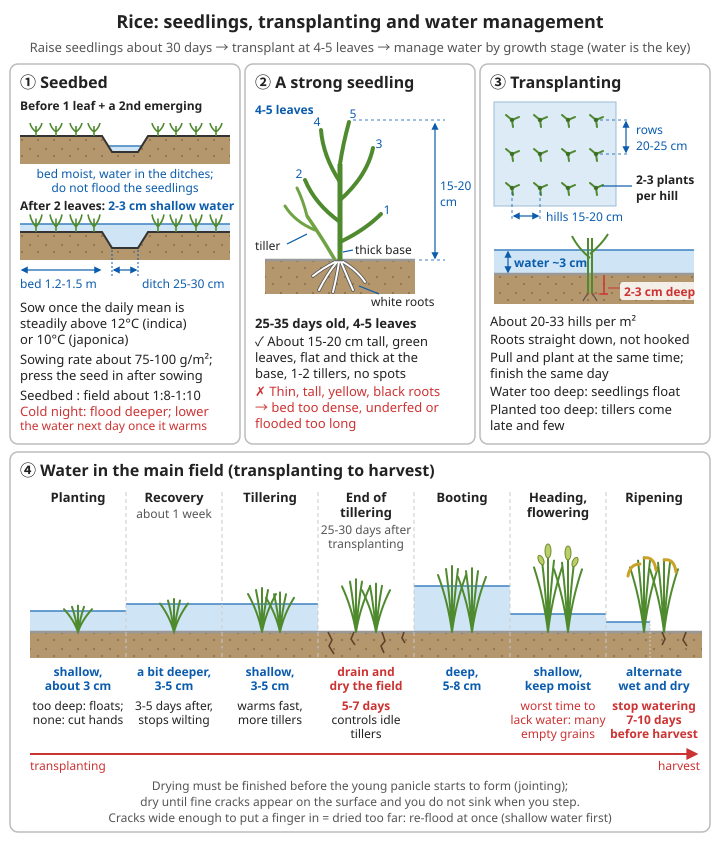

# Grain Crop Growing Guide

## Why staple crops matter

```
Grain crops = the basis of survival
- Provide carbohydrate (energy)
- Can be stored for a long time
- High yield per unit area
- The core of self-sufficiency
```

Vegetables supply vitamins but almost no calories. An adult living mainly on grain needs about 0.5 kg of grain a day (about 1700-1800 kcal, most of a day's energy needs), or about 180 kg a year. Whether you get through a winter depends on how much dry grain is in the store in autumn.

**Look at your own conditions first, then choose crops**:

| Crop | Conditions needed | Difficulty | Sowing to eating | Storage | Main use |
|------|-----------|---------|-----------|--------|---------|
| Potato | Cool; dislikes heat and waterlogging | Easy | About 3-4 months | Several months in a cellar, kept dark | Emergency food, staple |
| Sweet potato | Warm; tolerates drought and poor soil; frost-tender | Easy | About 4-5 months | Dislikes cold (chill damage below about 9°C, rots easily); dried slices keep | High-yield staple; leaves and vines edible |
| Maize | Warm; needs fairly good water and fertility | Fairly easy | About 3-5 months | Dried, keeps 1-2 years | Staple, feed |
| Soya bean | Widely adapted; does not tolerate continuous cropping | Fairly easy | About 3-4 months | Dried, keeps 1-2 years | Protein, oil |
| Sorghum | Tolerates drought, poor soil, saline-alkaline soil | Fairly easy | About 3-4 months | Keeps when dried | Fallback on dry land, feed, brewing |
| Rice | Needs a reliable water source and fields that hold water | Harder | About 4-5 months | Paddy rice keeps 1-2 years | Main staple in the south |
| Wheat | Temperate; winter wheat must overwinter | Harder | Winter wheat about 8 months | Keeps 1-2 years | Main staple in the north |

```
Rules for choosing crops:
✓ First ask local old farmers what they used to grow and when – local varieties
  and the local farming calendar are the result of centuries of trial
✓ Do not grow only one crop: one disease, one drought or flood can wipe it out;
  grow at least 2-3 crops together
✓ For emergencies, first grow fast crops that need no processing (potato, sweet potato),
  and start preparing for the staple grains at the same time
✓ Think about processing for staples: rice must be husked, wheat must be milled;
  without a stone mill or roller, maize, potato and sweet potato are easier to eat directly
```

To judge soil quality, see [Geology, minerals and soil - Soil fertility](../../../docs/08-基础科学知识/06-地质矿物与土壤.md#54-土壤肥力). For frost dates and the farming calendar, see [Weather observation and forecasting - Frost](../../../docs/08-基础科学知识/07-天气观测与预报.md#五霜冻) and [Physics - Calendars](../../../docs/08-基础科学知识/02-物理.md#92-历法) (the 24 solar terms).

---

## Rice

### Basic information

```
Type: staple grain
Cycle: 120-150 days
Yield: about 7500 kg/ha (paddy rice, milling yield about 65-70%) – with improved seed,
       chemical fertiliser and full irrigation
       With only farmyard manure, traditional varieties and hand work, realistically about 3000-4500 kg/ha
Suited to: areas with plenty of water
```

Rice needs fields that hold water: a level surface, bunds that do not leak, and channels that can both irrigate and drain. Where there is no reliable water source, do not force rice; maize, sweet potato or sorghum are safer.

### Choosing varieties

**By growth period**:
- Early rice: 90-120 days
- Mid-season rice: 120-150 days
- Late rice: 150-170 days

**By growing method**:
- Paddy rice (grown flooded)
- Upland rice (grown on dry land, lower yield)

**Recommended for beginners**: locally adapted varieties

```
Why you must use local varieties:
- Many rice varieties are sensitive to day length (late rice especially).
  Moved from south to north or the other way, they may head very late,
  or fail to ripen before the autumn frost
- Indica rice tolerates heat and is mostly grown in the south; japonica rice tolerates cold
  and is mostly grown in the north and at high altitude
- Hybrid rice yields well, but the second generation segregates and cannot be saved for seed
  (see Seed saving)
  → For the long term after a disaster, you need conventional rice you can save seed from
```

### Growing methods

#### Raising seedlings and transplanting (the usual method)

**1. Raising seedlings (about 30 days)**:
```
Time: around Qingming (early April; in the south)
- A more exact rule: sow once the daily mean temperature is steadily above 12°C (indica)
  or above 10°C (japonica)
- Too early, a late cold spell rots the seedlings; for late rice and double-cropped rice,
  sow later according to the local calendar

Preparing the seedbed:
- Level and fertile
- Keep only moist until the seedlings have one leaf and a second emerging; after two leaves,
  keep a shallow layer of water (2-3 cm)
- Choose a sheltered, sunny plot that is easy to irrigate and drain and close to the main field
- Seedbed to main field area ratio about 1:8-1:10 (for 1000 m² of field, about 100-125 m² of seedbed)
- Make seedbed strips about 1.2-1.5 m wide, with ditches about 25-30 cm wide between them
  for walking and drainage
- Rake the surface until the mud is soft and level: "mushy on top, loose underneath"

Seed quantity:
- Seed for the main field (conventional rice): about 30-60 kg/ha, i.e. about 3-6 kg of seed
  per 1000 m² of field
- Sowing rate on the seedbed: about 75-100 g/m², spread evenly

Selecting and soaking seed:
1. Sun the seed for 1-2 days (improves germination vigour)
2. Select: pour the seed into water and stir; skim off floating empty grains and debris.
   Salt water selects more thoroughly: for japonica use salt water with a specific gravity
   of about 1.10-1.13, about 1.7-2.5 kg of salt in every 10 L of water;
   indica and hybrid rice seed is lighter, so use somewhat less salt or plain water only
   (rule of thumb, for reference only).
   Without a hydrometer, float a fresh egg: when the shell shows above the surface
   by about the size of a 5-fen coin, that is about 1.10-1.13.
   Re-test after every two or three batches; rinse the full seed that sinks 2-3 times in clean water
3. Soaking against disease (optional): about 1 kg of slaked lime in 100 L of water; stir,
   then soak the seed in the clear liquid. A lime film forms on the surface – do not break it.
   Soak for the time given by the water temperature in step 4.
   This gives some protection against bakanae disease and rice blast; rinse clean afterwards
   (⚠️ lime water harms skin and eyes – wear gloves)
4. Soak until the husk is translucent and the embryo is white and swollen: at about 15°C
   this takes 5-7 days, at about 20°C about 3-4 days, at about 30°C about 2 days;
   hybrid rice absorbs water fast, so less time; go by the husk, not by the number of days

Sowing:
- After soaking (days depend on water temperature, see above), sprout the seed (1-2 days)
- Sow at a moderate density
- Keep moist
- Sprouting: drain the soaked seed, heap it in a basket and cover with wet sacking to keep warm.
  Keep it at about 35°C (no more than 38°C), turn it a few times a day and sprinkle with warm water;
  in about 1 day the grains "crack open and show white".
  After that, lower to about 25-30°C to grow roots
- Sow when the shoot is about half a grain long and the root about one grain long;
  long shoots break easily when sowing
- Above about 40°C inside the heap the sprouts "burn" (smell of alcohol, yellow shoots);
  feel the temperature often
- After sowing, press the seed gently into the mud with a board or your palm,
  then scatter a thin layer of plant ash or fine soil

Care:
✓ Keep shallow water
✓ Fertilise lightly
✓ Prevent pests and disease
- Before one leaf and a second emerging: keep the bed surface moist with water in the ditches;
  do not flood the seedlings (lack of air rots the sprouts)
- After two leaves: 2-3 cm of shallow water; on cold nights flood deeper to protect the seedlings,
  and lower it again the next day once it warms
- Around the two-leaf stage give one "weaning feed": well-rotted thin manure water
  or urine diluted 5-10 times
- 3-5 days before transplanting give another light "send-off feed";
  seedlings that go out with fertiliser recover faster
- If you have plastic film, you can build a low tunnel for warmth, but on sunny days when it
  goes above about 30°C inside at noon, open it to ventilate, or the seedlings scorch

What strong seedlings look like:
✓ About 15-20 cm tall, green leaves, flat and thick at the stem base
✓ Many white roots, 1-2 tillers, no disease spots
✗ Thin and tall, yellow, black roots → seedbed too dense, short of fertiliser, or flooded too long
```

**2. Preparing the field**:
```
- Plough (turn the soil)
- Harrow level
- Build bunds (to hold water)
- Flood

Key points:
- Plough about 15-20 cm deep and turn in the base fertiliser (well-rotted farmyard manure)
- The difference in height across the field should ideally be no more than about 3 cm:
  high spots show mud and grow weeds, low spots drown the seedlings
- Pack the bunds firm and repair rat and crab holes, or the water will not stay
- Keep the inlet and outlet separate, so each field can be filled and drained on its own
- Winter green manure (Chinese milk vetch etc.) is ploughed in and left to rot about 1-2 weeks
  before transplanting
```

**3. Transplanting**:
```
Time: when the seedlings have 4-5 leaves (seedling age about 25-35 days)

Spacing:
- Between rows: 20-25 cm
- Between hills: 15-20 cm
- 2-3 plants per hill
- About 20-33 hills per square metre in total
- Wider on rich soil and with varieties that tiller strongly; closer on poor soil,
  when transplanting late, and with varieties that tiller little

Depth:
- Shallow (2-3 cm)
- Keep about 3 cm of shallow water in the field while transplanting: too deep and the
  seedlings float up; no water and you cannot see, and you cut your hands
- Planted too deep, tillering is late and sparse; too shallow, seedlings float away

Key points:
✓ Pull and plant at the same time
✓ Finish planting the same day
✓ Keep a water layer
- Flood the seedbed the day before pulling to soften it; lift the seedlings gently with their
  mud and roots, without tearing the roots
- Push the roots straight down, do not bend them into a hook (slow to recover)
- For 3-5 days after planting keep the water slightly deeper (3-5 cm) to protect the seedlings
  from wilting in strong sun
- After about a week the new leaves turn green and white roots appear = recovery;
  fill any gaps promptly
```



*Figure: Raising and transplanting rice and water management – shallow water in the seedbed, strong seedlings at 4-5 leaves, 20-25 cm between rows × 15-20 cm between hills with 2-3 plants per hill, and water in the main field managed by growth stage (see Field management below for details)*

#### Direct seeding (simpler but slightly lower yield)

```
- Sow straight into the field after preparing it
- Saves labour and time
- Suits small areas
- Weeds are hard to control

How:
- Use more seed than for transplanting: conventional rice about 45-75 kg/ha
  (use the higher figure for broadcasting)
- The field must be level; drain standing water before sowing, keep moist but not flooded
  after sowing, and only put on shallow water once the seedlings have 2-3 leaves
- Birds and rats eat the seed: cover it with fine soil or plant ash after sowing, and keep watch
- Weeds come up together with the rice; weed often, or suppress weeds with a water layer
  once the rice seedlings are established
```

### Field management

**Water management**:
```
Critical!

Tillering stage (after transplanting):
- Shallow water (3-5 cm)
- Encourages tillering
- Shallow water warms up quickly and gives more tillers; deep flooding for long gives fewer

End of tillering:
- Drain and dry the field for 5-7 days
- Controls unproductive tillers and encourages rooting

Booting stage:
- Deep water (5-8 cm)

Heading and flowering:
- Shallow water
- Keep moist
- This is when lack of water does most harm: it causes many empty and shrivelled grains

Ripening:
- Alternate wet and dry
- Stop watering 7-10 days before harvest
- Stopping too early gives poorly filled grain; too late leaves the field muddy and hard to harvest
```

**How to dry the field**:
```
When:
- When the number of stems per hill reaches about 80% of the planned number of panicles
  (for example, 10-15 stems per hill), usually about 25-30 days after transplanting
- It must be finished before the young panicle starts to form (jointing)

How far:
✓ Fine cracks appear on the surface (like chicken footprints); you do not sink when you step,
  but leave a footprint
✓ White roots show at the surface, the leaves fade from deep green and stand up straighter
✗ Cracks wide enough to put a finger in → dried too far, the roots tear; re-flood at once

How hard:
- Many seedlings, deep green leaves, growing too vigorously → dry hard and for longer
- Few seedlings, yellow leaves, sandy or leaky fields → dry lightly, or just drain and expose
  the surface for 1-2 days
- After drying, re-flood with shallow water first; do not flood deep all at once

Unusual weather at heading and flowering:
- Cold windy days (below about 20°C for japonica, about 22°C for indica) → flood deep to keep warm
- Heat (above about 35°C) → keep a water layer; if possible, flood by day and drain at night to cool
```

**Fertilising**:
```
Base fertiliser (when preparing the field):
- Mainly organic
- Well-rotted farmyard manure
- About 15000-30000 kg/ha (about 1.5-3 kg per square metre), turned in when preparing the field
- In fields short of potassium (old leaves yellow and scorched at tips and edges) add plant ash
  at about 75-150 g/m²
  (do not heap plant ash together with manure or urine – it turns the nitrogen into ammonia gas, which escapes)

Top-dressing:
- Tillering feed (7-10 days after transplanting)
- Panicle feed (booting stage)
- Mainly nitrogen, with phosphorus and potassium
- Use thin manure water or urine diluted 5-10 times, poured between the rows;
  keep shallow water afterwards
- Give the panicle feed when the young panicle is forming (after re-flooding from drying);
  give little or none if the leaves are already deep green

Principle:
- Push early (tillering)
- Hold back in the middle (prevent rank growth)
- Top up late (fill the grain)

Too much nitrogen: drooping leaves, soft stems → lodging;
rice blast, sheath blight and planthoppers all get clearly worse; plants stay green and ripen late
```

**Pest and disease control**:
```
Common diseases:
- Rice blast: choose resistant varieties, do not over-apply nitrogen
- Sheath blight: control the water layer, do not plant too densely

Common pests:
- Rice planthoppers: light traps in the field
- Stem borers: remove dead-heart seedlings promptly

Prevention first!
```

| Pest/disease | How to recognise it | How to prevent it |
|------|--------|--------|
| Rice blast | Spindle-shaped spots on leaves, grey-white in the centre with brown edges; the panicle neck turns dark brown and the whole panicle turns white and sets no grain (neck blast) | Resistant varieties; seed disinfection; do not over-apply nitrogen; do not keep diseased straw into the next year |
| Sheath blight | Large grey-green blotches with brown edges in a cloud-like pattern on leaf sheaths near the water surface, spreading upwards | Do not plant too densely; dry the field at the right time; do not over-apply nitrogen |
| Bacterial leaf blight | Long yellow-white dead streaks along leaf tips and edges, common after typhoons and rainstorms | Resistant varieties; do not let water from diseased fields flow into other fields |
| Bakanae disease | Seedlings thin, long and pale yellow, standing well above the others; they die later | Disinfect seed when soaking; pull them out as soon as you see them in the seedbed |
| Rice planthoppers | Large numbers of small brown or grey-white insects at the base of the plants; in bad cases patches turn yellow and collapse ("hopper burn") | Do not plant too densely or over-apply nitrogen; light traps; protect spiders and frogs; keep ducks in the paddy |
| Stem borers (striped stem borer, yellow stem borer) | At tillering the central leaf dies (dead heart); after heading the whole panicle turns white, stands upright and snaps off when pulled (white head) | Pull out dead-heart and white-head stems and take them out of the field; cut stubble low at harvest; plough and flood in winter and spring to drown overwintering larvae |
| Rice leaf folder | Leaves rolled lengthways into a tube with silk, a green larva inside, white streaks left on the leaf | Protect natural enemies; squeeze rolled leaves by hand when few; light traps for the moths |

```
Additional notes:
- Ducks in the paddy: about 7-10 days after transplanting, put in ducklings about half a month old,
  about 150-300 per hectare; they eat insects and weeds and muddy the water, which suppresses weeds.
  Take the ducks out before heading, or they will eat the grain
- Fish in the paddy also eat insects and weeds; drive the fish into the fish trench before
  using any pesticide
- After heading and grain filling, keep sparrows off: scarecrows, coloured streamers, someone on watch
- Do not use pesticides of unknown origin or with unclear labels (see Principles of pest and disease control)
```

For keeping ducks, see [Poultry - Raising ducks](../../../docs/04-动植物培育/05-家禽养殖.md#鸭的养殖); for fish, see [Aquaculture - Fish in rice paddies](../../../docs/04-动植物培育/07-水产养殖.md#稻田养鱼).

### Harvest and storage

**Harvest**:
```
When:
- 90% of grains yellow and ripe
- Harvesting early loses a lot
- Harvesting late, grain shatters easily

How:
- Cut the rice
- Thresh
- Dry (moisture <13%)

✓ Start cutting when several sunny days are forecast; thresh as soon as possible after cutting.
  Do not leave it heaped in the field (it heats up and sprouts)
```

**Storage**:
```
✓ Fully dry
✓ Sealed against damp
✓ Protected from rats and insects
✓ Cool, ventilated place
✓ Check regularly

Brown rice / paddy rice keeps 1-2 years
- Paddy rice (in the husk) keeps best; mill only as much as you will eat
- Brown and white rice go stale and get insects easily after milling; do not mill too much at once
```

For judging ripeness, threshing and drying, see [Grain and oil processing - Harvest](../../../docs/07-日常生活技能/14-粮油加工.md#收获-什么时候割怎么割) and [Drying to a safe moisture content](../../../docs/07-日常生活技能/14-粮油加工.md#干燥到安全水分); for husking and milling, see [Rice - Husking and milling](../../../docs/07-日常生活技能/14-粮油加工.md#稻谷-去壳和碾米).

---

## Wheat

### Basic information

```
Type: staple grain
Cycle: winter wheat about 220-260 days, spring wheat about 90-120 days
Yield: about 4500-6000 kg/ha – with improved seed, chemical fertiliser and irrigation
       With only farmyard manure, traditional varieties and rain-fed, realistically about 1500-3000 kg/ha
Suited to: the north, temperate regions
```

Winter wheat is sown in autumn and harvested in early summer the next year, generally about 220-260 days from sowing to harvest (shorter for winter wheat in the south); spring wheat takes about 90-120 days.

### Varieties

**By growing season**:
- Winter wheat: sown in autumn, harvested in spring/early summer (the main type, higher yield)
- Spring wheat: sown in spring, harvested in autumn (cold high regions)

```
- Winter wheat must go through a period of cold (vernalisation) before it heads: a strongly
  winter-type variety sown in spring only grows leaves and does not head
- Where winter wheat can be grown depends on whether it survives the winter: in regions with very
  cold winters, little snow cover and strong winds, grow spring wheat
- Again, use local varieties: strongly winter-type northern varieties ripen late in the south,
  and spring-type southern varieties freeze to death in the north
```

### Growing methods

**Preparing the land**:
```
- Plough deep (20-25 cm)
- Harrow fine and level
- Apply plenty of base fertiliser
- Base fertiliser: well-rotted farmyard manure about 15000-30000 kg/ha
  (about 1.5-3 kg per square metre), spread evenly before ploughing
- Clods should be broken fine, loose on top and firm below: where clods are large and hollow,
  seed falls into the gaps and does not emerge, and is easily frozen in winter
- Soil moisture: best when a handful of soil squeezes into a ball and breaks apart when dropped;
  if too dry, water first and then sow
```

**Sowing**:
```
When:
- Winter wheat: from Hanlu to Shuangjiang (solar terms; October)
- Spring wheat: around Qingming (early April)

A more exact rule for winter wheat:
- Sow when the daily mean temperature falls to about 16-18°C (winter-type varieties)
  or 14-16°C (semi-winter-type varieties)
- The aim is "strong seedlings" before winter: 5-6 leaves on the main stem and 3-5 tillers
- Too early: the plants grow too lush before winter, die easily in the cold, and suffer more pests
  and disease
- Too late: seedlings too small before winter (only 2-3 leaves), poor cold tolerance, few tillers,
  low yield
- Rough farming calendar (varies a lot; go by local experience):
  northern North China late September; Huang-Huai region early to mid October;
  Yangtze basin late October to early November

Spring wheat: sow as soon as the soil has thawed about 5-7 cm deep and can be harrowed
              ("sowing on the frost"); the earlier the better – late sowing clearly cuts yield

Method:
- Drilled in rows (20-25 cm apart)
- Or broadcast
- Drilling gives even emergence and makes hoeing and top-dressing between rows easier;
  it is better than broadcasting

Seed rate:
- 150-225 kg/ha
- Use the lower figure when sowing on time on good soil; the higher figure when sowing late,
  on poor soil, or on roughly prepared land
- After the right sowing date, add about 7.5 kg per hectare for each day of delay

Depth:
- 3-5 cm
- Too deep: slow emergence, weak seedlings; too shallow: dries out and freezes easily
- Firm the soil lightly after sowing so the seed is in close contact with moist soil
```

**Working out the seed rate yourself** (when seed comes from different sources and thousand-grain weight varies a lot):
```
Seed rate (kg/ha) = planned seedlings per m² × thousand-grain weight (g) ÷ (germination rate × emergence rate) ÷ 100

Example: planned 250 plants per square metre, thousand-grain weight 40 g, germination rate 90%,
         field emergence rate 80%
    250 × 40 ÷ (0.9 × 0.8) ÷ 100 ≈ 139 kg/ha (about 14 g per square metre)

- Thousand-grain weight: count 1000 full seeds and weigh them
- Germination rate: do a germination test before sowing
- Sown on time, usually about 200-300 seedlings per square metre
```

For germination testing, see [Seed saving and breeding - Germination test](../../../docs/04-动植物培育/08-留种与育种.md#发芽率测试).

### Field management

**Care before winter** (winter wheat):
```
✓ Water in time (emergence watering, overwintering watering)
✓ Hoe and weed
✓ Roll (prevents frost heave)
✓ Apply winter manure

Details:
- Check after emergence: re-sow wherever a row has a gap of more than about 15 cm
- Overwintering watering: water when the daily mean temperature falls to about 3-5°C
  and the ground "freezes at night and thaws by day"; the water must soak in the same day.
  Watered too early, the plants grow too lush; too late, the surface ices over.
  If subsoil moisture is good and the plants are weak, you can skip it
- Rolling: on loose, cloddy land, roll once with a stone or wooden roller to crush clods and close
  cracks, so cold winter wind cannot get into the roots and leave them "hanging" and frozen;
  do not roll when the soil is too wet
- Winter manure: around the start of winter, spread well-rotted farmyard manure or plant ash between
  the wheat rows; it feeds the crop and covers the soil to keep it warm
- In winter do not let livestock into the wheat to graze or trample it
```

**Spring care**:
```
✓ Water and fertiliser at green-up (early spring)
✓ Top-dress at jointing
✓ Prevent lodging
✓ Pest and disease control

Green-up (early spring, when it warms and the wheat turns green and starts growing):
- Hoe first (loosens the soil, keeps moisture in and warms the soil); do not rush to water
- Weak or yellow plants: give a green-up feed early (thin manure water, diluted urine)
- Lush plants (too tall before winter, deep green leaves): no fertiliser, no water; roll once to
  "hold them back" and prevent lodging later

Jointing (the first node at the stem base is about 1.5-2 cm above ground; you can feel a hard node
when you pinch it):
- This is the most important top-dressing and watering; it decides the size of the ears
- Water after top-dressing, or apply just before rain
- If frost (a late cold spell) is forecast after jointing, watering once beforehand reduces frost damage

Preventing lodging:
- Do not sow too thickly, do not over-apply nitrogen
- For lush plants, roll and hold back water before jointing
- After heading, do not water before strong wind and rain
```

**Irrigation**:
```
Critical stages:
- Emergence
- Before winter
- Green-up
- Jointing
- Booting
- Grain filling

Principles:
- Water promptly in drought
- Drain in the rainy season
- When water is short, give priority to the jointing and booting waterings
- Do not water late in grain filling on windy days, to prevent lodging
- Winter wheat in the south "fears wet more than drought": dig bed ditches, cross ditches and
  perimeter ditches so no water stands in the field after rain
```

**Pests and diseases**:
```
- Rust: choose resistant varieties
- Fusarium head blight: spray to prevent it at flowering
- Aphids: prevent and treat early

Recognising them:
- Rust: blisters of powder on the leaves, bright yellow in stripes (stripe rust) or orange-brown
  scattered dots (leaf rust); wipe with a finger and it leaves "rust powder".
  Pulling out volunteer wheat and not sowing too early reduce it
- Aphids: dense small green insects on the ears and leaf undersides, sticky leaf surfaces;
  when there are many ladybirds and lacewings, there is often no need to act;
  act only when numbers shoot up and the ears are covered
- Smut: the ear turns into a mass of black powder → pull it out, bag it, take it out of the field
  and burn it; do not save seed from wheat grown on that field
```

### Fusarium head blight: mouldy wheat must not be eaten

Fusarium head blight (scab) is the most dangerous disease of wheat. It not only cuts yield: infected grains contain fungal toxins such as **deoxynivalenol (commonly called vomitoxin)**. In people it causes nausea, vomiting and diarrhoea; livestock refuse feed, vomit and abort. The toxin is heat-stable: steaming, boiling and baking destroy only a small part of it, so you cannot remove it by cooking.

```
When it occurs:
- Most severe when flowering (about a week after heading) meets several days of continuous rain
  and warm, humid weather
- Common in the middle and lower Yangtze and the Huang-Huai wheat regions; worse after a maize crop
  and where there is a lot of maize straw in the field

How to recognise it:
- One or a few spikelets on the ear turn bleached first, as if ripe too early
- In damp weather a pink mould grows at the base of the spikelets and in the cracks of the glumes
- Infected grains are shrivelled, chalky white or pinkish, and lighter than good grains

Prevention:
✓ Grow local varieties with better resistance
✓ Before sowing, clear out or plough deeply under the maize straw and rice stubble in the field
✓ Dig good drainage ditches so no water stands in the field
✓ At the start of flowering, if continuous rain is forecast, this is the only effective time to spray;
  use pesticide according to the label. Spraying after the disease appears is almost useless

Dealing with diseased wheat:
1. Harvest and thresh plots with many diseased ears separately; do not mix them with good wheat
2. Winnow or float off the light diseased grains (diseased grains are light: they land further
   away when winnowing, and float when soaked)
3. If there are many diseased grains (roughly more than a few per cent) or the grain is pinkish,
   do not use the whole batch as food, and do not feed it to pigs or chickens either
4. Never save seed from diseased wheat
```

### Harvest and storage

**Harvest**:
```
When:
- From late dough stage to early full ripeness
- 90% of grains hard

How:
- Cut and dry (cut, dry, then thresh)
- Or with a combine harvester

Drying:
- Moisture <12%

⚠️ If rain falls on ripe wheat, the grain sprouts on the ear (pre-harvest sprouting); the flour
   becomes sticky and cannot be made into noodles or bread, and it soon goes mouldy:
   harvest each plot as soon as it is ripe – "snatch the grain from the dragon's mouth"
```

**Storage**:
```
✓ Dry and ventilated
✓ Protected from insects and rats
✓ Kept dark
✓ Keeps 1-2 years
```

For judging when to cut, threshing and drying, see [Grain and oil processing - Harvest](../../../docs/07-日常生活技能/14-粮油加工.md#收获-什么时候割怎么割); for milling flour, see [Wheat - Stone milling](../../../docs/07-日常生活技能/14-粮油加工.md#小麦-石磨磨面).

---

## Maize

### Basic information

```
Type: staple / feed
Cycle: 100-150 days
Yield: about 7500-9000 kg/ha – with improved seed (mostly hybrids) and chemical fertiliser
       With farm varieties and only farmyard manure, realistically about 2000-4500 kg/ha
Suited to: a wide range; very adaptable
```

### Varieties

- Field maize
- Sweetcorn (eaten fresh)
- Waxy maize
- Fodder maize

```
- Almost all maize seed sold today is hybrid: high yield in the first year, but you cannot save seed from it
  → For the long term, find farm varieties (conventional, open-pollinated varieties)
- Sweetcorn is high in sugar and low in starch; it shrivels when dried and does not store well,
  so it is not suitable as a staple
- For staple maize, choose flint or dent types with a ripening time that suits your area
```

### Growing methods

**Preparing the land and fertilising**:
```
- Plough deep
- Apply plenty of organic fertiliser
- Ridges or flat beds
- Plough about 20 cm deep; base fertiliser of well-rotted farmyard manure about 15000-30000 kg/ha
- In low-lying, rainy places, grow on ridges for good drainage; in dry regions, grow flat or in
  furrows to keep moisture in
```

**Sowing**:
```
When:
- Spring sowing: April-May (soil temperature steadily above 12°C)
- Summer sowing: June (after the wheat harvest, as a second crop)
- Soil temperature: measure at 5-10 cm depth; it counts as steady only when the morning reading
  meets the requirement for several days in a row
- Summer maize: the earlier the better – sow as soon as the wheat is harvested while the soil is
  still moist; if late, it may not ripen before the autumn frost

Method:
- Sow in hills or drills
- Between rows: 60 cm
- Between plants: 28-37 cm
- Density: 45000-60000 plants/ha
- Use the higher figure on rich land and with compact varieties; the lower figure on poor land and
  with tall farm varieties
- You can also use wide and narrow rows (for example 80 cm and 40 cm alternating) for better air
  and light and easier intercropping

Depth:
- Usually 4-6 cm
- Shallower in clay and wet soil (about 3-4 cm); deeper in sandy and dry soil (about 6-7 cm)

Per hill:
- 2-3 seeds
- After emergence thin to 1 plant
- Seed use about 30-45 kg/ha (depending on thousand-grain weight)
```

```
⚠️ Maize is wind-pollinated: pollen from the male flower (the tassel at the top) must land on the
   silks of the female ear for kernels to form
- In small plots grow maize in a block (at least 4 rows), not one single long row,
  or pollination will be poor and the cobs will have missing kernels and bare tips
- Grow sweetcorn and waxy maize apart from field maize; cross-pollination changes the kernels
```

For isolation distances, see [Seed saving and breeding - Isolation distances](../../../docs/04-动植物培育/08-留种与育种.md#隔离距离).

### Field management

**Seedling stage**:
```
✓ Thin and single (at 3-4 leaves)
✓ Hoe and weed
✓ Control soil pests (white grubs, mole crickets)

- Keep strong, even seedlings; pull out weak, diseased, and unusually large or small ones
- Where a hill is empty, transplant a spare seedling from a neighbouring hill with its soil,
  then water
- Some dryness at the seedling stage "holds the plants back" and makes roots go deep
  (leaves may curl slightly at noon as long as they recover by evening)
- Cutworms bite through seedlings at night: in the morning, scrape away the topsoil near the cut
  seedling and catch them
- White grubs (fat, curved white larvae) and mole crickets eat the roots: pick them out when digging
  and feed them to chickens; manure you apply must be well rotted
```

**Jointing stage**:
```
✓ Top-dress (at the "large trumpet" stage)
✓ Earth up (prevents lodging)
✓ Remove tillers

- Earthing up: when hoeing, draw soil up to about 10 cm around the stem base; this encourages brace
  roots, resists lodging, and makes watering and drainage easier
- When farm varieties produce many tillers, snap off the side shoots at the stem base
```

**Tasselling and flowering**:
```
✓ Plenty of water
✓ Control corn borer
✓ Hand-assisted pollination (small plots; improves seed set)

- The month around tasselling is when maize needs most water; drought then cuts yield most
- Hand pollination: on a sunny morning after the dew has dried, shake the plants or collect pollen
  in a paper bag and sprinkle it on the silks; repeat after 2-3 days
- Do not remove the tassels from plants kept for seed
```

**Grain filling and ripening**:
```
✓ Keep watered
✓ Prevent early senescence
✓ Prevent lodging
```

**Fertilising**:
```
Base fertiliser: mainly organic
Top-dressing:
- Seedling feed: at 3-4 leaves
- Ear feed: at the large trumpet stage (important!)
- Grain feed: after tasselling

Give a heavy ear feed!

How to recognise the large trumpet stage:
- About 11-12 leaves unfolded; the top few leaves cluster together and look like a trumpet
  from above
- About 10-15 days before tasselling
- The female ear is forming now; lack of fertiliser gives small ears with few kernels

How to apply:
- Open a furrow or dig holes about 10-15 cm from the plants, about 10 cm deep; cover with soil
  after applying (nitrogen spread on the surface is lost to the air and washed away by rain)
- Use well-rotted manure, diluted urine or oilseed cake; water after applying, or apply just before rain
- Split: a little as seedling feed, most of the top-dressing as ear feed; grain feed depending on growth,
  only when the leaves turn yellow from lack of fertiliser

Signs of deficiency:
- Nitrogen: lower old leaves yellow from the tip along the midrib in a "V" shape
- Potassium: old leaves yellow and scorched at the edges
- Phosphorus: leaves dark green and purplish at the seedling stage
```

### Corn borer

The corn borer is maize's main pest. The larvae bore into the central leaves, tassels, stems and ears, causing broken stems and damaged ears, and making ear rot and mould toxins worse.

```
How to recognise it:
- Whorl stage: rows of neat small holes in the unfolded leaves (bitten while the leaves were still
  rolled in the whorl)
- After tasselling: broken tassels; bore holes in the stem with sawdust-like droppings outside
- Ears: tips eaten, with flesh-coloured larvae and droppings inside

Control (mainly cultural and physical):
1. Deal with the stalks: the larvae overwinter in maize stalks and cobs.
   The next spring, before they pupate (before adult moths appear locally), chop the stalks and
   plough them in, compost them, or burn them all as fuel
   → This is the most basic measure; ideally the whole village does it together
2. Light traps: during the moth season, put a light by the field at night with a basin of water
   underneath (a few drops of oil on the surface)
3. Protect and release natural enemies: Trichogramma wasps, ladybirds, lacewings; use few broad-spectrum
   insecticides
4. At the late whorl stage (trumpet stage), if there are many larvae, put a biological pesticide
   (such as Beauveria bassiana or Bacillus thuringiensis) or granules used according to the label into the whorl
5. Deal separately with damaged ears picked off at harvest; do not eat mouldy ones
```

```
Other common problems:
- Northern and southern leaf blight: long or oval grey-brown spots on the leaves, worse in wet years
  → resistant varieties, crop rotation, remove crop debris
- Common smut: galls with a white skin on stems and ears, releasing black powder when they burst
  → remove before the skin breaks and take out of the field
- Armyworms: masses of larvae strip the leaves overnight → find early, pick by hand,
  let chickens and ducks into the field to eat them
- Ear rot: pink, grey-green or yellow-green mould on the ears → such maize must not be eaten
  or fed to livestock
```

### Harvest and storage

**Harvest**:
```
When:
- Husks dry and yellow
- Kernels hard
- Milk line gone

How:
- Snap off the ears
- Husk
- Dry

- Milk line: the line between yellow and white on the back of the kernel; it moves down from the top,
  and when it disappears (a black layer forms at the kernel base) the grain is fully ripe
- Harvesting a few days later (after the kernels are fully hard) gives a higher yield, but in rainy
  places watch for mould on the ears
```

**Storage**:
```
Cobs:
- Hang up to dry in the air
- Moisture <14%

Kernels:
- Dry after shelling
- Seal against damp and insects
- Keeps 1-2 years

☠️ Throw away the whole batch of maize that is mouldy, discoloured or bitter; do not eat it or
   feed it to livestock (aflatoxin, not destroyed by heating)
```

For shelling and grinding, see [Grain and oil processing - Maize](../../../docs/07-日常生活技能/14-粮油加工.md#玉米). **If maize is your main staple for a long time, first boil it with lime water or plant-ash lye**, or pellagra can easily result; see [Nutrition and deficiency diseases - Niacin](../../../docs/07-日常生活技能/02-营养与营养缺乏病.md#烟酸-吃玉米要用碱处理). For mould, see [Food processing and preservation - Aflatoxin](../../../docs/07-日常生活技能/01-食物加工与保存.md#黄曲霉毒素).

---

## Potato

See [Vegetable growing - Potato](../../../docs/04-动植物培育/01-蔬菜种植.md#土豆)

```
Cycle: 90-120 days
Yield: 22500-30000 kg/ha
Features:
✓ High yield
✓ Nutritious
✓ Stores well
✓ Can be a staple

An important famine-reserve crop!
```

```
About the yield: the figure above is fresh tubers under good management;
                 with only farmyard manure and home-saved seed potatoes, realistically about 10000-20000 kg/ha
Conversion: fresh potato is about 80% water; about 4.5 kg of fresh potato has the energy of 1 kg of grain
```

### Potatoes in the field

For the basic growing and harvesting methods, see the vegetable growing chapter; this adds only the points for growing potatoes over a large area.

```
Seed potatoes:
- About 1500-2250 kg/ha (about 150-225 g per square metre)
- Cut large tubers into pieces of about 25-40 g, each with 1-2 eyes; small tubers
  (under about 50 g) are best planted whole
- Toss the cut pieces in dry plant ash and spread them in a cool place for 1-2 days so the cut
  surfaces heal, to stop them rotting
- If you cut into a tuber with a black ring, a brown ring or rot, disinfect the knife in boiling water
  or alcohol before cutting the next one
- About 2-3 weeks before planting, spread the seed potatoes in diffuse light to "green-sprout" them;
  plant when they have short, sturdy green sprouts – they come up earlier and more evenly

Spacing:
- About 60-70 cm between rows, about 25-30 cm between plants, about 50000-65000 hills per hectare
- Plant on ridges and earth up 2-3 times as the plants grow, so no tubers show above ground
  (tubers that see light turn green and are poisonous)

When:
- Spring crop: plant about 2-4 weeks before the local last frost, when the soil at 10 cm reaches
  about 7-8°C, so the shoots come up after the late frosts
- Potatoes like it cool: in heat (days above about 30°C) the tubers hardly grow,
  so in the south mostly autumn-winter crops are grown, and in the north and at altitude, spring crops
```

```
⚠️ Late blight: the most deadly potato disease; it caused the Irish famine of the 1840s
How to recognise it: water-soaked dark brown spots on the leaves, with a ring of white mould on the
       underside in damp weather; in rainy weather the stems and leaves of a whole field turn black
       and collapse within a few days, with a foul smell; tubers turn brown and rot under the skin
How to prevent it:
✓ Plant disease-free seed potatoes; do not plant only one variety
✓ Earth up thickly to cover the tubers, so spores are less easily washed down to them by rain
✓ When you find the first diseased plants, pull them out at once, bag them, take them out of the field
  and bury them deep
✓ When stems and leaves are badly diseased, cut off the tops and remove them; wait 1-2 weeks before
  digging (the skins harden and carry less disease)
✓ Grow apart from aubergine, tomato and chilli (all in the nightshade family); do not rotate them with each other
✓ Wait at least 3 years before growing potatoes or other nightshade crops on the same land again

Degeneration: after several years of replanting home-saved seed potatoes, plants become stunted
with crinkled, mottled leaves, and yield falls year by year
→ Mostly virus disease; save seed from strong, healthy plants, and preferably get new seed
  from cool high-altitude areas
```

For saving seed potatoes, see [Seed saving and breeding - Potatoes and sweet potatoes](../../../docs/04-动植物培育/08-留种与育种.md#土豆和红薯-用薯块繁殖); for cellar storage, see [Food processing and preservation - Cellar storage](../../../docs/07-日常生活技能/01-食物加工与保存.md#窖藏).

---

## Sweet potato

See [Vegetable growing - Sweet potato](../../../docs/04-动植物培育/01-蔬菜种植.md#红薯)

```
Cycle: 120-150 days
Yield: 30000-60000 kg/ha
Features:
✓ Very high yield!
✓ Tolerates drought and poor soil
✓ Easy to grow
✓ Can be eaten fresh or dried for storage
✓ Leaves and vines are edible too

The highest-yielding food crop!
```

```
About the yield: the figure above is fresh roots under good management;
                 with extensive growing, realistically about 15000-30000 kg/ha
Conversion: about 3.5 kg of fresh sweet potato has the energy of 1 kg of grain,
            so in energy per unit area, sweet potato usually beats cereals
Drawbacks: very little protein, so you cannot live on sweet potato alone; fresh roots dislike cold
           and do not keep long
```

### Sweet potatoes in the field

```
Raising slips:
- About 750-1500 kg of seed roots per hectare of field to raise slips
- Keep the slip bed at about 28-32°C for the first few days (no more than 35°C; a hotbed or
  manure-heated bed can be used); after sprouting lower it to about 22-25°C
- Cut the slips when they are about 20-25 cm long with 5-7 leaves, and plant them in the field

Planting:
- Ridges: about 70-90 cm apart, about 25-30 cm high (loose soil gives big roots)
- About 20-30 cm between plants, about 45000-60000 plants per hectare
- Plant the slips slanting or lying flat, with 3-4 nodes in the soil (every node may form a root)
  and the leaves above ground
- Plant on cloudy days or in the evening and water afterwards; plant only when the soil is above
  about 15°C – they are frost-tender

Care:
- Hoe 1-2 times before the canopy closes
- Do not give much nitrogen: too much grows only vines and leaves, no roots
- Plant ash (potassium) works best for sweet potato, about 75-150 g/m²
- Harvest: before the local first frost, or when the daily mean temperature falls to about 15°C;
  handle gently when digging, and eat broken-skinned roots first
```

```
⚠️ Black rot: round, black-brown, slightly sunken spots on the roots; cut open, the flesh under
   the spot is black-green and bitter
- Diseased roots contain toxins (such as ipomeamarone); people who eat them get nausea and vomiting,
  and cattle and sheep that eat them can be poisoned and die
- Do not eat diseased roots or feed them to livestock, not even cooked; bury them deep or burn them
- Prevention: raise slips from disease-free seed roots; cut slips high (at least about 3 cm above the
  bed surface, so you do not take diseased roots); do not damage the skins at harvest and when
  putting them in the cellar

Storage:
- Before putting them in the cellar, "cure" them for a few days at about 30-35°C and high humidity
  so wounds heal (if you cannot, at least air them for a few days)
- Keep the cellar at about 10-15°C: below about 9°C they suffer chill damage and rot;
  above about 15°C they sprout
- When storing large amounts is not practical, cut them into slices and sun-dry them, or grind them into flour
```

For overwintering seed roots for slips, see [Seed saving and breeding - Potatoes and sweet potatoes](../../../docs/04-动植物培育/08-留种与育种.md#土豆和红薯-用薯块繁殖); for storage temperatures of roots and other vegetables, see [Food processing and preservation - Storage conditions for vegetables](../../../docs/07-日常生活技能/01-食物加工与保存.md#各类蔬菜的储存条件).

---

## Soya bean

### Basic information

```
Type: food / oil crop
Cycle: 100-120 days
Yield: 2250-3000 kg/ha – under good management; with extensive growing, realistically about 900-1500 kg/ha
Features:
- Rich in protein
- Can be pressed for oil
- Legume that fixes nitrogen (improves soil)
```

Soya beans contain about 35-40% protein and about 20% oil; when grain is your staple, they are the most important source of protein. In years without meat or eggs, eating a few tens of g of beans per person per day clearly reduces protein deficiency.

### Growing methods

**Sowing**:
```
When: May-June (summer soya)
- Spring soya (one crop a year in the north): when the soil at 5 cm is steadily above about 8-10°C,
  usually late April to mid May
- Summer soya: sow early after the wheat harvest while the soil is moist; the earlier the better
- Soya is sensitive to day length, so do not move varieties between latitudes:
  southern varieties taken north stay green and ripen late; northern varieties taken south flower
  too early and stay short

Method:
- Drills or hills
- Between rows: 40-50 cm
- Between plants: 15-20 cm
- 2-3 seeds per hill; keep 1-2 plants after emergence
- About 200000-300000 plants per hectare; wider for spring soya, rich land and branching varieties,
  closer for summer soya
- Seed use about 60-90 kg/ha (depending on seed size)

Depth: 3-5 cm
- When emerging, soya must push its two fat seed leaves out of the soil, and it is weak at pushing
  through soil
- If sown too deep, or if rain after sowing crusts the surface, it may not come up;
  sow shallower in clay (about 3 cm)
```

**Care**:
```
✓ Hoe and weed at the seedling stage
✓ Top-dress and water at flowering and pod set
✓ Nitrogen fixation by root nodule bacteria (give little nitrogen)
✓ Pest and disease control

- Hoe 2-3 times at the seedling stage, finishing before the canopy closes
- From flowering to pod filling (beans swelling) is when it needs most water; drought makes many
  flowers and pods drop
- If leaves turn yellow at flowering, give a little plant ash and phosphate (such as bone meal);
  give nitrogen only in small amounts when clearly short
```

### Root nodules: why soya beans need little nitrogen

The nodules on soya roots contain root nodule bacteria (rhizobia) that fix nitrogen from the air for the plant. Most of the nitrogen a soya crop needs comes from the nodules, and the root stubble and fallen leaves after harvest leave some nitrogen for the next crop.

```
Checking the nodules (from about 3-4 weeks after emergence):
1. Dig up a plant with its soil using a spade and shake the soil off gently in water
   (pulling it straight up tears the nodules off)
2. The main root and upper side roots should have nodules from rice-grain to soya-bean size
3. Cut one open: pink or red inside → fixing nitrogen, good
                 white or grey-green → not working; no nodules → this land lacks soya root nodule bacteria

Why not to give much nitrogen:
- With a lot of nitrogen in the soil, soya "gets lazy" and grows fewer nodules; fixation drops
- Too much nitrogen also makes stems and leaves grow rank, lodge, and drop flowers and pods,
  so yield is actually lower
- Only on poor land give a little starter fertiliser at sowing (such as a little well-rotted manure)
  to help the seedlings through

On new land that has never grown soya:
- Take topsoil from an old field that grew soya with good nodules, and mix it with the seed
  (about equal amounts of soil and seed, moistened with a little clean water); mix in the shade
  and sow at once
- The bacteria are killed by sun, drying, and direct contact with lime or plant ash; do not put the
  mixed seed in the sun

Conditions for good nodules:
✓ Soil not too acid (improve acid soil with lime first)
✓ Enough phosphorus, potassium and calcium; plant ash and bone meal help
✓ Well-aerated soil, not waterlogged for long
```

For improving acid soil, see [Lime and building materials - Improving acid soil](../../../docs/07-日常生活技能/16-石灰与建筑材料.md#改良酸性土); for testing acidity, see [Geology, minerals and soil - Acidity and alkalinity](../../../docs/08-基础科学知识/06-地质矿物与土壤.md#53-酸碱性).

```
Pests, diseases and continuous cropping:
- Do not grow soya on the same land year after year: after a few years, cyst nematodes and root rot
  build up, plants are stunted and yellow, and yield falls sharply
  → Wait at least 2-3 years before growing soya again
- Pod borers and podworms: larvae bore into the pods and eat the beans → rotate crops,
  plough after harvest, harvest on time
- Aphids: spread virus diseases → protect ladybirds; pinch off heavily infested shoot tips early
```

**Harvest**:
```
- Leaves have dropped
- Pods yellow and dry
- They rattle when shaken

Dry, then thresh and store

- If not harvested promptly when ripe, the pods burst and drop the beans: cut in the morning while
  there is dew, when the pods are less likely to split
- Dry to below about 12% moisture; beans easily get bean weevils, so seal them after drying
- Fresh green soya beans (edamame; when the pods are full but still green) can be picked early
  for some as a vegetable
```

```
⚠️ Soya beans must be cooked thoroughly before eating: raw soya beans and raw soya milk contain
   trypsin inhibitors and saponins, which cause nausea, vomiting and diarrhoea.
   Beware of "false boiling" with soya milk – keep it boiling for a few more minutes after it boils
```

For making tofu and soya milk, see [Food processing and preservation - Tofu](../../../docs/07-日常生活技能/01-食物加工与保存.md#豆腐); for threshing and storing beans, see [Grain and oil processing - Beans](../../../docs/07-日常生活技能/14-粮油加工.md#豆类); for the role of beans in the diet, see [Nutrition and deficiency diseases - Protein](../../../docs/07-日常生活技能/02-营养与营养缺乏病.md#蛋白质-豆类是最重要的植物蛋白).

---

## Sorghum

### Basic information

```
Cycle: 90-130 days
Yield: 4500-6000 kg/ha – under good management; on dry, poor land with extensive growing,
       realistically about 1500-3000 kg/ha
Features:
✓ Tolerates drought and poor soil
✓ Very adaptable
✓ For food, brewing and feed

Why it tolerates drought:
- Deep, dense roots; waxy leaf surface, so it loses little water
- In drought it can stop growing and "go dormant", then recover after rain; maize in drought loses a lot of yield
- It also tolerates salinity and short spells of waterlogging better than maize
→ On dry, poor or saline land where maize and wheat do badly, sorghum is the fallback crop
```

### Growing

**Sowing**:
```
- Spring or summer
- Drills or hills
- 50-60 cm between rows
- 20-25 cm between plants
- 3-5 cm deep

- Sorghum likes heat even more than maize: sow when the soil at 5 cm is steadily above about 12°C;
  in cold soil the seed rots easily
- The seed is small and weak at pushing through soil: break the soil fine and firm it after sowing;
  if the soil is dry you can sow down to about 5 cm
- Seed use about 10-20 kg/ha (drilled); thin in stages after emergence
```

**Care**:
```
✓ Thin and single
✓ Hoe and weed
✓ Top-dress 1-2 times
✓ Prevent lodging
✓ Control aphids

- Thin at 3-4 leaves, single at 5-6 leaves, leaving 1 plant per hill
- Seedlings grow slowly and weeds easily smother them; hoe often early on
- Top-dressing: mainly once at jointing; give another at booting depending on growth
- Snap off tillers from the stem base (they can be kept for forage sorghum)
- Sugarcane aphid: masses of pale yellow aphids under the leaves; the honeydew makes leaves shiny
  and grow black mould → protect ladybirds; early on, pinch off infested lower leaves and take
  them out of the field
- Birds: flocks of sparrows peck at it when ripening; cover heads kept for seed with paper or mesh bags;
  dark sorghum (high in tannin) is eaten less by birds, light sorghum suffers more
- Smut: the head turns into a mass of black powder → pull out and burn; do not keep for seed
```

### Safety of sorghum as food and feed

```
☠️ Young plants and regrowth are poisonous (take special care with livestock):
- Sorghum seedlings, new shoots regrowing after cutting, and stems and leaves stressed by drought or
  frost contain high levels of cyanogenic glycosides; cattle and sheep that graze a lot of them get
  cyanide poisoning and die quickly
- Do not graze sorghum seedlings; for forage, wait until the plants are tall (above about 60 cm),
  or feed it dried or as silage; do not feed it during drought, and do not graze for at least
  1-2 weeks after frost (new shoots that regrow are just as poisonous)
- Ripe sorghum grain does not have this problem

Tannin:
- Dark (red, brown) sorghum is high in tannin, tastes astringent, and reduces protein digestion
- Removing the outer bran and soaking before cooking reduces tannin; it is also commonly used for
  brewing and feed
- White and light sorghum taste better and suit food use, but suffer more from birds
```

For dehulling and eating, see [Grain and oil processing - Coarse grains](../../../docs/07-日常生活技能/14-粮油加工.md#杂粮).

---

## 📝 Key points for growing grain crops

### Recommended order for beginners

```
1. Potato / sweet potato (simple and high-yielding – must grow!)
2. Maize (easy, steady yield)
3. Soya bean (improves soil, gives protein)
4. Rice (where there is water)
5. Wheat (needs experience)

Why this order:
- Potatoes can be dug after 3-4 months, need no threshing, husking or milling, and are edible once
  boiled → the fastest way to fill stomachs
- Maize needs less land preparation and irrigation than rice or wheat, and the dried grain keeps
- Soya adds protein and leaves nitrogen for the next crop
- Rice needs paddy fields and seedling raising; wheat must overwinter and be milled.
  Without experience, they easily fail in the first year
- But start preparing land and seed for rice and wheat in the very first year: root crops do not
  keep long and are low in protein, so you cannot rely on them alone for long
```

### Estimating yield and area

**Realistic yield ranges** (kg/ha, area in hectares; 1 ha = 10000 m², 1 kg/ha = 0.1 g/m²):

| Crop | Good management (improved seed, chemical fertiliser, irrigation) | Low input (farmyard manure, saved seed, hand work) | Converted to edible food |
|------|--------------------------|----------------------------|----------------|
| Rice (paddy) | About 7500 | About 3000-4500 | Milling yield about 65-70% |
| Wheat | About 4500-6000 | About 1500-3000 | Flour yield about 75-85% |
| Maize | About 7500-9000 | About 2000-4500 | About 90% (almost all edible after removing cob and shelling) |
| Sorghum | About 4500-6000 | About 1500-3000 | About 80% after dehulling |
| Soya bean | About 2250-3000 | About 900-1500 | About 100% (protein source) |
| Potato (fresh) | About 22500-30000 | About 10000-20000 | About 4.5 kg fresh ≈ 1 kg grain |
| Sweet potato (fresh) | About 30000-60000 | About 15000-30000 | About 3.5 kg fresh ≈ 1 kg grain |

```
For the first few years after a disaster, plan on the "low input" column:
- Without chemical fertiliser, improved seed or enough irrigation, yields are often only half
  of modern levels or less
- On newly cleared land, and for someone growing a crop for the first time, the first year's yield
  will be even lower
- One drought, flood or pest outbreak can cut yield by half or more
```

**Working back from food needs to area**:
```
1. How much grain is needed:
   Each person about 180 kg of processed grain a year (about 0.5 kg a day, when grain is the staple)
   Family of 4: 4 × 180 = about 720 kg (a little less for two adults and two children;
   more for heavy physical work)

2. Add the necessary margins:
   + Seed: about 5% (next year's seed cannot be eaten)
   + Losses in harvesting, drying and storage: about 10%
   + Reserve for a bad harvest: add at least another 20-30% (so one bad year does not mean hunger)
   → You need to harvest about 1000 kg of "grain equivalent" a year

3. Divide by the low-input yield:
   Area (ha) = grain needed (kg) ÷ yield (kg/ha)
   Example: all maize, low input about 3000 kg/ha, about 90% as food
       1000 ÷ (3000 × 0.9) ≈ 0.37 ha ≈ 3700 m²

4. Conclusion: a family of 4 feeding itself on low-input grain needs roughly 0.3-0.5 ha
   (3000-5000 m²) of grain land, plus a vegetable plot; somewhat less where much sweet potato is
   grown or two crops a year are possible
```

For working out how long stocks will last, see [Record-keeping, trade and division of labour - Working out how long it will last](../../../docs/07-日常生活技能/13-记账交易与社会分工.md#算一算够用多久).

### Self-sufficiency plan (family of 4)

**About 3000-5000 m² (0.3-0.5 ha) of grain land, plus a vegetable plot**:

**Example 1: northern dryland (mostly one crop a year)**

| Crop | Area | Estimate at low-input yield | Food equivalent |
|------|------|----------------|---------|
| Wheat | 1200 m² | About 2000 kg/ha → about 240 kg | About 200 kg flour |
| Maize | 1200 m² | About 3000 kg/ha → about 360 kg | About 320 kg |
| Potato | 800 m² | About 15000 kg/ha → about 1200 kg fresh | About 270 kg |
| Sorghum or foxtail millet | 500 m² | About 2000 kg/ha → about 100 kg | About 80 kg |
| Soya bean | 600 m² | About 1200 kg/ha → about 70 kg | About 70 kg (protein) |
| **Total** | **About 4300 m²** | | **About 940 kg** |

**Example 2: southern paddy region**

| Crop | Area | Estimate at low-input yield | Food equivalent |
|------|------|----------------|---------|
| Rice (one crop) | 1500 m² | About 3500 kg/ha → about 525 kg paddy | About 350 kg rice |
| Sweet potato | 800 m² | About 20000 kg/ha → about 1600 kg fresh | About 450 kg |
| Maize | 600 m² | About 3000 kg/ha → about 180 kg | About 160 kg |
| Soya bean | 500 m² | About 1200 kg/ha → about 60 kg | About 60 kg (protein) |
| **Total** | **About 3400 m²** | | **About 1020 kg** |

```
Notes:
- These are rough estimates; local conditions vary a lot. In the first year, better to plant 30-50% more
- Two crops a year need less land: in North China, plant summer maize after the wheat harvest;
  in the south, grow wheat, rapeseed or green manure on rice fields in winter, getting an extra crop
  from the same land
- Root crops yield well but do not keep long (sweet potatoes dislike cold, potatoes sprout);
  1000-odd kg of fresh roots needs a cellar, or must be sliced and dried. The bulk of your food should
  still be grain that keeps for a year or two
- Leave land for rotation and green manure; do not fill the land with the same crop every year
- Labour: 0.3-0.5 ha of grain land worked by hand takes the family about 100-200 working days a year
  (see Time required)
- Chickens, pigs and other livestock eat grain; calculate their feed separately
```

### Crop rotation

```
3-year rotation:
Year 1: rice / wheat
Year 2: maize / sorghum
Year 3: soya bean / groundnut

Or:
Year 1: root crops
Year 2: maize
Year 3: beans

Benefits:
✓ Balances soil nutrients
✓ Reduces pests and diseases
✓ Increases yield

Common combinations:
- After beans, grow nitrogen-hungry crops such as maize or wheat to use the nitrogen left by the beans
- Potato, tomato, aubergine and chilli are all in the nightshade family; do not grow them one after another
- Do not grow wheat after a crop that left a lot of maize stalks (the head blight fungus overwinters on maize stalks)
- Paddy-upland rotation in the south (rice–wheat, rice–rapeseed): alternating flooding and drying keeps
  many pests, diseases and weeds down
- Intercropping: soya between rows of maize (for example 2 rows of maize alternating with 2-4 rows
  of soya); tall and short plants together, soya fixes nitrogen, and total yield is often higher than
  growing either alone
```

For the reasons behind rotation, see [Biology and medicine basics - Biology in agriculture](../../../docs/08-基础科学知识/04-生物与医学基础.md#82-农业中的生物学).

### Fertilising and soil fertility

Grain crops take nutrients out of the land every year. If you only take and never put back, yields fall lower and lower within a few years.

```
Organic fertiliser (the main source after a disaster):
- Well-rotted stable manure and compost: base fertiliser about 15000-30000 kg/ha
  (about 1.5-3 kg per square metre)
  It must be well rotted: raw manure burns roots, carries germs and parasite eggs, and attracts soil pests
- Human urine: dilute 5-10 times for top-dressing; pour on the soil, not the leaves.
  One adult's urine for a year contains about 3-4 kg of nitrogen, enough for most of the nitrogen
  needs of about 300-400 m² of grain for one crop
- Human faeces: must be stored for a long time or hot-composted before use; use on grain crops,
  applied into the soil
- Plant ash (potassium): about 75-150 g/m²; strongly alkaline – do not mix or store it with manure,
  urine or ammonium nitrogen fertilisers, and do not let it touch seed that has been mixed with
  root nodule bacteria
- Bone meal (phosphorus): burn or boil bones, then crush and grind them to powder
- Straw: do not burn it all; compost some or return it to the field to add organic matter

Green manure:
- In the south, grow Chinese milk vetch on rice fields in winter; in the north, grow leguminous green
  manures such as vetch, sweet clover or lucerne
- Plough in at full flowering; plant the next crop about 1-2 weeks later

Reading leaf colour to find what is lacking:
- Leaves pale yellow, old leaves yellow first → nitrogen deficiency
- Old leaves yellow and scorched at tips and edges → potassium deficiency
- Seedling leaves dark green with purple, slow growth → phosphorus deficiency (also common in cold weather)
- Acid soil (many crops grow poorly, beans have few nodules) → spread lime to improve it
```

For the safe use of human waste, see [Sanitation - Using faeces and urine](../../../docs/07-日常生活技能/03-卫生设施.md#粪便与尿液的利用); for how to make compost, see [Farming and animal husbandry - Soil improvement](../../../docs/04-动植物培育/README.md#土壤改良); for liming soil, see [Lime and building materials - Improving acid soil](../../../docs/07-日常生活技能/16-石灰与建筑材料.md#改良酸性土); for the chemistry of nitrogen fertiliser, see [Chemistry - Nitrogen fertiliser and ammonia synthesis](../../../docs/08-基础科学知识/03-化学.md#410-氮肥和合成氨); for soil conservation, see [Geology, minerals and soil - Protecting the soil](../../../docs/08-基础科学知识/06-地质矿物与土壤.md#55-保护土壤).

### Principles of pest and disease control

```
Cultural and physical control first, chemicals last:
1. Cultural control: local resistant varieties, rotation, sowing at the right time, sensible density,
   balanced fertilising (not too much nitrogen), removing diseased debris and stalks, digging drainage ditches
2. Physical control: light traps, catching by hand, pulling out diseased plants, ploughing and
   sun-baking the soil after harvest
3. Biological control: protect frogs, spiders, ladybirds and birds; ducks and fish in paddy fields;
   chickens and ducks pecking insects

When you have to use pesticides:
✓ Use only pesticides with complete labels that you can identify, strictly according to the crop,
  dose and method on the label
✓ Observe the "pre-harvest interval" on the label: there must be at least that many days between
  the last spraying and harvest
✓ Do not use highly toxic pesticides banned by the state (such as methamidophos, parathion "1605",
  HCH "666", DDT), and do not use products of unknown origin or without labels
✓ Do not mix pesticides or wash sprayers next to wells or water sources; never use empty pesticide
  containers for food or water – bury them deep
✓ Pregnant and breastfeeding women, children and old people must not mix or spray pesticides
✓ If you feel dizzy or sick, sweat heavily or have blurred vision → stop at once, leave the area,
  wash, call 120 and get medical care
```

For protection when spraying and first aid for pesticide poisoning, see [Poisoning - Protection when spraying pesticides](../../../docs/01-日常疾病和伤害/12-中毒.md#喷洒农药时的防护) and [Pesticide and rat poison poisoning](../../../docs/01-日常疾病和伤害/12-中毒.md#农药和鼠药中毒).

### Seed saving

```
Important! You must save seed!

Selection:
✓ Strong plants
✓ Plump grains
✓ Free of pests and disease

Treatment:
✓ Fully dry
✓ Sealed storage
✓ Cool and shaded
✓ Protected from insects and rats

Note:
- The offspring of hybrids (F1) segregate and are not suitable for saving seed
- Traditional (heirloom) varieties can be saved
- Stock up on seed of traditional varieties!
- Keep seed grain separate from food grain and label it "SEED" – do not eat it even when hungry
- Save at least one extra season's seed, in case you must re-sow after a disaster
```

For seed-saving methods for each crop, isolation distances and germination tests, see [Seed saving and breeding](../../../docs/04-动植物培育/08-留种与育种.md); for threshing, winnowing, milling rice and grinding flour, see [Grain and oil processing](../../../docs/07-日常生活技能/14-粮油加工.md).

### Storage essentials

```
Long-term grain storage:
✓ Fully dry (moisture <13%)
✓ Sealed containers (against damp and insects)
✓ Cool, ventilated place
✓ Kept dark
✓ Check and re-dry regularly

Safe moisture content for each grain:
- Paddy rice <13%, wheat <12%, maize <14%, soya beans below about 12%

Longer storage:
- Vacuum or nitrogen-flushed packing
- Cold storage
- Add a desiccant

Note:
- Brown rice is more nutritious than white rice but keeps for a shorter time
- Whole grains are more nutritious but must be protected from insects
- Store in batches and use in rotation
- Paddy rice in the husk and whole wheat grains keep better than milled rice and flour:
  process only as much as you will eat
- Keep the store off the ground and away from the walls; once a month push your hand into the
  grain to check for heat, damp or a musty smell
- ☠️ Throw away whole batches of mouldy, caked grain – do not eat it or feed it to livestock
- ☠️ Do not fumigate grain yourself with aluminium phosphide tablets (they release a highly toxic gas)
```

For judging dryness, airtight oxygen-free storage, low-temperature insect control and other methods, see [Grain and oil processing - Drying to a safe moisture content](../../../docs/07-日常生活技能/14-粮油加工.md#干燥到安全水分) and [Grain storage - Preventing mould and insects](../../../docs/07-日常生活技能/14-粮油加工.md#储粮-防霉和防虫).

### Tools and equipment

**Minimum tools**:
```
- Hoe (digging, weeding)
- Spade (digging ditches)
- Sickle (harvesting)
- Rake (preparing the land)
- Buckets (watering, carrying)
- Baskets (harvesting, drying)

Next level:
- Thresher
- Rice huller / flour mill
- Winnowing basket (removing chaff)
- Plough and harrow (if you have a draught ox): an ox can plough more than ten times as much
  land a day as a person
- Wooden or stone roller (firming soil, rolling the threshing floor)
- Tarpaulins, straw mats (keeping rain off the drying floor)
```

For repairing and sharpening tools, see [Woodworking and tool maintenance](../../../docs/07-日常生活技能/09-木工与工具维护.md); for water channels and lifting water, see [Water engineering and supply - Conveying and lifting water](../../../docs/07-日常生活技能/10-水源工程与供水.md#输水和提水).

### Time required

```
Per 1000 m² (0.1 ha) of grain land (by hand):
- Preparing the land: 7-15 days
- Sowing / transplanting: 3-7 days
- Routine care: 2-3 hours a week
- Harvest: 7-15 days
- Processing: 5-10 days

Total about 30-45 working days a year

- Rice (seedlings, transplanting, water management) takes most labour; maize, sorghum and root crops less
- With a draught ox, land preparation time can be cut to a fraction
- Busy seasons are concentrated at sowing and harvest; the whole family, or several families
  exchanging labour, must work together
- A family of 4 with 0.3-0.5 ha of grain land needs about 100-200 working days a year
```

---

**Next chapter**: [Growing Fruit Trees](../../../docs/04-动植物培育/03-果树培育.md)
**Back**: [Chapter index](../../../docs/04-动植物培育/README.md) | [Main contents](../../README.md)
