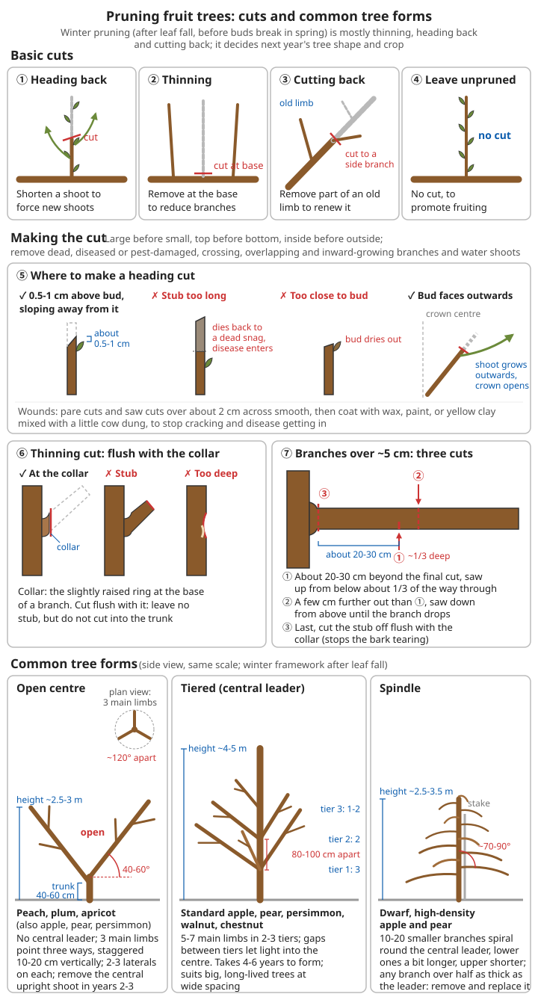

# Fruit Tree Growing Guide

## Why grow fruit trees

```
Advantages:
✓ Vitamins and nutrition
✓ Perennial (plant once, harvest for many years)
✓ Relatively little labour
✓ High economic value
✓ Makes surroundings pleasant

Considerations:
- Needs patience (2-5 years to fruit)
- Takes up a lot of space
- Up-front investment
- Needs some skill
```

**From the point of view of self-sufficiency after a disaster**: grain is planted every year; a fruit tree is "one investment, decades of output". A well-managed mature apple or persimmon tree yields 50-150 kg of fruit a year; jujubes and persimmons can be dried, and walnuts and chestnuts are high-energy, long-keeping "tree grains". The drawback is that it takes 3-5 years from planting to a real crop, so **the sooner you plant the better**. Even when grain is tighter right now, it is worth first planting a few trees around the house, at field edges and on slopes.

```
⚠️ Think it through first:
- Choosing tree species and varieties that people already grow and that fruit locally is far more
  reliable than bringing in "good varieties"
- Fruit trees occupy the land for decades; do not plant them where you will later build houses,
  dig channels or make roads
- Do not use good flat grain land; slopes, ditch sides, yards and field banks suit fruit trees better
- Fruit trees need bees and other pollinating insects to set fruit; misuse of pesticides leaves an
  orchard "full of flowers but no fruit"
```

---

## Fruit tree basics

### Choosing a site

```
✓ Plenty of sun (6 hours or more a day)
✓ Good drainage (no standing water)
✓ Deep, fertile soil
✓ Sheltered from wind (or with a windbreak)
✓ Water close at hand

❌ Avoid:
- Low-lying land that floods easily
- Heavy clay
- A high water table
- Windy gaps
```

**What to look for**:

```
1. Light: look at noon in winter – most of the plot should not be shaded by houses or big trees
   most of the time
   - Too little light → shoots grow long and soft, few flower buds, small sour fruit
2. Drainage: if water still stands on the surface half a day after rain, or water seeps into the bottom
   of a 1 m deep pit by the next day
   → do not plant, or plant on ridges (30-50 cm high)
   - Peach, cherry and fig hate waterlogging most; 2-3 days of standing water can rot the roots and kill the tree
3. Soil depth: ideally at least 1 m of usable soil; if there is rock or a hard layer beneath,
   dig big pits and replace the soil
4. Acidity: most fruit trees suit slightly acid to neutral soil; chestnut and citrus like slightly acid soil;
   jujube, pomegranate, grape and fig tolerate saline-alkaline soil fairly well
5. Cold air: valley bottoms and hollows collect cold air in spring and get late frosts that kill the flowers
   → choose the middle of a slope (south and south-east slopes are best)
6. Wind: where strong winds blow for long periods, plant a few rows of wind-tolerant trees
   (poplar, willow, elm, black locust) on the windward side as a windbreak
```

For judging soil texture and acidity, see [Geology, minerals and soil - Simple soil texture tests](../../../docs/08-基础科学知识/06-地质矿物与土壤.md#52-简单的土壤质地判断) and [Acidity and alkalinity](../../../docs/08-基础科学知识/06-地质矿物与土壤.md#53-酸碱性); for improving acid soil with lime, see [Lime and building materials - Improving acid soil](../../../docs/07-日常生活技能/16-石灰与建筑材料.md#改良酸性土); for late frost patterns, see [Weather observation and forecasting - Frost](../../../docs/08-基础科学知识/07-天气观测与预报.md#五霜冻).

### Choosing varieties and rootstocks

Almost all fruit trees are grown as **grafted trees**: the upper part is the variety (the scion), which decides what the fruit looks and tastes like; the lower part is the rootstock, which decides the roots, the tolerance of cold, drought and waterlogging, and the size of the tree.

**Choosing varieties**:

```
✓ The most important test: it overwinters and fruits normally in your area
   - Ask old farmers and look at old trees in neighbouring villages: which variety fruits every year
     and is rarely diseased
✓ Fruit trees that need winter chilling (apple, pear, peach, cherry, apricot)
   need enough days at about 0-7°C in winter, or in spring they bud and flower unevenly and set little fruit
   → In the warm-winter south, apples and sweet cherries often "grow but never fruit"
✓ Cold-tender fruit trees (citrus, fig, pomegranate) in the north need hardy varieties or winter protection
✓ Combine early, mid and late varieties to lengthen the harvest and spread weather risk
✓ For fruit trees that need a pollinator, choose at least 2 varieties that flower at the same time and
  can pollinate each other (see the Pollination section)
✓ For self-sufficiency after a disaster, prefer varieties that keep or can be dried
  (late apples, late pears, persimmon, jujube, walnut, chestnut)
```

**Common rootstocks** (only closely related plants graft successfully):

| Fruit tree | Common rootstock | Features |
|------|---------|------|
| Apple | Siberian crab apple (Malus baccata), crab apples (such as Baleng crab) | Vigorous, deep-rooted, long-lived, slow to fruit |
| Apple | Dwarfing rootstocks (M26, M9, SH series etc.) | Small trees, early fruiting (2-3 years); need support and fairly good water and fertiliser |
| Pear | Birchleaf pear (Pyrus betulifolia), Callery pear (Pyrus calleryana) | Birchleaf pear tolerates drought and saline-alkaline soil; Callery pear suits the hot, humid south |
| Peach | Seedling peach, David's peach (Prunus davidiana) | Seedling peach tolerates wet soil and suits the south; David's peach tolerates drought and cold and suits the north |
| Citrus | Trifoliate orange (Poncirus trifoliata), red tangerine | Trifoliate orange is cold-hardy and disease-resistant but does not tolerate saline-alkaline soil |
| Jujube | Sour jujube | Extremely tolerant of drought and poor soil |
| Persimmon | Date-plum (Diospyros lotus), wild persimmon | Date-plum tolerates cold and drought; common in the north |
| Walnut | Local seedling walnut | Wild walnut and Manchurian walnut also work |

**Choosing young trees (when buying or picking them at a nursery)**:

```
✓ A good young tree:
- The graft union is well healed, and the variety part above it is sturdy
- Main and side roots intact, plenty of fine roots, root bark fresh (scraped, it is white or
  yellowish-white and moist)
- Plump buds on the stem, normal bark colour, not shrivelled
- One-year apple, pear and similar trees: about 1 m tall or more, about 1 cm or more in diameter
  above the union

✗ Reject:
- Roots cut back to a stub, black or mouldy roots
- Galls on the roots (crown gall)
- Gum oozing, rotting patches or insect holes on the stem
- Shrivelled bark that is brown when scraped → it has dried out and is unlikely to survive

Between lifting and planting: dip the roots in mud slurry or wrap them in wet straw; do not let wind
or sun reach them. If you cannot plant at once, dig a trench, lay the trees in it at a slant and cover
the roots and the lower half of the stem with moist soil (heeling in)
```

For grafting, cuttings and layering, see [Seed saving and breeding - Vegetative propagation](08-seed-saving-and-breeding.md#vegetative-propagation); they are not repeated in this chapter.

### Planting

**Time**:
- Deciduous fruit trees: from leaf fall in autumn to bud break in spring (dormant period)
- Evergreen fruit trees: spring (March-April)

```
How to choose the exact time:
- Where winters are not too cold (winter minimum above about -15°C): autumn planting is better
  → roots start recovering before winter, so the tree buds early and grows well the next year
- In the harsh, windy, dry northern winter: plant in spring (after the soil thaws and before bud break)
  → autumn-planted trees easily freeze or dry out in winter
  → If you must plant in autumn, bend the tree over and bury it in soil for winter, and lift it up in spring
- Evergreen fruit trees (citrus etc.): before the spring flush, or on cloudy days early in the southern
  rainy season; plant with a root ball and cut off some leaves to reduce water loss
```

**Spacing**:
Depends on the species; generally:
- Large fruit trees (apple, pear): 4 × 5 m
- Medium (peach, plum, apricot, sweet cherry): 3 × 4 m
- Small (jujube, pomegranate, fig): 2 × 3 m

| Fruit tree | In-row × between-row spacing | About trees per ha | Notes |
|------|------------|-------------|------|
| Apple (vigorous rootstock) | 4-5 m × 5-6 m | 330-500 | Large, long-lived trees |
| Apple (dwarfing rootstock) | 1-2 m × 3.5-4.5 m | 1100-2800 | Own-rooted dwarfing stocks can be closer, interstem trees a bit wider; need stakes and a lot of water and fertiliser |
| Pear | 3-4 m × 4-5 m | 500-830 | |
| Peach, plum, apricot | 3-4 m × 4-5 m | 500-830 | Open-centre crowns spread wide |
| Sweet cherry | 3-4 m × 4-5 m | 500-830 | |
| Persimmon | 4-5 m × 5-6 m | 330-500 | |
| Walnut | Late-bearing 3-4 m × 5-6 m; early-bearing 2-3 m × 4-5 m | 420-670 (late-bearing) | Big trees at field edges or intercropped with grain can be widened to 6 m × 8 m |
| Chestnut | 4-5 m × 5-6 m | 330-500 | |
| Citrus | 3 m × 4 m | About 830 | Pomelos need more space |
| Jujube | 2-3 m × 3-4 m | 830-1700 | |
| Pomegranate, fig | 2-3 m × 3 m | 1100-1700 | |
| Grape (trellis) | 1-1.5 m × 2-2.5 m | 2700-5000 | |
| Grape (pergola) | 1-2 m × 4-6 m | 830-2500 | |

```
Principles:
- Thin soil, poor land, slopes → trees stay small, so plant somewhat closer
- Rich soil, plenty of water → trees grow large, so plant wider
- Better too wide than too close: in a crowded orchard, after a few years branches cross, air and light
  are poor, diseases increase and fruit decreases, and you end up felling trees, which is more work
- Rows running north-south are best, so both sides get even light
- Plant tall walnuts, chestnuts and persimmons on the north side of the orchard or at field edges,
  where they do not shade the smaller trees
```

**Planting pit**:
```
Size: 60-80 cm wide and deep

Steps:
1. Dig the planting pit
2. Fill the bottom with organic fertiliser mixed with topsoil
3. Set in the tree (roots spread out)
4. Fill with soil and tread firm
5. Water thoroughly to settle the roots
6. Mulch the tree basin (keeps moisture in)

Depth:
- The graft union 5-10 cm above the ground
- "Plant deep but not over the union, shallow but not showing roots"
```

**Step by step**:

```
1. Dig the pit (ideally 1-2 months ahead so the subsoil weathers):
   - Usually 60-80 cm square and 60-80 cm deep
   - Thin soil with hard soil or stones below: dig about 1 m square and 1 m deep, remove the stones
     and replace with good soil
   - In close-planted orchards (dwarf apples, grapes) you can dig a continuous planting trench about
     60-80 cm wide and deep
   - Pile the topsoil (the top 30 cm or so of worked soil) and the subsoil (the raw soil below) separately

2. Add base fertiliser and backfill:
   - In each pit put about 20-30 kg of well-rotted farmyard manure (stable manure, compost);
     you can also add about 0.5-1 kg of bone meal or superphosphate and about 1 kg of plant ash
   - First lay a layer of straw, weeds or leaves about 20 cm thick at the bottom (especially useful on
     clay, to improve aeration)
   - Mix the fertiliser thoroughly with topsoil and fill the middle and lower part of the pit
   - Put about 15-20 cm of plain topsoil on top so the roots do not touch the fertiliser directly
   - After backfilling, water thoroughly once to settle the soil; if there is no time, mound the soil
     about 10-15 cm above ground to allow for settling
   ⚠️ Raw manure or unrotted oilseed cake in the pit ferments and heats up, burning the roots;
      young trees die in whole rows

3. Trim and soak the roots:
   - Cut off broken, damaged and mouldy roots with clean, flat cuts
   - Shorten roots that are too long
   - Before planting, soak the roots in clean water for half a day to a day, or dip them in mud slurry
     (yellow clay mixed with water to a paste)

4. Set the tree in place:
   - Make a small mound in the middle of the pit, set the tree on it and spread the roots out all round,
     not coiled together
   - Line up the trees in rows (with a string or sighting poles)
   - Point the graft union towards the prevailing wind (the union is relatively brittle; this reduces wind breakage)

5. Fill, lift and firm:
   - Fill with topsoil first; as you fill, gently lift and shake the tree so soil gets between the roots
   - Tread firm in layers, but do not stamp hard on the roots
   - Fill the subsoil last, and make a round soil ridge about 1 m across around the tree (the tree basin)
     for watering

6. Water thoroughly to settle the roots:
   - At least 15-20 L per tree, in two goes, so the water reaches the root layer
   - Once it has soaked in, if the tree has tilted or the soil has sunk, straighten it and add soil at once
   - The next day, when the surface has dried a little, cover the basin with fine soil or mulch to keep moisture in

7. Heading back: right after planting, cut the main stem at a set height to make branches grow lower down
   - Apple, pear: about 70-90 cm (dwarf apples are trained as spindles and can be left uncut or cut lightly)
   - Peach, plum, apricot: about 40-60 cm
   - Jujube: about 60-80 cm
   - There should be 5-8 plump buds in the 20-30 cm below the cut
   - Seal the cut with wax or paint to stop it drying out
```

**Planting depth and the graft union**:

```
✓ After planting (once the soil has settled), the depth ≈ the depth the tree grew at in the nursery
   → Look at the soil mark on the stem: the line where the colour changes is the old ground level
✓ The graft union must be about 5-10 cm above the ground

Why:
- Planted too deep: roots lack air, the tree grows weakly and stays poor for years;
  if the union is buried, the variety part grows its own roots, a dwarfing rootstock stops dwarfing,
  and the benefits of a resistant rootstock are lost; the union also rots easily
- Planted too shallow: roots are exposed, suffer drought and frost, and the tree blows over

How to check you got it right:
- After a month the tree has not sunk noticeably, and the union is still above the soil
- After watering the basin, no more big cracks open in the surface
```

### Caring for young trees

The first 3 years after planting decide whether the orchard succeeds. Young trees mostly die not from disease but from **lack of water, being gnawed, or being smothered by weeds**.

**Establishment (1-2 months after planting)**:

```
1. Watering: without rain, water thoroughly every 7-10 days, about 15-20 L per tree each time
   - On clay, rather leave longer gaps; watering too often rots the roots
   - Push a finger about 5 cm into the soil: moist and holds together → no need to water; dry and crumbly → water
2. Mulch: cover the tree basin with about 10 cm of hay, straw or plastic film to keep moisture in,
   suppress weeds and even out soil temperature
   - Leave a gap of about 5-10 cm between mulch and trunk; mulch against the trunk attracts insects and rots
3. Stake: in windy places or for dwarf trees, drive a wooden stake beside the tree and tie it with a
   soft cloth strip in a figure of eight; do not tie too tight
4. Checking it has taken:
   ✓ About 3-4 weeks after spring planting, buds swell and new leaves open → it has taken
   ✓ Scrape the bark lightly with a fingernail: green and moist underneath → still alive, keep waiting
   ✗ Brown and dry when scraped, and twigs snap easily → dead; replant in autumn or next year
   ⚠️ Sometimes a tree puts out a few small leaves and then wilts ("false take"): it is living on
      reserves stored in the wood and has not yet grown roots. Keep the soil moist all the more,
      and shade it a little at noon on sunny days
```

**Care in the first three years**:

```
✓ Weeding: keep the tree basin (about 1-1.5 m across) weed-free; weeds steal water and nutrients
   and can "drown" small trees
✓ Top-dressing: start once new shoots are about 10-20 cm long, a little at a time, often:
   - Each time, per tree, about 5-10 L of well-rotted human urine or biogas slurry diluted 5-10 times,
     or about 1 kg of well-rotted chicken manure
   - Apply in a shallow trench at the outer edge of the basin, cover with soil and water
   - After Liqiu (the "Start of Autumn", about early August) stop giving nitrogen, so the shoots ripen
     and survive the winter
✓ Protection from gnawing: if rabbits, sheep or cattle strip a ring of bark, the tree dies
   - Fence the trunk with wire mesh, bamboo strips or thorny branches, about 1 m high
   - Never let flocks of sheep into a young orchard
✓ Intercropping: between rows you can grow short crops (beans, groundnuts, sweet potatoes,
   vegetables, green manure), at least 1 m from the trunks
   ✗ Do not intercrop tall crops such as maize and sorghum, or climbing crops (they shade and twine round the trees)
✓ Removing flowers: remove all flowers in the first 1-2 years after planting – grow the tree first, then fruit
✓ Training: prune lightly and tie branches down according to the chosen tree form; do not prune hard
   (hard pruning delays fruiting)
✓ Winter protection: in the north, earth up and wrap the trunks in winter for the first two or three
   years (see "Winter frost protection and spring frost protection")
```

---

## Common fruit trees

### Apple

**Varieties**: Fuji (Red Fuji), Gala, Golden Delicious, etc.

**Climate**: temperate, needs a certain amount of winter chilling

**Fruiting**: grafted trees usually start fruiting in 3-4 years (2-3 years on dwarfing rootstocks, 4-6 years on vigorous seedling rootstocks); full bearing from about year 8-10; a well-managed vigorous tree can stay in full bearing for 30-40 years

**Growing points**:
```
Pollination:
- Most need cross-pollination
- Plant 2-3 varieties
- Or graft on different varieties

Pruning:
- Winter pruning (dormant period)
- Remove overcrowded, diseased and pest-damaged branches
- Open-centre or spindle form

Fertilising:
- Base fertiliser: autumn (organic)
- Top-dressing: spring bud break, after flowering, during fruit swelling

Pests and diseases:
- Valsa canker: scrape out the lesions
- Aphids: spray in early spring
- Spider mites: control in the growing season
```

**Additional notes**:

```
- Suits areas with a mean annual temperature of about 8-14°C and fairly cold winters; Fuji is only
  moderately winter-hardy – in very cold areas choose hardy varieties such as Hanfu or Jinhong,
  or use Siberian crab apple rootstock
- Strong biennial bearing: a heavy crop one year, almost none the next → flowers and fruit must be
  thinned (see "Thinning flowers and fruit")
- Young trees with upright branches that only grow and never fruit → in spring or autumn pull the main
  branches out to an angle of about 70-90° from the central leader (branch spreading);
  this clearly brings fruiting forward
- Valsa canker is the top apple disease in the north: red-brown, water-soaked patches on the bark that
  smell of fermented grain and feel soft when pressed; inspect carefully in early spring and scrape out
  any you find (method in "Pest and disease control")
- Fuji is late-ripening and keeps well; in a cellar it lasts until the next spring
```

**Harvest**: September-November (depending on variety)

### Pear

**Varieties**: Xuehua, Yali, Dangshan, etc.

**Climate**: very adaptable, fairly cold-hardy

**Fruiting**: 3-5 years; full bearing for 20-30 years

**Growing points**:
```
Features:
- Need cross-pollination (plant pollinator trees)
- Like moist conditions

Care:
- Training and pruning (delayed-open central leader form)
- Plenty of irrigation
- Thin flowers and fruit (improves quality)

Pests and diseases:
- Pear scab: clear fallen leaves, spray protectively
- Pear psylla: control in early spring
```

**Additional notes**:

```
- Long-lived: a well-kept old pear tree can bear for over a hundred years
- Yali, Xuehua, Dangshan Su and most other pears cannot set fruit with their own pollen;
  pollinator combinations must flower at the same time (asking local growers is most reliable)
- Each flower cluster has 5-8 flowers; keep only 1-2 fruits, about 20-25 cm apart
- Scab: black mouldy spots on the leaf undersides and fruit, with deformed and cracked fruit;
  thoroughly sweeping up fallen leaves in autumn and winter and cutting out and burning diseased shoots
  is the most effective prevention
- Pear psylla: the nymphs secrete sticky honeydew and the leaves turn black (sooty mould);
  in winter scrape off loose old bark and clean up the orchard, and control the overwintering adults
  when they emerge in early spring
- Small-fruited types such as Ussurian pear and Nanguo pear are extremely cold-hardy and suit the Northeast
```

### Peach

**Varieties**: honey peach, nectarine, yellow peach, etc.

**Climate**: likes warmth, fairly drought-tolerant

**Fruiting**: 2-3 years (early); full bearing for 10-15 years

**Growing points**:
```
Features:
- Fruits early
- Relatively short-lived
- Grows fast

Pruning:
- Important!
- Pinching and thinning shoots in summer
- Heading back and cutting back in winter
- Open-centre form

Fertilising:
- Hungry for fertiliser
- Top-dress several times during the growing season

Pests and diseases:
- Peach leaf curl: spray in spring before bud break
- Aphids, spider mites: control promptly
- Yellow peach moth: bag the fruit
```

**Special points**:
- Fruit must be thinned (remove some young fruit early)
- Improves the quality of each fruit

**Additional notes**:

```
- Peach trees usually decline after 15-20 years; raise replacements elsewhere in advance and renew in stages
- Most peaches set fruit with their own pollen, so a single variety will fruit
  (a few pollen-less varieties need a pollinator – ask when buying trees)
- Thinning guide: 3-4 fruits on long fruiting shoots, 1-2 on medium ones, 1 or none on short ones,
  fruits about 15-20 cm apart; finish about 2-4 weeks after flowering, when the fruit is soya-bean to
  peanut size
- Peach wounds ooze gum easily: seal large cuts; avoid pruning in the depth of winter;
  waterlogging, raw manure and insect damage all make gumming worse
- Peach leaf curl: in spring, new leaves pucker, turn red and thicken, as if "scalded";
  the key is one spray of a copper product or lime sulphur before bud break (when buds start to swell);
  spraying after symptoms appear works poorly
- Replant problems: when an old peach orchard is grubbed out, new peaches planted on the same spot often
  grow badly – use different land or replace the soil
- Extremely sensitive to waterlogging: on low-lying land always plant on ridges
```

### Grape

**Varieties**: Kyoho, Summer Black, Shine Muscat, etc.

**Climate**: very adaptable

**Fruiting**: 2-3 years; full bearing for 20-30 years

**Growing points**:
```
Training systems:
- Trellis, pergola
- Must have a support frame

Propagation:
- Cuttings (root easily)
- Layering

Pruning:
- Hard pruning in winter
- Pinching and thinning shoots in summer

Care:
✓ Thin flowers and fruit
✓ Bag the bunches (against pests and disease, improves quality)
✓ Plenty of water and fertiliser (while the berries swell)
✓ Bury the vines for winter (in the north)

Pests and diseases:
- Downy mildew: control in the rainy season
- Powdery mildew: ventilate, spray
```

**Additional notes**:

```
Building supports:
- Trellis: set a post about 2 m tall (wood, concrete, bamboo) every 4-6 m and run 3-4 wires;
  the lowest wire about 50-60 cm above ground, then one every 40-50 cm above
- Pergola: the kind of grape arbour in a yard, about 1.8-2 m high, so people can walk and sit in the shade underneath

Winter pruning (the most important):
- When: from about 2-3 weeks after leaf fall until the ground freezes (in the north, finish before burying);
  in the south where vines are not buried, finish between leaf fall and a month before bleeding starts
  ⚠️ If you prune in spring after the sap starts flowing, the cuts "run with water" (bleeding)
     and weaken the vine
- What to keep: on each fruiting cane leave 2-3 buds (short spurs) or 5-8 buds (medium to long canes),
  depending on variety and training system; cut all other one-year shoots off at the base
- Renew old arms year by year; do not let the frame fill up with old wood

Summer care:
- Rubbing out buds: where one bud gives 2-3 shoots, keep only the strongest
- Spacing shoots: shoots about 15-20 cm apart; rub out the rest
- Pinching: before flowering, pinch the shoot leaving about 5-8 leaves above the bunch to improve fruit set
- Usually keep only 1 bunch per fruiting shoot; for large-bunched varieties cut off about 1/5 of the
  bunch tip and remove the side bunch

Downy mildew: yellow oily spots on the upper side of the leaves, white frosty mould underneath;
in wet weather it can strip a vine of leaves in a few days. Ensure drainage and ventilation and start
protecting before the rainy season; the traditional spray is Bordeaux mixture (made from copper sulphate
and lime; follow specialist sources or instructions for the proportions)
```

For cuttings and layering, see [Seed saving and breeding - Cuttings](08-seed-saving-and-breeding.md#cuttings) and [Layering](08-seed-saving-and-breeding.md#layering); for burying vines for winter in the north, see "Winter frost protection and spring frost protection" in this chapter.

**Harvest**: July-October (depending on variety)

### Citrus (mandarin, orange, pomelo, lemon)

**Climate**: subtropical, not cold-hardy

**Fruiting**: 3-5 years

**Growing points**:
```
Features:
- Evergreen fruit trees
- Like warm, humid conditions
- Damaged by frost

Care:
✓ Keep watered
✓ Use organic fertiliser
✓ Prune (for air and light)
✓ Winter protection (in the north, grow in pots and bring indoors in winter)

Pests and diseases:
- Citrus canker: cut off diseased shoots and leaves
- Spider mites, aphids: control promptly
- Citrus leaf miner: control on summer and autumn shoots
```

**Additional notes**:

```
Cold tolerance (approximate; frost damage starts below these temperatures, and the longer it lasts the worse it is):
- Lemon: about -3°C
- Sweet orange, pomelo: about -5°C
- Satsuma mandarin: about -6 to -7°C
- Kumquat, loose-skinned mandarins on trifoliate orange rootstock: fairly cold-hardy
- Flowers may be damaged below about 5°C

Water:
- "Keep watered" does not mean water every day: water thoroughly once the soil is dry about 5-10 cm down
- In dry summer and autumn weather, about every 7-10 days; hold back water somewhat in late autumn,
  which helps flower bud formation and raises sweetness
- Drain in the rainy season; waterlogged roots rot and the leaves turn yellow

Fertilising: about three times a year – before spring bud break (for the spring flush and flowers),
             after fruit set has stabilised (to swell the fruit), and around harvest (to restore the tree
             and keep the leaves through winter)

Pruning: mainly in spring before bud break; remove dead, diseased, crossing and water shoots;
         keep the canopy "dense outside, open inside but not too open" – the aim is air and light

Fruit set: most citrus set fruit with their own pollen or even without pollination;
           a few varieties such as Shatian pomelo need a pollinator tree or hand pollination

⚠️ Huanglongbing (citrus greening, the most dangerous): leaves show asymmetric yellow-green mottling,
   veins on new shoots turn yellow, fruit is small and colours abnormally ("red-nose fruit")
   → It cannot be cured: when found, dig out and burn the whole tree, and control the Asian citrus psyllid
     that spreads it
   → Get trees only from reliable sources; do not casually bring trees or budwood from affected areas
```

### Cherry

**Varieties**: sweet cherry, sour cherry, Chinese cherry

**Climate**: likes cool conditions, dislikes heat and waterlogging

**Fruiting**: 3-4 years (sweet cherry), 2-3 years (Chinese cherry)

**Growing points**:
```
Features:
- "The first fruit of spring" (ripens earliest)
- Demanding about its environment
- High economic value

Requirements:
✓ Excellent drainage (no waterlogging!)
✓ Pollinator trees
✓ Protection from birds (netting or bird scarers)

Care:
- Light pruning, leaving shoots unpruned (brings fruiting forward)
- Pinching in summer
```

**Additional notes**:

```
- Most sweet cherries are self-sterile; plant at least 2-3 varieties that flower together and can
  pollinate each other
  (a few self-fertile varieties such as Lapins can be grown alone, but yield more with a pollinator)
- Chinese cherry (small cherry) is self-fertile and very adaptable; good beside houses
- The fruit easily cracks if it rains before ripening; under post-disaster conditions choose Chinese
  cherry and small-fruited varieties
- Birds: net about 2 weeks before ripening, mesh about 2-3 cm; reflective strips and streamers work
  only for a few days
- Wounds ooze gum easily; prune in the growing season (after harvest) where possible
```

### Jujube

**Varieties**: Dongzao (winter jujube), Jinsi Xiaozao, large jujube, etc.

**Climate**: drought-tolerant, very adaptable

**Fruiting**: 2-3 years (grafted trees)

**Growing points**:
```
Features:
✓ Extremely drought-tolerant
✓ Tolerates poor soil
✓ Needs little care
✓ Suits dry regions

Care:
- Trunk girdling (kaijia; improves fruit set)
- Spraying water at flowering (improves fruit set)
- Pinching the extension shoots

Pests and diseases:
- Jujube looper: control in early spring
- Jujube rust: watch in the rainy season
```

**Harvest**: eaten fresh or dried

**Additional notes**:

```
- Jujube trees can live over a hundred years; they bud late (almost the latest of all fruit trees in
  spring), so they escape late frosts and are very reliable in the north
- Root suckers (young plants coming up from the roots under the tree) can be dug up and used as
  rootstocks or planted directly
- Dry, hot wind at flowering ("scorched flowers") gives very poor fruit set: at full bloom, spray the
  canopy with clean water in the evening, every 2-3 days, 2-3 times in all

Girdling (kaijia):
- Which trees: only vigorous mature trees with a trunk diameter of about 10 cm or more;
  never weak or young trees
- When: at full bloom, when about half the flowers are open
- How: the first time, at about 20-30 cm above ground on the trunk, make two cuts around the trunk
  about 0.3-0.5 cm apart (narrower for weaker trees) and peel off the ring of bark between them
  without damaging the wood. Move up about 3-5 cm each year after that
- Check: the wound should heal completely within about 1 month; if it has not healed after
  a month and a half, plaster it with mud and wrap it in plastic
⚠️ Girdling too wide, or every year on weak trees, weakens or even kills the tree;
   if you are not sure, do not do it

- Jujube looper: in early spring, tie a band of plastic sheet round the trunk or paint on sticky insect glue,
  to stop the wingless female moths climbing up to lay eggs
- Jujube witches' broom: shoots and leaves grow in dense "broom" clusters, flowers turn into leaves
  → cannot be cured; dig out and burn diseased branches or whole trees
- Drying: pick when ripe (skin fully red), spread on mats in strong sun and turn daily;
  take in or cover at night against dew; about 7-15 days until the moisture is low enough and they
  do not feel sticky when squeezed
```

For general drying requirements, see [Food processing and preservation - Vegetables and fruit](../../../docs/07-日常生活技能/01-食物加工与保存.md#蔬菜和水果).

### Pomegranate

**Climate**: likes warm, dry conditions

**Fruiting**: 3-4 years

**Growing points**:
```
Features:
- Drought-tolerant
- Both ornamental and edible

Care:
✓ Plenty of sun
✓ Enough water at flowering and young-fruit stage
✓ Thin some flowers and fruit
✓ Prune (for air and light)
```

**Additional notes**:

```
- Easily frost-damaged below about -12°C in winter (soft-seeded pomegranates are even less hardy;
  rule of thumb, varieties differ a lot); in the north choose hardy varieties, and earth up or wrap
  young trees in straw in winter
- There are two kinds of flower: vase-shaped "perfect flowers", swollen at the base, set fruit;
  bell-shaped "defective flowers", narrow at the base, generally do not → when thinning, remove the
  defective flowers first
- Many suckers come up at the base and from the roots; cut them off at the base promptly
- Fruit easily splits if it rains at ripening: keep soil moisture steady before ripening, and do not
  flood heavily after a long dry spell
- Can be propagated by cuttings; one-year shoots root well
```

### Fig

**Climate**: likes warmth, fairly cold-hardy

**Fruiting**: the same year or the next

**Growing points**:
```
Features:
✓ Fruits extremely early!
✓ Simple care
✓ Few pests and diseases
✓ Cuttings root easily

Care:
- Little care needed
- Prune (to control the shape)
- Winter protection (in cold areas)

Beginner-friendly!
```

**Additional notes**:

```
- Common varieties fruit without pollination, so a single tree will fruit
- The parts above ground may be frost-damaged or killed at about -7 to -12°C (rule of thumb, varieties
  differ a lot), but the roots often survive and send up new shoots in spring;
  in the north bend the branches down and bury them, or plant at the foot of a south-facing wall
- Can give two crops a year: a summer crop (on last year's wood) and an autumn crop (on this year's shoots)
- Ripe fruit is very soft and does not keep; dry it or boil it into jam promptly if you cannot eat it all
- The white sap of the shoots and leaves irritates the skin; in some people, contact followed by sunlight
  causes red patches and blisters. Wear gloves and long sleeves when picking and pruning
```

### Persimmon

**Climate**: very adaptable; can be grown from the south of North China down to South China

**Fruiting**: grafted trees 3-5 years; very long full-bearing period, and trees can live over a hundred years

```
- Rootstock: date-plum in the north, wild persimmon in the south
- Most varieties set fruit without pollination (parthenocarpy); where male flowers are scarce, a nearby
  persimmon or wild persimmon with male flowers helps reduce fruit drop
- Tree form: delayed-open central leader or natural open centre; mainly thin out, cut back little
  (persimmon flower buds are near the shoot tips, so heading back removes them)
- Little care needed, few pests and diseases; the persimmon fruit moth bores into the fruit and infested
  fruit drops early – pick it up and burn it as you go;
  anthracnose causes black sunken spots on the fruit – cut out diseased shoots and clean up the orchard
- Astringent persimmons must have the astringency removed before eating: seal them up for a few days
  with ripe apples or pears; or soak them in water at about 40°C for about 1 day
- Dried persimmons: peel, then hang to dry, kneading them soft, for about 3-4 weeks until a white
  "frost" forms on the surface; dried persimmons and dried jujubes are both good winter energy sources
⚠️ Eating a lot of persimmons on an empty stomach (especially underripe ones with the skin) can form
   stones in the stomach, causing abdominal pain and vomiting; serious cases need hospital treatment.
   Do not eat too many at once
```

### Walnut

**Climate**: temperate, fairly cold-hardy, sensitive to late frost

**Fruiting**: seedling trees about 8-10 years; grafted trees of early-bearing varieties start in 2-3 years and reach full bearing in about 10 years

```
- Male and female flowers are on the same tree but often open at different times; with several varieties
  together or other walnut trees nearby, fruit set is better
- Big trees with deep roots – leave plenty of room; leaves and roots release substances that inhibit
  other plants, so do not grow sensitive crops such as tomatoes or apples under them
- Pruning time: after harvest until leaf fall, or in spring after the leaves open
  ⚠️ Pruning in the dormant season causes heavy bleeding: the wounds pour sap and weaken the tree
- Harvest: when the green husks split and a few nuts fall by themselves; after heaping for a few days
  the husks soften and peel easily
  ⚠️ Husk juice stains hands black and irritates the skin – wear gloves when husking
- Walnut fruit moth ("black walnut"): fruit turns black and drops early → pick up fallen fruit and bury
  deep or burn
- Dry until the kernel snaps cleanly; kept in a dry, airy place they last about a year
```

### Chestnut

**Climate**: temperate to subtropical; likes slightly acid, well-drained sandy soil; grows poorly on saline-alkaline and heavy clay soil

**Fruiting**: grafted trees start in 3-4 years and reach full bearing in about 8-10 years

```
- Low self-fertility: always plant 2 or more varieties together, or have other chestnut trees nearby
  (pollinated by wind and insects)
- Seedling chestnuts fruit late and vary in quality; grafted trees are best, or graft good varieties
  onto seedling trees
- Chestnut gall wasp: infested buds form galls and cannot grow shoots or flowers; cut off galled
  shoots in winter
- Chestnut weevil (bores the nuts): after harvest, pour the chestnuts into clean water and skim off
  the floating infested and empty nuts
- Harvest: wait until the spiny burrs split by themselves and the nuts fall, then gather them every day;
  do not beat the tree with poles
- Keeping: fresh chestnuts dislike both drying and heat; dry off surface moisture, then layer them with
  moist sand in a cool place; or dry them in the sun, or boil and then sun-dry them
```

### Fruiting age and yield at a glance

The table gives **rough orders of magnitude** under normal management. Differences in variety, soil, climate and management can make results differ several-fold; with extensive management after a disaster, short of fertiliser and pesticides, it is safer to plan on the lower figure or even half of it.

| Fruit tree | Starts fruiting (grafted) | Full bearing from | Productive life | Yield per mature tree per year | Full-bearing yield per ha per year |
|------|-------------|-----------|---------|------------|---------------|
| Apple (vigorous) | 4-6 years | 8-10 years | 30-40 years or more | 50-150 kg | 22,500-45,000 kg |
| Apple (dwarf) | 2-3 years | 5-6 years | 15-25 years | 15-30 kg | 30,000-45,000 kg |
| Pear | 3-5 years | 8-10 years | 50 years or more | 50-150 kg | 30,000-45,000 kg |
| Peach | 2-3 years | 4-5 years | 15-20 years | 30-50 kg | 15,000-30,000 kg |
| Grape | 2-3 years | 4-5 years | 20-30 years | 5-10 kg per vine | 15,000-30,000 kg |
| Citrus | 3-5 years | 8-10 years | 30 years or more | 50-100 kg | 30,000-45,000 kg |
| Sweet cherry | 4-5 years | 7-8 years | 20-30 years | 15-30 kg | 7,500-15,000 kg |
| Jujube | 2-3 years | 8-10 years | Over a hundred years | Fresh jujubes 20-50 kg | Fresh jujubes 15,000-22,500 kg |
| Pomegranate | 3-4 years | 6-8 years | 30-50 years | 20-40 kg | 15,000-22,500 kg |
| Fig | Same year to next year | 4-5 years | 20-30 years | 10-20 kg | About 15,000 kg |
| Persimmon | 3-5 years | About 10 years | Over a hundred years | 50-150 kg | 15,000-30,000 kg |
| Walnut (early-bearing varieties) | 2-3 years | About 10 years | 50 years or more | Dry nuts 5-15 kg | Dry nuts 2,250-4,500 kg |
| Chestnut | 3-4 years | 8-10 years | 50 years or more | 10-20 kg | 2,250-4,500 kg |

```
Converting to "how many people it can feed" (roughly):
- Fresh fruit is mostly water, and most has only about 40-60 kcal per 100 g; its main value is
  vitamin C, potassium, fibre and variety in the diet – it cannot be a staple
- Dried jujubes about 270 kcal per 100 g, dried persimmons about 250 kcal, walnut kernels about 650 kcal,
  dried chestnuts about 350 kcal → these can count as part of the "food ration"
- A family of 4 with a few apple/pear trees, two or three jujubes and persimmons and one or two walnuts
  around the house will in a normal year have enough fruit for the whole year, and can dry some for winter
```

For the nutritional value of different fruits, see [Nutrition and deficiency diseases](../../../docs/07-日常生活技能/02-营养与营养缺乏病.md).

---

## Fruit tree management techniques

### Training and pruning

**Aims**:
- Control the shape and size of the tree
- Let in air and light
- Encourage fruiting
- Renew and rejuvenate

**Timing**:
- Winter pruning: dormant period (deciduous fruit trees)
- Summer pruning: growing season

```
Winter pruning:
- From leaf fall to bud break in spring, avoiding the coldest spells (below about -10°C cuts are easily
  frost-damaged); in the north it is mostly done in early spring (February-March)
- Mainly thinning out, heading back and cutting back; it decides next year's tree shape and yield

Summer pruning (growing season):
- Rubbing out buds: after bud break, rub off badly placed or crowded buds (by hand; smallest wound)
- Pinching: when new shoots reach a certain length, pinch off the tip to make them branch and firm up
- Thinning shoots: cut out crowded new shoots and water shoots
- Spreading branches: pull upright branches down to horizontal or slanting (tie them with string to
  stakes in the ground), usually in spring or autumn; untie after about 1-2 months

Special timings:
- Walnut: after harvest until leaf fall, or after the leaves open (heavy bleeding in the dormant season)
- Grape: from leaf fall until a month before bleeding starts
- Peach, apricot, plum, cherry: wounds ooze gum easily; avoid pruning in the depth of winter,
  delay to early spring or after harvest
- Citrus (evergreen): mainly in spring before bud break
```

**Basic cuts**:
```
Heading back:
- Shorten a shoot
- Encourages new shoots

Thinning out:
- Remove from the base
- Reduces the number of branches

Cutting back:
- Remove part of an older branch
- Renews and rejuvenates

Leaving unpruned:
- No cut
- Encourages fruiting
```

**How to cut**:

```
1. Look at the whole tree first: walk round it and decide which big branches to remove;
   take out big branches first, then cut small ones
   → "big before small, top before bottom, inside before outside"
2. What to thin out: dead branches, diseased or pest-damaged branches, crossing branches, overlapping
   branches, branches growing inwards, upright water shoots, and suckers from the roots and trunk
3. Heading cuts:
   - Cut about 0.5-1 cm above a bud, sloping away from the bud
   - Choose an outward-facing bud (towards the outside of the crown), so the new shoot grows outwards
     and the crown opens up
   ✗ Stub left too long: it dies back into a "dead peg" where disease gets in
   ✗ Cut too close to the bud: the bud dries out and dies
4. Thinning cuts: cut flush against the "collar" (the slightly raised ring) at the base of the branch,
   leaving no stub, but do not cut into the trunk
5. Saw large branches (about 5 cm across or more) with the "three-cut method" so the bark does not tear:
   ① About 20-30 cm out from where you want the final cut, saw about 1/3 of the way up from underneath
   ② A few cm further out than ①, saw down from the top until the branch falls
   ③ Finally saw off the remaining stub flush with the collar
6. Wounds: pare smooth any cut or saw wound about 2 cm across or more, then seal with wax, paint, or
   yellow clay mixed with a little cow dung, to prevent cracking and infection
7. Disinfect tools: after cutting trees with Valsa canker, jujube witches' broom or similar, wipe the
   blades with 75% alcohol or scald them in boiling water before cutting healthy trees

How much to cut:
- Young trees: prune lightly, spread more branches and head back less, to form the tree fast and fruit early
- Full-bearing trees: renew a suitable amount every year, keeping light both inside and outside the crown
- Old trees: cut back gradually over 2-3 years to rejuvenate; cutting too much at once sends up a mass
  of water shoots
- After pruning, look at the crown: if you see light coming through in spots "the size of sieve holes"
  when standing under the tree, it is about right
```

**Common tree forms**:
- Open-centre: hollow centre, good air flow
- Delayed-open central leader: has a central leader
- Spindle: for close-planted orchards

```
Natural open-centre (peach, plum, apricot; also usable for apple, pear, persimmon):
- Trunk about 40-60 cm tall
- No central leader; 3 main branches facing three directions (about 120° apart),
  spaced about 10-20 cm apart vertically, at about 40-60° to the ground
- Train 2-3 side branches on each main branch, with fruiting shoots on the side branches
- How: after heading back, choose 3 well-placed new shoots as main branches and pinch or remove the rest;
  in the second and third year cut out the upright central shoot
- Keep the tree about 2.5-3 m tall for easy picking

Delayed-open central leader (a kind of leader form; vigorous apple trees, pear, persimmon, walnut, chestnut):
- Has a central leader, with main branches in 2-3 tiers, 5-7 in all
  - 3 in the first tier, 2 in the second, 1-2 in the third
  - About 80-100 cm between tiers, so light gets into the inner crown
- Tree about 4-5 m tall; takes 4-6 years to form
- Suits big, long-lived trees at wide spacing

Spindle / slender spindle (close-planted dwarf apples and pears):
- One upright central leader (tied to a stake if needed),
  with 10-20 smaller branches spiralling round it, pulled out to about 70-90° from the leader
  or even hanging down
- Lower branches somewhat longer, upper ones shorter, so the whole looks like a spindle
- Tree about 2.5-3.5 m tall; if any branch gets too thick (more than half the thickness of the leader),
  remove it at the base and replace it with a new one
```



*Figure: Heading back, thinning out, cutting back, leaving unpruned; cut about 0.5-1 cm above a bud with the bud facing outwards, thinning cuts flush with the collar, the three-cut method for big branches; natural open-centre, delayed-open central leader and spindle forms*

### Fertilising

**Principle**: "mainly organic fertiliser, chemical fertiliser as a supplement"

**Base fertiliser** (autumn):
```
- Organic fertiliser (well rotted)
- Dig a trench at the outer edge of the crown's shadow and apply it there
- Amount: 20-50 kg per tree (mature trees)
```

```
When: from harvest until leaf fall (about September-October) is best
- The soil is still warm then, so broken roots heal easily and grow new roots, and the fertiliser
  can be taken up and stored; next year's bud break, flowering and fruit set all depend on these reserves
- Applied as late as winter or spring, it works clearly less well

Amount (rule of thumb):
- Young trees: about 5-10 kg per tree
- Mature trees: about 20-50 kg per tree;
  the rule of thumb is "1-2 kg of well-rotted organic fertiliser for every 1 kg of fruit produced"
- You can add bone meal and plant ash at the same time (phosphorus, potassium)

Methods:
1. Ring trench: dig a trench right round the outer edge of the crown (where roots absorb most actively),
   about 30-40 cm wide and deep
2. Radial trenches: dig 4-6 trenches outwards from about 1 m from the trunk, shallow at the inner end
   and deeper at the outer end
3. Strip trench: in close-planted orchards dig a trench along one side of the row, and the other side
   the next year
- Change position every year, gradually improving the whole root zone
- Mix fertiliser and soil well before filling in, then water
⚠️ It must be well rotted: raw manure burns roots and attracts soil pests
```

For safe treatment of manure and urine and composting times, see [Sanitation - Using faeces and urine](../../../docs/07-日常生活技能/03-卫生设施.md#粪便与尿液的利用); for the roles of nitrogen, phosphorus and potassium, see [Farming and animal husbandry - Fertilising](README.md#fertilising).

**Top-dressing** (growing season):
```
Key times:
1. Before bud break: mainly nitrogen
2. After flowering: nitrogen with phosphorus
3. Fruit swelling: nitrogen, phosphorus and potassium
4. After harvest: restore the tree

Methods:
- In trenches or holes
- Or foliar feeding
```

```
In practice:
- Holes: dig 6-10 holes about 15-20 cm deep at the outer edge of the crown; apply, cover with soil and water
- Without chemical fertiliser: well-rotted human urine or biogas slurry diluted 5-10 times,
  or well-rotted chicken manure or oilseed cake
  - Mature trees: each time about 20-30 L of diluted urine per tree, or 3-5 kg of well-rotted chicken manure
- Give extra potassium during fruit swelling: about 1-2 kg of plant ash per tree, spread on the basin
  and forked in shallowly
  (do not store plant ash mixed with human manure and urine or ammonium nitrogen fertiliser – nitrogen is lost)
- Foliar feeding: urea about 0.3-0.5%, monopotassium phosphate about 0.2-0.3% (mix as the packet says);
  spray the undersides of the leaves in the evening or on cloudy days. It acts fast but is only a supplement
- How to judge:
  ✓ Leaves deep green, new shoots of moderate length (about 30-50 cm), fruit swelling normally → about right
  ✗ Leaves pale yellow, new shoots short → not enough fertiliser (first rule out waterlogged, rotting roots)
  ✗ Shoots growing wildly, leaves large and thin, little fruit with poor colour → too much nitrogen; cut back nitrogen
- In late autumn (after about August) hold back nitrogen, or the shoots will not ripen and will freeze easily in winter
```

### Watering

```
Key times:
✓ Before bud break
✓ After flowering
✓ Fruit swelling
✓ After harvest
✓ Before the ground freezes

Methods:
- Furrow or basin watering
- Drip irrigation (saves water)

Drainage:
- Drain promptly in the rainy season (prevents waterlogging)
```

```
How much:
- Each time, wet the whole root layer (about 40-60 cm deep);
  about 100-200 L per mature tree. Frequent shallow watering makes roots grow upwards and more
  drought-sensitive
- Check: 1 day after watering, dig at the outer edge of the crown – if the soil at 40 cm is still moist
  and holds together, it was watered through

Notes:
- Generally do not flood-water at flowering (it cools the soil and makes more flowers drop);
  in severe drought give a little
- Hold back water 2-3 weeks before ripening: the fruit is sweeter and keeps better,
  but do not flood heavily after a long dry spell (fruit splits easily)
- Freezing-up watering: when the soil is about to freeze (in the north about November), water thoroughly
  once, to reduce shoot dieback and frost damage in winter
- Saving water: mulching the basin about 10-20 cm deep with straw clearly reduces evaporation;
  in dry areas you can bury clay pots or buckets with holes at the outer edge of the crown and fill them
  so the water seeps out slowly
- Drainage: dig drainage ditches round the orchard and between rows; 6-12 hours after rain there should
  be no water standing on the surface
```

For water channels and water storage, see [Water engineering and supply](../../../docs/07-日常生活技能/10-水源工程与供水.md).

### Thinning flowers and fruit

**Aims**:
- Improve fruit quality
- Prevent biennial bearing (fruiting in alternate years)
- Keep the tree vigorous

**Timing**:
- Flower thinning: at flowering
- Fruit thinning: 2-4 weeks after fruit set

**Method**:
```
- Remove deformed, diseased and pest-damaged fruit
- Remove crowded, weak and small fruit
- Keep well-placed fruit

How much fruit to keep:
- Depends on tree vigour and variety
- Leaf-to-fruit ratio: about 40:1 (apple; small-fruited types about 30-40:1,
  large-fruited types such as Fuji about 50-60:1)
```

```
Why you must thin: a tree has only so much food to share. If too much fruit is left,
every fruit is small and sour, the tree is exhausted, and it uses up the reserves for next year's
flower buds → almost no crop the next year (biennial bearing)

Thin flowers first or fruit first:
- Where there are no late frosts at flowering and fruit set is reliable: thin flowers (saves more reserves)
- Where late frosts are common or pollination is poor: do not thin flowers; wait until fruit has set and
  then thin fruit, to be safe

Guide to fruit to keep, by species:
- Apple: keep 1 king (central) fruit per cluster, fruits about 20-25 cm apart
- Pear: keep 1-2 per cluster, fruits about 20-25 cm apart
- Peach: 3-4 on long fruiting shoots, 1-2 on medium, 1 on short, fruits about 15-20 cm apart
- Grape: keep 1 bunch per fruiting shoot, pinch the tip off large bunches, thin out crowded berries
- Persimmon, jujube, walnut, chestnut: usually not thinned specially; regulated by pruning

How:
1. Cut the fruit stalk with thinning scissors or pinch it with a fingernail; do not pull downwards
   (that damages the fruiting spur and next year's buds)
2. First remove diseased, pest-damaged, deformed and small fruit, then thin the rest to the right spacing
3. Keep fruits that are well shaped with sturdy stalks, growing on the underside or sides of the branch
4. Thin in two rounds: a rough first thinning, then the final thinning 1-2 weeks later;
   if a lot of fruit drops naturally, thin less

How to judge: when it looks "such a waste" after thinning, that is usually about right
```

### Pollination

Many fruit trees **cannot set fruit with their own pollen**. If you plant only one variety, it will set very little fruit however much it flowers.

| Pollination needs | Fruit trees |
|---------|------|
| Must have a pollinator tree | Most apple varieties, most pear varieties, most sweet cherry varieties, chestnut, Shatian pomelo, etc. |
| Fruit better with a pollinator | Walnut, jujube, plum, apricot, persimmon (some varieties) |
| A single variety fruits normally | Peach (most), grape, citrus (most), pomegranate, fig (common varieties), Chinese cherry |

```
Planting pollinator trees:
- The pollinator variety and the main variety must flower at the same time, be compatible with each
  other, and be a good variety in its own right
  → The most reliable way is to ask local growers, or see how old local orchards combine them
- Ratio: 1 pollinator tree for every 4-8 main trees; or plant the 2 varieties in alternate rows
- Distance: main trees should ideally be no more than about 10-15 m from a pollinator
  (pollinators spread evenly within rows or every few rows)
- With only one tree: top-graft one or two branches of a pollinator variety onto it, so one tree has
  two kinds of flower
  (for grafting, see Seed saving and breeding - Grafting)

Helping pollination:
- Put beehives in or near the orchard (about 2-5 hives per ha, the upper figure for close-planted orchards),
  or protect wild bees
- Never spray insecticide at flowering
- If it is rainy and cold at flowering and the bees do not come out, pollinate by hand

Hand pollination:
1. Collect flowers: on the pollinator variety, pick flowers at the "balloon" stage, just about to open
2. Collect anthers: rub two flowers together or scrape the anthers off with a comb and spread them on paper
   in a dry place at about 20-25°C for 1-2 days, until the anthers split and release yellow pollen
3. Apply: from the day the main variety opens until the 3rd day, dip a soft brush or a pencil with a rubber
   tip in the pollen and dab it lightly on the stigmas; do 1-2 flowers (the central ones) per cluster
   - If pollen is scarce, mix in 2-5 times its volume of starch or talc as a filler
4. Keep the pollen in a dry, cool place and use it within a few days
```

For the general principles of hand pollination, see [Seed saving and breeding - Bagging and hand pollination](08-seed-saving-and-breeding.md#bagging-and-hand-pollination).

### Pest and disease control

**Prevention first**:
```
✓ Choose resistant varieties
✓ Prune properly (air and light)
✓ Clear fallen leaves and diseased fruit (reduces sources of disease)
✓ Dig over the soil (destroys overwintering pests)
✓ Whitewash the trunks (against frost and pests)
```

```
The jobs in the year that take least effort and do most good:
1. Winter clean-up: sweep up fallen leaves, collect mummified and rotten fruit, cut out diseased and
   dead branches, and burn or bury them all together
2. Scraping loose old bark in winter: many pests and diseases overwinter in cracks in rough old bark;
   scrape off the loose old bark with a scraper (without damaging the green living bark) and burn it
3. Tying straw bands in autumn: in September tie a band of straw or corrugated cardboard round the trunk;
   pests crawl in to overwinter – take it off in winter and burn it
4. Before bud break, spray once with a protective product (traditionally lime sulphur) to kill
   overwintering diseases and insect eggs
5. Walk the orchard once a week in the growing season and remove diseased leaves and fruit as soon as you see them
```

**Physical control**:
- Sugar-vinegar bait traps
- Black-light traps
- Bagging (fruit)
- Sticky traps

```
- Sugar-vinegar bait: about 1 part sugar, 4 parts vinegar, 1 part liquor and 16 parts water in a
  wide-mouthed jar or bowl, hung in the lower-middle part of the crown and changed weekly;
  traps adult fruit borers, leaf-roller moths and similar
- Bagging: bag apples and pears about 2-4 weeks after thinning, and peaches after thinning;
  this keeps out fruit borers, yellow peach moths and birds and also reduces pesticide residues.
  Bags made from newspaper work too; leave ventilation and drainage holes at the bottom
- Yellow sticky traps: catch aphids, leaf miners and similar; hang about 300-450 per ha
- Longhorn beetles: when you see fresh droppings and sawdust (pushed out of a hole) on the trunk,
  hook the larva out along its tunnel with fine wire, or push a cotton ball soaked in pesticide into
  the hole and seal it with mud
- Birds: netting is the only reliable long-term method
```

**Biological control**:
- Protect and use natural enemies
- Biological pesticides

```
- Ladybirds, lacewings and hoverflies eat aphids; predatory mites eat spider mites;
  parasitic wasps attack fruit borers and leaf rollers
- Leaving grass or sowing green manure (clover, lucerne etc.) between rows gives natural enemies a home,
  which is better than bare, clean-cultivated soil
- Magpies, tits and other birds eat large numbers of pests; you can hang nest boxes
- Chickens free-ranging in the orchard (in mature orchards where the branches are above the chickens'
  pecking height) eat the pests in fallen fruit and pupae overwintering in the ground,
  but stop them scratching up the roots
```

**Chemical control**:
- Spray at key times
- Rotate products (prevents resistance)
- Observe the pre-harvest interval

```
General principles:
- Use only when really needed; give priority to the cultural, physical and biological methods above
- Use strictly according to the crop, concentration and number of sprays on the label; do not
  increase the strength
- Observe the pre-harvest interval: the number of days between the last spray and harvest is stated on the label
- Do not use highly toxic pesticides banned by the state; never spray insecticides at flowering (protect the bees)
- When spraying wear a mask, gloves and a hat, long sleeves and long trousers; stand upwind;
  do not eat, drink or smoke while spraying; wash and change clothes afterwards;
  pregnant and breastfeeding women, children and old people must not spray
- Keep pesticides in their original packaging, locked away from water sources, food and children;
  never decant them into drink bottles
- Lime sulphur and Bordeaux mixture are traditional orchard sprays; follow specialist sources for
  making and mixing them
⚠️ If after spraying you get a headache, nausea, heavy sweating, drooling or blurred vision → leave the
   area at once, take off contaminated clothing, wash the skin with soapy water and plenty of clean water,
   call 120, and take the pesticide packaging with you to the doctor
```

For protection when spraying and first aid for pesticide poisoning, see [Poisoning - Pesticide and rat poison poisoning](../01-first-aid-and-family-health/12-poisoning.md#pesticide-and-rat-poison-poisoning).

**Identifying the main pests and diseases**:

| Pest/disease | Main hosts | Recognition | Main control |
|-------|---------|------|---------|
| Valsa canker | Apple, pear | Red-brown wet rot of the bark on trunk and branches, smelling of fermented grain; later small black dots on the lesion | Scrape out in early spring: scrape to about 1 cm into healthy bark beyond the lesion, then treat with a product or seal with mud; burn the scrapings; keep the tree vigorous |
| Ring rot, anthracnose | Apple, pear, persimmon, grape | Brown rotten spots on the fruit, in concentric rings or sunken | Bagging; remove diseased fruit; cut out diseased branches |
| Scab | Pear | Black mould on leaf undersides and fruit; fruit deformed and cracked | Sweep up fallen leaves; cut out diseased shoots |
| Leaf curl | Peach | New leaves pucker, turn red and thicken in spring | Spray a protective product before bud break; pick off diseased leaves |
| Gummosis | Peach, apricot, cherry | Gum oozing from trunk and branches, clear → amber | Drainage, few wounds, seal wounds; scrape off the gum and treat |
| Downy mildew | Grape | Yellow oily spots on top of the leaf, white frost underneath | Drainage and ventilation; protect before the rainy season |
| Powdery mildew | Grape, apple | A layer of white powder on leaves, shoots and fruit | Cut out diseased shoots; ventilation |
| Huanglongbing (citrus greening) | Citrus | Mottled yellowing of leaves, small fruit that colours abnormally | No cure; dig out diseased trees; control the psyllid |
| Jujube witches' broom | Jujube | Shoots and leaves growing in dense clusters | No cure; remove diseased branches or trees |
| Aphids | All fruit trees | Colonies on the undersides of young leaves on new shoots; leaves curl | Protect ladybirds; yellow traps; cut off damaged young shoots; in bad cases use a pesticide according to the label |
| Spider mites | Apple, pear, peach, citrus | Dense yellow-white speckling on the leaves, turning brown and dropping in bad cases; fine webbing under the leaves | Scrape loose old bark, clean up the orchard; protect predatory mites; spray clean water in drought |
| Fruit borers | Apple, pear, peach, jujube | Small holes in the fruit with droppings coming out | Bagging; sugar-vinegar bait; collect infested fruit and bury it deep |
| Longhorn beetles | Apple, pear, peach, walnut, citrus | Frass holes and sawdust on trunk and branches | Hook out the larvae; catch the adults |
| Citrus leaf miner | Citrus | Winding silvery-white tunnels in young leaves | Rub out scattered summer and autumn shoots, let shoots flush all at once |

### Winter frost protection and spring frost protection

```
General frost protection (deciduous fruit trees in the north):
1. In autumn hold back nitrogen and water so the shoots ripen fully (become woody and darker in colour)
2. Water thoroughly once before the ground freezes (freezing-up watering)
3. Whitewashing the trunks: in late autumn (about October-November) whitewash the trunk and the base of
   the main branches, to about 1-1.2 m high. The white reflects sunlight, reducing bark splitting from
   being warmed by day and chilled sharply at night in winter, and also kills some overwintering insect eggs
   Reference recipe: about 10 parts quicklime, about 1 part salt, about 30-40 parts water,
   with a little clay or animal fat added to help it stick
   ⚠️ Quicklime gets violently hot with water and can boil and spatter: wear gloves and goggles,
      put the water in first and add the lime slowly. If it splashes into the eyes, brush off the
      particles first, then rinse with plenty of clean water, and get medical care
4. Protecting young trees (the first 2-3 years after planting):
   - Mound soil about 30 cm high round the base of the trunk
   - Wrap the trunk in straw rope, rice straw or old cloth
   - In the coldest parts of the north: bend 1-2-year-old trees over and bury them in soil
   - Where winter and spring are dry and windy, the shoots of young trees "die back" (dry out);
     wrapping or burying is the key

Burying grapevines for winter (where the absolute winter minimum is often below about -15 to -17°C):
1. Do it after winter pruning and before the ground freezes
2. Untie the canes from the frame, lay them on the ground all in one direction and tie them together
3. Cover them with soil taken from between the rows (take soil more than about 1.5 m from the roots,
   so you do not dig up the roots), about 20-30 cm thick (thicker in colder places; about 50-60 cm
   in the bitterly cold north-west growing areas), about 1-1.5 m wide
4. Next spring, uncover them and put them back on the frame around the time the soil thaws and the sap
   starts flowing (when David's peach flowers)
   - Uncovered too early: hit by late frost; too late: buds sprout under the soil and are damaged
     as soon as they see light

Fig, pomegranate: similar to grapes – bend the branches down and bury them, or wrap them;
planting at the foot of a south-facing wall reduces frost damage

Citrus (in marginal areas):
- Before a cold wave, water, cover the crown with straw mats or plastic sheet, mulch the basin with
  straw and mound soil round the root collar
- After snow, shake snow off the branches promptly so they do not break
- After frost damage, do not rush to prune; wait until buds break in spring to see how far the dieback goes
- In the north it can only be grown in pots, brought indoors in winter (somewhere at about 5-10°C with light)

Protecting against late spring frost (one frost at flowering can wipe out the year's crop):
- Watch the weather: clear, still nights when the temperature falls fast in the evening are the most dangerous
- Water 1-2 days before the frost; moist soil gives off more heat
- Smoke: pile heaps of damp straw or sawdust every 10-15 m or so on the windward side of the orchard;
  light them in the early hours when the temperature falls to about 1°C, and keep them smoking thickly
  until about 1 hour after sunrise
  ⚠️ Keep someone on watch, keep away from houses and firewood, and prevent fires
- Cover small trees with straw mats, plastic sheet or old cloth

Judging frost damage: cut a flower or young fruit open – centre brown or black → killed by frost;
still greenish-white → alive. In years of severe frost damage, save the tree and try again next year;
do not abandon care just because there is no fruit this year
```

For late frost weather patterns, see [Weather observation and forecasting - Frost](../../../docs/08-基础科学知识/07-天气观测与预报.md#五霜冻); for safe handling of quicklime, see [Lime and building materials - Slaking and seasoning](../../../docs/07-日常生活技能/16-石灰与建筑材料.md#熟化与陈伏).

---

## 📝 Key points for growing fruit trees

### Recommended for beginners

```
Easy to grow (suitable for beginners):
1. Fig (very easy, fruits fast)
2. Jujube (drought-tolerant, little care)
3. Peach (fruits early)
4. Grape (easy to manage)
5. Pomegranate (ornamental and edible)

Need experience:
- Apple, pear (need pollination and pruning skills)
- Cherry (demanding about environment)
- Citrus (hard to overwinter in the north)
```

```
Priorities for self-sufficiency after a disaster:
- Keep well or can be dried: jujube, persimmon, walnut, chestnut, late apples and pears
- Need little care and few sprays: jujube, persimmon, walnut, chestnut, fig, pomegranate
- Quick results: fig, grape, peach (for something to eat soon), planted together with long-lived trees
  (for long-term returns)
```

### Home orchard plan (about 667 m²)

```
Mixed planting:
- Apple/pear: 10-15 trees (the core)
- Peach/plum: 5-8 trees
- Grape: 20-30 vines (trellis)
- Pomegranate/jujube: 3-5 trees
- Strawberry/raspberry: spare ground at the edges

Advantages:
✓ Variety
✓ Longer harvest season
✓ Mutual pollination (for some)
✓ Less risk
```

```
Notes:
- The numbers above only fit with dwarfing rootstocks or small-crown management;
  with vigorous apples and pears at 4 m × 5 m, about 667 m² takes only about 30 trees,
  so reduce each type accordingly
- Plant at least 2 varieties each of apple and pear that can pollinate each other
- Put tall walnuts and persimmons on the north side or edges of the plot, where they do not shade other trees
```

### Labour-saving management

```
✓ Choose varieties suited to the local area
✓ Pest- and disease-resistant varieties
✓ Suitable spacing (not too close)
✓ Ground cover (keeps moisture in, suppresses weeds)
✓ Drip irrigation
✓ Dwarfing rootstocks (easier to manage)
```

```
Calendar of work for the year (deciduous fruit trees in the north; correspondingly earlier in the south):
- Winter (December-February): winter pruning, scraping loose old bark, orchard clean-up, collecting manure;
  checking for Valsa canker
- Early spring (March): spray protective product before bud break; uncover buried grapevines; replant gaps
- Spring (April-May): protect against late frost; pollination and beehives at flowering; thinning flowers
  and fruit; top-dressing, watering; rubbing out buds
- Summer (June-August): bagging; summer pruning (pinching, thinning shoots); top-dressing;
  drainage in the rainy season, disease prevention
- Autumn (September-November): harvest; base fertiliser; tying straw bands; whitewashing;
  freezing-up watering; burying grapevines
```

### Harvest and storage

**Harvest at the right time**:
- Too early: poor quality
- Too late: does not store or travel well

```
How to judge ripeness:
- Ground colour (skin on the shaded side) changes from green to yellow-green or yellow
- Seeds change from white to brown
- The stalk separates from the spur when you lift the fruit gently
- Taste a few: pleasantly sweet-sour, with the aroma developed
- Pick fruit for storage a few days earlier than fruit to eat at once (about 80-90% ripe)

Picking:
- Pick on sunny days after the dew has dried; not in rain or in the midday heat
- Hold the fruit in your hand and lift or twist upwards; do not yank, and do not break the fruiting shoots
- Keep the stalk on apples and pears; pick peaches with a little stalk or close to the stalk
- Handle gently; line baskets with straw or soft cloth; stack no more than 4-5 layers
- Pick the outer and lower crown first, then the inner and upper crown
```

**Storage**:
```
Short term:
- Cool, ventilated place
- Laid out in layers

Long term:
- Cold storage (for suitable varieties)
- Processing (jam, dried fruit, bottled fruit)
```

```
- Keep well in a cellar: late apples and pears (about 0-3°C in a humid cellar, 3-6 months)
- Do not keep: peaches, cherries, figs, grapes (a few days to 1-2 weeks) → process promptly
- Before putting fruit in the cellar, sort out any with wounds or disease spots; one rotten fruit
  infects the whole lot
- The ethylene given off by apples ripens other fruit and vegetables; store them apart from potatoes
  and leafy greens
- Sort through stored fruit once a month
```

For cellars, drying and jam, see [Food processing and preservation - Cellar storage](../../../docs/07-日常生活技能/01-食物加工与保存.md#窖藏), [Sun-drying and air-drying](../../../docs/07-日常生活技能/01-食物加工与保存.md#晒干与风干) and [Jam](../../../docs/07-日常生活技能/01-食物加工与保存.md#果酱酸性沸水浴).

### Propagation methods

**Grafting** (the usual method):
```
Advantages:
✓ Keeps good traits
✓ Dwarfing control
✓ Earlier fruiting
✓ Better adaptability (from the rootstock)

Methods:
- Scion grafting (spring)
- Bud grafting (late summer to early autumn)

Needs to be learned!
```

**Cuttings**:
- Grape, fig: root easily
- Others need rooting hormone

**Layering**:
- Grapes and other climbing plants

**Seedlings** (from seed):
- Do not keep the parent's traits
- Fruit late
- Generally not recommended (except for raising rootstocks)

```
- Rootstock seedlings: in autumn collect ripe seed of Siberian crab apple, birchleaf pear, seedling peach,
  David's peach, sour jujube, date-plum and similar, and stratify it over winter in moist sand
  (mix seed and moist sand about 1:3-5 and keep at about 0-5°C); sow in spring when the seeds start
  to split, and graft that autumn or the next year
- Changing the variety on old trees (top-working): on a mature tree of a poor variety, saw off the main
  branches in spring and cleft-graft a good variety onto them; it is back in fruit in 2-3 years,
  much faster than planting a new tree
- Take scions and cuttings only from healthy mother trees that have done well for years and are free of
  virus diseases, jujube witches' broom and huanglongbing
```

For the steps of cleft grafting and bud grafting, see [Seed saving and breeding - Vegetative propagation](08-seed-saving-and-breeding.md#vegetative-propagation).

### Summary of key points

```
1. Choose species and varieties that overwinter and fruit normally locally; use healthy grafted trees
2. Choose sunny, well-drained slopes; do not plant in low, waterlogged spots or where cold air collects
3. Planting pits about 60-80 cm, with well-rotted base fertiliser kept apart from the roots by soil;
   graft union 5-10 cm above ground
4. Better too wide than too close; apple, pear, sweet cherry and chestnut must have pollinator trees
5. For the first three years keep them watered, weeded and protected from gnawing; remove flowers so the tree grows first
6. Winter pruning sets the framework, summer pruning removes crowded shoots; clean cuts with no stubs,
   seal large wounds
7. Mainly autumn base fertiliser, with small frequent top-dressings in the growing season; hold back nitrogen
   and water in late autumn
8. Thin flowers and fruit to prevent biennial bearing; clean up, scrape bark and whitewash in winter;
   no insecticides at flowering
9. In the north protect against cold and late frost; keep fruit that stores or dries as winter food
```

---

**Next chapter**: [Medicinal Plants](04-medicinal-plants.md)
**Back**: [Chapter index](README.md) | [Main contents](../../README.md)
