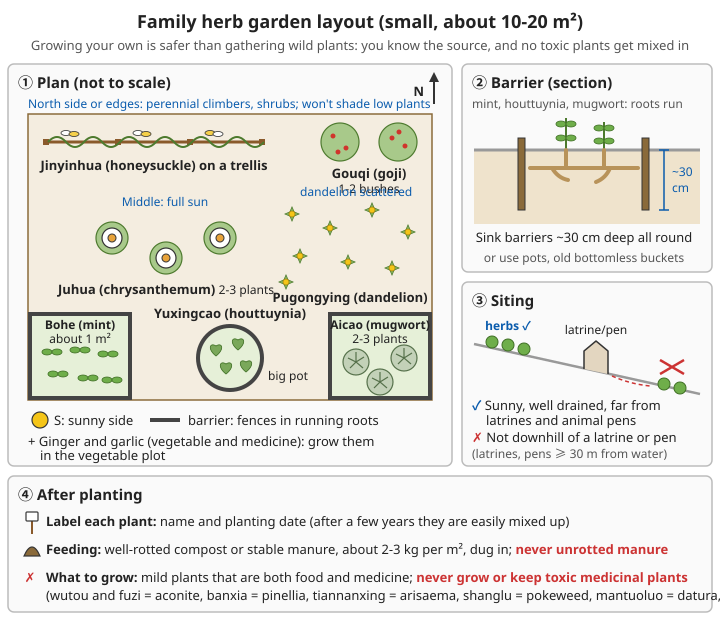

# Medicinal Plants: Identification and Growing Guide

⚠️ **Important notice**:
- This chapter is for educational reference only
- It cannot replace professional medical diagnosis and treatment
- Consult a doctor or a practitioner of Chinese medicine before use
- Wrong use can cause harm
- Some plants are poisonous and need professional guidance

```
What this chapter can do:
✓ Help you recognise, grow, harvest, dry and store a few common, mild medicinal plants
✓ Show which poisonous plants each is most easily mistaken for, and how to tell them apart
✓ Show who should not use them, and which Western medicines need care when taken with them

What this chapter cannot do:
❌ It cannot be used to "diagnose and prescribe" for yourself or your family
❌ For a fever that will not come down, severe pain, difficulty breathing, blood in the stool,
   jaundice, problems in pregnancy, or illness in babies and young children,
   no herb can replace medical care: call 120 first or go to hospital
```

For prescriptions, decoction methods, processing and incompatibilities see [Chinese Herbal Preparations](../../../docs/06-制药技术/04-中药制剂.md); they are not repeated here. For eating wild plants or poisonous mushrooms by mistake see [Poisonous Mushrooms and Wild Plant Poisoning](../03-wilderness-survival/09-poisonous-mushrooms-and-wild-plants.md).

**How to read the doses in this chapter**: the "usual dose" given for each plant is the usual adult daily range of the dried herb in the Chinese Pharmacopoeia (checked against the 2020 edition; the current edition is 2025, and its text takes precedence). It is there only to remind you "do not exceed this", not to invite you to treat yourself. **Whether to use a herb, and how much, follows the Pharmacopoeia and the guidance of a practitioner of Chinese medicine**; children, older people and frail people need smaller doses, which a doctor must decide.

---

## Common easy-to-grow medicinal plants

Each plant below follows the same order: actions → identification (and the poisonous plants it is confused with) → growing → harvesting and drying → use → contraindications and medicine warnings.

For more detail on identifying the crude herbs, look-alikes, processing at the place of origin and Pharmacopoeia doses, see Part 10: [*Bohe*](../../../docs/10-中药材识别与采集/04-全草类.md#11-薄荷), [*Jinyinhua*](../../../docs/10-中药材识别与采集/05-花叶类.md#11-金银花), [*Juhua*](../../../docs/10-中药材识别与采集/05-花叶类.md#12-菊花), [*Pugongying*](../../../docs/10-中药材识别与采集/04-全草类.md#21-蒲公英), [*Yuxingcao*](../../../docs/10-中药材识别与采集/04-全草类.md#23-鱼腥草), [*Aiye*](../../../docs/10-中药材识别与采集/05-花叶类.md#53-艾叶), [*Gouqizi*](../../../docs/10-中药材识别与采集/03-果实种子类.md#11-枸杞子), [*Gancao*](../../../docs/10-中药材识别与采集/01-根及根茎类上.md#15-甘草).

### *Bohe* (mint)

*Bohe* (Mentha haplocalyx, Chinese field mint).

**Actions**: disperses wind-heat, clears the head and eyes, soothes the throat, helps rashes come out

**Identification**:
```
- Perennial herb
- Square (four-angled) stem
- Leaves opposite, oval, toothed
- Strong mint smell when crushed
- Small pale purple flowers in summer
```

**Look-alikes**: spearmint, *Huoxiang* (Agastache rugosa, Korean mint), *Jingjie* (Schizonepeta tenuifolia, Japanese catnip) and *Zisu* (Perilla frutescens, perilla) are all members of the mint family with square stems, opposite leaves and a scent. Mistaking one for another does not usually poison anyone, but their actions differ. The real thing to guard against is **taking an unknown wild plant without the mint smell for mint**. Always crush a leaf and smell it: the cool smell of mint is unmistakable.

**Growing**:
```
✓ Very easy to grow!
✓ Propagate by division or cuttings
✓ Likes moist soil
✓ Part shade or full sun
✓ Grows fast and must be contained (very invasive)

How to do it:
- In spring (average daily temperature above about 10°C), dig up a piece of rooted
  underground stem, cut it into 10-15 cm pieces each with 2-3 nodes,
  and lay them flat 5 cm deep, about 30 cm apart each way
- Cuttings: cut 8-10 cm of young shoot, strip the lower leaves, push into moist soil
  or stand in clean water; roots form in about 1-2 weeks
- Keep the soil moist but not waterlogged; yellow, curling leaves usually mean
  too little water, or waterlogging and root rot
- To stop it spreading: grow it in a pot or an old bucket with the bottom cut out,
  or bury barriers about 30 cm deep around it
- Dig it up and replant divisions every 2-3 years, or old roots tangle and growth weakens

Common problems:
- Rust (small orange-yellow spots under the leaves): cut off and burn affected leaves,
  improve air flow, do not water from above
- Aphids: wash off with water, squash by hand, or spray dilute soapy water
```

For general methods of taking cuttings and dividing plants see [Seed Saving and Breeding – Cuttings](08-seed-saving-and-breeding.md#cuttings) and [Division](08-seed-saving-and-breeding.md#division).

**Harvesting**:
```
Harvesting:
- Pick leaves at any time during the growing season
- For medicine, cut when stems and leaves are lush or when the third whorl of flowers is open
- Use fresh or sun-dried

In detail:
- About 2 cuts a year: the first in summer, the second in autumn,
  each when stems and leaves are lush or the third whorl of flowers is open
- Cut on a sunny morning after the dew has dried, about 10 cm above the ground,
  leaving stubble to regrow
- Drying: tie in small bunches and hang upside down in a cool, airy, shaded place;
  mint works through its volatile oil, which is lost in strong sun or high heat,
  so if you use heat keep it no higher than about 35-40°C
- Dry enough when: leaves crumble when rubbed and stems snap when bent
```

**Use**:
- As a tea: relieves summer heat, soothes the throat
- External: stops itching (insect bites)

```
- Tea: a small pinch of dried leaves (about 3 g) or a few fresh leaves; pour on boiling water,
  cover and leave for a few minutes
  Usual dose: 3-6 g (follow the Pharmacopoeia / a practitioner); in decoctions it is "added last"
- External: crush fresh leaves and rub the juice on insect bites to stop itching
```

**Contraindications and warnings**:
```
⚠️ Do not put mint oil or menthol (ingredients of cooling balms and medicated oils such as
   qingliangyou and fengyoujing) near the mouth or nose of babies and young children:
   it can cause spasm of the larynx and stop breathing
⚠️ Do not make or swallow mint essential oil or any other plant essential oil
- Mint tea can make gastro-oesophageal reflux (heartburn) worse
- People who are weak and sweat a lot should not drink it often
- Drinking large amounts while breastfeeding may reduce milk supply
- With Western medicines: small amounts as a tea have no clear interactions;
  people on long-term medication should still tell their doctor
```

### *Jinyinhua* (honeysuckle)

*Jinyinhua* (Lonicera japonica, Japanese honeysuckle; the plant is called *rendong*).

**Actions**: clears heat and toxins, disperses wind-heat

**Identification**:
```
- Perennial climber
- Leaves opposite, oval
- Flowers open white and turn yellow ("gold and silver" together)
- Strongly scented
- Flowers about April-June; in some places a second flush in autumn

More detail:
- Semi-evergreen twining climber; young shoots and both sides of the leaves
  are often covered in short soft hairs
- Corolla long and slender, splitting at the tip into an upper and a lower lip (two-lipped);
  the stamens stick out beyond the flower
```

**⚠️ Deadly look-alike: *Gouwen* (Gelsemium elegans, heartbreak grass)**

*Gouwen* is also a climber with yellow flowers. In southern China it is often picked by mistake for honeysuckle and made into tea, and every year people die of the poisoning. *Gouwen* poisoning comes on fast and can quickly paralyse breathing.

| Feature | Honeysuckle | *Gouwen* (heartbreak grass) |
|------|--------|---------------|
| Flower shape | Two-lipped, long slender tube, petals split into upper and lower lips | Funnel/trumpet shaped, 5 even lobes |
| Flower arrangement | Two flowers side by side in a leaf axil | Many flowers in an umbrella-like cluster |
| Flower colour | White first, then yellow; white and yellow together on one plant | Yellow only |
| Leaves | Covered in short soft hairs | Smooth, hairless, glossy |
| Flowering time | About April-June, a second flush in autumn in some places | About May-November (overlaps with honeysuckle, so flowering time cannot tell them apart) |

**Rule: if you cannot be 100% sure that wild-picked "honeysuckle" is honeysuckle, do not use it. Use your own home-grown plants first.**

```
Also note:
- Gouwen is even harder to tell apart when not in flower: never pick vines or leaves
  without flowers
- Every part of Gouwen (root, stem, leaf, flower) is poisonous; do not use it in
  medicinal wine or soups
- If after drinking home-picked "honeysuckle tea" someone has a numb mouth and tongue,
  dizziness, blurred vision, drooping eyelids, weak limbs or difficulty breathing
  → call 120 at once, and take the leftover flowers and leaves for the doctor to see
- Shanyinhua (Lonicera macranthoides and related species) looks similar and is not
  poisonous, but the Pharmacopoeia lists it and honeysuckle as two different herbs
```

For what to do in poisoning see [What to do if someone eats a poisonous plant](#what-to-do-if-someone-eats-a-poisonous-plant).

**Growing**:
```
✓ Very adaptable
✓ Propagate by cuttings or division
✓ Likes sun
✓ Tolerates drought and poor soil
✓ Needs a frame, or ground space to climb over

How to do it:
- Cuttings: in spring or the rainy season, cut 20-30 cm of strong 1-2-year-old stem
  (with 3-4 nodes), push it at an angle about 2/3 into the soil, water well and keep moist;
  roots form in about a month
- In the ground, space about 1.5 m × 1.5 m; grow against a wall or fence,
  or on a frame about 1.5 m high
- Pruning: in winter cut out dead and crowded stems and keep the main stem to about 1 m
  so it grows as a shrub; flowers form on new shoots, so pruning gives more flowers
  and makes picking easier
- A few flowers in the first year or two; full flowering after 3 years

Common problems:
- Aphids (clusters on new shoots and flower buds): catch early, cut off affected
  shoots or wash them off
- Powdery mildew: improve air flow, cut off diseased leaves
- Avoid pesticides in a herb garden; if you must, follow the label, keep strictly to the
  pre-harvest interval, and never use highly toxic pesticides banned in China
```

**Harvesting**:
```
Harvesting:
- Pick at the bud stage (not yet open)
- Early morning is best
- Sun-dry or heat-dry promptly

In detail:
- Best time: when the bud has turned from green to white and the upper part has
  swollen but not yet opened (open flowers are poorer in effect and quality)
- 2-4 flushes a year; each flush is concentrated into about a week, so pick every day
- Spread out to dry in the sun on bamboo mats or paper the same day, about 1 cm deep;
  turn as little as possible and do not squeeze, or the flowers turn black
- Heat-drying in wet weather: first a few hours at 30-35°C, then raise to about 50°C until dry
- Dry enough when: a handful rustles when squeezed and the buds crumble when pinched
```

**Use**:
- As a tea: clears heat and toxins, prevents colds
- As a decoction: swollen, sore throat, hot toxic sores and boils

```
- Tea: about 3-5 dried flowers up to a small pinch; pour on boiling water
- Usual dose: 6-15 g (follow the Pharmacopoeia / a practitioner)
- There is no reliable evidence that it "prevents colds"; respiratory infections are
  prevented mainly by ventilation, handwashing, masks and vaccination
```

**Contraindications and warnings**:
```
- Cold in nature: people with a cold, weak digestion who often have diarrhoea
  should not drink it often
- Pregnant or breastfeeding women, babies and young children: ask a doctor first
- A sore throat with high fever, difficulty swallowing or drooling, or a sore that is
  quickly spreading red and swollen with fever, may be a serious infection:
  see a doctor, do not rely on honeysuckle alone
- With Western medicines: as a tea, no clear interactions; tell your doctor if you take medicines
```

### *Juhua* (chrysanthemum)

*Juhua* (Chrysanthemum morifolium, florists' chrysanthemum).

**Actions**: disperses wind and clears heat, calms the liver and brightens the eyes

**Identification**:
```
- Perennial herb
- Leaves alternate, pinnately lobed
- Flowers in autumn, in many colours
- Fragrant

More detail:
- The medicinal chrysanthemum is a flower head: the outer ray florets are white or yellow,
  the central disc florets yellow
- Yejuhua (Chrysanthemum indicum, wild chrysanthemum): small flowers (about 1.5-2.5 cm across),
  yellow, very bitter; it is also a medicinal herb, but more bitter and cold,
  and cannot be drunk every day like ordinary chrysanthemum tea
```

**Look-alikes**: ornamental and potted chrysanthemums from flower shops and parks have usually been sprayed with pesticides, **so do not pick them for tea**. Some plants of the daisy family (such as *Qianliguang*, Senecio scandens, and *Jusanqi*, Gynura japonica) contain substances that damage the liver. Before picking wild "yellow flowers" for tea, be 100% sure; see [Poisonous plants (do not misuse)](#poisonous-plants-do-not-misuse).

**Growing**:
```
✓ Easy to grow
✓ Propagate by division or cuttings
✓ Likes full sun
✓ Needs good drainage
✓ Flowers in autumn

How to do it:
- Cuttings: in April-May cut 8-10 cm shoot tips, push into moist sand or loose soil,
  shade and keep moist; roots form in about 2-3 weeks
- Division: in spring dig up old plants and split them into small rooted clumps to replant
- Space about 40 cm apart; it hates waterlogging, so on low ground plant on raised ridges
- Pinching: when plants are about 20 cm tall pinch out the tip, and pinch 2-3 more times later
  for more branches and flowers; stop pinching after late July or flowering suffers
- Growing chrysanthemums on the same ground year after year makes wilt and root rot
  steadily worse; move to new ground every 2-3 years

Common problems:
- Aphids: wash off, squash by hand, cut off
- Lower leaves turning black and dying (leaf spot): remove diseased leaves,
  do not crowd the plants
```

**Harvesting**:
```
Harvesting:
- Pick when the flowers are fully open
- Sun-dry or heat-dry

In detail:
- Around Shuangjiang (Frost's Descent, late October), when the petals are flat and about
  70-80% of flowers are open, pick on a sunny day after the dew has dried
- Sun-dried directly, chrysanthemums tend to drop petals and discolour. The traditional method:
  steam the flowers in a steamer for about 3-5 minutes (just until the petals soften),
  then spread out to sun-dry,
  or dry in the shade, or heat-dry at a low temperature (no higher than about 35-40°C)
- Dry enough when: the flower base crumbles when pinched, with no damp centre
```

**Use**:
- As a tea: clears the liver, brightens the eyes, reduces "internal heat"
- For medicine, *Hangbaiju* and *Gongju* varieties are mostly used

```
- Tea: 4-6 dried flowers; pour on boiling water
- Usual dose: 5-10 g (follow the Pharmacopoeia / a practitioner)
- "Brightening the eyes" is no substitute for an eye examination: sudden loss of vision,
  eye pain, a red eye with headache, or floating dark shapes or flashes of light
  → go to hospital the same day
```

**Contraindications and warnings**:
```
- People allergic to the daisy family (chrysanthemum, mugwort, dandelion, ragweed, etc.)
  should not use it: it can cause rashes or asthma
- Slightly cold in nature: people with a cold, weak digestion who often have diarrhoea
  should drink less
- With Western medicines: at tea amounts, no clear interactions
```

### *Shengjiang* (fresh ginger)

*Shengjiang* (Zingiber officinale, fresh ginger).

**Actions**: induces sweating to release the exterior, warms the stomach and stops vomiting, warms the lungs and stops coughing

**Identification**:
```
- Perennial herb
- Thick, fleshy, pale yellow underground rhizome
- Leaves lance-shaped, alternate
- Distinctive hot, pungent taste
```

**Look-alikes**: seed ginger is usually bought at the market, so it is not mistaken. There are many kinds of wild "ginger"; do not pick them to eat or use as medicine.

**Growing**:
```
✓ Warm, moist conditions
✓ Planted from seed ginger (rhizomes)
✓ Planted in spring
✓ Plenty of water
✓ Part shade

How to do it:
- Choosing seed: plump old ginger with shiny skin, no diseased spots, not frost-damaged
- Sprouting: sun the ginger for 1-2 days, then keep it at about 20-25°C (under damp straw
  or next to a warm kang, a heated brick bed) for about 20-30 days,
  until the shoots are about 1-1.5 cm long
- Breaking: break into pieces of about 50-75 g, each with 1-2 strong shoots
- Planting: when the soil is steadily above about 15°C (April-May in most areas),
  open furrows about 10-15 cm deep, rows about 50-60 cm apart and plants about 20 cm apart;
  lay the pieces flat with shoots upward and cover with about 5 cm of soil
- It needs a lot of seed: about 0.6-0.75 kg/m² (about 6000-7500 kg/ha)
- Shade: ginger dislikes strong light; in summer build a shelter of branches or shade netting
  that blocks about 30-50% of the light
- Earthing up: as the rhizomes grow after emergence, draw soil from the furrow sides up
  around the base 2-3 times so the rhizomes grow large and do not turn green
- Keep the soil moist, but waterlogging rots the ginger

Common problems:
- Ginger wilt (a bacterial disease: leaves yellow and curl, rhizomes turn brown,
  rot and smell): very hard to treat once it appears; pull out affected plants and carry
  them away with their soil to bury deep; do not grow ginger on that plot for 3-4 years,
  and never use diseased ginger as seed
```

**Harvesting**:
```
Harvesting:
- Young ginger: summer
- Mature ginger: autumn, before frost

Storage:
- Do not wash mature ginger; store it with a little soil on it in a cellar or a sand pile
- Best at about 12-15°C with high humidity; below about 10°C it is chilled
  and then rots easily
- The medicinal "dried ginger" (ganjiang) is mature ginger sliced and sun-dried or
  dried at low heat; its properties differ from fresh ginger
```

For how to build a cellar see [Food Processing and Preservation – Cellar storage](../../../docs/07-日常生活技能/01-食物加工与保存.md#窖藏).

**Use**:
- Boiled in water: colds of the wind-cold type, nausea and vomiting
- As a tea: ginger and jujube tea (warms the stomach)
- As food: seasoning; warms the stomach

```
- Boiled in water: cut 3-5 slices, boil in water for about 10 minutes, drink hot
- Usual dose: 3-10 g (follow the Pharmacopoeia / a practitioner), about a few slices
```

**Contraindications and warnings**:
```
⚠️ Do not eat rotten ginger: cutting off the rotten part is not safe; throw the whole piece away
- People with "yin deficiency with excess fire" (dry mouth, sore throat, constipation,
  feeling hot) should not eat much
- In people with stomach ulcers or gastritis, large amounts on an empty stomach irritate the stomach
- Vomiting that will not stop, vomiting blood, severe abdominal pain, or a pregnant woman
  with severe vomiting who cannot keep food or drink down → see a doctor,
  do not rely on ginger water
- With Western medicines: large amounts (far more than for seasoning) may increase
  bleeding; people taking anticoagulants such as warfarin or antiplatelet drugs such as
  aspirin should not eat large amounts; see "Taking herbs with Western medicines" below
```

### *Dasuan* (garlic)

*Dasuan* (Allium sativum, garlic).

**Actions**: detoxifies and reduces swelling, kills parasites, stops dysentery

**Identification**: see [Vegetable Growing – Garlic](01-vegetable-growing.md#garlic)

**Growing**: plant in autumn, harvest in early summer

For sowing, care and harvesting in detail see [Vegetable Growing – Garlic](01-vegetable-growing.md#garlic). After harvest, plait into strings and hang in an airy place to dry in the shade; store dry and cool.

**Use**:
- As food: antibacterial, prevents colds
- External: crushed and applied to the affected area (reduces swelling)

```
⚠️ Correction: do not put raw crushed garlic on the skin or on wounds
- Raw garlic paste in direct contact with the skin causes chemical burns (blistering, ulcers);
  covering it with a dressing makes this worse, and children's skin is injured more easily
- The folk use of garlic paste to "reduce inflammation", "draw out pus", "treat athlete's foot"
  or "apply to the gums" is a common cause of injury

Correct use: mainly as food
- Crush it and leave it to stand for about 10 minutes before mixing into food; this keeps more
  of the active substances than cooking whole cloves
- Usual dose: 9-15 g (follow the Pharmacopoeia / a practitioner), about a few cloves
- Large amounts eaten raw on an empty stomach irritate the stomach; people with gastritis
  or stomach ulcers should eat less
- Its "antibacterial" and "cold-preventing" effects are limited; it cannot replace antibiotics
  or medical care
```

For more detail see [Making Antibiotics – Garlic](../../../docs/06-制药技术/02-抗生素制备.md#32-大蒜以食用为主).

**Contraindications and warnings**:
```
- Garlic has an antiplatelet effect, and large amounts prolong bleeding time:
  eat less before surgery or a tooth extraction; people taking anticoagulants or
  antiplatelet drugs should not eat large amounts
- Burned by garlic paste: treat as a burn, rinse under cool running water for at least
  15 minutes; see a doctor for large blisters or a large area
```

### *Pugongying* (dandelion)

*Pugongying* (Taraxacum mongolicum, Mongolian dandelion).

**Actions**: clears heat and toxins, reduces swelling and dissolves lumps, promotes urination and relieves painful urination

**Identification**:
```
- Perennial herb
- Leaves all from the base, narrowly reverse lance-shaped, pinnately lobed
- Yellow flower heads
- Seeds with white pappus (the dandelion "clock")
- White milky sap when broken

More detail:
- Each flower stalk is hollow, with only one flower at the top
- Sow thistle (Sonchus) and Ixeris look similar, also have white milky sap and yellow flowers,
  but their stems branch and carry several flowers each; most of them are also traditional
  wild vegetables and generally not poisonous
```

**Look-alikes**: dandelion itself is rarely confused with anything deadly, but **the risk is other plants getting mixed in when you gather wild greens**, especially at the seedling stage. Before it flowers it is hard to be sure from the leaves alone; the first time, wait until it flowers and forms its seed clock to confirm the plants, then pick from that patch. For the rules on gathering wild greens see [Poisonous Mushrooms and Wild Plant Poisoning – Rules for gathering wild greens and fruit](../03-wilderness-survival/09-poisonous-mushrooms-and-wild-plants.md#rules-for-gathering-wild-greens-and-fruit).

**Growing**:
```
✓ Common in the wild
✓ Very easy to grow
✓ Grown from seed
✓ Tolerates cold and drought
✓ Extremely adaptable

How to do it:
- Sow in spring or autumn; the seed is tiny: scatter it on raked, moist soil,
  cover with only about 0.5 cm of fine soil and keep moist; at about 15-25°C
  seedlings appear in about a week
- Rows about 25-30 cm apart; when seedlings have 4-5 leaves thin to about 10-15 cm apart
- You can also dig up wild plants by the root and transplant them
- When picking leaves, cut about 2 cm above the ground and leave the root; new leaves will grow
- Remove flowers promptly so it does not seed all over the garden
```

**Harvesting**:
```
Harvesting:
- The whole plant is used
- Harvest from spring to autumn
- Use fresh or sun-dried

In detail:
- For medicine, dig up the whole plant with its root from spring to autumn,
  when the flowers first open
- Shake off the soil, wash and sun-dry; thick roots can be split lengthways to dry faster
- When picking wild plants: keep away from roads, factories, mines, rubbish dumps
  and places sprayed with herbicide
```

**Use**:
- Young leaves are edible (cold dressed or stir-fried)
- As a decoction: hot toxic sores and boils, swollen sore throat
- As a tea: clears heat and promotes urination

```
- Young leaves are bitter; blanch, then dress cold or stir-fry
- Usual dose: 10-15 g (follow the Pharmacopoeia / a practitioner)
- A red, hot, painful, swollen breast with fever (especially when breastfeeding), or a boil
  that is spreading quickly → may be an infection needing antibiotics or incision and
  drainage; see a doctor
```

**Contraindications and warnings**:
```
- People allergic to the daisy family should not use it
- Cold in nature: people with a cold, weak digestion or diarrhoea should not use much;
  large amounts can cause diarrhoea
- It promotes urination: people taking diuretics or lithium, or with poor kidney function,
  should not take large amounts on their own; ask a doctor first
```

### *Yuxingcao* (fish mint)

*Yuxingcao* (Houttuynia cordata, fish mint; its edible rhizome is called *zhe'ergen*).

**Actions**: clears heat and toxins, drains pus and treats abscesses, promotes urination and relieves painful urination

**Identification**:
```
- Perennial herb
- Purplish-red stems
- Heart-shaped leaves with smooth edges
- Fishy smell when crushed
- White flower spikes
- Spreads by underground stems

More detail:
- The 4 white "petals" are really bracts; the upright spike in the middle is the flower cluster
- The fishy smell is very obvious and is the most reliable identification feature
```

**Look-alikes**: fish mint likes ditch sides, field banks and wet ground, and **water hemlock grows in the same damp places**. When digging up a patch, take care not to pull up other plants with it, especially anything with pinnately divided leaves, small white flowers in umbrella-shaped clusters and a celery-like look: never take these. See [Poisonous plants (do not misuse)](#poisonous-plants-do-not-misuse).

**Growing**:
```
✓ Likes moist part shade
✓ Propagated from underground stems
✓ Vigorous (must be stopped from spreading)
✓ Tolerates cold

How to do it:
- In spring cut the white underground stems into pieces about 10 cm long with 2-3 nodes,
  lay them flat in furrows about 5 cm deep, rows about 25-30 cm apart
- Keep the soil moist; it grows best in part shade; in strong summer sun the leaves yellow
- The underground stems wander everywhere; grow it in a plot enclosed by barriers or in a big pot
- From the second year you can dig the underground stems to eat and cut the tops for medicine
```

**Harvesting**:
```
Harvesting:
- Whole plant or rhizome
- Harvest in summer
- Use fresh or sun-dried

In detail:
- For medicine: in summer, when stems and leaves are lush and flowering, cut the tops and sun-dry
- As a vegetable: dig the young underground stems (zhe'ergen) at any time of year
- Wash thoroughly in clean water several times before eating raw; do not pick plants
  growing by sewage ditches or cesspits
```

**Use**:
- As food: cold dressed (young stems and leaves, rhizome)
- As a decoction: lung-heat cough, urinary tract infection

```
- Usual dose: 15-25 g (follow the Pharmacopoeia / a practitioner); in decoctions do not boil for long
- Cough with high fever, chest pain, breathlessness, or coughing up pus or blood,
  and frequent painful urination with fever, back pain or blood in the urine → see a doctor;
  pneumonia and kidney infection (pyelonephritis) need antibiotics
```

**Contraindications and warnings**:
```
- Eaten as a vegetable in normal food amounts it is generally safe; do not take large
  amounts as medicine for long periods
- Slightly cold in nature: people with a cold, weak digestion should eat less
- Pregnant women and people with poor kidney function should ask a doctor before using it as medicine
- Houttuynia injections have caused severe allergic reactions; that is not the same as eating it,
  but it shows its constituents are not entirely harmless
```

### *Aicao* (Chinese mugwort)

*Aicao* (Artemisia argyi, Chinese mugwort; the leaf used as medicine is *Aiye*).

**Actions**: warms the channels and stops bleeding, dispels cold and relieves pain

**Identification**:
```
- Perennial herb
- Upright stem
- Leaves alternate, deeply pinnately divided, with white felt underneath
- Strong scent
- Small yellow flowers in summer

More detail:
- Leaves dark green on top and grey-white underneath, feeling like felt: this is the key
  difference from most other Artemisia species
- Close relatives such as Artemisia lavandulifolia and Artemisia mongolica look similar,
  smell similar, and are often used as mugwort too
```

**Look-alikes**: there are many Artemisia species and most are not highly poisonous, but ragweed (Ambrosia; leaves also pinnately divided, but no white felt underneath and only a weak scent) has pollen that is a strong allergen. For mugwort you will eat (in *qingtuan*, green rice dumplings, or boiled in water), use only plants you have confirmed yourself: white felt under the leaves and a strong scent.

**Growing**:
```
✓ Very adaptable
✓ Propagate by seed or division
✓ Tolerates drought
✓ Likes sun

How to do it:
- Division is simplest: in spring dig rooted underground stems, cut into 10-15 cm pieces,
  bury about 5-8 cm deep, about 30-40 cm apart each way
- The seed is tiny: scatter it and cover with a thin layer of soil; it is slow and uneven to come up
- Underground stems spread fast; plant once and you will not need to replant for years;
  use barriers to keep it in bounds
- It hates waterlogging; make sure it drains in the rainy season
- It can be cut 2-3 times a year
```

**Harvesting**:
```
Harvesting:
- Best around the Dragon Boat Festival (Duanwu, 5th day of the 5th lunar month)
- The leaves are used for medicine
- Sun-dry and hang to store

In detail:
- Around Duanwu, when stems and leaves are lush but not yet flowering, cut on a sunny day
- Medicine uses mainly the leaves: tie in bunches, hang upside down in a cool, airy, shaded
  place to dry, or sun-dry briefly; avoid strong sun for strongly scented plants
- Moxa wool is made from mugwort stored for 1-3 years: pound the dried leaves repeatedly and
  sieve out the fragments and veins; the woolly material left is moxa
```

**Use**:
- Moxibustion: warms the channels and unblocks the collaterals
- Boiled for a foot bath: dispels cold, helps sleep
- Repelling mosquitoes: burning mugwort leaves

```
- Foot bath: boil a handful of dried mugwort (about 20-30 g) in water for about 10 minutes,
  add cold water to bring it below about 40°C before soaking; test with your elbow first
- Internal use: usual dose 3-9 g (follow the Pharmacopoeia / a practitioner);
  internal use must be under a practitioner's guidance; do not boil and drink large amounts
  yourself: the volatile oil in mugwort can damage the liver and cause convulsions in large doses
- Repelling mosquitoes: open the windows when burning mugwort, keep people away from the fire,
  and do not burn it all night in a closed room
```

**Contraindications and warnings**:
```
⚠️ Moxibustion and burning mugwort easily cause burns and fires: keep the moxa stick
   a safe distance from the skin; do not use moxibustion on people with reduced skin
   sensation (diabetes, older people, paralysis, drunk or deeply asleep) or on babies
   and young children; put it out completely after use, in a container of water or sand
- Pregnant women should not use moxibustion on their own, especially on the abdomen and
  lower back; for internal use they must ask a doctor
- People with asthma or COPD should avoid breathing mugwort smoke
- Foot baths for people with diabetes: water no hotter than about 40°C, no longer than about
  15 minutes; afterwards check the feet for redness or broken skin
- With Western medicines: people taking anticoagulants should ask a doctor before taking mugwort internally
```

For treating burns see [Wound and Injury Care – Scalds and burns](../01-first-aid-and-family-health/02-wounds-and-injuries.md#scalds-and-burns).

### *Gouqi* (wolfberry)

*Gouqi* (Lycium barbarum, goji or wolfberry; the dried fruit is *Gouqizi*).

**Actions**: nourishes the liver and kidneys, replenishes essence and brightens the eyes

**Identification**:
```
- Deciduous shrub
- Long, slender, thorny branches
- Leaves lance-shaped or oval-lance-shaped
- Purple flowers
- Red berries (goji berries)

More detail:
- Fruit long-oval, about 1-2 cm long, hanging along the branches (one to a few per leaf axil)
- Branches often arch and hang down, with short thorns at the leaf axils
```

**Look-alikes**: there are many small red and black berries, and children are the most likely to eat them by mistake. Black nightshade (Solanum nigrum; the unripe green berries are poisonous, ripe ones are black-purple), *Masang* (Coriaria nepalensis; fruit red then purple-black, highly poisonous) and heavenly bamboo (Nandina domestica) all bear clusters of small berries. **Pick only from plants you grew yourself, or from bushes you are 100% sure are wolfberry (a thorny shrub with long-oval red fruit)**, and teach children not to eat berries from the roadside.

**Growing**:
```
✓ Tolerates drought and poor soil
✓ Propagate by seed, cuttings or division
✓ Likes sun
✓ Very adaptable

How to do it:
- Cuttings are fastest: in spring before buds break, cut 15-20 cm of 1-year-old stem
  about 0.5-1 cm thick, push it into the soil at an angle with 1-2 buds showing,
  keep moist; it makes a plant the same year
- Planting out: about 1-1.5 m apart in rows about 2 m apart; it tolerates saline-alkaline
  soil but not waterlogging
- Pruning: keep one main stem about 50-60 cm high with 3-5 main branches on top,
  forming an umbrella; every winter cut out dead, diseased, crowded and ground-touching branches
- It starts fruiting in the second year and reaches full cropping in 3-4 years
- Feeding: in winter dig a trench around the outside of the crown and bury well-rotted
  manure, about 5-10 kg per plant

Common problems:
- Aphids and psyllids: clusters on new shoots; wash off, cut out affected shoots
- Gall mites: small purple-black lumps on the leaves; cut off and burn affected leaves
- Black fruit rot (fruit turns black and rots, mainly in the rainy season):
  remove diseased fruit promptly, improve air flow
```

**Harvesting**:
```
Harvesting:
- Pick ripe fruit in summer and autumn
- Sun-dry or heat-dry

In detail:
- Pick when the fruit is bright red, soft and glossy (about 80-90% ripe)
- Pick in the morning after the dew has dried; pull off gently with the stalk, do not squeeze
- First spread out in the shade for 1-2 days until the skin wrinkles, then move into the sun;
  fruit put straight into strong sun, or turned by hand while drying, easily turns black
- Spread thinly to dry and do not turn; in wet weather heat-dry starting at about 40-50°C,
  gradually raising to about 55-60°C
- Dry enough when: the skin is shrivelled, a handful is not sticky and does not clump together
```

**Use**:
- In tea, porridge and soups
- Nourishes the liver and kidneys, brightens the eyes

```
- Usual dose: 6-12 g (follow the Pharmacopoeia / a practitioner), about a small handful
- Eaten in moderate amounts as food it is generally safe; do not eat large amounts just
  because it is "nourishing"
```

**Contraindications and warnings**:
```
- Stop while you have a cold with fever, diarrhoea or bloating
- With Western medicines: ⚠️ there are reports of bleeding and raised clotting test results
  when wolfberry (including wolfberry tea and juice) is taken with warfarin; people on warfarin
  should not suddenly increase, or eat large amounts of, wolfberry over long periods,
  and should tell their doctor before changing their diet
- People with diabetes: wolfberry contains sugar, and eating a lot of the dried fruit raises blood sugar
- In storage it very easily gets insects, absorbs damp and goes mouldy; see "Harvesting and
  processing – Storage" below
```

### *Gancao* (liquorice)

*Gancao* (Glycyrrhiza uralensis, liquorice root).

**Actions**: tonifies the spleen and boosts *qi* (vital energy), clears heat and toxins, harmonises the other herbs in a formula

**Identification**:
```
- Perennial herb
- Thick, pale yellow roots and rhizomes
- Pinnate compound leaves
- Purple pea-like flowers
- Member of the pea family

More detail:
- Root bark red-brown or grey-brown, cut surface yellowish-white, clearly sweet when chewed
- Grows mainly on dry grasslands and sandy land in northwest, north and northeast China
```

**Growing**:
```
- Propagate by seed or rhizome
- Tolerates drought and saline-alkaline soil
- Grows slowly
- Harvest the roots after 3-4 years

Note:
- Growing is restricted in some areas (protected plant)
- Buy from a legal source

Correction and additions:
- What is protected is wild liquorice: several wild Glycyrrhiza species are on China's
  list of wild plants under state key protection, and digging them up without permission
  is prohibited; cultivation is encouraged, but seeds and seedlings must come from legal sources

How to do it:
- The seed coat is hard and waterproof, so untreated seed germinates poorly:
  before sowing, rub the seeds with coarse sand to scratch the coat, then soak overnight in warm water
- It needs deep, loose, well-drained sandy loam; in heavy, waterlogged soil the roots rot
- Sow in spring or early summer, rows about 30-40 cm apart, covered with about 2-3 cm of soil
- Seedlings are weak in the first year or two; weed often
- Liquorice is a legume with root nodules; it fixes nitrogen and improves the soil
```

For how to judge soil texture see [Geology, Minerals and Soil – Simple soil texture tests](../../../docs/08-基础科学知识/06-地质矿物与土壤.md#52-简单的土壤质地判断).

**Harvesting**: after 3-4 years of growth, dig the roots in autumn after the tops have died back, or in spring before new growth. The roots go very deep: dig a deep trench along the root and try to get all of it out. Remove the fine roots and the crown, dry in the sun until half dry, tie in bundles, then finish drying in the sun.

**Use**:
- As a decoction: boosts *qi*, stops coughs, detoxifies
- *Zhigancao* (honey-fried liquorice): stronger actions after frying

```
- Usual dose: 2-10 g (follow the Pharmacopoeia / a practitioner)
- In a formula liquorice is mostly a "supporting" herb, and its dose is small anyway;
  do not decoct or chew it alone, for long periods, or in large amounts
```

For the frying method see [Chinese Herbal Preparations – Frying with liquids](../../../docs/06-制药技术/04-中药制剂.md#炙制); for the incompatibility of liquorice with *Gansui* (Euphorbia kansui), *Daji* (Euphorbia pekinensis), *Yuanhua* (Daphne genkwa) and *Haizao* (Sargassum, seaweed) see [Chinese Herbal Preparations – The eighteen incompatibilities and nineteen antagonisms](../../../docs/06-制药技术/04-中药制剂.md#61-十八反十九畏配伍禁忌).

**Contraindications and warnings**:
```
⚠️ Taking liquorice for a long time or in large amounts (including liquorice tablets, snacks
   high in liquorice, and herbal "cooling teas") makes the body retain sodium and lose potassium:
   raised blood pressure, swelling, tiredness, and in severe cases low potassium causing
   muscle weakness and heart rhythm disturbances

Do not use, or ask a doctor first:
- People with high blood pressure, heart failure, kidney disease or low potassium
- Pregnant women (large amounts are linked to a risk of premature birth)

Take care with these Western medicines:
- Diuretics (such as hydrochlorothiazide, furosemide) and corticosteroids: low potassium is more severe
- Digoxin: low potassium increases the risk of digoxin toxicity
- Blood pressure medicines: liquorice may cancel out their effect
```

---

## Key points for growing medicinal plants

### Choosing what to grow

```
Recommended for beginners (easy to grow):
1. Mint (very easy)
2. Honeysuckle (very adaptable)
3. Chrysanthemum (average)
4. Ginger and garlic (vegetables that are also medicinal)
5. Dandelion (wild, easy to gather)

Need experience:
- Liquorice (slow-growing)
- Huangqi (Astragalus membranaceus, astragalus), Danggui (Angelica sinensis, Chinese angelica)
  and similar (specialist)

Also consider when choosing:
✓ Growing your own is safer than gathering wild: you know where the plant came from,
  and it will not be mixed up with poisonous plants
✓ Prefer mild herbs that are "both food and medicine": mint, chrysanthemum, ginger, garlic,
  dandelion, fish mint, wolfberry and purslane are already eaten as vegetables or drunk as tea
✓ Do not grow or keep poisonous medicinal plants: wutou and fuzi (aconite), banxia (Pinellia),
  tiannanxing (Arisaema), shanglu (pokeweed), datura and so on, especially if there are children
  in the home
✓ Suit the local climate: ginger dislikes cold, so in the north plant late and harvest early;
  liquorice and wolfberry tolerate drought and suit the north and northwest
```

### A home herb garden

**Small area (10-20 m²)**:
```
- Mint: 1 m²
- Honeysuckle: on a climbing frame
- Chrysanthemum: 2-3 plants
- Dandelion: scattered
- Mugwort: 2-3 plants
- Wolfberry: 1-2 plants

+ Ginger and garlic (in the vegetable plot)
```

```
Layout suggestions:
- Choose a sunny, well-drained plot away from latrines and animal pens
  (latrines and pens at least 30 m from water sources, and the herb garden not downhill of them)
- Mint, fish mint and mugwort spread wildly underground; grow them separately in a corner
  enclosed by barriers or in big pots
- Honeysuckle and wolfberry are perennial shrubs/climbers; put them on the north side
  or at the edge so they do not shade lower plants
- Grow chrysanthemum and dandelion in the sunny middle
- Label every plant with its name and planting date: after a few years it is easy to mix them up
- Feed with well-rotted compost or manure, about 2-3 kg per square metre, dug in;
  never use manure that has not fully rotted
```

For safe use of manure see [Sanitation – Using faeces and urine](../../../docs/07-日常生活技能/03-卫生设施.md#粪便与尿液的利用); for soil acidity see [Geology, Minerals and Soil – Acidity and alkalinity](../../../docs/08-基础科学知识/06-地质矿物与土壤.md#53-酸碱性).



*Figure: Home herb garden layout. Honeysuckle and wolfberry go on the north side or at the edge, chrysanthemum and dandelion in the sunny middle, and mint, fish mint and mugwort, which spread underground, are kept apart with barriers about 30 cm deep or in big pots; the herb garden is not downhill of latrines or animal pens*

### Harvesting and processing

**When to harvest**:
```
- Whole-plant herbs: before flowering or at early flowering
- Flowers: bud stage or just opening
- Fruits: when ripe
- Roots and rhizomes: autumn and winter (when nutrients are stored)

Principles:
✓ Harvest on sunny days
✓ In the morning after the dew has dried
✓ Clean and free of pollution

More:
✓ Leaves: when the plant is growing most strongly, before flowering, e.g. mint and mugwort;
  mulberry leaf is the exception and is picked after the first frost
✓ Seeds: when the fruit is fully ripe and just starting to dry, e.g. plantain seed
✓ Do not harvest straight after rain: the plants are full of water, hard to dry and go mouldy
✓ Harvest one kind at a time, bag and dry each separately, and label them:
  several kinds dried together are very hard to tell apart once dry
✓ Gathering wild: keep away from roads, factories, mines, rubbish dumps and the edges of
  fields sprayed with pesticide or herbicide
```

**Processing methods**:
```
Sun-drying:
- Spread in a thin layer
- In a cool, airy, shaded place or in the sun
- Turn often
- Until dry

Heat-drying:
- Low temperature (<60°C)
- Preserves potency

Fresh use:
- Some herbs work better fresh
- E.g. dandelion, fish mint

More:
- Sort first: remove soil, weeds, dead leaves and insect-damaged or mouldy parts
- Wash roots and slice while fresh (about 2-4 mm thick); slices dry faster than whole roots
- Aromatic herbs (mint, mugwort, chrysanthemum): dry in the shade, or heat-dry no higher than
  about 35-40°C, so the volatile oil is not lost
- Flowers (honeysuckle): turn as little as possible while sun-drying, or they turn black
- Berries (wolfberry): first air in the shade, then sun-dry or dry at low heat; do not squeeze
- Bring sun-drying herbs indoors at night so the night dew does not make them damp again
- Fully dry when: leaves crumble when rubbed, stems snap, the cut surface of roots has no damp
  centre, flowers crumble when pinched; anything packed before it is fully dry goes mouldy
  within days
```

For low-temperature drying in wet weather see [Food Processing and Preservation – Sun-drying and air-drying](../../../docs/07-日常生活技能/01-食物加工与保存.md#晒干与风干); for frying, honey-frying, steaming and other processing methods see [Chinese Herbal Preparations – Processing methods for Chinese herbs](../../../docs/06-制药技术/04-中药制剂.md#二中药炮制方法).

**Storage**:
```
✓ Thoroughly dry
✓ Airtight containers
✓ Cool, dry place
✓ Away from light
✓ Protected from damp and insects
✓ Labelled with the herb and the date

Shelf life:
- Usually 1-2 years
- Renew every year

How to do it:
- Containers: lidded pottery jars, glass jars, tin cans; failing these, tie up thick plastic
  bags tightly and put another bag over the outside
- Keeping dry: the traditional "lime jar": put quicklime wrapped in cloth at the bottom of the jar
  to absorb moisture, with a board above it and the herbs on top; quicklime gets very hot
  when it meets water, so wrap it well, keep it stable and keep children away from it;
  if it gets in the eyes, brush it off first and then rinse with water
- Around the rainy season, and every 1-2 months, open and check:
  re-dry anything that has absorbed damp; if you find small insects or insect powder,
  sun-dry or pick out the damaged parts
- Flowers, leaves and aromatic herbs (mint, chrysanthemum, honeysuckle) lose much of their
  scent after about a year; roots keep longer
- Moxa wool and aged mugwort are the exception: they are better after 1-3 years
```

```
⚠️ Throw away all mouldy herbs:
- Do not wash, sun-dry or roast them and use them anyway: mould toxins (such as aflatoxin)
  survive high temperatures and can seriously damage the liver
- How to tell: white, green or black furry growth or spots on the surface, a musty smell,
  or lumps and discoloration inside when broken open
```

For aflatoxin see [Food Processing and Preservation – Aflatoxin](../../../docs/07-日常生活技能/01-食物加工与保存.md#黄曲霉毒素).

---

## Common wild Chinese herbs

The plants in this section are common by roadsides and fairly mild, but still use them only when you are 100% sure, and gather them away from polluted places. For identifying the crude herbs and their doses see Part 10: [*Cheqiancao*](../../../docs/10-中药材识别与采集/04-全草类.md#32-车前草), [*Machixian*](../../../docs/10-中药材识别与采集/04-全草类.md#25-马齿苋), [*Xiakucao*](../../../docs/10-中药材识别与采集/04-全草类.md#29-夏枯草), [*Yimucao*](../../../docs/10-中药材识别与采集/04-全草类.md#41-益母草).

### *Cheqiancao* (plantain)

*Cheqiancao* (Plantago asiatica, Asian plantain; the seed is *Cheqianzi*).

```
Identification:
- Leaves all from the base, oval, with obvious parallel veins
- Upright flower spikes
- Common by roadsides and in fields

More identification points:
- Long leaf stalks; the leaves spread flat from the centre in a rosette
- Each leaf has 5-7 thick veins curving from the base to the tip; pull the leaf stalk apart
  and fine white threads stretch out
- Seeds tiny, black-brown, sticky when wet

Actions:
- Promotes urination and relieves painful urination, clears heat and brightens the eyes

Harvesting:
- Whole plant, in summer and autumn
- Seed (Cheqianzi): in summer and autumn, when the seed spikes turn yellow-brown, cut the spikes,
  sun-dry and rub out the seeds

Use:
- Usual dose of the plant: 9-30 g; of the seed: 9-15 g, wrapped in cloth when decocted
  (follow the Pharmacopoeia / a practitioner)

Contraindications and warnings:
- It promotes urination: pregnant women, people with poor kidney function and people taking
  diuretics should ask a doctor first
- Frequent painful urination with fever, back pain or blood in the urine → see a doctor
```

### *Machixian* (purslane)

*Machixian* (Portulaca oleracea, purslane).

```
Identification:
- Fleshy herb
- Stems lie along the ground, pale green or tinged purplish-red
- Leaves reverse egg-shaped, thick
- Small yellow flowers

More identification points:
- Leaves like little spoons; when pinched off they ooze clear slime, not white milky sap
- Grows in large numbers in vegetable plots, field edges and at the foot of walls in summer and autumn

Actions:
- Clears heat and toxins, cools the blood and stops bleeding

Use:
- Edible (cold dressed, stir-fried)
- As a decoction

In detail:
- As a wild vegetable: wash the young stems and leaves, blanch, then dress cold, stir-fry or use
  as a dumpling filling; it can also be blanched and sun-dried to store for winter
- Usual dose: 9-15 g (follow the Pharmacopoeia / a practitioner)
```

```
⚠️ Look-alikes: Dijincao (Euphorbia humifusa), spotted spurge (Euphorbia maculata) and other
   spurges also lie flat on the ground with stems often tinged red, but they ooze white milky sap
   when broken, and their leaves are thin, not fleshy (sun spurge, Euphorbia helioscopia, of the
   same family, grows upright and also has milky sap).
   Anything with white milky sap is not purslane: do not pick it. Spurge sap irritates the skin,
   and eating it causes violent vomiting and diarrhoea

Contraindications and warnings:
- Cold in nature: people with diarrhoea or a cold, weak digestion should eat less
- Pregnant women should not eat large amounts or use it as medicine
- Fairly high in oxalic acid: people with kidney stones should not eat large amounts
- Diarrhoea with high fever, pus and blood in the stool, or severe dehydration → see a doctor,
  do not rely on purslane
```

For managing diarrhoea and rehydration see [Infectious Disease at Home – Diarrhoeal infections](../01-first-aid-and-family-health/15-infectious-disease-at-home.md#diarrhoeal-infections).

### *Xiakucao* (self-heal)

*Xiakucao* (Prunella vulgaris, self-heal).

```
Identification:
- Upright herb
- Leaves opposite, oval or lance-shaped
- Purple flower spikes
- Flower spikes turn brown in summer (hence the name, "withers in summer")

More identification points:
- Square stem, often tinged purplish-red, about 20-30 cm tall
- Flower spike short and thick, like a little club, with flowers in whorl after whorl

Actions:
- Clears liver fire, disperses lumps

Harvesting:
- The fruiting spike (not the whole plant), in summer
- Cut the spikes when they turn reddish-brown and sun-dry

Use:
- Usual dose: 9-15 g (follow the Pharmacopoeia / a practitioner)

Contraindications and warnings:
- Cold in nature: use with caution in people with a weak digestion
- If you feel a lump in the neck or breast, do not treat it yourself with herbs that
  "disperse lumps": go to hospital and find out what it is
- It has been reported to lower blood pressure: people taking blood pressure medicines should
  ask a doctor first
```

### *Yimucao* (Chinese motherwort)

*Yimucao* (Leonurus japonicus, Chinese motherwort).

```
Identification:
- Upright herb, square stem
- Leaves deeply palmately divided
- Pink or pale purple flowers in whorls
- Fields and roadsides

More identification points:
- About 0.5-1 m tall; lower leaves palmately 3-lobed, upper leaves increasingly narrow,
  almost strap-shaped
- Flowers in rings in the upper leaf axils; the calyx has spiny tips that prick when dry

Actions:
- Activates blood circulation and regulates menstruation, promotes urination and reduces swelling

⚠️ Forbidden in pregnancy (it activates the blood and can cause miscarriage)

Harvesting:
- Whole plant, in summer
- In early summer, when stems and leaves are lush and the flowers not yet or just open,
  cut and sun-dry

Use:
- Usual dose: 9-30 g (follow the Pharmacopoeia / a practitioner)

Contraindications and warnings:
- Forbidden in pregnancy; do not use with heavy periods or a tendency to bleed
- Kidney damage has been reported with large amounts or long-term use; people with poor
  kidney function should not use it
- People taking anticoagulant or antiplatelet drugs such as warfarin or aspirin should not use it:
  it increases the risk of bleeding
- Heavy bleeding after childbirth, fever or abdominal pain, or abnormal menstrual bleeding
  → see a doctor
```

For menstrual problems see [Menstrual Hygiene and Contraception](../01-first-aid-and-family-health/17-menstrual-hygiene-and-contraception.md).

---

## ⚠️ Safety warnings

### Poisonous plants (do not misuse)

```
Common poisonous plants:
❌ Datura (thorn apple): the whole plant is poisonous, highly toxic
❌ Shanglu (Phytolacca, pokeweed): root looks like ginseng; poisonous
❌ Tiannanxing (Arisaema): tuber poisonous, must be processed
❌ Banxia (Pinellia ternata): poisonous, must be processed
❌ Fuzi (processed lateral root of Aconitum carmichaelii, aconite): highly toxic,
   must be strictly processed
❌ Maqianzi (Strychnos nux-vomica, nux vomica): highly toxic
❌ Cang'erzi (Xanthium, cocklebur fruit): poisonous

Principles:
✓ If you do not know it, do not pick it or use it!
✓ Use only when you are certain
✓ Beginners should avoid poisonous species
```

The table below lists the most common mistakes made when gathering herbs or wild greens. For symptoms of poisoning and how soon they appear see [Poisonous Mushrooms and Wild Plant Poisoning – Poisonous plants easily mistaken for edible ones](../03-wilderness-survival/09-poisonous-mushrooms-and-wild-plants.md#poisonous-plants-that-are-easily-mistaken); this section covers only how to tell them apart.

| Poisonous plant | Often mistaken for | How to tell them apart |
|----------|-----------|----------|
| *Gouwen* (heartbreak grass) | Honeysuckle | See the comparison table under [*Jinyinhua* (honeysuckle)](#jinyinhua-honeysuckle) above: *Gouwen* flowers are small, even, 5-lobed trumpets, many in a cluster, yellow only, and the leaves are smooth and hairless; for more detail see [*Gouwen* vs honeysuckle](../../../docs/10-中药材识别与采集/09-有毒中药与易混淆有毒植物.md#42-钩吻-vs-金银花) |
| Water hemlock (Cicuta virosa) | Water dropwort (Chinese water celery), wild celery | Water hemlock is tall (can exceed 1 m), with a thick rhizome that, cut lengthways, shows a row of hollow chambers separated by cross-walls, and the cut oozes pale yellow sap; **never pick any wild plant of the carrot family (small white flowers in umbrella-shaped clusters, celery-like leaves)**; for more detail see [Water hemlock vs water dropwort and wild carrot](../../../docs/10-中药材识别与采集/09-有毒中药与易混淆有毒植物.md#43-毒芹-vs-水芹野胡萝卜) |
| *Shanglu* (pokeweed) | Ginseng, "local ginseng" (*turenshen*), wild radish | Pokeweed is a herb about 1-2 m tall, with stems often purplish-red and strings of purple-black berries; the root is large and fleshy, and its cross-section shows concentric rings. Ginseng (Panax ginseng) is a small plant of the ginseng family with palmate compound leaves. Note: what markets sell as "local ginseng" may be another plant, or may be pokeweed root; for more detail see [Pokeweed vs ginseng](../../../docs/10-中药材识别与采集/09-有毒中药与易混淆有毒植物.md#44-商陆-vs-人参) |
| Datura (thorn apple; *Yangjinhua*) | Wild greens, other herbs; seeds mixed into beans and grain | Large white or pale purple trumpet flowers (about 10-20 cm long), fruit a spiny ball, leaves with an unpleasant smell |
| Aconite: *wutou*, *caowu*, *fuzi* (Aconitum) | Ingredients for home-made medicinal wine and stews | Leaves deeply palmately divided, flowers blue-purple and helmet-shaped; tuberous roots like small taro. **Even long boiling cannot be relied on to remove the poison from aconite: do not make aconite medicinal wine or stew meat with *fuzi*** |
| *Tiannanxing* (Arisaema), *Banxia* (Pinellia), wild taro (Alocasia, giant taro) | Taro, konjac | One bite of the raw tuber causes violent numbness and burning pain in the mouth, tongue and throat, and can cause swelling of the larynx. Eat only taro you grew yourself and are sure of |
| *Jusanqi* (Gynura japonica; commonly called "*tusanqi*", "local *sanqi*") | *Sanqi* (Panax notoginseng) | *Sanqi* belongs to the ginseng family, with palmate compound leaves and small red fruit; *Jusanqi* belongs to the daisy family, with pinnately lobed leaves and yellow or orange-yellow flower heads. **Jusanqi contains pyrrolizidine alkaloids; long-term or large doses can cause severe liver damage (hepatic sinusoidal obstruction syndrome), and the "*tusanqi*" that families grow for medicinal wine or soups is very often this plant**; for more detail see [*Jusanqi* (*tusanqi*) vs *Sanqi*](../../../docs/10-中药材识别与采集/09-有毒中药与易混淆有毒植物.md#45-菊三七土三七-vs-三七) |
| Cocklebur (Xanthium; seedlings and seeds) | Wild greens, bean sprouts | Fruit oval, covered in hooked spines, often sticks to clothing; the seedlings and seeds are the most poisonous and can cause acute liver failure |
| Plants of the birthwort family (Aristolochia: *Guanmutong*, *Guangfangji*, *Qingmuxiang*, *Madouling*, etc.) | Home-gathered "*mutong*", "*fangji*" and similar herbs | Contain aristolochic acid, which can cause kidney failure and cancers of the urinary tract, and the damage is irreversible. **Do not gather and use any plant whose name includes "*mutong*", "*fangji*", "*madouling*" or "*qingmuxiang*"** |
| *Leigongteng* (Tripterygium wilfordii, thunder god vine) | Home-made medicinal wine for rheumatism | Extremely toxic; the therapeutic dose is very close to the toxic dose, so it can only be used under a doctor's monitoring |
| *Masang* (Coriaria), unripe black nightshade berries | Wild berries, wolfberry | See the look-alikes note under [*Gouqi* (wolfberry)](#gouqi-wolfberry) above |

```
A few more points:
- Heshouwu (Reynoutria multiflora, fo-ti), including processed heshouwu: often grown and taken
  at home as a tonic; liver damage has been reported, with a higher risk from the raw root;
  do not take it long term or above the dose, do not use the raw root steeped in water, ground
  into powder or in medicinal wine, and do not use it if you have liver disease; if while taking
  it you feel tired, go off fatty food, pass darker urine or the whites of the eyes turn yellow
  → stop and have your liver function checked
- Herbs that "must be processed", such as Maqianzi, Fuzi, Banxia and Tiannanxing:
  at home there is no reliable way to control processing quality and dose,
  so do not process and use them yourself
- Photo-identification apps and "the old folk say it's edible" are not confirmation
- Buy herbs from a proper pharmacy; even a packet of herbs with another plant mixed in can
  cause harm, so if the shape or smell is wrong when you open it, do not use it
```

For identifying the various toxic Chinese medicinals and easily confused poisonous plants, and their symptoms of poisoning, see [Toxic Chinese Medicinals and Easily Confused Poisonous Plants](../../../docs/10-中药材识别与采集/09-有毒中药与易混淆有毒植物.md).

### Using herbs safely

```
✓ Consult a qualified practitioner of Chinese medicine
✓ Know the contraindications
✓ Do not take too much
✓ Some herbs must be processed before use
✓ Use with caution in pregnant women, children and older people
✓ Watch for adverse reactions
✓ If you feel unwell, stop at once and see a doctor
```

**Who should ask a doctor before using any herb**:
```
- Pregnant women, women trying to conceive and breastfeeding women: herbs that activate the blood
  (Yimucao, Honghua (Carthamus tinctorius, safflower), Taoren (peach kernel), etc.),
  purgatives and poisonous herbs are forbidden
- Babies and children: doses must be reduced by body weight, and many herbs have no safety data
  for children; do not give herbs on your own to children under 3; never give a baby herbal water
  in place of milk or rehydration fluid
- Older people: often take several medicines at once and have reduced liver and kidney function,
  so interactions and build-up are more likely
- People with liver or kidney disease: most herbs are processed by the liver and cleared by the
  kidneys; some herbs can themselves damage the liver and kidneys (see the table above)
- People with a history of allergy: especially those allergic to the daisy family
- People about to have surgery or a tooth extraction: stop blood-activating herbs and large
  amounts of garlic and ginger in advance, and tell the doctor what you have been taking
```

For contraindications in pregnancy see [Chinese Herbal Preparations – Contraindications in pregnancy](../../../docs/06-制药技术/04-中药制剂.md#62-孕妇禁忌); for children see [Chinese Herbal Preparations – Medicines for children](../../../docs/06-制药技术/04-中药制剂.md#63-儿童用药).

**How to try a herbal tea safely**:
```
1. Confirm first: you know the plant 100%, it is the right part, clean and not mouldy
2. Start small: the first time use the lower end of the usual dose, and only one herb,
   not several mixed together
3. Watch: within a few hours of drinking, rash, itching, swollen lips, palpitations,
   abdominal pain or diarrhoea, or dizziness → stop; difficulty breathing, a tight throat,
   or swollen lips or tongue → call 120
4. Do not drink it continuously for long: usually a few days to a week or two; if symptoms
   have not improved, stop and see a doctor
5. Keep a record: what you drank, how much, which days; tell the doctor when you seek care
```

### Taking herbs with Western medicines

Many people think "herbs are natural, so taking them with Western medicines does no harm", but some herbs make Western medicines stronger (bleeding, low blood sugar, low blood pressure) or weaker. **People on long-term medication (especially the drugs in the table below) should ask a doctor or pharmacist before taking any herb, "health tea" or medicinal wine**, and should write the herbs on their medication card.

| Western medicine you are taking | Herbs to be careful with (from this chapter) | Possible result |
|---------------|---------------------|-----------|
| Anticoagulants such as warfarin; antiplatelet drugs such as aspirin and clopidogrel | Wolfberry, *Yimucao*, large amounts of garlic, large amounts of ginger; outside this chapter also *Danggui*, *Danshen* (Salvia miltiorrhiza), ginkgo, *Honghua*, etc. | Bleeding, fluctuating clotting test results |
| Diuretics (hydrochlorothiazide, furosemide, etc.), corticosteroids | Liquorice | Severe low potassium |
| Digoxin | Liquorice | Low potassium triggering digoxin toxicity, heart rhythm disturbances |
| Blood pressure medicines | Liquorice (raises blood pressure); *Xiakucao* and similar (may add to the lowering effect) | Poor blood pressure control, or blood pressure too low and dizziness |
| Lithium, diuretics | Dandelion, plantain and other diuretic herbs | Dehydration, electrolyte disturbance, lithium toxicity |
| Diabetes medicines, insulin | Any herbal tea claimed to "lower blood sugar" | Low blood sugar (sweating, palpitations, shaking hands, confusion) |
| Anti-epileptic drugs, immunosuppressants (after organ transplant), anti-arrhythmic drugs, anti-cancer drugs | Any herb | The effective and toxic doses of these drugs are very close; herbs may change their blood levels |

```
✓ Do not cut down or stop Western medicines on your own because you are taking herbs:
  stopping blood pressure, diabetes, anticoagulant or anti-epileptic medicines or steroids
  suddenly is dangerous
✓ A common suggestion is to take herbs and Western medicines 1-2 hours apart,
  but this only reduces some of the interaction in the gut; it does not remove the risks above
✓ When you see a doctor, tell them about every herb, supplement and medicinal wine you take
```

For the medication card and the medicines most dangerous to stop suddenly see [Chronic Disease Medication Stockpile – Medication card](../01-first-aid-and-family-health/08-chronic-medication-stockpile.md#medication-card) and [The medicines most dangerous to stop suddenly](../01-first-aid-and-family-health/08-chronic-medication-stockpile.md#the-most-dangerous-medicines-to-stop-suddenly).

### What to do if someone eats a poisonous plant

```
1. Call 120 at once or get to hospital as fast as possible: do not wait for symptoms
   to appear or get worse
   (Gouwen, aconite and water hemlock can stop breathing and the heart within tens of minutes)
2. Everyone who ate or drank the same thing must go to hospital, even with no symptoms
3. Take the leftover plant, herb dregs or medicinal wine, or photos of them, and tell the doctor
   when it was eaten, how much, and when the person started to feel unwell
4. If the person is unconscious or having seizures, lay them on their side so vomit does not
   block the airway; not breathing and not responding → start CPR

❌ Do not use folk remedies to "detoxify" (mung bean soup, liquorice water, vinegar, etc.)
❌ Do not make the person vomit yourself, especially if they are drowsy or having seizures;
   whether to induce vomiting follows the advice of 120 or a doctor
```

See [Poisoning – General principles of poisoning management](../01-first-aid-and-family-health/12-poisoning.md#general-principles-for-handling-poisoning) and [Basic First Aid](../01-first-aid-and-family-health/00-basic-first-aid.md).

### Ethics of collecting

```
✓ Do not over-collect wild medicinal plants
✓ Protect plant resources
✓ Some are protected plants (collecting forbidden)
✓ Know the local regulations
✓ Encourage cultivation

In detail:
- Take only part of any patch (no more than about one third); leave the parent plants and
  plants that are flowering and setting seed
- When digging roots, take mature large plants and leave the small ones; fill the hole afterwards
- Wild liquorice, wild ginseng, Shihu (Dendrobium), Tianma (Gastrodia elata) and many others are
  plants under state key protection in China; do not dig up, buy or sell wild-sourced material
- Collecting is forbidden in nature reserves
- Grow what you can yourself: collect wild seeds or root cuttings once and propagate them at home
```

---

## 📝 Medicinal plants: key points

```
Getting started:
- Start with easy-to-grow plants
- Mint, honeysuckle, chrysanthemum
- Vegetables that are also medicinal (ginger, garlic)

Learning:
✓ Identify correctly
✓ Know the actions and uses
✓ Know the contraindications
✓ Consult professionals

Safety:
✓ If unsure, do not use
✓ Do not take too much
✓ Watch for reactions
✓ For serious illness, see a doctor!

Purpose:
- Everyday health care
- Easing minor complaints
- Support in emergencies
- Not a substitute for medical care!

The things that most often go wrong:
1. Picking "honeysuckle" in the wild and getting Gouwen, picking "wild celery" and getting
   water hemlock, digging "ginseng" and getting pokeweed
2. Home-made medicinal wine with aconite, thunder god vine or "tusanqi"
3. Burns from raw garlic paste on the skin; burns from moxibustion
4. Eating large amounts of wolfberry or garlic while on warfarin; drinking liquorice long term
   while on diuretics or digoxin
5. Pregnant women using blood-activating herbs such as Yimucao
6. Using mouldy herbs
7. Using herbs to put off seeing a doctor
```

---

**Next chapter**: [Poultry](05-poultry.md)
**Back**: [Chapter index](README.md) | [Main contents](../../README.md)
