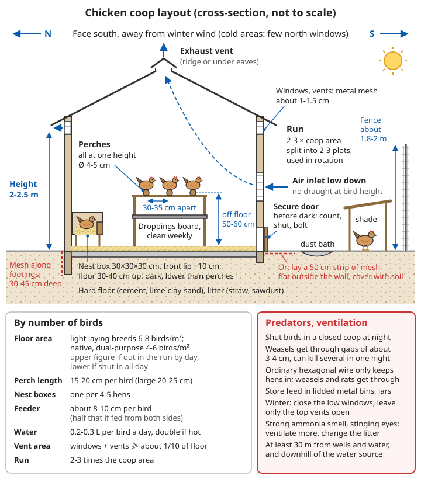
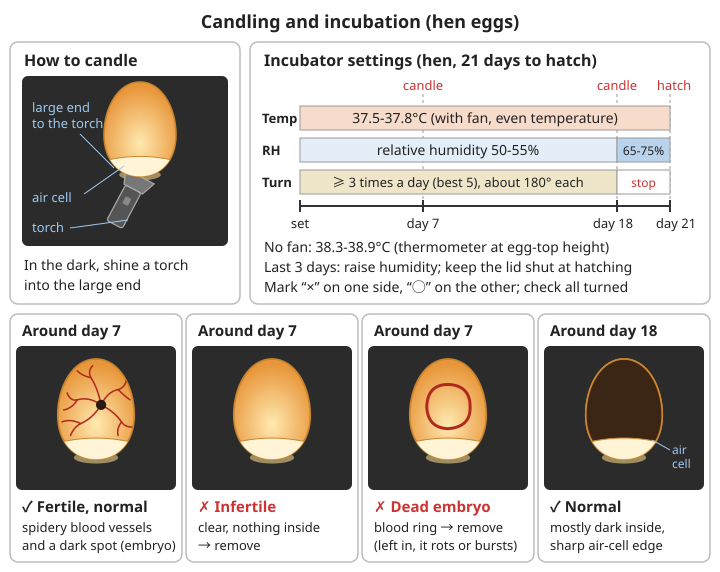

# Poultry Keeping Guide

Poultry are the easiest source of meat and eggs to restore after a disaster: a chicken takes only 5-6 months from hatching to laying, needs no large pasture, eats kitchen scraps and insects, and turns its droppings into fertiliser for the vegetable plot. But poultry are also a source of disease such as avian influenza (bird flu) and *Salmonella*. **Keeping them well depends on hygiene and disease prevention, not on feeding more.**

> The veterinary medicine and vaccine content in this chapter covers general principles only. For medicines and vaccination schedules follow the product leaflet and consult your local animal husbandry and veterinary station. If birds die in numbers, report it; do not just deal with it yourself and leave it there.

## Chickens

### Why keep chickens?

```
Advantages:
✓ Eggs (protein)
✓ Meat
✓ Manure (fertiliser)
✓ Pest control
✓ Relatively easy
✓ Need little space

What you put in:
- At the start: a chicken house, fencing, equipment
- Every day: feed, water, time
```

**Work out the feed first**: a laying hen eats 100-120 g of feed a day, about 40 kg a year. Fifteen hens need about 600 kg of feed a year, as much as 3 adults eat in a year (about 0.5 kg of grain per person per day). When grain is short, the size of the flock must be set by **how many kitchen scraps, green fodder, insects and low-grade grain you can find**, not by how many eggs you would like to eat.

```
Rough estimates:
- Native chickens lay about 120-180 eggs a year; high-producing layers about 250-300 (first year)
- For each person to eat 1 egg a day you need about 2-3 laying hens
- A laying hen produces about 0.1 kg of fresh droppings a day, about 35 kg a year
```

### Choosing a breed

**Layers**:
- Leghorn: high egg production (280-300 eggs/year)
- Brown-egg layers: adaptable

**Meat birds**:
- White-feathered broilers: fast-growing (slaughtered at 45 days)
- Yellow-feathered broilers: good meat quality

**Dual-purpose (eggs and meat)**:
- *Luhua* (barred) chickens, *Sanhuang* ("three-yellow") chickens: good all-round performance
- Native chickens: disease-resistant, suited to free-ranging

**Recommended for beginners**: a local native breed

**How to choose**:

| Type | Advantages | Disadvantages | Suited to |
|------|------|------|------|
| Commercial layers (Leghorn, brown-egg) | Lay many eggs, eat less feed | Mostly hybrid lines whose offspring do not breed true; they hardly ever go broody; need good-quality feed | Those with a steady feed supply |
| White-feathered broilers | Ready to slaughter at 6-7 weeks, low feed-to-meat ratio | Must have high-protein complete feed; leg problems and sudden death are common as they grow; very hard to keep as breeders | Fast meat in the short term |
| Yellow-feathered broilers, native chickens | Thrive on rough feed, forage well, resist disease, hens go broody | Lay fewer eggs, grow slowly (3-5 months to slaughter) | **Long-term self-sufficiency, breeding your own** |

```
Choosing for after a disaster / long-term self-sufficiency:
✓ First choice is a local native or dual-purpose breed: they can hatch their own chicks
  and do not depend on hatcheries or complete feed
✓ Keep some hens that go broody (native chickens, Luhua, Langshan, etc.) as "living incubators"
✓ About 1 cock to 8-12 hens (if you want eggs but not chicks you need no cock;
  hens lay just the same)
✓ Bring in a cock from a different source every year, or keep a flock of several dozen or more,
  to avoid inbreeding
  (inbreeding lowers hatch rates and increases deformities; see the link below)

Buying chicks / young birds:
✓ Lively and alert, with clear calls and bright eyes
✓ Navel well healed and dry, vent clean and not pasted with droppings
✓ Shanks glossy, standing steadily
✓ Buy from a breeding farm with vaccination records and ask exactly which vaccines have been given
  (Marek's disease vaccine is usually injected at the hatchery on the day of hatching)
❌ Do not buy birds that are dull, huddled and shivering, or with white droppings pasted on the vent
```

For inbreeding see [Biology and Medicine Basics – The harm of inbreeding](../../../docs/08-基础科学知识/04-生物与医学基础.md#63-近亲繁殖的危害); for selection see [Seed Saving and Breeding – Selection](08-seed-saving-and-breeding.md#selection-making-a-variety-better-every-year).

### Building a chicken house

**Site**:
```
✓ High, dry ground
✓ Airy and sunny
✓ Well drained
✓ Away from living areas (smell)
✓ Easy to manage

More:
✓ At least 30 m from wells and water sources, and downhill of them (as for latrines and animal pens)
✓ Facing south, sheltered from the wind in winter (in the north, few windows in the north wall)
✓ Away from ponds and wetlands where wild birds gather (wild ducks and similar birds are the main
  source of bird flu)
❌ Do not build in hollows or at the mouth of a gully (standing water, floods, cold air sinking)
```

**Specifications**:
```
Floor area:
- Floor-kept (inside the house): light layers 6-8 birds/m², native and dual-purpose birds
  4-6 birds/m² (see "Space in detail" below)
- Free-range: 1-2 m² per bird (outdoor run)

Height:
- 2-2.5 m

Structure:
✓ Walls: brick or wooden boards
✓ Floor: concrete or earth (covered with straw)
✓ Roof: rainproof
✓ Ventilation windows
✓ Door (predator-proof)

Inside:
✓ Perches (for roosting at night, about 50-60 cm above the floor)
✓ Nest boxes (one per 4-5 birds, 30x30x30 cm)
✓ Drinkers
✓ Feed troughs
✓ Litter (straw, wood shavings)
```

**Space in detail**:

| Item | Standard | Notes |
|------|------|------|
| Floor area inside | Light layers 6-8 birds/m²; native and dual-purpose birds 4-6 birds/m² | Use the upper figure if they go out to a run during the day; the lower if they are shut in all day |
| Perch length | 15-20 cm per bird (large breeds 20-25 cm) | Tighter in winter, more room in summer |
| Feed trough length | About 8-10 cm per bird (half that if they can feed from both sides) | Trough rim level with the birds' backs, so they scratch out less feed |
| Water | About 0.2-0.3 L per bird per day, double in hot weather | About twice the weight of feed eaten |
| Nest boxes | One per 4-5 birds | Floor of the box about 30-40 cm above the ground (lower than the perches), in a dark spot |

**Perches**:
```
✓ Use round poles 4-5 cm across, or square timber with the edges rounded off
  (too thin and they cannot grip, and the breastbone gets bruised)
✓ About 50-60 cm above the floor (for large breeds as low as about 45 cm, so they do not hurt
  their legs jumping down, but still higher than the nest boxes); with several perches,
  space them 30-35 cm apart horizontally
✓ It is better to have all perches at the same height, not stepped (birds fight over the highest spot)
✓ Put a droppings board or pit under the perches and clear it weekly: well over half of a
  chicken's droppings are passed at night
✓ Make the perch ends removable, for scrubbing and checking for red mites
  (the mites hide in the perch cracks by day)
```

**Nest boxes**:
```
✓ 30x30x30 cm, with a board about 10 cm high across the front to keep the nesting straw in
✓ Line with clean straw or wood shavings and change it when dirty
  (droppings on the shell are the main way bacteria get into the egg)
✓ Dark and quiet; place below the perches or lower than them, so birds do not sleep
  and foul in the boxes
✓ For newly laying hens, put a dummy egg (a stone or wooden egg) in the box to guide them
  and reduce eggs laid outside the nest
```

**Ventilation**:
```
Principle: plenty of air change, but no draughts at the height of the birds

✓ Windows and vents together should be at least about 1/10 of the floor area; open them all in summer
✓ Leave outlet vents under the eaves or at the ridge (hot air and ammonia rise), with inlets lower down
✓ In winter close the lower windows and leave only the upper outlets open
✓ Test: if you notice a strong ammonia smell and your eyes sting when you go in, the ammonia is
  already damaging the birds' airways; increase ventilation and change the litter
✓ Keep litter loose and dry (squeeze a handful; it should fall apart when you let go);
  caked, damp litter is a breeding ground for coccidiosis
```

**Keeping out rats and weasels**:

Weasels, cats, foxes, snakes, hawks and rats are among the biggest causes of poultry losses. A weasel can get through a gap of about 3-4 cm and may kill several birds in one night; rats steal feed and eggs, bite chicks and spread *Salmonella*.

```
✓ Shut the birds in a closed house every night: count them before dark, close the door
  and bolt it (weasels can open simple door hooks)
✓ Cover windows and vents in the house with metal mesh of about 1-1.5 cm (welded mesh);
  ordinary hexagonal chicken wire only keeps chickens in, not weasels and rats out
✓ Against digging: bury mesh 30-45 cm down from the base of the walls, or lay a 50 cm wide strip
  of mesh flat on the ground outside the walls and cover it with soil
✓ A hard floor is best (concrete or sanhetu, rammed lime-clay-sand), or bury mesh under an earth floor
✓ Store feed in lidded metal bins or jars; take away leftover feed at night and do not leave feed
  on the ground overnight
✓ Cut back weeds and clear rubbish heaps around the house (hiding places for rats and snakes)
✓ Net over the run if hawks are a problem, or leave shrubs and shelters for the birds to hide under
⚠️ Put rat poison in bait stations the chickens cannot reach, and pick up dead rats promptly
   (chickens will eat both the bait and dead rats)
```

**The run**:
```
- Area: 2-3 times the house
- Fenced (to keep birds in and predators out)
- Shade (trees, a shelter)

More:
✓ Fence about 1.8-2 m high; light breeds can fly, so clip the main flight feathers of one wing
  (cut the feather ends only, not into the blood vessels)
✓ Leave a patch of dry loose earth or a wood-ash pit for dust-bathing: this is how chickens
  rid themselves of lice and mites
✓ Divide the run into 2-3 plots and rotate them so the ground can rest and grow grass,
  reducing the build-up of parasite eggs
```

For hard earth floors see [Lime and Building Materials – *Sanhetu* and lime-soil](../../../docs/07-日常生活技能/16-石灰与建筑材料.md#三合土和灰土); for general rat control see [Sanitation – Getting rid of flies and rats](../../../docs/07-日常生活技能/03-卫生设施.md#消灭苍蝇和老鼠).



*Figure: Chicken house layout (schematic cross-section, not to scale); all values are taken from the text above and the "Space in detail" table*

### Brooding chicks (0-6 weeks)

**Equipment**:
```
- Brooder box/cage
- Heat lamp (winter)
- Thermometer

More:
- Without electricity: use a kang (heated brick bed) or heated wall, or hot-water bottles
  (filled with hot water and wrapped in cloth) in one corner of the brooder; refill every few hours
- Curve cardboard across the corners of the brooder so chicks cannot pile into a dead corner
  and smother
- Letting a hen raise the chicks is easiest: a broody hen keeps them warm herself,
  and you only need to keep out predators and provide feed and water
```

**Temperature**:
```
Critical!
- Week 1: 32-35°C
- Week 2: 29-32°C
- Week 3: 26-29°C
- Then lower by 2-3°C a week
- Down to 21°C (about 6 weeks)

How to tell:
- Right temperature: chicks spread out and lively
- Too cold: huddled together, cheeping
- Too hot: keep away from the heat source, beaks open
```

```
More:
✓ Hang the thermometer at the height of the chicks' backs (about 5 cm above the litter),
  at the edge of the heat source, not up at the roof
✓ Heat only one side of the brooding area, so chicks can choose between warm and cool
✓ Watching the chicks is more reliable than the thermometer: check once at night too;
  huddling means they are cold
✓ All crowding to one side (not around the heat) → there is a draught on that side; block it
✓ Lower the temperature gradually, and hold off during sudden cold snaps
✓ Before removing heat at 6 weeks, first turn the heat off by day and keep it at night
  for a few days' transition
```

**Stocking density**:

| Age | Floor density |
|------|----------|
| 1-2 weeks | 30-40 birds/m² |
| 3-4 weeks | 20-25 birds/m² |
| 5-6 weeks | 10-15 birds/m² |

Overcrowding leads to uneven growth, feather pecking and outbreaks of coccidiosis; enlarge the brooding area as they grow.

**Feeding**:
```
0-6 weeks:
- Chick feed (high protein)
- Available at all times
- Clean drinking water
- Clean daily

Note:
✓ Warm water for the first 3 days (against stress)
✓ Change feeds gradually
✓ Keep clean
```

**Water first, then feed**:
```
1. Let the chicks rest briefly when you get them home, then give water first: warm water
   at about 20-25°C (close to room temperature, never hot)
   On the first day you can add about 5% white or brown sugar to the water to help them recover
2. For chicks that will not drink, gently dip the beak in the water once; the others will copy
3. After about 2-3 hours, when most chicks have drunk, start feeding:
   scatter chick feed (or crushed maize or millet, or cooked egg yolk cooled until not sticky,
   crumbled) on newspaper or a shallow tray where they can peck it easily
4. For the first few days feed little and often, 6-8 times a day; then change to feed troughs

✓ Drinkers must be shallow, or put clean pebbles in the water dish, so chicks cannot fall in
  and drown or get wet and chilled
✓ Chick feed should have about 19-21% crude protein; on broken rice or maize alone they lack
  protein, fail to grow and peck each other's feathers
✓ Are they eating enough? A few hours after the first feed, feel the crop (under the neck):
  in most chicks it should be soft and full
```

**Management**:
```
✓ Watch how alert they are
✓ Clean regularly
✓ Ventilate (but keep warm)
✓ Prevent smothering
✓ Vaccination (consult a vet)

More:
✓ Pasted vent (vent blocked by dried droppings): soften with warm water and wipe gently;
  usually caused by the wrong temperature or pullorum disease
✓ Replace damp litter promptly; raise drinkers or stand them on mesh
✓ Guard against cats, rats and snakes: chicks are the easiest to carry off
✓ Feather pecking or vent pecking: dim the light (switch to red light), reduce density,
  check protein and salt in the feed, and move pecked birds to a separate pen
```

### Feeding adult birds (after 6 weeks)

**Feed**:
```
Commercial feed:
- Layer feed (laying hens)
- Broiler feed (meat birds)

Home-mixed feed:
- Maize (60-70%)
- Soybean meal/cake (15-20%)
- Wheat bran (5-10%)
- Shell meal/bone meal (3-5%, for calcium)
- Salt (0.3%)
- Green fodder (vegetable leaves, grass, 10-20%)

Add:
- Grit (aids digestion)
```

**Feed formulation principles**:

| Stage | Crude protein | Calcium | Notes |
|------|--------|----|------|
| Chicks (0-6 weeks) | 19-21% | About 1% | Lack of protein is the main reason chicks do not grow |
| Growers (7-18 weeks) | 15-16% | About 1% | Do not feed layer feed: too much calcium damages the kidneys |
| Laying hens | 16-17% | About 3.5-4% | The home-mixed feed above does not have enough calcium; give extra shell |
| Broilers | 21-23% early, 18-19% later | About 1% | White-feathered broilers have the highest feed requirements |

```
Key points for home-mixed feed:
✓ Energy feeds (maize, broken rice, sorghum, dried sweet potato) make up about 60-70%,
  protein feeds (soybean cake, peanut cake, fish meal, insects) about 20%,
  and the rest is bran and minerals
✓ Raw soybeans cannot be fed directly (they contain anti-nutritional factors and birds do not
  thrive on them); roast or boil them first; commercial soybean meal has already been heat-treated
✓ Cottonseed cake (contains gossypol) and rapeseed cake (contains glucosinolates) are toxic:
  no more than 5% of the feed, and preferably none for laying hens
✓ Salt: about 0.3% is enough; more causes diarrhoea and poisoning; when you feed salted fish
  or leftovers, add no extra salt
✓ Grit: particles about 2-4 mm (finer for chicks), in a separate trough;
  free-range birds usually find their own
✓ Change feeds gradually over a week; a sudden change cuts laying and causes diarrhoea
❌ Do not feed mouldy maize, peanuts or oilseed cake: aflatoxin is extremely toxic to poultry
  (especially ducklings)
```

**Extra calcium (most important for laying hens)**:
```
One eggshell contains about 2 g of calcium; a laying hen needs far more calcium each day
than a growing bird.
✓ From 2 weeks before laying starts, put out a separate trough of crushed shell (or crushed
  limestone) for them to eat freely; the birds eat as much as they need
✓ Recycling eggshells: wash them, dry them in the stove (or boil for a few minutes), then crush;
  crush until they no longer look like eggshell, or the hens learn to eat eggs
✓ Bones: boil or burn, then smash into bone meal, which supplies both calcium and phosphorus
❌ Thinner shells, soft-shelled eggs, more broken eggs → suspect lack of calcium first,
  then heat, old age and disease
```

**Using kitchen scraps and insects**:
```
Kitchen scraps can be fed (up to about a third of the diet; more and they get too little
protein and energy):
✓ Vegetable leaves, fruit and vegetable peel, leftover rice, rice bran, okara (soybean pulp),
  distillers' grains (small amounts)
✓ Leftover meat must be cooked; feed small amounts
❌ Do not feed: mouldy or soured food; very salty leftovers; sprouting or green potato peel;
  raw dried beans; avocado; chocolate; raw poultry meat or poultry offal
  (it spreads disease through the flock)

Insects (the best protein supplement):
✓ Free-range birds find their own insects and weed seeds in the run, orchards and harvested fields
✓ Chickens following behind digging or grass-cutting eat large numbers of insects and their eggs
✓ Earthworms: make a worm bed of rotting vegetable leaves, cow dung and damp straw, keep it moist
  and shaded, and dig out part of it regularly to feed
✓ Mealworms: line a wooden box with bran, add vegetable leaves for moisture; they build up
  in a month or two
✓ Black soldier fly larvae: they eat kitchen scraps and manure, and mature larvae crawl out
  by themselves; suited to somewhat larger households
✓ Hang a lamp at night to attract insects (with a basin of water under it, or the chickens below);
  in summer it attracts plenty of flying insects
⚠️ Do not feed insects from ground that has just been sprayed with pesticide
```

**Feeding routine**:
```
- At set times and in set amounts
- Laying hens: 100-120 g a day
- Broilers: feed freely
- Clean drinking water (at all times)

More:
✓ Feed free-range birds a little in the morning (so they go out to forage) and fully in the evening
  (to draw them back into the house, which also makes counting easy)
✓ Are you feeding enough? Laying hens should keep a steady weight and glossy feathers;
  if laying drops suddenly or birds get thin, feed more
✓ In winter give more energy feed (maize); in hot weather feed in the cool of morning and evening
✓ Scrub drinkers every day; running out of water is far worse than running out of feed;
  in summer half a day without water causes a big drop in laying
```

**Daily management**:
```
Daily:
✓ Watch the flock (alertness, appetite, droppings)
✓ Feed and water
✓ Collect eggs (2-3 times)
✓ Clear droppings (or at intervals)

Weekly:
✓ Clean drinkers and feed troughs
✓ Change litter (in part)
✓ Check equipment

At intervals:
✓ Thorough cleaning and disinfection
✓ Deworming
✓ Vaccination
```

**Judging health by the droppings**:

| Droppings | Possible cause |
|------|----------|
| Formed, brown, with a little white urates on top | Normal |
| Occasional pasty brown "caecal droppings" | Normal (about once a day) |
| Bloody, orange-red or like carrot | Coccidiosis |
| Yellow-green and loose | Serious disease such as Newcastle disease or bird flu (look at alertness and deaths too) |
| White and pasty, stuck to the vent (chicks) | Pullorum disease |
| Watery | Too much green fodder or water, or weather too hot; may also be disease |

**Extreme weather**:
```
Heat (above 30°C): panting with beaks open, wings held out → shade, more ventilation,
  cool water, feed in the cool of the day;
  add a straw mat on the roof or whitewash it to reflect the sun
Cold: combs and wattles frostbitten and turning black → block draughts but keep the upper
  ventilation; in winter a damp house harms birds more than cold;
  for breeds with large combs, rub petroleum jelly or fat on the comb
```

**Health checks**:
```
Catch a few birds each month and look:
✓ Part the feathers around the vent and under the wings: are there lice or mites
  (tiny red dots or small grey-white insects)?
✓ Feel either side of the breastbone: is the muscle full, or does the bone stick out like
  a knife edge (too thin)?
✓ Look at the feet: raised, crusty scales (scaly leg mite); swollen, inflamed foot pads
  (bumblefoot, usually from rough perches or a floor that is too hard)
If you find lice or mites: make sure there is a dust bath (dry earth with wood ash), scald perches
  and cracks with boiling water or paint them with milk of lime;
  in severe cases use a veterinary insecticide, following the label and withdrawal period
```

### Managing egg laying

**Point of lay**:
- Starts laying at 5-6 months old
- Gradually rises to a peak (8-10 months old)
- High production lasts about a year

```
Is a hen laying?
✓ Comb and wattles red, full and warm
✓ Vent large, moist and oval
✓ 2-3 fingers fit between the two pubic bones (the bone tips on either side below the vent),
  and 3-4 fingers between the ends of the pubic bones and the breastbone
✗ Small, pale, dry comb, small dry vent, only 1 finger between the pubic bones
  → not laying (stopped, moulting or due for culling)
```

**Encouraging laying**:
```
✓ Good nutrition (protein, calcium)
✓ Light: 14-16 hours a day
  - Add artificial light when daylight is short
  - Light on in the morning and evening
✓ Quiet surroundings
✓ Suitable temperature (13-23°C)
✓ Plenty of drinking water
```

**Managing light**:

Day length is the hen's signal for "what season it is": as days lengthen she lays, as they shorten she stops and moults. So light must not only be long enough but also **steady, and only ever increased, never cut back**.

```
✓ During rearing (before about 18 weeks old) do not lengthen the light; use natural light or
  a fixed short day, or they come into lay too early, with small eggs and a risk of prolapse
✓ After laying starts, add light gradually, 15-30 minutes more each week, until it reaches
  14-16 hours a day, then hold it there
✓ Add the extra light in the morning (lights on before dawn) and let it get dark naturally
  in the evening so the birds go up to roost by themselves;
  if you add light in the evening, dim it before switching off, or leave a small lamp on,
  so the birds can find the perches in the dark
✓ The light need not be bright: enough to see the feed trough and water
  (roughly one low-wattage LED lamp per 10 m²); too bright encourages pecking
❌ Suddenly shortening the light during laying (power cuts, forgetting the lights for several days)
  → a big drop in laying, and it may even set off a moult
⚠️ Without electricity, do not force it: accept fewer eggs in winter; using paraffin lamps or
   candles to light a chicken house is a fire risk
```

**Moulting**:
```
Hens moult naturally once a year in autumn: first the head and neck, then the body, finally
the wings; it usually lasts 2-4 months, and most stop laying during it.
This is normal, not a disease.

✓ During the moult raise the protein in the feed (more insects, soybean cake, fish meal);
  feathers are made mostly of protein
✓ Handle birds as little as possible during the moult: new feathers have blood vessels in their
  bases and bleed if knocked
✓ Hens that moult quickly and early (finished in 1-2 months) are usually good hens;
  consider culling those whose moult drags on
❌ "Forced moulting" by withholding feed and water is not recommended: it harms the birds,
   kills many, and is inhumane
✓ Besides autumn, stress (no water, no feed, a fright, a sudden cut in light) also causes
  moulting and a stop in laying
```

**Broodiness**:
```
Native and dual-purpose hens often go broody: they will not leave the nest box, fluff up,
cluck and peck at you, and stop laying.
- If you want chicks: this is your chance; see "Hatching" below
- If not: dealing with it early gets her laying again sooner:
  move her to a cage with an airy floor (wire-mesh bottom) or a bright, cool place,
  feed and water her separately; she usually comes out of it in 3-5 days
❌ Do not use rough methods such as dunking in cold water or starving her
```

**Common laying problems**:

| Problem | Cause | What to do |
|------|------|------|
| Eggs laid outside the nest | Too few nest boxes, too bright, no guidance at point of lay | More nest boxes, dummy eggs; at point of lay let them out into the run later in the morning |
| Hens eating eggs | Started by broken eggs, lack of calcium or protein, overcrowding, boredom | Collect eggs often, add calcium and protein, crush shells before feeding; cull persistent offenders |
| Soft or thin shells | Lack of calcium, lack of vitamin D (no sunlight for long periods), heat, old age, disease | Give shell, more sunlight, protect from heat |
| Blood spots or meat spots in eggs | Occasional ones are normal; frequent ones are linked to fright or lack of vitamin A | Pick them out by candling; eggs with blood spots are safe to eat |
| Prolapsed vent | Laying started too early, eggs too large, hen too fat | Isolate, clean and push back; cull severe cases; control light during rearing |

**Collecting eggs**:
```
- 2-3 times a day
- Collect promptly (before they are pecked or soiled)
- Storage: blunt end up, in a cool place, 10-15°C
```

```
More:
✓ The shell has a natural protective coating. Do not wash clean eggs; wipe off droppings
  with a dry cloth or sandpaper
✓ If you must wash them, use water warmer than the egg (cold water makes the contents shrink
  and draws dirt in through the shell), and eat them soon after washing
✓ Eat cracked eggs the same day, cooked; do not store them or eat them raw
✓ Freshness test: put the egg in clean water; lying flat on the bottom means fresh;
  one end tilting up means it has been kept a while; if it floats, do not eat it
✓ For long-term storage you can keep eggs in limewater (see the link below)
⚠️ Eggs may carry Salmonella: children, pregnant women, older people and the sick should not eat
   raw or runny eggs; wash your hands after handling raw eggs
```

For storing eggs in limewater see [Lime and Building Materials – Other uses](../../../docs/07-日常生活技能/16-石灰与建筑材料.md#其他用途); for recognising food poisoning see [Common Illnesses – Food poisoning](../01-first-aid-and-family-health/01-common-illnesses.md#food-poisoning).

### Hatching

Only by hatching your own chicks can a flock keep going without outside help. Hatching eggs must come from a flock with a cock.

**Choosing hatching eggs**:
```
✓ From a healthy, well-laying breeding flock free of pullorum disease; about 1 cock to 8-12 hens
✓ Normal shape, medium size (hen's eggs about 50-65 g), even shell thickness,
  no cracks, clean
✓ Store no more than 7 days (the longer, the lower the hatch rate), at about 13-16°C
  in a cool place, small end down
❌ Do not use double-yolked, misshapen, rough-shelled, dirty or washed eggs
```

**Hatching under a broody hen (simplest, high success rate)**:
```
1. Choose a reliably broody hen (give her eggs only after she has sat for 2-3 days
   without leaving the nest)
2. Put the nest in a quiet, half-dark, predator-proof place off the ground, lined with dry grass;
   first check for and treat lice and mites around the nest and on the hen
   (a hen bitten so badly she cannot sit still will abandon the nest)
3. Give each hen 10-15 eggs (as many as she can fully cover: more for large hens,
   fewer for small ones)
4. Mark the hatching eggs in pencil, check daily, and remove eggs that other hens lay in the nest
   later (they would hatch out of step)
5. Put water and feed beside the nest; the hen usually leaves once a day for about 10-20 minutes
   to eat, drink and pass droppings; do not chase her
6. The hen turns the eggs and controls temperature and humidity herself, with no help needed;
   in very dry weather you can put damp earth under the nest
7. Chicks hatch around day 21; let the hen keep them in the nest for 1-2 days before they come out,
   then give crumbled feed and shallow water
✓ A hen can also hatch duck eggs (about 28 days); sprinkle a little warm water on the eggs
  part-way through
```

**Simple incubation (without a hen)**:

| Parameter | Chicken | Duck | Goose |
|------|----|----|----|
| Incubation period | 21 days | 28 days (Muscovy about 35 days) | About 30-31 days |
| Temperature (with fan, even temperature in the box) | 37.5-37.8°C | About 37.5°C | 37.3-37.5°C |
| Temperature (no fan, measured at the height of the egg tops) | 38.3-38.9°C | As for chicken, slightly lower | As for chicken, slightly lower |
| Relative humidity (incubation) | 50-55% | 55-60% | 55-60% |
| Relative humidity (last 3 days before hatching) | 65-75% | 70-75% | 70-75% |
| Stop turning | Day 18 | Day 25 | Day 27-28 |

```
1. Box: a polystyrene or wooden box, with a heat source inside (light bulb, hot-water bag/bottles,
   heat from a kang), a thermometer (at the height of the eggs) and a tray of water (for humidity)
2. Run the empty box for 1-2 days first, and put the eggs in only once the temperature is steady
3. Turning: at least 3 times a day (5 is best; an odd number avoids the same side being down
   every night), turning about 180° each time;
   mark one side of each egg "×" and the other "○", and check after turning that all have turned
   Turning stops the embryo sticking to the shell membrane; failing to turn is a common
   cause of failure in simple incubation
4. Candling: in a dark place, shine a torch into the egg from the large end
   - Around day 7: a spider's web of blood vessels and a dark spot (the embryo) → fertile and normal;
     clear with nothing inside → infertile, remove; a ring of blood → dead embryo, remove
     (left in, it rots and may even burst)
   - Around day 18: most of the egg dark, with a clear edge to the air cell → normal
5. After turning stops, raise the humidity, and open the box as little as possible during hatching
   (if the humidity escapes, chicks easily get stuck in the shell)
6. Hatching: from first pipping to hatching usually takes a few hours to a day; do not rush to help;
   only if a chick is still not out after more than 24 hours and the membrane is drying,
   carefully peel away a small piece, and stop at once if you see bleeding
7. Move chicks to the brooder once their down is dry; not eating or drinking for about 24-48 hours
   after hatching is not a problem (they live on the yolk inside them)

Duck and goose eggs: large and fatty, and they make more heat of their own in the middle and late
  stages; from about day 10-15 cool them once a day (open the box until the eggs feel just
  slightly warm to the hand) and spray with a little warm water
```



*Figure: Using the hen's egg as an example; the incubation period, temperature, humidity and day turning stops differ for ducks and geese; see the table above*

```
Common causes of failure:
- Temperature too high: early hatching, deformities, large belly with poorly healed navel
- Temperature too low: late hatching, weak chicks
- Humidity too low: chicks stuck to the shell, cannot get out
- Humidity too high: chicks with big bellies, wet and sticky
- A short drop in temperature (a few hours) is less dangerous than a short rise: in a power cut
  cover the box with a quilt to keep it warm, and do not rush to open it
```

### Disease prevention

**Prevention first**:
```
✓ Cleanliness and hygiene
✓ Good ventilation
✓ Suitable stocking density
✓ Balanced nutrition
✓ Vaccination
✓ Regular disinfection
✓ Isolate sick birds
✓ Watch for anything unusual
```

**Biosecurity: keep disease out**:
```
✓ Keep newly bought birds separately in quarantine for at least 2-4 weeks, and join them to the
  flock only if nothing is wrong; the further the quarantine area from the flock, the better
✓ Keep chickens, ducks and geese apart if you can: ducks and geese infected with bird flu
  may show no illness but pass the virus to chickens
✓ Cover feed troughs and water or keep them indoors, so wild birds and rats cannot reach them;
  do not give chickens water from ponds that wild birds visit
✓ Change into dedicated footwear before entering the house, or step on a disinfectant mat
  (a straw mat soaked in milk of lime or wood-ash water);
  do not visit other people's flocks, and people and tools that have been to poultry markets
  or farms with sick birds do not come into your chicken house
✓ For broilers use "all in, all out" where possible: after each batch leaves, clean and disinfect
  thoroughly and leave the house empty for 1-2 weeks before the next batch
✓ Write every batch, every vaccination and every medicine in a record book
```

**Cleaning and disinfection**:
```
1. Clear first: remove all droppings and litter (to the compost), scrape corners, perches
   and nest boxes clean
2. Then wash: scrub with water; hot soda water if you have it
3. Then disinfect: paint walls and floor with milk of lime (1 kg slaked lime to 4-9 L water);
   or spray a chlorine disinfectant diluted according to the instructions;
   scald perch cracks with boiling water
4. Let it dry and air before putting the birds back
⚠️ Clean before you disinfect: under a thick layer of droppings no disinfectant works well
⚠️ Quicklime gets very hot when it meets water; if it gets in the eyes, wipe away the powder
   first, then rinse with plenty of clean water
```

For making milk of lime see [Lime and Building Materials – Disinfecting animal pens and latrines](../../../docs/07-日常生活技能/16-石灰与建筑材料.md#畜圈厕所消毒); for making chlorine disinfectant and its safety points see [Infectious Disease at Home – Making household disinfectant](../01-first-aid-and-family-health/15-infectious-disease-at-home.md#making-household-disinfectant).

**Common diseases**:
```
Newcastle disease ("chicken plague"):
- Prevent by vaccination!
- Signs: dull, difficulty breathing, green droppings, high death rate

Coccidiosis:
- Signs: bloody droppings, wasting
- Prevention: keep dry, preventive medication

Pullorum disease:
- Common in chicks
- Signs: white droppings
- Warmth, antibacterial drugs

⚠️ Consult a vet when disease is serious!
```

| Disease | Main signs | Prevention | Once it occurs |
|------|----------|------|--------|
| Newcastle disease ("chicken plague") | Birds of any age; dull, difficulty breathing, fluid in the crop, yellow-green loose droppings; later twisted neck, circling, paralysis; high death rate | Vaccination is the only reliable method, repeated according to the schedule | No specific treatment; isolate, report to the veterinary station, give emergency vaccination to birds not yet ill |
| Bird flu (highly pathogenic) | Sudden mass deaths; swollen head and face, purple comb and wattles, bleeding under the leg scales; laying stops abruptly | China has compulsory vaccination against highly pathogenic bird flu; keep out wild birds, keep chickens and ducks apart | **Do not treat or sell the birds yourself**; report at once to the local animal husbandry and veterinary authority, and cull and dispose of birds safely as required |
| Coccidiosis | Mostly at 3-6 weeks old and in damp seasons; bloody droppings, eyes closed, neck drawn in, ruffled feathers, wasting | Dry litter, raise feed and water troughs to keep droppings out; anticoccidial drugs in chick feed or coccidiosis vaccine | Use anticoccidial drugs according to the instructions, and replace all the damp litter |
| Pullorum disease | Chicks under 2-3 weeks with white pasty droppings, pasted vents, huddling from cold; can pass to the next generation through hatching eggs | Get birds from pullorum-free breeding flocks; keep chicks warm, disinfect often | Warmth; antibacterial drugs under a vet's guidance; survivors may carry the infection, so do not keep them as breeders |
| Marek's disease | From 2-5 months old: wasting, one leg stretched forward and one back ("doing the splits"), paralysis, grey-white eyes | Vaccinate on the day of hatching (vaccination later does not work) | Not worth treating; cull |
| Infectious bursal disease (Gumboro) | Mostly at 3-6 weeks old; suddenly very dull, white watery droppings, pecking at their own vents | Vaccination | No specific treatment; keep warm, provide water |
| Parasites (roundworm, lice and mites) | Wasting, anaemia, drop in laying; worms visible in droppings | Rotate runs, dust baths, clean perches | Dewormers according to the instructions and withdrawal period |

**Vaccination schedule principles**:
```
✓ Vaccination schedules differ with local diseases, the source of the birds and the type of vaccine;
  follow what your local animal husbandry and veterinary station recommends;
  the following is only a common outline:
  - Day of hatching: Marek's disease (injected at the hatchery)
  - About 1-2 weeks old: Newcastle disease (live vaccine, eye or nose drops), infectious bronchitis
  - About 2-4 weeks old: infectious bursal disease (in drinking water, often twice); Newcastle booster;
    first bird flu vaccination (injected at about 2-3 weeks old, as required by compulsory national
    vaccination)
  - About 6 weeks old: second bird flu vaccination
  - Before laying: Newcastle disease (inactivated vaccine, injected), another bird flu booster
  - During laying: boost bird flu and Newcastle about every 4-6 months, depending on antibody tests
    or the local disease situation
✓ Vaccinate only healthy birds; vaccinating sick birds not only fails but may make them worse
✓ Transport and store vaccines chilled and away from light, as the instructions say; once diluted,
  use them up within the stated time (usually within 1-2 hours)
✓ Before vaccinating in drinking water, withhold water for 2-4 hours so the birds are thirsty,
  and dilute with clean water containing no disinfectant
✓ For a few days before and after vaccination do not spray disinfectant over the birds,
  and avoid stress (catching, moving, changing feed)
✓ Boil or bury deep any leftover vaccine and empty bottles; do not throw them away carelessly
✓ When no vaccine is available: isolate even more strictly, keep birds in small separate groups,
  and bring in as few from outside as possible
```

**General principles for veterinary medicines**:
```
✓ Have a vet confirm the diagnosis before using medicine; do not give antibiotics at the first
  sign of illness, and do not use human antibiotics
✓ Follow the dose and course on the instructions exactly
✓ Keep to the withdrawal period: eggs and meat from during treatment and the withdrawal period
  must not be eaten or sold
✓ Do not use veterinary drugs banned in China; adding antibiotics long term as prevention breeds
  resistant bacteria that end up harming people
```

**Isolation and reporting**:
```
When you find a sick bird:
1. Take it out at once and put it in an isolation cage well away from the flock (downwind),
   with one person and dedicated tools looking after it
2. Watch the whole flock: alertness, eating, drinking, droppings, laying and deaths; write them
   down every day
3. Several deaths in a short time (for example several in one or two days), or swollen heads
   and faces, purple combs, or widespread green droppings
   → suspect Newcastle disease or bird flu and report at once to the local animal husbandry and
   veterinary authority; until then close off the whole flock: do not sell, give away, eat or move any
4. Do not cut open, eat, feed to dogs or cats, or throw into rivers any birds that died of disease

Disposing of birds that died of disease (key points):
✓ Handle them wearing gloves and a mask, and bag them; bury deep (pit at least 1.5 m deep,
  away from water sources, scatter quicklime before covering with soil) or burn
✓ Wash your hands thoroughly afterwards and disinfect tools and footwear; bury contaminated
  litter and droppings with them, or compost them at high temperature
```

For the full requirements for disposing of animals that died of disease see [Sanitation – Disposing of animals that died of disease](../../../docs/07-日常生活技能/03-卫生设施.md#病死动物处理); for how vaccines and antibiotic resistance work see [Biology and Medicine Basics – Immunity and vaccines](../../../docs/08-基础科学知识/04-生物与医学基础.md#三免疫和疫苗) and [Antibiotics and resistance](../../../docs/08-基础科学知识/04-生物与医学基础.md#四抗生素和耐药).

**Diseases that pass between birds and people**:

| Disease | How people catch it | Prevention |
|------|-----------|------|
| Bird flu | Touching sick or dead birds or their droppings, slaughtering sick birds, visiting live poultry markets | Do not touch sick or dead birds with bare hands; do not slaughter or eat them; wash hands after contact |
| Salmonellosis | Raw eggs, undercooked poultry, not washing hands after handling chickens (especially chicks) | Cook eggs and poultry thoroughly; wash hands after handling birds; children under 5 should not kiss or cuddle chicks and ducklings |
| *Campylobacter* enteritis | Juices from raw poultry contaminating chopping boards and cooked food | Separate boards for raw and cooked food; do not wash raw chicken (splashes spread contamination around the kitchen) |
| Psittacosis (Chlamydia) | Breathing dust from the dried droppings or feathers of infected birds | Sprinkle water to lay the dust before cleaning out the house, and wear a mask |

```
⚠️ If within 2 weeks of contact with sick or dead birds, or with a place where many birds died,
   you develop fever, cough, tiredness or aching muscles:
   see a doctor at once and tell them about the contact with birds; this is vital for early
   diagnosis of bird flu
✓ Pregnant women, children, older people and people with weak immunity should avoid clearing
  droppings, slaughtering and handling sick or dead birds as far as possible
✓ Wear a mask and gloves when clearing droppings and litter, and wash your hands with soap
  under running water afterwards
```

For handwashing see [Sanitation – How to wash](../../../docs/07-日常生活技能/03-卫生设施.md#怎么洗); for home care of fever and respiratory symptoms see [Infectious Disease at Home – Respiratory infections](../01-first-aid-and-family-health/15-infectious-disease-at-home.md#respiratory-infections).

### Culling and replacement

```
Culling:
- Laying falls after 1-2 years
- Cull old birds, add new ones
- Cull sick and weak birds

More:
- Replace 20-30% each year (to keep up egg production)
- Or all in, all out (broilers)
```

```
Choosing birds to cull (easiest to see around the autumn moult):
✗ Moult early and drags on, comb pale, dry and shrunken, pubic bones close together,
  not laying for long periods
✗ Chronic illness, long-term thin and weak, often eats eggs or pecks other birds
✓ Keep for breeding: hens that lay well, moult quickly, are well-shaped, resist disease and
  raise chicks; and strong, docile cocks
✓ Before mixing new and old birds, let them live side by side through a wire mesh for a few days,
  then put the new ones in at night, to reduce fighting
```

### Using chicken manure

Chicken manure is the most concentrated of farmyard manures (high in nitrogen and phosphorus), but **fresh chicken manure must not go straight onto the land**: it "burns" seedlings (it heats up and gives off ammonia as it ferments), and may carry pathogens and parasite eggs.

```
✓ Compost it together with its litter (straw, wood shavings); the litter supplies carbon,
  which balances the manure's high nitrogen
  Roughly 1 part chicken manure : 2-3 parts straw, dry leaves or wood shavings
✓ Keep the heap as moist as a wrung-out sponge (squeezed hard, a little water seeps out but does
  not run), and turn it regularly;
  a few days of heat in the centre (about 55-65°C) kills most pathogens;
  it usually takes at least 2-3 months to be fully rotted
✓ Signs it is fully rotted: dark brown, no bad smell, loose and crumbly like soil
✓ Rate as a guide: about 1-2 kg/m² of rotted chicken manure as a base dressing (a rule of thumb,
  for reference only), dug in; about half the rate for pig or cattle manure
✓ Put the chicken house next to the vegetable garden, or use a movable "chicken tractor"
  (a small wheeled coop) moved in turn over empty vegetable beds:
  the birds eat weeds and insects and leave their droppings in the soil;
  wait a while before planting vegetables
❌ Do not top-dress vegetables eaten raw with chicken manure; manure and litter from birds that
  died of disease must be buried deep or composted separately at high temperature,
  never put on the vegetable plot
```

For composting see [Farming and Animal Husbandry – Soil improvement](README.md#improving-soil); for the hygiene rules on using manure see [Sanitation – Using faeces and urine](../../../docs/07-日常生活技能/03-卫生设施.md#粪便与尿液的利用).

### Slaughter and hygiene

The following applies to chickens, ducks and geese. **Slaughter only healthy birds**; never slaughter or eat sick birds, dead birds or birds that died of unknown causes; deal with them as animals that died of disease.

```
Before slaughter:
✓ Withhold feed for 8-12 hours (so the crop and gut are empty and contaminate less at slaughter),
  but give water as usual
✓ Check before slaughter: alertness, breathing and droppings normal; do not slaughter birds
  under treatment or within the withdrawal period

Slaughter:
1. Quickly, with as little suffering as possible: hang the bird upside down (or put it head down
   into a killing cone or long tube) and let it calm down, then with a sharp knife quickly cut
   the large blood vessels on one side of the neck just behind the jaw
2. Bleed for 2-3 minutes; fully bled meat is better and keeps longer
3. If you want to eat the blood, catch it in a clean container and cook it the same day
⚠️ Sharpen the knife well; hesitating and cutting repeatedly causes the animal more suffering,
   and you are more likely to cut yourself
⚠️ When bird flu is circulating or there is an outbreak locally, do not slaughter live poultry at home

Scalding and plucking:
✓ Chickens: water at about 60-65°C, turning the bird in it for about 1-2 minutes, until the large
  wing feathers pull out easily
✓ Ducks and geese: oily feathers and dense down; water at about 61-65°C for longer (about 2-3 minutes);
  you can soak the feathers through with cold water first; pull out the fine down slowly with
  small tweezers or between your fingers
✗ Water too hot or scalded too long → the skin cooks and tears when plucked
✓ Wash and sun-dry goose and duck down for filling quilts and clothing

Gutting:
1. Work on a table, not on the ground
2. First remove the crop, then cut around the vent and carefully draw out the guts,
   without breaking the intestines or the gall bladder
   (gut contents on the meat are the main source of bacterial contamination;
   bile makes the meat bitter)
3. Check the organs: white spots, large areas of bleeding or swelling in the liver, or fluid or
   a bad smell in the body cavity →
   do not eat any of the bird; deal with it as an animal that died of disease
4. Cut open the gizzard, remove the contents and its horny lining; the heart, liver and gizzard
   are edible
5. Rinse with clean water and cool as quickly as possible
```

```
Hygiene:
✓ A chopping board and knife only for raw poultry; wash them straight after use with hot water and
  detergent; wash your hands with soap afterwards
✓ Without a fridge, eat it the same day, or preserve it at once by salting, smoking or drying
✓ Cook poultry and eggs thoroughly: meat at least 75°C in the centre, no blood when cut,
  juices running clear
✓ Do not leave feathers, offal and blood lying around: cooked offal can be fed to dogs and cats
  (except from sick birds); bury or compost the rest, away from water sources
❌ Do not feed raw poultry offal to chickens or ducks (it keeps disease circulating)
```

For preserving meat see [Food Processing and Preservation – Cured and salted meat](../../../docs/07-日常生活技能/01-食物加工与保存.md#腊肉咸肉) and [Smoking](../../../docs/07-日常生活技能/01-食物加工与保存.md#烟熏); for hygiene in cooking and storage see [Common Illnesses – Food poisoning](../01-first-aid-and-family-health/01-common-illnesses.md#food-poisoning).

---

## Ducks

### Features

```
Advantages:
✓ Very adaptable
✓ Disease-resistant
✓ Lay many eggs (270-300 a year, in some breeds)
✓ Good meat
✓ Love water; can be kept on land and water together

Needs:
- A water source (pond or stream is better)
- More space to roam
```

```
How they differ from chickens:
- Ducks do not perch; they sleep on the ground, so litter must be deeper and changed more often
- Ducks need to drink to wash their food down, so there must be water next to the feed trough,
  and drinkers must be deep enough to dip the whole bill
  (ducks clean their nostrils and eyes this way)
- Ducks rarely go broody (except Muscovies); duck eggs must be hatched by hens, Muscovies
  or an incubator
- Ducks are even more sensitive to aflatoxin than chickens; never feed them mouldy feed
- Ducks can carry bird flu virus without falling ill; keep them apart from chickens
```

### Breeds

- Layers: Shaoxing duck, Jinding duck
- Meat: Pekin duck, Cherry Valley duck
- Dual-purpose: Gaoyou duck

```
More:
- Muscovy duck: quiet, can fly, goes broody and hatches eggs, thrives on rough feed;
  suited to small-scale self-sufficiency; incubation period about 35 days
- Local breeds of brown "ma" ducks: small, good foragers, suited to free-ranging and to
  duck-rice farming
- Drake to duck ratio: laying breeder flocks about 1:15-20, meat breeder flocks about 1:5-8
```

### Duck house

```
Like a chicken house, but:
✓ Waterproof floor (duck droppings are wet)
✓ Slightly sloping (for drainage)
✓ Larger run
✓ A pond (if possible)
```

```
Details:
✓ Density inside: adult ducks about 4-6 birds/m²
✓ Put the drinking area at one end of the house, raised on mesh or bricks over a drain,
  and keep the rest of the floor dry
✓ Deep litter (at least about 10 cm), changed promptly when wet; ducks that sleep on wet ground
  for long get leg problems and breast blisters
✓ Nests: along a wall at floor level, divide off a row of nests with boards (about 40x40 cm)
  and line with dry grass; they need not be raised off the ground
✓ Protect from weasels and foxes too, and shut them in at night; ducks frightened at night panic
  and trample each other, so a small lamp can be left on in the house
✓ Pond: the water must be changeable or flowing; stagnant water soon smells and breeds germs;
  lay gravel or bricks around the pond to stop it getting muddy
```

### Feeding and care

**Brooding**:
```
- Keep warm (as for chicks)
- Week 1: 29-32°C
- Lower week by week
- Water + duckling feed
```

```
More:
✓ Then lower by about 2-3°C a week; in mild weather heat can be removed at 3-4 weeks
✓ Water first, then feed; first feeds can be cooked broken rice or crushed maize, or duckling feed
  moistened into a damp mash that does not stick to the fingers
✓ Ducklings need quite a lot of niacin (vitamin B3); on maize alone they get weak legs and cannot
  stand; add yeast, bran or soybean cake, or a poultry multivitamin as directed
✓ Ducklings without a mother duck have down that is not waterproof: for the first 1-2 weeks do not
  let them swim; the water need only be deep enough to dip the bill, so they do not get soaked,
  chilled or drown
✓ After 2 weeks they can go into shallow water briefly on warm sunny days; afterwards let them
  dry off and preen in the sun
✓ Duck viral hepatitis is common in ducklings (sudden mass deaths, head thrown back before death);
  vaccinate as your local veterinary station advises
```

**Adult ducks**:
```
Feed:
- Duck feed or home-mixed (similar to chicken feed)
- Like green fodder (vegetable leaves, water plants)
- Can forage freely (insects, grass, snails)

Free-ranging:
- Out in the morning and evening (ducks like it cool)
- On water (eating water plants, snails, fish and shrimp)
- Reduces feed costs

Laying:
- Mostly at night or early morning
- Nest boxes
- Collect eggs at set times
```

```
More:
✓ Laying ducks need extra calcium too: crushed shell in a separate trough, as for chickens
✓ Ducks lay from the small hours to early morning: do not let them out before 9 a.m.;
  collect the eggs first and then let them out, or eggs will be laid in the open and in the water
✓ Duck-rice farming: put young ducks in after the rice seedlings have taken and begun tillering;
  the ducks eat insects and weeds and stir up the muddy water; take them out when the ears appear,
  so they do not eat the rice
✓ Before letting ducks out, find out whether nearby fields have just been sprayed; keep ducks off
  sprayed fields and water for 1-2 weeks
✓ Duck plague (duck viral enteritis): watery eyes, swollen head and neck ("big-head plague"),
  green loose droppings, mass deaths;
  prevent by vaccination; if it occurs, isolate and report, as for chicken diseases
```

For combining with rice paddies see [Aquaculture – Fish in rice paddies](07-aquaculture.md#fish-in-rice-paddies).

---

## Geese

### Features

```
Advantages:
✓ Mainly eat grass (low cost)
✓ Grow fast
✓ Disease-resistant
✓ Good meat
✓ Valuable down

Needs:
- Grassland
- A water source
- Plenty of space
```

```
More:
✓ Geese are very alert and call loudly at strangers and wild animals; they can double as
  "guard geese"
✓ An adult goose can eat about 1-2 kg of fresh grass a day; with good grass very little
  concentrate feed is needed
✓ Geese live long; breeding geese can be kept for 4-5 years or more
⚠️ Ganders are aggressive in the breeding season and will peck and beat with their wings;
   children should not go near them alone
```

### Breeds

- Lion-head goose, Taihu goose, Sichuan White goose, etc.

```
More:
- Large (Lion-head goose): grows big, lays few eggs (about 25-35 a year)
- Small to medium (Taihu, Sichuan White, Huoyan, etc.): lay more eggs (about 60-100 a year);
  better suited to breeding and raising your own
- Gander to goose ratio about 1:4-6
```

### Feeding and care

**Brooding** (0-4 weeks):
```
- Warmth: week 1 28-30°C
- Gosling feed + chopped greens
- Ratio: feed : greens = 1:2, gradually to 1:4
```

```
More:
✓ Week 2 about 25-27°C, then lower week by week; in warm weather heat can be removed at 2-3 weeks
✓ Water first, then feed; cut greens into fine shreds, and feed only tender leaves
✓ In the first week do not put them on grass on dewy mornings or after rain (wet down chills them);
  after about a week let them graze briefly at midday on warm sunny days, gradually longer
✓ Gosling plague: goslings under 3 weeks are most susceptible, and the death rate is very high;
  prevent it by vaccinating breeding geese before laying (goslings get antibodies from the mother)
  or by giving goslings vaccine or antiserum after hatching as the veterinary station advises
```

**Growing** (after 4 weeks):
```
- Mainly grazing
- Eat grass (fresh, tender grass)
- A little concentrate feed as a supplement
- Water (for swimming)

Grazing:
- Once in the morning and once in the afternoon
- Grassland, waterside
- Can be fattened quickly (70-90 days, 3-4 kg)
```

```
Grazing details:
✓ Geese love tender grasses, legumes and vegetable leaves; rotate grazing grounds and rest
  them to regrow once grazed bare
✓ Learn to recognise and avoid poisonous plants (such as oleander, datura and water hemlock)
  and ground just sprayed with pesticide
✓ Drive them back into the shade when the midday heat is strong; after they return in the evening,
  feel their crops and give concentrate feed to any that are not full
✓ Fattening: for 2-3 weeks before slaughter graze them less and give more concentrates such as
  maize and broken rice, for fatter meat
```

**Laying**:
```
- Start laying at 8-10 months old
- Seasonal laying (spring)
- 40-80 eggs a year
- Large eggs (150-200 g)
```

```
More:
✓ A month before the laying season give extra concentrate feed and shell, to meet the needs of laying
✓ Put nests in a quiet corner of the house, lined with dry grass; collect goose eggs promptly
  so they are not trampled and broken
✓ To hatch goslings: females of some local breeds go broody, or eggs can be hatched by hens,
  Muscovy ducks or an incubator, about 30-31 days
✓ Geese mostly mate in water; where there is open water, fertility of hatching eggs is higher
```

---

## 📝 Poultry keeping: key points

```
Choosing:
- Beginners: chickens (easy)
- With water: ducks, geese
- With grassland: geese (low cost)

Numbers (household):
- 10-20 chickens (enough eggs + occasional meat)
- Or a mix: chickens + ducks + geese

Keys to success:
✓ Cleanliness and hygiene
✓ Suitable stocking density
✓ Good nutrition
✓ Disease prevention and vaccination
✓ Careful observation
✓ Dealing with problems promptly

Returns:
- In: housing + feed + time
- Out: eggs + meat + fertiliser
- Pays back in about half a year (if kept well)
- A steady return over the long term

Note:
✓ Know the local regulations
✓ Do not disturb neighbours (smell, noise)
✓ Humane keeping
✓ Food safety
✓ Guard against bird flu: do not touch sick or dead birds with bare hands, bury them deep or hand
  them to the animal disease control authorities, and report mass deaths at once
```

```
The things that most often go wrong:
❌ Gaps in the chicken house → a weasel kills half the flock in one night
❌ Brooding temperature up and down, no one checking at night → chicks pile up and smother
❌ Damp litter → coccidiosis
❌ No separate calcium for laying hens → soft shells, broken eggs, hens eating eggs
❌ Light switching between long and short during laying → laying stops
❌ New birds joined to the flock without quarantine, chickens and ducks kept together
   → disease brought in
❌ Feeding mouldy feed → aflatoxin poisoning
❌ Eating or selling birds that died of disease → you fall ill and the disease spreads
```

---

**Next chapter**: [Livestock](06-livestock.md)
**Back**: [Chapter index](README.md) | [Main contents](../../README.md)
