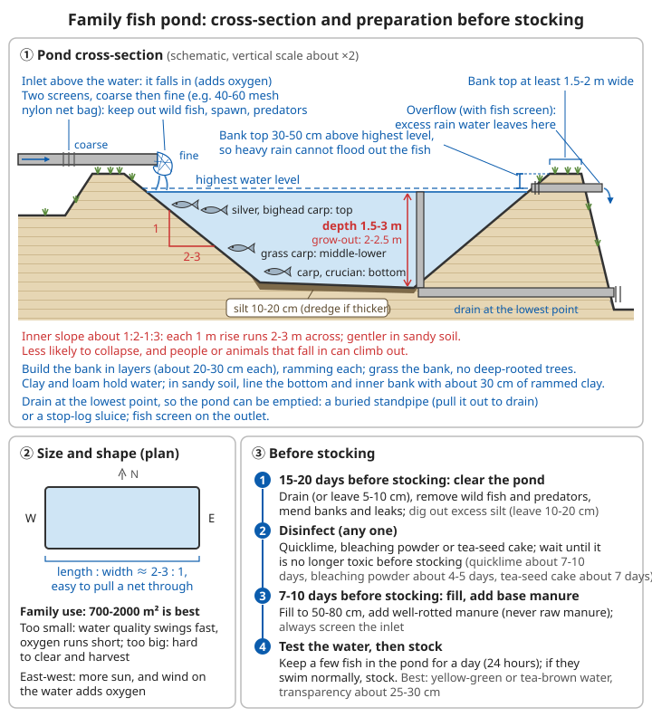

# Aquaculture Guide

## The value of aquaculture

```
Advantages:
✓ Rich in protein (fresh fish flesh contains about 17-20% protein; the edible part is a
  little over half the weight of the fish)
✓ Makes full use of water: one pond stores water, raises fish, and supplies irrigation and
  firefighting water at the same time
✓ Some species grow fast (the four major Chinese carps, stocked as fingerlings, reach
  0.5-1.5 kg by the autumn of the following year)
✓ Can "eat" waste from elsewhere: green grass, vegetable leaves, rice bran and well-rotted
  manure can all be turned into fish
✓ Good economic returns

Needs:
- A water source (pond, reservoir, rice paddy, tank)
- Some skill
- Water quality management (when fish farming fails, it is almost always a problem with
  the water, not with the fish)
```

From the point of view of self-sufficiency after a disaster: a fish pond can produce fish without bought feed (through plankton grown with green grass and manure), though yields will be much lower than with intensive feeding. Pond mud is also a good fertiliser, and pond water can be used to water vegetables. All of this assumes a reliable water source — drinking water comes first; see [Water Sources and Water Supply](../../../docs/07-日常生活技能/10-水源工程与供水.md).

---

## Fish farming

### Common farmed fish

**The four major Chinese carps**:
- Grass carp: eats grass, grows fast; eats a lot and produces a lot of droppings, which fertilise the water for silver and bighead carp
- Silver carp: filters phytoplankton (the algae that turn water green); lives in the upper water
- Bighead carp: filters zooplankton; upper water. Silver and bighead carp need no feed — they are fish that "eat the water"
- Black carp: eats snails, mussels and the like; bottom water. Grows slowly and needs large amounts of snails and clams; seldom kept in household ponds

**Others**:
- Crucian carp: adaptable, tolerates low oxygen, breeds naturally
- Common carp: omnivorous, easy to keep; roots in the mud and makes the water muddy, so stock only a few
- Tilapia: a tropical fish, grows fast; stops growing below about 15°C and dies of cold below about 10°C; cannot overwinter outdoors in northern China
- Yellow catfish: high market value; fairly carnivorous and eats small fry

**Choosing species**: prefer species that are common locally and whose fry are easy to buy or that breed by themselves. Do not release non-native species (such as tilapia, crayfish or suckermouth catfish) into rivers and lakes.

### Pond fish farming

#### Pond conditions

```
Area:
- Small: about 700-2000 m²
- Medium: about 2000-6700 m²
- Large: >6700 m²
- For household self-sufficiency a 700-2000 m² pond is best; too small and the water quality
  changes quickly and oxygen runs short easily; too large and draining and netting are hard work

Water depth:
- 1.5-3 m (2-2.5 m is common for ponds raising fish to eating size)
- A mix of deep and shallow is better
- Too shallow (<1 m): water too hot in summer, freezes solid easily in winter, unstable
  water quality
- Too deep (>3 m): the bottom water lacks oxygen and gets no light; it is of no use

Water source:
✓ Plentiful (can top up even in the dry season)
✓ Clean
✓ Unpolluted (no factory or mine discharge upstream; does not receive pesticide runoff
  from fields)
✓ Easy to fill and drain

Bottom:
- 10-20 cm of silt (dredge if thicker)
- Or a sand-and-mud bottom
- Clay and loam hold water well; sandy soil leaks, so line the pond bottom and the inside
  of the banks with about 30 cm of clay and ram it down

Shape:
- Rectangular is best (length:width about 2-3:1, easy for netting)
- Running east-west (good light; wind over the surface adds oxygen)
```

For judging soil texture see [Geology, Minerals and Soil – Simple soil texture tests](../../../docs/08-基础科学知识/06-地质矿物与土壤.md#52-简单的土壤质地判断).

**Banks, inlets and outlets**:
```
Banks:
- At least 1.5-2 m wide at the top (wide enough to walk and push a cart along; less likely
  to collapse)
- Inner slope about 1:2-1:3 (for every 1 m of rise, 2-3 m horizontal); use the gentler
  slope in sandy soil. Gentle slopes collapse less, and people and animals that fall in
  can climb out more easily
- Bank top 30-50 cm above the highest water level, so heavy rain does not overflow the pond
  and let the fish escape
- Build in layers (about 20-30 cm each), ramming each one down; plant grass on the banks to
  protect the slopes, and do not plant large deep-rooted trees (roots cause leaks)

Inlet:
- Above the pond surface, so the water falls into the pond (which also adds oxygen)
- Fit two screens (coarse then fine, e.g. 40-60 mesh nylon net bags) to keep out wild
  fish, fish eggs and predators

Outlet:
- At the lowest point of the pond bottom, so the pond can be drained completely (needed
  for cleaning the pond and for harvesting by draining)
- Simple method: bury an upright pipe or a board sluice gate; pull out the pipe or lift the
  boards to let the water out
- Fit a fish screen on the outside of the outlet

Overflow:
- At the designed highest water level, make an overflow with a fish screen; in heavy rain
  the surplus water runs out here and does not wash away the banks
```



*Figure: Water depth 1.5-3 m, silt 10-20 cm, inner slope about 1:2-1:3, bank top 30-50 cm above the highest water level; two screens on the inlet, outlet at the lowest point of the pond bottom*

#### Pond preparation

**Cleaning and disinfecting the pond**:

Why clean the pond: the silt at the bottom harbours disease organisms, parasite eggs and wild fish (snakeheads and catfish eat fingerlings; other wild fish compete for food and oxygen). If an old pond is not cleaned, newly stocked fingerlings often die in large numbers.

```
15-20 days before stocking:

1. Drain the water (or leave only 5-10 cm)
2. Remove unwanted fish, wild fish and predators (snakeheads, snakes, water rats and others)
3. Repair the banks and plug leaks
4. Remove excess silt (leave 10-20 cm); the pond mud you dig out is a good fertiliser for
   vegetable plots and orchards
5. If you can, drain the pond in winter and let the bottom dry until it cracks; a winter of
   frost and sun greatly reduces disease organisms

Disinfection (choose one):
- Quicklime, dry method (5-10 cm of water left): about 900-1125 kg/ha
  * Dig several small pits in the pond bottom and put lumps of quicklime in them
  * Add water to slake it and, while it is still hot (still bubbling), splash it over the
    whole pond with a long-handled scoop, including the slopes
  * The next day rake the lime slurry and silt together; this works even better
- Quicklime with water in the pond (1 m deep): about 1875-2250 kg/ha
  (scale the amount by depth: about half for 0.5 m)
  * Slake it in buckets on a boat or on the bank, then splash it over the whole pond
- Bleaching powder with water in the pond (about 30% available chlorine): about 20 g per m³
  of water, i.e. about 200 kg/ha for 1 m depth
  * Dissolve in a wooden bucket or pottery jar and splash over the whole pond; do not use
    metal containers
  * Works fast and its toxicity disappears fast, but it is less effective than quicklime
    against disease organisms in the silt, and it does not improve the pond bottom
- Without lime or bleaching powder: crush tea-seed cake, soak it overnight, and splash it
  over the pond with the residue, about 600-750 kg/ha for 1 m depth; it kills wild fish and
  snails but is a poor disinfectant

Wait for the toxicity to disappear before stocking:
- Quicklime: about 7-10 days; bleaching powder: about 4-5 days; tea-seed cake: about 7 days
- "Test the water" before stocking: put a few fish in a net cage or bucket in the pond for a
  day (24 hours); if they swim normally you can stock
- Always fit screens on the inlet when filling, or the cleaning will have been wasted
```

Why quicklime works well: with water it forms calcium hydroxide, which for a short time raises the pH of the water above 11 and kills disease organisms and wild fish; afterwards it absorbs carbon dioxide and turns into calcium carbonate, which also neutralises acid pond mud, adds calcium and makes the silt release nutrients.

```
⚠️ Quicklime safety
- It gives off violent heat with water, enough to boil the water and spatter lime slurry;
  stand well back and turn your face away when slaking it
- Wear goggles and gloves, long sleeves and long trousers; keep a bucket of clean water
  next to you
- On the skin: brush off the dry powder first, then rinse with plenty of clean water
- In the eyes: at once hold the eyelids open and rinse continuously with plenty of clean
  water; get medical help as soon as possible
- Keep children away from lime heaps and slaking pits
```

For burning, slaking and safe use of lime see [Lime and Building Materials](../../../docs/07-日常生活技能/16-石灰与建筑材料.md#先说清楚-本章的定位) and [Slaked lime powder](../../../docs/07-日常生活技能/16-石灰与建筑材料.md#消石灰粉撒地消毒改土用); for chemical burns see [Wound and Injury Care – Chemical burns](../01-first-aid-and-family-health/02-wounds-and-injuries.md#chemical-burns).

**Base fertiliser**:
```
7-10 days before stocking (after the disinfectant's toxicity has gone and the pond has been
filled to 50-80 cm):
- Organic manure (fermented chicken, pig or cattle manure) 3000-4500 kg/ha,
  heaped in the shallows at the edge or spread out, so the nutrients dissolve slowly
- Biogas slurry or green manure (tender grass or legumes cut and left to rot in a corner of
  the pond) can also be used
- Purpose: to grow plankton, so there is natural food as soon as the fingerlings go in
  (first feeding for fry)
- Yellow-green or tea-brown water is good; stock when the transparency is about 25-30 cm
```

```
⚠️ Manure must be fully rotted before it goes into the pond
- Fresh manure uses up a great deal of oxygen and brings in disease organisms
- Human faeces are especially dangerous: liver fluke eggs get into the water in human
  faeces → are eaten by snails → the larvae burrow into fish flesh → people are infected by
  eating raw or undercooked fish. Do not build toilets beside ponds, and do not tip fresh
  human faeces into a pond
```

For how long excreta must be stored see [Sanitation – Faeces](../../../docs/07-日常生活技能/03-卫生设施.md#粪便必须长时间储存); for biogas slurry see [Lighting and Energy – Using biogas residue and slurry](../../../docs/07-日常生活技能/06-照明与能源.md#沼渣沼液的利用).

#### Stocking fingerlings

**When**: spring (March-May), with water above 10°C; in the south you can also stock in winter (December to February), when the water is cold and fish are less easily injured, and they start feeding as soon as spring comes.

**Fingerling sizes**: fry hatched this year and grown to about 3 cm are called *xiahua* ("summer flowers", summer fry); those grown on to autumn or winter, about 10-15 cm, are called *dongpian* ("winter pieces", large fingerlings). When raising fish for eating, stock *dongpian* where possible: survival is high and they reach eating size the same year.

**Stocking density** (polyculture, fish per ha; intensive, i.e. fed every day):

| Species | Mainly grass carp | Mainly silver/bighead carp | Size |
|------|----------|----------|----------|
| Grass carp | 12000-15000 | 3000-4500 | 100-200 g each |
| Silver carp | 3000-4500 | 7500-12000 | *dongpian* |
| Bighead carp | 750-1500 | 3000-4500 | *dongpian* |
| Crucian and common carp | 750-1500 | 1500-3000 (total "others") | *dongpian* |

```
Note: adjust sizes and densities to your conditions
- Extensive ponds with no bought feed, fed only green grass and manure: stock 1/3-1/2 of the
  figures above; better too few than too many. If the density exceeds what the water can
  carry, the fish do not grow and easily suffer oxygen shortage and disease
- If water exchange is poor and there is no aerator, also use the lower figures
- Silver:bighead usually about 2-5:1 (a rule of thumb; bighead eat zooplankton, of which
  there is less, so too many will not grow)
- Traditional saying: "one grass carp carries three silver carp": grass carp eat grass and
  their droppings fertilise the water; the plankton this grows feeds the silver and bighead
  carp at no extra feed cost
- Do not stock many common carp (they root in the mud and stir up the water); do not put
  snakeheads, catfish or other predatory fish in a polyculture pond
```

**How polyculture works**:
- Makes full use of every layer of the water
- Silver and bighead carp: upper layer (plankton)
- Grass carp: middle and lower layers (plants)
- Black carp, common carp, crucian carp: bottom (bottom-dwelling animals, leftover feed)
- They help each other: grass carp droppings fertilise the water, silver and bighead carp eat the algae so the water does not get too rich, and crucian and common carp clear up leftover feed

**How to stock**:
```
✓ Choose healthy fingerlings: smooth, uninjured body, scales intact, lively, swim strongly
  against a current; struggle strongly in the hand; gill covers open and close strongly
  out of water
✗ Reject fish that are dark in colour, swim alone, float at the surface, or have white spots
  or bleeding spots
✓ Even sizes (fish of the same species about the same size, or the small ones cannot get food)
✓ Stock each pond in one go
✓ Stock on a fine morning (not on muggy, rainy or very windy days)
✓ Disinfect fingerlings (soak in 3-5% salt water for 5-10 minutes, i.e. 300-500 g of salt per
  10 L of water; take fish out at once if they start rolling onto their side)
✓ Temperature matching (difference <5°C): float the bag or bucket of fish in the pond for
  15-30 minutes, then slowly mix in pond water, and finally let the fish swim out by themselves
✓ Release them on the upwind side, a little away from the bank, in deeper water
```

#### Feeding and management

**Feeding**:
```
Grass carp:
- Mainly green grass and water plants: tender land grasses, ryegrass, Sudan grass, eelgrass
  (Vallisneria), vegetable leaves, duckweed
- Or pellet feed
- Daily ration (pellets): 3-5% of fish body weight (summer), 1-2% (spring and autumn)
- Green grass contains a lot of water: feed about 20-40% of the total weight of grass carp in
  the pond as fresh weight (at the summer peak), aiming for it to be nearly all eaten before
  the next feed. As an order of magnitude, about 30 kg of green grass produces 1 kg of grass carp
- Make a feeding frame: enclose a square on the water surface with bamboo poles (e.g.
  2 m × 2 m) and throw the grass in it, so it does not drift away
- Grass must be fresh and tender; do not feed grass recently sprayed with pesticide, or grass
  that has heated up and turned yellow

Common and crucian carp:
- Pellet feed
- Or maize, wheat bran, soybean cake and the like (grind, soak or cook the maize)

Silver and bighead carp:
- Rely mainly on plankton
- Fertilise (organic manure) to grow plankton
- Can be supplemented with soy milk or bran slurry (splashed over the surface)

Black carp:
- Snails, clams, river mussels (crushed); oilseed cake when the fish are small
```

**Home-made feed** (for common, crucian and grass carp; suggested proportions):
```
- Rice bran or wheat bran about 40-50%
- Soybean cake, peanut cake, rapeseed cake about 25-35% (for protein)
- Maize meal, broken rice, sweet-potato flour about 10-20% (for energy, and as a binder)
- Animal protein (earthworms, silkworm pupae, fly maggots, small trash fish cooked and
  chopped) about 5-10%, if available
- A little salt (about 0.5%)

Method:
1. Grind and sieve the ingredients, add water and mix into a dough (it holds together when
   squeezed and falls apart when poked)
2. Steam or boil it (cooked starch binds well and does not fall apart easily in water)
3. Roll into strings or press into small pellets and dry in the sun or shade; pellet size
   about half the width of the fish's mouth
4. Feed made the same day can be fed wet, but must not be kept overnight (it goes mouldy)

Note:
✗ Do not feed mouldy oilseed cake or grain (aflatoxin can damage the liver and kill)
✗ Cottonseed cake and rapeseed cake contain toxins; each should be no more than about 1/4 of
  the feed, ideally soaked or boiled first
✗ Do not feed live golden apple snails directly (a non-native species that escapes, breeds
  and eats rice plants)
```

**Estimating the ration as a percentage of body weight**:
```
Steps:
1. Estimate the total weight of fish in the pond = number stocked × survival rate × average weight
   (each month net 20-30 fish and weigh them to get the average weight)
2. Daily ration = total fish weight × feeding rate

Water temperature and feeding rate (pellets or home-made dry feed):
| Water temperature | Feeding rate | Feeds per day |
| <10°C    | Stop or very little | — |
| 10-15°C  | about 0.5-1% | 1 (midday) |
| 15-20°C  | about 1-2% | 1-2 |
| 20-30°C  | about 3-5% | 2-3 |
| 30-32°C  | about 2-3% | 2 (avoid midday) |
| >32°C    | Halve it | In the cool of morning and evening |

Example: about 1000 grass carp in the pond, average 0.4 kg, about 400 kg in total;
         in July water at 28°C, at 4% → about 16 kg of dry feed a day, in 2 feeds,
         morning and afternoon

Judging:
- Pellets eaten within about 20-30 minutes = the right amount; if a lot is left, cut down;
  if fish are still crowding the feeding frame after it is gone, add a little
- Cut down or stop on rainy or muggy days, after fish have been gasping at the surface, and
  when they are sick
```

**Feeding principles**:
```
✓ Fixed time (same time every day, e.g. 8-9 a.m. and 3-4 p.m.)
✓ Fixed place (a fixed feeding frame, so you can watch the fish eat and clear leftovers)
✓ Fixed quality (fresh, not spoiled)
✓ Fixed quantity (according to season, weather and the fish)

Saying: feed by the "four fixes"
Also the "three looks": look at the weather, the water colour, and how the fish feed and move
```

**Water quality management** (important!):
```
"To raise fish, first raise the water"

Water colour:
✓ Yellow-green or tea-brown (good): plenty of the diatoms and green algae that silver and
  bighead carp like to eat
✓ Clear to the bottom: the water is poor; it needs fertilising
✓ Deep green, blue-green: the water is rich; oxygen shortage is likely
✗ A green, paint-like or oily scum on the surface with a fishy stink: a blue-green algae
  "bloom"; it uses a lot of oxygen at night and the algae may release toxins when they die;
  change water and stop fertilising
✗ Dark brown and smelly: too much organic matter; the bottom mud is rotting
✗ Water suddenly turns clear, whitish or reddish: algae are dying off in large numbers; oxygen
  may run out at any time

Good water (old fish farmers say it should be "rich, lively, fresh and clean"):
- Rich: plenty of plankton; the water has colour
- Lively: the colour changes between morning and evening (paler in the morning, deeper in
  the afternoon), showing the algae are growing normally
- Fresh: the colour is bright, not dull or dark
- Clean: moderate transparency, no foam or scum on the surface

Transparency:
- About 25-40 cm is right (<20 cm too rich, >40 cm too poor)
- How to measure: tie a string to the centre of a white enamel plate (or a board painted
  white, about 20 cm across) and lower it slowly into the water; the length of string under
  water at the point where the plate just disappears is the transparency

Dissolved oxygen (oxygen dissolved in the water):
- ≥5 mg/L: ideal
- 3-5 mg/L: acceptable, but fish eat less and grow slowly
- <2 mg/L: oxygen shortage; fish start gasping at the surface
- <1 mg/L: severe gasping; mass death of the whole pond may follow
- Through the day: photosynthesis is strongest in the afternoon, when oxygen is highest; it
  is lowest just before dawn

pH:
- Best about 7-8.5, slightly alkaline
- On sunny afternoons algae take up carbon dioxide and pH rises; it is lower in the morning.
  This is normal
- Below about 6.5 (acidic): fish grow poorly and fall ill easily. Each time, apply quicklime
  at about 150-300 kg/ha (for 1 m depth), slaked to a slurry and splashed over the whole pond,
  at intervals of 15-20 days
- Above about 9: stop liming and add fresh water
- How to measure: test paper or home-made red-cabbage juice

Adjusting:
✓ Add fresh water regularly (every 7-10 days, raising the level by about 10-20 cm each time;
  more often in hot weather)
✓ Use an aerator if you can
✓ Fertilise (organic manure, to grow plankton)
✓ Adjust pH (quicklime)
✓ Clear floating plants from the surface (not too many; duckweed and water hyacinth covering
  the surface block the light and cause oxygen shortage)
✓ Remove silt once a year (thick silt uses a lot of oxygen)

Pond rounds:
✓ Walk round the pond morning, midday and evening; before dawn is the most important (to see
  if fish are gasping at the surface)
✓ Watch the water colour, the fish's movement and feeding
✓ Check the works (leaking banks, broken screens, the aerator)
✓ Remove dead fish, leftover feed and rotting water plants
✓ Keep a pond diary: weather, water temperature, water colour, amount fed, anything unusual
```

For measuring acidity see [Geology, Minerals and Soil – Acidity and alkalinity](../../../docs/08-基础科学知识/06-地质矿物与土壤.md#53-酸碱性).

**Using an aerator** (when there is electricity):
```
"On sunny days run it at noon, on cloudy days at dawn; when fish gasp run it early; in long
spells of rain run it at midnight"

- On sunny days run it for 1-2 hours at noon: the surface water is supersaturated with oxygen,
  and stirring sends it down to the lower water, "storing oxygen" for the night. Do not run it
  in the evening (it disperses the oxygen in the surface water and actually brings on gasping)
- On cloudy days skip the noon run from the afternoon onwards, and run it from the second
  half of the night to early morning instead
- When there are signs of gasping, run it at once until the sun is up and the fish stop
  gasping
- Without an aerator: a small solar water pump, a hand-cranked water wheel, or rowing a boat
  and splashing the water can all help in an emergency
```

```
⚠️ Electrical safety
- Aerators and pumps use electricity next to water: they must have a residual-current device
  (RCD); keep cables off the ground and out of the water
- Switch off the power before repairs; keep away during thunderstorms
```

See [Household Electrical Safety – Electricity in wet places](../../../docs/07-日常生活技能/08-家庭用电安全.md#潮湿环境用电) and [Lighting and Energy – Small-scale solar power](../../../docs/07-日常生活技能/06-照明与能源.md#小型太阳能).

**Recognising gasping fish and emergency action**:

Gasping (*fu tou*, "floating heads") is when fish short of oxygen come to the surface to "gulp air". Mild gasping that is not dealt with urgently is not a big problem, but severe gasping can kill every fish in the pond within a few hours. It is the greatest risk in pond fish farming.

```
Weather and signs that make gasping likely:
- Muggy, still weather with low pressure in summer and autumn (before a storm)
- A hot day followed by an evening thunderstorm: cold surface water sinks and turns the
  oxygen-poor bottom water up to the top
- Long spells of rain and too little light, so the algae produce no oxygen
- Water too rich (deep green), transparency <20 cm, or a sudden change in water colour
- Feed left uneaten on the feeding frame in the evening; fish swimming at the surface in the
  afternoon
```

| Severity | Signs | Action |
|------|------|------|
| Mild | Around dawn silver and bighead carp gasp in the middle of the pond, sink at the slightest disturbance, and stop once the sun is up | Feed less that day, keep watch that night, have aeration ready |
| Moderate | Silver, bighead and grass carp are all gasping; when disturbed they sink but soon come up again | Aerate at once or run in fresh water |
| Severe | Grass carp, black carp and common carp are gasping too; the fish crowd to the edge of the pond, do not sink when disturbed, and turn dark | Do everything possible to save them, and get ready to move them to another pond |
| Mass death | Fish dart about wildly, roll onto their sides, sink and die; the large fish usually die first | Save as many as you can |

```
Emergency steps:
1. Start the aerator at once; or pump in fresh water:
   - Add it at the surface on the upwind side, making a current; gasping fish gather where
     the new water comes in
   - The new water must be high in oxygen: let well or river water fall over a drop or spray
     it before it enters the pond
   - Do not pump water from the pond bottom and back in; this stirs up silt and makes the
     oxygen shortage worse
2. Stop feeding until 1 day after the fish are back to normal
3. Do not net the pond or walk about in it frightening the fish
4. Chemical oxygen releasers (calcium peroxide, sodium percarbonate and the like) can be used
   in an emergency; scatter over the whole pond strictly at the dose on the packet
5. Once the fish stop gasping, add fresh water and feed little that day and for the next few
   days; if the water is too rich, replace 1/4-1/3 of it and stop fertilising
6. Remove dead fish as soon as possible; fresh ones can be eaten that day or salted. Treat
   fish that smell bad or died of unknown causes as dead animals
```

For disposing of dead animals see [Sanitation – Disposing of dead animals](../../../docs/07-日常生活技能/03-卫生设施.md#病死动物处理); for reading the weather see [Weather Observation and Forecasting – Air pressure](../../../docs/08-基础科学知识/07-天气观测与预报.md#31-气压).

**Fertilising**:
```
Purpose: to grow plankton (food for silver and bighead carp)

Method:
- Organic manure (well rotted): 1500-2250 kg/ha each time
- Every 10-15 days
- Little and often
- Fertilise according to the water (more when it is poor, less when it is rich)
- Apply in sunny shallows, or put it in bamboo baskets or woven bags hung in the water so it
  dissolves slowly

Note:
- Apply little or none in hot weather (oxygen shortage is likely)
- Do not apply on rainy days (without sunshine the algae cannot grow, and the organic matter
  only uses up oxygen)
- Fertilise on sunny mornings
- Organic manure must be fermented and fully rotted!
- Leave about 7-10 days between fertilising and liming (lime drives the nitrogen out of the
  manure)
```

**Overwintering**:
```
- Overwinter in deep water (1.5-2 m or more)
- Keep the water level up under the ice
- Sweep snow off the ice (snow blocks the sunlight, and the algae under the ice stop
  producing oxygen)
- Oxygen under the ice (cutting ice holes): 1-2 holes for about every 700 m², each about 1 m²;
  once cut, cover with rice straw or straw mats so they do not freeze solid again. If fish
  gather near a hole with their mouths opening and closing rapidly, they are short of oxygen;
  add fresh water
- Feed less or stop (fish hardly eat when the water is below about 10°C)
- In the south where ponds do not freeze: you can feed a little at midday on sunny winter
  days when the water warms up
```

```
⚠️ Danger on ice
- Do not let children play on the frozen pond; adults cutting ice holes should tie a rope
  round their waist, with someone watching from the bank
- Clear, hard ice must be at least about 15 cm thick to hold one adult (white or greyish ice
  is weaker); ice is thinner near ice holes and inlets
```

For self-rescue and rescuing others after falling through ice see [Snow and Polar Survival – Ice and falling through](../03-wilderness-survival/04-snow-and-polar-survival.md#ice-and-falling-through).

#### Disease prevention and treatment

```
Prevention first:
✓ Clean and disinfect the pond
✓ Disinfect fingerlings
✓ Disinfect tools (dry nets and buckets in the sun after use; keep separate tools for each pond)
✓ Disinfect the feeding frame regularly (every 1-2 weeks splash lime slurry or bleaching powder
  solution around it)
✓ Feed fresh feed
✓ Manage water quality well
✓ Stock at a sensible density
✓ Isolate sick fish promptly
✓ Handle gently when netting and transporting, so the fish are not bruised (wounds are the
  way in for water mould and bacteria)
✓ In the disease season (May-September) splash quicklime over the whole pond every 15-20 days,
  about 225-300 kg/ha (for 1 m depth)
```

**Spotting sick fish**: swimming alone, floating at the surface or circling at the edge of the pond, eating much less, dark body colour, white spots, white fluff, bleeding or ulcers on the body, pale or purplish gills. Watch for these on your daily rounds; find problems early and deal with them early.

**Common diseases**:

| Disease | Signs | General treatment |
|----|------|----------|
| Gill rot (bacterial) | Gill filaments rotting and white, covered with mud; sometimes a transparent patch on the inside of the gill cover (a "skylight") | Splash quicklime or bleaching powder over the whole pond; use medicines as an aquaculture technician advises |
| Red skin disease (bacterial) | Patches of bleeding and redness on the body, scales falling off; mostly after bruising during netting | As above; avoid bruising |
| Enteritis (bacterial) | Red, swollen vent; yellow mucus comes out when the belly is pressed lightly | Stop feeding for 1 day, then feed fresh feed; never feed mouldy feed |
| Grass carp haemorrhagic disease (viral) | Bleeding in the gill covers, fin bases and muscle of grass carp; sudden onset, many deaths | No specific treatment; prevent by vaccination; once it breaks out, improve water quality and feed less |
| Saprolegniasis (water mould, fungal) | White cotton-wool-like tufts growing on wounds | Bathe sick fish in 3-5% salt water; avoid injuring fish |
| Ichthyophthiriasis (white spot disease) | Body and fins covered in small white spots | The parasites decline by themselves once the water rises above 25°C; add fresh water |
| Trichodiniasis | Fry and fingerlings race wildly round the edge of the pond in shoals ("running horses") | Ask a technician which medicine to use |
| Anchor worm, fish lice | Parasites visible to the naked eye hanging on the body, with red swelling around them | Kill with medicine splashed over the whole pond; prevented by pond cleaning |

```
The "three grass carp diseases" (gill rot, red skin, enteritis) often occur together and are
the commonest diseases of grass carp; with haemorrhagic disease they are called the "four diseases".

General principles for medicines:
✓ Diagnose before treating: take sick fish to the local aquaculture technology extension station
✓ Use the label dose: calculate by the volume of the whole pond (area × average depth);
  do not misjudge it
✓ Keep to the withdrawal period: leave enough days between treatment and harvesting for sale
✗ Do not use medicines banned by the state (such as malachite green, chloramphenicol,
  nitrofurans, organochlorine pesticides); they leave residues in fish flesh that harm the
  people who eat it
✗ Do not use farm pesticides to kill parasites (many pesticides are more toxic to fish than
  to the parasites)
✗ Do not apply medicines when fish are gasping, or on muggy or rainy days; watch closely after
  applying, and add water at once if fish start gasping

⚠️ For serious disease consult an aquaculture technician!
```

For dealing with gasping from oxygen shortage see "Recognising gasping fish and emergency action" above.

#### Harvesting

```
When:
- Autumn and winter, when the water cools (fish are less easily injured and keep better)
- Or whenever they reach market size

Methods:
- Seine netting
- Draining the pond (after letting the water out)
- Catch the big ones and leave the small ones (rotational harvesting and restocking): net out
  big fish in batches in summer and autumn to give the remaining fish room, then stock more
  fingerlings

When netting:
✓ Stop feeding 1-2 days before (with empty guts fewer fish die in transport and holding, and
  the flesh is cleaner)
✓ Net in the cool of early morning; do not net on muggy days or when fish are gasping
✓ Pull the net steadily, keep it in the water only briefly, and add fresh water straight
  after netting
✓ After draining the pond to harvest, take the chance to remove silt and dry the pond out,
  ready for next year

Yield:
- Ordinary management: 4500-7500 kg/ha
- Intensive, high-yield: 12000-22500 kg/ha
- Extensive, with no bought feed, relying only on green grass and manure: about 1500-3000 kg/ha
  (order of magnitude)
```

**Keeping fish fresh after harvest**:

Fish spoil much faster than meat: at room temperature (above 25°C) they begin to go off within a few hours.

```
Holding fish alive:
- Put fish you cannot eat straight away in a net cage or a pool of clean water; without
  feeding they live for a few days to a couple of weeks
- Kill them when needed and eat them fresh; this is the best way to "keep" fish without a
  refrigerator

After killing:
1. Kill at once with a blow to the head, bleed (cut the gills), scale, and remove the gills
   and guts
2. Rinse the blood out of the belly cavity with clean water; keep in a cool, airy place and
   eat the same day
3. If you have ice: a layer of ice, a layer of fish; keeps for about 3-5 days

Is it fresh?
✓ Bright red gills, full clear eyes, scales lying tight, flesh springs back when pressed,
  only a fishy smell
✗ Grey or dull gills, sunken cloudy eyes, soft flesh that keeps a fingerprint, a bad smell →
  do not eat

Fish you cannot eat in time:
- Salt, sun-dry or smoke it (salt fish, dried fish, smoked fish)

⚠️ Fish gall bladders are poisonous: swallowing the gall bladder of grass carp, black carp,
   silver or bighead carp and others, raw or soaked in liquor, can cause poisoning (vomiting,
   diarrhoea, passing little urine, acute kidney failure), and can kill.
   The folk belief that "swallowing fish gall brightens the eyes and clears heat" has no
   basis; remove and discard the gall bladder when gutting fish
⚠️ Freshwater fish must be cooked right through; do not eat raw fish, "drunken fish" or
   half-raw fish slices (liver fluke)
```

For how to salt, dry and smoke see [Food Processing and Preservation – Salting](../../../docs/07-日常生活技能/01-食物加工与保存.md#盐腌), [Sun-drying and air-drying](../../../docs/07-日常生活技能/01-食物加工与保存.md#晒干与风干) and [Smoking](../../../docs/07-日常生活技能/01-食物加工与保存.md#烟熏). If symptoms appear after swallowing fish gall, see a doctor at once; for general management of poisoning see [Poisoning](../01-first-aid-and-family-health/12-poisoning.md#general-principles-for-handling-poisoning).

### Fish in rice paddies

```
Advantages:
✓ One body of water, two uses
✓ Fish eat pests and weeds
✓ Fish droppings fertilise the field
✓ A double harvest of rice and fish

Method:
- Dig a fish trench round the field (1 m wide, 0.5 m deep)
- Fish pit (for the fish to shelter in): dig a pit about 1 m deep in a corner of the field or
  near the inlet
- Trenches and pits together take up about 5-10% of the paddy (more than that reduces the
  rice harvest)
- Fit screens on the inlet and outlet
- Fish to stock: common carp, crucian carp, grass carp and others
  (larger grass carp eat rice seedlings, so stock mainly common and crucian carp, with few
  grass carp or add them once the rice is tall)
- Density: 750-2250 fish/ha (a rule of thumb, for reference only)
- When to stock: about 7-10 days after transplanting, once the seedlings have turned green
  and rooted (too early and the fish knock over and eat the seedlings)

Management:
- Manage the rice as normal
- When applying pesticide, drain the water into the fish trench (to protect the fish)
- Give some feed (rice bran, wheat bran, grass)
- Drying the field (mid-season drainage): drain slowly so the fish follow the water into
  the trenches and pit, and keep water in the trenches and pit; do not dry the field for too long
- Use mainly organic manure and base fertiliser; top-dress with chemical fertiliser in small,
  split doses, not scattered into the fish trench; do not use ammonium bicarbonate, ammonia
  water and the like (ammonia is very toxic to fish)
- Before harvesting the rice, drain the field to gather the fish in the trenches and pit and
  catch them, or move them to a pond

Returns:
- 300-750 kg of fish per hectare
- The rice yield goes up too!

Suitable conditions:
- A steady water source that can keep a layer of water in the field (water in the fish trench
  no shallower than 0.5 m)
- Bunds raised and strengthened (against leaks and escapes)
- Ideally a proven local model and technical guidance
  (such as the rice-fish co-culture of Qingtian, Zhejiang, listed by the FAO as a Globally
   Important Agricultural Heritage System in 2005; and the integrated rice-fish farming
   promoted in many areas)

Common reasons for failure:
- No fish trench or pit, so the fish have nowhere to go when the field is dried or the water
  is cut off
- Leaking bunds or weak screens on the inlet and outlet, so the fish escape
- Spraying pesticides (especially insecticides) as usual, killing the fish
- Stocking too densely without feeding, so the fish do not grow
- Failing to keep out birds, snakes, rats and other predators
```

```
General principles for pesticides (take extra care when keeping fish in paddies):
✓ Use farming and physical methods first: light traps for insects, pulling up diseased plants
  by hand, fish and ducks eating insects and weeds
✓ If you must use a pesticide, choose one whose label says it is of low toxicity to fish,
  and use the label dose
✓ When spraying, point the nozzle up onto the rice leaves, not straight into the water;
  do not spray before rain (the pesticide washes into the paddy water)
✓ Drain the water into the fish trench first, and refill a few days after spraying
✗ Do not use highly toxic pesticides banned by the state; most organophosphates and
  pyrethroids are very toxic to fish
```

For water levels and drying of rice paddies see [Grain Crops – Rice field management](02-grain-crops.md#field-management); for protection when spraying and pesticide poisoning see [Poisoning – Pesticide and rat poison poisoning](../01-first-aid-and-family-health/12-poisoning.md#pesticide-and-rat-poison-poisoning).

### Ducks in rice paddies (rice-duck farming)

In the paddy, ducks eat weeds and insects (rice planthoppers, stem borer larvae and others), swim back and forth stirring the water and stimulating the rice plants, and their droppings fertilise the field. In many places this replaces herbicides and most insecticides.

```
Conditions:
- A level field that can hold a water layer of about 5-10 cm
- Fence the field with nylon netting or bamboo hurdles (about 60-80 cm high) to stop ducks
  escaping and keep out weasels and dogs
- Put up a simple duck shed in a corner of the field (shelter from rain, a place to rest at
  night, supplementary feed)

Breeds:
- Small, nimble ducks that forage well, of the partridge-coloured (*ma ya*) type (such as
  local partridge ducks, Shaoxing ducks)
- Do not use large, slow breeds such as Pekin or Cherry Valley ducks (they flatten the rice
  seedlings)

Steps:
1. Keep ducklings in the shed for about 7-15 days first; once they have adjusted, put them
   into the field (let them practise in shallow water for a few days first)
2. Put the ducks in about 7-14 days after transplanting, once the seedlings have turned green
   and rooted
3. Density: about 150-300 ducks/ha; one flock for each fenced field of about 0.3-1 ha
4. Let them out in the morning; in the evening you can give a little paddy rice or rice bran
   by the shed (feed little, so they stay hungry and go looking for insects and weeds)
5. Before the rice heads (when the grain begins to fill), drive the ducks out of the paddy,
   or they will eat the ears
6. Fatten the ducks you bring back for a while before slaughter, or keep them for eggs

Note:
- Ducks eat small fish fry. When rice, ducks and fish share a field, stock large fingerlings,
  or keep ducks first and stock fish after the ducks are taken out
- Do not use pesticides or rat poisons that are toxic to ducks in the field
- Too many ducks in a paddy trample the seedlings
```

For brooding, breeds and day-to-day care of ducks see [Poultry Keeping – Ducks](05-poultry.md#ducks).

### Fish in tanks (barrels) (small scale)

```
Suitable when:
- There is no large body of water
- Small household scale
- For enjoyment and food

Containers:
- Large tanks, aquariums, large plastic barrels (food-grade, or with no odour)
- At least 50-100 L of water; if you want fish to eat, a barrel of several hundred litres or
  a 1000 L IBC tote is best
- Water at least about 40 cm deep; place out of strong sun or put up shade netting

Species:
- Crucian carp, common carp (tolerate low oxygen)
- Tilapia (tropical; needs warmth)
- Loach (tolerates low oxygen even better)

Density (by weight of fish, more reliable than by number):
- No aeration, no filter: no more than about 0.5 kg of fish per 100 L of water
- With an air pump and a filter: about 10-20 kg of fish per 1000 L of water
- Beginners use the lower figure

Management:
✓ Aeration (air pump)
✓ Filtration (simple: a bucket of sponge and gravel; a pump pushes water through it and it
  flows back)
✓ Regular water changes (1/3 a week): let new water stand in the sun for 1-2 days (to drive
  the chlorine out of tap water) and add it only when it is close in temperature
✓ Feeding (pellets, a little): 1-2 times a day, as much as is eaten within 5 minutes
✓ Protect from summer heat and winter cold
✓ Look every day: fish gaping at the surface → short of oxygen; water smelly, white and cloudy
  → overfed; cut feed and change water at once

Output is limited; this is mainly for experience and enjoyment
```

### Simple aquaponics

Fish excrete ammonia, which is toxic to fish; bacteria turn the ammonia into nitrate, which is exactly what vegetables need as fertiliser; the vegetables take up the nutrients and clean water flows back to the fish tank. With very little water you get both fish and vegetables, and it is much more stable than keeping fish in a tank alone.

```
The simplest set-up (one fish tank + one grow bed):

Fish tank: a 1000 L IBC tote or a large tank (with the top cut off), holding the fish
Grow bed: a large, fairly shallow trough (about 30 cm deep), above or beside the fish tank
  - Fill with washed gravel, expanded clay or broken brick (about 1-2 cm pieces, not
    limestone, or the pH will stay too high)
  - Grow bed volume about 1-2 times the fish tank volume
Circulation:
  - A small pump lifts fish-tank water into the grow bed; the water runs through the gravel
    and back to the fish tank by gravity
  - Fit a bell siphon or a timer switch in the grow bed so the water alternately "fills and
    drains", letting the roots breathe
  - When there is no electricity: scooping water over the grow bed by hand with a bucket a few
    times a day will just about do

Start-up ("cycling the water", about 3-6 weeks):
1. Fill with water, run the pump, and put in a few fish (or only a few small fish)
2. Feed little, so nitrifying bacteria slowly grow on the gravel
3. This is the most dangerous time for the fish: if they gasp at the surface or stop eating,
   change 1/3 of the water and feed less
4. When the vegetables start to grow green and the fish feed normally, the system is stable;
   then add more fish gradually

Proportions (order of magnitude):
- Fish: no more than about 20 kg per 1000 L of water
- About 40-50 g of feed per square metre of grow bed per day (for leafy vegetables);
  tomatoes, cucumbers and other fruiting vegetables need more nutrients, about 50-80 g
- Keep the pH about 6-7 (a compromise between fish, vegetables and bacteria); if it is too
  low, adjust with a little wood-ash water

Suitable vegetables: lettuce, pak choi, water spinach, celery and herbs are the easiest;
  tomatoes and cucumbers need a bigger grow bed and more time

Common problems:
- New leaves turn yellow while the veins stay green: iron deficiency, the commonest problem
  in aquaponics
- Fish dying, water smelly: too many fish or too much feed; cut feed and change water first
- Never spray the vegetables with pesticide (it will kill the fish); deal with pests by
  picking them off by hand and using insect netting
```

For small-scale solar power see [Lighting and Energy – Small-scale solar power](../../../docs/07-日常生活技能/06-照明与能源.md#小型太阳能); for choosing vegetables see [Vegetable Growing](01-vegetable-growing.md).

---

## Shrimp and crayfish farming

### Crayfish farming

```
⚠️ Be clear first
- The crayfish (red swamp crayfish, Procambarus clarkii) is a non-native species and a great
  burrower: it hollows out bunds and dykes and damages rice and native aquatic life. Keep it
  only in areas where it is already farmed, in enclosed ponds and paddies; do not take it to
  new areas or release it
- It must be cooked right through before eating (it may carry lung fluke and other parasites);
  eat only crayfish of known origin
- If muscle aches, weakness and urine the colour of soy sauce appear within a few hours to a
  day of eating crayfish, it may be rhabdomyolysis; see a doctor at once
```

**Pond conditions**:
```
- Area: about 2000-3300 m²
- Water depth: 1-1.5 m
- Easy to fill and drain
- Escape barrier (fence): put a ring of smooth plastic film or plastic board round the pond,
  about 40-50 cm above ground with the bottom edge buried about 20 cm in the soil; crayfish
  cannot climb a smooth surface. They escape most easily on rainy days
- Wide banks with gentle slopes, able to stand up to burrowing
```

**Stocking**:
```
- Juvenile crayfish: 450-750 kg/ha
- When: spring or autumn
  (in autumn stock breeding adults, which carry eggs through the winter in their burrows and
   produce young by themselves the next spring)
- Provide cover (water plants, roof tiles, pieces of net)
- Water plants covering about 1/2-2/3 of the surface: Elodea, Hydrilla, alligator weed and others
- Clean and disinfect the pond before stocking in the same way (quicklime; see Pond preparation
  above)
```

**Management**:
```
Feed:
- Omnivorous
- Small fish and shrimp, snails, water plants, manufactured feed
- Also eat cooked maize, wheat, soybean cake, pumpkin, rice bran
- Feed about 3-5% of crayfish body weight, mainly in the evening (crayfish forage at night)

Water quality:
- Keep it fresh
- Grow some water plants (they clean the water and provide food and cover)
- Every 15-20 days splash a little quicklime (adds calcium, helps moulting)

Note:
- Crayfish moult as they grow
- They are easily attacked while moulting and need cover
- Walk round the pond regularly; prevent escapes
- Crayfish are extremely sensitive to many insecticides; do not use pyrethroids or similar
  pesticides in the paddies or by the pond
```

**Harvesting**:
```
- Catch with cage traps
- You can catch while raising (catch the big ones, leave the small; crayfish over about
  9-10 cm long can be taken)
- April-October is the main catching season
- Live crayfish survive 1-2 days in a damp, cool place (e.g. covered with a wet sack); dead
  crayfish spoil very quickly; do not eat them
```

### Freshwater prawn (river prawn) farming

```
Similar to crayfish, but:
- Needs better water quality (plenty of oxygen; does not tolerate low oxygen, and cannot crawl
  out of the water as crayfish can)
- Can be stocked a little more densely
- Higher value
- Does not burrow, so it does not damage banks
- Breeds naturally in ponds, and is often kept together with fish (in ponds stocked mainly with
  silver and bighead carp, with no predatory fish)
```

---

## Crab farming

### Chinese mitten crab (hairy crab) farming

**Pond conditions**:
```
- Water depth: 1-1.5 m
- Hard bottom (against burrowing)
- Escape barrier (smooth boards or netting)
- Plant water plants (Elodea and others)
```

**Stocking**:
```
- Juvenile crabs ("button crabs"): 7500-12000 per ha
- When: spring
- Size: 100-150 crabs per kg
```

**Management**:
```
Feed:
- Omnivorous
- Small fish, snails, maize, pumpkin, special crab feed

Water quality:
- Fresh, plenty of dissolved oxygen
- Water plants covering 50-60%

Moulting:
- Grow through repeated moults
- Give extra nutrition during moulting
- Provide hiding places

Note:
- Prevent escapes (especially in heavy rain and muggy weather)
- Guard against theft
```

**Harvesting**:
```
- Mature in September-November (autumn)
- Cage traps, nets
- Sold live; high value
- Do not eat dead crabs (they decay very quickly after death and produce harmful substances);
  crabs must be steamed or boiled right through
```

Mitten crabs demand good water quality and skill and need a large investment; they are not a first choice for self-sufficiency after a disaster.

---

## Loach farming

**Features**:
```
✓ Adaptable
✓ Tolerates low oxygen: can swallow air and breathe through its gut, so it survives in shallow
  water, paddies and small pits
✓ Omnivorous
✓ Good market value
✓ Suits small water areas and paddies
```

**Farming**:
```
Ponds:
- Small earth ponds or concrete tanks (tens to hundreds of square metres)
- Water depth 30-50 cm
- 10-15 cm of mud on the bottom (loach burrow into mud; spread mud on the floor of concrete tanks)
- Pond walls about 30-40 cm above the water; in earth ponds line the inside of the walls with
  netting, its bottom edge buried about 30 cm in the soil (loach burrow out and escape)

Stocking:
- 750-1500 kg/ha
- Fingerlings 3-5 cm
- Clean and disinfect the pond before stocking (quicklime, as for fish ponds); disinfect the
  fingerlings in salt water in the same way
- Cover about 1/5 of the surface with water hyacinth, alligator weed or the like, for shade
  and cooling

Feeding:
- Omnivorous
- Rice bran, wheat bran, earthworms, small trash fish, special feed
- Feed about 3-5% of body weight; they eat most at water temperatures of 25-28°C;
  feed mainly in the evening
- Below about 15°C or above about 30°C they eat less and stay buried in the mud

Management:
- Keep the water quality up (loach darting to the surface again and again to gulp air → the
  water has gone bad; change it)
- Prevent escapes (loach are good at squeezing through): watch the inlet, outlet and walls
  especially in heavy rain
- Shade in summer
- Keep out birds, snakes and rice-field eels (eels eat loach)

Harvesting:
- After 4-6 months of growing
- At 10-15 cm
- Catch with cage traps (baited with rice bran or roasted wheat bran)
- In winter you can drain the water and dig them out of the mud
```

**Loach in rice paddies**: the field works are the same as for fish in paddies (fish trench, fish pit, escape barriers). In the paddy loach eat insects and organic debris, and they tolerate shallow water and short spells without water when the field is dried, so they suit paddies better than common or crucian carp. Stock far fewer than in an intensive pond, and feed little or not at all.

---

## Safety: drowning at fish ponds and working in water

Fish ponds, paddy fish trenches and water tanks are all places where children often drown. **In the countryside, children usually drown in ponds near their homes.**

```
Preventing child drowning:
✓ Fence fish ponds near houses and yards (at least about 1.2 m high, so small children cannot
  climb over, with a gate that shuts securely)
✓ Give the inner banks a gentle slope and leave a shelf at the shallow edge, so someone who
  falls in can stand and climb out easily
✓ Put up a warning sign by the pond and keep a long bamboo pole, rope or life ring in a fixed
  place that everyone knows
✓ Put lids on water tanks, IBC totes, water jars and storage cisterns that children cannot lift
✓ Do not let children go to the pond alone to play, catch fish or fish with a line; do not let
  them on the ice in winter
✓ Adults netting or working in the pond should not bring small children; when netting, someone
  must be assigned to watch children on the bank too
✓ If you see someone fall in: shout for help, call 110/120, and reach out with a bamboo pole or
  rope. People who cannot swim must not go into the water, and do not form a human chain to
  rescue someone

Working in water:
✓ At least two people when netting or removing silt, one of them on the bank
✓ After dredging the pond bottom mud is very deep; you can sink in and be unable to pull your
  feet out. Stand on boards before moving
✓ Do not go into the water with cuts on your skin; wear rubber boots and gloves, and wash with
  clean water after work
✓ In schistosomiasis areas of southern China (where Oncomelania snails live), do not go into
  water barefoot; follow the local disease control centre's instructions
✓ Long hours standing in water in paddies and ditches after floods, or where there are many
  rats, can lead to leptospirosis: if sudden high fever and aching muscles all over (especially
  the calves) appear within 1-2 weeks of contact with muddy water, see a doctor as soon as
  possible
```

For full coverage of drowning prevention see [Child Safety – Preventing drowning](../01-first-aid-and-family-health/14-child-safety.md#preventing-drowning); for first aid for drowning see [Acute Symptoms – Drowning](../01-first-aid-and-family-health/05-acute-symptoms.md#drowning); for rescuing someone in the water see [River Crossing, Flash Floods and Hypothermia – Rescuing a companion from the water](../03-wilderness-survival/08-river-crossing-flash-floods-and-hypothermia.md#rescuing-a-companion-from-the-water).

---

## 📝 Aquaculture essentials

### Recommended for beginners

```
Easy to start:
1. Pond polyculture (the four major Chinese carps)
2. Fish in rice paddies (one body of water, two uses), ducks in rice paddies
3. Loach (adaptable)

Needs experience:
- Mitten crabs (demanding, large investment)
- Crayfish (demanding to manage, non-native, damage bunds)

For experience and enjoyment:
- Fish in tanks (a few)
- Aquaponics (with electricity or manual circulation you can harvest a little fish and
  vegetables)
```

### Keys to success

```
✓ Water quality management! (most important)
  - Plenty of dissolved oxygen (walk round before dawn to check for gasping)
  - Right water colour (yellow-green, tea-brown; transparency about 25-40 cm)
  - Change water or add fresh water regularly

✓ Sensible density (do not overstock; with no feed, stock fewer)

✓ Feeding properly
  - Fixed times and amounts (calculated as a percentage of fish body weight)
  - Fresh feed, nothing mouldy

✓ Disease prevention
  - Clean the pond, disinfect fingerlings
  - Find problems early and treat early

✓ Daily pond rounds (watch closely)

✓ Learn the skills (ask experienced local fish farmers and the aquaculture station)
```

### Household aquaculture set-up (with a pond of about 700-1300 m²)

```
Pond polyculture:
- Mainly grass carp, with silver and bighead carp, common and crucian carp
- Or crayfish + fish together

Rice paddy (if you have one):
- Fish in the paddy or ducks in the paddy

Aim:
- Mainly for your own table
- Sell the surplus

Expected:
- About 300-500 kg of fish from a pond of about 667 m²
- Enough fish for a family for a year
- Surplus can be sold
- With no bought feed, relying only on green grass and manure, about 1/3-1/2 of the above

Nutrient cycle:
- Grow grass by the pond to feed the grass carp; feed vegetable leaves and rice bran to the fish
- Well-rotted pig and chicken manure and biogas slurry fertilise the water for silver and
  bighead carp
- Pond mud dug out each year goes on vegetable plots and orchards
```

### Points to note

```
✓ Water source:
  - Make sure it is plentiful and clean
  - Know the water rights (do not compete with drinking water or downstream irrigation)

✓ Skills:
  - Learn the basics
  - Ask experienced people
  - Start with small trials

✓ Investment:
  - Pond improvement
  - Fingerlings
  - Feed
  - Equipment (aerators and so on)

✓ Risks:
  - Disease
  - Mass death from oxygen shortage (the commonest big loss)
  - Natural disasters (floods overtopping the pond and fish escaping, drought and water shortage)
  - Market price fluctuations
  - Theft and predators (birds, otters, snakes and others)

✓ Food safety:
  - Freshwater fish and shrimp must be cooked
  - Eating them raw (e.g. raw fish slices) easily leads to liver fluke and other parasites
  - Do not eat fish gall bladders
  - Do not eat fish that died of disease or of unknown causes

✓ Environment:
  - Do not overfeed or over-fertilise (it pollutes the water)
  - Use medicines responsibly (follow the label, keep to withdrawal periods, no banned drugs)
  - Waste water (no medicine in pond water when it is let out; nutrient-rich water can be used
    to water the land)
  - Do not release non-native species into natural waters

✓ Personal safety:
  - Fences and rescue poles by the pond, to prevent children drowning
  - RCDs on aerators and pumps
  - Protect against burns and eye splashes when handling quicklime
```

### Estimated returns (polyculture in a pond of about 667 m²)

```
Inputs:
- Pond cleaning and preparation: 200 yuan
- Fingerlings: 1000-1500 yuan
- Feed: 2000-3000 yuan
- Fertiliser, medicines: 300-500 yuan
- Electricity, other: 200-300 yuan
Total: 3700-5500 yuan

Output:
- Yield: 400 kg
- Price: average 15 yuan/kg
- Income: 6000 yuan

Net profit: 500-2300 yuan

Notes:
- Profit is lower in a beginner's first year
- It rises with experience
- The value is higher when you eat the fish yourself
- Returns are better combined with other crops and livestock
```

---

**Next chapter**: [Seed Saving and Breeding](08-seed-saving-and-breeding.md)
**Back**: [Chapter index](README.md) | [Main contents](../../README.md)
