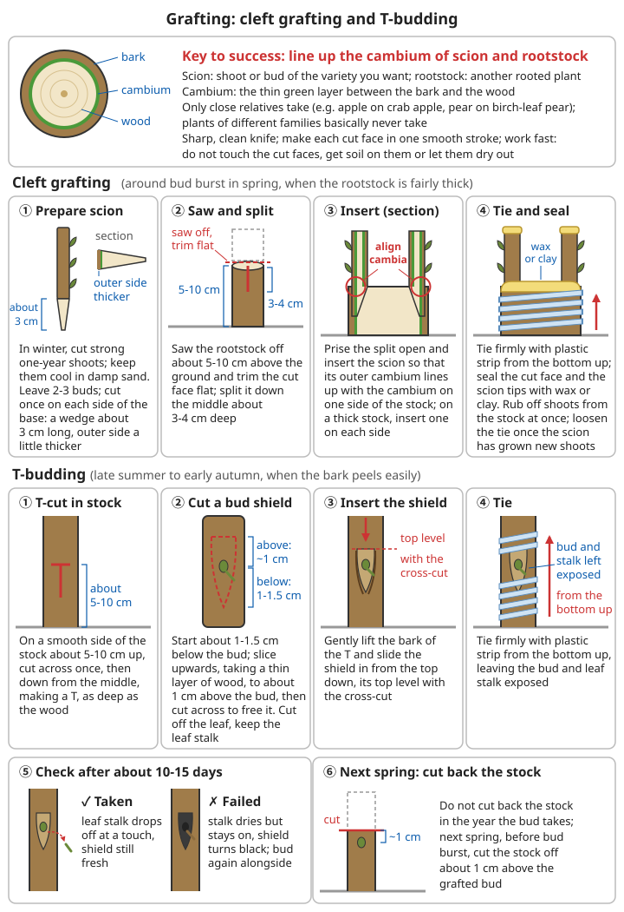

# Seed Saving and Breeding

## Contents
- [Why farming stops when the seed runs out](#why-farming-stops-when-the-seed-runs-out)
- [Self-pollination and cross-pollination](#self-pollination-and-cross-pollination)
- [Isolation, bagging and hand pollination](#isolation-bagging-and-hand-pollination)
- [Seed-saving notes for the main crops](#seed-saving-notes-for-the-main-crops)
- [Drying, cleaning and storage](#drying-cleaning-and-storage)
- [Germination testing](#germination-testing)
- [Vegetative propagation](#vegetative-propagation)
- [Selection: making a variety better every year](#selection-making-a-variety-better-every-year)
- [Community seed bank](#community-seed-bank)

---

## Why farming stops when the seed runs out

When the food is eaten you can grow more. When the seed is gone you can grow nothing. Today most farmers buy seed every year. Once seed shops, seed companies and transport stop, **after the first growing season the seed in your hands decides whether this community can go on farming**.

```
⚠️ Remember three things first:
1. Seed is "next year's food". However hungry you are, do not eat the seed grain;
   store it separately, lock it up and keep a record
2. Bought commercial seed is often treated with chemicals (dyed red, pink, blue, green, etc.):
   ☠️ Treated seed contains insecticides and fungicides; some are highly toxic
   ✗ Do not eat it, do not feed it to chickens, ducks, pigs or cattle, do not store it
     with food, do not leave it where children can reach it
   ✓ Wear gloves when sowing and wash your hands afterwards; never again use bags or
     containers that held treated seed for food
   ✓ Leftover treated seed can still be sown, but the seed it produces carries no chemicals
3. If you can, stock up now on seed of "open-pollinated varieties" (varieties you can save seed from)
```

### Why hybrid (F1) seed cannot be saved

```
Seed packets marked "F1", "first-generation hybrid" or "×× hybrid" are hybrid seed
- Made by crossing two different pure-line parents; the first generation is uniform,
  high-yielding and disease-resistant (hybrid vigour)
- The seed it produces (F2), when sown, segregates: plants are tall and short,
  ripen at different times, yield clearly falls, and some are of very poor quality
- Hybrid seed has to be produced afresh every year by a seed producer;
  you cannot make it at home

So:
✓ Stock and grow open-pollinated varieties (also called "standard varieties",
  "farmers' varieties", "traditional varieties" or "heirloom varieties")
✓ Save seed from open-pollinated varieties every year; as long as they do not
  cross with other varieties, each generation stays much the same as the last
✓ If hybrid seed is all you have: grow and harvest it as normal, and save seed too;
  by choosing the best plants for several years in a row you can slowly select a
  new stable variety (see "Selection" below), but yields will be lower for the first few years
```

For the principles of heredity and segregation see [Biology and Medicine Basics – Heredity](../../../docs/08-基础科学知识/04-生物与医学基础.md#61-遗传) and [Seed selection and breeding](../../../docs/08-基础科学知识/04-生物与医学基础.md#62-选种育种). A short checklist for saving grain-crop seed is in [Grain Crops – Seed storage](02-grain-crops.md#seed-saving).

---

## Self-pollination and cross-pollination

Before saving seed, find out first: does this crop pollinate itself, or does pollen come from other plants by wind or insects?

```
Self-pollinating: pollen falls on the stigma of the same flower before or just as it opens
  → rarely crosses with other varieties; seed saving is simple, and even a few
    plants rarely lead to decline
Cross-pollinating: pollen has to come from other plants or other flowers by wind or insects
  → if other varieties of the same crop grow nearby they will cross, and the seed "changes"
  → if too few seed plants are kept, inbreeding depression sets in (each generation
    weaker than the last), so keep enough plants
Partly cross-pollinating: mainly self-pollinating, but a good share is crossed by insects
  (e.g. chilli/pepper, aubergine, broad bean, sorghum)
  → treat as "medium difficulty"
```

| Type | Main crops | How pollinated | Seed-saving difficulty |
|------|----------|----------|----------|
| Self-pollinating | Rice, wheat, barley, soya bean, pea, common bean, tomato, lettuce | Pollinates itself | ⭐ Easy |
| Partly cross-pollinating | Chilli/pepper, aubergine, broad bean, sorghum, cotton | Mainly self, crossed by insects | ⭐⭐ Medium |
| Cross-pollinating (wind) | Maize, spinach, beet | Pollen carried by wind, can drift a long way | ⭐⭐⭐ Hard |
| Cross-pollinating (insect) | Cucumber, pumpkin, watermelon, melon and other cucurbits; Chinese cabbage, radish, cabbage and other brassicas; onion; carrot | Bees and other insects | ⭐⭐⭐ Hard |

```
Which cross with each other (crossing only happens within the same species):
- Chinese cabbage, pak choi, napa cabbage, turnip, choy sum → all cross
- Cabbage, cauliflower, broccoli, Chinese kale (gai lan) → all cross
- Radish and Chinese cabbage → usually do not cross; radish and wild radish → cross
- Cucumber crosses only with cucumber, not with pumpkin or watermelon
- Courgette crosses with some pumpkins (those of the same species); pumpkins of
  different species usually do not cross; if unsure, assume they will
- Carrot and wild carrot → cross (wild carrot is a common weed with white umbrella-shaped flowers)
- Sweet corn, waxy corn and ordinary maize → all cross
```

---

## Isolation, bagging and hand pollination

### Isolation distances

The table below gives **commonly used reference ranges** for household and community seed saving, not strict standards. Terrain, wind direction, screening by trees and houses, and the number of beehives nearby all affect the result; the purer you need the seed, the greater the distance.

| Crop | Reference isolation distance | Notes |
|------|--------------|------|
| Rice, wheat, soya bean, pea, common bean, lettuce | 3-10 m | Separate varieties by a few rows or by another crop |
| Tomato | 3-15 m | Use the upper figure for old varieties whose stigma sticks out of the flower |
| Chilli/pepper, aubergine | 50-200 m | Or bag/net the plants |
| Cucumber, melons, pumpkin | 400-800 m | Or hand-pollinate |
| Chinese cabbage, radish and other brassicas | 500-1000 m | Or net cages + introduced bees/hand pollination |
| Onion, carrot | 500-1000 m | For carrot, also pull up wild carrot nearby |
| Spinach | 500-1000 m or more | Wind-pollinated; the pollen is very light |
| Maize | 200-400 m or more | Or stagger flowering by about 30 days or more |

```
When you do not have enough distance:
1. Isolation in time: sow two varieties at different times so their flowering does not overlap
   (common for maize)
2. Save only one variety a year: for a cross-pollinating crop, save variety A this year
   and variety B next year
   (seed keeps for several years, so taking turns works well)
3. Share the work in the community: in one area, each household is responsible for
   one variety of one crop
4. Bagging, net cages, hand pollination (below)
```

### Bagging and hand pollination

```
Bagging materials: paper bags, gauze bags, fine nylon mesh bags; they must let air through.
Do not use plastic bags (heat builds up and the flowers rot)

Hand-pollinating cucurbits (pumpkin, cucumber):
1. In the evening, find flowers that will open the next day: the petals have turned
   yellow and the tips are about to open
   Female flower: has a tiny fruit below it; male flower: has only a thin stalk below it
2. With thin string or tape, gently tie shut the petal tips of the female and male flowers
   so they cannot open
3. Next morning (after the dew has dried), pick the male flower, tear off the petals and
   gently brush the anthers on the stigma of the female flower; ideally use 2-3 male
   flowers from different plants
4. As soon as pollination is done, tie the female flower's petals shut again or bag it
5. Tie a coloured thread round the fruit stalk as a marker → save seed only from these fruits

Hand-pollinating maize:
1. Before the silks appear, cover the ear with a paper bag (you may first trim a little
   off the tip of the husk)
2. When the tassel starts shedding pollen, cover it with a large paper bag; next morning
   tap it to collect the pollen
3. Mix pollen from several plants, open the ear's bag, quickly sprinkle the pollen on the
   silks and re-bag at once
4. Write a label; keep the bag on until the silks are dry and brown

Brassicas, onion, carrot:
- Cover whole plants with fine netting (mesh small enough to keep bees out); inside the
  net, brush lightly every day between flowers on different plants with a soft paintbrush,
  or put some flies or bees inside the net to help pollination
```

### Minimum number of seed plants

| Crop type | Minimum plants | Ideal plants |
|----------|----------|----------|
| Self-pollinating (rice, wheat, beans, tomato, lettuce) | 5-10 plants | 20 plants or more |
| Partly cross-pollinating (chilli/pepper, aubergine) | 10 plants | 20 plants or more |
| Melons, pumpkin | 5-6 plants | 10-20 plants |
| Brassicas, onion, carrot, spinach | 20 plants | 50 plants or more |
| Maize | 100 plants | 200 plants or more |

```
Why cross-pollinating crops need so many:
- Saving seed from only one or two plants is like making the variety "marry its close relatives"
- Over a few years the plants get shorter and weaker, yield falls and disease resistance
  drops; this is called inbreeding depression
- Maize, brassicas, onion and carrot are the most sensitive; melons less so
- Keeping many seed plants also preserves the diversity within the variety, so when a new
  pest or disease comes, some plants are more likely to withstand it
✓ Collect and mix seed from all the seed plants; do not take seed only from the one or two biggest
```

For the dangers of inbreeding see [Biology and Medicine Basics – The dangers of inbreeding](../../../docs/08-基础科学知识/04-生物与医学基础.md#63-近亲繁殖的危害).

---

## Seed-saving notes for the main crops

| Crop | Pollination | When to collect seed | Key handling points | Minimum plants |
|------|------|--------------|----------|----------|
| Rice | Self | Over 90% of grains on the panicle yellow and hard | Choose single plants with large panicles and plump grain; harvest and thresh separately, sun-dry | 10-20 |
| Wheat | Self | Fully ripe, grain hard, cannot be dented with a fingernail | As above; protect from rain and sprouting | 10-20 |
| Maize | Cross (wind) | Husks dry, black layer at the base of the kernels | Hang up to dry with husks on; use only kernels from the middle of the ear | 100+ |
| Soya bean | Self | Pods brown and rattle when shaken | Harvest on time, or the pods burst; when sun-drying, avoid fierce sun that cracks seed | 10-20 |
| Tomato | Self | Fruit fully ripe (riper than for eating) | Ferment to remove the gel (see below) | 5-10 |
| Cucumber | Cross (insect) | Fruit yellow-brown and soft, about 5 weeks later than eating stage | Scoop out seeds, ferment 1-2 days, wash clean | 5-6 |
| Pumpkin | Cross (insect) | Skin hard, cannot be pierced with a fingernail, stalk dry | Keep for 3-4 weeks after harvest before taking seed; wash and dry | 5-6 |
| Chilli/pepper | Partly cross | Fruit fully red (or the variety's ripe colour) | Cut open, scrape out seeds, dry in shade; wear gloves for hot chillies | 10 |
| Chinese cabbage, radish | Cross, biennial | Bolts and flowers the second spring; pods turn yellow | Replant after overwintering (see below) | 20+ |
| Onion | Cross, biennial | Second year, seed capsules on the flower head split and show black seed | Cut off the flower heads and let them finish ripening in a paper bag | 20+ |
| Carrot | Cross, biennial | Second year, umbrella-shaped flower heads turn brown | Cut ripe flower heads in batches | 20+ |
| Potato | Vegetative | Stems and leaves yellow and wither, skin set | Keep tubers from healthy plants as seed potatoes | — |
| Sweet potato | Vegetative | Before frost | Overwinter seed roots; raise shoots in spring and cut vines | — |

### Crops whose seeds come from wet flesh (tomato, cucumber)

```
Fermenting tomato seed to remove the gel:
1. Choose fully ripe, disease-free fruit, from several plants
2. Cut open and squeeze the seeds and surrounding gel into a glass jar or bowl;
   add a little clean water
3. Leave at room temperature for about 2-5 days (shorter in hot weather), stirring once
   a day; a white mould will form on the surface and it will smell sour; this is normal
4. Once the gel breaks down, the seeds sink and empty seeds and pulp float
5. Pour off what floats, add water and pour off again, several times, until only clean seed is left
6. Drain on a fine sieve or cloth, spread on a plate or sieve and dry in the shade
   (do not spread on paper towels, they stick)
7. Stir them a few times a day; after 1-2 weeks, when completely dry, pack them away
→ Fermentation removes germination-inhibiting substances and kills some of the
  disease organisms on the seed surface
⚠️ Do not ferment too long (generally no more than about 5 days), or the seeds may sprout in the jar

Cucumber: do not pick the seed fruit; leave it until it is yellow-brown and soft;
same method as tomato, 1-2 days of fermentation is enough
```

### Biennial crops: Chinese cabbage, radish, carrot, onion

These crops grow leaves, roots or bulbs in the first year. They need a winter's cold before they bolt, flower and set seed the following spring.

```
1. At the autumn harvest, choose the plants most typical of the variety:
   well-shaped roots, medium size, not split, not bolting early, free of pests and disease
   ✗ Do not choose plants that bolted and flowered early that year (their offspring
     will bolt early more easily)
2. Overwintering:
   - Where winters are not too cold: leave them in the ground, protected with straw
   - In cold areas: dig them up; cut the leaves off radish and carrot (leave 2-3 cm of
     leaf stalk), strip the old outer leaves off Chinese cabbage, and store in a cellar
     at about 0-3°C, buried in damp sand to keep moist;
     keep onions somewhere dry and airy
3. In early spring of the second year replant them, with wider spacing
   (flowering plants grow tall and large)
4. Keep them isolated during flowering (see the table above)
5. When pods and flower heads turn yellow-brown, harvest in batches, or cut whole plants,
   hang them in an airy place to finish ripening, then beat out the seed
⚠️ Radish and Chinese cabbage pods split easily when ripe, and birds like them;
   harvest in time
```

For cellar temperature and humidity see [Food Processing and Preservation – Cellar storage](../../../docs/07-日常生活技能/01-食物加工与保存.md#窖藏).

### Potato and sweet potato: propagating from tubers

```
Seed potatoes:
1. During the growing season, mark plants in the field that are vigorous, with flat leaves
   and no mosaic or leaf roll
2. At harvest, dig these plants separately; choose undamaged, disease-free tubers of about
   30-60 g as seed potatoes
3. Store seed potatoes apart from eating potatoes and label them; about 2-4°C, in the dark
4. 2-4 weeks before planting, put them in diffuse light to sprout, until they grow short,
   sturdy green shoots
   ⚠️ Do not eat seed potatoes that have turned green in the light
5. Cut large tubers into pieces, each with at least 1-2 eyes; let them dry for 1-2 days so
   the cut surface heals before planting;
   disinfect the knife after cutting a diseased tuber (scald with boiling water or wipe with alcohol)

⚠️ Virus build-up (seed potato degeneration):
- Potato virus diseases pass down through seed potatoes from generation to generation;
  if you save your own seed every year, after a few years the plants get shorter, the
  leaves crinkle and yield falls sharply
- What to do: every year, save seed strictly from healthy plants; pull up diseased plants
  with their tubers, and neither save them nor leave them in the field;
  save seed in cool high-altitude areas or in autumn (fewer aphids, less virus spread);
  a community can set aside a "seed potato field" far from other potato fields

Seed sweet potatoes:
1. Harvest before frost; choose medium-sized roots with no damage and no black spots
2. Let the skin dry, then store at 10-15°C; below 9°C they are easily chilled and rot
3. In spring, lay the seed roots in a hotbed or nursery bed and cover with soil to keep
   warm and moist, so vines grow
4. Cut vine pieces 20-30 cm long with 5-6 nodes and plant them in the field
→ In warm areas you can also overwinter vine cuttings in pots indoors or in a warm place
```

For growing potato and sweet potato see [Vegetable Growing – Potato](01-vegetable-growing.md#potato) and [Vegetable Growing – Sweet potato](01-vegetable-growing.md#sweet-potato).

---

## Drying, cleaning and storage

### Drying

The worst enemies of seed life are **damp and heat**. A common rule of thumb: for every 1 percentage point drop in seed moisture content, or every 5°C drop in storage temperature, storage life roughly doubles (Harrington's rule of thumb, which only roughly holds for moisture of about 5-14% and temperatures of about 0-50°C).

```
How to dry:
✓ Spread thinly on sieves, bamboo trays or cloth in an airy, shady place, and turn daily
✓ Grain seed can be dried in morning and evening sun
✗ Do not sun-dry small seeds on concrete, sheet metal or stone slabs in the midday sun
  (the temperature can exceed 50°C and kill the embryo)
✗ Do not dry seed on a stove or cooking range; with artificial heat, keep seed temperature
  no higher than about 35°C

Is it dry? (without a moisture meter):
1. Bite: bite grain and bean seed; if you cannot bite through and it cracks → dry;
   if it leaves a tooth mark → still damp
2. Hammer: hit large seeds (beans, maize) with a hammer; if it shatters → dry;
   if it flattens without breaking → still damp
3. Fingernail: press small seeds with a fingernail; if it breaks → dry; if it bends → still damp
4. Salt test (the most reliable home method):
   - Put a small handful of dry table salt (first dry it in a pan) in a dry glass jar
   - Add a handful of seed, close tightly, shake well and leave for about 1 day
   - If the salt clumps and sticks to the side of the jar → the seed is still too damp;
     keep drying
   - If the salt stays loose → the seed is dry enough to store

Reference moisture content: cereal seed below about 12%, beans below about 12%,
oilseeds (soya bean, peanut, sunflower seed) below about 8-9%
```

### Cleaning

```
1. Threshing: put pods into a cloth sack and tread or beat them; beat cereals with a flail
   or against the edge of a barrel
2. Winnowing: in a breeze or with a fan, pour the seed slowly from a height onto a cloth;
   light husks and debris blow away
3. Sieving: use sieves of different mesh sizes to remove large rubbish and small, shrivelled seed
4. Water selection: put tomato and melon seed in water; those that sink are plump, throw
   away those that float;
   rice can be selected in salt water: remove the empty grains that float, then wash
   immediately in clean water
   ⚠️ After water selection the seed must be dried thoroughly again before storage
5. Hand-picking: pick out diseased, insect-damaged and discoloured seeds and weed seeds
```

### Storage

```
✓ Dry: after drying, pack in containers that seal (glass jars, lidded pottery jars, metal tins,
  thick plastic bottles)
✓ Put a desiccant in the sealed container: rice dried in a pan and cooled, dry wood ash,
  or oven-dried silica gel, wrapped in paper or cloth and kept separate from the seed
✓ Cool: keep it in the coolest place in the house with the steadiest temperature
  (a cellar, the floor of a north-facing room);
  ✗ not near the stove, under the roof or against a sunny wall
✓ Freezing: thoroughly dried seed can be frozen, which greatly extends storage life;
  after taking it out of the fridge, wait until the container reaches room temperature
  before opening it, or moisture will condense on the seed
✓ Against insects:
  - Beans and cereals get insects most easily; freezing for a few days before storage kills eggs
  - Mix in dry wood ash, or add sun-dried Sichuan pepper or mugwort leaves
  - A sealed container on its own suffocates most pests
✓ Against rats: metal tins, pottery jars, or hang them up
✓ Labels: put one label inside and one outside each container (the outer one may fall off), giving:
  crop, variety name, year saved, place/source, number of seed plants,
  germination rate and test date
```

| Crop | Approximate useful life under ordinary storage |
|------|----------------------------|
| Onion, Welsh onion, garlic chives | 1-2 years |
| Peanut, soya bean | 1-3 years |
| Maize, carrot, chilli/pepper, spinach | 2-3 years |
| Rice, wheat, common bean, pea | 2-4 years |
| Lettuce, Chinese cabbage, radish | 3-5 years |
| Tomato, aubergine | 4-6 years |
| Cucumber, pumpkin, watermelon and other cucurbits | 5-6 years |

```
These are the times for which germination stays fairly good under dry, cool conditions;
dried and then refrigerated or frozen, seed lasts much longer; in a damp, hot house
germination may drop sharply within a year
→ Short-lived seed (onion, Welsh onion, etc.) is best saved every year
→ Do not wait until any seed is "nearly finished" before sowing it; renew it in rotation
  within its useful life
```

For drying and insect-proof storage of grain see [Food Processing and Preservation – Grain and beans](../../../docs/07-日常生活技能/01-食物加工与保存.md#粮食和豆类).

---

## Germination testing

For seed that has been stored for a while, was obtained by exchange, or you are unsure of, test the germination rate 2-3 weeks before sowing. Do not wait until nothing comes up after sowing.

```
Damp paper towel method:
1. Count out 100 seeds at random (if seed is short, use 50 and multiply the result by 2)
2. Wet a paper towel, coarse paper or cotton cloth and wring it until it no longer drips
3. Lay the seeds evenly on it, not touching each other, then roll it up or fold it in half
4. Put it in a plastic bag or cover with a plate to keep it moist; write the crop name and date
5. Keep it somewhere warm (about 20-25°C for most crops;
   melons, chilli/pepper and aubergine like it warmer, about 25-30°C)
6. Check daily; keep it moist but not waterlogged; each time, count and remove the seeds
   that have put out a root
7. Count up: 7-10 days for most crops; tomato, chilli/pepper, aubergine, carrot and onion
   need about 14 days, spinach up to 21 days

Germination rate = number of seeds germinated ÷ number of seeds tested × 100%
```

| Germination rate | Assessment | What to do |
|--------|------|------|
| Above 85% | Good | Sow normally |
| 60-85% | Fair | Increase the sowing rate in proportion |
| 40-60% | Poor | Increase the sowing rate, and grow a crop soon to save fresh seed |
| Below 40% | Very poor | Replace the seed if possible; if this batch is all you have, sow heavily and use the whole crop to produce new seed |

```
Adjusting the sowing rate:
Actual sowing rate = planned sowing rate ÷ germination rate

Example: planned 2 seeds per hole, germination 60% → 2 ÷ 0.6 ≈ 3.3, sow 3-4 seeds per hole
Example: planned sowing rate 50 kg/ha, germination 80% → 50 ÷ 0.8 ≈ 63 kg/ha

Note: emergence in the field is usually somewhat lower than germination on paper towels
     (soil temperature, moisture, pests); for important crops, allow a little extra
```

---

## Vegetative propagation

New plants are grown directly from roots, stems, leaves or buds, and are exactly the same as the parent plant. Fruit trees, grapes, potato, sweet potato, garlic, strawberry and others all keep their varieties this way.

```
⚠️ The risk of vegetative propagation: virus diseases in the parent plant are passed on
   unchanged to the offspring, so take material only from parent plants that are healthy,
   high-yielding and have done well for several years
```

### Cuttings

```
Hardwood cuttings (grape, fig, pomegranate, mulberry, willow, poplar):
1. From leaf fall in winter until before buds open in spring, cut vigorous one-year-old
   shoots about as thick as a pencil
2. Cut them into pieces about 15-20 cm long with 3-4 buds; cut straight across about 1 cm
   above a bud at the top, and slanting below a bud at the bottom
   (so you will not plant them upside down)
3. Tie up any you are not planting yet and bury them in damp sand in a cool place
4. In spring, push them into loose soil or sand so only the top bud shows; firm in
   and water thoroughly
5. Keep the soil moist and shaded; do not pull them up to look before new roots grow

Softwood cuttings (many ornamental shrubs, some fruit trees, mint, tomato side shoots):
1. In the growing season, cut half-ripened new shoots about 10-15 cm long, keeping
   2-3 leaves at the tip
2. Insert in damp sand or soil, shade, and cover with a plastic bag or an upturned bottle
   to keep moist
3. After 2-4 weeks, if you feel resistance when you pull gently → it has rooted

✓ Willow water (fresh willow twigs cut up and soaked for a day or two) is often used as a
  home-made rooting aid, and helps somewhat
```

### Division

```
Suitable for: garlic chives, Welsh onion, garlic, daylily, mint, strawberry, aloe, banana, bamboo
1. In spring or autumn, dig up the clump
2. Split it by hand or with a knife into several clumps, each with roots and buds
3. Trim over-long roots and some of the leaves; plant and water at once
Strawberry: once the young plants on the runners have rooted, cut them off; they are new plants
```

### Layering

```
Simple layering (grape, blackberry, winter jasmine and other plants with flexible shoots):
1. Bend down a shoot near the ground; where it will be buried, scrape a short section of bark
2. Bury it about 10 cm deep, hold it down with a hook or stone, with the tip above ground
3. Keep it moist; once it has rooted (usually a few months, up to the next spring),
   cut it from the parent plant and transplant

Air layering (fruit trees whose branches cannot reach the ground, citrus, lychee):
1. Choose a 1-2-year-old branch and remove a ring of bark about 1-2 cm wide; scrape it clean
2. Wrap the wound with damp moss or damp soil, wrap tightly with plastic sheet outside
   and tie both ends
3. When you can see roots through the plastic after a month or two, cut below them and
   plant in a pot or the ground
```

### Grafting

Grafting joins a shoot or bud of one variety (the scion) onto another rooted plant (the rootstock). **The key to success is lining up the cambium of both (the thin green layer between the bark and the wood) and pressing them tightly together.**

```
Basic requirements:
- Only close relatives will take: apple on apple or crabapple, pear on pear or birchleaf pear
  (Pyrus betulifolia), peach on peach or wild peach (mountain peach/hairy peach),
  citrus on trifoliate orange or other citrus, jujube on sour jujube;
  plants from different families basically will not take
- The knife must be very sharp and clean; make each cut surface in one stroke,
  do not saw back and forth
- Work fast; do not touch the cut surfaces, get soil on them or let them dry out
- Tying material: strips of plastic film are best; otherwise use soaked hemp bark or tree bark
- Sealing the wound: wax, a mixture of beeswax and grease, or wet clay, to stop drying out

Cleft grafting (in spring around bud break, when the rootstock is fairly thick):
1. Scion: in winter, cut vigorous one-year-old shoots and keep them cold, buried in
   damp sand, so they do not sprout
2. Saw off the rootstock about 5-10 cm above the ground and pare the cut surface smooth
3. With a knife, split down through the middle of the cut surface about 3-4 cm deep
4. Leave 2-3 buds on the scion; cut each side of the lower end once to make a wedge about
   3 cm long, slightly thicker on the outer side
5. Prise open the cleft with the knife and insert the scion so the cambium on its outer side
   lines up with the cambium on one side of the rootstock
   (on a thick rootstock, insert one scion on each side)
6. Withdraw the knife, bind tightly from the bottom up with plastic strip, and seal the cut
   surface and the top of the scion with wax or mud
7. Rub off buds that sprout from the rootstock promptly, so they do not compete with the scion
8. When the scion sprouts and grows new shoots, loosen the binding in good time so it does
   not cut into the stem

Bud grafting (T-budding, late summer to early autumn, when the bark peels easily):
1. On a smooth side of the rootstock about 5-10 cm above the ground, make one cut across,
   then one cut downwards from its middle, forming a "T", down to the wood
2. Cut a plump bud from the scion shoot: start about 1-1.5 cm below the bud and cut upwards,
   taking a thin layer of wood, to about 1 cm above the bud, then cut across to remove it;
   cut off the leaf blade but keep the leaf stalk
3. Gently lift the bark at the T-cut and slide the bud shield in from the top downwards,
   with its top level with the cross cut
4. Bind tightly from the bottom up with plastic strip, leaving the bud and leaf stalk exposed
5. Check after about 10-15 days: if the leaf stalk falls off when touched and the bud shield
   is still fresh → it has taken;
   if the leaf stalk is dry and does not fall and the shield is black → it has failed;
   you can re-graft beside it
6. Do not cut back the rootstock above a successful bud in the same year; next spring,
   before buds open, cut off the rootstock about 1 cm above the grafted bud
```



*Figure: top, the position of the cambium; middle, the four steps of cleft grafting (panel ③ is shown cut open); bottom, T-budding and the post-graft check and cutting back of the rootstock; not to scale, see the steps above for values*

For choosing and planting fruit-tree varieties see [Fruit Tree Growing](03-fruit-trees.md); for sharpening knives see [Woodworking and Tool Maintenance – Sharpening](../../../docs/07-日常生活技能/09-木工与工具维护.md#磨刀).

### Storing roots, tubers and bulbs

Store seed tubers, roots and bulbs apart from those for eating and label them separately. Before they go into the cellar, pick out any that are damaged or have disease spots, and check them over once a month during storage. For the storage temperature of each see [Food Processing and Preservation – Storage conditions for different vegetables](../../../docs/07-日常生活技能/01-食物加工与保存.md#各类蔬菜的储存条件).

---

## Selection: making a variety better every year

Saving seed is not just "keeping" it. Every year, which plants you save seed from decides which way the variety will change.

```
What to select for:
✓ High yield, plump grain or fruit
✓ Disease and pest resistance; still healthy in years when disease is widespread
✓ Suited to the local area: drought-hardy, cold-hardy, ripening at the right time
  (before frost or the rainy season)
✓ Resistant to lodging (grain crops), not bolting early (leaf and root vegetables)
✓ Tastes good, stores well
✗ Do not look only at fruit size: look at the whole plant, in the field; do not wait
  until the harvest is home to choose
✗ Do not choose plants growing on especially fertile field edges, beside manure heaps or in
  isolated open spots: they may have grown well only because conditions were good
```

### Two basic methods

```
Mass selection (simple, suits most situations):
1. In the field (not on the threshing floor), pick out a group of plants that meet your
   standards and mark them
2. Harvest their seed mixed together as next year's seed
3. Repeat every year
→ Keeps and slowly improves the variety while keeping diversity; especially suits
  cross-pollinating crops

Single-plant selection (faster, suits self-pollinating crops or when you want a new type):
1. When one plant stands out (e.g. ripens a week early, or stayed free of disease in a
   disease year), harvest its seed separately
2. Next year, sow its seed in a short row of its own (one plant, one row), beside ordinary
   seed for comparison
3. Keep only the lines that really do better and are uniform along the whole row;
   discard the rest
4. If it is still good after two or three years in a row, multiply it up
→ Self-pollinating crops stabilise within a year or two; for cross-pollinating crops avoid
  repeated single-plant selection, which causes inbreeding depression

Roguing (every year):
Walk the field once before flowering and once before harvest and pull up plants that are
clearly not true to the variety (too tall, too short, wrong colour, bolting early, diseased),
so they cannot flower and pollinate
```

### Record book

```
One page per variety; record every year:
- Variety name (your own name is fine, but use it consistently), source (where it was
  exchanged from, who gave it)
- Year saved, sowing date, plot
- Dates of emergence, flowering and ripening
- Performance: yield, pests and diseases, drought and cold hardiness, taste, keeping quality
- Number of seed plants, selection standards, germination rate
- Which varieties it grew next to (possible crossing)
→ After a few years it will be obvious which varieties suit your area
```

For how to keep records see [Record-keeping, Trade and Division of Labour – Community archives](../../../docs/07-日常生活技能/13-记账交易与社会分工.md#社区档案).

### Preventing mixing and keeping diversity

```
Preventing mixing:
✓ Grow different varieties in separate plots, with a gap or another crop between them,
  and a sign at the end of each plot
✓ Harvest the seed crop first; harvest, dry, thresh and bag it separately; when changing
  variety, sweep the threshing floor and clean the tools, sieves and bags
✓ Do not save seed from volunteer plants (ones that came up from seed dropped last year)

Diversity:
✗ The whole community growing only one "best" variety: one new disease or one spell of
  abnormal weather could wipe out the whole crop
✓ Keep at least 2-3 varieties of each main crop (early and late, drought-tolerant and
  flood-tolerant, high-yielding and disease-resistant)
✓ Do not rely on a single staple crop: combine rice, wheat, maize, root crops and beans
✓ Grow a small plot of rarely grown old varieties regularly to renew their seed; do not
  let them "die of old age" in store
```

---

## Community seed bank

One person's seed is easily destroyed all at once by rats, damp or fire. Only when a community manages it centrally and stores it in several places can it be sure of seed to sow every year.

```
How to organise it:
1. Appoint 1-2 people in charge (careful, good at keeping records), plus a deputy;
   both must know the whole process
2. Registration: give each seed lot a number; record crop, variety, source, year, quantity,
   germination rate and storage location
3. Keep at least two copies, in different buildings (against fire, flood and rats)
4. Keep enough staple-crop seed for at least two seasons' sowing, so that one failed season
   does not leave you with nothing to sow
5. Test germination once a year; for lots whose germination has clearly dropped or that
   are near the end of their storage life, have someone grow a crop and replace them
   with fresh seed
6. Assign growing tasks: for cross-pollinating crops, grow only one variety for seed in
   any one area each year, with different households responsible for different crops
   and varieties
7. Borrow seed, return seed: whoever takes seed returns more after harvest (a common rule
   is borrow one, return two); returned seed must be checked, dried and tested for germination
8. Exchange: swap varieties with nearby communities; this adds diversity and gives each a
   backup; grow exchanged seed on a small scale for one year first
9. Teaching: involve young people in the whole seed-saving process, so it is not just
   one or two people who know how
```

For stock management see [Record-keeping, Trade and Division of Labour – Stock management](../../../docs/07-日常生活技能/13-记账交易与社会分工.md#库存管理); for teaching skills see [Education and Knowledge Preservation – How to teach a craft](../../../docs/07-日常生活技能/12-教育与知识传承.md#怎样教手艺).

---

## 📝 Seed saving and breeding: key points

```
1. Seed is next year's food; however hungry you are, do not eat the seed grain;
   treated seed is poisonous: do not eat it or feed it to livestock
2. Stock open-pollinated varieties; the offspring of hybrid (F1) seed segregate and are
   not suitable for saving seed directly
3. First tell self- from cross-pollinating crops: self-pollinating ones are easy to save;
   cross-pollinating ones need isolation, bagging or hand pollination
4. Keep enough plants of cross-pollinating crops (maize 100 or more; brassicas, onion,
   carrot 20 or more)
5. Ferment tomato and cucumber seed to remove the gel; Chinese cabbage, radish, carrot
   and onion must overwinter and set seed in the second year
6. Dry seed thoroughly (salt test); keep it sealed, cool and safe from insects and rats,
   with labels inside and out
7. Test germination before sowing and adjust the sowing rate by
   "planned sowing rate ÷ germination rate"
8. Save potato seed from healthy plants to prevent virus degeneration; keep fruit-tree
   varieties by grafting, cuttings and layering
9. Select whole plants in the field, rogue every year, keep records;
   keep several varieties of each crop
10. Community seed bank: register centrally, store in separate places, renew regularly,
    borrow one, return two
```

---

**Next chapter**: [Firewood and Woodland Management](09-firewood-and-woodland-management.md)
**Back**: [Chapter index](README.md) | [Main contents](../../README.md)
