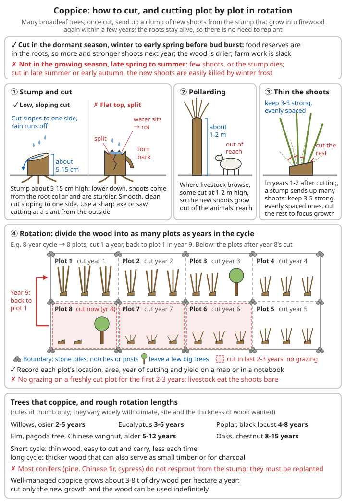
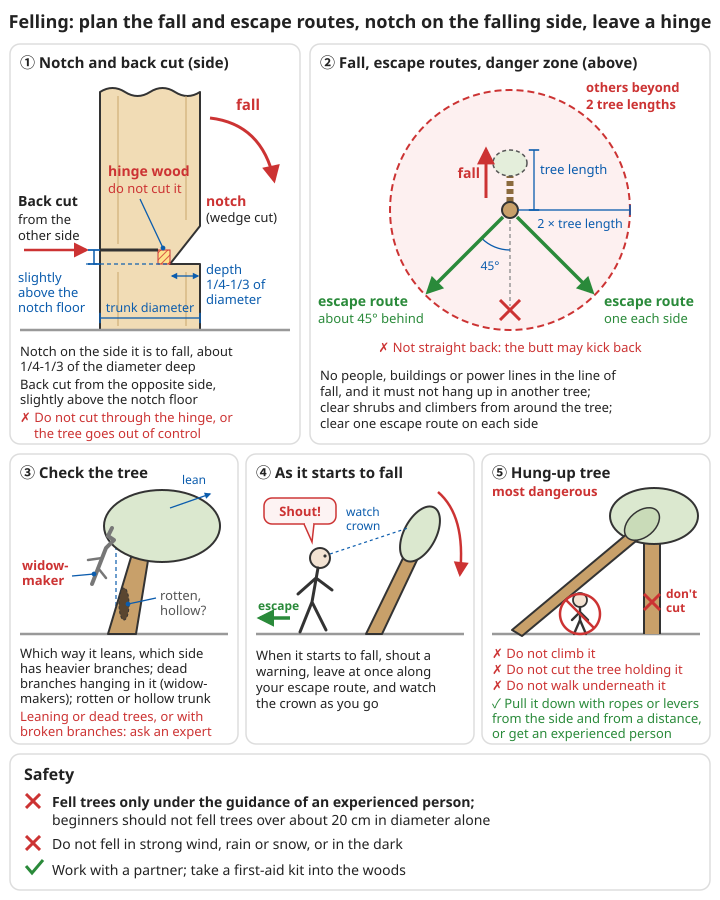

# Firewood and Woodland Management

## Contents
- [Why fuel is the bottleneck](#why-fuel-is-the-bottleneck)
- [How much firewood you need](#how-much-firewood-you-need)
- [Firewood must be dry](#firewood-must-be-dry)
- [How much firewood a woodland can produce](#how-much-firewood-a-woodland-can-produce)
- [Coppice: cut it and it grows back](#coppice-cut-it-and-it-grows-back)
- [Tree planting](#tree-planting)
- [Protecting the forest](#protecting-the-forest)
- [Other fuels](#other-fuels)
- [Saving firewood](#saving-firewood)
- [Felling safety](#felling-safety)
- [Other woodland products](#other-woodland-products)

---

## Why fuel is the bottleneck

Cooking, boiling water, heating, firing pottery and bricks, burning lime, smelting and forging iron: all of them need something to burn. Once the power grid and gas supply fail, the only fuel most communities can rely on is wood. **Grain ripens once a year, but trees take several years to more than ten years to grow. Cut faster than they grow, and within a few years there is nothing left to burn nearby.**

This has happened again and again in history:

```
- Around the capitals of many ancient civilisations the forests were cut down within
  a few generations; firewood and charcoal had to come from further and further away,
  and the price kept rising
- Areas that burned charcoal to smelt iron, boiled salt or fired pottery were often
  the first to strip their hills bare
- On the Loess Plateau and in much of North China, forests largely disappeared over
  history; farmers could burn only straw, grass roots and dung, and even dug up wheat
  stubble, roots and all, to burn
- Once the trees on a hillside are gone, rain washes the topsoil away: rivers turn muddy,
  silt builds up, floods downstream get worse, and the hill can no longer grow trees
  or crops
```

```
⚠️ Safety
- Tree felling is work with a very high accident rate: people are struck by falling trees
  and broken branches, cut by axes and saws, and crushed while carrying
- Once a forest fire starts, people cannot outrun it
- Fell only what you can safely handle, work in pairs or groups, never go into the
  woods to work alone
- Woodpiles, charcoal kilns and chimneys all carry fire and carbon monoxide risks
```

For fuel as a bottleneck in rebuilding technology see [Technology Rebuilding Roadmap – Fuel and energy](../../../docs/09-进阶科学与工程/00-技术重建路线图.md#31-燃料和能源); for soil erosion and soil protection see [Geology, Minerals and Soil – Protecting the soil](../../../docs/08-基础科学知识/06-地质矿物与土壤.md#55-保护土壤).

---

## How much firewood you need

### Household firewood

Below are rough ranges for living with a traditional wood-burning stove (**estimates**; they vary greatly with climate, how good the stove is and household size):

| Situation (household of 4-5) | Air-dried firewood per year (approx.) |
|------|------|
| Warm southern areas, cooking and boiling water only | About 2-3 t |
| North, cooking + *kang* (heated brick bed) heating (the cooking fire also heats the *kang*) | About 4-6 t |
| North, cooking plus a separate open stove or brazier for heating | 6-10 t or even more |
| Severely cold areas such as the Northeast and the high plateaus | Possibly half as much again or more |

```
Rough rules:
- One person, cooking only: about 1.5-3 kg of air-dried firewood a day
  (upper figure for an open fire, lower for an efficient stove)
- Heating often uses far more wood than cooking; the biggest savings are in heating
- A northern community of about 50 people (a dozen or so households) uses about
  50-80 t of firewood a year for household needs

Volume conversion (approx.): 1 m³ of neatly stacked air-dried hardwood is about 400-500 kg,
softwood about 300-400 kg
```

### The heating value of wood

| Fuel | Heating value (approx.) | Notes |
|------|------|------|
| Completely dry wood | About 18-19 MJ/kg | By mass, different tree species differ little |
| Air-dried firewood (moisture 15-20%) | About 15-16 MJ/kg | The good firewood you actually use |
| Half-dry firewood (moisture about 30%) | About 12-13 MJ/kg | |
| Freshly cut green wood (moisture about 50%) | About 8 MJ/kg or less | Much of its heat is also used up evaporating the water |
| Charcoal | About 29-30 MJ/kg | Smokeless, burns hot |
| Straw, dried dung cakes | About 12-15 MJ/kg | Bulky, burns fast |

```
Hardwoods (oak, pagoda tree, elm, jujube, etc.) and softwoods (poplar, willow, pine, Chinese fir)
give about the same heat per kg, but hardwood is denser: the same pile of hardwood weighs much
more, burns longer and gives more charcoal
Pine is resinous: it lights easily, but gives a lot of smoke and tar; clean the chimney often
```

For the concepts of heat and heating value see [Physics – Heat](../../../docs/08-基础科学知识/02-物理.md#五热学).

### Firewood for crafts (order-of-magnitude estimates)

| Use | Approximate consumption | Notes |
|------|------|------|
| Open bonfire firing of one batch of pottery | Firewood about 1-3 times the mass of the pottery | Most of the heat is lost |
| Firing pottery in a simple kiln | Firewood about 0.5-2 times the mass of the pottery | The better the kiln holds heat, the less wood |
| Firing bricks | About 0.5-1.5 t of firewood per 1000 bricks | Upper figure for earth kilns and simple kilns |
| Burning lime (about 900°C) | About 1-2 t of firewood per t of quicklime | Upper figure for crude batch kilns; continuous shaft kilns use less |
| Making charcoal | Charcoal yield about 15-25% by mass | 1 t of air-dried firewood gives about 150-250 kg of charcoal (1 kg of charcoal needs about 4-7 kg of wood) |
| Bloomery iron | About 8-10 kg of charcoal per kg of wrought iron; tens of kg when things go badly | Equivalent to tens of kg of wood |

```
⚠️ All of the above are estimates, only for judging the order of magnitude:
- Charcoal yield: only about 10%, or even less, with a crude earth kiln, wet wood or an
  unskilled operator; up to 25-30% with hardwood, a good kiln and good control
- Iron smelting: the figure of about 8-10 kg of charcoal per kg of iron in the metallurgy
  chapter is for good conditions; with low-grade ore, losses in the slag and repeated
  reheating and forging, the real figure may reach tens of kg
- Conclusion: one small iron furnace may use more wood in a year than the whole village
  uses for household firewood; you must first have a large area of rotational woodland
  before talking about smelting iron
```

For how to make charcoal see [Basic Metallurgy – Making charcoal](../../../docs/05-冶金技术/00-基础冶金知识.md#32-木炭制作闷烧法); for kiln firing see [Pottery, Glass and Papermaking – Firing](../../../docs/07-日常生活技能/11-陶瓷玻璃与造纸.md#烧制).

---

## Firewood must be dry

A freshly felled tree usually has a moisture content (the mass of water as a share of the total mass of the wet wood) of 40-60%. Wet wood has a low heating value, and is also hard to light and smoky; it deposits tar in the chimney and easily causes chimney fires. **Per kg, air-dried firewood gives close to twice the heat of wet wood; wet wood also does not burn well, and much of its heat is lost with the smoke and steam.**

```
Drying steps:
1. Cut it into lengths as soon as possible after felling: length to suit the firebox,
   generally 30-50 cm
2. Split it: unsplit round logs, wrapped in bark, will not dry through for years;
   split anything more than about 10 cm in diameter
3. Stack and air-dry: at least six months, ideally more than a year for hardwood and thick wood;
   cutting in winter and burning the following winter is the easiest rhythm
4. Burn thin wood and softwood first (they dry faster); keep hardwood and thick wood
   for the second year

Is it dry?
✓ Two pieces knocked together sound sharp, not dull
✓ Radial cracks at both ends, colour turned grey
✓ Clearly lighter
✓ More accurate: mark a few pieces and weigh them regularly; when the weight stops
  falling, they are dry
✗ The split face feels damp and cold; when lit, it hisses, oozes water and gives white smoke
```

```
Stacking a woodpile:
1. Choose an airy, sunny spot that does not collect water, some distance from the walls of buildings
2. Raise the base on stones, bricks or poles laid crosswise, 10-15 cm off the ground,
   against damp and rot
3. At both ends, stack wood crosswise in a "#"-shaped crib, or lean it against posts,
   to stop it falling over
4. Lay the pieces flat, layer by layer, split face down and bark up (the bark sheds rain like tiles)
5. Leave a gap between rows of woodpiles, with the long side facing the prevailing wind
6. Cover the top with bark, boards, old sheet metal or straw mats; do not wrap the sides
7. Keep the pile no higher than about 1.5 m; taller piles fall over easily and can crush people

✗ Do not wrap the whole woodpile tightly in plastic sheet: moisture cannot escape,
  and the wood goes mouldy and rots
⚠️ Woodpiles often hide snakes, scorpions and centipedes; wear gloves when taking wood,
   and do not put your bare hand into gaps
```

For fire-safety requirements for storing firewood see [Lighting and Energy – Firewood](../../../docs/07-日常生活技能/06-照明与能源.md#木柴); wood for furniture and tool handles needs more careful drying, see [Woodworking and Tool Maintenance – Drying](../../../docs/07-日常生活技能/09-木工与工具维护.md#干燥).

---

## How much firewood a woodland can produce

How much wood a woodland grows each year decides how much you can cut each year without destroying it. **Cut only what has newly grown, and the woodland will last for ever.**

| Woodland type | Growth per hectare per year (dry wood, approx.) |
|------|------|
| Natural secondary woodland and scrub in dry, cold northern areas | About 1-3 t |
| Ordinary temperate natural woodland | About 2-5 t |
| Well-managed coppice (oak, black locust, poplar and willow, etc.) | About 3-8 t |
| Fast-growing plantations in the warm, wet south (eucalyptus, poplar, bamboo, etc.) | 10 t or more |

```
⚠️ These figures vary greatly with tree species, climate, soil and rainfall; they only give
   the order of magnitude.
   The most reliable way is to keep your own records: when a plot has been cut, weigh the
   wood (or measure the stacked volume), and note the year the plot was last cut;
   after a few rounds you will know the real yield where you live.

Working out the woodland area from your needs:
  Woodland needed (ha) = firewood used per year (t) ÷ growth per hectare per year (t/ha)

Example: a northern community of 50 people uses about 60 t of household firewood a year;
    coppice at 4 t per hectare per year → about 15 ha of woodland is needed
    If you also fire bricks, burn lime, or make charcoal to smelt iron, the woodland
    needs to double or more

Example: a southern household that only cooks uses about 2.5 t a year;
    fast-growing plantation at 10 t per hectare per year → about 0.25 ha is enough
```

1 ha = 10000 m², that is, 100 m × 100 m. For measuring area see [Surveying and Mapping](../../../docs/08-基础科学知识/08-测量与制图.md).

---

## Coppice: cut it and it grows back

When many broadleaved trees are cut down, the stump sends up a clump of new shoots which, a few years later, are big enough to cut for firewood again. This way of managing woodland is called **coppicing** (coppice working). The roots are still alive, so there is no need to replant; the shoots grow much faster than newly planted trees, and the roots keep holding the soil.

### Which trees coppice

| Tree species | Coppicing ability | Suitable areas | Approximate rotation |
|------|------|------|------|
| Willow, Chinese willow (*Salix matsudana*), purple osier (*Salix integra*) | Very strong | Throughout China, likes wet ground | 2-5 years |
| Poplar | Strong (also suckers from the roots) | North and central China | 4-8 years |
| Black locust (*Robinia pseudoacacia*) | Very strong, also suckers from the roots | North and central China; tolerates drought and poor soil | 4-8 years |
| Eucalyptus | Very strong | Warm areas of South and Southwest China | 3-6 years |
| Oaks (sawtooth oak, Chinese cork oak, Mongolian oak, etc.) | Strong | Mountain areas throughout China | 8-15 years |
| Chinese chestnut | Strong | Both north and south | 8-15 years (when grown for fuel) |
| Elm, pagoda tree, Chinese wingnut, alder | Fairly strong | Everywhere | 5-12 years |
| Bamboo | Underground stems send up new canes every year | South | Cut old canes 3-5 years old every year |

```
✗ Most conifers (pine, Chinese fir, cypress) do not resprout from the stump once cut;
  they must be replanted
  (Chinese fir has some ability to coppice, but it is less reliable than broadleaved trees)
⚠️ The rotations in the table are rules of thumb, for reference only; they vary greatly with
   climate, site and how thick you want the wood
✓ The shorter the rotation, the thinner the wood, the easier it is to cut and carry,
  but each cut yields less;
  the longer the rotation, the thicker the wood, which can also serve as small timber or for charcoal
```

### How to cut

```
Cutting season:
✓ Cut in the dormant season, from winter until early spring before the buds open:
  the nutrients are stored in the roots, so the next year's shoots are many and strong;
  winter wood holds less water and dries fast, and there are hands free from farm work
✗ Do not cut in the growing season (late spring to summer): the stump puts up few shoots
  and may even die;
  if cut in late summer or early autumn, the new shoots do not have time to harden
  and are easily killed by winter frost

Stump height and the cut:
1. Leave stumps generally about 5-15 cm above the ground; lower stumps send shoots from
   the root collar, which are sturdier;
   where livestock may browse, some people leave stumps 1-2 m high (pollarding), so the
   new shoots grow out of the animals' reach
2. Make the cut smooth and clean, sloping to one side, so rain runs off and does not
   collect on top of the stump and rot it
3. Do not split the stump or tear the bark: use a sharp axe or saw, and cut at a slant
   from the outside
4. In the first and second years after cutting, a stump sends up many shoots;
   keep 3-5 vigorous, evenly spaced ones and cut off the rest, so the nutrients are concentrated

Cutting plots in rotation:
1. Divide the woodland into as many plots as there are years in the rotation
   Example: 8-year rotation → 8 plots, cut 1 plot a year, back to plot 1 in year 9
2. Record on a map or in a notebook the position, area, year cut and yield of each plot
3. Mark the boundary of each plot clearly with stone piles, blazes or boundary posts
4. Ban grazing on newly cut plots for the first two or three years
   (livestock will eat all the shoots)
5. In each plot you can leave a few large trees uncut (for timber, seed, birds and shade)
```



*Figure: cut in the winter dormant season, leaving stumps about 5-15 cm above the ground with the cut sloping to one side; one or two years after cutting keep 3-5 shoots; divide the woodland into plots by the rotation and cut one plot each year*

For how to keep woodland records see [Record-keeping, Trade and Division of Labour](../../../docs/07-日常生活技能/13-记账交易与社会分工.md).

---

## Tree planting

If the existing trees are not enough, or the hills around you are already bare, you must plant. **Plant trees several years before you need the firewood**; the earlier you start, the better.

### Choosing the site: plant where you cannot farm

```
✓ Steep slopes, stony slopes and thin soil that are no good for grain
✓ Beside gullies, riverbanks, canals and ponds (tree roots hold the soil and protect the banks;
  willow, poplar, Chinese wingnut and alder suit these best)
✓ Around the village, along roads, at field edges and corners
✓ On the side facing the winter wind (doubles as a windbreak)

✗ Do not take up flat, fertile good land (grain matters more)
✗ Do not plant tall trees next to houses (they can fall on the house, and roots damage foundations)
✗ Do not plant right above or next to wells and springs (fallen leaves rot in the water,
  roots damage the well lining)
```

### Fast-growing fuelwood trees

| Tree species | Advantages | Cautions |
|------|------|------|
| Black locust | Tolerates drought and poor soil; root nodules fix nitrogen and enrich the soil; hard wood, burns hot; flowers good for bees | Thorny; spreads fast by root suckers, do not plant next to farmland |
| Poplar, willow | Grow from cuttings, extremely fast-growing | Light wood that burns quickly; willow needs wet ground |
| Eucalyptus | Extremely fast-growing in the south, coppices strongly | Only for warm areas, killed by frost; uses a lot of water, do not plant next to water sources |
| Oaks | Best firewood, yields the most charcoal; acorns are edible (bitterness must be removed) | Slow-growing; seedlings take several years to raise |
| False indigo (*Amorpha fruticosa*), Korshinsk pea shrub (*Caragana korshinskii*), sea buckthorn (shrubs) | Tolerate drought and sand, fix nitrogen, grow on very poor land | Thin wood; suit dry northern areas |
| Leucaena, casuarina | Fast-growing in South China, fix nitrogen | Only for tropical and subtropical areas |

### Cuttings (easiest with poplar and willow)

```
1. In late winter or early spring, before the buds open, take cuttings from vigorous
   one- or two-year-old shoots
2. About 20-30 cm long and 1-2 cm thick; cut straight across at the top and slanting at the
   bottom, so you know which end is up
3. Push them into moist soil, leaving only 1-2 buds above ground (about 2/3 or more inserted)
4. After inserting, tread the soil firm, water thoroughly and keep the soil moist
5. Willow can also be planted directly as thick poles ("sets" 1-2 m long), pushed about
   0.5 m deep into moist riverbank soil
```

### Raising seedlings and planting out

```
Raising seedlings:
- Oaks, chestnut: in autumn gather plump seeds and sow them straight away, or bury them
  in damp sand over winter and sow in spring;
  the seeds must not dry out, and mice will eat them
- Black locust, false indigo: the seed coat is hard; before sowing, pour on hot water at
  about 80°C, let it cool naturally and soak for 1 day; sow the swollen seeds first,
  and scald the unswollen ones again
- Prepare a fine seedbed, sow in drills, cover with soil about 2-3 times the seed diameter,
  keep moist
- One-year seedlings about 30-100 cm tall can be lifted and transplanted

Digging pits and planting:
1. Timing: in spring before the buds open or in autumn after leaf fall;
   in the south you can also plant in the rainy season
2. Pits: about 40-60 cm square and about 40 cm deep; dig them larger on thin soil and
   stony slopes and fill with better soil
3. Fuelwood plantations can be planted densely, about 1-2 m between plants and rows;
   on slopes plant in rows along the contours, digging crescent-shaped "fish-scale pits",
   higher on the outer side than the inner, to catch rainwater
4. Spread the roots out in the pit; when it is half filled with soil, lift the seedling
   gently upwards, then fill up and tread firm
5. Water thoroughly once; when the water has soaked in, cover with a layer of loose soil
   or grass to reduce evaporation

Aftercare:
✓ Water in the dry season for the first year or two; cut the weeds around the trees or lay
  them under the trees as mulch
✓ Keep livestock out: no grazing for 3-5 years; fence with thorny brush or hurdles if needed
✓ Check survival the second spring and replant dead trees promptly
✓ Do not rush to cut: a newly planted woodland generally needs at least 3-5 years,
  oaks longer, before the first cut of the rotation
```

For seedling raising, grafting and other basic methods see also [Fruit Tree Growing – Planting out](../../../docs/04-动植物培育/03-果树培育.md#定植); for contour lines see [Trip Preparation and Calling for Help – Reading maps and contour lines](../../../docs/03-野外生存/07-户外出行准备与求救.md#看懂地图和等高线).

---

## Protecting the forest

```
Places not to cut:
✓ Do not clear-cut steep slopes (above about 25°); only thin them (cut part, at intervals)
✓ Watershed forest: do not cut the woods above springs, wells and streams you draw water
  from; keep at least a wide belt of trees
✓ Do not clear-cut bank-protection forest along rivers and gullies
✓ Do not cut the woods above the village that hold back flash floods, rockfalls and sandstorms

No "shaving the hill bald":
✓ Cut only one plot at a time; never clear a whole hillside at once
✓ Cut large areas plot by plot in rotation, with cut and uncut plots alternating
✓ Leave some seed trees, fruit trees and big trees in each plot
✓ Leave some of the fine branches and leaves on the ground to feed the soil and stop
  rain washing it away
✗ Do not dig out stumps, roots and all, or rake up all the leaf litter
  (that is the woodland's fertiliser and protective layer)

Fire prevention:
✓ Leave a firebreak between the woodland and the village and fields: about 10-20 m wide,
  cleared of dry grass and shrubs; it can be planted with crops that do not burn easily
  or kept as bare soil
✓ Clear dead branches and weeds within about 30 m of houses; do not stack wood against the woods
✓ In the dry, windy autumn and winter season, no burning of wasteland, field banks or
  rubbish in forest areas
✓ Build charcoal, brick and lime kilns on open ground, clear around them, and keep watch
  until they are completely out
✓ Community rule: anyone who sees smoke reports it at once; everyone must know the basics
  of fighting a fire

No grazing in young woodland:
✓ Ban grazing of sheep, goats and cattle in newly planted woodland and freshly cut coppice
  for 3-5 years
  (sheep and goats are the worst; they strip tender shoots and bark)
✓ Graze established woodland, grassland or dedicated pasture instead
```

For preventing, escaping from and fighting forest fires see [Fire – Forest fires](../../../docs/02-灾难应对/04-火灾.md#森林火灾).

---

## Other fuels

| Fuel | Advantages | Drawbacks and cautions |
|------|------|------|
| Straw, corn cobs, bean stalks | Available every year, no waiting for trees to grow | Burns hot but fast, needs constant feeding; burning all of it makes the land poorer and poorer |
| Dung cakes | Traditional fuel on grasslands and in treeless areas | Must be dried before burning; smoky, needs ventilation indoors; dung is also fertiliser, burn too much and the land lacks manure |
| Dead branches, leaf litter, weeds, shrubs | Easy to come by | Small amounts, fire does not last; do not rake up all the woodland leaf litter |
| Nut shells, sawdust, wood shavings | By-products of processing | Sawdust must be pressed into blocks or burned in a special stove |
| Biogas | Made by fermenting dung and straw, and also gives fertiliser | Risk of poisoning, suffocation and explosion; follow the safety rules strictly |
| Coal | High heating value, exposed at the surface in some places | Contains sulphur, the smoke is toxic; greater carbon monoxide risk when burned indoors; using it directly to smelt iron makes the iron brittle |

```
Rule for straw: return part to the field (ploughed in directly or composted), feed part to
               livestock, and burn only what is left; do not burn it in the open in the field

Making dung cakes: mix fresh cow dung with some chopped straw, pat it into cakes and stick
                   them on a sunny wall or spread them on the ground to dry; when fully dry,
                   stack them under a shelter; wash your hands afterwards
```

For biogas see [Lighting and Energy – Biogas](../../../docs/07-日常生活技能/06-照明与能源.md#沼气); for finding coal see [Geology, Minerals and Soil – Building and everyday materials](../../../docs/08-基础科学知识/06-地质矿物与土壤.md#31-建筑和日用材料); for the difference between coal and charcoal in smelting see [Basic Metallurgy – Common problems](../../../docs/05-冶金技术/00-基础冶金知识.md#七常见问题).

---

## Saving firewood

Every kg of firewood saved is one kg less cut from the woodland. **Improving stoves and insulation often pays off faster than planting another wood.**

```
Stoves:
✓ Fuel-saving stove: small, deep firebox, pot bottom close to the flame, a fire ring,
  a winding flue; saves a good share of firewood compared with an open three-stone fire
✓ One fire, several uses: the cooking fire also heats the *kang* and hot water
  (build a hot-water tank beside the stove)
✓ *Kang*: the waste heat from cooking runs a longer path under the *kang* before leaving;
  the most fuel-efficient way to heat in the north
✓ Burn dry wood, split fairly small, for a brisk fire with little smoke
✓ Burn only as much as you need; take the fire away when the food is cooked

Cooking:
✓ Put a lid on the pot; soak beans and grain first
✓ Haybox cooking: once boiling, put the pot in a straw basket or thick bedding and let the
  remaining heat finish the cooking
✓ Several households sharing one large stove or one oven save more than each burning its own

Heating:
✓ Insulate first, then light the fire: thick walls, sealed gaps around doors and windows,
  roof insulation, heavy door curtains
✓ Gather the whole family in one small room for warmth
✓ More clothes and thicker bedding save far more than burning wood for heat

⚠️ Insulation must never mean blocking all ventilation: a room with a fire must keep
   a ventilation opening, to prevent carbon monoxide poisoning
```

For more ways to save energy see [Lighting and Energy – Saving energy](../../../docs/07-日常生活技能/06-照明与能源.md#节约能源); for how *kang* and fuel-saving stoves are built see [Long-term Housing – Kang and stoves](../../../docs/07-日常生活技能/05-长期住所.md#火炕与炉灶); for wall and roof insulation see [Long-term Housing – Insulation](../../../docs/07-日常生活技能/05-长期住所.md#保温).

---

## Felling safety

### Felling trees

**Fell trees only under the guidance of an experienced person.** Beginners should not fell trees more than about 20 cm in diameter alone; leaning trees, dead trees and trees with broken branches hanging in them need an experienced person to assess them even more.

```
Before felling:
1. Look at the tree: which way it leans, which side has heavier branches, whether dead
   branches are hanging in it ("widow-makers"), whether the trunk is rotten or hollow
2. Look around: no people, buildings or power lines in the direction of fall, and it will
   not hang up in another tree
3. Clear the area: clear shrubs and climbers from around the tree
4. Plan your escape routes: clear one escape route on each side, at about 45° behind the
   planned direction of fall
   ✗ Do not retreat straight backwards (when the trunk hits the ground, the butt may kick back)
5. Everyone else stands at least two tree lengths away
6. Do not fell in strong wind, rain or snow, or in the dark

Felling (the principle):
1. On the side you want the tree to fall, cut a notch (a wedge-shaped cut), about 1/4-1/3
   of the trunk diameter deep
2. From the opposite side, slightly higher than the bottom of the notch, saw or chop
   towards the notch
3. Leave a strip of uncut "hinge" wood in the middle, so the tree falls along it in the
   planned direction
   ✗ Do not cut through the hinge, or the tree will go out of control
4. When the tree starts to fall, shout a warning, leave at once along your escape route,
   and watch the crown as you go

⚠️ A tree that hangs up in another tree as it falls (a hung-up tree) is one of the most
   dangerous situations:
   ✗ Do not climb it, do not cut the tree holding it up, do not walk underneath it
   ✓ Pull it down from the side and from a distance with ropes or levers,
     or get an experienced person to deal with it
```



*Figure: the notch is on the side the tree is to fall; the back cut is slightly higher than the bottom of the notch, leaving hinge wood in the middle; escape routes are at about 45° behind, everyone else is beyond two tree lengths. Principle only; fell trees only under the guidance of an experienced person*

### Axes, saws and carrying

```
✓ Keep axes and saws sharp, and axe heads wedged tight on the handle
✓ When splitting wood, stand firm with feet apart, put the log on a broad chopping block;
  your feet and legs must not be in the path of the axe; clear the area and wear eye protection
✓ When felling and cross-cutting on a slope, stand on the uphill side
  (rolling logs will crash downhill)
✓ When sawing, keep your other hand away from the saw's path; at the end of the cut the
  log will suddenly break and drop
✓ When lifting heavy logs with others, lift and put down together on a called command;
  lift with your legs, keep your back straight
✓ To move wood a long way, use a handcart, sledge or log chute; do not force it on your shoulders
✓ Take a first-aid kit into the woods, work with others, and tell someone which wood you
  are going to and when you will be back

❌ Do not fell trees or use a chainsaw when tired or after drinking alcohol
❌ Do not swing an axe one-handed, and do not use the back of an axe as a hammer to strike
   hard iron wedges
```

For axe and tool safety see [Woodworking and Tool Maintenance – Safety](../../../docs/07-日常生活技能/09-木工与工具维护.md#安全); for replacing axe handles and sharpening axes see [Replacing tool handles](../../../docs/07-日常生活技能/09-木工与工具维护.md#换工具柄斧锤锄) and [Sharpening](../../../docs/07-日常生活技能/09-木工与工具维护.md#磨刀) in the same chapter; for treating cuts and crush injuries see [Wound and Injury Care – Cuts and grazes](../../../docs/01-日常疾病和伤害/02-外伤处理.md#割伤与擦伤).

For using fire in forest areas, and fighting and escaping a forest fire once you find one, see [Fire – Forest fires](../../../docs/02-灾难应对/04-火灾.md#森林火灾).

---

## Other woodland products

A well-managed woodland is more than a woodshed:

| Product | Source | Notes |
|------|------|------|
| Timber | Big trees left during rotation, long-rotation plots | Roof beams, doors and windows, tool handles, furniture |
| Nuts | Chinese chestnut, walnut, hazelnut, acorns | High-energy food, keeps well; acorns must be soaked repeatedly to remove the bitterness before eating |
| Mushrooms | Shiitake and wood ear inoculated into logs of oak and other broadleaved trees | Never eat a wild mushroom you do not recognise |
| Medicinal herbs | *Jinyinhua* (Lonicera japonica, honeysuckle flower), *Tiannanxing* (Arisaema erubescens, arisaema; ☠️ toxic), *Huangjing* (Polygonatum sibiricum, Solomon's seal), *Lingzhi* (Ganoderma lucidum, reishi) and others growing under the trees | Gather only what you are sure of; there are many poisonous plants |
| Honey | Black locust, jujube, linden (lime tree), vitex and other nectar sources | Place hives at the woodland edge; they also pollinate fruit trees |
| Weaving materials | Willow withies, vitex twigs, bamboo | Baskets, hampers, fences, mats |
| Fodder, fertiliser | Black locust leaves, false indigo leaves, leaf litter | Tender leaves for livestock, leaf litter for compost |
| Wood ash | Ash left from burning firewood | Potash fertiliser; soaked in water it gives lye for making soap |

```
✓ When planning the woodland, plant more nut trees and nectar trees along the edges and gullies
✓ Wood chips and fine twigs can be used for growing mushrooms or for compost
⚠️ When gathering under the trees, likewise do not strip or dig everything out;
   leave enough for them to keep reproducing
```

For edible and poisonous plants see [Forest Survival – Food](../../../docs/03-野外生存/02-森林求生.md#食物); for medicinal herbs see [Medicinal Plants](../../../docs/04-动植物培育/04-药用植物.md); for making lye from wood ash see [Soap Making](../../../docs/07-日常生活技能/04-制皂.md).

---

## 📝 Firewood and woodland management: key points

```
1. Fuel is the bottleneck for long-term survival and rebuilding technology: trees grow slowly,
   and if you cut faster than they grow you will run out of firewood
2. Do the sums first: each household uses about 2-6 t of firewood a year (more where heating
   is needed), and smelting iron and making charcoal use astonishing amounts
3. Woodland area = firewood used per year ÷ growth per hectare per year;
   cut only what has newly grown
4. Split, stack and air-dry firewood for six months to a year or more; per kg, dry firewood
   gives close to twice the heat of wet wood
5. Broadleaved coppice: cut in the winter dormant season, leave low stumps with sloping cuts,
   cut plots in rotation
6. Plant trees several years ahead: poplar and willow from cuttings, black locust and oaks
   from seedlings; plant on slopes, by gullies and along riverbanks
7. Do not clear-cut steep slopes, watershed forest or bank-protection forest; keep firebreaks;
   no grazing in young woodland or freshly cut plots
8. Improving stoves, using one fire for several jobs, and insulating before burning pay off
   faster than planting another wood
9. Before felling, decide the direction of fall and the escape routes; work with others;
   do not try to force down a hung-up tree
```

---

**Back**: [Chapter index](../../../docs/04-动植物培育/README.md) | [Main contents](../../README.md)
