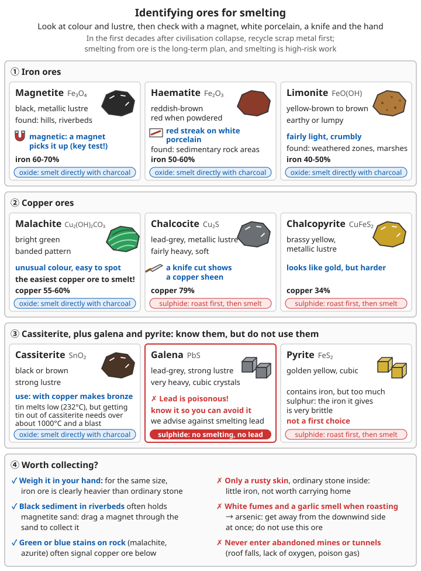

# Metallurgy Basics

> **An introduction to metallurgy - learning the basics of smelting metal from scratch**

## ⚠️ Safety first

**Metallurgy is high-risk work! Before you start, you must understand:**

- 🔥 Working temperatures can exceed 1300°C
- ☠️ Risk of carbon monoxide poisoning (colourless, odourless and highly toxic)
- 💥 Molten metal spatters explosively on contact with water
- 🌡️ Severe burns from high temperatures
- 🏭 Heavy-metal pollution
- ☠️ Metal fumes: the white fumes from heating galvanised parts or melting brass cause "metal fume fever"; roasting sulphide ores releases choking sulphur dioxide, and some ores also give off white fumes containing arsenic
- ☠️ **Do not touch lead or mercury**: do not melt lead, do not use mercury to extract gold, and keep pregnant women and children away from every smelting site

**Always work outdoors, in a well-ventilated place, away from where people live!**

```
What this chapter is for:
- It covers the basics common to all smelting: principles, furnaces, charcoal,
  judging temperature by the colour of the fire, identifying ore, safety
- The actual steps for smelting iron and copper are in later chapters
- In the first few decades after civilisation collapses, the steel, copper and
  aluminium in the ruins are far quicker to get and better in quality than
  anything home-smelted. Salvage, re-forge and remelt first; smelting from ore
  is the long-term plan for when salvaged material runs out
```

For salvaging scrap metal see [Scrap metal recovery and aluminium casting](05-scrap-metal-recycling-and-aluminium-casting.md); for how to build blowing equipment in detail see [Blowing equipment and forges](08-bellows-and-forges.md).

---

## 1. Basic principles of metallurgy

### 1.1 What is metallurgy?

**In short:** the process of extracting metal from ore.

**The chemistry:**
```
Metal oxide + carbon (reducing agent) → metal + carbon monoxide/carbon dioxide
Example: Fe₂O₃ + 3C → 2Fe + 3CO↑
```

```
What actually happens in the furnace:
1. The air blown in burns the charcoal: C + O₂ → CO₂, giving off a lot of heat
2. The CO₂ rises through the glowing charcoal and is reduced to carbon monoxide:
   CO₂ + C → 2CO
3. The carbon monoxide rises and strips the oxygen from the ore:
   Fe₂O₃ + 3CO → 2Fe + 3CO₂
4. Mud, sand and other impurities in the ore combine with the flux and melt into
   slag, which runs off; the metal stays behind

→ The real reducing agent is mainly carbon monoxide, so the furnace must be
  "rich in carbon, short of oxygen"
→ This is also why carbon monoxide is very concentrated around the furnace mouth
  and the slag hole
```

**The two kinds of ore are treated differently:**
- Oxide ores (magnetite, haematite, limonite, malachite, cassiterite): smelt directly with charcoal
- Sulphide ores (chalcopyrite, chalcocite, galena, pyrite): first roast them in air to burn off the sulphur and turn them into oxides, then smelt (see [5.4 Ore concentration](#54-ore-concentration))

For the basics of chemical reactions see [Chemistry](../../../docs/08-基础科学知识/03-化学.md).

### 1.2 Key elements

| Element | Role | Notes |
|------|------|------|
| **Ore** | Raw material | A natural mineral containing metal |
| **Fuel** | Provides heat | Charcoal, coke |
| **Reducing agent** | Takes away the oxygen | Usually carbon (charcoal) |
| **Flux** | Lowers the melting point | Limestone, quartz |
| **Forced air** | Raises the temperature | Supplies more oxygen |

**How to choose a flux:**
- Ore with a lot of mud and sand (quartz) → add limestone or shells; the two combine into a slag that melts easily
- Ore with a lot of lime → add quartz sand
- In bloomery smelting the iron and quartz in the ore itself combine into slag (losing some of the iron); beginners can leave out the flux at first, watch how the slag flows, and adjust
- Find the right amount by experience; record the proportions and how the slag ran every time

**What slag does:** it carries the impurities away and also covers the metal, stopping it from being oxidised again. Slag that flows well (like thin syrup, able to run out of the slag hole) shows the temperature and proportions are right; slag that is thick and sticky and clogs the furnace shows the temperature is too low or the flux is wrong.

### 1.3 Temperatures needed

| Metal | Melting point | Furnace temperature needed | Difficulty |
|------|------|----------|------|
| Copper | 1085°C | 1200°C | ⭐⭐ Easy |
| Gold | 1064°C | 1200°C | ⭐⭐ Easy |
| Silver | 962°C | 1100°C | ⭐⭐ Easy |
| Iron (bloomery) | Does not melt | 1100-1300°C | ⭐⭐⭐ Fairly hard |
| Iron (liquid pig iron) | About 1150°C (4% carbon) | 1300-1400°C | ⭐⭐⭐⭐ Hard |
| Tin (melting tin metal) | 232°C | 300°C | ⭐ Very easy |
| Tin (smelting from cassiterite) | 232°C | Above about 1000°C | ⭐⭐⭐ Needs forced air and strong reduction |

**Key:**
- Open charcoal fire: ~700-800°C (not enough)
- Charcoal + forced air: 1200-1400°C (can smelt copper)
- Charcoal + strong forced air + refractory materials: 1300-1400°C (can make liquid pig iron)

> Pure iron melts at 1538°C, but ironmaking does not need to reach that temperature: the bloomery process reduces the iron to sponge iron while it stays solid; pig iron, because it contains about 4% carbon, melts at around 1150°C.

**Why the "furnace temperature needed" is higher than the melting point:** the metal has to be heated right through, the slag has to flow, and the metal cools as it is poured, so the furnace is usually 100-200°C hotter than the melting point. For the melting points and pouring temperatures of lead, zinc, aluminium and other metals see [Advanced casting – Melting points and pouring temperatures of common metals](07-advanced-casting.md#11-melting-and-pouring-temperatures-of-common-metals).

---

## 2. Building a smelting furnace

### 2.1 Simple clay furnace (beginner)

**Suitable for:** copper, tin, lead and other low-melting-point metals

> ⚠️ Lead is toxic. This book does not recommend smelting or melting lead yourself; for the reasons see [Other metals – Lead](10-other-metals.md#3-lead).

#### Materials:
- Clay: 50-100 kg
- Sand: 20 kg (mixed into the clay to strengthen it)
- Rice straw / hay: 1-2 kg (prevents cracking)
- Stones: a number of them (for the furnace base)

**Which soil will do:** soil that is sticky when wet and can be rolled into a coil as thick as a chopstick and bent into a ring without breaking will do. If there is too much sand it will not roll into a coil; pure clay that is too sticky cracks easily as it dries, so mix in more sand. For how to find clay see [Pottery, glass and papermaking – What kind of soil makes pottery](../../../docs/07-日常生活技能/11-陶瓷玻璃与造纸.md#什么样的土能做陶).

#### Building steps:

**Step 1: Choose the site**
- Level ground, cleared of anything that burns
- No buildings within 10 m, and no houses downwind
- Close to water (for safety)

```
More on choosing the site:
✓ Slightly raised, well-drained sandy ground; not in a hollow where water
  collects, and not on concrete
  (damp in the ground and water in concrete burst the furnace floor and the
  ground when heated)
✓ Put up a tall shelter, open on all sides, to keep off the rain; its roof at
  least 2 m above the furnace mouth, and not made of thatch
✓ The water is for putting out fires and rinsing burns: keep buckets in a fixed
  place a few m away, never in front of the furnace or near the slag hole or the
  pouring area
✓ Keep away from haystacks, woodpiles and the edge of woodland; no houses
  downwind of the prevailing wind
```

**Step 2: Lay the foundation**
```
[Top view]
○ = air inlet
═ = stones

   Front
   ║
 ╔═══╗
 ║ ○ ║← air inlet (10 cm across)
 ╚═══╝
 ┌───┐
 │base│← raised 30 cm on stones
 └───┘
```

- Raise it 30-50 cm on stones (keeps out damp)
- Leave an air inlet

**Step 3: Mix the fireclay**
```
Recipe:
- Clay: 70%
- Fine sand: 25%
- Chopped rice straw: 5%
- Water: as needed, until it is plastic
```

**Mixing:** tread and knead it repeatedly for 30 minutes

```
How to tell the clay is ready:
✓ Squeeze a handful into a ball: it does not stick to your hand, and when broken
  the inside is even, with no dry lumps or air bubbles
✓ Roll a coil as thick as your thumb and bend it into a U: only fine cracks on
  the outside, and it does not break
✗ It runs as soon as you squeeze it → too much water; spread it out to dry a while
✗ It snaps when bent → too dry or too much sand; add water or clay
✓ Once mixed, cover with a damp cloth or plastic sheet overnight and knead it
  again the next day for a more even mix
```

**Step 4: Build the furnace wall**
- Wall thickness: 10-15 cm
- Inside diameter: 30-40 cm
- Height: 50-60 cm
- Floor: sloping, so slag can be drained

```
How to build it:
1. On the foundation, coil clay strips round and round upwards, each round
   about 5 cm high; press and smear each round into the one below with your
   fingers, do not just stack them
2. Each time it is about 15 cm higher, pause to let the lower part firm up a
   little before carrying on, or it will slump
3. You can also use a wooden bucket, a woven basket or a tightly tied bundle of
   straw as an inner form, then pull it out or burn it out afterwards
4. Tuyere: leave a hole about 10-15 cm above the floor, angled slightly
   downwards at the centre of the hearth
5. Slag hole / copper tap hole: leave a small hole at the lowest point of the
   floor, plugged with clay during smelting
6. Smooth the inner wall; the outer wall can be left rougher
```

**Step 5: Drying (crucial!)**
- Dry in the shade for 3-5 days (direct sun makes it crack)
- Then bake slowly over a low fire for 2-3 days
- Day 1: low fire for 30 minutes, let it go out, repeat 3 times
- Day 2: low fire for 2 hours
- Day 3: medium fire for 4 hours

```
Why so slowly: water in the wall turning suddenly into steam swells and cracks
the wall, and can even blow pieces off
How to tell it is dry right through:
✓ The colour has gone from dark to light, evenly all over, with no dark damp patches
✓ It does not feel cold to the touch, and sounds crisp rather than dull when tapped
✗ The wall gives off a lot of steam while baking, or damp marks appear on the
  outside → not dry yet; keep the fire low
In rain or humid weather, dry it for a few more days
```

**Step 6: High-temperature firing**
- Fire it hard for 6-8 hours
- The clay hardens and shrinks slightly
- Patch any cracks with clay

```
Patching cracks: fine cracks (under about 2 mm) can be left; for wide cracks,
  once the furnace has cooled, scrape the crack wider, wet it, press in clay of
  the same mix until full, then dry it over a low fire
Check before every smelt: if the wall has thinned or a crack goes right
  through, repair or rebuild it
```

#### Blowing equipment

**Simple bellows (essential!):**

```
[Side view]

Moving board ↓
┌─────┐
│     │  leather / cloth
│  □  │  ←air
└──║──┘
   ║← bamboo tube / wooden pipe
   ↓
 furnace
```

**How to make it:**
1. Wooden frame: 40×30×15 cm
2. Cover the top with leather or heavy canvas
3. Make an opening in the bottom and connect a bamboo tube
4. Put the bamboo tube into the furnace's air inlet
5. Compress the air by hand or foot

```
⚠️ Note:
- Bamboo tubes and wooden pipes must not go straight into the furnace; they will
  burn. Set a pipe of fired fireclay (the tuyere) into the furnace wall, and run
  the bamboo tube only to the outer end of the tuyere
- The bellows needs an intake valve (a flap of leather over the intake hole,
  closed when you press down and open when you lift), or each stroke will suck
  hot gas from the furnace back into the bellows
- A single bellows blows in puffs, so the furnace temperature rises and falls;
  the simplest fix is two bellows worked in turn
```

**Advanced version:**
- Double-chamber bellows (blows on both the press and the release)
- Continuous blast, more efficient

For how to make skin bellows, pot bellows, double-acting piston bellows and water-powered bellows, and tuyere sizes, see [Blowing equipment and forges](08-bellows-and-forges.md#3-how-to-make-each-kind-of-bellows).

### 2.2 High-temperature furnace (for iron)

**Materials:**
- Firebricks or fireclay (ordinary clay is not good enough)
- Fireclay recipe (recommended recipe A): bauxite or kaolin 50%, quartz sand 30%, fireclay 15%, crushed firebrick 5%

**Structural improvements:**
- Thicker walls (20-30 cm)
- Taller shaft (100-150 cm)
- Preheated blast (using the waste gas to heat the incoming air)
- Charging in layers

**Furnace shape:** narrow at the top, widest at the middle (the bosh), narrowing gradually down to the tuyere; below the tuyere are the hearth and the tap hole. For dimensions and a cross-section see the links below.

```
Why taller and thicker:
- The taller the shaft, the longer the rising hot gas and carbon monoxide have,
  as they pass up through the charge, to give their heat and reducing power to
  the ore → saves charcoal and reduces the ore more completely
- The thicker the wall, the less heat is lost; ordinary clay softens at around
  1300°C, sticks to the slag and burns through
- Beginners need not build a big furnace at once: practise first with a small
  shaft furnace about 1 m tall to get the rhythm of blowing, charging and
  tapping slag
```

For the dimensions of the shaft furnace, two refractory clay recipes and a building schedule see [Iron smelting – Simple shaft furnace](01-iron-smelting.md#21-simple-shaft-furnace-recommended) and [Iron smelting – Preparing refractory materials](01-iron-smelting.md#22-making-refractory-material); for firing firebricks and crucibles see [Pottery, glass and papermaking – Crucibles and firebricks](../../../docs/07-日常生活技能/11-陶瓷玻璃与造纸.md#坩埚和耐火砖).

---

## 3. Making fuel

### 3.1 Why charcoal matters

**Why charcoal is a must:**
- ✗ Firewood: contains water and impurities, burns cooler (an open flame is generally only about 600-900°C)
- ✓ Charcoal: mainly carbon (fixed carbon generally about 70-90%); with forced air it burns hot (1200-1400°C)
- ✓ Charcoal is smokeless, and gives a steadier carbon monoxide concentration

**Two more points:**
- Charcoal contains almost no sulphur or phosphorus, so the iron made with it is less likely to be brittle; coal contains sulphur, and using it directly makes iron brittle (see [Q4](#q4-can-coal-be-used-instead-of-charcoal))
- Charcoal is porous and keeps its shape; in the furnace it does not flare and collapse like firewood, so the charge stays permeable to air

### 3.2 Making charcoal (smouldering method)

**Principle:** heat wood with the air kept out; the volatile matter escapes and carbon is left.

```
⚠️ Safety when making charcoal:
- The smoke from a charcoal kiln is full of carbon monoxide and tar; stand
  upwind and do not put your head near the smoke hole
- Never climb into a kiln pit that has not cooled completely
- Freshly drawn charcoal may hold hidden embers and can reignite or even catch
  fire by itself
- Never heat a room or tent by burning charcoal
```

**Preparing the wood:**
- Hardwoods (oak, chestnut, elm, pagoda tree and so on) give hard, long-burning charcoal suitable for smelting; pine, poplar and willow give lighter, softer charcoal, usable for the forge and everyday use
- The wood must be dry: after felling, split it and stack it off the ground to dry for several months or more; wet wood gives less charcoal and takes longer
- Remove rotten parts, keep the thickness as even as possible, and split pieces that are too thick

For how to dry firewood and how much a piece of woodland can yield, see [Firewood and woodland management – Dry wood](../04-farming-and-animal-husbandry/09-firewood-and-woodland-management.md#firewood-must-be-dry).

#### Earth kiln (large-scale production)

**Steps:**

**1. Dig the pit:**
- 2-3 m across
- 1-1.5 m deep
- Dig a flue at the centre of the bottom

**2. Stack the wood:**
- Stand the wood upright (5-15 cm thick)
- Leave a gap in the centre as a chimney
- When full, cover the top with small branches

```
Stacking tips:
- Pack it as tightly as you can, thick pieces in the middle and thin ones round
  the outside (the middle is hotter, the outside burns more slowly)
- Fill the gaps between pieces with short offcuts; where there are big gaps the
  wood burns to ash
- Put dry grass and kindling in the central gap to light it
```

**3. Seal with earth:**
- Cover with 10-20 cm of damp earth
- Leave air holes at the top and bottom
- Do not seal it completely

```
First lay a layer of dry grass or leaves over the woodpile, then the earth, so
the earth does not fall into the gaps; pat the earth down firmly so there are no
cracks. If the earth cracks and smokes while smouldering, patch it with damp
earth at once —
wherever air leaks in, the charcoal burns to ash
```

**4. Light it:**
- Light it from the top
- Once the fire is steady, gradually make the top air hole smaller

**5. Smoulder:**
- Lasts 3-7 days
- Watch the colour of the smoke:
  - White smoke (steam) → early stage
  - Yellow smoke (wood tar) → middle stage
  - Bluish smoke (nearly done)
  - Clear hot air (done)

```
While it smoulders:
- Keep watch day and night in shifts, mainly checking whether the earth cover
  has slumped, cracked or is showing flame
- Thick, wet white smoke (it forms droplets on something cold held in it) means
  the wood is still drying; do not hurry
- Yellow smoke with a sharp tarry smell means the wood is carbonising
- If one side's smoke turns bluish first, that side is nearly done; seal that
  side's bottom air hole first
- A sudden flame → air is leaking in somewhere; seal it at once
```

**6. Put it out:**
- Seal every air hole completely
- Wait 2-3 days for it to cool
- Dig it open and take out the charcoal

```
Drawing the charcoal:
- Open one side; feel the temperature with the back of your hand outside the
  opening, and if it is still too hot to touch, seal it again and wait
- Spread the charcoal out on open ground with water and sand ready beside it,
  and watch it for at least 24 hours for any reignition before bagging and
  storing it
- Pick out half-burnt "brands" (brown in section, still showing wood grain) and
  burn them again in the next kiln
```

**Yield:**
- 1 t of air-dried wood → about 150-250 kg of charcoal (earth kilns average about 160 kg; a well-run kiln can give over 250 kg)
- Good hardwood (such as oak) gives a higher yield

#### Simple steel-drum method (small-scale production)

**Steps:**
1. Take a large steel drum and make small holes in the lid (to vent)
2. Fill it with pieces of wood
3. Turn it upside down over a fire and heat it
4. When smoke comes from the small holes, light it (to burn the combustible gas)
5. When the smoke clears, take away the fire and let it cool
6. Take out the charcoal

**Time:** 4-8 hours

```
Tips:
- Cut the wood into fist-sized pieces of equal length and pack them tightly
- If the smoke from the holes in step 4 can be lit and forms small flames, the
  wood is carbonising; these combustible gases also heat the drum and save
  firewood
- When the flames shrink and go out and no more smoke comes → carbonising is
  finished
- After removing the fire, bury the edge of the drum in earth to keep out the
  air; do not open it before it is completely cool, or the charcoal will catch
  fire
- Do not use drums that have held paint, pesticides or chemicals; burn out an
  old drum outdoors first to remove residues
```

**Common problems:**

| Problem | Cause | Remedy |
|------|------|------|
| Very little charcoal; most of it has turned to ash | The earth cover leaks, or the air holes are open too wide | Pat the earth down firmly; patch cracks as they appear |
| Lots of unburnt wood in the charcoal | Wood too wet or too thick, or not smouldered long enough | Dry it, split it thinner, smoulder longer |
| Soft charcoal that crumbles when squeezed | Softwood, or smouldered too hot and too fast | Choose hardwood; open the air holes less |
| The charcoal pile smokes and catches fire after drawing | Taken out before it had cooled | Wait a few more days; spread it out and watch it after drawing |

### 3.3 Checking charcoal quality

**Good charcoal:**
- ✓ Black with a metallic sheen
- ✓ Rings clearly when struck
- ✓ Clear grain in section
- ✓ Burns with no smoke or little smoke

**Poor charcoal:**
- ✗ Brown, or not fully carbonised
- ✗ A lot of ash
- ✗ Crumbles easily

```
Storage:
- Keep it in a dry, ventilated, roofed place, some distance from houses and
  woodpiles, protected from rain and damp
  (damp charcoal cools the furnace and bursts in it)
- A large heap of charcoal can catch fire by itself; do not pile it too high or
  too tightly, and check regularly for heating
- Sieve it before smelting: fragments and dust block the passages in the
  furnace; use the sieved fines for the forge or everyday use
```

---

## 4. Temperature control

### 4.1 Judging temperature

**Without a thermometer:**

| Temperature | Colour of the metal | Notes |
|------|----------|------|
| 500-550°C | Dark red | Red just visible in the dark |
| 650-700°C | Blood red | - |
| About 770°C | Dull cherry red | Steel loses its magnetism; a magnet just stops sticking |
| 780-850°C | Cherry red | Quenching temperature |
| 850-950°C | Bright red (light cherry red) | Forging temperature |
| 1000-1100°C | Orange-yellow | Copper melts (about 1085°C) |
| About 1200°C | Yellow | Bloomery iron |
| About 1300°C | Yellow-white | Pig iron melts and runs as liquid iron |
| 1500°C | White | Close to the melting point of pure iron (very hard to reach with traditional methods) |
| 1700°C | Dazzling white | Extremely hot |

**Other methods:**
- Drop in a small piece of copper: if it melts, it is >1085°C
- Drop in an iron nail: if it melts, it is above about 1500°C (mild steel melts a little below pure iron's 1538°C)

```
How to read the colour of the fire:
- Light makes a big difference: in sunlight colours look darker (you will
  underestimate the temperature and easily overheat); readings are most accurate
  on an overcast day, at dusk or in the shade of the shelter; try to look in the
  same light each time
- Look at the colour of the glowing charcoal and the metal inside the furnace,
  not at the flames shooting from the furnace mouth
- Eyes differ from person to person: let the same person judge over a long
  period, and compare with someone experienced
- When you have small pieces of pure metal to check against (tin 232°C,
  aluminium about 660°C, copper 1085°C), use them to calibrate your eyes
- Protect your eyes: look into the furnace through the tuyere or a spy hole only
  briefly; when looking for long at a fire above 1300°C, look through a piece of
  dark glass (a welding-mask lens is best), and do not put your face close to the
  tuyere (flame can shoot out)
```

```
Judging without your eyes:
- Slag: runs out freely → hot enough; thick and sticky, blocking the slag hole →
  too cool
- Furnace mouth: when the flame changes from dark red and smoky to a steady short
  blue or yellow-white flame, the furnace is burning strongly
- Tuyere: the glowing charcoal you can see through the tuyere is the brightest,
  and best shows the highest temperature in the furnace
```

For more fixed points from metal melting points and a home-made thermometer see [Rebuilding measurement standards – Fixed points for high temperatures](../../../docs/08-基础科学知识/09-计量基准的重建.md#52-高温的固定点-金属的熔点); for judging steel by its colour in forging and heat treatment see [Metalworking techniques – Judging temperature](04-metalworking.md#13-judging-temperature-without-a-thermometer).

### 4.2 Ways to raise the temperature

**1. Stronger forced air**
- Steady, continuous blowing
- Two bellows working in turn

```
- Blow evenly, not fast then slow; when tired, swap people, do not stop
- More air is not always better: with too much air the charcoal burns too fast,
  the furnace becomes "rich in oxygen, short of carbon", metal already reduced is
  oxidised again, and there is not enough carbon monoxide → watch this especially
  when smelting iron
- If slag blocks the tuyere, clear it with an iron rod pushed in from outside
```

**2. Better fuel**
- Use good hardwood charcoal
- Charcoal pieces of moderate size (walnut-sized)

```
Pieces that are too big leave large gaps and lose heat; charcoal that is too
broken up and dusty blocks the passages so the air cannot get through;
the charcoal must be dry
```

**3. Insulating the furnace**
- Thicken the walls
- Partly close the top of the furnace (reduces heat loss)

```
- You can plaster another layer of straw-tempered clay on the outside, or heap
  earth or stack stones round it, to reduce heat loss
- In rain or strong wind the furnace is hard to get hot and dangerous; do not
  fire it
```

**4. Preheating the intake**
- Use the waste gas to preheat the air

```
The simplest way is to run the air pipe some distance round the outside of the
furnace shaft, so the incoming air is warmed by the heat of the wall first; in a
tall-shafted furnace the ore and charcoal are preheated by the rising hot gas as
they move down, which itself saves charcoal
```

**5. Ratio of fuel to ore**
- Iron smelting: charcoal : ore ≈ 1:1 (by weight)
- Copper smelting: charcoal : ore ≈ 1:2

```
This is the ratio for each charge, not the total used: preheating the furnace and
keeping it hot burn a lot of extra charcoal; for the charcoal used over the whole
process see Q3
```

**When the temperature will not rise:**

| Problem | Possible cause | Remedy |
|------|---------|------|
| The furnace stays between dark red and cherry red | Not enough air, or the bellows leaks | Check the bellows leather and joints; swap people or add a bellows |
| The outside of the wall is very hot to the touch and steams | Wall too thin, or not dried right through | Add insulation; dry it thoroughly next time |
| The fire is fierce near the tuyere but dark above | Charcoal too broken up; the charge is not letting air through | Sieve out the fines; use walnut-sized charcoal |
| The temperature rises and falls | A single bellows blowing in puffs | Work two bellows in turn, or switch to a double-acting bellows |
| The tuyere goes black and the air will not go in | Slag or molten metal is blocking it | Clear it with an iron rod; if the tuyere is too low, raise it next time |

For how furnace temperature relates to air volume, and a comparison of the air delivered by different bellows, see [Blowing equipment and forges](08-bellows-and-forges.md).

---

## 5. Identifying and collecting ore

> For general ways of identifying minerals (streak, hardness, specific gravity) and clues to where ore can be found, see [Geology, minerals and soil](../../../docs/08-基础科学知识/06-地质矿物与土壤.md#32-金属矿床的常见线索). This section covers only ores used for smelting.

### 5.1 Iron ores

#### Magnetite Fe₃O₄
- **Appearance:** black, metallic lustre
- **Feature:** magnetic (the key!)
- **Iron content:** 60-70%
- **Identification:** a magnet sticks to it
- **Where found:** mountain areas, riverbeds

#### Haematite Fe₂O₃
- **Appearance:** reddish brown
- **Feature:** red when powdered
- **Iron content:** 50-60%
- **Identification:** leaves a red streak on unglazed white porcelain
- **Where found:** areas of sedimentary rock

#### Limonite FeO(OH)
- **Appearance:** yellowish brown to brown
- **Feature:** earthy or lumpy
- **Iron content:** 40-50%
- **Identification:** fairly light, crumbles easily
- **Where found:** weathered zones, bogs

```
Is a piece of iron ore worth collecting?
- Weigh it in your hand: iron ore is clearly heavier than an ordinary stone of
  the same size
- The black sand in riverbeds often contains magnetite sand; drag a magnet
  through the sand to collect it
- If only the surface is rust-coloured and the inside is ordinary stone, it is
  low in iron and not worth carrying home
- Pyrite (golden yellow, cubic) contains iron, but so much sulphur that the iron
  made from it is very brittle; do not choose it first
```

For a simple identification procedure and how much to collect the first time see [Iron smelting – Simple identification procedure](01-iron-smelting.md#12-simple-identification-flow).

### 5.2 Copper ores

#### Malachite Cu₂(OH)₂CO₃
- **Appearance:** bright green
- **Feature:** banded pattern
- **Copper content:** 55-60%
- **Identification:** its colour is distinctive and easy to recognise
- **The easiest copper ore to smelt!**

#### Chalcocite Cu₂S
- **Appearance:** lead grey, metallic lustre
- **Feature:** fairly heavy, soft
- **Copper content:** 79%
- **Identification:** a knife cut shows a copper sheen

#### Chalcopyrite CuFeS₂
- **Appearance:** brass-coloured
- **Feature:** metallic lustre
- **Copper content:** 34%
- **Identification:** looks like gold but is harder

```
- Green and blue stains on rock surfaces (malachite, azurite) are often a sign of
  copper ore below
- Chalcocite and chalcopyrite are sulphide ores and must be roasted before
  smelting (see 5.4)
- Some copper ores contain arsenic: if roasting gives off white fumes and a
  garlic-like smell → arsenic; get out of the downwind area at once, and do not
  use this ore
```

For azurite, native copper and how to smelt each kind of copper ore see [Copper smelting](02-copper-smelting.md).

### 5.3 Other useful ores

#### Cassiterite SnO₂
- **Appearance:** black or brown, strong lustre
- **Use:** making bronze (copper + tin)
- **Low melting point:** 232°C, but reducing tin from cassiterite needs above about 1000°C and forced air (see [Other metals – Tin](10-other-metals.md#2-tin))

#### Galena PbS
- **Appearance:** lead grey, strong metallic lustre
- **Feature:** very heavy, cubic crystals
- **Use:** lead goods, alloys
- **Warning:** lead is toxic!

```
☠️ Galena: learn to recognise it so you can avoid it
- Roasting and smelting galena give off lead fumes and sulphur dioxide. Lead
  poisoning is chronic: there is little to notice at first, but it damages
  children's intelligence and causes anaemia and nerve damage
- This book does not recommend smelting lead; if you really need lead, salvage
  it from old battery plates, lead pipes and the like, with proper protection
- Do not use lead for food or drink vessels or water pipes, and do not use
  lead glazes
```

For lead, zinc, gold and silver see [Other metals](10-other-metals.md); for the dangers of mercury see [Other metals – Mercury](10-other-metals.md#7-mercury-you-only-need-to-know-its-dangers).



*Figure: Identifying ores for smelting — test magnetite with a magnet, look for haematite's red streak and malachite's green; sulphide ores such as chalcocite and chalcopyrite must be roasted first; galena is toxic and pyrite has too much sulphur — learn them so you do not use them*

### 5.4 Ore concentration

**Raw ore usually contains a lot of impurities and needs concentrating:**

#### Gravity separation (washing)
```
1. Crush the ore (to fist size)
2. Put it in a water trough
3. Shake and wash it
4. Light impurities float up or wash away
5. Heavy metal ore sinks to the bottom
```

**Suitable for:** dense ores (iron, copper, tin)

```
More on the method:
- Before washing, break the fist-sized lumps further, to the size of soya beans
  or peanuts; lumps that are too big will not separate
- Use a shallow wooden pan or a sloping wooden trough; add water slowly at the
  top and shake so the water carries the light mud and sand down
- Keep the part that settles at the bottom, darker and heavier in the hand; what
  washes down can be washed again
- Dry the washed ore in the sun or over a fire before it goes into the furnace;
  wet ore cools the furnace and can even cause bursting
```

#### Magnetic separation (magnetite only)
```
1. Crush the ore
2. Pick it up with a strong magnet
3. Separate out the magnetic magnetite
```

```
Wrap the magnet in a plastic bag or cloth; when it is covered, turn the bag off
the magnet and the ore powder drops off;
strong magnets can be taken out of old loudspeakers and motors
```

#### Roasting (removing sulphur)
```
Some sulphide ores (such as pyrite FeS₂):
1. Pile them in the open
2. Set fire to them and roast
3. The sulphur escapes as SO₂
4. What is left is iron oxide (can be smelted)
```

```
⚠️ Safety when roasting:
- Sulphur dioxide irritates the eyes and airways; at high concentrations it can
  suffocate, and it kills crops and trees downwind
- Choose an open roasting site some distance from houses, fields and water;
  always stand upwind
- If you smell garlic or see a lot of white fumes (possibly arsenic) → stop and
  move away
- Roast thoroughly: turn the ore several times and roast until it no longer gives
  off choking fumes and has turned reddish brown; sulphur left behind makes iron
  brittle and copper bubble
- Roasting also helps limonite and other ores with a lot of water: it drives off
  the water and makes the ore porous, so it reduces more easily
```

### 5.5 Crushing ore

**Why crush it?**
- Increases the surface area for reaction
- Makes smelting more efficient
- Makes it easier to mix with the fuel

**Methods:**
1. **Stone mortar** - by hand
2. **Stone hammer** - by hand
3. **Stone mill** - animal power
4. **Water-powered mill** - using flowing water

**Size:**
- Iron smelting: peanut to walnut size
- Copper smelting: soya bean to peanut size
- Smaller is better, but powder that is too fine stops the air getting through

```
- Roasting before crushing saves effort: roasted ore is brittle and breaks easily
- Wear safety goggles when breaking ore (stone chips fly into the eyes), and a
  mask or a damp cloth over your nose and mouth to breathe in less dust
- Do not throw away the fine powder: mix it with a little clay and water, shape
  it into egg-sized balls, dry them in the sun and put them in the furnace
```

### 5.6 Safety when collecting

```
⚠️ The risks of mining are often less obvious than those of smelting:
- Do not go into abandoned mines or tunnels: they may collapse or be flooded,
  and oxygen-poor or toxic gas often collects at the bottom. One person goes in
  and collapses, then those who go down to rescue them collapse too; this is a
  common cause of multiple deaths
- When digging on outcrops and steep slopes, watch for rocks falling from above
  and loose rocks underfoot; do not work below steep slopes after rain or during
  a thaw
- When digging a pit, slope its sides; never undercut them so they overhang;
  once it is deeper than chest height, shore the sides or cut them into steps
- While someone works in the pit, have someone watching at the edge, and do not
  pile stones at the edge
- Wear gloves and safety goggles; others stand back while you strike
```

For warning signs of geological disasters see [Geological disasters](../02-disaster-response/01-geological-disasters.md).

---

## 6. Safety and protection

### 6.1 Essential protective gear

| Gear | Purpose | Improvised substitute |
|------|------|----------|
| **Thick leather gloves** | Protect against heat | Several layers of dry, thick cotton cloth wrapped round the hands (not wet cloth: wet cloth turns to steam in the heat and scalds you) |
| **Safety goggles** | Protect against spatter | A clear plastic sheet + string (only stops chips, softens in high heat; when pouring, use glass lenses if at all possible) |
| **Mask** | Protects against dust | Several layers of damp cloth |
| **Thick apron** | Protects against burns | Wet leather |
| **Long-handled tongs** | Hold hot objects | Wooden stick + iron wire |
| **Long-handled ladle** | Scoop molten metal | A bowl made of fireclay + a long wooden handle |
| **High leather boots** | Stop molten metal splashing onto the feet | Thick leather wrapped round the feet, trouser legs over the tops of the shoes (do not tuck trousers into shoes) |
| **Dark viewing glass** | Protects the eyes when looking at the fire | A welding-mask lens, or smoked glass |

```
- A damp-cloth mask only stops dust; it does not stop carbon monoxide or metal fumes
- Wear cotton, wool and leather: synthetic fibres melt in high heat and stick to
  the skin, causing deeper burns
- Handles of long-handled tools should be at least 1 m long; when holding and
  pouring, stand side-on to the crucible, not facing it
```

### 6.2 Work safety rules

#### Site safety
- [ ] Nothing flammable within 10 m
- [ ] Nobody living downwind
- [ ] Sand and water ready to put out fires
- [ ] Lighting and a watchperson for night work
- [ ] A layer of dry sand on the ground of the pouring area; never pour on concrete or damp ground
- [ ] Children and livestock kept at a safe distance, fenced off with rope or a fence

#### Operating safety
- [ ] All tools completely dry (moisture explodes!)
- [ ] Never work in the rain
- [ ] Pour molten metal into preheated moulds
- [ ] Watch from well away from the tuyere
- [ ] Dry everything added to the furnace or crucible (scrap, ore, flux) beforehand
- [ ] Never put sealed containers, pipes or gas cylinders in the fire (they explode)

#### Personal safety
- [ ] Wear long sleeves and long trousers, with cuffs fastened
- [ ] Tie up your hair or wear a hat
- [ ] Do not wear flammable material (synthetic fibres)
- [ ] Stay alert; no alcohol
- [ ] Drink plenty and rest in turns; hot work at the furnace easily causes heatstroke
- [ ] First-aid supplies (clean cloth, a bucket of water) on site, and someone who knows first aid

For treating heatstroke see [Dealing with acute symptoms](../01-first-aid-and-family-health/05-acute-symptoms.md).

### 6.3 Preventing poisoning

**Carbon monoxide poisoning (the number one killer!)**

**Source:** incomplete combustion produces CO

**Symptoms:**
- Mild: headache, dizziness, nausea
- Moderate: confusion, weakness
- Severe: coma, death

```
⚠️ Clues that strongly suggest carbon monoxide poisoning:
- Several people working at the furnace or charcoal kiln get headaches,
  dizziness or nausea at the same time
- Symptoms ease after leaving the furnace for a while and get worse on returning
- Putting the headache down to being "tired" or "hot" and carrying on working is
  the most dangerous thing of all
```

**Prevention:**
- ✓ Always work outdoors or in the open
- ✓ Work in a group and watch each other
- ✓ Leave at once if you feel unwell
- ✓ Do not lie down near the furnace

```
More on prevention:
- Carbon monoxide is most concentrated at the furnace mouth, the slag hole and
  downwind; do not stay or rest there
- Keep the smelting shelter open on all sides; do not close it in to keep off
  the wind
- Do not take a furnace with live embers, a charcoal brazier or freshly drawn
  charcoal indoors
- If you can, keep a carbon monoxide alarm in the work area
```

**First aid:**
1. Move the person into fresh air at once
2. Lay them flat and keep them warm
3. If conscious, let them rest quietly without walking about, and do not let them go back to work
4. If unconscious, lay them on their side to stop them choking
5. If breathing stops, start CPR at once

```
- Protect yourself before rescuing anyone: hold your breath and get in and out
  fast; a wet towel does not stop carbon monoxide
- If you can reach help, call 120 at once and say "carbon monoxide poisoning",
  so they can take the person to a hospital with hyperbaric oxygen
- See a doctor soon even if the person has come round: from a few days to a
  month or two after seeming to recover, carbon monoxide poisoning can cause
  memory loss, slowed responses and unsteady walking (delayed encephalopathy)
- A pregnant woman who has been poisoned must see a doctor even if her symptoms
  are mild
```

For the full steps for recognising and helping, see [Home and traffic accidents – Carbon monoxide poisoning](../01-first-aid-and-family-health/07-home-and-traffic-accidents.md#carbon-monoxide-poisoning); for CPR see [Basic first aid – CPR](../01-first-aid-and-family-health/00-basic-first-aid.md#cardiopulmonary-resuscitation-cpr).

**Heavy-metal poisoning**

**High-risk metals:** lead, mercury, arsenic

**Prevention:**
- Wash your hands thoroughly after work
- Do not eat or drink in the work area
- Pregnant women and children must have no contact

```
- Lead: do not melt lead or smelt galena; early lead poisoning shows only as
  tiredness, abdominal pain, constipation and anaemia, and is easily overlooked
- Mercury: do not use mercury to extract gold, and do not heat anything that
  contains mercury; mercury vapour is colourless and odourless, and breathing it
  in while heating does serious damage to the lungs, kidneys and nerves
- Arsenic: move away at once from white, garlic-smelling fumes during roasting;
  do not use ores containing arsenic
- Store and wash work clothes separately from everyday clothes; do not go home
  and hold your children in your work clothes
- Do not dump slag or roasting residue into water sources or fields; bury it
  together in one place far from water
```

**Metal fume fever**

```
Heating galvanised sheet iron or melting brass gives off white zinc fumes. A few
hours after breathing them in, people get chills, fever, aches all over and a
cough, as if they had a cold
- Treatment: leave the site, rest and drink plenty; it usually gets better within
  a day or two
- Difficulty breathing, a high fever that will not come down, or worsening
  symptoms → see a doctor at once
- Prevention: remove the coating from galvanised parts before heating, work
  upwind, and do not overheat brass
```

For more on mercury and lead see [Other metals – Mercury](10-other-metals.md#7-mercury-you-only-need-to-know-its-dangers) and [Other metals – Lead](10-other-metals.md#3-lead).

### 6.4 Treating burns

**Minor burns (red skin, blisters):**
1. Rinse at once with cool water for 15-20 minutes
2. Do not burst blisters
3. Apply burn ointment or aloe vera juice
4. Dress with sterile gauze

```
- Rinsing is what matters most: rinse for the full time, even after the pain
  stops; rinsing still helps if started within 3 hours of the burn
- Take off rings, bracelets and the like before swelling starts
- Do not apply soy sauce, toothpaste, plant ash or grease
- Blisters larger than about 2 cm across, burns on the hands, feet, joints or
  face, or redness, swelling, pus or fever → see a doctor
```

**Severe burns (charred skin):**
1. Rinse with plenty of clean water
2. Cut clothing away (do not pull or tear it)
3. Cover with a clean dressing
4. Get medical help at once
5. Give small, frequent sips of oral rehydration salts (ORS) or weak salt water (to an adult who is fully conscious, can swallow and is not vomiting, when help will take a long time to arrive); do not give large amounts of plain water

```
- Call 120 at once; have someone else call for help while you rinse, and do not
  delay getting to hospital to finish the rinsing time
- For large burns, rinse only the burnt area and cover the rest to keep warm;
  stop rinsing if the person starts shivering or their lips turn blue (to
  prevent hypothermia)
- Do not tear off clothing stuck to the skin; cut around it and leave the stuck
  part in place
- Do not apply any ointment; cover lightly with a clean, damp cloth or cling
  film, and do not wrap it tightly
```

**Molten metal splashes:**
- Never use water straight away!
- First put out any burning clothing
- Wrap in clean cloth
- Get medical treatment

```
What "do not use water" means:
- Never throw water onto molten metal, into a crucible or furnace, or where
  molten metal has spilled — water touching molten metal turns to steam
  instantly and blasts the metal in all directions, injuring more people
- On a person: first get away from where the molten metal has spilled; if
  clothing is on fire, "stop, drop and roll" to put it out
  (or smother it with a thick blanket or sand and earth); small drops of metal
  on the body solidify within seconds
- Once out of the danger area, rinse the burns with cool running water for
  15-20 minutes as above
- Do not pick at metal that has solidified and stuck to the skin; once it has
  cooled, cover it with clean cloth and leave it for a doctor
- Metal in the eye: do not rub; get medical help at once
```

For judging burn depth, estimating the area, and the full "cool, remove, soak, cover, transport" steps, see [Wound and injury care – Scalds and burns](../01-first-aid-and-family-health/02-wounds-and-injuries.md#scalds-and-burns).

---

## 7. Frequently asked questions

### Q1: How long does a complete beginner take to smelt successfully?

**A:**
- Copper: 1-2 weeks of preparation, success rate about 60% (an estimate from experience)
- Iron: 1-2 months of preparation, first-time success rate about 20-30% (an estimate from experience)
- Start with copper and build up experience

```
Recommended order of practice:
1. Burn a kiln of charcoal and make a bellows
2. Melt salvaged aluminium and tin in a small crucible to practise reading the
   colour of the fire and pouring (low temperature, low risk)
3. Melt scrap copper, and smelt copper from malachite
4. Build a shaft furnace and make bloomery iron
Record every time: charcoal used, blowing time, colour of the fire, how the slag
ran, the result
```

### Q2: How much metal can one smelt produce?

**A:**
- Small furnace (one smelt): 0.5-2 kg
- Medium furnace (one smelt): 2-10 kg
- Large furnace (one smelt): 10-50 kg

### Q3: How much charcoal does it use?

**A:**
- 1 kg of iron (bloomery process): successful runs recorded in experimental archaeology mostly used about 8-10 kg of charcoal; for beginners or when things go badly it can be several tens of kg
- 1 kg of copper (oxide copper ore): several kg of charcoal
- 1 kg of charcoal: about 4-7 kg of air-dried wood (more when the earth kiln yield is low)

**Conclusion:** it takes a great deal of wood! Sustainability is the key. For how much woodland you need and how to rotate felling, see [Firewood and woodland management](../04-farming-and-animal-husbandry/09-firewood-and-woodland-management.md).

### Q4: Can coal be used instead of charcoal?

**A:**
- Yes, but coal contains sulphur, so the product is poorer
- It must first be made into coke (similar to making charcoal)
- Its advantage is a higher heating value

```
- Raw coal put straight into the furnace softens and sticks together when heated,
  gives off thick smoke and chokes the charge; the sulphur goes into the iron and
  makes it brittle
- Coking, like charcoal burning, means smouldering with the air kept out, but it
  gives off more coal-tar smoke and carbon monoxide; do it far from homes and
  stand upwind
- Coke suits melting iron, casting and the forge; for smelting iron from ore,
  charcoal still gives good iron more easily
```

For where to find coal see [Geology, minerals and soil – Building and everyday materials](../../../docs/08-基础科学知识/06-地质矿物与土壤.md#31-建筑和日用材料).

### Q5: What if I cannot find any ore?

**A:**
- Salvage discarded metal objects
- Old cars and machinery (lots of steel)
- Discarded electrical appliances (copper wire)
- Reinforcing bars from old buildings
- Just remelt and re-forge them

```
⚠️ Dangers of salvaged parts: sealed containers, gas cylinders, shock absorbers
and fire extinguishers explode when heated; galvanised parts give off zinc fumes;
old brake pads may contain asbestos; batteries contain lead and acid
```

For identifying metals, dismantling, and melting and casting, see [Scrap metal recovery and aluminium casting](05-scrap-metal-recycling-and-aluminium-casting.md).

### Q6: Can one person do the smelting alone?

**A:**
- In theory yes, but the work is very heavy
- At least 2-3 people are recommended:
  - 1 person blowing
  - 1 person charging
  - 1 person monitoring and on safety
- Smelting is community work

```
One iron smelt needs several hours of continuous blowing, plus charcoal burning,
mining and crushing, so far more people are needed than the few at the furnace;
the people blowing must take turns, and the safety person should not do any
other job, but keep watch on people's condition and the fire
```

---

## 8. Checklists

### Before starting

- [ ] Furnace completely dry, no cracks
- [ ] Plenty of fuel (twice the amount planned)
- [ ] Blowing equipment working properly
- [ ] All tools present and dry
- [ ] Protective gear on
- [ ] Fire-fighting supplies in place
- [ ] Wind direction checked (nobody downwind)
- [ ] Clear weather, no rain
- [ ] Ore, flux and charcoal all dried and sieved
- [ ] Clear roles: who blows, who charges, who is responsible for safety
- [ ] Know where the nearest medical help is; someone knows first aid

### During work

- [ ] Check the furnace temperature every 15 minutes
- [ ] Steady, continuous blowing
- [ ] Watch for changes in the colour of the smoke
- [ ] Everyone is well (no dizziness etc.)
- [ ] Fuel topped up in time
- [ ] Tuyere and slag hole not blocked
- [ ] No glowing or flaming spots on the outside of the wall (a sign it is about to burn through; if one appears, stop the blast and let it cool)
- [ ] The people blowing take turns on time and drink water

### After finishing

- [ ] Wait at least 12 hours after the fire goes out
- [ ] Embers completely out
- [ ] Residue disposed of properly (it may contain toxic substances)
- [ ] Tools cleaned and put away
- [ ] Record what you learned this time (temperature, proportions, result)
- [ ] Wash your hands and change out of work clothes
- [ ] Check the furnace for damage and note what needs repairing

---

## Related chapters

- ⏭️ [Iron smelting](01-iron-smelting.md) - detailed steps for smelting iron
- ⏭️ [Copper smelting](02-copper-smelting.md) - detailed steps for smelting copper
- 🔗 [Wilderness survival – Basic skills](../03-wilderness-survival/00-basic-survival-skills.md) - lighting fires, tools and more
- 🔗 [Scrap metal recovery and aluminium casting](05-scrap-metal-recycling-and-aluminium-casting.md) - salvage first, smelt later
- 🔗 [Blowing equipment and forges](08-bellows-and-forges.md) - bellows, tuyeres and forges of all kinds
- 🔗 [Other metals](10-other-metals.md) - tin, lead, zinc, gold, silver, mercury
- 🔗 [Geology, minerals and soil](../../../docs/08-基础科学知识/06-地质矿物与土壤.md) - identifying minerals and clues for finding ore
- 🔗 [Firewood and woodland management](../04-farming-and-animal-husbandry/09-firewood-and-woodland-management.md) - where the wood for charcoal comes from
- 🔗 [Wound and injury care – Scalds and burns](../01-first-aid-and-family-health/02-wounds-and-injuries.md#scalds-and-burns) - first aid for burns

---

**Remember: metallurgy is not a skill you master overnight. It takes a great deal of practice, failure and learning from experience. But once you have mastered it, you hold a key to rebuilding civilisation!**
