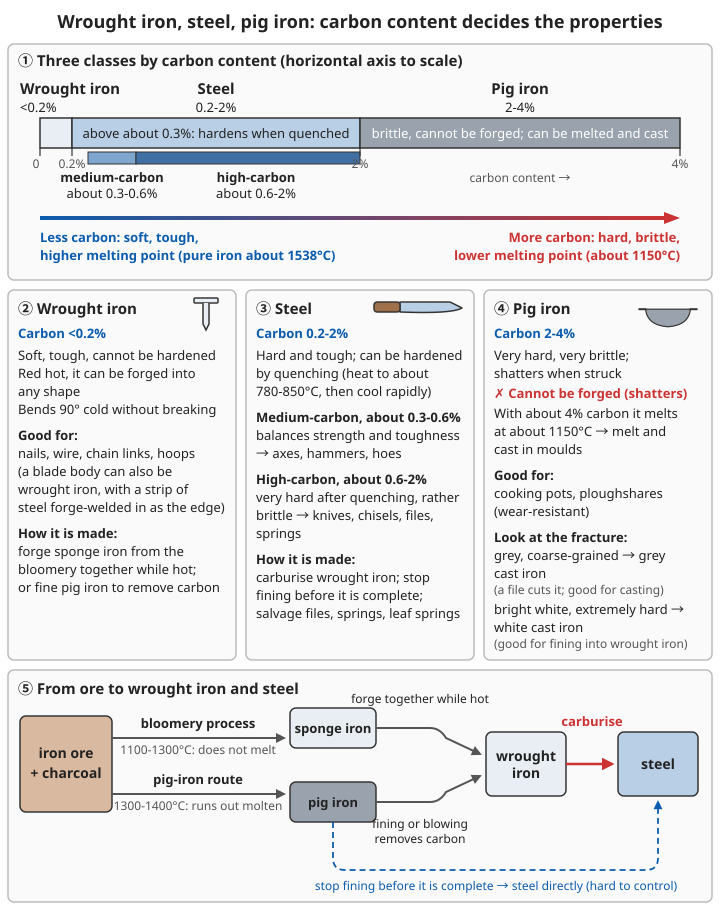

# Iron Smelting

> **The backbone of civilisation: mastering iron smelting from scratch**

## ⚠️ Warning

**Iron smelting is the hardest technique in metallurgy!**

- 🔥 The bloomery process needs 1100-1300°C; to get molten iron you need 1300-1400°C
- ⏱️ A single smelt takes 8-24 hours of continuous work
- 💪 Enormous physical effort (continuous blowing)
- ☠️ Very high carbon monoxide concentrations
- 💥 Mistakes can cause explosions

**First attempts fail 70%+ of the time. Prepare thoroughly and expect many attempts!**

```
☠️ Carbon monoxide: it is what reduces the ore to iron; the blue flames at the furnace
   mouth are CO burning
   → Work only in the open or under a roof open on all four sides; stand upwind;
     whoever keeps the night watch must not sleep beside the furnace
💥 Molten iron and slag explode and spatter on contact with damp sand, tools, ground or rain
   → Dry everything they will touch first
🔥 Slag and iron that look dull or even black can still be several hundred °C
   → Always use tongs
👁️ Wear goggles; look into the tuyere or furnace glare for only a few seconds at a time
🚫 Do not smelt ores containing lead, mercury or arsenic; do not burn galvanised or painted
   scrap, or scrap with plastic on it (toxic fumes)
```

For carbon monoxide poisoning see [Home and Traffic Accidents – Carbon monoxide poisoning](../01-first-aid-and-family-health/07-home-and-traffic-accidents.md#carbon-monoxide-poisoning); for burns see [Wound and Injury Care – Scalds and burns](../01-first-aid-and-family-health/02-wounds-and-injuries.md#scalds-and-burns); for protective gear see [Metallurgy Basics – Safety protection](00-metallurgy-basics.md#6-safety-and-protection).

---

## 1. Identifying and collecting iron ore

### 1.1 The three main iron ores

#### ① Magnetite Fe₃O₄

**Appearance:**
- Colour: black, iron-black
- Lustre: metallic or sub-metallic
- Hardness: 5.5-6.5 (a knife will not scratch it)
- Specific gravity: 5.0-5.2 (very heavy!)

**The unique identification test:**
```
Simplest: it is magnetic!
- Hold a magnet to it: strong attraction
- Or bring a compass near it: the needle swings
- Black streak (tells it apart from haematite, whose streak is red)
- Magnets can be taken out of old loudspeakers, motors and hard drives
```

**Advantages:**
- ✓ Highest iron content (60-70%)
- ✓ Easy to identify (magnetic)
- ✓ Smelts efficiently

**Where found:**
- Areas of igneous rock
- Contact metamorphic zones
- Black sand in rivers

```
River black sand: pan it in the slack water on the inside of a river bend, then pick it up
  with a magnet inside a plastic bag (turn the bag inside out and the black sand drops off);
  repeat 2-3 times
⚠️ Some black sands are rich in titanium: the slag becomes very sticky and little iron
   comes out → do a trial smelt first (see 1.5)
```

#### ② Haematite Fe₂O₃

**Appearance:**
- Colour: reddish brown, steel grey, black
- Lustre: metallic (dense lumps) or dull (earthy)
- Streak: **red** (the key test!)
- Hardness: 5.5-6.5

**Identification:**
```
Key: the colour of the streak!
1. Rub it on an unglazed white porcelain plate
2. It leaves a cherry-red or rust-coloured streak
3. Even if the ore itself is black, the streak is red

No porcelain plate: use the unglazed ring on the bottom of a bowl, or the broken edge of
a piece of porcelain
```

**Advantages:**
- ✓ High iron content (50-60%)
- ✓ Widespread
- ✓ Easy to crush

**Where found:**
- Areas of sedimentary rock
- Weathered crusts
- Red soil layers

#### ③ Limonite FeO(OH)·nH₂O

**Appearance:**
- Colour: brown, yellowish brown, blackish brown
- Lustre: dull, earthy
- Form: stalactitic, earthy, dense lumps
- Specific gravity: 3.6-4.0 (relatively light)

**Identification:**
```
Features:
- Yellowish-brown streak
- Lighter; you can feel it in the hand
- Porous, like a clod of earth
```

**Disadvantages:**
- ✗ Lower iron content (40-50%)
- ✗ Contains water; must be dried before smelting
- ✗ Many impurities

**Advantages:**
- ✓ Widespread, found right at the surface
- ✓ Easy to collect
- ✓ The beginner's choice

**Where found:**
- Marshes
- Lake beds
- Old weathered crusts

```
Clues to bog iron ore: on wetland water, a rainbow-coloured film that breaks into small
  flakes when you poke it (an oil film flows back together); orange-red fluffy deposits
  on the bottom of ditches; dig down 20-30 cm and you find hard, brown, porous lumps
⚠️ Bog iron ore often contains phosphorus; the iron made from it tends to be "cold-short"
   (brittle when cold; see Q8)
```

### 1.2 Simple identification flow

```
Find a suspicious stone
     ↓
┌────┴────┐
│ Magnet test │
└────┬────┘
     │
  Magnetic?
     │
 Yes ↓          No ↓
Magnetite!     Streak it on white porcelain
              ↓
          Red streak?
              │
          Yes ↓    No ↓
       Haematite!  Brown streak?
                     │
                 Yes ↓
                Limonite!
```

**Stones that are easily mistaken for iron ore:**

| Looks like | How to tell | Usable? |
|----------|----------|---------|
| Pyrite (golden yellow, "fool's gold") | Greenish-black streak; smells of sulphur when broken or heated | Not suitable: sulphur makes the iron "hot-short" (see Q8) |
| Black basalt, shale | Does not feel heavy in the hand; greyish-white streak | No |
| Red sandstone, red soil | Light; crumbles when squeezed | Too little iron |

For more identification methods see [Geology, Minerals and Soil – Getting to know minerals](../../../docs/08-基础科学知识/06-地质矿物与土壤.md#二认识矿物).

### 1.3 Collecting

**Best ore sites:**
- Ore exposed at the surface
- Ore layer >30 cm thick
- High iron content (dark colour, heavy)
- 3-10 km from where you live (too close pollutes; too far is exhausting to carry)

**Collecting tools:**
- Iron pick or pointed hoe (digging)
- Iron hammer (breaking)
- Winnowing basket or back basket (carrying)
- Cloth sacks (for crushed ore)

**Amount to collect (first time):**
- Target iron: 2 kg
- Ore needed:
  - Magnetite: 5-7 kg
  - Haematite: 6-9 kg
  - Limonite: 8-12 kg

```
Why so much: in primitive smelting a large share of the iron combines with the gangue
  into slag and runs away; often only half the iron in the ore, or less, becomes metal

⚠️ Do not dig at the foot of steep banks or undercut the base of a slope; do not enter
   abandoned mine workings (collapse, lack of oxygen, toxic gases)
```

### 1.4 Ore preparation

#### Step 1: Crushing
```
Lump ore → walnut-sized pieces
Tools: stone hammer, iron hammer
Time: 1-2 hours

- For a small furnace with an inner diameter of 20-30 cm, pea to peanut size
  (about 0.5-1.5 cm) is better
- Do not crush it to powder: powder blocks the air flow and is blown out of the furnace
  mouth → sieve it out
- Wear goggles when breaking ore
```

#### Step 2: Roasting (removing water and sulphur)
```
For: limonite and sulphur-bearing ores
Method:
1. Spread the ore out on firebricks or stone slabs
2. Pile firewood on it, light it and heat
3. Roast for 2-4 hours
4. Purpose: drive off water, oxidise the sulphur

Roasted enough: colour turns reddish brown to blackish red, breaks easily when struck,
no more white vapour or smell of sulphur
⚠️ Sulphur-bearing ore gives off sulphur dioxide: stand upwind, keep well away from
   houses, animal pens and vegetable plots
⚠️ Keep roasted ore dry; it must not get wet again before it goes into the furnace
```

#### Step 3: Washing to concentrate (optional)
```
1. Put the crushed ore in a trough
2. Add water and shake
3. The light earth washes away
4. The heavy iron ore sinks to the bottom
5. Can raise the iron content by 5-10%

Washed ore must be sun-dried or dried by the fire before it goes into the furnace
```

For washing and magnetic separation see [Metallurgy Basics – Ore concentration](00-metallurgy-basics.md#54-ore-concentration).

### 1.5 Trial smelting the ore

```
Test the ore before building a large furnace:
1. Layer about 1 kg of crushed ore alternately with charcoal in a forge and blow
   for 1-2 hours
2. Rake it open when cool: small grey iron grains that a magnet picks up and that
   deform under the hammer → worth mining
   Nothing but glassy slag → the ore is too poor or too impure; find another site
3. Write down the site, how the ore was prepared, how much charcoal was used and the result
```

---

## 2. Building the iron furnace

### 2.1 Simple shaft furnace (recommended)

**Specifications:**
- Height: 120-150 cm
- Inner diameter:
  - Hearth (below the tuyere, where the tap hole is): 20 cm
  - Bosh (above the tuyere, narrowing downwards): 25 cm
  - Belly (widest point): 40 cm
  - Top (charging mouth): 30 cm
- Wall thickness: 20-30 cm

A cross-section is at the end of this section.

**The key dimensions explained:**
- **Belly**: the widest point, where ore and fuel react fully
- **Bosh**: narrows downwards; the charge shrinks as it melts, and the narrowing keeps the charge pressed together as it sinks
- **Tuyere**: where the blast enters, 20-30 cm above the furnace floor

```
A bloomery furnace can be simpler: a straight cylinder, inner diameter 25-35 cm,
  height 100-150 cm, with 15-20 cm left below the tuyere for the bloom to grow
Do not build the furnace too big: the larger the inner diameter, the more air it needs;
  if the bellows cannot keep up, the furnace temperature actually drops

Tuyere: a refractory clay blowpipe (inner diameter about 2-3 cm) set in an 8-12 cm hole
  in the wall, sloping slightly downwards and reaching 3-5 cm into the furnace; leave
  a gap between the blowpipe and the bellows so hot gas is not sucked back
Slag hole/tap hole: at the front of the furnace floor, normally plugged with wet clay;
  dig a lower sand pit in front of the furnace to catch the slag
Site: no firewood or straw within 3 m of the furnace; any rain shelter must be high and
  open on all four sides; whoever works the bellows must not stand facing the slag hole
```

For making bellows and blowpipes see [Bellows and Forges](08-bellows-and-forges.md).


*Figure: Drawn roughly to scale for a furnace about 1.35 m high; the text does not specify the exact heights of the belly and bosh, so the figure only illustrates them. Charcoal and ore are charged in alternate layers; for charging details see "Stage 2: Charging" below*

### 2.2 Making refractory material

**Ordinary clay will not do! You must use refractory material!**

#### Refractory clay recipe A (recommended):
```
Ingredients:
- Bauxite (or kaolin): 50%
- Quartz sand: 30%
- Fireclay: 15%
- Crushed firebrick (if available): 5%
- Water: as needed
```

**Where to find bauxite/kaolin?**
- China-clay (porcelain clay) workings
- White or greyish-white soil layers
- Feels smooth and fine, absorbs water strongly

#### Refractory clay recipe B (simple):
```
Ingredients:
- Yellow clay: 40%
- Sand: 30%
- Crushed brick/potsherds (broken to the size of rice grains): 25%
- Chopped dry grass or rice husks: 5% (prevent cracking; they burn out and leave fine
  pores that insulate better)

⚠️ Do not add salt, quicklime or wood ash: they are fluxes and make the lining soften
   and melt at high temperature
Use recipe B only for the outer layer and the upper part of the shaft; use recipe A near
the tuyere and in the hearth
```

**Preparation:**
1. Mix the dry ingredients
2. Add water until it is plastic
3. Tread and knead it repeatedly for 30 minutes
4. Leave it to "age" for 24 hours (more even)

```
Is it good enough?
- Roll a finger-thick coil and bend it into a ring; it does not break → plasticity is right
  Breaks as soon as you bend it → add clay; sticky and shiny → add sand and grog
- Fire a small clay disc in the hottest part of the forge with the blast on for 1 hour:
  ✓ Does not deform, only hardens and changes colour → usable
  ✗ Turns glossy and glazed, softens or blisters → not refractory enough; use a whiter clay
```

For the principles of refractories see [Engineering Mechanics and Materials – Ceramics and refractories](../../../docs/09-进阶科学与工程/01-工程力学与材料.md#105-陶瓷和耐火材料).

### 2.3 Building steps

**Day 1: Building**
1. Site: open, well ventilated, away from buildings
2. Foundation: raise it 50 cm on stones to keep out damp
3. Inner former: use a wooden barrel or woven straw basket as the mould
4. Outer wall: build up the clay while withdrawing the inner former
5. Tuyere: leave a hole 8-12 cm in diameter

```
- Avoid hollows and places with a high water table (a damp furnace floor causes accidents)
- Add 10-15 cm of clay per layer and ram it firm; before adding the next layer, roughen
  the surface and brush on slip so the layers do not separate
- A woven straw former can be left in; it burns out while drying the furnace
- Inner layer of refractory clay about 10 cm; build up the outer layer with ordinary
  straw-clay and stones for insulation
```

**Days 2-7: Drying**
- Air-dry in the shade for 5 days (important!)
- Do not leave it in strong sun
- Cover it when it rains

```
Dry outside and wet inside, shrinking unevenly → it cracks → for the first two days
cover it with damp straw mats so it dries slowly
```

**Days 8-10: Firing the furnace dry**
- Day 1: low fire for 2 hours, let it go out; repeat 3 times
- Day 2: medium fire for 4 hours
- Day 3: strong fire for 6 hours
- Stop when the furnace wall glows faintly red

```
White steam is normal; if you raise the temperature too fast, water inside turns to steam
and blows a piece out of the wall
The outer wall goes from cold to too hot to touch, dry, no more steam → basically dried through
```

**Day 11: Inspection**
- Check for cracks
- Cracks <2 mm: leave them
- Cracks >2 mm: fill with refractory clay
- Tuyere clear

```
⚠️ A crack that goes right through the wall and lets light through, or any crack in the
   hearth: knock down that section and rebuild it
   → otherwise molten iron and slag will leak out there during smelting
```

---

## 3. Smelting iron in practice

### 3.0 Two routes: bloomery vs pig iron

| Point | Bloomery process (recommended for beginners) | Pig-iron route (sections 3.1-3.3 of this chapter) |
|--------|------------------|---------------------|
| Furnace temperature | 1100-1300°C | 1300-1400°C |
| State of the iron | Does not melt; you get a spongy lump (bloom) | Melts and runs out as molten iron |
| Product | Low carbon, close to wrought iron, can be forged directly | Pig iron, very brittle; must be fined into wrought iron |
| Difficulty | Lower | Higher (demanding blast) |

**Bloomery essentials:**
- Use the same shaft furnace, ore and charcoal; the blast can be weaker
- Keep the furnace at yellow (about 1200°C); the iron will not melt
- When the smelt is over, rake out the bloom (sponge iron) mixed with slag from the furnace floor
- While it is red hot, forge it repeatedly to squeeze out the slag and consolidate it into a block: this is wrought iron (see 3.4)
- Early ancient iron making (including in China before the Spring and Autumn period) mainly used this method

```
In the furnace: burning charcoal makes CO; the CO takes oxygen from the ore
  (Fe₂O₃ + 3CO → 2Fe + 3CO₂)
In the pig-iron route the iron then absorbs carbon, its melting point falls to about
  1150°C, and it melts
Blast too strong, too little charcoal → iron already reduced burns back to iron oxide
```

**Sections 3.1-3.3 below describe the pig-iron route.**

### 3.1 Preparing materials

**One smelt (target: 2 kg of iron):**

| Material | Amount | Notes |
|------|------|------|
| Iron ore | 6-10 kg | Already crushed |
| Charcoal | 10-20 kg | Good hardwood charcoal; roughly the same mass as the ore, or more |
| Limestone | 0.5 kg | Flux, lowers the melting point |
| Spare charcoal | 5 kg | Just in case |

```
Charcoal: break hardwood charcoal into 2-3 cm pieces, sieve out the fines; it must be dry
Limestone: break into fingertip-sized pieces (white or grey stone that fizzes with vinegar);
  it combines with the quartz in the ore into a free-running slag; in the bloomery
  process add less or none
```

For making charcoal and checking its quality see [Metallurgy Basics – Making fuel](00-metallurgy-basics.md#3-making-fuel).

**Other preparation:**
- Water (2 buckets): putting out fires, cooling
- Long-handled tongs: holding
- Long-handled iron ladle: skimming slag
- Sand and earth (1 heap): emergency fire fighting
- Iron bucket: catching molten iron
- Protection: leather gloves, goggles, heavy apron, shoes that cover the top of the foot
- An iron bar about 1.5 m long (for poking open the slag hole and tuyere), balls of wet clay (for plugging holes and patching leaks)
- Lighting, a notebook, drinking water (bellows workers drink every 1-2 hours, with a little salt added)

### 3.2 Procedure

#### Stage 1: Preheating the furnace (1-2 hours)

```
1. Lay charcoal on the furnace floor (10 cm thick)
2. Light it
3. Start blowing
4. Bring it up to 600-700°C (dark red to blood red)

Light it with dry kindling first, then add charcoal up to half the furnace height;
adding ore before the furnace is hot enough smothers the fire
```

**Blowing rhythm:**
- 1 person: one stroke every 5 seconds
- 2 people taking turns: continuous blast

```
- Evenness matters more than force; bursts of hard blowing followed by pauses make the
  temperature swing up and down
- Change over every 20-30 minutes, without stopping the blast during the changeover
- The bellows suddenly feel stiff and the tuyere goes dark → slag has blocked the tuyere;
  clear it with the iron bar through the blowpipe opening
```

For how to improve an inadequate blast see [Bellows and Forges](08-bellows-and-forges.md).

#### Stage 2: Charging (in batches)

**Charging order (repeat):**
```
Batch 1:
1. Add charcoal (1 layer, 3-5 cm thick)
2. Add ore (1 layer, 3-5 cm thick)
3. Add a little limestone (1 small handful)
4. Keep blowing for 5 minutes

Repeat for 8-10 batches until the shaft is full
```

**Key points:**
- Alternate charcoal and ore
- Slightly more charcoal than ore
- Do not fill it all at once (smothers the fire)
- Keep blowing while you charge
- Use half the ore in the first two or three batches; after that, top up by as much as the charge sinks
- When charging, stand to the side of the furnace mouth; do not put your face over it

#### Stage 3: Smelting reaction (6-10 hours)

**Keep blowing!**
- Keep the blast steady
- Never stop (the temperature drops sharply)
- Take turns

**Temperature control:**
```
Target temperature: 1300-1400°C
By colour: yellow-white

Too cold:
- Blow harder
- Add charcoal

Too hot (rare):
- Blow less
- Stop charging
```

For colour and temperature see [Metallurgy Basics – Judging temperature](00-metallurgy-basics.md#41-judging-temperature).

**What you will see:**

| Time | What you see | Meaning |
|------|------|------|
| 1-2 hours | Thick, acrid smoke | Ore heating up, impurities driven off |
| 3-4 hours | Less smoke, bright inside the furnace | Reduction stage begins |
| 5-6 hours | Occasional sparks fly out | The iron is starting to melt |
| 7-8 hours | Furnace bottom glowing | Molten iron collecting |

**Tapping slag (about every 1-2 hours):**
```
When slag builds up to the tuyere it drowns it (tuyere goes dark, the blast sounds muffled)
1. Stand to the side and open the slag hole with the iron bar
2. Blackish-red slag, like thick syrup, runs into the sand pit
3. When bright yellow flame starts coming out, plug the hole with a ball of wet clay

✓ Slag runs freely, black when cold, with a glassy fracture → normal
✗ Slag too thick to run → furnace too cold or ore too impure; blow harder, add limestone
✗ Slag full of shiny iron beads → slag tapped too early or temperature unsteady
⚠️ When the slag has a black crust on top it is still liquid underneath; do not step on it
```

**Topping up:**
- Keep adding charge as it sinks
- Keep the furnace full above the belly
- Charcoal burns fast; top it up in time

**Carbon monoxide (watch for it the whole time):**
```
- When the wind changes, change your position with it; step away after looking into
  the furnace mouth
- Headache, dizziness, nausea, drowsiness, slow reactions → move upwind at once and
  let someone else take over
- Two or more people feel unwell at the same time, or someone is confused → treat it as
  carbon monoxide poisoning: move them into fresh air and get medical help as soon as possible
```

#### Stage 4: Tapping the iron (critical!)

**When it is done:**
- The tap hole at the bottom of the furnace glows
- An iron rod pushed in feels liquid
- 8+ hours have passed

**Tapping steps:**
```
1. Prepare the container for the iron (dry!)
   - Dig a hollow in the ground and line it with sand
   - Or build a channel of firebricks

2. Open the tap hole
   - Break out the clay plug with an iron rod
   - The molten iron will run out

3. Separate iron and slag
   - Molten iron (heavy) is at the bottom
   - Slag (light) floats on top
   - Hold the slag back with an iron plate or wooden board

4. Cast ingots or blocks
   - Pour into sand moulds
   - Or straight onto sandy ground as a thin cake (easier to work later)
```

**⚠️ Safety warning:**
- Molten iron is at 1200-1400°C: extremely dangerous!
- Keep 2 m away
- It must never touch water!
- Have sand ready for fires
- Dry the sand moulds, slag board, iron bars and plugging clay beside the fire first
- If rain is coming, postpone tapping and keep the furnace hot; children and anyone not working move back beyond 5 m

```
If molten iron or slag splashes on you:
1. Clothes on fire: lie down and roll, or smother the flames with a heavy blanket; do not run
2. Do not tear off metal that has solidified on the skin
3. Rinse with cool water for 15-20 minutes, cover loosely with a clean cloth;
   do not put toothpaste, soy sauce or wood ash on it
4. Burn larger than the casualty's palm, or on the face, hands, feet, joints or eyes
   → get to hospital as soon as possible
```

For judging and treating burns see [Wound and Injury Care – Scalds and burns](../01-first-aid-and-family-health/02-wounds-and-injuries.md#scalds-and-burns).

#### Stage 5: Cooling (2-4 hours)

```
Iron in the mould:
- Let it cool naturally
- Do not pour water on it (it will crack)
- Move it once it has faded to dark red

The furnace:
- Stop blowing
- Let the fire die out by itself
- Wait 12 hours before clearing it out

⚠️ Not red does not mean cool: from a distance drop on one drop of water; if it sizzles,
   it is still very hot
⚠️ The furnace still makes carbon monoxide after the fire is out; do not put your head
   into the furnace mouth
⚠️ Heap slag and leftover charcoal on sandy ground and check the next day that they are
   completely out
```

### 3.3 Your first result

**What you get: pig iron**

**Properties of pig iron:**
- Carbon content: 2-4%
- Hardness: very hard
- Brittleness: very brittle; shatters when struck
- Colour: greyish white (grey cast iron) or white (white cast iron)
- **Cannot be forged!**

**What can it be used for?**
- ✓ Casting into shape (melt and pour into a mould)
- ✓ Making iron pots and ploughshares (wear-resistant)
- ✗ Cannot be forged into knives or axes (it shatters)

**It must be refined further into wrought iron or steel!**

```
What did this smelt produce?
- Grey, coarse-grained fracture → grey cast iron (a file will cut it; good for casting)
- Bright white fracture, extremely hard → white cast iron (good for fining into wrought iron)
- Can be hammered flat when red hot → wrought iron or low-carbon steel
- Spongy lump full of slag → furnace not hot enough; it is really bloomery iron
  (treat it as in 3.4)
```

For casting pig iron see [Advanced Casting – Cast iron](07-advanced-casting.md#7-cast-iron).

### 3.4 Removing and consolidating the bloom

```
The bloom (sponge iron, the "iron lump") is full of slag and charcoal; it must be forged
into dense wrought iron while hot. This step fails more often than any other

1. Removing it: after the last batch of charge, keep blowing for 30-60 minutes, stop
   charging, break open the outlet at the front of the furnace, and lever out the heaviest
   lump from the furnace floor with long tongs and the iron bar; knock off the loose slag
   on the surface
2. First forging (be quick): while it is yellow to orange-yellow, tap it lightly with a wooden
   mallet or light hammer; hit too hard at first and the sponge iron breaks into several
   pieces; the liquid slag squeezed out sprays everywhere
3. When the colour drops to blood red, put it back in the fire, heat to yellow and forge again,
   gradually hitting harder; once it is a thick block, cut it, fold it and forge-weld it,
   often a dozen or more times back and forth
4. Good enough: it rings clearly when struck, the cut face is almost free of slag holes,
   and when red hot it bends without splitting along slag lines

Losses: the final wrought iron is often only about half the mass of the bloom
```

For forging technique see [Forging Simple Tools](03-forging-simple-tools.md).

---

## 4. From pig iron to wrought iron

### 4.1 Principle

```
Pig iron (2-4% carbon)
    → remove carbon
      → wrought iron (<0.2% carbon)
```

**Purpose:** remove carbon, increase toughness, make it forgeable

```
Carbon combines with oxygen from the air and escapes → the less carbon, the higher the
melting point (pure iron about 1538°C)
→ at the same furnace temperature the molten iron thickens and balls up: "going from runny
  to thick" is itself the sign that carbon is being removed
```

### 4.2 Method A: Fining (recommended)

**Equipment:**
- Shallow dish-shaped hearth (like a wok)
- Blowing equipment
- How to make it: dig a shallow pit in the ground about 40-50 cm across and about 20-25 cm deep, plaster it with refractory clay and dry it, and make a tuyere in the side; fine 1-3 kg at a time

**Steps:**

**1. Charging:**
- Lay charcoal in the bottom
- Light it and blow until very hot

**2. Melting the pig iron:**
- Put pieces of pig iron into the hearth
- Blow and heat until it melts
- Temperature: 1300-1400°C
- First break the pig iron into egg-sized pieces and place them on the charcoal directly in front of the tuyere; white cast iron fines more easily than grey

**3. Stirring (critical!):**
```
Keep stirring the molten iron with a long iron rod:
- Purpose: expose the molten iron fully to the air
- Reaction: C + O₂ → CO₂ (carbon is oxidised and burnt off)
- Time: 30-60 minutes continuously
- What you see:
  * Showers of sparks
  * Gradually thickens (less carbon, higher melting point)

The iron rod must be at least 1.5 m long; have two or three to swap; whoever stirs wears
goggles and stands to the side
```

**4. Watching the change:**
```
Molten iron → iron paste (semi-solid) → iron lump (solid mass)

Sparks go from many and crackling to fewer and fewer; the iron mass can be lifted on
the rod like dough → ready to take out
```

**5. Taking it out and forging:**
- Lift the iron lump out with tongs (while hot!)
- Put it on the anvil and hammer it quickly
- Purpose:
  * Drive out leftover slag
  * Consolidate the iron
  * Shape it

**6. Repeated heating and forging:**
- Heat to orange-yellow
- Hammer
- Repeat 3-5 times

**Product: wrought iron (forged iron)**
- Carbon <0.2%
- Soft, very tough
- Can be forged into all kinds of shapes
- Does not break easily

> If you stop before fining is complete, more carbon stays in the iron and you get steel directly: this is the "fined steel" (*chaogang*) of the Han dynasty, but it is hard to control. Beginners should fine all the way to wrought iron first, and if they need steel, carburise it as in section 5.

### 4.3 Method B: Blowing

**Principle:** blow air into molten pig iron to oxidise the carbon

**Equipment:**
- Crucible (made of refractory clay)
- Refractory clay blowpipe or iron pipe (an iron pipe burns away a section at a time)

**Steps:**
1. Melt the pig iron in the crucible
2. Insert the blowpipe deep into the molten iron
3. Connect the blowpipe to the bellows and blow (never blow by mouth)
4. The carbon is oxidised and the molten iron boils
5. Continue for 20-40 minutes
6. Pour it out and forge it

**Disadvantage:** dangerous, spatters easily

```
⚠️ Not recommended for beginners:
- The molten iron boils violently and can spray out of the crucible; the crucible may be
  eaten away and crack
- Bamboo or any material containing water pushed into molten iron causes a steam
  explosion → never use it
- If you must try, use only a few hundred g, stand the crucible in a sand pit, work with
  long handles, and keep everyone else at least 5 m away
```

### 4.4 Testing wrought iron

**Methods:**
```
1. Forging test:
   - Heat to red
   - It can be hammered out into a thin sheet
   - No cracks → wrought iron ✓
   - Shatters → pig iron; needs more refining

2. Bending test:
   - Bend an iron bar cold
   - Bends 90° without breaking → wrought iron ✓
   - Snaps → pig iron

3. Spark test:
   - Grind it on a grinding wheel
   - Wrought iron: long, yellow-white sparks with very few branches
   - Pig iron: short, dark red to orange sparks with only a few small branches at the ends
   - Steel: the more carbon, the more numerous and dense the branches
   - Comparing against known reinforcing bar and files is more reliable

```

For a spark comparison chart see [Scrap Metal Recycling and Aluminium Casting – Spark identification](05-scrap-metal-recycling-and-aluminium-casting.md#22-spark-testing-on-a-grinding-wheel-or-with-a-coarse-file).

---

## 5. Steelmaking

### 5.1 What is steel?

**Steel = iron with 0.2-2% carbon**

- Less carbon than pig iron (not brittle)
- More carbon than wrought iron (harder)
- **Both hard and tough: the best material for blades!**

| Type | Carbon content (approx.) | Properties | Good for |
|------|---------------|------|--------|
| Wrought iron | <0.2% (with slag inclusions) | Soft, tough, cannot be hardened | Nails, wire, chain links, hoops |
| Low-carbon steel | Below about 0.3% (reinforcing bar and sheet iron are often around 0.2%) | Soft, tough, welds well; like wrought iron, basically will not harden | Wire, sheet, structural parts |
| Medium-carbon steel | About 0.3-0.6% | A balance of strength and toughness | Axes, hammers, hoes |
| High-carbon steel | About 0.6-2% (tool steels mostly 0.8-1.5%) | Very hard after quenching, rather brittle | Knives, chisels, files, springs |

Steel can be hardened by quenching (heat to about 780-850°C, then cool rapidly); wrought iron cannot, which is why cutting edges must be steel. For the principle see [Engineering Mechanics and Materials – Iron and steel](../../../docs/09-进阶科学与工程/01-工程力学与材料.md#102-铁和钢-碳决定一切).



*Figure: Wrought iron has <0.2% carbon, soft and tough, cannot be hardened; steel has 0.2-2% carbon and can be hardened by quenching (medium-carbon steel about 0.3-0.6%, high-carbon steel about 0.6-1.5%); pig iron has 2-4% carbon, very brittle, cannot be forged, only cast. The bloomery process gives sponge iron forged into wrought iron; the pig-iron route gives pig iron that is fined into wrought iron; wrought iron is carburised into steel*

### 5.2 Method: carburising

**Principle:** make wrought iron absorb carbon

#### Pack carburising (simple)

**Materials:**
- Pieces of wrought iron
- Charcoal powder
- Sealed container (iron box or clay pot)

**Steps:**

**1. Preparing the carburising mixture:**
```
Charcoal powder: 70-80%
Wood ash: 15-20%
Salt: 5-10%
(mix well)

Charcoal powder between millet and mung-bean size; after one use, mix it half and half
with fresh mixture
```

**2. Packing:**
```
In the iron box/clay pot:
Lay carburising mixture on the bottom (3 cm)
  ↓
Put in the wrought iron pieces
  ↓
Fill all round with carburising mixture
  ↓
Cover the top with carburising mixture (3 cm)
  ↓
Seal (plaster it tight with clay)

- At least 2 cm between pieces, and between pieces and the pot wall
- Put in a small bar of the same iron as a test piece
- Leave a small vent hole as thick as a chopstick in the seal so it does not burst
```

**3. Heating:**
- Put the sealed container in the fire
- Heat to 900-950°C (bright red)
- Hold for 4-12 hours
  - Thin pieces (blades): 4-6 hours
  - Thick pieces (axe heads): 8-12 hours
- Start timing when the whole pot is evenly bright red; blue flames from the vent are carbon monoxide, so stand upwind

**4. Cooling:**
- Let it cool slowly in the furnace
- Or take it out and cool it in air

**5. Checking:**
- Open the container
- The iron surface should be greyish black
- Noticeably harder
- Most reliable: heat the test piece to cherry red and quench it in water; if a file skids → it has become steel; if the file cuts → not long enough

**Product: steel!**
- Depth of carburised case: about 0.3-1.5 mm (increases with holding time)
- Hard outside, tough inside (the ideal!)
- It still has to be quenched and tempered; the case is thin, so do not grind through it when sharpening

For case depth against time, and how to quench and temper, see [Metalworking](04-metalworking.md).

#### Liquid carburising (quick)

**Steps:**
1. Heat the wrought iron to about 1000°C (orange-yellow)
2. Plunge it quickly into charcoal powder
3. The surface absorbs carbon
4. Reheat and plunge again
5. Repeat 5-10 times
6. Quench (cool rapidly)

**Advantage:** fast
**Disadvantage:** shallow case (about 0.1-0.3 mm); only suitable for surface-hardening small parts

> The "liquid carburising" used in factories uses salt baths containing cyanide: highly toxic. Do not try it.

### 5.3 Other ways to get steel

```
1. Stop fining before it is complete (see 4.2)
2. Sandwiched or laid-on steel: make the blade body of wrought iron and forge-weld a strip
   of steel into the edge; saves steel and stays tough
3. Recycle scrap steel: files, springs and leaf springs are already high-carbon steel;
   much easier than carburising yourself
```

For sandwiched steel see [Forging Simple Tools – Advanced techniques](03-forging-simple-tools.md#11-advanced-techniques).

---

## 6. Common problems and faults

### Q1: The furnace will not get hot enough, never reaches 1300°C?

**Causes:**
- ✗ Not enough blast
- ✗ Furnace wall too thin, loses heat fast
- ✗ Opening at the top too large
- ✗ Poor charcoal

**Fixes:**
- ✓ Blow harder and keep it continuous
- ✓ Thicken the wall, or build another layer round the outside
- ✓ Partly close the top
- ✓ Change the charcoal
- ✓ Check for air leaks at the blowpipe joint, a tuyere set too high or too shallow, a furnace too large, or too much ore added at once

### Q2: 8 hours of smelting and no molten iron?

**Possible causes:**
1. **Not hot enough**
   - Check the colour inside the furnace; it should be yellow-white
   - Blow harder

2. **Incomplete reduction**
   - Wrong ratio of charcoal to ore
   - Use more charcoal

3. **The iron is spongy and has not melted**
   - Normal! This is the product of the bloomery process (see 3.0)
   - Take out the charge and pick out the sponge iron lumps
   - Heat and forge them repeatedly, consolidating them into a block: wrought iron you can use directly

4. **All the iron has gone into the slag**
   - Slag black and heavy, runs freely, but almost no iron → too much quartz in the ore, unsteady temperature
   - Add more limestone, wash the ore, keep plenty of charcoal

### Q3: Explosion and spattering when tapping?

**Cause:** moisture!
- Damp tap hole
- Container for the iron not dry
- Standing water on the ground
- Wet clay used for plugging, rusty damp iron tools

**Prevention:**
- Thoroughly dry everything that will touch molten iron
- Heat it by the fire for 20 minutes beforehand
- If it spatters, everyone moves back; do not try to save the molten iron; first check whether anyone is burned

### Q4: The iron is poor quality, full of impurities?

**Causes:**
- Low-grade ore
- Slag mixed in

**Improvements:**
- Wash the ore to concentrate it
- Add enough limestone (flux)
- Separate the slag carefully when tapping

### Q5: Only a few hundred g of iron per smelt — too little?

**That is normal!**
- Small furnace, per smelt: 0.5-3 kg
- Medium furnace: 5-10 kg
- Large furnace (needs many people): 20-50 kg

**Raising output:**
- Build a larger furnace
- Charge more
- Build several furnaces and run them at the same time
- First get a small furnace producing iron reliably every time, then scale up (charcoal and labour must double along with it)

### Q6: When fining pig iron into wrought iron, the iron gets less and less?

**That is normal!**
- The carbon is oxidised and burnt off
- Some of the iron is oxidised into iron slag
- Losses: 10-30%
- This is why you need to smelt plenty of iron

### Q7: Blocked tuyere, burn-through, or frozen outlet?

| Situation | Signs | What to do |
|------|------|------|
| Tuyere blocked by slag | Bellows stiff, tuyere dark | Break it up with the iron bar through the blowpipe; frequent blockages mean slag is not being tapped often enough |
| Furnace wall burnt through | A bright red patch on the outside, even slag seeping out | Everyone away from that side, reduce the blast, plaster thick clay on the outside; if it leaks a lot, shut down the furnace |
| Outlet frozen | Cannot be opened, or a little runs out and sets | Add charcoal, blow harder for half an hour and try again; make the outlet larger and lower in the next furnace |

### Q8: The iron cracks as soon as you forge it?

| What you see | Likely cause | What to do |
|------|----------|--------|
| Cracks when forged red hot ("hot-short") | Too much sulphur (pyrite, or coal was used) | Roast the ore thoroughly; use only charcoal |
| Snaps when struck cold, with a sparkling fracture ("cold-short") | Too much phosphorus (common with bog iron ore) | Change the ore, or use it only for things that take no impact |
| Splits along black lines | Slag inclusions not forged out | Heat to yellow before forging; fold and forge-weld more times |
| Breaks into more pieces the more you forge | It is really pig iron | Fine it into wrought iron first, as in section 4 |
| Surface flakes off, gets smaller the more you hammer | Heated too long, heavy oxidation | Heat it buried in charcoal; forge as soon as it reaches temperature |

---

## 7. Time and resource estimates

### One complete iron-smelting cycle:

| Stage | Time | Labour |
|------|------|------|
| Building the furnace | 7-10 days | 2-3 people |
| Mining | 1-2 days | 2 people |
| Making charcoal | 5-7 days | 1-2 people |
| Preparing the ore | 1 day | 1 person |
| Smelting | 10-14 hours | 2-3 people (in turns) |
| Cooling | 12 hours | No one needed |
| **Total** | **About 3 weeks** | **A team of 2-3** |

The furnace can be used many times; from the second smelt on, usually only 1-2 days are needed to patch the lining.

### Resources used (per smelt):

| Resource | Amount | How hard to get |
|------|------|----------|
| Wood (for charcoal) | 100-150 kg | ⭐⭐ |
| Clay | 100 kg | ⭐ |
| Iron ore | 6-12 kg | ⭐⭐⭐ |
| Limestone | 1 kg | ⭐⭐ |

### Output:
- Pig iron: 1-3 kg
- Wrought iron after refining: 0.7-2 kg

```
Wood is the real bottleneck: 1 kg of charcoal takes about 4-7 kg of air-dried wood;
  1 kg of iron usually takes about 8-10 kg of charcoal, tens of kg when things go badly,
  and forging and heat treatment need more on top
→ Long-term iron making requires planning a rotationally coppiced fuel wood first
```

For how big a woodland you need and how to rotate cutting see [Firewood and Woodland Management](../04-farming-and-animal-husbandry/09-firewood-and-woodland-management.md).

**Conclusion: iron smelting is resource- and time-intensive work that needs teamwork and thorough preparation!**

---

## 8. Advanced techniques

### 8.1 Raising output

**Several furnaces in parallel:**
- Build 3-5 furnaces
- Run them in turn
- Continuous output

**Continuous operation:**
- After tapping one furnace, clean it out at once
- Repair for 2-3 hours
- Start the next smelt
- ⚠️ Draw up shifts: tired people are the ones who touch molten iron and forget about water

### 8.2 Improving quality

**Ore selection:**
- Use only magnetite or good haematite
- Wash it thoroughly

**Temperature control:**
- Train dedicated bellows workers
- Keep a steady rhythm

**Proper proportions:**
- Charcoal : ore : limestone = 2 : 2 : 0.1-0.15 (limestone about 5-8% of the ore)
- Change only one thing per smelt and record it (ore and charcoal quality, blowing time, slag condition, iron produced); after three to five smelts you will find the proportions that suit your local ore

### 8.3 Using scrap iron

**After a collapse, scrap iron may be easier to get than ore:**
- Old cars (lots of steel)
- Reinforcing bar from buildings
- Machine parts
- Rails, wire

**Processing:**
- Sort it (remove copper, aluminium, plastic)
- Remelt
- Cast or forge
- **Ten times easier than smelting iron from ore!**

```
⚠️ Remove paint, plastic and rubber before heating; galvanised parts give off zinc oxide
   fumes when heated, and breathing them causes chills and fever ("metal fume fever");
   parts containing lead do not go into the furnace
⚠️ Fuel tanks, gas cylinders and sealed pipes may still hold fuel or gas and explode when
   heated → open and empty them first
⚠️ Melting steel is much harder than melting pig iron; a primitive furnace can usually
   only forge scrap steel
```

For identifying and sorting scrap metal, and which scrap is good steel, see [Scrap Metal Recycling and Aluminium Casting](05-scrap-metal-recycling-and-aluminium-casting.md).

---

## 9. Checklist

### Before smelting:
- [ ] Furnace completely dry, no cracks
- [ ] Blowing equipment working smoothly
- [ ] Plenty of charcoal (planned amount × 1.5)
- [ ] Ore crushed and prepared
- [ ] Limestone ready
- [ ] Tap hole and iron container dry
- [ ] Sand and water ready for fires
- [ ] Everyone knows their job
- [ ] Fine weather
- [ ] All protective gear present; no firewood or straw within 3 m of the furnace
- [ ] Everyone knows the symptoms of carbon monoxide poisoning

### During smelting:
- [ ] Blast continuous and steady
- [ ] Temperature has reached yellow-white
- [ ] Charcoal topped up in time
- [ ] People taking turns to avoid exhaustion
- [ ] Watching for signs of carbon monoxide poisoning
- [ ] Slag tapped regularly, tuyere clear

### When tapping:
- [ ] Molten iron confirmed to have collected
- [ ] Iron container preheated
- [ ] Everyone back at a safe distance
- [ ] Ready to separate the slag

### Afterwards:
- [ ] Slag and leftover charcoal confirmed out
- [ ] Lining inspected, places needing repair noted
- [ ] Iron produced weighed and recorded

---

## Related chapters

- ⏮️ [Metallurgy Basics](00-metallurgy-basics.md) - building furnaces, making fuel
- ⏭️ [Forging Simple Tools](03-forging-simple-tools.md) - making tools from wrought iron and steel
- ⏭️ [Metalworking](04-metalworking.md) - heat treatment such as quenching and tempering
- 🔗 [Bellows and Forges](08-bellows-and-forges.md) - bellows, tuyeres and forges
- 🔗 [Advanced Casting](07-advanced-casting.md) - melting and casting pig iron

---

**Remember: it took humanity thousands of years to master iron smelting. You will not succeed the first time, but every attempt builds valuable experience. Keep at it, and iron will be yours!**

**With iron tools in hand, civilisation can be rebuilt!**
