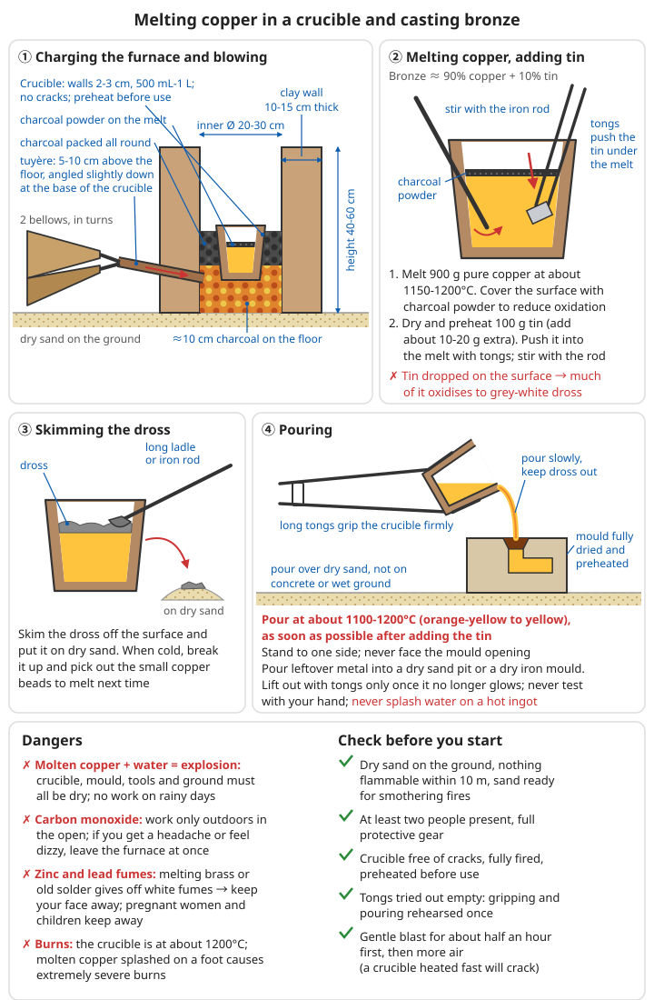

# Copper Smelting

> **The beginner's first choice: the metal you are most likely to smelt successfully**

## ⚠️ Safety first

**Copper is easier to smelt than iron, but it is just as dangerous:**

- ☠️ **Carbon monoxide**: produced in large amounts when a charcoal furnace burns short of oxygen; colourless and odourless. Work only outdoors in the open
- 💥 **Molten copper explodes on contact with water**: a damp crucible, mould, tool or ground will cause a steam explosion if molten copper touches it
- ☠️ **Sulphur dioxide**: given off in large amounts when roasting sulphide ores such as chalcocite and chalcopyrite; irritates the airways and damages crops
- ☠️☠️ **Arsenic**: many copper ores carry arsenic (arsenopyrite, tetrahedrite and others). When heated it gives off white smoke with a garlic smell; it is highly toxic and builds up in the body — **if you find arsenic, stop at once and do not use that ore**
- ☠️ **Zinc fumes and lead**: melting brass gives off white zinc fumes (metal fume fever); old copper scrap may contain lead
- 🔥 **Burns**: the crucible is at around 1200°C; molten copper splashed on the feet causes extremely severe burns

**If you can recover copper and copper alloys from ruins, recover them first (see [Scrap Metal Recycling and Aluminium Casting](../../../docs/05-冶金技术/05-废旧金属回收与铝铸造.md)); smelting from ore is the last resort.** For protective gear see [Metallurgy Basics – Essential protective equipment](../../../docs/05-冶金技术/00-基础冶金知识.md#61-必备防护装备).

---

## ✅ Why start with copper?

**Copper is the best way into metallurgy:**

| Point | Copper | Iron |
|--------|----|----|
| Melting point | 1085°C | Pure iron 1538°C (pig iron about 1150°C) |
| Furnace temperature needed | 1200°C | Bloomery 1100-1300°C; molten iron 1300-1400°C |
| Equipment difficulty | ⭐⭐ Simple | ⭐⭐⭐⭐ Difficult |
| Success rate (first attempt) | 60-70% | 20-30% |
| Smelting time | 3-5 hours | 8-24 hours |
| Difficulty of identifying the ore | ⭐ Very easy (green) | ⭐⭐⭐ Harder |

**Advantages:**
- ✓ Lower temperature needed: an ordinary charcoal furnace plus a blast is enough
- ✓ Short smelting time
- ✓ Copper ores are easy to recognise (bright colours)
- ✓ Can be cast into all kinds of shapes
- ✓ Does not corrode easily
- ✓ Can be made into bronze (harder, more durable)

**Limitations (be realistic):**
- ✗ Copper ore is far less common than iron ore; in most places you will not find usable copper ore
- ✗ Pure copper is very soft; for cutting tools it has to be alloyed with tin into bronze or work-hardened by cold forging, and is still inferior to steel
- ✗ Sulphide copper ores (the commonest primary copper ores) are slow and toxic to smelt; beginners should use only carbonate-type oxidised ores

---

## 1. Identifying copper ores

### 1.1 Malachite Cu₂(OH)₂CO₃ ⭐Recommended

**The easiest copper ore to identify and smelt!**

**Appearance:**
- Colour: **bright green** (the colour of peacock feathers)
- Pattern: concentric rings or bands
- Lustre: silky or glassy
- Hardness: 3.5-4 (a knife scratches it)
- Specific gravity: about 4, noticeably heavier than ordinary rock (about 2.7)

**Identification:**
```
Not every green stone is malachite — chlorite, serpentine, epidote, green mosses and
lichens can all fool you. Do three simple tests:

1. Streak: rub hard on unglazed white porcelain (the bottom of a bowl, the back of a tile)
   → Malachite: pale green streak
   → Chlorite, serpentine and the like: white or almost colourless
2. Acid: scrape off a little powder and add a few drops of vinegar (the stronger the better)
   or dilute hydrochloric acid
   → Malachite: fine bubbles (carbonate)
3. Flame: sprinkle a little powder into a flame
   → Contains copper: the flame turns green or blue-green

Passes all three → almost certainly a copper carbonate ore; it can be smelted
```

For general identification methods see [Geology, Minerals and Soil – Identification methods](../../../docs/08-基础科学知识/06-地质矿物与土壤.md#21-鉴定方法).

**Properties:**
- Copper content: 55-60%
- Decomposes easily (starts to break down and give off CO₂ at 300°C)
- **The best ore for beginners!**

**Where found:**
- The oxidised zone of copper deposits
- Cracks in rock
- Often together with azurite

```
In the field:
- Malachite is usually a thin green crust on rock surfaces and in cracks; large pure
  lumps are rare
- Where green and blue stains appear, there may be sulphide copper ore further down
- Ancient mine pits, place names containing the character for copper (铜), and old slag
  heaps (black, glassy, very heavy lumps) are all clues
```

For clues to finding ore see [Geology, Minerals and Soil – Common clues to metal ore deposits](../../../docs/08-基础科学知识/06-地质矿物与土壤.md#32-金属矿床的常见线索).

### 1.2 Azurite Cu₃(OH)₂(CO₃)₂

**Appearance:**
- Colour: **deep blue, sky blue**
- Lustre: glassy
- Form: crystals or lumps
- Streak: light blue; also fizzes with acid

**Properties:**
- Copper content: 55%
- Brittle
- Often found with malachite (beautiful green and blue together)
- Smelted exactly like malachite; the two can be smelted together

### 1.3 Chalcocite Cu₂S

**Appearance:**
- Colour: lead grey, metallic lustre on fresh surfaces
- Features: soft; a knife scratch shows a copper sheen
- Specific gravity: very heavy (5.5-5.8)
- The surface is often oxidised to a green or blue copper patina

**Properties:**
- Copper content: **79%** (the highest!)
- A sulphide; must be roasted first to remove the sulphur
- Gives off pungent sulphur dioxide when heated (the choking smell of a struck match)

### 1.4 Chalcopyrite CuFeS₂

**Appearance:**
- Colour: brassy yellow (like gold, but harder)
- Lustre: strongly metallic
- Hardness: 3.5-4
- The surface often has an iridescent blue, purple and red tarnish

**Identification:**
- Harder than gold (gold is very soft)
- Greenish-black streak

| Mineral | Colour | Knife scratch | Streak | Other |
|------|------|---------|------|------|
| Chalcopyrite | Deep brassy yellow, often with a coloured tarnish | Scratches | Greenish black | Breaks into irregular pieces |
| Pyrite ("fool's gold") | Pale brassy yellow | Does not scratch (hardness 6-6.5) | Black or greenish black | Often cubes; sparks when struck with steel |
| Native gold | Golden yellow, does not tarnish | Very soft, can be squashed flat | Golden yellow | Extremely heavy; can be hammered into thin leaf |

**Properties:**
- Copper content: 34%
- Contains iron, which goes into the slag during smelting
- ⚠️ Smelting needs repeated roasting and smelting (see route C); **not suitable for beginners**

### 1.5 Native copper Cu (pure copper)

**Extremely rare!**
- Pure red metal
- Can be used directly without smelting
- If you find some, you are very lucky!

```
Native copper occurs in some basalts and in the oxidised zone of copper deposits;
the surface is usually covered with green copper patina.
- Scrape the surface to expose red metal; very soft; spreads under the hammer
  without breaking
- Can be cold-forged directly into small items (awls, needles, sheet); when it gets hard,
  anneal it (see Q5)
- If there is a lot, melt it in a crucible and cast it
```

### 1.6 Ore identification at a glance, and dangerous ores

| Ore | Appearance | Streak | Acid | Copper | Smelting difficulty | Recommended |
|------|------|------|------|------|---------|------|
| Malachite | Bright green | Pale green | Fizzes | 55-60% | ⭐⭐ | ✓✓ |
| Azurite | Deep blue | Light blue | Fizzes | 55% | ⭐⭐ | ✓✓ |
| Chalcocite | Lead grey, metallic lustre | Dark grey | No fizz | 79% | ⭐⭐⭐⭐ (needs roasting) ☠️ | △ |
| Chalcopyrite | Brassy yellow | Greenish black | No fizz | 34% | ⭐⭐⭐⭐⭐ ☠️ | ✗ for beginners |
| Native copper | Red metal | Copper red, shiny | No fizz | About 100% | ⭐ | ✓✓✓ |

**Do not use these ores:**

```
☠️☠️ Arsenic-bearing ores (the most dangerous):
  - Arsenopyrite (mispickel): silvery white to steel grey, metallic lustre, smells of
    garlic when struck
  - Tetrahedrite, tennantite: steel grey to iron black, often with chalcopyrite and galena
  - Realgar (orange-red), orpiment (lemon yellow): often found in the same veins
  Test: a garlic smell when struck, rubbed or heated, or white smoke → contains arsenic
  → Stop at once, keep away from the fumes, and do not use ore from this place again

☠️ Galena: lead grey, very heavy, often in cubes → the copper smelted will contain lead;
   lead fumes are toxic
```

For the hazards of lead and arsenic see [Chemistry – Heavy metals](../../../docs/08-基础科学知识/03-化学.md#93-重金属) and [7. Safety notes](#7-safety-notes) in this chapter.

### 1.7 Collecting and hand-sorting

```
1. Collecting: break off the green mineralised parts with a hammer and steel bar; do not
   dig deep pits, and do not enter old mine workings without supports
   (old workings collapse, and carbon dioxide and other harmful gases may collect at the bottom)
2. Hand-sorting: break the ore to walnut size and, in sunlight, pick out the green and blue
   parts; discard as much white quartz and grey rock as you can
   → the less gangue, the less slag, and the less likely the copper beads are to be
     trapped in the slag
3. Washing: crush further to soybean size, shake and wash in water; the light earth and
   rock fragments wash away
4. Drying: the ore must be completely dry before it goes into the furnace

Test: after hand-sorting, most of the ore is green and blue → good enough
      More than half is white or grey rock → keep sorting, or you will very probably
      not get a solid lump of copper
```

For washing methods see [Metallurgy Basics – Ore concentration](../../../docs/05-冶金技术/00-基础冶金知识.md#54-矿石富集).

---

## 2. Simple copper smelting

### 2.0 Choosing between the three routes

| Route | Suitable ore | Equipment | Time | Difficulty | Danger |
|------|---------|------|------|------|------|
| A Crucible smelting | Hand-sorted malachite, azurite | Small furnace + crucible | 3-5 hours | ⭐⭐ | ☠️ (CO, burns) |
| B Shaft-furnace reduction smelting | Larger amounts of oxidised copper ore | Small shaft furnace | 3-5 hours (longer including preheating) | ⭐⭐⭐ | ☠️ |
| C Roasting + smelting | Sulphide ores such as chalcocite and chalcopyrite | Roasting ground + shaft furnace | Several days | ⭐⭐⭐⭐⭐ | ☠️☠️ (sulphur dioxide, possibly arsenic) |

```
First time: use only route A, with 1-2 kg of hand-sorted malachite
After one success: consider route B to increase output
Route C: only if there really is no oxidised ore and no scrap copper
```

### 2.1 Preparing equipment

**Simple copper furnace:**
- Much smaller and simpler than an iron furnace!
- Inner diameter: 20-30 cm
- Height: 40-60 cm
- Wall thickness: 10-15 cm
- Material: ordinary clay will do (fireclay is better)

```
Building points:
1. Choose a dry, slightly raised spot; spread a layer of dry sand on the ground
2. Mix the clay with chopped dry grass and coarse sand (prevents cracking) and build it up
   ring by ring, or dig a pit in the ground and plaster the inside with clay
3. Make a tuyere about 5-10 cm above the furnace floor and insert a pottery or clay pipe
   (the nozzle), sloping slightly downwards and aimed at the lower part of the crucible
4. Dry in the shade for a few days, then heat with a small fire for at least half a day,
   until no more steam comes off
5. Blast: a skin bag, bellows or a salvaged blower; two bellows worked in turn give
   an unbroken blast

Furnace is good enough: with the blast on, the charcoal bed is bright yellow, and a short
piece of copper wire dropped in melts (>1085°C)
```

For refractory clay recipes see [Iron Smelting – Making refractory material](../../../docs/05-冶金技术/01-铁的冶炼.md#22-耐火材料配制); for making bellows see [Bellows and Forges](../../../docs/05-冶金技术/08-鼓风设备与锻炉.md#三各种风箱的做法); for judging temperature by fire colour see [Metallurgy Basics – Judging temperature](../../../docs/05-冶金技术/00-基础冶金知识.md#41-判断温度).

**Crucible (container for melting copper):**
```
Options:
1. Buy a graphite crucible (ideal)
2. Make one from fireclay
3. A thick iron can (makeshift)
   ⚠️ Only as a short-term emergency: at the melting temperature of copper, iron oxidises
      badly and soon burns through, and iron gets into the copper → not recommended;
      if you have a clay-graphite crucible or a home-made clay crucible, do not use it
```

**Home-made clay crucible:**
1. Shape fireclay into a bowl
2. Walls 2-3 cm thick
3. Capacity 500 mL-1 L
4. Dry slowly and fire hard
5. Can be reused

```
Notes:
- Mix about half grog (crushed old firebrick or porcelain) into the fireclay; it is then
  less likely to crack in firing
- Dry in the shade for at least one or two weeks, heat with a small fire for a few hours
  first, then raise the temperature gradually and fire it through
- Melting clean copper, a good crucible lasts many melts;
  a crucible used to smelt ore directly is eaten by the slag and often lasts only one
  to a few smelts
- Check before every use: if it is cracked, do not use it; preheat it before use; never
  put a cold crucible straight into a fierce fire
```

For making crucibles and crucible tongs in detail see [Advanced Casting – Crucibles](../../../docs/05-冶金技术/07-铸造进阶.md#22-坩埚).

### 2.2 Route A: direct smelting (for malachite and azurite)

**Materials (first time):**
- Malachite: 2 kg
- Charcoal: 3 kg
- Crucible: 1

**Steps:**

**1. Preparing the ore:**
```
Crush → soybean to peanut size
Roasting (optional):
  - Heat in air to red heat
  - For 1-2 hours
  - Reaction: Cu₂(OH)₂CO₃ → CuO + H₂O + CO₂
  - Purpose: drive off water and CO₂, reduce impurities
  - Test: green has turned black and no more gas comes off on further heating
    → roasting is complete
```

**2. Charging:**
```
Bottom: a layer of charcoal (10 cm)
Put in the crucible
Fill all round the crucible with charcoal
Fill the crucible with ore (seven-tenths full)

⚠️ The crucible must not hold ore alone: copper oxide needs carbon and carbon monoxide
   to be reduced to copper
   → mix ore and charcoal powder about 2:1 by volume, load it, and cover with a layer
     of charcoal powder about 2 cm thick
   → with ore alone, all you end up with is molten black copper oxide and slag, no copper
```

**3. Lighting:**
- Light the charcoal from the bottom
- Start blowing
- Use a gentle blast at first so the crucible heats up slowly (about half an hour), then blow harder; this stops the crucible cracking from sudden heating

**4. Heating (2-4 hours):**
```
Temperature stages:
About 300-400°C → ore decomposes and gives off gas, turns from green to black
                  (copper oxide)
Above about 800°C → carbon monoxide and charcoal start to reduce the copper oxide to
                    copper (solid, spongy copper)
1085°C → copper starts to melt; small copper beads gather
About 1150-1200°C → fully molten copper, sinks to the bottom of the crucible

Signs:
- Crucible glowing (yellow)
- An iron rod pushed in meets nothing solid
- A green tinge in the flame at the crucible mouth means there is copper at high
  temperature inside
- Keep topping up the charcoal in the furnace; the charcoal round the crucible must
  never burn away

Common mistakes:
✗ Blast stops and starts → temperature swings up and down; copper beads stay scattered
  in the slag and do not gather
✗ Not enough charcoal in the furnace → upper half of the crucible not hot enough
✗ Adding wet ore or charcoal to the crucible part-way through → spattering
```

**5. Skimming:**
```
A layer of slag (oxides, impurities) floats on the molten copper
Skim it off with a long ladle or iron rod
Put the skimmed slag on dry sand; when cool, break it up: it often contains small copper
beads; pick them out and remelt them next time
```

**6. Casting:**
```
Prepare a mould:
  - Sand mould (a groove cut in sand)
  - Stone mould (a groove carved in a stone slab)
  - Iron mould (durable)

Pouring:
  - Grip the crucible with long-handled tongs
  - Pour slowly into the mould
  - Take care not to pour in slag

⚠️ The mould must be completely dry and preheated; pour on dry sandy ground, never on
   concrete or damp ground
⚠️ Stand to the side when pouring; do not face the mould opening
```

**7. Cooling:**
- Let it cool naturally for 10-20 minutes
- The copper ingot has a red metallic lustre
- Take it out with tongs only once it is no longer glowing; **do not test the temperature with your hand, and do not throw water on a hot ingot to speed things up**

**Yield:**
- 2 kg of malachite → at most about 1.1 kg of copper in theory (malachite is about 57% copper)
- Cleanly hand-sorted malachite actually gives about 0.6-0.9 kg; ore with a lot of rock in it gives much less

```
Working out why it failed:
Only black powder in the crucible              → not hot enough, or no charcoal mixed in
A lump of slag full of small copper beads      → not hot enough or slag too sticky → crush
                                                 the slag, pick out the beads, melt again
Crucible cracked and all the copper ran out    → crucible not dried or heated too fast → the
                                                 copper on the furnace floor can be raked
                                                 out and recovered when cool
Ingot black, porous, very brittle              → gas absorbed or oxidised; see Q2
```

### 2.3 Route B: reduction smelting (for oxidised copper ores)

**Principle:** reduce copper oxide with charcoal
```
2CuO + C → 2Cu + CO₂↑
```

**Like iron smelting, but much simpler:**

1. Mix ore and charcoal (1:1)
2. Load into the furnace, in layers or mixed
3. Blow and heat
4. After 3-5 hours, copper collects at the bottom of the furnace
5. Open the outlet and let the molten copper run out
6. Cast into ingots

**Suitable for:** oxidised copper ores (black or brown)

```
Details:
1. First fill the furnace with charcoal and preheat for about 1 hour to heat the walls through
2. Charge in batches from the top: a layer of charcoal, a layer of ore (or the mixture);
   do not add too much at a time; keep the furnace always full of charcoal
3. Keep blowing; the slag melts inside the furnace and can be let out of a slag hole
   in the side
4. With a lot of gangue (white quartz) the slag is very sticky and the copper beads
   cannot get out: add a little haematite or limonite powder and a little limestone as
   flux to thin the slag
5. A small furnace often does not produce molten copper: let it cool, break open the
   furnace bottom and take out a "furnace-bottom copper cake"; break off the slag stuck
   to it
6. What you get this way is crude copper (black copper) containing slag and iron; it has
   to be refined (see 2.5)

Test: slag that runs out thin, like molten black glass → normal
      Slag thick, pulls into strings, will not run → not hot enough, or needs flux
```

For controlling furnace temperature and the blast see [Metallurgy Basics – Temperature control](../../../docs/05-冶金技术/00-基础冶金知识.md#四温度控制).

### 2.4 Route C: treating sulphide copper ores

**For:** sulphides such as chalcocite and chalcopyrite

**Two steps:**

**Step 1: Roasting (removing sulphur):**
```
1. Crush the ore
2. Pile it in the open or in a shallow pit
3. Light it and let it burn slowly
4. Reaction:
   2Cu₂S + 3O₂ → 2Cu₂O + 2SO₂↑
   (the sulphur escapes as pungent, choking SO₂)
5. Continue for 6-12 hours
6. Product: copper oxide (black)
```

```
Details:
- The ore must be piled in alternate layers with firewood and charcoal to burn; sulphide
  ore also gives off heat as it burns
- Keep it at dark red only; too hot and the ore fuses into lumps and the sulphur inside
  cannot burn out
- Turn it part-way through to let air in
- Test: when turned over, no more pungent smoke, and the ore has become a loose dark
  reddish-brown to black material → roasting is complete
- Chalcopyrite often needs roasting two or three times

⚠️ Roasting ground: away from homes and water sources, more than 500 m from where people
   live, and downwind of homes and fields (sulphur dioxide turns the leaves of nearby
   crops yellow and kills them)
⚠️ Workers stand upwind; do not bend over to smell it; if the smoke smells of garlic or
   there is white smoke → arsenic; stop
```

**Step 2: Reduction smelting:**
- Treat the roasted copper oxide by route B

```
Why chalcopyrite is especially hard (for information):
- Chalcopyrite contains iron; one roasting hardly ever removes all the sulphur
- Smelting first gives not copper but "matte" (dark lumps of copper and iron sulphides
  melted together)
- The matte must be crushed, roasted and smelted again, often for several rounds, with the
  iron gradually going into the slag, before you finally get crude copper
→ Historically this was work for a whole mining operation over several weeks; a small
  group should not make it its first choice
```

For protection against sulphur dioxide see [7. Safety notes](#7-safety-notes) in this chapter.

### 2.5 Refining blister copper

The crude copper from routes B and C often contains iron, sulphur and oxygen, and is black and brittle. It must be refined:

```
1. Break up the crude copper and melt it in a crucible
2. Once molten, blow the blast onto the surface of the copper for a while (oxidising refining):
   iron, sulphur and other impurities oxidise first and float up as slag → skim repeatedly
3. After skimming, the copper holds a lot of dissolved oxygen (brittle) and must be deoxidised:
   - Cover the surface with a layer of charcoal powder
   - Push a freshly cut, wet stick (green wood) into the molten copper and stir —
     the gases and carbon given off by the heated wood take the oxygen out of the copper
     ("poling")
   ⚠️ When poling, the molten copper boils and bubbles violently; stand well back, use
      a long pole and move slowly
4. Pour a small ladleful into a thin sheet, and bend it when cool:
   Bends back and forth repeatedly, fine pinkish fracture → good enough
   Breaks at the first bend, coarse dull fracture → keep refining
5. When it passes, cast it into ingots
```

---

## 3. Making bronze

### 3.1 What is bronze?

**Bronze = an alloy of copper + tin**

**Proportions:**
- Standard bronze: 90% Cu + 10% Sn
- Hard bronze (tools): 88% Cu + 12% Sn
- Soft bronze (ornaments): 92% Cu + 8% Sn

**Why bronze?**
- Pure copper is too soft; tools made of it bend
- Adding tin raises the hardness greatly
- Lowers the melting point (easier to cast): bronze with 10% tin melts at about 1000°C
- Runs well (casts complex shapes)

**Hardness compared:**
| Material | Hardness (HB) | Notes |
|------|----------|------|
| Pure copper | 40-50 | Soft, bends easily |
| Bronze (10% tin) | 100-120 | 2-3 times harder! |
| Wrought iron | 80-100 | Bronze is harder! |
| Steel | 200+ | Steel is hardest |

The figures in the table are approximate; a bronze edge becomes noticeably harder after cold forging, but is still far inferior to quenched steel.

**Tin content and uses:**

| Tin | Properties | Good for |
|------|------|------|
| About 5-8% | Fairly soft, tough, can be cold-forged | Sheet, wire, nails, needles |
| About 10-12% | Hard but not too brittle | Tools such as axes, hoes and knives |
| About 15% and above | Increasingly brittle; can be cast but not forged | Not suitable for tools |
| About 20% and above | Very brittle, but rings loudly when struck and polishes bright | Bells, small bells, mirrors |

```
Simple test: cast a small test bar about 5 mm thick and, when cool, bend it with a hammer
- Bends somewhat before breaking, fine fracture → tin content right
- Shatters at a blow, greyish-white shiny coarse-grained fracture → too much tin;
  add copper and remelt
- Bends very easily, not hard → too little tin
```

### 3.2 Getting tin

**Tin ore: cassiterite SnO₂**

**Identification:**
- Colour: black, brown, dark red
- Lustre: strongly metallic or adamantine
- Specific gravity: **very heavy** (about 6.8-7.0, far heavier than ordinary rock at about 2.7)
- Hardness: 6-7 (very hard)

**Where found:**
- Granite areas
- Placer deposits (in river sand)

**Smelting tin:**
```
Cassiterite + charcoal → heat with a strong blast to about 1000°C or more → tin is reduced,
melts and runs out

Note: although metallic tin melts at only 232°C, reducing cassiterite to tin needs a
temperature of about 1000°C or more and plenty of charcoal (a strongly reducing atmosphere);
it needs a blast — an ordinary open fire will not do.
The slag often still holds tin and needs smelting a second time.
```

For the detailed method see [Other Metals – Tin](../../../docs/05-冶金技术/10-其他金属.md#二锡).

```
Finding tin in the ruins (much easier than smelting it):
- Solder wire and solder bars: old ones are mostly tin-lead alloy (about 37% lead)
  ⚠️ Bronze made with leaded tin contains lead → do not use it for food or drink vessels
- Solder marked "lead-free": mainly tin with a little copper and silver; can be used
  directly to make bronze
- Old pewter ware: often contains lead; likewise do not use it for food or drink vessels
- The tin coating on tinplate (food cans) is very thin; not worth recovering
```

### 3.3 Melting bronze

**Materials:**
- Pure copper: 900 g
- Tin: 100 g
- Charcoal: 2 kg

**Steps:**

1. **Melt the copper:**
   - Put the copper in the crucible
   - Heat to about 1150-1200°C until fully molten (copper melts at about 1085°C)
   - Cover the molten copper with a layer of charcoal powder to reduce oxidation

2. **Add the tin:**
   - Once the copper is molten, add the tin
   - The tin melts instantly (its melting point is so low)
   - Stir evenly with an iron rod
   - Dry and preheat the tin beside the furnace beforehand; push it under the molten copper with tongs, do not just drop it on the surface (tin on the surface oxidises heavily)
   - Some tin is lost in melting; add about 1-2% extra (about 10-20 g)

3. **Skim:**
   - Skim the dross off the surface

4. **Cast:**
   - Pour into the mould
   - Bronze runs extremely well and can cast fine shapes
   - Do not let it stand after adding the tin; pour as soon as possible, at about 1100-1200°C (orange-yellow to yellow)

5. **Cool:**
   - Let it cool naturally
   - Bronze is slightly yellow

**Properties of the product:**
- Colour: freshly cast and polished it is golden to orange-yellow; the "green" (*qing*) of the Chinese name for bronze is the colour of the surface patina after long oxidation
- Hardness: much higher than pure copper
- Toughness: does not break easily
- Corrosion resistance: does not rust away for thousands of years (bronze relics!)

```
Common problems:
✗ Many small holes on the casting surface → molten copper absorbed gas, or the mould
  was damp → cover with charcoal powder, dry the mould thoroughly
✗ Uneven composition, some places white and brittle → not stirred evenly after adding tin
✗ Much of the tin turns into greyish-white dross → tin left on the surface and oxidised;
  push it under the molten copper
```

For running systems, sand moulds and casting defects see [Advanced Casting – Melting and pouring](../../../docs/05-冶金技术/07-铸造进阶.md#六熔炼与浇注) and [Advanced Casting – Casting defects and their causes](../../../docs/05-冶金技术/07-铸造进阶.md#八铸造缺陷和原因).



*Figure: The crucible is surrounded with charcoal, with the nozzle aimed at the lower part of the crucible; the molten copper is covered with charcoal powder and the tin is pushed under the copper and stirred in; after skimming, pour with long-handled tongs on dry sandy ground (about 1100-1200°C, orange-yellow to yellow). Crucible, mould, tools and ground must be dry*

### 3.4 Making brass (an alternative)

**Brass = copper + zinc**
- Proportions: 70% Cu + 30% Zn
- Colour: golden (like gold!)
- Hardness: medium, less than bronze

**The problem:** zinc melts at 419°C but boils at 907°C
- At copper-melting temperature (1100°C), zinc vaporises!

**The ancient method (cementation):**
1. Mix copper sheet with calamine (ZnCO₃) powder
2. Seal and heat to 900°C
3. Zinc vapour soaks into the copper
4. Brass forms on the surface

```
Notes:
- Put copper scrap or thin copper sheet, calamine powder and charcoal powder in a crucible,
  and seal the mouth tight with clay
- Heat to about 900-1000°C and hold for several hours; the zinc is reduced by the charcoal
  to vapour and soaks into the copper
- Finally raise the temperature to melt the brass and pour it out
- If the seal leaks, white zinc oxide fumes come out → move away; do not breathe them
```

For sources of zinc and the difficulties see [Other Metals – Zinc in practice](../../../docs/05-冶金技术/10-其他金属.md#42-现实做法).

**The modern method:**
- Remelt recycled brass items (simple!)
- Discarded copper pipes, valves, ornaments and so on

```
Remelting brass:
- Pour as soon as it is molten and do not let it get too hot, or it gives off white smoke
  (zinc fumes) and the zinc burns away
- A few hours after breathing zinc fumes you get fever, shivering and aching all over
  ("metal fume fever"), usually better in a day or two; if you have difficulty breathing,
  chest pain, or the symptoms do not go away, see a doctor
- Taps, valves and other "free-cutting brass" often contain 1-3% lead → do not use it
  for food or drink vessels
```

---

## 4. Casting techniques

This section covers only the few simple casting methods most used at a copper-smelting site; for moulding boxes, running systems, risers, casting defects and so on see [Advanced Casting](../../../docs/05-冶金技术/07-铸造进阶.md).

### 4.1 Sand casting (the simplest)

**Materials:**
- Fine sand (river sand)
- Clay powder (a little, 5-10%)
- Water (very little, just to dampen)

```
Moisture test: squeeze a handful tight; it holds together, leaves no water on your hand,
               and breaks with a clean face → right
               Will not hold together → too dry; hand wet, leaves a water mark → too wet
               (makes a lot of steam when poured; may spatter)
```

For preparing moulding sand and moulding in boxes see [Advanced Casting – Moulding sand and moulding](../../../docs/05-冶金技术/07-铸造进阶.md#四型砂与造型).

**Making the mould:**
```
Method 1: cut a groove directly
  - Cut the shape into smooth damp sand
  - Suitable for: simple shapes (ingots, sheet, rings)

Method 2: pressed pattern
  - Carve a pattern from wood or stone
  - Press it into the sand to leave an impression
  - Take out the pattern
  - Pour in the metal

Method 3: two-part mould
  - Make upper and lower halves of the sand mould
  - Leave a pouring opening
  - Put the halves together and pour
  - Suitable for: complex shapes (axe heads, knives)
```

**Pouring steps:**
1. Ram the sand mould firm (so it does not collapse)
2. Dig out the pouring channel
3. Preheat the mould (to avoid cold cracking)
4. Pour in the molten copper quickly
5. Wait 5-10 minutes to cool
6. Break away the sand and take out the casting
7. Remove the flash and grind smooth

```
Notes:
- For a sand mould, step 3 "preheat" mainly means letting it dry and drying the surface of
  the mould cavity with a charcoal fire
- Poke a few vent holes round the cavity with fine wire so steam and air can escape
- Fill it in one pour without stopping; keep pouring until copper shows at the pouring cup
```

For designing sprues and risers see [Advanced Casting – Running systems](../../../docs/05-冶金技术/07-铸造进阶.md#五浇注系统).

### 4.2 Lost-wax casting (precision casting)

**Suitable for:** complex shapes, works of art

**Procedure:**
```
1. Carve a wax model (beeswax or animal fat)
2. Wrap it in clay to form a shell
3. Leave a pouring opening and vent holes
4. Bake:
   - The wax melts and runs out
   - The clay fires hard into pottery
5. Pour molten copper to fill the cavity
6. When cool, break the shell
7. You have a finely detailed casting
```

```
Points for each step:
1. Wax: beeswax with a little rosin is harder and holds its shape better; pure animal fat is
   too soft and only suits very simple shapes
   Keep the wax model walls no thinner than about 3 mm, or the copper will not fill them
2. Make the pouring opening and vent holes from wax rods too, stick them to the wax model,
   and wrap them in the clay with it
3. Apply the clay in two layers:
   - First layer: a very fine slip (fine clay mixed with water to a thin paste), brushed on
     or dipped several times to copy the detail
   - Second layer: coarse clay mixed with chopped dry grass or coarse sand, built up into
     a shell about 1-2 cm thick
4. Dry in the shade for several days, until completely dry
5. With the pouring opening downwards, heat slowly to let the wax run out (it can be
   collected and reused), then raise the temperature to dark red and fire for several hours
   to burn off the last of the wax and turn the clay shell into pottery
6. Pour while the shell is still hot (a hot shell lets the copper run further); bury the
   shell in dry sand so it does not burst

Shell is good enough: after firing it rings clearly when tapped, and nothing rattles inside
when shaken
```

**Advantage:** can cast extremely complex shapes
**Disadvantage:** each mould can be used only once

### 4.3 Stone-mould casting (durable)

**Method:**
- Carve the mould in soft stone (soapstone, sandstone)
- Can be reused dozens of times
- Suitable for: small items such as arrowheads, blades and nails

```
How:
1. Choose two fine-grained, uncracked pieces of soft stone and grind the mating faces flat
2. Carve the cavity and pouring opening in one or both; when finished, put them together
   and cut a few alignment marks on the side, or make two pegs and holes, so they line up
   every time
3. Before pouring: smoke the cavity with a layer of soot (release agent), and warm the whole
   mould with a charcoal fire to drive the water out of the stone
4. Bind the halves tight with wire or rope, stand it pouring opening up in dry sand, and pour

⚠️ Do not use river pebbles or stones just taken from water: they hold water inside and
   burst at high temperature
⚠️ Sandstone cracks and flakes easily when heated; soapstone is best; fired clay moulds
   can also be used instead
```

---

## 5. Useful copper goods

### 5.1 Tools

**1. Copper axes and hoes (bronze):**
- Not as good as iron, but better than stone
- Do not rust easily
- Good for farming

**2. Copper knives (bronze):**
- Chopping, cutting
- Need frequent sharpening (not as good as steel)

**3. Copper arrowheads (bronze):**
- Sharp, penetrate well
- Simple to cast

**4. Copper needles and hooks:**
- Sewing, fishing
- Do not rust

```
Making bronze tools last longer:
- After casting the blank, hammer the edge repeatedly while cold (cold forging work-hardens
  it), then grind the edge
- A chipped or turned edge can be hammered and dressed again, and worn-out tools can be
  remelted and recast — no copper is wasted
- Once you have iron and steel, copper is better kept for things that must not rust,
  or must conduct electricity or heat
```

For forging tools and dressing edges see [Forging Simple Tools](../../../docs/05-冶金技术/03-简易工具锻造.md).

### 5.2 Containers

**1. Copper pots and basins:**
- Conduct heat quickly
- Durable
- Note: do not use them for strongly acidic food (forms verdigris, which is toxic)
- Traditional copper pots are tinned inside to separate the food from the copper; when the tin wears through and red copper shows, re-tin them

**2. Copper buckets and cups:**
- Storing water
- Naturally antibacterial (copper ions kill germs)
- ⚠️ This antibacterial effect is slow and unreliable; it cannot replace boiling or other drinking-water disinfection

**Other important uses:**
- Copper wire: second only to silver in conductivity; generators, electric motors and the telegraph all depend on it (keep copper wire from ruins as wire wherever possible; see [Scrap Metal Recycling and Aluminium Casting](../../../docs/05-冶金技术/05-废旧金属回收与铝铸造.md))
- Copper sheet and pipe: stills, heat exchangers, roofing (for copper sheet and wire drawing see [Sheet and Wire](../../../docs/05-冶金技术/11-板材与线材.md))

### 5.3 Ornaments and money

**Copper mirrors:**
- Polished, they can serve as mirrors

**Copper coins:**
- Can be used as money (most ancient coins were copper)

**Copper bells and ornaments:**
- Decoration

---

## 6. Common questions

### Q1: Can I make bronze without tin?

**A: There are alternatives**

**Option 1: copper-arsenic alloy**
- Use arsenic-bearing ore instead of tin
- Hardness also increases
- ⚠️ Arsenic is highly toxic! Extreme care needed

```
☠️☠️ This book does not recommend this option:
- Much of the earliest "bronze" in history was arsenical copper, but when it is smelted,
  arsenic escapes in large amounts as white smoke (arsenic trioxide, i.e. white arsenic);
  smelters who breathe it for a long time suffer nerve and skin damage and cancer
- Arsenic builds up in the body; poisoning often shows only years later and cannot be reversed
- There is no reliable way, under primitive conditions, to control the arsenic content or
  protect against the fumes
→ Do not deliberately use arsenic-bearing ore; prefer options 2 and 3
```

**Option 2: use pure copper**
- Soft, but usable
- Cold forging (repeated hammering) increases hardness

**Option 3: recycle scrap copper**
- Electrical wire (pure copper)
- Brass items (contain zinc)
- Bronze items (antiques may contain tin)

### Q2: Why is the copper I smelted so brittle?

**A: Probably too much oxygen**

**Fixes:**
- Sprinkle a layer of charcoal powder on the surface while melting (keeps air out)
- Stir with a wooden stick (it chars and deoxidises)

| Cause | Signs | Fix |
|------|------|------|
| Too much oxygen | Dull red, coarse fracture | Cover with charcoal powder, pole it (see [Refining blister copper](#25-refining-blister-copper)) |
| Sulphur (incomplete roasting) | Casting full of gas holes, smells of sulphur | Roast the ore thoroughly; oxidise-refine the crude copper |
| Iron, lead or other impurities | Hard and brittle, off colour | Hand-sort the raw material; oxidise-refine and skim |
| Bronze with too much tin | Greyish white, shatters at a blow | Add copper and remelt (see [3.1](#31-what-is-bronze)) |
| Over-worked by cold forging | Cracks appear after hammering | Anneal after every spell of hammering (see Q5) |

### Q3: Are copper vessels toxic?

**A: Pure copper is not toxic, but take care:**

✓ Safe uses:
- Cooking rice and boiling water in copper pots
- Drinking from copper cups

✗ Avoid:
- Storing acidic food (vinegar, fruit juice) for long → forms verdigris (toxic)
- If there is green corrosion, clean it off thoroughly before use
- Do not leave food in copper vessels overnight

### Q4: How much copper can I make at once?

**A:**
- Small crucible (500 mL): 0.5-1 kg
- Medium crucible (2 L): 2-4 kg
- Large crucible (5 L): 5-10 kg

```
Notes:
- The figures above are roughly how much copper each smelt gives when smelting ore in
  the crucible
- If you are melting scrap copper, the same crucible holds much more: molten copper has
  a density of about 8.9 g/mL, so a 500 mL crucible seven-tenths full holds about 3 kg
  of molten copper → the crucible and tongs must be able to take that weight
- A large crucible full of molten copper is very heavy; two people must carry it with
  a pouring shank, and rehearse it empty first
```

### Q5: Can copper be forged?

**A: Yes, but take care:**

**Cold forging:**
- Pure copper can be cold-forged (hammered at room temperature)
- It gets harder the more you hammer it (work hardening)
- But also more and more brittle

**Hot forging:**
- Heat to blood red to bright red (about 700-900°C)
- Hammer into shape
- Anneal (heat and cool slowly) to restore toughness

```
Notes:
- Pure copper is shaped mainly by alternating "cold forging + annealing": hammer for a while,
  and when it feels hard, before fine cracks begin to appear, heat it to dark red
  (about 500-550°C) to anneal it, then carry on hammering
- Copper is unlike steel: after annealing it can be cooled in air or plunged straight into
  water; quenching does not harden copper, and it also knocks off the surface scale
- Large pieces of pure copper can also be hot-forged at blood red to bright red
  (about 700-900°C)
- Bronze (about 10% tin) is mainly cast; only the edge is suitable for cold forging;
  the more tin, the less it can be forged
```

For annealing and quenching steel see [Metalworking](../../../docs/05-冶金技术/04-金属加工技术.md); for drawing copper wire and rolling copper sheet see [Sheet and Wire](../../../docs/05-冶金技术/11-板材与线材.md).

---

## 7. Safety notes

### Copper poisoning (relatively mild, but still take care):

**Acute poisoning:**
- Symptoms: nausea, vomiting, abdominal pain
- Cause: swallowing a large amount of copper salts
- What to do: **do not make them vomit**, and do not give milk or other home "antidotes"; rinse the mouth, then call 120 at once or get to hospital, taking a sample of what was swallowed

```
- The commonest case is swallowing copper sulphate (blue vitriol, blue crystals, used to
  make pesticides such as Bordeaux mixture); it is far more toxic than the patina on copper
  vessels → keep it in a labelled container out of children's reach
- Blue-green vomit, severe abdominal pain, little urine, yellowing of the skin and eyes
  → serious; get to hospital as soon as possible
```

For the general handling of poisoning see [Poisoning – General principles of treating poisoning](../../../docs/01-日常疾病和伤害/12-中毒.md#中毒的通用处理原则).

**Prevention:**
- Wash your hands after work
- Do not keep food in damaged or corroded copper vessels
- Clean copper vessels regularly

### Roasting sulphide copper ore:

**It produces SO₂ (toxic!):**
- A pungent, choking, irritating gas (smells like a struck match), not a rotten-egg smell
- You must stay upwind
- More than 500 m from where people live

```
- After breathing it: coughing, tight throat and chest, wheezing, stinging, watering eyes
- People with asthma, children, the elderly and pregnant women are especially at risk;
  keep them away from the downwind side of the roasting ground
- What to do: leave the smoke at once for fresh air upwind; rinse the eyes with plenty of
  clean water; if coughing and chest tightness do not ease, or breathing becomes difficult
  → get to hospital at once
- A wet cloth over the mouth and nose only slightly reduces the irritation; it is not
  protection → rely on distance and wind direction
- Crops and vegetables downwind of the roasting ground will be damaged; do not roast
  upstream of a water source
```

For general information on toxic gases see [Chemistry – Toxic gases](../../../docs/08-基础科学知识/03-化学.md#92-有毒气体).

### Arsenic: the associated poison to watch most closely

```
☠️☠️ Many sulphide copper ores contain arsenic; in roasting and smelting the arsenic is given
    off as white smoke and condenses in cooler places such as the flue and furnace mouth
    as a white powder (arsenic trioxide, i.e. white arsenic)

Warning signs:
- A garlic smell when the ore is struck or heated
- White smoke during roasting or smelting, and a frost-like layer of white powder building
  up near the furnace mouth

As soon as you notice it:
1. Stop work; everyone moves upwind
2. Do not sweep up or touch the white powder; keep children and livestock away; do not let
   rain wash it into a water source
3. Do not use this batch of ore, the slag, or the copper produced for food or drink vessels
4. Abandon this ore from then on

Signs of chronic poisoning (long-term exposure): numbness and tingling in the hands and feet,
darkened or spotted skin, thickened skin on the palms and soles, weakness → stop exposure
and see a doctor
```

### Other hazards

```
☠️ Carbon monoxide: headache, dizziness and nausea are early warning signs → leave the
   furnace at once for fresh air; when several people work, watch out for each other;
   do not sleep near the furnace
💥 Molten metal and water: crucible, moulds, tools and ground must be dry; no work in rain
☠️ Zinc and lead fumes: white smoke when melting brass or old solder → do not get close;
   pregnant women and children keep away
🔥 Burns: rinse at once under cool running water for 15-20 minutes; large or deep burns
   go to hospital
```

For treating carbon monoxide poisoning and burns see [Metallurgy Basics – Preventing poisoning](../../../docs/05-冶金技术/00-基础冶金知识.md#63-中毒预防) and [Metallurgy Basics – Treating burns](../../../docs/05-冶金技术/00-基础冶金知识.md#64-烧伤处理).

---

## 8. Checklist

### Preparing for the first copper smelt:
- [ ] Identify and collect malachite or azurite (the simplest)
- [ ] Streak and acid tests confirm copper ore; no garlic smell (no arsenic)
- [ ] Ore crushed
- [ ] Most white and grey rock hand-sorted out; ore dried
- [ ] Crucible made or obtained
- [ ] Crucible checked free of cracks and fired through
- [ ] Small furnace built and dried
- [ ] 5 kg of charcoal ready
- [ ] Sand mould made
- [ ] All protective gear present
- [ ] Dry sand spread on the ground, nothing flammable within 10 m, sand ready for fires
- [ ] At least two people present

### During smelting:
- [ ] Continuous blast
- [ ] Temperature has reached yellow (about 1200°C)
- [ ] Copper fully molten
- [ ] Dross skimmed off
- [ ] Charcoal topped up as needed; never burnt away round the crucible
- [ ] Anyone with headache or dizziness → leaves the furnace at once

### Before pouring:
- [ ] Mould preheated
- [ ] Mould dry
- [ ] Safe distance
- [ ] Crucible tongs tried out empty: gripping and pouring rehearsed
- [ ] Somewhere ready for surplus molten copper (a dry sand pit or dry iron mould)

### After smelting:
- [ ] Slag broken up when cool and copper beads picked out
- [ ] Furnace fire put out and checked for embers
- [ ] Hands and face washed before eating or drinking
- [ ] Record: amount of ore, amount of charcoal, time, copper produced, to compare and improve next time

---

## Related chapters

- ⏮️ [Metallurgy Basics](../../../docs/05-冶金技术/00-基础冶金知识.md) - building furnaces, making fuel
- ⏭️ [Forging Simple Tools](../../../docs/05-冶金技术/03-简易工具锻造.md) - working and using copper items
- ⏭️ [Metalworking](../../../docs/05-冶金技术/04-金属加工技术.md) - casting and forging techniques
- 🔗 [Scrap Metal Recycling and Aluminium Casting](../../../docs/05-冶金技术/05-废旧金属回收与铝铸造.md) - recovering copper wire, brass and bronze
- 🔗 [Advanced Casting](../../../docs/05-冶金技术/07-铸造进阶.md) - crucible furnaces, moulding boxes, running systems, casting defects
- 🔗 [Bellows and Forges](../../../docs/05-冶金技术/08-鼓风设备与锻炉.md) - bellows and nozzles
- 🔗 [Other Metals](../../../docs/05-冶金技术/10-其他金属.md) - sources and smelting of tin and zinc
- 🔗 [Sheet and Wire](../../../docs/05-冶金技术/11-板材与线材.md) - copper sheet, copper wire
- 🔗 [Geology, Minerals and Soil](../../../docs/08-基础科学知识/06-地质矿物与土壤.md) - mineral identification and prospecting
- 🔗 [Poisoning](../../../docs/01-日常疾病和伤害/12-中毒.md) - dealing with swallowed and inhaled poisons

---

**Remember: copper is the beginner's best friend! Smelting copper successfully will give you great confidence and lay the groundwork for learning to smelt iron.**

**The glory of the Bronze Age is yours to recreate!**
