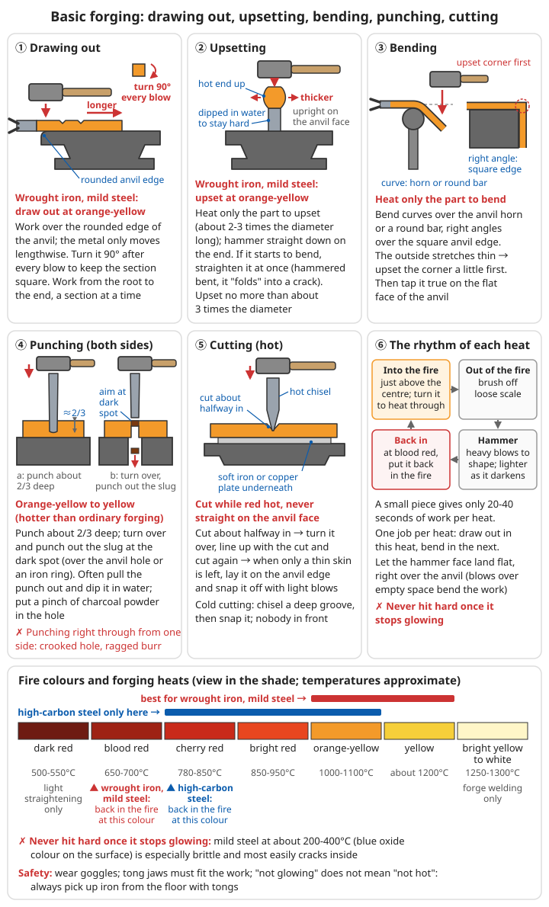

# Forging Simple Tools

> **The tools you need most after collapse - making survival gear from scratch**

## 🔨 Introduction

**Having metal is not enough. It is only useful once you have worked it into tools!**

This chapter teaches you how to forge the most basic, most essential tools from wrought iron, steel or bronze. These tools will be the foundation for rebuilding civilisation.

**Tool priorities:**
1. **Hammer** - the tool for making other tools
2. **Knife and axe** - basic survival tools
3. **Hoe, pick** - farming and mining
4. **Nails** - essential for building

**Where the material comes from:** After civilisation collapse, the most realistic raw material is not iron you smelt yourself but steel from the ruins: car leaf springs, files, rails, axle shafts, rebar. Which material suits which tool is covered in [Scrap Metal Recycling and Aluminium Casting - Iron and steel](../../../docs/05-冶金技术/05-废旧金属回收与铝铸造.md#31-钢铁); smelting your own wrought iron is covered in [Iron Smelting](../../../docs/05-冶金技术/01-铁的冶炼.md).

**The difference between wrought iron and steel decides how you forge:**
- **Wrought iron, low-carbon steel** (rebar, sheet iron): soft, easy to forge, easy to forge-weld, but **cannot be hardened by quenching** → knife bodies, axe bodies, nails, chains, hoe blades
- **Medium- and high-carbon steel** (axle shafts, leaf springs, files): can be hardened by quenching, but the forging temperature range is narrow; overheat it and it is ruined, work it too cold and it cracks → hammer heads, picks, cutting edges, chisels, punches
- **Pig iron, cast iron**: **cannot be forged**; it shatters at the first blow and can only be cast

---

## ⚠️ Safety first

- ☠️ **Carbon monoxide**: a charcoal or coal fire indoors or in a closed shed can cause headache, unconsciousness and even death. The forge must stand under a well-ventilated, half-open shelter; see [Home and Traffic Accidents - Carbon monoxide poisoning](../../../docs/01-日常疾病和伤害/07-居家与交通意外.md#一氧化碳中毒)
- 🔥 **"Not glowing" does not mean "not hot"**: iron that has cooled until you can no longer see any red is still several hundred degrees Celsius. Treat every piece of iron round the anvil and on the ground as hot; pick it up with tongs, never by hand
- 👁️ **Wear safety goggles**: scale flies off when you hammer; once the head of a chisel or punch has spread into a "mushroom head", the curled rim breaks off and flies out. Eye injuries are the most common injury
- 👕 Wear cotton, linen or leather clothing and an apron, not synthetics (sparks melt them onto your skin); wear shoes that cover the top of the foot; tie back long hair
- 🛢️ **Quenching oil can catch fire**: keep the oil in a metal drum with a lid, and plunge the workpiece in completely in one go; if the oil catches fire, put the lid on or throw sand on it. **Never throw water on it**
- ☠️ Galvanised parts (sheet iron with a white coating, water pipes, screws) give off white smoke when heated; breathing it in causes "metal fume fever". Remove the zinc coating before forging (see [Scrap Metal Recycling and Aluminium Casting - Dismantling and pre-treatment](../../../docs/05-冶金技术/05-废旧金属回收与铝铸造.md#四拆解与预处理)). Do not forge lead, cadmium-plated parts, or parts with coatings of unknown origin
- 🔨 When two people work with a sledgehammer, agree on spoken signals beforehand; the person holding the tongs must not stand in the line of the sledgehammer's swing
- 🔇 Forging for long periods damages hearing; plug your ears with cotton wool or cork

For treating burns see [Wound and Injury Care - Scalds and burns](../../../docs/01-日常疾病和伤害/02-外伤处理.md#烫伤与烧伤); for general protection in metallurgical work see [Metallurgy Basics - Safety and protection](../../../docs/05-冶金技术/00-基础冶金知识.md#六安全防护).

---

## 1. Forging basics

### 1.1 What is forging?

**Forging = heating metal + hammering it into shape**

**Principles:**
- Metal softens when heated
- Hammering changes its shape
- After cooling it keeps the new shape
- Repeated hammering makes metal denser and stronger

Forging squeezes out slag and breaks up coarse grains, so forged parts are much tougher than cast ones: knives, axes, chisels and nails, which take impacts, must be forged; pots and ploughshares, which have complex shapes and do not take violent impacts, are cast (see [Advanced Casting](../../../docs/05-冶金技术/07-铸造进阶.md)). Forging only changes the shape; when working out how much material you need, allow about 1/5 more than the weight of the finished piece to cover scale and offcuts.

### 1.2 Forging temperatures

| Temperature | Colour | State | Use |
|------|------|------|------|
| Dark red (about 500-550°C) | Dark red, barely visible in the dark | Too hard | Not suitable for forging; only light straightening |
| Blood red (about 650-700°C) | Blood red | Fairly hard | Stop temperature for wrought iron and low-carbon steel: when it reaches this colour, put it back in the fire |
| Cherry red (about 780-850°C) | Cherry red; a little hotter than the point where a magnet just stops sticking (about 770°C) | Forgeable | **Quenching temperature**; lower limit for forging high-carbon steel; final finishing and shaping |
| Bright red (about 850-950°C) | Bright red (bright cherry red) | Forgeable | Main forging temperature for high-carbon steel |
| Orange-yellow (about 1000-1100°C) | Orange-yellow | **Easiest to forge** | Main temperature for drawing out and upsetting wrought iron and low-carbon steel; do not take high-carbon steel above this colour |
| Yellow (about 1200°C) | Yellow | Very soft | Heavy forging and first breakdown of wrought iron and low-carbon steel; high-carbon steel is burnt |
| Bright yellow to white (about 1250-1300°C) | Shining, the surface looks as if it is sweating, a few sparks | Forge-welding temperature | Use only for forge welding; sparks bursting out in large numbers = already burnt |

**Key points:**
- **Wrought iron and low-carbon steel forge best at orange-yellow to yellow; when they fall to blood red, put them back in the fire**
- **Forge high-carbon steel (leaf springs, files) only between cherry red and orange-yellow; the range is narrow, so reheat often**
- Not hot enough: it will not move, and the tool cracks easily
- Too hot: the metal burns away and its properties suffer
- **Never strike heavy blows when it is no longer glowing**: low-carbon steel is particularly brittle at about 200-400°C (when blue oxide colours appear on the surface); hammering it then is the surest way to create hidden cracks

**Reading the fire colour:** look in the shade under the shelter (in sunlight the same temperature looks darker, and you will easily overheat it); tips and thin edges heat quickly, so check that the thickest part is heated through.

### 1.3 Essential tools

#### Minimum tool set:

**1. Forge:**
```
Simple forge:
- Much smaller than a smelting furnace
- Inside diameter: 20 cm
- Depth: 15 cm
- Hearth filled with charcoal
- Air inlet (tuyere) in the side
- Can be built temporarily from firebricks
```

For the forge's construction, fuel, fire management and how to make various kinds of bellows, see [Bellows and Forges](../../../docs/05-冶金技术/08-鼓风设备与锻炉.md#五锻炉).

**2. Anvil:**
```
Ideal: a large block of wrought iron or steel (50-100 kg)
Substitutes:
  - Large stone (granite, basalt)
  - A length of railway rail
  - A large block of iron
Requirements: flat, hard, stable
```

For anvil mounting height and anvil materials found in the ruins, see [Bellows and Forges - The anvil](../../../docs/05-冶金技术/08-鼓风设备与锻炉.md#54-砧子).

- The heavier the anvil the better: if the anvil "does not move" when you strike, your effort goes into the workpiece
- Grind one edge of the anvil face to a rounded corner (radius about 5 mm) for bending and fullering, and keep the other edge square; fix a thick round steel bar beside it as a "horn" for bending rings and hooks
- A stone anvil chips and cracks easily; put a soft iron plate under the work when cutting or punching

**3. Hammer:**
```
At first: stone hammer, iron hammer head lashed to a wooden handle
Later: forge your own purpose-made hammers
Weight: 0.5-2 kg
```

- A single smith's main hammer is about 1-1.5 kg; beginners should start at about 1 kg. When two people work together, the striker swings a 3-5 kg sledgehammer and the smith directs with a small hammer ("where the small hammer taps, the sledge strikes")
- A ball-peen hammer (one flat face, one rounded face) is used for drawing out and hammering hollows

**4. Tongs:**
```
Use: holding hot workpieces
At first: two wooden sticks + bound with wire
Later: forged iron tongs
```

- **The jaws must fit the thickness and shape of the workpiece**, or the jolt of the hammer will throw the workpiece out and injure someone; have one pair each for square, round and flat bar. Slip an iron ring over the two reins to lock the jaws tight

**5. Chisels and punches:**
```
Use: making holes, cutting
How made: hardened (quenched) iron rods
```

- Make them from steel; wrought iron cannot be hardened. **Hot chisels and hot punches** are used on red-hot work; short and stout is fine, just dip them in water often. **Cold chisels** cut cold iron and must be quenched and tempered (method below)
- Also make a "drift" with a gentler taper to enlarge a punched hole and correct its shape

**Other items:** quenching water bucket (beside the forge, within arm's reach), metal oil drum with a lid, magnet (to judge quenching temperature), wire brush, whetstone and sandpaper (to see temper colours), callipers or wire templates, soapstone marker, sand for fire-fighting.

#### Making your first pair of tongs:

```
Material: two pieces of wrought iron or steel bar about 12-16 mm square, each about 40 cm long; make the two halves identical
1. Flatten about 5 cm at the end to make the jaw; flatten the section right next to it into the joint,
   with the flat turned 90° to the jaw
2. Draw out the rest into the rein, about 30 cm long; punch a hole (about 8 mm) in the centre of the joint
3. Cross the two halves, insert a red-hot rivet and rivet them together; while hot, open and close them repeatedly so they do not seize
4. Put the stock you want to hold into the jaws, heat the jaws and hammer them so they fit this stock
Check: grip a workpiece and tap it with the hammer; it must not wobble, turn or slip out
```

For the key points of riveting see [Welding and Joining - Riveting](../../../docs/05-冶金技术/06-焊接与连接.md#二铆接).

#### Making chisels and punches:

```
Material: high-carbon steel (leaf springs or old files, annealed first) or medium-carbon round bar,
          about 16-20 mm in diameter, about 15-20 cm long

1. Forge the shape: draw one end into a taper or a flat wedge (the chisel edge); on the other end (the struck end)
   forge a chamfer of about 2 mm
2. Normalise: heat to cherry red and let it cool naturally in air; repeat 2-3 times (relieves forging stresses)
3. Grind the edge: cold chisel edge angle about 60° (for cutting iron), wood chisel about 25-30°
4. Quench: heat only about 2-3 cm at the cutting end to cherry red, dip about 1 cm into water,
   moving it up and down a little; when the edge has turned black, take the whole thing out
5. Temper: polish the edge bright and let the residual heat in the upper part drive the colours down to the edge;
   when a cold chisel reaches purple, or a wood chisel reaches brown, plunge the whole tool into water
6. Do not quench the struck end; keep it soft. Once it has spread into a "mushroom head", grind off the curled rim at once,
   or the rim will break off and fly into someone's eye
```

### 1.4 Basic forging techniques

#### Holding the hammer and where to stand

```
Stance: stand side-on to the anvil, with the foot on your tong-hand side slightly forward; the anvil face should be
        at about knuckle height with your arm hanging down
Grip: hold near the end of the handle, not in a death grip; let the weight of the head do the falling
Blow: the hammer face lands flat, with the point of impact directly over the anvil
      (a tilted face leaves crescent-shaped marks; striking an overhanging part bends it and jars your hand)
Each heat: bury the work just above the centre of the fire (directly in front of the tuyere it oxidises badly), turn it so it heats through
           → take it out and brush off loose scale → heavy blows first to shape it, lighter blows as it darkens
           → back into the fire when it falls to blood red. A small piece gives only 20-40 seconds of work per heat
           One heat, one job: draw out in this heat, bend in the next
```

**1. Flat blows:**
- Strike straight down
- For flattening and spreading
- When finishing the surface, use light, close blows to flatten out hammer marks

**2. Angled blows:**
- Strike at an angle
- For shaping and gathering in
- For example to forge the bevel of a cutting edge, or to bring the corners of a square bar in to an octagon

**3. Fold forging:**
- Fold the metal in half
- Hammer repeatedly
- Adds layers, improves strength
- In practice the main purpose is **to squeeze out the slag in bloomery iron and make the composition even**; the layers themselves are nothing magical. Folding wrought iron 3-6 times is enough; folding too many times burns out the carbon and burns away the material. Method in [11.1](#111-fold-forging-hundred-refined-steel)

**4. Upsetting:**
- Strike the end straight on
- Makes the metal thicker

```
Uses: nail heads, thickening joints before forge welding, the eye area of hammer heads and picks

1. Heat only the section to be upset (about 2-3 times the diameter in length);
   after heating you can dip the rest in water to keep it hard
   → only the hot section thickens, not the whole bar
2. Stand the workpiece on the anvil face, hot end up (or hot end down and "ram" it on the anvil); strike the end face squarely
3. Check every few blows: if it starts to bend, straighten it on the anvil at once before carrying on
   (if you keep hitting it bent, it folds into a crack, called a "cold shut", and it will later break there)
4. The section being upset should not be longer than about 3 times the diameter; longer than that, it will certainly bend; do it in several heats
```

**5. Drawing out:**
- Keep hammering
- Makes the metal longer and thinner

```
Uses: forging thick stock into long thin bars, knife blades, points

Drawing out a square bar:
1. After each blow, turn the work 90°, hitting two faces in turn to keep the section square
   (hitting in only one direction turns the section into a diamond, which gets more and more skewed and easily splits down the middle)
2. Hammer the work over the rounded edge of the anvil, or use the edge of the hammer to make a series of cross grooves,
   then hammer the grooves flat → the metal moves only lengthways, much faster than hammering on the flat face
3. Work from the root of the stock towards the end, a section at a time, with hammer marks overlapping

Drawing to round: square → knock off the four corners to an octagon → sixteen sides → tap lightly while turning until round
Drawing a point: forge the point square, round it off last; the tip is thin and heats fast, so take it out of the fire first
                 to avoid burning it
```

**6. Bending:**

```
1. Heat only the section to be bent (heat where you bend)
2. Bend curves over the horn or a round bar; bend right angles over the square edge of the anvil
   No horn: drive two thick iron pegs into a wooden block, put the work between them and lever it round (a bending fork)
3. The outside of a bend is stretched thin, and the sharper the bend the thinner it gets
   → for a square, strong right angle, first upset the corner a little, then bend
4. After bending, tap it flat on the flat anvil face and check that it lies in one plane
```

**7. Punching:**

```
Uses: hammer eyes, axe eyes, tong joints, rivet holes

1. Mark the position on the work first, tap a shallow mark with the punch, and check the position is right
2. Heat to orange-yellow to yellow (hotter than for ordinary forging, so punching takes less effort)
3. Set the punch on the mark and strike hard, driving it to about 2/3 of the work's thickness
   - Every few blows, pull the punch out and dip it in water, or the heat will soften it
   - Sprinkle a pinch of charcoal powder in the hole so the punch does not stick
4. Turn it over: on the back you can see a darker spot (where the punch has come closest)
5. Punch down from the back on the dark spot to knock out the small remaining "slug":
   place the work over the hole in the anvil, or on an iron ring, so the slug drops out underneath
6. Reheat and use a drift with a gentler taper to enlarge the hole and correct it to the shape you need
   (for example the oval of a hammer eye or axe eye)

❌ Punching right through from one side only: the hole goes crooked and the back tears out with a ragged edge
❌ Punching where the stock is too narrow: the "walls" either side of the hole are squeezed and crack. Leave at least as much
   material round the hole as the hole's diameter; upset that area first if needed
```

**8. Cutting:**

```
Hot cutting (thick stock, red hot):
1. Put a soft iron or copper plate under the work; do not cut directly on the anvil face (it chips the chisel edge and the anvil face)
2. Stand the hot chisel on the cut line and strike, cutting about halfway in
3. Turn it over and cut from the other side, lined up on the cut
4. When only a thin layer is left, put the cut over the anvil edge and break it off with light blows

Cold cutting (thin stock, sheet):
- Use a cold chisel to cut a deep groove all round the cold stock, then break it off over the anvil edge
- Wear goggles: the cut-off end flies off; no one should stand in front
- If you have a hacksaw, it is easier to saw thin stock (see Bench Work and Machining)
```

For sawing and filing see [Bench Work and Machining](../../../docs/05-冶金技术/09-钳工与机械加工.md#三锯削).



*Figure: Draw out over the rounded anvil edge, turning 90° after each blow; when upsetting, heat only the end; heat where you bend; punch from both sides; put a soft iron plate under hot cuts. Wrought iron and low-carbon steel forge best at orange-yellow to yellow; put them back in the fire when they fall to blood red*

**9. Forge welding:**

Heat two pieces of wrought iron or low-carbon steel to bright yellow to white, sprinkle on borax (or fine quartz sand) as flux, quickly lay them together and hammer them, and they join into one piece. Lengthening bars, making iron rings and chains, and adding steel cutting edges all depend on it. For the full steps, judging the temperature and common failures, see [Welding and Joining - Forge welding](../../../docs/05-冶金技术/06-焊接与连接.md#三锻焊); here we stress only a few points:

- Upset the joint first, then forge it into a bevel (scarf joint), so that after welding it is not thinner than the rest
- Both pieces must reach welding temperature **at the same time**; work fast: no more than two or three seconds from leaving the fire to the first blow
- The first blow must be light (to stick them first), then hit harder, working from the middle outwards
- Coal used as fuel contains sulphur, which makes iron brittle, and forge welding rarely succeeds; it is best to forge-weld with charcoal or coke

### 1.5 Heat treatment: fire colours and temper colours

After forging, tool steel (medium- and high-carbon steel) must be **quenched** to harden it, then **tempered** to remove the brittleness. The principles and full procedures are in [Metalworking](../../../docs/05-冶金技术/04-金属加工技术.md); the colours used for each tool in this chapter are standardised as follows:

**Quenching:**
```
1. Normalise first: heat the forged piece to cherry red and let it cool naturally in air (not on damp ground
   or in a draught). Repeat 2-3 times → relieves forging stresses, so it is less likely to crack when quenched
2. Rough-grind before quenching: leave the edge about 1 mm thick; do not grind it sharp
   (an edge that is too thin is the most likely to crack and warp when quenched)
3. Heat to cherry red (about 780-850°C), heated through
   Simple check: touch it with a magnet; when the steel is hot enough that the magnet no longer sticks,
   heat it a little longer, and that is the right quenching temperature
4. Edge first into the water (or oil), straight down, moving it forwards and backwards (not side to side, or it will bend)
5. When it no longer glows, take it out and temper at once (if left alone it sometimes cracks by itself)

Water quench: hard, but cracks easily; suits simple shapes such as chisels and punches
Oil quench (vegetable oil, animal fat): somewhat slower, less likely to crack; suits thin-edged knives and sickles
Warm water (about 30-60°C): between the two
```

**Temper colours** (the colours that appear on a polished bright surface of a quenched piece as you slowly heat it):

| Colour | Approx. temperature | Used in this chapter for |
|------|--------|---------|
| Pale straw | 200-220°C | Razors, carving knives and other very hard small edges |
| Dark straw/gold | 230-240°C | Kitchen knives, small knives, plane irons |
| Brown | 250-260°C | Axes, wood chisels, sickles |
| Purple | 270-280°C | Cold chisels, hammer faces, scissors |
| Dark blue | 290-300°C | Pick points, hoe edges, tongs and other things that must withstand impact |
| Light blue-grey | 310-350°C | Springs |

```
Tempering essentials:
- The edge is thinnest and heats fastest → heat from the back of the blade or the thick side of the work,
  and let the colour slowly "run" to the edge; or lay the work on a red-hot iron plate
- As soon as the colour arrives, plunge it into water or oil to stop the tempering
- If the colour suddenly runs past (turns grey) → over-tempered, not hard enough; the only fix is to quench and temper again
```

For tempering temperature tables for each kind of tool and methods of partial quenching, see [Metalworking - Tempering procedure](../../../docs/05-冶金技术/04-金属加工技术.md#32-回火操作) and [Metalworking - Selective quenching](../../../docs/05-冶金技术/04-金属加工技术.md#24-选择性淬火局部淬火).

**Wrought iron and low-carbon steel cannot be hardened**; quenching them is useless. For a hard edge you can only add steel (see [11.2](#112-inserted-steel-edges)) or case harden (see [11.3](#113-surface-hardening)).

---

## 2. Forging a hammer

**Why make a hammer first?**
- A hammer is "the tool for making tools"
- With a good hammer, every other tool is easier to make

### 2.1 Forging the hammer head

**Material:**
- Wrought iron block: 1 kg
- Or steel block: 0.8 kg (better)

The best material is a length of medium-carbon round steel: cut a piece from a car axle shaft, drive shaft or large bolt. Steel about 40 mm in diameter and about 10-12 cm long gives a hammer-head blank of about 1 kg. A wrought iron hammer head is soft and its face becomes more and more dished with use; it is only a stopgap.

**Steps:**

**1. Heating:**
- Heat the iron block to cherry red
- Heat steel through to orange-yellow before starting heavy blows; in each heat, work it only down to blood red, then back into the fire

**2. Rough shaping:**
```
Cylindrical iron block
   ↓ hammer one end
Wedge shape (thick at one end, thin at the other)
   ↓ hammer the middle
Waisted in the middle (where the handle fits)
   ↓ finishing
Rough hammer head
```

Practical order: forge the round stock square first and true up the end faces → mark the position of the eye → **punch the eye first, then shape the two ends** (any distortion caused by punching can be corrected afterwards).

**3. Making the eye (the hole for the handle):**
```
Method A: hot punching
  - Heat to orange-yellow to yellow
  - Punch from both sides with a pointed chisel
  - Break through

Method B: drilling
  - After forging is finished
  - Drill the hole (slow)
```

Make the eye an oval of about 15 mm × 30 mm (for a 1 kg head); drive the drift in some way from each side so that both ends of the hole flare slightly: once the wedge spreads the end of the handle, it locks inside and cannot come out. Leave the drift in the hole and hammer the bulging sides flat.

For the general punching method see item 7 of [1.4](#14-basic-forging-techniques); for drilling see [Bench Work and Machining - Drilling](../../../docs/05-冶金技术/09-钳工与机械加工.md#五钻孔).

**4. Finishing:**
- Striking face: flat and smooth
- Wedge face: slightly curved
- Forge a small chamfer all round the hammer face and leave the centre slightly crowned, so the hammer marks have no sharp edges

**5. Quenching (if steel):**
- Heat to cherry red
- Plunge quickly into water
- The surface hardens

- Quench only the two ends and keep the eye area soft: heat the whole head to cherry red, hold it by the eye, and dip the two faces in turn about 2 cm into water, moving up and down; when neither end glows, plunge the whole head in

**6. Tempering:**
- Reheat and watch the temper colours (see [1.5](#15-heat-treatment-fire-colours-and-temper-colours))
- Reduces brittleness
- Temper the hammer faces to **purple** (about 280°C): polish the faces bright, push a red-hot thick iron bar into the eye, and the heat travels from the middle to both ends; the face colour passes through pale straw, gold and brown, and when it turns purple plunge it into water at once. The eye area is heated more, so it is tougher and will not crack at the eye

### 2.2 Fitting the handle

**Making a wooden handle:**
```
Material: hardwood (oak, elm, locust/pagoda tree)
Length: 30-40 cm
Thickness: comfortable to hold, thinner at the front, thicker at the back

Fitting:
1. Insert the handle into the hammer eye
2. Drive in a wooden or iron wedge (from the top)
3. The wedge spreads the wood and locks it tight
```

The wood must be thoroughly dry, straight-grained and free of knots; **if the hammer head is at all loose, stop using it and repair it**, because a flying hammer head can injure people. For the full steps see [Woodworking and Tool Maintenance - Replacing tool handles](../../../docs/07-日常生活技能/09-木工与工具维护.md#换工具柄斧锤锄).

---

## 3. Forging knives

### 3.1 A simple kitchen knife

**Material:**
- Wrought iron: 500 g (for the blade body)
- Steel: 50 g (for the cutting edge, if available)

If you have a piece of car leaf spring, forging the whole knife from it is easiest (no forge welding needed); wrought iron plus a steel strip suits times when you have very little steel.

**Steps:**

**1. Drawing out:**
- Heat the iron block
- Hammer repeatedly to draw it out into a bar
- Target size: 20 cm long, 8 cm wide, 5 mm thick
- At one end, draw down about 10 cm into a "tang" (for fitting the handle), with a shoulder forged between it and the blade to stop the hand sliding forwards

**2. Shaping the blade:**
```
Hammer the edge to thin it
Forming the cutting edge
   ___
  /   \  ← cutting edge (thin)
 |     | ← blade body
 |_____| ← spine (thick, keeps it strong)
```

Thin it gradually from the spine to the edge: spine about 3-5 mm, edge about 1-1.5 mm. As the edge side is hammered longer, the knife curves towards the spine → bend the stock a little the opposite way beforehand, or after forging tap it straight from the spine side on the anvil. In the last heat, tap it flat lightly at cherry red.

**3. Adding steel (if you have steel):**
```
Method:
  - Weld a steel strip at the edge
  - Heat to bright yellow to white, surface "sweating" (about 1250-1300°C)
  - Hammer so the iron and steel join
  - The result is "soft iron back, steel edge"
  - The "sandwiched steel" of traditional Chinese kitchen knives and axes works on this principle
```

Add the steel before shaping; see [11.2 Inserted steel edges](#112-inserted-steel-edges) and [Welding and Joining - Forge welding](../../../docs/05-冶金技术/06-焊接与连接.md#三锻焊).

**4. Grinding the edge:**
- Grind on a whetstone
- Form a sharp edge
- **Only rough-grind before quenching**: grind away hammer marks and shape the bevel, leaving the edge about 1 mm thick; leave the final sharpening until after tempering

**5. Quenching (if the edge is steel):**
- Heat the edge to cherry red
- Quench only the edge in water
- Do not quench the spine (keeps it tough)

- Normalise 2-3 times first; heat the edge evenly to cherry red (a little hotter than where the magnet stops sticking), dip it edge down, vertically, about 1-2 cm into oil (or water), moving it back and forth along the edge; when it no longer glows, plunge the whole knife in. It is hardened only if a file skids on it

**6. Tempering:**
- Temper the edge to gold (about 240°C)
- Reduces brittleness
- Polish a bright strip on the blade, lay the spine on a red-hot iron plate, and plunge it into water when the colour has run to the edge and turned gold

**7. Fitting the handle:**
- Wooden handle or cloth wrap

- Stick tang: forge the tang to a pointed taper; drill a smaller hole in a hardwood handle (about 12 cm long); wrap the blade in a wet cloth (to protect the temper), heat the tang and "burn" it into the hole; fit an iron ferrule on the front of the handle to stop it splitting
- Full tang: forge the tang into a flat plate, put wooden scales on both sides and rivet them tight with 2-3 rivets

**8. Final sharpening:** after tempering, sharpen on a whetstone (edge bevel about 15-20°); do not let the edge get hot while grinding. For sharpening technique see [Woodworking and Tool Maintenance - Sharpening](../../../docs/07-日常生活技能/09-木工与工具维护.md#磨刀).

### 3.2 Machete/dagger

**Like a kitchen knife, but:**
- Thicker and heavier (machete)
- Or thinner and more pointed (dagger)
- Single edge, thick spine
- All steel is best (if available)

This book covers only knives used as tools:
- **Billhook** (cutting branches, splitting bamboo, clearing paths): blade about 25-30 cm long, spine about 5-6 mm thick, weight towards the front; temper to brown (about 260°C), tougher than a kitchen knife; edge bevel about 20-25°
- **Small pointed knife** (slaughtering, skinning, whittling wood): blade about 10-15 cm long, spine about 3 mm thick, forged from leaf spring or an old file (anneal the file first and grind off the teeth before forging, or the hammer will turn the teeth into cracks); temper to gold; forge a shoulder at the tang to stop the hand sliding onto the edge

---

## 4. Forging an axe

### 4.1 Axe structure

```
[Side view]
       cutting edge
        ↓
    ___/  ← axe blade
   /
  |  ○  ← eye for the handle
  |
   \___  ← axe poll (for striking)
```

**Key point:** the centre of gravity is on the cutting-edge side, so the axe cuts with force

A felling axe has a thin blade that bites deep into wood (about 1-1.5 kg); a splitting axe has a thick body and a blunt wedge (about 1.5-2.5 kg). Do not use the poll to strike iron wedges or steel parts; the eye area will crack.

### 4.2 Forging steps

**Material:**
- Wrought iron: 1-1.5 kg
- Steel strip (for the edge, if available): about 100 g, about 5 mm thick and about 4 cm wide

**Steps:**

**1. Folding and forging:**
```
Long iron bar
  ↓ fold in half
Two layers
  ↓ hammer-weld together
One end left open (eye for the handle)
  ↓ finishing
Rough axe head
```

```
Wrapped-eye method (wrought iron with a steel edge):
1. Flat wrought iron bar about 50 mm wide, 12 mm thick, 30 cm long; thin the middle section a little
2. Heat it and fold it in half round an iron mandrel shaped like the axe eye
3. Sandwich the steel strip between the ends of the two "legs", with about 5 mm sticking out
4. Sprinkle borax, heat to welding temperature, and weld all the way from the eye to the edge
5. Once welded, forge the whole thing into an axe shape; the cutting edge is formed by the steel strip
```

For forge-welding essentials see [Welding and Joining - Forge welding](../../../docs/05-冶金技术/06-焊接与连接.md#三锻焊). If you have a single solid piece of medium-carbon steel (such as an axle shaft), you can also punch the eye from both sides at the back and draw out and spread the front into the blade, with no forge welding.

**2. Forming the edge:**
- Hammer the edge to thin it
- Form a bevel
- Make the edge slightly convex, with both corners rounded a little so they do not chip

**3. Making the eye:**
- The fold naturally forms the eye
- Or hot punch, or drill
- Flare the top and bottom of the eye slightly, so the handle will not come off once wedged

**4. Quenching and tempering (if steel):**
- Quench the edge to harden it
- Temper to reduce brittleness

- After normalising, heat only about 3 cm at the edge to cherry red, dip about 2 cm into water and move it back and forth; polish the side and let the residual heat carry the colours to the edge; **when the edge reaches brown (about 260°C)**, plunge into water

**5. Grinding the edge:**
- Grind on a whetstone
- Edge angle 20-30°
- Larger for a splitting axe, smaller for a felling axe; grind both sides equally so the axe does not glance off when it strikes

**6. Fitting the axe handle:**
- Wooden handle 60-80 cm long
- Thinner at the front, thicker at the back
- Secured with a wedge
- Looking along the handle from the end, the edge must line up with the handle's centre line

---

## 5. Forging farm tools

Most farm tools have a body of wrought iron or low-carbon steel, with a steel edge added or a case-hardened edge. Farm tools have to cut into soil full of stones, so **toughness matters more than hardness**: better an edge that is a little soft and gets resharpened when blunt than one so hard it chips the moment it hits a stone.

### 5.1 Hoe

**Structure:**
```
[Top view]
┌─────┐
│     │ ← blade (15 cm wide, 20 cm long)
│  ║  │ ← socket for the handle
└─────┘
```

**Forging:**
1. Hammer the iron block into a thin plate
2. Roll one end into a socket (for the handle)
3. Make the blade face slightly curved
4. Grind the edge sharp

**Uses:** turning soil, weeding

**Detailed method:**

```
1. Blade: forge wrought iron or low-carbon steel to about 3-5 mm thick; thin the edge side to about 2 mm,
   leaving the handle side thick
2. Handle fitting: leave a tongue at the back of the blade and roll it round a tapered iron mandrel into a tapered socket;
   or forge a separate neck, forge-weld or rivet one end to the back of the blade, and punch a hoe eye in the other end
3. The blade should be at about 60-70° to the handle; adjust by bending the neck hot to suit the user's height
4. Forge-weld a strip of steel onto the edge, or case harden it (see 11.3); after quenching, temper to dark blue (about 300°C)
5. Grind only the top face, with an edge bevel of about 30°
Repairing a hoe: when the edge has worn short, heat it, draw it out and thin it, then quench and temper again; one hoe can be repaired for many years
```

### 5.2 Pick (pickaxe)

**Structure:**
```
  ╱╲  ← point (breaks hard ground and rock)
 ╱  ╲
═════ ← eye for the handle
 ╲  ╱
  ╲╱  ← chisel end (optional)
```

**Forging:**
1. Make a hole (for the handle) in the middle of the iron block
2. Hammer both ends to draw them to points
3. Quench to harden (if steel)

**Uses:** digging, mining, breaking ice

**Detailed method:**

```
Material: medium-carbon steel (such as an axle shaft), about 2-3 kg
1. Upset the middle section first, so there is enough "meat" on both sides of the hole after punching
2. Punch the pick eye from both sides and shape it with a drift
3. Draw one end into a four-sided point; flatten the other into a chisel end about 5 cm wide (or point it as well); bend both arms slightly downwards
4. Normalise; heat each end in turn to cherry red and quench by dipping about 3 cm into water;
   temper to purple to dark blue (about 280-300°C); a pick has to strike stone, and if it is too hard the point will chip
5. Handle about 80-90 cm long; the eye is larger at the top than the bottom, and the handle goes in from the top, so it gets tighter with use
Blunt pick point: reheat, draw it to a point again, then quench and temper; do not just keep grinding it
```

### 5.3 Sickle

**Structure:**
```
   ___
  /   ← curved cutting edge
 /
/
║ ← handle
```

**Forging:**
1. Hammer a long iron bar into a crescent shape
2. Grind the inner side into a cutting edge
3. Forge one end into a socket for the handle

**Uses:** harvesting, cutting grass

**Detailed method:**

```
Material: thin leaf spring or other high-carbon steel strip, or wrought iron with a steel edge
1. Draw out into a flat bar about 3 mm thick, 3-4 cm wide and 30-40 cm long
2. Thin one edge (the cutting edge) to about 1 mm: this side stretches, and the bar naturally curves into a sickle shape
3. Forge the handle end into a tang, pass it through the wooden handle, then bend the protruding tip back and drive it into the handle; or roll it into a socket
4. Normalise; heat the edge to cherry red and quench in oil (thin pieces quenched in water crack and warp easily)
5. Temper to brown (about 260°C); grind one side only, keeping the edge thin
Serrated sickle (for wheat and rice): before quenching, use a chisel to cut fine teeth diagonally along the edge; when blunt, cut them again
```

---

## 6. Nails and fasteners

### 6.1 Forging iron nails

**Why it matters:**
- Essential for building and furniture
- Needed in huge quantities
- Simple but crucial

Forge nails from wrought iron or low-carbon steel (rebar); they need no quenching - hard nails snap when driven into wood.

**Steps:**

**1. Preparing the bar:**
- Thickness: about 4-5 mm square bar for small nails, about 6-10 mm square for large nails
- Length: 5 cm longer than the finished nail

- When making a batch, forge directly on the end of a long bar, cutting off each nail as it is finished; the long bar is your handle, so no tongs are needed

**2. Drawing the point:**
- Heat one end to cherry red
- Hammer it to a point
- Forge it into a four-sided pyramid; do not make the point too fine: a square, slightly blunt point cuts the wood fibres and is less likely to split the wood

**3. Making the head:**
```
Method A: upsetting directly
  - Heat the other end
  - Strike straight down, thickening it into a head

Method B: using a nail header
  - Drill a small hole in an iron plate
  - Put the point into the hole
  - Hammer the protruding end into a head
```

```
Nail header: punch a hole slightly larger than the nail shank in a steel plate about 10 mm thick, widening slightly towards the bottom;
             set it over the anvil's hole or between two bricks; make one for each size of nail
1. After drawing out the shank, cut a nick all round at the anvil edge about 1.5 times the nail's thickness from the end
2. Put it into the header and break it off at the nick, leaving the end standing above the header
3. While still hot, give it two or three heavy blows straight down, then one angled blow from each of four directions to make a "rose head"
4. Knock the nail out from below. The whole job is done in one heat
```

**4. Cutting:**
- Cut off with a chisel

**5. Cooling:**
- Cool in water

**Output:**
- Once skilled: 2-5 minutes per nail
- 100-200 nails a day!

**Making rivets:** the same as nails, but without the point; both ends of the shank are flat. Cut to a length of "total thickness of the two plates + about 1.5 times the rivet diameter" (see [Welding and Joining - Rules of thumb for sizes](../../../docs/05-冶金技术/06-焊接与连接.md#21-尺寸经验)).

### 6.2 Iron rings and chains

**Iron rings (links):**
1. Wind an iron bar round a cylinder (a wooden pole) into a spiral
2. Cut it into individual rings
3. Forge-weld each ring closed

**Chains:**
- Rings linked together
- For hanging and hauling

**Detailed method:**

```
Material: wrought iron or low-carbon steel round bar, commonly 8-10 mm diameter
1. Cutting stock: wind wire into a ring of the same size to measure the length, then add about 1 times the bar thickness
   (for the overlap and loss when forge welding); once a trial is right, cut all links for the same chain to this length
2. Upset both ends and forge them into scarfs facing opposite ways
3. Bend into a U on the horn, thread it through the previous link, and close it so the two scarfs overlap
4. Sprinkle flux, heat to welding temperature, hammer closed on the horn, and shape into an oval
Testing: a weld showing a seam line, a dent or black slag inclusions → cut it off and redo it;
         test-load with a weight about 2 times the working load, with no one standing underneath
⚠️ Never lift people with home-made chain, and never suspend loads over anyone's head; a chain is only as strong as its worst link
```

For joints without forge welding (riveting, cold-bent hooks and rings) see [Sheet and Wire - Uses of wire](../../../docs/05-冶金技术/11-板材与线材.md#45-线材的用途).

---

## 7. Containers

### 7.1 Iron pots

**Methods:** casting or forging

**Casting (simple):**
- Melt iron (or use pig iron)
- Pour into a pot-shaped mould
- Cool to shape
- Molten iron needs a very high furnace temperature and suitable moulding sand, so in reality it is not simple; see [Advanced Casting](../../../docs/05-冶金技术/07-铸造进阶.md)

**Forging (hard work):**
1. A large iron plate
2. Heat it and strike it repeatedly with a ball-peen hammer
3. It forms a hollow
4. Roll the rim outwards

For the steps of raising see [Sheet and Wire - Raising](../../../docs/05-冶金技术/11-板材与线材.md#25-锤揲-把平板打成碗和盆). Heat the iron plate and hammer it; when it cools and stiffens, reheat it; work round and round from the outside inwards. Low-carbon steel plate about 1.5-2 mm thick is most suitable.

**Uses:** cooking, boiling water

```
⚠️ Do not make pots from galvanised sheet: heating gives off zinc fumes, and acidic food dissolves zinc out of it
A newly made iron pot: wipe on a thin layer of vegetable oil and heat it over a low fire until it smokes; repeat several times to build up a rust-proof oil film
```

### 7.2 Iron buckets

**Forging:**
1. Bend an iron sheet into a cylinder
2. Hammer-join or rivet the seam
3. Weld on the bottom

- The seams and bottom of sheet-iron buckets are most often made with a "lock seam" (both edges folded to hook into each other, then pressed flat), then sealed with soft solder against leaks; see [Welding and Joining - Lock seams in sheet iron](../../../docs/05-冶金技术/06-焊接与连接.md#24-铁皮的咬口)
- Roll a wire into the rim so the bucket does not get squashed when carried
- Forge the handle from iron bar, with hooked ends hung in lugs riveted to the bucket

**Uses:** carrying water, storage

---

## 8. Quality checks

### 8.1 Checking knives

**1. Sharpness:**
```
Test: cut paper, whittle wood
Pass: cuts easily
Fail: resharpen the edge
```

**2. Toughness:**
```
Test: chop wood and look at the edge
Pass: no chips, no rolled edge
Fail: re-temper or remake
```

```
How to tell where the problem lies:
- Chipping (small notches break out of the edge) → too hard and brittle: tempering temperature too low; temper again to the next deeper colour
- Rolled edge (the edge is pushed over and curls) → too soft: not hardened, or over-tempered; quench and temper again
- The blade bends and does not spring back → the blade was not quenched, or it is wrought iron (a soft blade is normal, as long as the edge is hard)
```

**3. Hardness (steel knives):**
```
Test: scratch with a file
Pass: the file skids (hard enough)
Fail: the file bites (quench again)
```

Note: do the file test **after quenching and before tempering**. After tempering it is normal for a file to bite slightly into the edge.

### 8.2 Checking tools

**Hammers:**
- The head is firm and does not come off
- It does not chip or crack when striking
- Good balance
- The face does not dent when striking iron (too soft); the edge of the face does not flake (too hard)

**Nails:**
- Do not bend when driven into wood
- The head does not come off
- Bent over and straightened once without breaking (wrought iron nails should not be brittle)

**Axes, hoes:**
- No cracks at the axe eye or hoe eye (use a magnifying glass, or look closely for hair-fine lines)
- When chopping knots in hardwood, or hoeing stony soil, the edge does not chip

**Forge-welded parts (chains, lengthened bars):**
- The weld does not crack when bent
- Look at a broken section: grey and fine = good; black slag inclusions, or two visible layers that have not grown together = poorly welded

---

## 9. Common problems

**Quick guide to common failures:**

| Symptom | Most common cause | What to do |
|------|-------------|--------|
| Cracks while hammering | Too cold (cold forging); high-carbon steel overheated | See Q1 |
| Crumbles into fragments at the first blow | The material is cast iron or pig iron | Cannot be forged; use it as casting stock |
| Surface flakes and peels off in layers | Wrought iron with a lot of slag, layers not welded together | Heat to welding temperature and hammer together again, fold |
| Workpiece throws lots of sparks, surface looks foamy | Burnt; the steel is burning | Cut off the burnt part; it can no longer be used for an edge |
| Section becomes a diamond and gets more skewed | Not turned 90° after each blow when drawing out | Hammer it back square on the anvil edge across the diagonal |
| Fold lines when upsetting | Kept hitting after it bent without straightening | Cut off the folded part; next time heat only a short section |
| Punched hole goes crooked, back tears | Punched right through from one side only | Punch from both sides; correct with a drift |
| Cracks after quenching | Edge too thin, temperature too high, water quench too violent, not normalised | See Q6 |
| Not hard after quenching | The material is wrought iron or low-carbon steel; not hot enough | See Q2 |
| Bent after quenching | Entered the water at an angle, swung side to side, uneven thickness on the two sides | Straighten gently while tempering (while still hot); next time go straight down |
| Forge weld will not take | Not hot enough, scale present, too slow, sulphur in the fuel | See [Welding and Joining - Forge welding](../../../docs/05-冶金技术/06-焊接与连接.md#三锻焊) |

### Q1: What do I do if the metal cracks while forging?

**Causes:**
- Too cold (cold forging)
- Too many impurities
- Blows too heavy

**Solutions:**
- Reheat
- Line up the crack, heat to welding heat (bright yellow to white), and hammer it closed
- Use good-quality material

**Additional notes:**
- Small surface cracks in wrought iron and low-carbon steel can be closed this way; **cracks in high-carbon steel (leaf springs, files) cannot be welded properly**; cut the cracked part off or use it for something unimportant
- A crack at the edge usually means the edge cooled first and then took a heavy blow: finish thin edges and tips first, while they are still red
- Anneal files and leaf springs before forging, and never take them above orange-yellow

### Q2: The knife is not hard enough and blunts easily?

**Causes:**
- The material is wrought iron (not steel)
- Wrong quenching temperature
- Not quenched

**Solutions:**
- Use steel
- Or case harden the wrought iron (turn it into steel)
- Quench correctly

**How to tell whether it is steel:** cut off a small piece, heat it to cherry red and quench it in water, then try it with a file: if the file will not bite, it is steel; if it bites, it is wrought iron or low-carbon steel. You can also look at the sparks from a grinding wheel (see [Scrap Metal Recycling and Aluminium Casting - Spark testing](../../../docs/05-冶金技术/05-废旧金属回收与铝铸造.md#22-火花鉴别砂轮或粗锉打磨)).

### Q3: After quenching the tool is too brittle and breaks when struck?

**Causes:**
- Over-hardened
- Not tempered

**Solutions:**
- You must temper!
- After quenching, reheat and temper to gold, brown, purple or dark blue depending on the tool's use (see [1.5](#15-heat-treatment-fire-colours-and-temper-colours))
- Once the colour arrives, cool in air, or dip in water or oil to stop it

**Also:** overheating before quenching (heating to orange-yellow or yellow before quenching) makes the steel's grains grow coarse; the fracture looks bright and coarse-grained, and tempering cannot save it. In that case, first normalise 2-3 times to refine the grain, then quench again at cherry red.

### Q4: The tool's surface is pitted and uneven?

**That is normal!**
- All hand-forged pieces are like this
- It does not affect use
- For a smooth finish: repeated hammering + grinding

**Reducing pits:** every time you take the work out of the fire, brush or knock off the loose scale before hammering; keep the anvil face and hammer face clean; do the last heat at cherry red with light blows; brush a little water onto the anvil face before striking, and the steam will blast the scale off (the hammer blow will suddenly be very loud; wear goggles).

### Q5: How long does a knife take?

**Time:**
- Beginner: 6-10 hours
- Skilled: 2-4 hours
- Master: under 1 hour

### Q6: It cracked with a "ting" during quenching?

**Causes:**
- The edge was forged too thin, or the difference in thickness was too great
- Heated too hot, or overheated locally
- Not normalised; forging stresses still present
- Hidden cracks already in the material (left by cold forging or folds from upsetting)
- High-carbon steel or complex shapes quenched in cold water or brine

**Prevention:** follow the order in [1.5](#15-heat-treatment-fire-colours-and-temper-colours): normalise, leave the edge thick, judge the temperature with a magnet, quench thin edges in oil, temper immediately after quenching.

**If it has already cracked:** quench cracks in high-carbon steel tools are basically impossible to repair. For a small crack, grind away the cracked part and make a smaller tool; a large crack means going back to the forge to make something else. For repair attempts see [Metalworking - Case studies](../../../docs/05-冶金技术/04-金属加工技术.md#十实战案例).

---

## 10. Tool care

### 10.1 Preventing rust

**Methods:**
1. Oil (animal, vegetable or mineral oil)
2. Store dry
3. Wipe regularly
4. Wrap in oiled paper or cloth

Wash, dry and oil farm tools after each season's use. Bluing/blacking (forming a dense black oxide film on the surface) greatly reduces rusting; see [Metalworking - Bluing and blacking](../../../docs/05-冶金技术/04-金属加工技术.md#72-发蓝发黑防锈)

### 10.2 Edge maintenance

**Sharpen regularly:**
- Coarse grinding: grinding wheel, coarse whetstone
- Fine grinding: fine whetstone
- Keep the sharpening angle consistent

**Sharpen as soon as it is blunt:**
- Do not wait until it is very blunt
- The blunter it is, the harder it is to sharpen

**Do not let the edge get hot when grinding:** if the grinding wheel brings up yellow or blue colours, the temper in that section has been destroyed and it has gone soft. Press lightly on the wheel and dip in water often; use the wheel only for shaping, and sharpen on a whetstone.

**When to reforge rather than keep grinding:** a large chip out of the edge (about 2 mm or more), or a hoe edge or pick point worn short → forge it again, then quench and temper; an edge that rolls and will not get sharp however you grind it → the hardness has gone; heat-treat it again.

For sharpening technique and whetstone care see [Woodworking and Tool Maintenance - Sharpening](../../../docs/07-日常生活技能/09-木工与工具维护.md#磨刀); for using grinding wheels safely see [Bench Work and Machining - Grinding](../../../docs/05-冶金技术/09-钳工与机械加工.md#八磨削).

### 10.3 Handle maintenance

**Wooden handles:**
- Oil regularly to stop them drying and cracking
- Re-wedge promptly when loose
- Replace at once if broken

Do not soak a loose tool in water to "swell it tight"; once dry it will be looser than before. For replacing handles see [Woodworking and Tool Maintenance - Replacing tool handles](../../../docs/07-日常生活技能/09-木工与工具维护.md#换工具柄斧锤锄); for routine care see [Woodworking and Tool Maintenance - Tool care](../../../docs/07-日常生活技能/09-木工与工具维护.md#工具保养)

---

## 11. Advanced techniques

### 11.1 Fold forging (hundred-refined steel)

**Method:**
```
1. Draw out the iron block
2. Fold it in half
3. Heat and hammer-weld
4. Draw out and fold again
5. In practice, repeating 3-6 times is enough

Results:
  - Slag is squeezed out, composition becomes more even
  - Denser
  - Strength and toughness improve (mainly because there is less slag)
  - If you fold together stock with different carbon contents, a pattern appears after polishing
```

Sprinkle flux on the mating faces before each fold. Every weld burns off a layer of material and some of the carbon; after a dozen or more folds, much of the material is gone, and even high-carbon steel has become low-carbon steel.

### 11.2 Inserted steel edges

**Method:**
- Soft iron for the body
- Steel for the edge
- Joined by forge welding
- Advantages: saves steel, performs well

**Three methods:**

```
Facing (tiegang): forge-weld a steel strip onto one face of the wrought iron blade at the edge (steel on one side)
      → simplest; suits kitchen knives, plane irons, chisels (the side you grind is steel)

Sandwiching (jiagang): a steel strip sandwiched between two layers of wrought iron, with steel showing at the edge
      → soft iron protects the steel on both sides, so it does not break easily; common for axes and kitchen knives

Inserting (qiangang): split a groove (about 1-2 cm deep) in the edge of the wrought iron with a hot chisel,
      insert a steel bar forged into a wedge, and weld it in
      → the whole edge is steel; common for axes and hoes
```

```
Steps for inserting steel (axe or thick knife):
1. Forge the wrought iron body to shape first, leaving the edge thick
2. Heat the edge to yellow and split a groove along the centre line with a hot chisel
3. Forge the steel bar into a wedge that fits the groove, sprinkle on borax and knock it into the groove
4. Heat to welding temperature (this is on the high side for steel; do not leave it in the fire long),
   close the joint with light blows first, then hammer it solid from the bottom of the groove to the edge; reheat once or twice more and hammer the weld solid
5. Thin the edge and shape it; normalise, quench and temper as for an all-steel tool
Check: rub vinegar on the side of the edge; the steel and iron show different shades,
       so you can see where the steel is; there should be no black line in the middle of the weld
```

For general forge-welding essentials see [Welding and Joining - Forge welding](../../../docs/05-冶金技术/06-焊接与连接.md#三锻焊).

### 11.3 Surface hardening

**Case hardening (carburising):**
- Already covered in the steelmaking section
- Hard outside, tough inside

When you have no steel, bury wrought iron hoe edges, ploughshares, nail headers and the like in charcoal powder, seal them, and heat for several to a dozen or more hours; the surface turns into a layer of steel, which you then quench and temper. The carburised layer is only about 0.3-2 mm deep; once ground away the tool is soft again, so grind as little as possible. For the method see [Metalworking - Case hardening](../../../docs/05-冶金技术/04-金属加工技术.md#六渗碳技术) and [Iron Smelting - Carburising](../../../docs/05-冶金技术/01-铁的冶炼.md#52-方法-渗碳法)

---

## 12. Tool list

### Essential tools after collapse (in order of priority):

**Tier 1 (absolutely essential):**
1. Knife (kitchen knife/machete)
2. Axe
3. Hammer

**Tier 2 (very important):**
4. Hoe
5. Sickle
6. Nails (lots)

**Tier 3 (important):**
7. Pick
8. Chisels, saw
9. Needles, fish hooks
10. Iron pot

**Tier 4 (nice to have):**
11. Scissors
12. Tongs
13. Files
14. Iron bucket

**A few tools this chapter does not cover in detail:**
- **Saws**: the teeth have to be filed one by one, and the blade must be thin and springy; it is very hard to make a good one by hand forging. Prefer salvaging saw blades, hacksaw blades and band-saw blades from the ruins; old blades can be re-filed and re-set
- **Needles, fish hooks**: make them from steel wire (high-carbon wire). First heat the wire to dark red over the fire and bury it in ashes to cool slowly (annealing); bend to shape, file the point, the eye or the barb, then heat to cherry red and quench in oil, and temper to dark blue (about 300°C, so it is springy rather than brittle)
- **Scissors**: make the two blades the way you make a knife (faced with steel or all steel), temper to purple, and rivet them together; the two blades should curve slightly inwards so they press together as they close

For filing, sawing, drilling and tapping see [Bench Work and Machining](../../../docs/05-冶金技术/09-钳工与机械加工.md); for using and caring for woodworking tools see [Woodworking and Tool Maintenance](../../../docs/07-日常生活技能/09-木工与工具维护.md).

---

## 13. Checklist

- [ ] The forge is under a ventilated, half-open shelter with nothing flammable nearby; sand and water for fire-fighting and an oil drum with a lid are ready
- [ ] Goggles, cotton/linen or leather apron, shoes that cover the feet; spoken signals agreed when two people work together
- [ ] Tong jaws fit the stock; the hammer head is not loose; chisels and punches have no mushroom heads
- [ ] Stock sorted (wrought iron/low-carbon steel, medium-carbon steel, high-carbon steel); no cast iron on the anvil; zinc coating removed
- [ ] Wrought iron back into the fire at blood red, high-carbon steel at cherry red; no heavy blows once it stops glowing
- [ ] Normalise before quenching and leave the edge thick; temper immediately after quenching, choosing the temper colour for the tool's use
- [ ] Test hardness with a file and toughness with a trial chop; do not let the edge get hot when sharpening
- [ ] At the end of work, put the fire out or bank it safely; oil the tools and put them away

---

## Related chapters

- ⏮️ [Iron Smelting](../../../docs/05-冶金技术/01-铁的冶炼.md) - getting raw material for forging
- ⏮️ [Copper Smelting](../../../docs/05-冶金技术/02-铜的冶炼.md) - bronze tools
- ⏭️ [Metalworking](../../../docs/05-冶金技术/04-金属加工技术.md) - quenching, tempering, forging techniques
- 🔗 [Scrap Metal Recycling and Aluminium Casting](../../../docs/05-冶金技术/05-废旧金属回收与铝铸造.md) - finding steel in the ruins, and which stock makes which tool
- 🔗 [Welding and Joining](../../../docs/05-冶金技术/06-焊接与连接.md) - forge welding, riveting
- 🔗 [Bellows and Forges](../../../docs/05-冶金技术/08-鼓风设备与锻炉.md) - forges, bellows, anvils
- 🔗 [Bench Work and Machining](../../../docs/05-冶金技术/09-钳工与机械加工.md) - filing, sawing, drilling, grinding to finish forged blanks
- 🔗 [Sheet and Wire](../../../docs/05-冶金技术/11-板材与线材.md) - sheet-iron goods, raising, wire
- 🔗 [Woodworking and Tool Maintenance](../../../docs/07-日常生活技能/09-木工与工具维护.md) - handles, sharpening, routine care

---

**Remember: the quality of your tools decides the quality of your survival! Take the time to make good tools, and they will see you through the whole collapse!**

**One good knife beats ten bad ones!**
