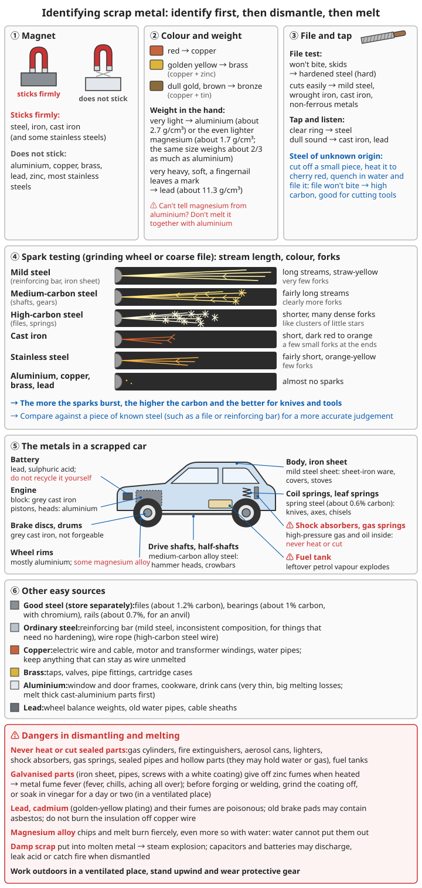

# Scrap Metal Recycling and Aluminium Casting

> **For decades after civilisation collapses, the biggest "mine" is the ruins: one scrapped car holds more steel, aluminium and copper than a small iron furnace produces in months, and of far better quality**

## ⚠️ Safety first

**Taking apart and melting scrap metal carries many hidden dangers!**

- 💥 Sealed containers, gas cylinders, shock absorbers and fire extinguishers explode when heated — **never put a sealed part into a fire**
- 💥 Damp scrap or tools put into molten metal cause a steam explosion that throws molten metal everywhere
- ☠️ Galvanised parts (iron sheet, water pipes and screws with a white coating) give off zinc fumes when heated, causing "metal fume fever" (fever, chills, aching all over)
- ☠️ Lead, cadmium (a golden-yellow plating) and their fumes and dust are poisonous; old brake pads may contain asbestos
- 🔥 Magnesium alloy (some wheel rims, engine covers) swarf and melt burn fiercely, **even more fiercely in contact with water**, and cannot be put out with water
- ⚡ Capacitors, car batteries and lithium batteries may discharge, leak acid or catch fire while being taken apart

**Always work outdoors in a well-ventilated place, stand upwind, and wear protective gear.**

---

## 1. Why recycle first, then smelt

| Source | Difficulty | Quality | Notes |
|------|------|------|------|
| Re-forging ready-made steel parts directly | ⭐ | Very good | Car leaf springs, files, rails: stable composition, far better than home-smelted iron |
| Melting and recasting scrap aluminium | ⭐⭐ | Good | Melting point only about 660°C; a charcoal furnace with forced air can melt it |
| Melting and casting scrap copper and brass | ⭐⭐⭐ | Good | Needs about 1100-1200°C |
| Melting and casting scrap iron | ⭐⭐⭐⭐ | Fair | Needs about 1300-1400°C and coke; see [Advanced Casting](../../../docs/05-冶金技术/07-铸造进阶.md) |
| Smelting from ore | ⭐⭐⭐⭐⭐ | Hard to guarantee | See [Iron Smelting](../../../docs/05-冶金技术/01-铁的冶炼.md), [Copper Smelting](../../../docs/05-冶金技术/02-铜的冶炼.md) |

```
Order of priority:
1. What can be used as it is, use as it is (bolts, chains, bearings, springs, pipes)
2. What can be re-forged, re-forge (leaf spring → knife, rail → anvil)
3. Low-melting metals, melt and recast (aluminium, lead, tin, zinc)
4. Smelting from ore comes last
```

---

## 2. Identifying metals

### 2.1 Simple tests

| Method | Result | Meaning |
|------|------|------|
| Magnet | Sticks firmly | Steel, iron, cast iron (and some stainless steels) |
| Magnet | Does not stick | Aluminium, copper, brass, lead, zinc, most stainless steels |
| Colour | Red | Copper |
| Colour | Golden yellow | Brass (copper + zinc) |
| Colour | Dull gold, brown | Bronze (copper + tin) |
| Weight in the hand | Very light | Aluminium (density about 2.7 g/cm³) or the even lighter magnesium (about 1.7 g/cm³) |
| Weight in the hand | Very heavy, soft, a fingernail leaves a mark | Lead (about 11.3 g/cm³) |
| File | Will not bite, skids | Hardened steel (hard) |
| File | Cuts easily | Mild steel, wrought iron, cast iron, non-ferrous metals |
| Tapping | Clear ring | Steel |
| Tapping | Dull sound | Cast iron, lead |

### 2.2 Spark testing (on a grinding wheel or with a coarse file)

```
Mild steel (reinforcing bar, iron sheet): long spark streams, straw-yellow, very few forks
Medium-carbon steel (shafts, gears): fairly long streams, clearly more forks
High-carbon steel (files, springs): shorter streams, many dense forks, like clusters of little stars
Cast iron: short streams, dark red to orange, a few small forks at the ends
Stainless steel: fairly short streams, orange-yellow, few forks
Aluminium, copper, brass, lead: almost no sparks

→ The more sparks and the more they "burst", the higher the carbon and the better it is for knives and tools
→ Compare against a piece of known steel (such as a file or reinforcing bar) for a more accurate judgement
```

### 2.3 Telling magnesium from aluminium

```
Magnesium is lighter than aluminium (the same size weighs about two-thirds as much)
File off a few chips, put them on a non-flammable stone and light them:
  Magnesium chips burn fiercely with a blinding white light (⚠️ do not look straight at it; use only a tiny amount)
  Aluminium chips do not light easily
⚠️ If you are not sure whether a part is magnesium alloy, do not melt it with aluminium
```



*Figure: First use a magnet to separate steel and iron from non-ferrous metals, then look at the colour, feel the weight, file and tap; sort steels by comparing their sparks with a known steel. Never heat or cut sealed parts, and remove the zinc from galvanised parts first; lead and cadmium are poisonous, burning magnesium alloy gets fiercer with water, and damp scrap put into molten metal explodes*

---

## 3. Good materials in the ruins

### 3.1 Steel and iron

| Source | Approximate material | Good for |
|------|---------|--------|
| Car leaf springs, coil springs | Spring steel (e.g. 60Si2Mn, about 0.6% carbon) | Knives, axes, chisels, crowbars, springs |
| Files | Carbon tool steel (e.g. T12, about 1.2% carbon) | Small knives, gravers, chisels (anneal first, then forge) |
| Inner and outer rings and balls of rolling bearings | Bearing steel (e.g. GCr15, about 1% carbon, contains chromium) | Punches, small knives, drill bits |
| Rails | Steel with about 0.7% carbon | Cut off a length for an anvil; very good quality |
| Car half-shafts, drive shafts | Medium-carbon alloy steel | Hammer heads, crowbars, heavy tools |
| Reinforcing bar | Mild steel, inconsistent composition | Nails, hooks, chains, things that do not need hardening |
| Car bodies, iron sheet | Mild steel sheet | Sheet-iron ware, covers, stoves |
| Wire rope, steel wire | High-carbon steel wire | Rope, springs, binding |
| Brake discs, brake drums, engine blocks | Grey cast iron | Remelt and cast (see Advanced Casting); cannot be forged |

```
✓ Keep stock known to be good steel (leaf springs, files, bearings) sorted and stored separately, for important tools
✓ For steel of unknown origin, first cut off a small piece for a hardening test: heat to cherry red and quench in water,
  then try it with a file. File will not bite → high carbon, can make cutting tools; file bites → mild steel
```

For how to harden, see [Metalworking](../../../docs/05-冶金技术/04-金属加工技术.md).

### 3.2 Non-ferrous metals

| Metal | Source | Melting point | Uses |
|------|------|------|------|
| Aluminium | Aluminium window and door frames, car wheel rims, engine pistons and cylinder heads, cookware, drink cans | About 660°C | Casting pots, parts, moulds |
| Copper | Electric wire and cable, motor and transformer windings, water pipes | 1085°C | Conductors (best kept as wire), casting |
| Brass | Taps, valves, pipe fittings, cartridge cases | About 900-940°C | Casting valves, bushings, parts |
| Lead | Car battery plates, wheel balance weights, old water pipes, cable sheaths | 327°C | Weights, solder, radiation shielding |
| Tin | Solder, pewter ware | 232°C | Solder, alloying with copper to make bronze |
| Zinc | Galvanised coatings, die-cast parts (some door handles, taps) | About 420°C | Alloying with copper to make brass |

```
⚠️ Do not burn the insulation off copper wire: burning plastic gives off poisonous fumes (including hydrogen chloride and dioxins)
   → Strip it with a knife, or slit the outer sheath and pull the wire out; split thick cable lengthwise
✓ Keep copper wire as wire wherever you can; do not melt it — drawing your own copper wire is very hard,
  and generators, motors and telegraphs all need copper wire
✓ The aluminium in drink cans is very thin, heavily oxidised and coated, so losses on melting are high (perhaps only about half is left);
  melt thick cast-aluminium parts first (wheel rims, pistons, cylinder heads)
```

### 3.3 Other useful things

```
- Gears, chains, bearings, shafts, nuts and bolts: use them as they are wherever possible
- Electric motors, generators: see Electrical Engineering and Electronics
- Magnets: loudspeakers, electric motors, hard disks
- Springs: door springs, mattress springs, car springs
- Saw blades, drill bits, taps, dies: very valuable, and hard to make yourself
```

For electrical equipment worth salvaging, see [Electrical Engineering and Electronics – Realistic small-scale power generation](../../../docs/09-进阶科学与工程/02-电气工程与电子学.md#33-现实可行的小型发电).

---

## 4. Dismantling and preparation

```
1. Sort: pile steel, cast iron, aluminium, copper, brass, lead and others separately
2. Remove non-metals: plastic, rubber, paint, oil and grease, insulation
3. Remove galvanising: before forging or welding galvanised sheet or pipe,
   grind the coating off, or soak it in vinegar for a day or two to dissolve the zinc (in a ventilated place)
4. Remove oil and grease: oil smokes heavily and catches fire during melting; burn it off outdoors, or wash it in lye
5. Cut small: before melting, cut into pieces that fit in the crucible
6. Dry: everything that goes into molten metal must be thoroughly dry (warm it beside the furnace first)

⚠️ Never heat or cut, while dismantling:
- Gas cylinders, fire extinguishers, aerosol cans, lighters
- Car shock absorbers, gas springs (they contain high-pressure gas and oil)
- Sealed pipes and hollow parts (they may contain water or gas)
- Fuel tanks (leftover petrol vapour will explode)
```

---

## 5. Melting and casting aluminium

Aluminium is the easiest metal in the ruins to melt and cast: it has a low melting point, a small crucible furnace can melt it, and it is good for casting pots, ladles, parts and moulds.

### 5.1 Equipment

```
Crucible furnace (simple):
- Shell: an iron drum or thick sheet-iron bucket
- Lining: refractory, about 5-8 cm thick (fireclay plus grog; see Iron Smelting – Preparing refractories)
- Cut an air inlet low in the side, angled along the tangent of the chamber, so the flame swirls round the crucible
- Lid: leave a vent hole
- Fuel: charcoal or coke
- Air supply: a skin bag, bellows, hand-cranked blower, or a salvaged hair dryer or blower

Crucible:
- For aluminium a steel crucible will do: a length of thick-walled steel pipe with a steel plate welded (or forge welded) on one end as the bottom
- The crucible needs a reliable way to hold it: matching crucible tongs, or lugs welded on both sides so a pouring fork can lift it
- Try the crucible tongs and pouring fork empty beforehand, to make sure the grip is secure and you can hold it steady
```

For preparing refractories, see [Iron Smelting – Preparing refractories](../../../docs/05-冶金技术/01-铁的冶炼.md#22-耐火材料配制); for building a crucible furnace in detail, see [Advanced Casting – Furnaces and crucibles](../../../docs/05-冶金技术/07-铸造进阶.md#二熔炉和坩埚).

### 5.2 Melting steps

```
1. Put the crucible in the furnace and preheat it empty until it glows red, to drive off moisture
2. Put in a few dry pieces of aluminium
3. Once they melt, add more preheated aluminium one piece at a time (do not pack it full at once)
4. Pouring temperature is about 700-750°C
   (with no thermometer: once all the aluminium is molten and flows freely when stirred, heat a little longer, then pour;
    do not keep heating until the crucible glows bright — too hot and the aluminium absorbs more gas, and the casting is full of gas holes)
5. Skim the dross (oxides and impurities) off the surface with a preheated iron ladle
6. Do not stir too much (it brings in gas and oxides)
7. Pour as soon as possible
```

### 5.3 Moulds

```
Sand moulds: the most common; see Copper Smelting – Sand-mould casting and Advanced Casting – Moulding sand and moulding
Metal moulds (steel, cast iron): can be used again and again; good for simple shapes such as ingots and blocks
  - Must be preheated before use (to about 200°C or more) to drive off all moisture
  - Smoke the inner surface with a candle or pine twigs to coat it with soot, so the casting releases easily
⚠️ Never use a damp mould, and do not pour on a concrete floor
  (the moisture in concrete expands when heated and makes the floor burst and spatter)
  → Work and pour over a layer of dry sand
```

For a diagram of the whole sand-casting process, from making the pattern and moulding to pouring and knocking out, see [Advanced Casting – The basic casting process](../../../docs/05-冶金技术/07-铸造进阶.md#12-铸造的基本流程).

### 5.4 Finishing the casting

```
- Take it out once it has cooled and saw off the sprue
- File, scrape and grind
- Aluminium castings can be drilled, filed and turned, but they are softer than steel and wear faster
- For cookware: melt down salvaged cast-aluminium parts and cookware first (their composition is purer);
  do not make cookware from aluminium alloy of unknown origin (it may contain lead, cadmium and so on)
```

---

## 6. Other low-melting metals

### 6.1 Lead

```
Melting point 327°C; it melts on an ordinary fire. Good for casting weights, bullet-shaped sinkers, solder

⚠️ Lead poisoning is slow and irreversible:
- Melt it only outdoors, standing upwind
- Do not let it get too hot (smoke means it is too hot); lead vapour and lead fumes are highly toxic
- Pregnant women and children must not handle it or be nearby
- Wash your hands and face with soap afterwards, and wash the clothes you wore separately
- Keep pots, ladles and moulds for lead only; never use them for food again
- Never use lead for containers that hold food or drinking water

Car battery plates: recycling them yourself is not recommended
  → The battery contains sulphuric acid, and the paste on the plates is a powder of lead compounds that is very easily breathed in
```

### 6.2 Tin and zinc

```
Tin: melting point 232°C, non-toxic, used for solder and for making bronze;
  tin cans are steel sheet with a very thin tin plating, not a source of tin
Zinc: melting point about 420°C, boiling point about 907°C; if it gets too hot while melting it gives off white zinc fumes
  → Only outdoors, control the temperature carefully, and avoid breathing it in
```

---

## 7. Checklist

### Before melting

- [ ] Outdoors, away from anything flammable, with dry sand spread on the ground
- [ ] Crucible, tongs, pouring fork and skimming ladle all preheated and dried
- [ ] All charge material dry: no sealed parts, no galvanised parts, no unknown alloys
- [ ] Moulds dry, preheated and standing on dry sand
- [ ] Wear: leather gloves, goggles or a face shield, leather apron, leather shoes (no synthetic clothing, no sandals)
- [ ] Have a bucket of dry sand ready to cover spilled metal (⚠️ never water)
- [ ] Plan the pouring route in advance: no obstacles on the way, bystanders kept well back

### While pouring

- [ ] Hold steady with both hands; move smoothly, without stopping
- [ ] Leave spilled metal until it has cooled before dealing with it; do not touch it with your hands or feet

---

## Related chapters

- ⏮️ [Metalworking](../../../docs/05-冶金技术/04-金属加工技术.md) - Heat treatment of salvaged steel
- ⏭️ [Welding and Joining](../../../docs/05-冶金技术/06-焊接与连接.md) - Joining salvaged metal parts together
- ⏭️ [Advanced Casting](../../../docs/05-冶金技术/07-铸造进阶.md) - Furnaces, crucibles, moulding sand, gating systems, cast iron
- 🔗 [Technology Rebuilding Roadmap – Resources in the ruins](../../../docs/09-进阶科学与工程/00-技术重建路线图.md#四废墟里的资源-先利用再制造) - What else can be found in the ruins
- 🔗 [Engineering Mechanics and Materials – Materials science](../../../docs/09-进阶科学与工程/01-工程力学与材料.md#十材料科学) - The composition and properties of steel

---

**Remember: dismantle, identify and reuse first; melt and cast after. One car leaf spring from the ruins beats a whole furnace-load of home-smelted iron.**
