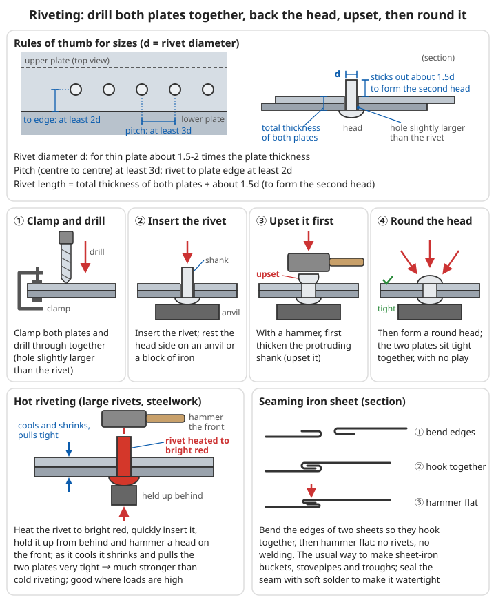
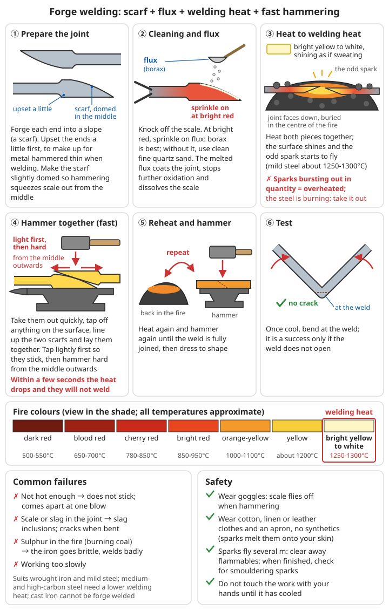

# Welding and Joining

> **Making parts is not enough; you must also be able to join them — pots need patching, carts need repairing, broken farm tools need joining, iron sheet needs making into buckets. Joining techniques decide how big and how complex the things you can build are**

## ⚠️ Safety first

- 👁️ **Arc light badly injures the eyes**: look at an arc without a welding helmet and a few hours later you get severe eye pain, watering and sensitivity to light (arc eye); bystanders are injured just the same
- ☀️ Ultraviolet light from the arc burns bare skin like a severe sunburn
- ⚡ Arc welders can give an electric shock, especially in damp conditions
- ☠️ Welding galvanised, painted or cadmium-plated parts gives off poisonous fumes; lead solder is poisonous
- 🔥 Welding sparks can fly several metres and set fire to nearby sawdust, grass and clothing
- 💥 **Never weld or cut a container that has held fuel, oil or chemicals** (even if it looks empty); leftover vapour will explode

---

## 1. Comparing joining methods

| Method | Difficulty | Strength | What you need | Good for |
|------|------|------|-----------|------|
| Bolting | ⭐ | Good | Drilled holes, nuts and bolts | Anything that must come apart |
| Riveting | ⭐⭐ | Good | Drilled or punched holes, rivets | Iron sheet, plate, farm tools, structures that need not come apart |
| Soft soldering | ⭐⭐ | Low | Solder, flux, soldering iron | Making sheet-iron ware watertight, wires, electronic components |
| Brazing (hard soldering) | ⭐⭐⭐ | Fairly good | Brass or silver solder, borax, a hot fire | Steel, copper and brass parts, repairing cast iron |
| Forge welding | ⭐⭐⭐⭐ | Very good | Forge, high heat, practised skill | Wrought iron and mild steel, lengthening, wrapping a steel edge |
| Arc welding | ⭐⭐⭐ | Very good | Arc welder and electricity, electrodes, helmet | Steel structures, repairs |

```
How to choose:
- Must come apart → bolts
- No electricity, no welder → riveting, forge welding, soldering or brazing
- Must be watertight, little load → soft soldering
- Welder and electricity available → arc welding is fastest and strongest
```

---

## 2. Riveting

It needs no electricity and no very high temperature, and it was the main way of joining steel plate before electric welding became common (iron bridges, boilers and ships were all riveted).

### 2.1 Rules of thumb for sizes

```
Rivet diameter: for thin plate about 1.5-2 times the plate thickness
Rivet pitch (centre to centre): at least 3 times the rivet diameter
Rivet to plate edge: at least 2 times the rivet diameter
Rivet length: total thickness of both plates + about 1.5 times the rivet diameter (to form the second head)
```

### 2.2 Cold riveting (small rivets, iron sheet, copper, aluminium)

```
1. Clamp the two plates together and drill through both at once (hole slightly larger than the rivet)
2. Insert the rivet, with the head side resting on an anvil or a block of iron
3. With a hammer, first thicken (upset) the protruding shank, then form it into a round head
4. Once riveted, the two plates should sit tight against each other, with no play
```

### 2.3 Hot riveting (large rivets, steel structures)

```
1. Heat the rivet to bright red
2. Quickly insert it in the hole, hold it up from behind, and hammer a head on the front
3. As the rivet cools it shrinks and pulls the two plates very tight
→ Much stronger than cold riveting; good where loads are high
```

### 2.4 Seaming iron sheet

```
No rivets, no welding: bend the edges of two sheets so they hook into each other, then hammer flat (a seam)
→ The usual way to make sheet-iron buckets, stovepipes and troughs; seal the seam with soft solder to make it watertight
```



*Figure: Sizes drawn as in 2.1 (d is the rivet diameter), cold riveting in the four steps of 2.2, hot riveting see 2.3, seaming see 2.4*

---

## 3. Forge welding

Heat two pieces of iron to a white heat close to melting and hammer them together into one solid piece. It is one of the traditional blacksmith's core skills: lengthening, wrapping a steel edge (see [Forging Simple Tools – Inserting a steel edge](../../../docs/05-冶金技术/03-简易工具锻造.md#112-嵌钢刃)) and fold forging all depend on it.

### 3.1 Suitable materials

```
✓ Wrought iron, mild steel: the easiest to forge weld
△ Medium- and high-carbon steel: possible, but at a lower welding heat; easily burnt
✗ Cast iron: cannot be forge welded (it cannot be forged)
✗ Stainless steel, galvanised parts: very hard or impossible
```

### 3.2 Steps

```
1. Prepare the joint
   - Forge each of the two ends into a slope (like sharpening a pencil; this is called a "scarf")
   - Upset the ends a little first, to make up for metal hammered thin during welding
   - Make the scarf faces slightly rounded (a little higher in the middle), so hammering squeezes scale out from the middle
2. Cleaning and flux
   - Knock off the scale
   - At bright red, sprinkle on flux: borax is best; without borax, use clean fine quartz sand
   - The melted flux coats the joint, stops further oxidation and dissolves the scale
3. Heat to welding heat
   - Heat both pieces together, joint faces down, buried in the centre of the fire
   - Colour: bright yellow to white, the surface shines as if sweating, and the odd spark starts to fly
   - Sparks bursting out in quantity → already overheated; the steel is burning; take it out
   - Mild steel about 1250-1300°C
4. Hammer together
   - Take them out quickly, tap off anything on the surface, line the two scarfs up and lay them together
   - First tap lightly so they stick, then hammer hard from the middle outwards
   - Work fast: within a few seconds the heat drops and they will not weld
5. Heat again and hammer again until the weld is fully joined, then dress to shape

Test: once cool, bend at the weld; it is a success only if the weld does not open
```

```
Common failures:
- Not hot enough → does not stick; comes apart at one blow
- Scale or slag in the joint → slag inclusions in the weld; cracks when bent
- Sulphur in the fire (when burning coal) → the iron goes brittle and will not weld well
- Working too slowly
```



*Figure: Drawn following the steps in 3.2; the fire-colour bar follows the table in [Forging Simple Tools – Forging temperatures](../../../docs/05-冶金技术/03-简易工具锻造.md#12-锻造温度); all temperatures are approximate*

---

## 4. Soft soldering

Low-melting solder (tin or tin-lead alloy) sticks metal together without melting the metal itself. It is not strong, but it **seals watertight** and **conducts electricity**.

### 4.1 Materials

```
Solder:
- Tin-lead solder (e.g. 63% tin, 37% lead): melts at about 183°C; the easiest to use
  ⚠️ Contains lead; do not use it on anything that holds food or drinking water
- Lead-free solder (tin with a little copper): melts at about 227°C; can be used on food ware
- Pure tin: 232°C

Flux (removes the oxide film so solder can "wet" the metal):
- Rosin: for wires and electronic components; not corrosive
- Solder paste
- Zinc chloride solution ("killed spirits"): put zinc pieces in dilute hydrochloric acid until it stops bubbling
  → For iron sheet and copper sheet; works well but is corrosive, so wash the joint thoroughly with water afterwards
  ⚠️ Making it gives off hydrogen; keep away from naked flames and do it outdoors

Soldering iron:
- Electric soldering iron
- Without electricity: a fairly large block of copper on an iron handle, heated in the fire before use (a traditional soldering iron)
```

### 4.2 Steps

```
1. Clean: rub the joint with sandpaper or a file until bright metal shows, and remove oil and grease
2. Apply flux
3. "Tin" first: coat each of the two joint faces with a layer of solder
4. Put them together and heat, so the solder melts and flows into the gap
5. The key: heat the work and let the work melt the solder; do not just drip solder onto cold work
   (then the solder only "sits" on the surface and falls off at a touch)
6. Do not move it before it cools
7. If you used a corrosive flux, wash it off thoroughly with water

Seams in iron sheet: seam or lap them first, then solder to seal; do not rely on solder alone to carry the load
```

### 4.3 Joining wires

```
1. Strip off the insulation and scrape the copper bright
2. Twist the two wires tightly round each other (get a firm mechanical joint first)
3. Apply rosin and solder
4. Wrap with insulating tape or heat-shrink tubing
```

---

## 5. Brazing (hard soldering)

Uses higher-melting brass or silver solder. Much stronger than soft soldering; it can join steel, copper and brass, and can also repair cracks in cast-iron parts.

```
Filler:
- Brass (copper-zinc alloy): melts at about 900°C; cheap (salvaged brass wire and brass sheet will do)
- Silver solder: melts at about 600-800°C; flows well and gives neat joints, but is expensive
Flux: borax (mixed to a paste with a little water)

Steps:
1. Clean and grind the joint; the gap between the parts must be small and even (a few tenths of a mm)
2. Apply the borax paste
3. Heat the whole work to bright red (forge, a hot fire or a blowlamp)
4. Hold the filler against the joint; the heat of the work melts it and it is "drawn" into the gap
5. Let it cool naturally, then knock off the glassy borax residue

⚠️ Overheated brass gives off white zinc fumes; do not breathe them in
⚠️ Brazing temperature is higher than the tempering temperature of steel; a hardened tool goes soft after brazing and must be heat-treated again
```

---

## 6. Arc welding

Electricity makes an arc between the electrode and the work, several thousand degrees Celsius hot, which melts the electrode and the work locally so they fuse as they cool. As long as you have a (salvaged) welder and electricity, it is the fastest and strongest joining method.

### 6.1 Equipment and protection

```
Equipment:
- Arc welder (AC or DC, salvaged from scrap)
- Electrode holder, earth clamp, cables
- Electrodes: ordinary mild-steel electrodes (e.g. J422 / E4303), stored somewhere dry
- Chipping hammer, wire brush

Protection (every item is essential):
- [ ] Welding helmet with a filter of shade about 10-12 (⚠️ ordinary sunglasses are absolutely not enough)
- [ ] Leather gloves, thick long-sleeved cotton clothing (synthetic clothing melts and sticks to the skin when sparks hit it)
- [ ] Leather shoes
- [ ] Put up screens all round so bystanders cannot see the arc
- [ ] Ventilation; do not weld in an enclosed space
- [ ] Keep sand or water for putting out fires within reach; after welding, check the surroundings for smouldering for 30 minutes
```

### 6.2 Welding current

```
Usual current for ordinary mild-steel electrodes (go by the recommended values on the electrode packet):
  2.5 mm electrode: about 50-80 A
  3.2 mm electrode: about 90-130 A
  4.0 mm electrode: about 140-200 A
  Use the lower end for thin plate, vertical and overhead welding; the upper end for thick plate welded flat
Current too low → hard to strike an arc, electrode sticks, poor penetration
Current too high → lots of spatter, undercut, burns through thin plate
```

### 6.3 Key points of technique

```
1. Clean: grind the joint clean, removing rust, paint and galvanising
2. Attach the earth clamp as close to the joint as you can
3. Strike the arc: helmet down, scratch the electrode lightly on the work (like striking a match), lift it once the arc starts
4. Arc length: keep the gap between the electrode tip and the work about equal to the electrode diameter
5. Running the bead: move forward at an even speed, the electrode tilted slightly towards the direction of travel
6. Finishing: fill the crater before lifting off
7. Chip off the slag and inspect the weld
8. Multi-pass welds: clean off all the slag after each pass before welding the next

Tack welding: before the real weld, tack the joint in several places to stop it distorting or shifting
Thick plate (about 6 mm or more): grind a bevel (V-shape) on the joint first, or the weld will not penetrate
```

### 6.4 With no welder

```
Some people connect 3 car batteries in series (about 36 V) to weld in an emergency.
⚠️ Only as a last resort: the current cannot be adjusted, the batteries get very hot,
   and they may explode from the hydrogen they give off; keep the batteries away from the arc and sparks, and make the connections secure
```

For battery safety, see [Electrical Engineering and Electronics – Batteries and energy storage](../../../docs/09-进阶科学与工程/02-电气工程与电子学.md#七电池和储能).

---

## 7. Gas welding and gas cutting (for awareness)

```
Acetylene (or another fuel gas) burnt mixed with oxygen gives a flame of about 3000°C or more;
it can weld and heat, and with a cutting torch it can also cut steel plate

⚠️ This needs proper gas cylinders, pressure regulators and flashback arrestors;
   cylinders can explode if heated, knocked or leaking, and acetylene mixed with air is extremely explosive
   → Use it only with sound professional equipment and after training; do not make your own
```

---

## 8. Checking weld quality

```
Appearance: the weld is even and full, with no cracks, gas holes, undercut (a groove burnt along the edge of the weld) or lack of penetration
Hammer test: hammer near the weld, listen to the sound and see whether it cracks
Bend test: weld a test piece of the same material by the same method, clamp it in a vice and bend it;
  only if the weld does not crack is the welding good
⚠️ For important parts that carry load or pressure (lifting hooks, axles, pressure vessels), do not rely on a weld you are not sure of
```

---

## 9. Checklist

### Before welding

- [ ] Has the work held fuel, oil or chemicals? Yes → do not weld
- [ ] Have galvanising, paint and grease been removed?
- [ ] Is there anything flammable within 3-5 m?
- [ ] Is all the protective gear there (arc welding: helmet, leather gloves, long sleeves, leather shoes)?
- [ ] Are bystanders well away or screened off?

### After welding

- [ ] Do not touch the work with your hands before it cools
- [ ] Check the surroundings for smouldering sparks
- [ ] Has the weld been inspected?

---

## Related chapters

- ⏮️ [Scrap Metal Recycling and Aluminium Casting](../../../docs/05-冶金技术/05-废旧金属回收与铝铸造.md) - Identifying and preparing metals
- ⏭️ [Advanced Casting](../../../docs/05-冶金技术/07-铸造进阶.md)
- 🔗 [Forging Simple Tools](../../../docs/05-冶金技术/03-简易工具锻造.md) - Forging basics, wrapping a steel edge
- 🔗 [Engineering Mechanics and Materials](../../../docs/09-进阶科学与工程/01-工程力学与材料.md) - Loads on joints and safety factors
- 🔗 [Wound and Injury Care – Scalds and burns](../../../docs/01-日常疾病和伤害/02-外伤处理.md#烫伤与烧伤)

---

**Remember: a good joint matters more than good material — however good the steel, once the weld cracks it is all wasted. Clean first, then heat, and test last.**
