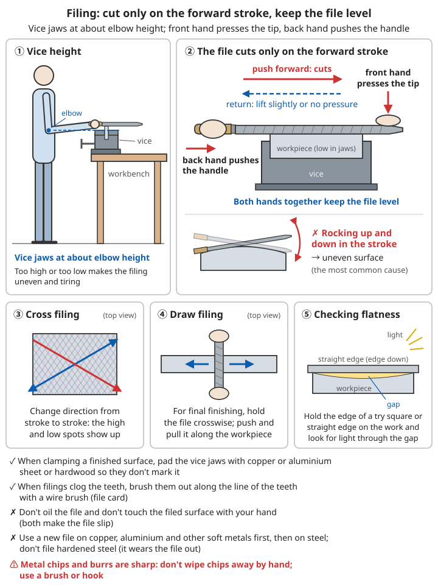
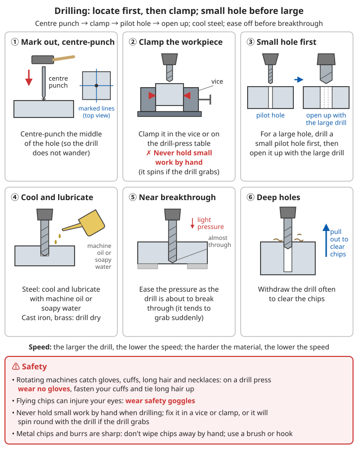

# Bench Work and Machining

> **Forging and casting only give you a "blank". What makes a part fit, turn and swap with another is sawing, filing, drilling, tapping and turning — the last step in turning a lump of iron into a machine**

## ⚠️ Safety first

- ⚙️ **Rotating machines catch gloves, cuffs, long hair and necklaces**: when using a drill press, lathe or grinding wheel, do not wear gloves, fasten your cuffs and tie long hair up
- 👁️ Chips and grinding-wheel fragments fly and injure eyes: wear safety goggles
- 💥 Grinding wheels spin very fast, and a cracked wheel can burst: check it before use, and stand to the side of the wheel when starting it
- 🩸 Metal chips and burrs are sharp. Do not wipe chips away with your hand; clear them with a brush or a hook
- 🔧 Remove the lathe chuck key as soon as you have used it, or it will fly out when the machine starts
- ⚠️ Do not hold small workpieces in your hand when drilling. Clamp them in a bench vice or jig, or the workpiece will spin with the drill when the bit jams

---

## 1. Workbench and bench vice

```
Workbench: a sturdy, heavy wooden or steel bench that does not wobble
Bench vice: fixed to the edge of the bench; jaws at about the operator's elbow height
  → too high or too low makes filing uneven and tiring

✓ When clamping a surface that is already finished, line the jaws with copper sheet,
  aluminium sheet or hardwood so they do not mark it
✓ Keep the part of the workpiece sticking out of the jaws as short as possible, to reduce vibration
```

---

## 2. Marking out and measuring

### 2.1 Tools

```
- Steel rule, tape measure
- Try square (checks right angles)
- Scriber: a hardened, sharpened steel needle that draws fine lines on metal
- Centre punch: makes a small dent on a line or at the centre of a hole (locates the drill)
- Dividers: draw circles, divide into equal parts
- Vernier calipers: measure outside diameter, inside diameter and depth, to 0.02 mm
- Surface plate: a flat cast-iron plate or thick glass plate, used as the reference
  for measuring and marking out

Before marking out, coat the workpiece with whitewash, chalk or blue dye so the lines show clearly
```

### 2.2 Reading vernier calipers

```
1. Read the main scale first: the main-scale mark to the left of the vernier zero
   (whole millimetres)
2. Then read the vernier: find which vernier line lines up best with a main-scale line,
   and read its number (× 0.02 mm)
3. Add the two
Example: main scale reads 23 mm, vernier line 17 lines up → 23 + 17 × 0.02 = 23.34 mm
```

For setting up measurement standards, see [Measurement and the scientific method](../../../docs/08-基础科学知识/00-度量衡与科学方法.md).

---

## 3. Sawing

```
✓ The teeth of the blade point forward (it cuts on the push stroke)
✓ Tension the blade tightly and do not let it twist
✓ Use a fine-tooth blade for thin material; at least 2-3 teeth must be on the material
  at once (otherwise teeth break off)
✓ Use the full length of the blade, at about 40-60 strokes a minute; do not go too fast
✓ Press on the push stroke, no pressure on the return
✓ When nearly through, ease the pressure and support the piece that is about to drop
✓ Add a little machine oil when sawing steel; saw cast iron and brass dry
```

---

## 4. Filing

### 4.1 Choosing a file

```
By coarseness: bastard file (removes a lot) → second-cut → smooth file, dead-smooth file (finishing)
By shape: flat file (flat surfaces), square file (square holes), round file (round holes,
  inside corners), half-round file (large inside curves), three-square file (sharp angles,
  sharpening saw teeth)
```

### 4.2 Method

```
✓ A file cuts only on the forward stroke; on the return lift it slightly or use no pressure
✓ Use both hands: the front hand presses on the tip, the back hand pushes the handle,
  keeping the file level as it moves forward
  (the most common cause of an uneven surface is the file rocking up and down during the stroke)
✓ Cross filing: change direction from stroke to stroke; this shows where the high and low spots are
✓ Draw filing: for final finishing, hold the file crosswise and push and pull it along
  the length of the workpiece
✓ Checking flatness: hold the edge of a try square or straight edge against the workpiece
  and look for light through the gap

✓ When filings clog the teeth, brush them out along the line of the teeth with a wire brush (file card)
✗ Do not oil the file (it will slip), and do not touch the filed surface with your hand
  (oil from your skin makes the file slip)
✗ Use a new file on copper, aluminium and other soft metals first, then on steel;
  do not file hardened steel (it wears the file out)
```


*Figure: Vice jaws at about elbow height; the file cuts only on the forward stroke, with both hands keeping it level*

---

## 5. Drilling

### 5.1 Steps

```
1. Mark out, and centre-punch the centre of the hole (so the drill does not wander)
2. Clamp the workpiece in the vice or on the drill-press table
3. For a large hole, drill a small pilot hole first, then open it up with the large drill
4. When drilling steel, cool and lubricate with machine oil or soapy water;
   drill cast iron and brass dry
5. Ease the pressure as the drill is about to break through (it tends to grab suddenly)
6. When drilling deep holes, withdraw the drill often to clear the chips

Speed: the larger the drill, the lower the speed; the harder the material, the lower the speed
```


*Figure: The six drilling steps and safety points; no gloves on a drill press, wear safety goggles*

### 5.2 Without a power drill

```
- Hand drill, breast drill (salvaged)
- Bow drill: wrap a bowstring round the drill shaft and saw it back and forth;
  suits small holes and soft materials
- Punching: thin iron sheet can be heated and punched through over the hole in the anvil
```

### 5.3 Sharpening drills

```
A twist drill has a point angle of about 118°; the two cutting edges must be
the same length and symmetrical
- Grind a little clearance behind the cutting edge (about 8-12°) so it can bite
- If the two edges are not symmetrical, the hole comes out oversize and the drill wobbles
```

---

## 6. Tapping and threading

### 6.1 Internal threads (tapping)

```
Tapping-drill diameter ≈ nominal thread diameter - pitch
  M6 × 1: tapping hole about 5 mm
  M8 × 1.25: tapping hole about 6.8 mm
  M10 × 1.5: tapping hole about 8.5 mm
  M12 × 1.75: tapping hole about 10.2 mm

Steps:
1. Drill the tapping hole and put a small chamfer on its mouth
2. Line the tap up square to the hole and turn it with a tap wrench
3. For every half turn forward, turn back about a quarter turn to break off the chip
4. Use machine oil on steel; in blind holes, withdraw the tap often to clear chips
5. Use a set of taps in order: taper tap, then second (and plug) tap
⚠️ Taps are very brittle. If it will not turn, do not force it, or it will snap
   in the hole and be very hard to get out
```

### 6.2 External threads (threading)

```
- The rod diameter is slightly smaller than the nominal thread diameter
  (about 0.1-0.2 mm smaller), with a chamfered end
- Set the die square and turn it with a die stock, again turning back a little every half turn
```

### 6.3 Standardise your threads

```
✓ Within a community, standardise on a few thread sizes
  (for example the sizes of the salvaged metric taps and dies)
✓ Taps and dies are extremely valuable. Making them needs hardened tool steel and
  accurate dividing, so salvage and keep them wherever you can
```

For why thread standards matter, see [Engineering mechanics and materials – Threads and fasteners](../../../docs/09-进阶科学与工程/01-工程力学与材料.md#116-螺纹和紧固件).

---

## 7. Scraping: getting a high-precision flat surface

```
Filing gives a "fairly flat" surface. For surfaces as precise as machine-tool slideways
and sliding faces, use scraping:

1. Get a reference surface plate (a reference flatter than the workpiece)
   → with no ready-made plate, lap three plates against each other in turn
     (the three-plate method; see the technology rebuilding roadmap)
2. Spread a thin layer of marking compound on the plate (red lead in oil, Prussian blue,
   or soot mixed with oil)
3. Rub the workpiece back and forth on the plate a few times, then lift it off
4. The spots on the workpiece that picked up colour are the high spots
5. Scrape off these high spots with a scraper (a hardened, sharpened flat steel blade)
6. Repeat until the contact spots are many and evenly spread
```

For how precision work bootstraps itself, see [Technology rebuilding roadmap – Precision machining](../../../docs/09-进阶科学与工程/00-技术重建路线图.md#32-精密加工-机器的母机).

---

## 8. Grinding

```
Natural grindstone: a large wheel of sandstone, its lower part dipped in a water trough,
  turned to grind tools and workpieces
Salvaged grinding wheels:
- Before use, do a "ring test": tap the wheel lightly with a wooden mallet. A clear ring
  means it is sound; a dull sound may mean a crack — do not use it
- A guard must be fitted
- When starting, stand to the side of the wheel, not in line with it
- Keep the gap between the tool rest and the wheel no more than about 3 mm,
  so the workpiece cannot get dragged in
- When grinding hardened tools, dip them in water often; turning blue or black
  means the temper has been drawn (it has gone soft)
```

For sharpening edge tools, see [Woodworking and tool maintenance – Sharpening](../../../docs/07-日常生活技能/09-木工与工具维护.md#磨刀).

---

## 9. The lathe

The lathe is called "the mother of machine tools": it can turn cylinders, bores, end faces and threads, and with one lathe you can build another, better lathe.

### 9.1 Main parts

```
Headstock: turns the workpiece; carries a chuck or a centre
Tailstock: supports the other end of a long workpiece with a centre, or holds a drill for drilling
Tool post and carriage: hold the cutting tool and move it along and across the ways
Leadscrew: drives the carriage forward at a precise rate → thread cutting
Bed ways: the precision reference for the whole lathe
```

### 9.2 Cutting speed and spindle speed

```
Spindle speed (rpm) = 1000 × cutting speed (m/min) ÷ (π × workpiece diameter (mm))

Cutting speeds for high-speed steel tools (rough figures):
  Mild steel: about 20-30 m/min
  Cast iron: about 15-25 m/min
  Brass, aluminium: faster
Example: turning mild steel 50 mm in diameter, take 25 m/min
  Speed = 1000 × 25 ÷ (3.14 × 50) ≈ 160 rpm

The larger the workpiece, the lower the speed; if the tool glows red or gives off blue smoke → too fast
```

### 9.3 Cutting tools

```
- Material: high-speed steel (from salvaged lathe tools, drills and saw blades)
  or carbide inserts
- Rake angle: about 10-15° for steel, close to 0° for brass
- Clearance angle: about 6-8°, so the part below the cutting edge does not rub on the workpiece
- Set the tool point at the centre height of the workpiece
```

### 9.4 With no ready-made lathe: the pole lathe

```
The simplest lathe in history; it can turn wood and softer metals:
- Mount two centres on two supports to hold the workpiece
- Wrap a cord once round the workpiece; tie its top end to a long springy pole overhead
  and its bottom end to a foot treadle
- Press the treadle: the workpiece turns and the tool cuts. Let go: the pole pulls the
  cord back and the workpiece turns the other way (draw the tool back now)
- Rest the tool on a crossbar and guide it by hand
→ It cuts only intermittently, but is good enough for shafts, handles, wheels and wooden bowls
```

### 9.5 Safety

```
✓ Clamp the workpiece securely and remove the chuck key before starting
✓ No gloves; do not touch the turning workpiece; do not clear chips by hand
✓ Long chips wrap around; clear them with a hook
✓ Wear safety goggles
```

---

## 10. Accuracy and interchangeability

```
Tolerance: the allowed range of error in a part's size, e.g. a shaft 20 mm in diameter,
  allowed ±0.05 mm
Fit: whether a shaft and hole should be "loose" (can turn), "tight" (pressed in, does not move)
  or "transition"
Gauges: make a matched pair of standard "go" and "no-go" gauges; a part that passes the go
  gauge and does not pass the no-go gauge is acceptable
  → no need to measure the actual size each time; inspection is fast and reliable

Interchangeability: parts made to a common standard and common gauges, by different people
  at different times, can replace one another
  → when a machine breaks you only change the part; this is the basis of mass production
```

---

## 11. Checklist

- [ ] Is the workpiece clamped securely?
- [ ] Goggles on? Gloves off? Cuffs fastened?
- [ ] Has the grinding wheel been checked, and is the guard fitted?
- [ ] Has the chuck key been removed?
- [ ] Have the measuring tools been wiped clean, oiled and put back in their cases?

---

## Related chapters

- ⏮️ [Bellows and forges](../../../docs/05-冶金技术/08-鼓风设备与锻炉.md)
- ⏭️ [Other metals](10-other-metals.md)
- 🔗 [Forging simple tools](../../../docs/05-冶金技术/03-简易工具锻造.md) - forging the blank
- 🔗 [Metalworking](../../../docs/05-冶金技术/04-金属加工技术.md) - heat treatment of cutting tools, taps and punches
- 🔗 [Engineering mechanics and materials – Machine elements](../../../docs/09-进阶科学与工程/01-工程力学与材料.md#十一机械元件) - bearings, gears, threads
- 🔗 [Technology rebuilding roadmap](../../../docs/09-进阶科学与工程/00-技术重建路线图.md) - precision machining is the bottleneck in building machines

---

**Remember: measure twice, file once. A machine's accuracy is not reached in one step — each generation of tools makes a better next generation.**
