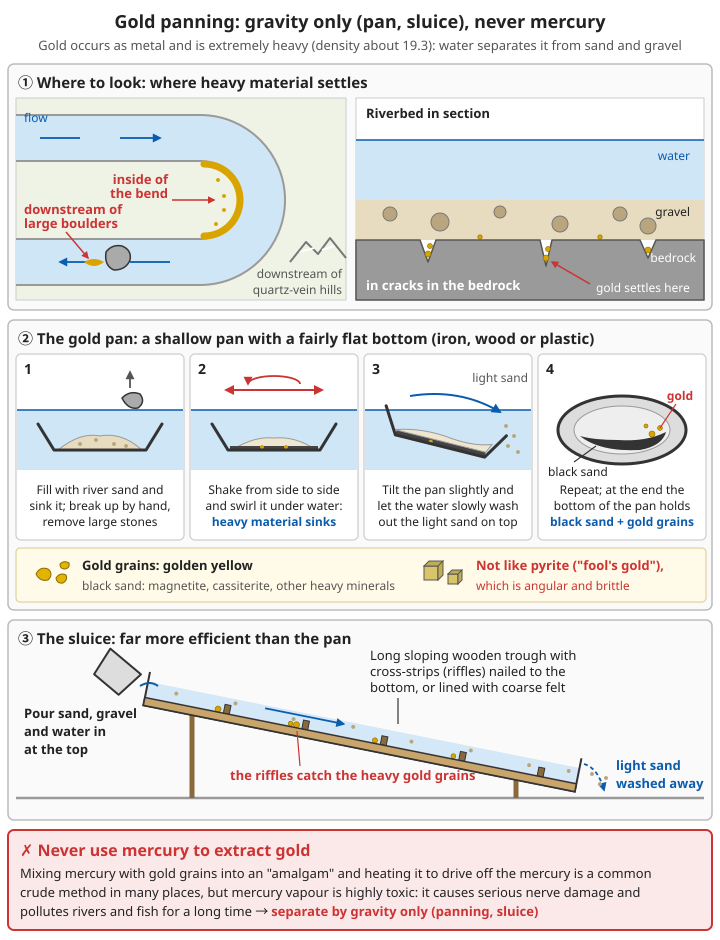

# Other Metals: Tin, Lead, Zinc, Gold, Silver

> **Iron and copper carry tools and machines, but bronze needs tin, brass needs zinc, soldering needs tin and lead, and electronics and precision devices cannot do without gold and silver. Each of these "minor metals" has uses nothing else can fill — and each has its own dangers**

## ⚠️ Safety first

**Of these metals, smelting lead and zinc and extracting silver all give off large amounts of toxic fumes.**

- ☠️ **Lead**: lead fume and lead dust build up in the body and damage the nerves, blood and kidneys. They are especially harmful to children and pregnant women, and the damage is irreversible
- ☠️ Roasting sulphide ores (galena, sphalerite) gives off sulphur dioxide, which irritates the airways and damages nearby crops
- ☠️ Zinc vapour and zinc fume cause metal fume fever
- ☠️ **Never use mercury (quicksilver) to extract gold**: mercury vapour is highly toxic, and it pollutes water and soil and harms people for generations
- ✓ Do all smelting downwind and far from homes, water sources and fields; keep pregnant women and children away

**Salvage these metals from ruins first (see [Scrap metal recycling and aluminium casting](../../../docs/05-冶金技术/05-废旧金属回收与铝铸造.md)); smelting from ore is the last resort.**

---

## 1. Overview

| Metal | Main ores | Melting point | Smelting difficulty | Toxicity | Main uses |
|------|---------|------|---------|------|---------|
| Tin | Cassiterite SnO₂ | 232°C | ⭐⭐⭐ | Low | Bronze, solder, tinplate, pewter |
| Lead | Galena PbS | 327°C | ⭐⭐⭐ | ☠️☠️☠️ | Solder, weights, radiation shielding, storage batteries |
| Zinc | Sphalerite ZnS, smithsonite ZnCO₃ | About 420°C | ⭐⭐⭐⭐⭐ | ☠️ | Brass, galvanising against rust, batteries |
| Gold | Native gold (placer gold, lode gold) | 1064°C | ⭐⭐ (panning) | None | Corrosion-proof electrical contacts, exchange value |
| Silver | Native silver; occurs with lead | 962°C | ⭐⭐⭐⭐ | ☠️☠️ during extraction | Silver solder, electrical contacts, mirrors |

---

## 2. Tin

### 2.1 Recognising cassiterite

```
- Colour: black or brown, sometimes dark red
- Lustre: strong, like metal or diamond
- Very heavy: density about 7, much heavier than ordinary rock (about 2.7)
- Very hard: a knife will not scratch it
- Where found: granite country, often concentrated in river gravels (alluvial tin)
  → as with gold panning, wash the gravel to concentrate the heavy cassiterite
```

### 2.2 Smelting

```
Cassiterite + charcoal → tin + carbon dioxide (SnO₂ + 2CO → Sn + 2CO₂)

⚠️ Metallic tin melts at only 232°C, but reducing cassiterite to tin needs temperatures
   of about 1000°C or more and a strongly reducing atmosphere (plenty of charcoal, forced draught)
   → you need a blast furnace; an ordinary fire will not do

Steps:
1. Wash and concentrate the cassiterite, and crush it into small grains
2. Mix with powdered charcoal, put it into a crucible or small shaft furnace,
   and cover with a layer of charcoal
3. Heat with a strong blast to about 1000°C or more
4. The reduced tin melts and sinks to the bottom
5. The slag often still holds tin; crush it and smelt it again

Refining (liquation):
  Heat the crude tin slowly on a sloping hearth, a little above 232°C.
  The pure tin melts first and runs off; impurities with higher melting points stay behind
```

For blowing equipment, see [Bellows and forges](../../../docs/05-冶金技术/08-鼓风设备与锻炉.md).

### 2.3 Uses

```
- Bronze: copper + about 10% tin (see Copper smelting – making bronze)
- Solder: soft soldering (see Welding and joining)
- Tinplate: thin iron sheet coated with tin; it does not rust and can be made into tins
  and kettles (see Sheet and wire)
- Pewter: tin with a little copper or antimony, made into bowls, pots and candlesticks
  ⚠️ Do not add lead; old pewter often contains lead — do not use it for wine, vinegar
  or other acidic food and drink
- Tin kept for a long time below about 13°C may slowly turn into a grey powder ("tin pest");
  in cold regions store tin ingots and tinware somewhere warmer
```

---

## 3. Lead

### 3.1 Galena

```
- Lead-grey, with a very strong metallic lustre
- Very heavy (density about 7.5), often in cubic crystals; it breaks into small cubes
- Often found together with silver and zinc ores
```

### 3.2 Smelting (principle)

```
1. Roasting: heat in air; lead sulphide becomes lead oxide, giving off sulphur dioxide
   2PbS + 3O₂ → 2PbO + 2SO₂
2. Reduction: heat lead oxide with charcoal to reduce it to lead
   PbO + C → Pb + CO

☠️ The whole process produces large amounts of lead fume, lead dust and sulphur dioxide,
   extremely harmful to people and the surroundings
   → Unless it is truly necessary, do not smelt lead from ore; salvage scrap lead first
```

### 3.3 Uses and protection

```
Uses:
- Weights, fishing-net sinkers
- Solder
- Radiation shielding (thick lead sheet stops gamma rays)
- Lead-acid storage batteries (see Electrical engineering and electronics)

Protection:
✓ Melt lead only outdoors, and do not overheat it (if it smokes, it is too hot)
✓ Wash your hands and face after work, and wash work clothes separately
✓ Use dedicated tools, never used for food
✗ Do not use lead for drinking-water pipes or for containers for water or food,
  and do not collect rainwater for drinking from lead-sheet roofs
✗ Keep pregnant women and children away
```

For preventing lead poisoning, see [Chemistry – Heavy metals](../../../docs/08-基础科学知识/03-化学.md#93-重金属).

---

## 4. Zinc

### 4.1 Why zinc is hard to smelt

```
Zinc boils at only about 907°C, but reducing zinc ore to zinc needs about 1000°C or more
→ as soon as zinc is reduced it becomes vapour; in the furnace it meets air,
  is oxidised again and goes off with the smoke
→ it must be reduced in a sealed vessel, and the zinc vapour then condensed
  to liquid or solid in a cool part

The Ming-dynasty Chinese book Tiangong Kaiwu (The Exploitation of the Works of Nature)
by Song Yingxing records "refining *wo qian*" (zinc smelting):
  Calamine (smithsonite) was packed into clay pots and sealed, coal cakes were piled
  between the pots, and on heating the zinc vapour condensed into zinc in the cooler
  upper part of each pot
```

### 4.2 What to do in practice

```
- Get zinc mainly from ruins: galvanised coatings, zinc-alloy die castings,
  the zinc cans of old batteries
- You do not necessarily need metallic zinc to make brass: the historical "cementation
  process" sealed copper with calamine and charcoal in a crucible and heated it, and the
  zinc vapour soaked straight into the copper to form brass (see Copper smelting – making brass)
- When melting zinc, ventilate well and avoid breathing zinc fume
```

### 4.3 Uses

```
- Brass (copper + zinc)
- Galvanising: dip iron and steel parts into molten zinc; a zinc layer forms on the surface
  and prevents rust
  (zinc is more reactive than iron, so it corrodes first and protects the iron;
  see Advanced chemistry – corrosion and protection)
- Sacrificial anodes: zinc blocks attached to ship hulls and water pipes against corrosion
- The negative electrode of zinc-carbon dry cells
```

---

## 5. Gold

### 5.1 Panning for gold

Gold hardly combines with other elements, so it occurs in nature as metal. It is also extremely heavy (density about 19.3), so water can separate it from sand and gravel.

```
Where to look:
- On the inside of river bends, downstream of large boulders, and in cracks in the bedrock
  of the riverbed (heavy material settles in these places)
- Downstream of mountain areas with quartz veins

The gold pan:
1. A shallow pan with a fairly flat bottom (iron, wood or plastic)
2. Fill it with river sand, sink it in the water, break it up by hand and remove large stones
3. Shake the pan from side to side and swirl it under water, so the heavy material sinks
   to the bottom
4. Tilt the pan slightly and let the water slowly wash out the light sand on top
5. Repeat; at the end the bottom of the pan holds black sand (magnetite, cassiterite and
   other heavy minerals) and gold grains
6. Gold grains are golden yellow, and are not angular and brittle like pyrite ("fool's gold")

The sluice: a long sloping wooden trough with cross-strips (riffles) nailed to the bottom
  or lined with coarse felt. Pour sand, gravel and water in at the top; the riffles catch
  the heavy gold grains and the light sand is washed away
  → far more efficient than the pan
```



*Figure: Gold is very heavy and settles on the inside of bends, downstream of large boulders and in bedrock cracks; shaking the pan sinks the heavy material, and tilting it washes away the light sand; the sluice's riffles catch the gold grains. Separate by gravity only — never use mercury*

### 5.2 Do not use mercury

```
❌ Mixing mercury (quicksilver) with gold grains to form an "amalgam", then heating it
   to drive off the mercury and leave the gold, is how small-scale miners work in many places.
   But mercury vapour is highly toxic and causes serious nerve damage,
   and it pollutes rivers and fish for a long time
→ Separate by gravity only (washing, sluices)
```

### 5.3 Uses

```
- Melts at 1064°C; can be melted and cast into ingots (see Metallurgy basics)
- Does not rust or corrode, and conducts well → electrical contacts
- Extremely ductile; can be beaten into very thin gold leaf
- In the early stage of rebuilding, gold is far less useful in practice than iron and copper;
  its value lies mainly in exchange, and that depends on whether society accepts it
```

---

## 6. Silver

### 6.1 Sources

```
- Native silver (fairly rare)
- With galena: many lead ores contain a little silver; historically most silver
  was extracted from lead
- Ruins: silverware, silver jewellery, silver contacts in electronic parts, silver solder
```

### 6.2 Cupellation (principle)

```
Put silver-bearing lead in a shallow dish (cupel) made of bone ash (or plant ash),
and melt it under a forced draught:
- The lead is oxidised to lead oxide, which is absorbed by the porous cupel or blown away
- The silver is not oxidised, and a bead of silver is left at the end
→ Also used to assay and purify gold and silver

☠️ This process produces large amounts of lead fume and is extremely dangerous;
   learn the principle only
```

### 6.3 Uses

```
- The best electrical conductor of all metals: electrical contacts, switches
- Silver solder (see Welding and joining – brazing)
- The reflective layer of mirrors
- Silverware
⚠️ Silver ions have some antibacterial effect, but do not drink "colloidal silver".
   It does not cure disease, and taking it for a long time turns the skin permanently grey-blue
```

---

## 7. Mercury: you only need to know its dangers

```
Mercury (quicksilver) is found in old clinical thermometers, blood-pressure meters,
fluorescent tubes and old-style switches
- It is liquid at room temperature and gives off invisible toxic vapour
- If one breaks: open the windows to ventilate, collect the droplets with a piece of stiff card
  into a sealed jar; do not vacuum or sweep it with a broom
- Do not heat anything that contains mercury
- Do not use mercury for any smelting or refining
```

---

## 8. Checklist

- [ ] Salvage from ruins first rather than smelting from ore
- [ ] Smelting site far from homes, water sources and fields, and downwind
- [ ] With lead, zinc or sulphide ores: outdoors, temperature controlled, protective mask, wash afterwards
- [ ] Pregnant women and children kept away
- [ ] Lead and mercury never in contact with food or drinking water
- [ ] Pan for gold by gravity only, no mercury

---

## Related chapters

- ⏮️ [Bench work and machining](09-bench-work-and-machining.md)
- ⏭️ [Sheet and wire](11-sheet-and-wire.md) - tinplate, copper wire
- 🔗 [Copper smelting](../../../docs/05-冶金技术/02-铜的冶炼.md) - making bronze and brass
- 🔗 [Metallurgy basics – Recognising and collecting ore](../../../docs/05-冶金技术/00-基础冶金知识.md#五矿石识别与采集)
- 🔗 [Advanced chemistry – Electrochemistry](../../../docs/09-进阶科学与工程/05-化学进阶.md#五电化学) - reactivity of metals, corrosion and protection

---

**Remember: minor metals have major uses, and major toxicity. Never smelt what you can salvage, never use mercury where gravity separation will do, and always smelt lead and zinc far from people and water.**
