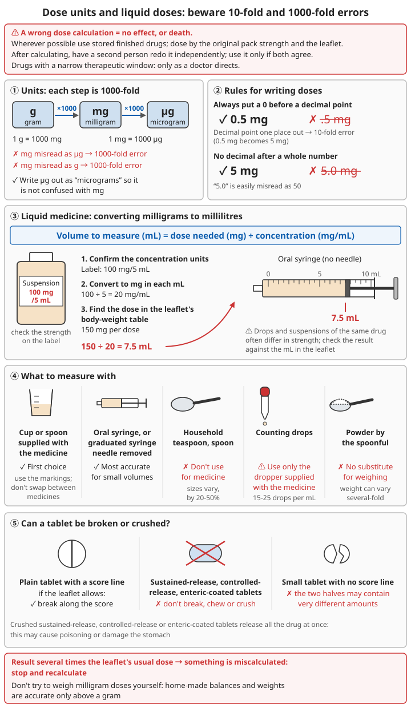

# Pharmacy Basics

> **An introduction to making medicines: safety first, life above all**

## ⚠️ Warning, once again

**Making medicines is not a game!**

- One mistake = poisoning or death
- Purity cannot be guaranteed = serious side effects
- A wrong dose calculation = no effect, or a fatal one

**Use this only when civilisation has collapsed, the medical system has broken down and a life is at stake!**

---

## 1. Basic chemical concepts

### 1.1 Kinds of substance

**Elements:**
- Hydrogen (H), oxygen (O), carbon (C), nitrogen (N), etc.
- Basic substances that cannot be broken down further

**Compounds:**
- Water (H₂O), ethanol (C₂H₅OH), table salt (NaCl)
- Made up of elements

**Mixtures:**
- Air, solutions, liquid medicines
- Several substances mixed together

### 1.2 Acids, bases and salts

**Acids (pH<7):**
- Examples: hydrochloric acid (HCl), acetic acid (CH₃COOH)
- Characteristics: sour taste, corrosive
- Uses: dissolving, neutralising

**Bases (pH>7):**
- Examples: caustic soda (NaOH), limewater (Ca(OH)₂)
- Characteristics: bitter and astringent, slippery feel, corrosive
- Uses: neutralising, saponification

**Salts:**
- Examples: table salt (NaCl), soda (Na₂CO₃)
- Acid + base → salt + water

### 1.3 Calculating concentrations

**Percentage by mass:**
```
Concentration (%) = (mass of solute / total mass of solution) × 100%

Example: 10% salt water
  = 10 g salt + 90 g water
  = 100 g solution
```

**Percentage by volume:**
```
Concentration (%) = (volume of solute / total volume of solution) × 100%

Example: 75% alcohol (medical alcohol is measured by volume, i.e. 75%vol)
  = 75 mL ethanol, topped up with water to a total volume of 100 mL
  (ethanol and water shrink slightly in volume when mixed, so it is not
  simply "75 mL + 25 mL")
```

**Mass per volume (a solid dissolved in a liquid; the most common form on medicine labels):**
```
Concentration = mass of solute / total volume of solution

Example: 0.9% normal saline = 0.9 g sodium chloride in every 100 mL (i.e. 9 g/L)
Example: 2% tincture of iodine = 2 g iodine in every 100 mL (iodine is a solid
         and cannot be counted as "mL of iodine")
Most "100 mg/5 mL" and "0.5%" figures on medicine labels are of this kind
```

**Dilution calculation (important!):**
```
Formula: C₁V₁ = C₂V₂
C₁ = starting concentration
V₁ = starting volume
C₂ = target concentration
V₂ = target volume

Example: diluting 95% alcohol to 75%
Known: C₁=95%, C₂=75%, V₂=100 mL
Find V₁: V₁ = C₂V₂/C₁ = 75×100/95 ≈ 79 mL
So: 79 mL of 95% alcohol + 21 mL water = 100 mL of 75% alcohol
```

---

## 2. Doses and amounts

### 2.1 Dose units

| Unit | Symbol | Conversion |
|------|------|------|
| Gram | g | 1 g |
| Milligram | mg | 1 g = 1000 mg |
| Microgram | μg | 1 mg = 1000 μg |
| Millilitre | mL | volume of liquid |

**Common estimates:**
- 1 g ≈ the weight of 1 mL water (an ordinary paperclip is about 0.5-1 g; only a rough guide)
- 1 mL ≈ 20 drops of liquid (different droppers give about 15-25 drops)
- 1 teaspoon ≈ 5 mL
- 1 tablespoon ≈ 15 mL

⚠️ These are only rough estimates. The error can be tens of per cent, so they must not be used to measure strong medicines. For why, and for more reliable methods, see 2.4 below.

### 2.2 The therapeutic window

```
[Dose-effect diagram]

Lethal dose ----------☠️ (danger!)
         ↑
Toxic dose -----------⚠️
         ↑
Upper effective dose -✓ ← therapeutic window (safe range)
         ↑
Lower effective dose -✓
         ↑
Ineffective dose -----✗
```

**Key principles:**
- Dose too small: no effect
- Dose about right: treatment
- Dose too large: poisoning / death

**Using medicines safely:**
- Start with the smallest effective dose
- Increase gradually
- Watch the response closely

```
Notes:
- "Increase gradually" only within the range given in the leaflet or by
  a doctor. Never exceed the stated maximum single dose, maximum daily
  dose or minimum interval between doses
- If a medicine is not working, first ask: is the diagnosis right, is it
  the right medicine for the problem? Do not just give more
- Medicines with a narrow therapeutic window (e.g. warfarin, digoxin,
  some anti-epileptic drugs, diabetes medicines) can cause harm with a
  tiny error. Use them only as a doctor directs; do not adjust them yourself
- The same ingredient can be hidden in several medicines (e.g. many cold
  remedies contain paracetamol (acetaminophen)). Taking several together
  can add up to an overdose → read the ingredient list of every medicine
```

### 2.3 Adult vs child doses

**Calculating a child's dose (rough):**
```
Method 1: by body weight
  Child's dose = adult dose × (child's weight in kg / 70)

Method 2: by age
  Child's dose = adult dose × (age / (age + 12))

Example: adult dose 100 mg, child aged 5
  Child's dose = 100 × (5/(5+12)) ≈ 29 mg
```

⚠️ The two formulas above are rough historical conversions with large errors. Use them only as a last resort when there is no children's formulation and no leaflet at all:
- Use a **children's formulation** first (drops, suspension, granules) and dose by the **body weight** column in the leaflet; for doses of common fever medicines see [Common illnesses – fever medicine dose chart](../../../docs/01-日常疾病和伤害/01-常见疾病.md#退烧药剂量速查)
- A medicine whose leaflet says "not for children", or gives no children's dose, must not be scaled down by formula for a child (aspirin, for example, is not used for fever in children and teenagers)
- A baby under 3 months with a fever or any illness goes straight to a doctor; do not give medicines yourself. Ibuprofen is for babies over 6 months
- If a child is clearly much lighter or heavier than others of the same age, calculate by weight, not age

**Special groups:**
- Older people: reduce the dose by 1/4-1/3
- Pregnant women: most medicines are forbidden!
- Kidney / liver failure: reduce the dose

```
Notes:
Older people
  - Liver and kidney function decline with age, so medicines stay in the body
    longer. "Reduce the dose" means the dose for older people given in the
    leaflet or by a doctor; if none is given, start from the lowest dose in
    the leaflet
  - They often take many medicines, so the risk of interactions and of taking
    the same drug twice is high → record every medicine on the medication card
  - Sedatives, sleeping pills and antihistamines (which cause drowsiness)
    easily cause dizziness and falls
Pregnancy and breastfeeding
  - Ask a doctor before using any medicine (including Chinese medicines and
    "natural" herbs)
  - For fever and pain, paracetamol is generally the first choice; ibuprofen,
    aspirin and similar drugs should be avoided after 20 weeks of pregnancy
    unless a doctor specifically says otherwise
  - Medicines taken while breastfeeding also partly pass into breast milk;
    read the "breastfeeding women" section of the leaflet
Liver and kidney patients
  - Paracetamol harms the liver, and ibuprofen and similar drugs harm the
    kidneys. People who already have liver or kidney disease should ask a
    doctor before using them
```

Related chapter: [Chronic medication stockpile – medication card](../../../docs/01-日常疾病和伤害/08-慢性病用药储备.md#用药信息卡).

### 2.4 Dose conversion and weighing errors

**The commonest mistakes are errors of magnitude, not small errors:**
```
Misreading mg and μg   → 1000 times out
Misreading mg and g    → 1000 times out
Decimal point one place out → 10 times out (0.5 mg written as 5 mg)
Treating mg and mL as the same → for liquid medicines always check the concentration

How to prevent this:
✓ When writing doses, write μg as "micrograms" so it is not confused with mg
✓ Always put a 0 before a decimal point: write "0.5 mg", not ".5 mg"
✓ Do not add a decimal after a whole number: write "5 mg", not "5.0 mg"
  (it is easily read as 50)
✓ After calculating, have a second person work it out again independently;
  use it only when both results agree
✓ If the result is several times different from the usual dose in the
  leaflet → something has been miscalculated; stop and work it out again
```

**Liquid medicines: converting milligrams to millilitres**
```
Volume to measure (mL) = dose needed (mg) ÷ concentration (mg/mL)

Example: a children's suspension labelled "100 mg/5 mL", i.e. 20 mg in each mL
    The leaflet's weight table gives 150 mg per dose
    → 150 ÷ 20 = 7.5 mL

Steps:
1. Check the concentration units (drops and suspension of the same medicine
   often have different concentrations!)
2. Convert to mg per mL
3. After calculating, compare with the number of millilitres in the leaflet
```

**Errors of measuring devices:**

| Device | Approximate error | Can it be used to measure medicine? |
|------|---------|---------------|
| Measuring cup, spoon or oral syringe supplied in the medicine box | Small | ✓ First choice; use the markings, and do not swap between products |
| Graduated syringe (needle removed, used as an oral measure) | Small | ✓ Most accurate for small volumes of liquid |
| Household teaspoons and tablespoons | Sizes vary; can be 20-50% out | ✗ Do not use to measure medicine |
| Counting drops from a dropper | 15-25 drops per mL, depending on dropper and liquid | ⚠️ Only with the dropper supplied with the medicine |
| Measuring powder with a spoon | Powders can differ several times in weight | ✗ Cannot replace weighing |
| Equal-arm balance + home-made weights | With care, a few parts per thousand, but only above a gram | ⚠️ Not possible at milligram level |

**Can tablets be split or crushed?**
```
✓ Ordinary tablets with a score line can be split along the line if the
  leaflet allows it
✗ Sustained-release, controlled-release and enteric-coated tablets (the
  name or leaflet says "sustained-release", "controlled-release" or
  "enteric-coated") must not be split, chewed or crushed → the whole dose
  is released at once, which can cause poisoning or harm the stomach
✗ If you break a small tablet with no score line, the two halves may
  contain very different amounts
```

**When you have no accurate weighing equipment:**
- Wherever possible, use stored ready-made medicines and give them by the strength on the original packaging (mg per tablet). This is more reliable than any home-made weighing
- Do not try to weigh milligram-level medicines yourself; for how to make a balance and weights, the accuracy they can reach and the sources of error, see [Rebuilding measurement standards – factors affecting accuracy](../../../docs/08-基础科学知识/09-计量基准的重建.md#41-影响精度的因素) and [how accurate you can be](../../../docs/08-基础科学知识/09-计量基准的重建.md#43-能做到多准)
- A balance can be checked against the net weight of unopened packaged food or medicines; see [Rebuilding measurement standards – mass and volume](../../../docs/08-基础科学知识/09-计量基准的重建.md#62-质量和容积)



*Figure: g, mg and μg each differ by a factor of 1000; write "0.5 mg", not ".5 mg", and "5 mg", not "5.0 mg"; liquid medicine volume (mL) = dose (mg) ÷ concentration (mg/mL), e.g. for a 100 mg/5 mL suspension and a 150 mg dose, measure 7.5 mL; use the measuring device supplied in the medicine box or an oral syringe, not household spoons; sustained-release, controlled-release and enteric-coated tablets must not be split or crushed*

---

## 3. Extraction and purification

### 3.1 Water extraction (decoction)

**Principle:** water-soluble components dissolve into the water

**Steps:**
```
1. Chop the herbs
2. Add water (3-5 cm above the herbs)
3. Soak for 30 minutes
4. Bring to the boil, then simmer on a low heat (ordinary herbs about
   25-30 minutes, tonic herbs about 40-60 minutes, herbs for relieving
   the exterior (for colds) about 15-20 minutes)
5. Strain off the liquid
6. The residue can be boiled a second time

Use: Chinese herbal decoctions
```

### 3.2 Alcohol extraction

**Principle:** alcohol (ethanol) dissolves more organic components

**Steps:**
```
1. Grind the herbs
2. Steep in 50-70% alcohol
3. Seal
4. Steep at room temperature for 7-14 days, shaking every day
5. Strain off the liquid

Use: medicinal wines, tinctures
```

### 3.3 Distillation

**Principle:** separating and purifying by different boiling points

**Simple still:** a pot or bottle is heated from below; the vapour is led out through a tube from a hole in the lid, the tube passes through cold water where the vapour condenses into droplets, and these run into a receiving bottle. For a diagram, temperature control and discarding the heads, see [Making disinfectants – distillation](../../../docs/06-制药技术/01-消毒剂制备.md#13-蒸馏提纯).

**Uses:**
- Purifying alcohol
- Extracting essential oils
- Making distilled water

### 3.4 Filtration and sedimentation

**Filtration:**
```
Coarse: gauze, cotton cloth
Medium: filter paper, fine cloth
Fine: several layers of filter paper
```

**Sedimentation:**
```
1. Add a precipitating agent
2. Leave to stand
3. Impurities settle to the bottom
4. Pour off the clear liquid on top
```

### 3.5 Crystallisation

**Principle:** on cooling or evaporation, the solute comes out as crystals

**Steps:**
```
1. Make a saturated hot solution
2. Cool slowly
3. Crystals form
4. Collect by filtering
5. Wash and dry

Use: purifying medicines (aspirin, etc.)
```

---

## 4. Aseptic technique

### 4.1 Why does it need to be sterile?

**Consequences of contamination:**
- Oral medicines: diarrhoea, food poisoning
- External medicines: wound infection
- Injections: sepsis, death!

**Sterility requirements (from low to high):**
1. Oral medicines: clean is enough
2. External medicines: a higher level of cleanliness
3. Eye medicines, medicines for open wounds: sterile
4. Injections: **absolutely sterile!**

### 4.2 Sterilisation methods

**Boiling (simplest):**
```
Steps:
1. Put the equipment in water
2. Boil for 15-30 minutes
3. Keep it at a rolling boil
4. After taking it out, do not let it touch anything contaminated

Kills: most bacteria and viruses
Does not kill: spores (but good enough for general use)
```

**Pressure steam sterilisation (most reliable):**
```
Equipment: pressure cooker
Conditions: 121°C, 15 minutes, gauge pressure about 100 kPa
            (about 1 atmosphere)
Kills: all microorganisms, including spores

Used for: equipment for injections, culture media

⚠️ The working pressure of household pressure cookers varies by model; many
   reach only 50-80 kPa (about 112-117°C inside) and never reach 121°C, so the
   same time does not sterilise fully. A pressure cooker also has no
   temperature display, so you cannot confirm the conditions were reached
   → treat the result of a household pressure cooker only as "very clean",
   not as reliably sterile
```

**Dry heat sterilisation:**
```
Method: oven / stove
Temperature: 160-170°C
Time: 2 hours

Used for: glassware, metal instruments
```

**Chemical sterilisation:**
```
Soak in 75% alcohol: 30 minutes
Wipe with povidone-iodine: twice
Potassium permanganate solution: soak

Used for: items that cannot stand heat, skin disinfection
```

Make potassium permanganate solution at 0.01%-0.1% according to use; for the concentration table see [Making disinfectants – making up potassium permanganate solution](../../../docs/06-制药技术/01-消毒剂制备.md#53-高锰酸钾溶液配制). Chlorine disinfectant ("84" bleach (sodium hypochlorite)) is for surfaces and the surroundings, not for skin or wounds; for the mixing ratios see [Infectious disease at home – "84" bleach](../../../docs/01-日常疾病和伤害/15-传染病家庭防控.md#84消毒液含氯消毒剂). Wash items clean before disinfecting them chemically: blood, pus and grease stop disinfectants from working.

### 4.3 Key points of aseptic technique

**Before you start:**
- [ ] Wash and disinfect your hands
- [ ] Sterilise the equipment
- [ ] Clean and disinfect the work surface
- [ ] Wear clean clothes

**While working:**
- [ ] Keep exposure time short
- [ ] Do not talk or cough
- [ ] Do not let the mouths of containers touch anything
- [ ] Put lids down with the inside facing up

**Afterwards:**
- [ ] Seal promptly
- [ ] Label with the date and name
- [ ] Store cool and away from light

### 4.4 Cleaning, disinfection and sterilisation: the difference

| Level | What it achieves | Common methods | Good enough for |
|------|-------------|---------|--------|
| Cleaning | Removes visible dirt and most microorganisms | Soap, scrubbing under running water | Things for oral use and medicine containers; also the precondition for disinfection and sterilisation |
| Disinfection | Kills most disease-causing microorganisms, but not necessarily spores | Boiling, 75% alcohol, povidone-iodine, chlorine disinfectant | Skin, thermometers, external instruments, dressing equipment |
| Sterilisation | Kills all microorganisms, including spores | Reliable pressure steam, dry heat | Instruments that go deep into wounds or into the body |

```
Common mistakes:
❌ Disinfecting without cleaning first → dirt shields the bacteria and the
   disinfectant cannot get in
❌ Wiping with alcohol and using it straight away → the alcohol only works
   once it has dried naturally (about 30 seconds)
❌ Drying with an ordinary towel after disinfecting → it is contaminated
   again; let it air-dry or use a disinfected cloth
❌ Thinking "it has been boiled, so it is sterile" → boiling only
   disinfects; it does not kill spores
```

### 4.5 Hygiene when using medicines day to day

**Handwashing (the first step of everything):**
```
1. Wet both hands under running water
2. Apply soap and rub palms, backs of hands, between the fingers, fingertips,
   thumbs and wrists
3. Rub for at least 20 seconds
4. Rinse under running water and dry with a clean cloth or in the air

No soap: scrub with plant ash, or just rub thoroughly under running water
for 20 seconds
When your hands are not visibly dirty, you can rub them with 75% alcohol
instead, until dry
```

Related chapter: [Sanitation facilities – handwashing stations](../../../docs/07-日常生活技能/03-卫生设施.md#洗手点).

**Taking out and using medicines:**
```
✓ Tip tablets into the bottle cap or onto clean paper before taking them;
  do not rummage in the bottle with your fingers
✓ Do not put extra tablets back in the original bottle
✓ Take ointment out with a clean cotton bud; do not put a used bud back
  into the tube or jar
✓ Do not let the tip of eye-drop or nose-drop bottles touch the eye,
  eyelashes, nose or fingers
✓ One bottle of eye drops, nose drops or ointment per person; family
  members must not share
✓ Everyone taking medicine uses their own cup and measure; wash measures
  and let them dry after use
✓ Wash your hands before and after changing a dressing; wear gloves when
  touching a wound (if you have no gloves, use a clean plastic bag)
✓ Bag used dressings and cotton buds, tie the bag tightly and throw it
  away; keep bloodstained items away from children
```

**How to tell that hygiene is not good enough:**
- After a dressing change the wound becomes redder, more swollen, hotter or more painful, or it oozes pus or smells → possible infection; see the criteria for seeing a doctor in section 11 of this chapter
- The eye becomes redder or there is more discharge after using eye drops → stop using that bottle and use a new one; if it does not improve, see a doctor
- Condensation or mould spots appear in a medicine container → the container is not dry or not sealed; treat the whole bottle as spoiled

---

## 5. Storing medicines

### 5.1 Storage conditions for common medicines

| Type of medicine | Storage temperature | Other requirements | Shelf life |
|----------|----------|----------|--------|
| Solid tablets | As on the pack (mostly room temperature or cool) | Dry, away from light | 1-3 years |
| Liquid medicines | Refrigerated (2-8°C) | Away from light | 1-6 months |
| Alcohol / tincture of iodine | Room temperature | Sealed | 2 years |
| Chinese herbal pieces | Cool and dry | Ventilated, protected from insects | 1 year |
| Ointments | Cool | Sealed | 1-2 years |

⚠️ The table above is only a rough guide. For ready-made medicines, the **storage conditions and expiry date on the pack** always take priority. "Liquid medicines, refrigerated, 1-6 months" in the table refers to home-made or opened liquids; most unopened ready-made syrups and oral solutions are kept at room temperature, with the expiry date on the pack.

**What common storage terms mean (the Chinese Pharmacopoeia):**

| The pack says | Meaning |
|---------|------|
| Room temperature | 10-30°C |
| Cool place | Not above 20°C |
| Cool, dark place | Away from light and not above 20°C |
| Cold place | 2-10°C |
| Protect from light | Packed in a light-proof container (e.g. a brown bottle, wrapped in black paper) |
| Sealed | Protected from efflorescence, damp, evaporation and foreign matter |

```
Storage points:
✓ Keep in a dry, cool, dark place out of children's reach, ideally locked
✓ Keep the original packaging and leaflet; do not pop tablets out of
  blister packs in advance to repack them
✓ Do not keep medicines in the bathroom, next to the kitchen hob, on a
  windowsill or in a car in summer
✓ Put medicines that need refrigerating in the middle of the fridge, not
  against the back wall, and do not freeze them
✓ Keep external and internal medicines apart; never keep disinfectants or
  pesticides with medicines
✓ Check regularly (e.g. every six months): use those near expiry first and
  clear out anything expired or spoiled
```

For a detailed explanation of storage conditions see [Antibiotics – storage conditions](../../../docs/06-制药技术/02-抗生素制备.md#64-储存条件); for what to do with insulin and other refrigerated medicines in a power cut, see [Chronic medication stockpile – insulin and other medicines that need refrigerating](../../../docs/01-日常疾病和伤害/08-慢性病用药储备.md#胰岛素等需要冷藏的药).

### 5.2 Recognising spoiled medicines

**Changes in appearance:**
- ✗ Change of colour (brown, black)
- ✗ Mould (white fur, green spots)
- ✗ Caking, deliquescence (absorbing moisture and turning damp)
- ✗ Cloudy liquid, sediment
- ✗ Unusual smell

**Throw away anything spoiled at once!**

### 5.3 Choosing containers

**Glass bottles (best):**
- ✓ Do not react with medicines
- ✓ Can be sterilised at high temperature
- ✓ Seal well
- Dark bottles are even better (keep out light)

**Earthenware jars:**
- ✓ For storing dried herbs
- ✓ Breathable

**Plastic bottles (use with care):**
- ⚠️ Some medicines dissolve plastic
- ⚠️ Cannot stand high temperatures
- Usable short-term

```
Whatever container you use:
✓ Label it: medicine name (generic name), strength, expiry date or date
  opened, how to use
✗ Do not keep medicines or disinfectants in drink bottles or food jars;
  children and older people easily swallow them by mistake
✗ Do not mix several medicines in one bottle; once mixed, they cannot be
  told apart
```

### 5.4 How to read expiry dates

```
A pack usually carries three dates or numbers:
- Date of manufacture
- Batch number (used to trace problems; it is not a date)
- Expiry date: "use by May 2027" usually means it can be used until the last
  day of that month; if a day is given, it can be used until that day
  Older packs that say "invalid from" mean use it before that date

Once opened, the shelf life is shorter than the date on the pack:
- The expiry date is determined in the original, unopened pack stored under
  the stated conditions
- Once opened, contact with air, moisture and hands speeds up both
  breakdown and contamination
```

**How long to use after opening (the leaflet takes priority if it says; otherwise a cautious guide):**

| Dosage form | After opening | Notes |
|------|--------|------|
| Eye, nose and ear drops | Usually no more than 4 weeks | Very easily contaminated; single-dose units are used up once opened |
| Syrups, oral solutions, suspensions | As in the leaflet; if not stated, usually 1-3 months | Throw away at once if cloudy, smelly or mouldy |
| Dry suspensions made up with water (e.g. children's antibiotics) | As in the leaflet; usually a few days to 2 weeks | Most need refrigerating; throw away when the time is up |
| Creams, ointments | Usually 1-2 months | Tubes are better than jars; take from jars with a clean cotton bud |
| Loose tablets in a bottle | Usually no more than 6 months, and not beyond the original expiry date | Keep the desiccant; screw the cap on tightly after each use |
| Tablets in blister packs | Unopened blisters keep the original expiry date | Take a tablet as soon as you pop it out |

Write the date of opening on the bottle when you open it; otherwise you will soon forget it.

### 5.5 Can expired medicines be used?

**In normal times: do not use expired medicines.** When you have in-date medicines, or can get to a hospital or pharmacy, never use expired ones.

**In an extreme situation with no alternative at all, judge by these principles:**
```
The main risk of an expired medicine is "not strong enough", not "turned into poison":
- Testing in the US military and FDA Shelf Life Extension Program found
  that most solid dosage forms (tablets, capsules) kept sealed under good
  conditions still contained enough active ingredient after the labelled
  expiry date
- But "most" is not "all", and it does not apply to medicines stored
  badly

So:
✓ Tablets and capsules in their original sealed packaging, stored well,
  normal in appearance and only a little past their date can be considered
  when there is no alternative at all
⚠️ Do not raise the dose yourself to "make up" for lost strength
⚠️ When treating a deadly illness (e.g. a severe infection), not strong
  enough = treatment fails. So try even harder to get medical care; do not
  delay because "we have medicine"
```

**When you cannot rely on expired medicines:**

| Situation | Reason |
|------|------|
| Liquid forms (syrups, oral solutions, eye drops, injections) | Break down quickly and may grow bacteria |
| Medicines that need refrigerating (insulin, some vaccines, etc.) | Once storage conditions fail, the potency is unpredictable |
| Glyceryl trinitrate (nitroglycerin) | Loses potency very easily; if it fails during an angina attack, rescue is delayed |
| Medicines with a narrow therapeutic window (warfarin, digoxin, anti-epileptic drugs, etc.) | Once the content changes, the dose is no longer right |
| Any change in appearance (colour change, caking, deliquescence, cloudiness, odd smell, mould) | Already spoiled, whether expired or not |
| Damaged packaging, broken seal | No way to judge how much damp and contamination it has had |

⚠️ One exception to know: in a severe allergic attack (anaphylactic shock), if all you have is an expired adrenaline (epinephrine) auto-injector and nothing else, most professional opinion is that you should still use it (unless the liquid is clearly discoloured or has particles in it), and call 120 at once. In normal times, still replace it on time; see [Acute symptoms – allergic reactions](../../../docs/01-日常疾病和伤害/05-急性症状.md#过敏反应).

For the research data on expired medicines and how to judge antibiotics specifically, see [Antibiotics – about expiry dates](../../../docs/06-制药技术/02-抗生素制备.md#65-关于有效期).

### 5.6 Disposing of expired and spoiled medicines

```
✓ If there is a medicine take-back point (pharmacy, community), hand them in there
✗ Do not flush them down the toilet or pour them out near a water source;
  they pollute the water
✗ Do not throw whole bottles into the bin; children or others may find them
  and swallow them
If there is no take-back point: take the tablets out of the packaging, mix
  them with soil, used tea leaves or cat litter, put them in a sealed bag and
  put it out with household rubbish; tear off or black out personal details
  on the labels
```

---

## 6. Safety and protection

### 6.1 Personal protective equipment

**Basic protection:**
- [ ] Mask (against breathing in dust and vapour)
- [ ] Gloves (against contact with corrosive substances)
- [ ] Goggles (against splashes)
- [ ] Apron / work clothes

**High-risk work (strong acids, strong bases):**
- [ ] Chemical-resistant gloves
- [ ] Face shield
- [ ] Long sleeves and long trousers

### 6.2 Ventilation

**Work that must be ventilated:**
- Distilling alcohol (flammable vapour)
- Using strong acids and bases (corrosive fumes)
- Handling sulphides (toxic gas)
- Culturing microorganisms (to avoid contamination)

**Ventilation measures:**
- Work outdoors
- Open windows on opposite sides for a through draught
- A simple fume hood

### 6.3 First aid

**Acid and alkali burns:**
```
1. Quickly take off contaminated clothing and gloves
2. Rinse at once with plenty of running water for at least 30 minutes
   (rinse alkali burns even longer)
3. Do not try to "neutralise" with soda water, vinegar, etc. → neutralising
   gives off heat, makes the burn worse and wastes rinsing time
4. Brush off quicklime powder before rinsing; blot concentrated sulphuric
   acid off quickly with a dry cloth first, then rinse with plenty of water
5. Cover loosely with a clean cloth and go to a doctor, taking the chemical's
   container or label with you
6. Splashed in the eye: rinse at once with running water, and keep rinsing on
   the way to the doctor
```

For details see [Wound and injury care – chemical burns](../../../docs/01-日常疾病和伤害/02-外伤处理.md#化学烧伤) and [Foreign bodies – chemicals in the eye](../../../docs/01-日常疾病和伤害/04-异物处理.md#化学品入眼紧急).

**Breathing in toxic gas:**
```
0. Protect yourself first: if there is a strange smell or someone has
   collapsed, do not rush in; ventilate first or wear protection
1. Move to fresh air at once
2. Loosen the collar
3. Keep the airway open
4. Unresponsive and not breathing normally → call 120 and start CPR at once
5. See a doctor (coughing and chest tightness may only get worse hours later)
```

**Swallowed by mistake:**
```
1. Spit out whatever is left in the mouth and rinse with clean water (do not swallow)
2. Call 120 and say clearly what was swallowed, roughly how much, and when
3. Do not make the person vomit, and do not give milk, egg white, vinegar or
   other folk remedies, unless a doctor or 120 specifically tells you to
   (vomiting does not remove poison effectively; corrosive substances burn
    the gullet again on the way up; a person with reduced consciousness who
    vomits can easily breathe it into the lungs)
4. Do not give anything by mouth to someone with reduced consciousness;
   breathing but cannot be woken → lay them on their side
5. Take the raw materials, container and anything left over to hospital
6. Even if they "seem fine now", see a doctor; many poisons only take effect
   hours later
```

For details see [Poisoning – general principles of dealing with poisoning](../../../docs/01-日常疾病和伤害/12-中毒.md#中毒的通用处理原则).

---

## 7. Simple laboratory equipment

### 7.1 Equipment you can make

**Still:**
```
Materials:
- A large pot (the still)
- A hole in the lid with a bamboo tube / copper pipe in it
- The pipe runs through a bucket of cold water (condensing)
- The other end of the pipe drips into a bottle (receiving)

Principle: vapour → condensation → droplets
Uses: distilling alcohol, essential oils
```

**Filter:**
```
Materials:
- Funnel (or a bamboo tube, or an earthenware pot with a hole in the bottom)
- Filter cloth / gauze / filter paper
- Receiving container

Filtering several times makes it cleaner
```

**Simple balance:**
```
Materials:
- A straight rod
- A central pivot (knife edge)
- Pans / hooks hanging at both ends
- Standard weights (coins or stones weighed in advance)

Crude, but it can estimate weight
```

**Substitutes for a thermometer:**
```
Without a thermometer:
- Water boiling = 100°C (at sea level)
- Hot water you can keep your hand in = 40-50°C
- Hot water you cannot keep your hand in = 60-80°C
- Steaming hard, small bubbles on the bottom = about 80-90°C
- Wood starts to burn = about 300°C
```

### 7.2 Keeping records

**Record every batch of medicine you make (important!):**
```
Date: ____
Name of medicine: ____
Raw materials:
  - Type, quantity, source
Recipe:
  - Proportions of each ingredient
Steps:
  - Detailed procedure
Temperature / time: ____
Yield: ____
Quality check: colour, smell, state
Effect (after use): ____
Side effects: ____
Suggested improvements: ____
```

**Why does this matter?**
- Successes can be repeated
- Failures are not repeated
- The knowledge can be passed on to others

---

## 8. Recognising toxic substances

### 8.1 Highly poisonous plants (avoid completely)

| Plant | Toxic component | Lethal dose | Symptoms |
|------|----------|--------|------|
| Heartbreak grass (*Gelsemium elegans*, *duanchangcao*) | Gelsemine alkaloids | About 3 g fresh leaves (literature value) | Respiratory paralysis |
| Datura (thorn apple) | Hyoscyamine | Small amounts (a child eating a few seeds can be severely poisoned) | Hallucinations, coma |
| Aconite (*wutou*) | Aconitine | 3-5 mg (0.2 mg can cause poisoning) | Cardiac arrest |
| Oleander | Cardiac glycosides | Small amounts | Abnormal heart rhythm |
| Poison hemlock | Coniine | Small amounts | Convulsions, respiratory failure |

**Principle: never use a plant you do not recognise!**

### 8.2 Heavy metals (forbidden)

- ☠️ Mercury (quicksilver): nerve poison
- ☠️ Lead: chronic poisoning
- ☠️ Arsenic (white arsenic): highly toxic
- ☠️ Cadmium: kidney damage

**Ancient "elixirs of immortality" often contained these and poisoned many people!**

### 8.3 Safety testing (with great caution)

**If you absolutely must test an unknown plant:**
```
Step 1: skin test
  - Squeeze out some juice and rub it on the inside of the arm
  - Wait 4 hours
  - Redness, swelling, burning pain → give up

Step 2: lip test
  - Touch a small amount to the lips
  - Wait 15 minutes
  - Numbness, burning pain → give up

Step 3: tongue-tip test
  - Put a tiny amount on the tip of the tongue
  - Spit it out at once
  - Wait 15 minutes
  - Any discomfort → give up

Step 4: swallow a small amount
  - A very small amount (the size of a grain of rice)
  - Wait 8 hours
  - If there is no bad reaction, increase gradually

The whole process takes 2-3 days!
```

**⚠️ The risk is extremely high! Do not try this unless you are truly desperate!**

---

## 9. Frequently asked questions

### Q1: What if I have no accurate weighing equipment?

**A: Estimate by volume**
```
1 teaspoon (about 5 mL) ≈ 5 g (powder)
1 tablespoon (about 15 mL) ≈ 15 g
1 cup (about 250 mL) ≈ 250 g

Liquids: estimate by volume
Solids: measure the volume with water, then estimate the weight
```

**Principle: better too little than too much!**

```
⚠️ "1 teaspoon ≈ 5 g" only holds for water and things with a density close to water:
- Dry powdered herbs are light; a teaspoon may be only 2-3 g
- A level teaspoon of fine salt is about 5-6 g, of white sugar about 4-5 g
- The same powder differs greatly between packed and loose
So volume estimates can only be used for things like salt and sugar that are
safe over a wide range, never to measure strong or toxic medicines
```

See [2.4 Dose conversion and weighing errors](#24-dose-conversion-and-weighing-errors) above.

### Q2: How can I tell whether extraction is complete?

**A: Compare several extractions**
- First extraction: dark colour
- Second extraction: light colour
- Third extraction: almost colourless → complete

### Q3: How long do home-made medicines keep?

**A: Cautious estimates**
- Liquid medicines: 1-4 weeks (refrigerated)
- Dry medicinal powders: 3-6 months
- Medicinal wines: 6-12 months
- Medicated plasters: 1-3 months

**At any suspicion of spoiling, throw it away at once!**

### Q4: Does it have to be sterile?

**A: It depends on the use**
- By mouth: clean is enough (not sterile)
- On open wounds: as sterile as possible
- Injections: **absolutely sterile!** (if you cannot achieve this, do not do it!)

---

## 10. Checklists

### Before making a medicine:
- [ ] Recipe checked and correct
- [ ] Raw materials confirmed non-toxic
- [ ] Equipment cleaned / sterilised
- [ ] Full protective equipment
- [ ] Good ventilation
- [ ] Ready to keep detailed records

### While making it:
- [ ] Temperature control
- [ ] Time control
- [ ] Colour / smell normal
- [ ] Nothing unusual happening

### After making it:
- [ ] Normal appearance
- [ ] No odd smell
- [ ] Suitably packed
- [ ] Clearly labelled (name, date, dose)
- [ ] Properly stored

### Before using it:
- [ ] Not expired
- [ ] Not spoiled
- [ ] Dose calculated accurately
- [ ] Side effects and contraindications known
- [ ] Patient checked: age, weight, pregnant or breastfeeding, allergies, other medicines being taken
- [ ] No ingredient duplicated among the medicines used together
- [ ] You know when to stop the medicine and when to see a doctor (see the next section)

---

## 11. Adverse drug reactions and when to see a doctor

> Any medicine (including Chinese medicines, home-made medicines and "natural" remedies) can have adverse reactions. Being able to recognise them, stop the medicine and know when someone must go to hospital matters more than knowing how to use the medicine.

### 11.1 Grading adverse reactions

| Severity | Common signs | What to do |
|------|---------|--------|
| Mild | Mild nausea, upset stomach, slight dizziness, dry mouth, drowsiness, constipation or loose stools | Most can be watched while continuing; taking it after meals as the leaflet says can reduce stomach upset; when drowsy, do not drive, climb or use dangerous machinery |
| Moderate | Local or widespread rash, itching, vomiting, frequent diarrhoea, marked palpitations | Stop the suspected medicine, record it and consult a doctor as soon as possible; watch whether it gets worse |
| Severe (life-threatening) | Difficulty breathing, tight throat, swollen lips and face, dizziness and fainting; large areas of skin blistering and peeling; vomiting blood, black stools; convulsions, reduced consciousness; breathing becoming slow and shallow | **Stop the medicine at once and call 120** |

Severe allergy (anaphylactic shock) can happen within minutes of taking a medicine; for how to recognise and treat it, see [Acute symptoms – allergic reactions](../../../docs/01-日常疾病和伤害/05-急性症状.md#过敏反应).

### 11.2 Danger signs that are easily missed

```
Skin and mucous membranes
- After a few days of fever and feeling generally unwell, large red patches,
  blisters and peeling skin appear, with ulcers in the mouth, eyes or
  genitals → a severe drug rash; see a doctor at once
  (it often appears days to weeks after starting a medicine, e.g. some
   anti-epileptic drugs, sulphonamides, allopurinol, some antibiotics and
   fever and pain medicines)

Liver
- Yellow skin or whites of the eyes, urine as dark as strong tea, poor
  appetite, pain in the upper right abdomen
  → possible drug-induced liver damage (paracetamol overdose, some Chinese
    medicines, etc.)

Bleeding in the gut
- Vomiting material like coffee grounds or bright red, black shiny stools
  like tar
  → common with ibuprofen, aspirin and similar drugs; higher risk in older
    people and long-term users

Kidneys
- Much less urine, swelling all over
  → ibuprofen and similar drugs harm the kidneys more easily in people who
    are dehydrated or elderly

Blood
- Fever, sore throat or mouth ulcers while on a medicine, or unexplained
  bruises on the skin or bleeding gums → white blood cells or platelets may
  be low; a blood test is needed

Nerves and breathing
- Cannot be woken, breathing slow and shallow (overdose of sleeping pills,
  sedatives, some cough medicines)
- Convulsions, unsteady walking, slurred speech
```

### 11.3 How to tell whether a medicine is the cause

```
Points that suggest the medicine:
✓ It appeared only after starting the medicine (or raising the dose, or
  changing medicine)
✓ It gradually gets better after stopping the medicine
✓ The "adverse reactions" section of the leaflet mentions this sign
✓ Something similar happened before with the same or a similar medicine

Possible other causes:
- The illness itself is getting worse (e.g. a rash or fever caused by infection)
- Food, alcohol or other medicines taken at the same time

⚠️ After a severe reaction (severe rash, swelling of the throat, anaphylactic
   shock), do not try the medicine again "to check"; the next reaction may be
   worse
```

### 11.4 What to do after an adverse reaction

```
1. Severe (see 11.1) → call 120 at once; do not wait
2. Moderate or mild → stop the most likely medicine
   (but anti-epileptic drugs, steroids, blood pressure medicines,
    antidepressants and similar must not be stopped suddenly on your own;
    ask a doctor first; see the chronic medication stockpile chapter)
3. Record: which medicine, what dose, when it started, what the signs were,
   what happened after stopping
4. Write the medicine's name in the "allergies" section of the medication
   card and medical record, and tell the family
5. Take the medicine box and leaflet with you to the doctor
```

Related chapters: [Chronic medication stockpile – the medicines most dangerous to stop suddenly](../../../docs/01-日常疾病和伤害/08-慢性病用药储备.md#突然停药最危险的几类药), [Poisoning – drug overdose and accidental swallowing](../../../docs/01-日常疾病和伤害/12-中毒.md#药物过量与误服).

### 11.5 Common dangerous combinations

| Combination | Risk |
|------|------|
| Several cold and fever medicines taken together | Ingredients such as paracetamol are duplicated, and an overdose damages the liver without anyone noticing |
| Paracetamol + alcohol | Worse liver damage |
| Sleeping pills, sedatives, drowsy antihistamines + alcohol | Breathing suppressed; can be fatal |
| Ibuprofen + aspirin / anticoagulants (e.g. warfarin) | Higher risk of bleeding |
| Cephalosporins, metronidazole, etc. + alcohol | Disulfiram-like reaction: flushed face, palpitations, falling blood pressure; severe cases can be fatal. Do not drink alcohol while taking them or for about 1 week after stopping |
| Chinese medicines + Western medicines "all at once" | Ingredients unknown, interactions hard to predict; if they must be used together, ask a doctor or pharmacist first |

### 11.6 When you must see a doctor

**Call 120 at once:**
- [ ] Difficulty breathing, tight throat, swollen face and lips, dizziness and fainting after taking a medicine
- [ ] Reduced consciousness, cannot be woken, convulsions, or breathing slow and shallow
- [ ] Vomiting blood, black stools
- [ ] Large areas of skin blistering or peeling, or ulcers in the mouth or eyes
- [ ] A medicine taken by mistake or in overdose, even if there are no symptoms yet (especially in children)

**See a doctor soon (the same day):**
- [ ] Yellow skin or whites of the eyes, urine like strong tea
- [ ] Much less urine, swelling all over
- [ ] Fever, sore throat, mouth ulcers or unexplained bruises while on a medicine
- [ ] Anything unusual after a medicine in a baby, a pregnant woman or a very old person
- [ ] No improvement after 2-3 days of using a medicine as the leaflet says, or getting worse

**Do not treat yourself; see a doctor first:**
- [ ] Fever or illness in a baby under 3 months
- [ ] Pregnant or breastfeeding women who need medicine
- [ ] Severe abdominal pain, chest pain or headache with no diagnosis
- [ ] Illnesses that need prescription medicines, injections or drips
- [ ] Suspected severe infection (high fever that will not come down, redness and swelling spreading from a wound, listlessness)

**When the medical system has broken down and no doctor can be reached:** the situations above still mean the illness is serious. Do everything you can to find a doctor, nurse, pharmacist or experienced person to help; meanwhile do what you can following the first-aid chapters, and keep a detailed record of how the illness changes. Do not stop looking for help because "we have home-made medicine".

For the specific criteria for seeing a doctor for common illnesses, see the "when to see a doctor" section for each illness in [Common illnesses](../../../docs/01-日常疾病和伤害/01-常见疾病.md); for fever see [When to see a doctor for fever, by group](../../../docs/01-日常疾病和伤害/01-常见疾病.md#不同人群的发烧就医标准).

---

## Related chapters

- ⏭️ [Making disinfectants](../../../docs/06-制药技术/01-消毒剂制备.md) - start practising with alcohol
- ⏭️ [Chinese herbal preparations](../../../docs/06-制药技术/04-中药制剂.md) - a safer starting point
- 🔗 [Farming and Animal Husbandry – Medicinal plants](../../../docs/04-动植物培育/04-药用植物.md) - where the raw materials come from
- 🔗 [Chronic medication stockpile](../../../docs/01-日常疾病和伤害/08-慢性病用药储备.md) - stockpiling, refrigerated medicines, medication card
- 🔗 [Poisoning](../../../docs/01-日常疾病和伤害/12-中毒.md) - dealing with drug overdose and accidental swallowing
- 🔗 [Rebuilding measurement standards](../../../docs/08-基础科学知识/09-计量基准的重建.md) - balances, weights and weighing errors

---

**Remember: basic knowledge is the precondition for making medicines safely! Without thorough study and preparation, do not plunge in blindly!**

**Knowledge is life!**
