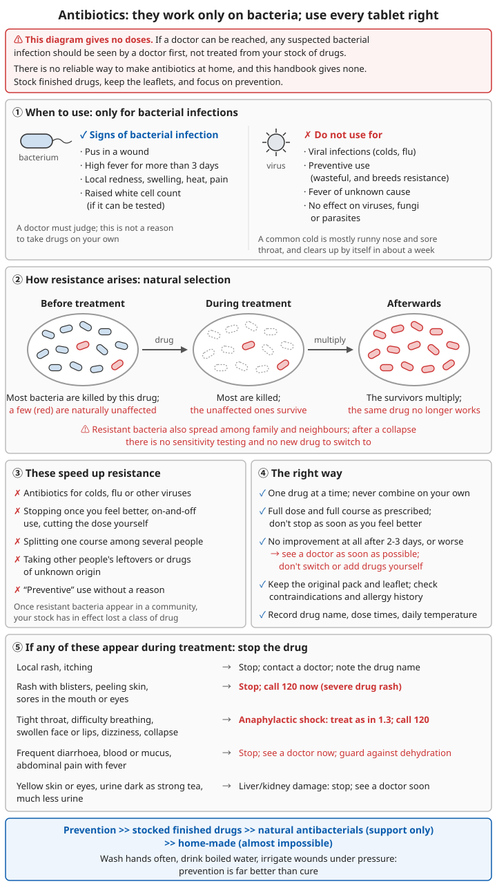

# Making Antibiotics

> **⚠️ Extremely high risk – last resort only**

## 🚨 Serious warning

**The content of this chapter is extremely dangerous!**

**List of risks:**
- ☠️ Allergic reaction: penicillin allergy can kill (anaphylactic shock)
- ☠️ Purity cannot be guaranteed: impurities cause serious side effects
- ☠️ The dose cannot be made precise: too much poisons, too little does nothing
- ☠️ Sterile conditions are extremely hard to achieve: contamination makes the infection worse
- ☠️ Resistance: misuse makes bacteria resistant
- ☠️ Superinfection: the normal flora is killed and disease-causing germs move in

**The risk of death is real and very high!**

**Preconditions for use:**
- ✓ A bacterial infection has been confirmed (not a virus!)
- ✓ Life is in danger and there is no other choice
- ✓ You have medical knowledge
- ✓ No history of penicillin allergy
- ✓ You accept all the risks

**⚠️ If there is any other option at all, never use a home-made antibiotic!**

---

## 1. Penicillin: why this handbook gives no home-made method

### 1.1 A short history of penicillin

**Discovery:** In 1928 Fleming found that a *Penicillium* mould could stop bacteria growing
**Significance:** It has saved hundreds of millions of lives
**The problem:** It took more than ten years to get from discovery to a usable medicine; industrial production depends on special high-yield strains and professional fermentation and purification equipment

### 1.2 Home-made penicillin is not feasible

- Most *Penicillium* moulds collected in the wild produce no penicillin or only tiny amounts, and you cannot tell them apart by looking
- Penicillin breaks down quickly when heated or in acid; it cannot be purified without professional equipment
- A crude extract has an unknown dose and cannot be sterilised; injected, it can cause sepsis; taken by mouth, most of it is destroyed by stomach acid
- There is no reliable case of anyone making it successfully in the wild

**Conclusion: stock finished antibiotics before collapse (see Section 6); do not try to make them.**
Mouldy bread and fruit cannot be used as treatment either (see Q2).

### 1.3 Emergency treatment of penicillin allergy (when using stocked penicillin)

**Symptoms:**
- Rash, itching
- Tight chest, shortness of breath
- Falling blood pressure
- Loss of consciousness

**Emergency treatment (every second counts!):**
```
1. Stop the drug immediately!

2. Adrenaline (epinephrine):
   - 1:1000 (1 mg/mL) adrenaline
   - Adults: 0.3-0.5 mL (0.3-0.5 mg), no more than 0.5 mg per dose
   - Children: 0.01 mL/kg (0.01 mg/kg), no more than 0.3 mg per dose
   - Inject into the muscle (outer side of the thigh)
   - If there is no improvement, repeat after 5-15 minutes

3. Position:
   - Lie flat
   - Raise both legs

4. Keep the airway open

5. If breathing and heartbeat stop → CPR

⚠️ No adrenaline = death is almost certain!
   You must have it ready in advance!
```

**Also during emergency treatment:**
```
- Call 120 at the same time; do not wait to "see if it gets better"
- If breathing is clearly difficult and lying flat makes it worse, let the person
  sit up or half sit; but if they are dizzy, pale or have a weak pulse they must lie
  flat. Do not let them stand up or walk
  (standing up suddenly during shock can stop the heart)
- Antihistamines (such as loratadine) only ease the rash and itching; they cannot
  replace adrenaline. Do not delay the injection to give an antihistamine first
- Even when the symptoms ease, the person must still go to hospital for observation:
  some people have a second attack hours later (biphasic reaction)
- Afterwards, write "penicillin allergy" on the medication card and never use
  penicillins again; whether cephalosporins can be used must be decided by a doctor
```

For how to fill in a medication card, see [Chronic Medication Stockpile – Medication card](../01-first-aid-and-family-health/08-chronic-medication-stockpile.md#medication-card).

---

## 2. Sulfonamides

### 2.1 Overview

**Sulfonamides (sulfa drugs):**
- The first synthetic antibacterial drugs
- Widely used during the Second World War
- Used less today (more side effects, and better drugs exist)

**Advantages:**
- Made by chemical synthesis (no fermentation needed)
- Broad-spectrum

**Disadvantages:**
- Serious side effects (kidney damage, blood disorders)
- Resistance develops easily

### 2.2 Synthesis (almost impossible)

**⚠️ Needs a professional chemistry laboratory!**

**Raw materials:**
- Aniline
- Chlorosulfonic acid
- Ammonia solution

**Steps:**
- It takes a multi-step organic synthesis (including protecting the amino group, chlorosulfonation, ammonolysis and deprotection); every step needs professional equipment and control of reagents. It is not described here

**The reality:**
- The raw materials are hard to get
- The reactions are dangerous (strong acids, toxic gases)
- Purification is difficult
- **It is almost impossible to make after civilisation collapse!**

### 2.3 Alternative: salvaged medicines

**The realistic plan:**
- Stock finished sulfonamides before collapse
- Search abandoned pharmacies and hospitals
- Check the expiry date
- Store them properly

**How to decide whether a found medicine is worth keeping:**
```
Keep:
✓ Original packaging intact; drug name (generic name), strength, batch number
  and expiry date clearly readable
✓ Ideally with the package leaflet; if there is none, write the drug name
  and strength on the pack with a pen
✓ Tablets and capsules look intact (for the criteria see 6.5)

Do not keep or use:
❌ Loose, unlabelled tablets when you cannot say what they are
   (tablets that look alike may be completely different drugs)
❌ Packs that are damaged, damp, soaked in water or scorched by fire
❌ Liquid forms and injections (you cannot tell whether they are contaminated,
   and injecting needs professional skill)
```

⚠️ Sulfonamides (co-trimoxazole) have quite a few contraindications: they must not be used by people with sulfonamide allergy, in late pregnancy, in newborns, in severe liver or kidney failure, or in people with glucose-6-phosphate dehydrogenase deficiency (favism). Drink plenty of water while taking them; if a rash appears (especially with blisters or mouth ulcers), stop the drug at once and see a doctor. Whether it is suitable must be checked in the package leaflet and decided by a doctor.

---

## 3. Natural antibacterial substances

### 3.0 What they are for, and strength of evidence

**What they can do:**
- Help in the care of **superficial wounds**
- Be used early in minor infections
- When there are no antibiotics, they are better than nothing

**What they cannot do:**
- ✗ Replace antibiotics
- ✗ Treat deep infections, abscesses or bone infections
- ✗ Control a whole-body infection (sepsis)

⚠️ **In the following situations natural antibacterials are useless; antibiotics are essential:**
- Redness and swelling spreading up the limb (lymphangitis, often a red streak)
- High fever, shivering, fast heart rate, change in consciousness
- Large amounts of pus in the wound, foul smell, blackened tissue
- Bites, deep puncture wounds, contaminated deep wounds

**In order of strength of evidence:**

| Substance | Strength of evidence | Main use |
|------|----------|----------|
| Honey | Fairly strong (burns, infected surgical wounds) | External dressing |
| Tea tree oil | Moderate (skin and fungal infections) | External, diluted |
| Propolis | Fairly weak | External |
| Garlic | Strong in the laboratory, weak for human wounds | Mainly eaten |
| Herbal formulas | Traditional experience, limited modern evidence | Supportive, taken by mouth |

---

### 3.1 Honey (first choice for external use)

**Why it works:**
- Very low water content; it draws water out of the wound and bacteria struggle to survive
- Acidic (pH 3.2-4.5)
- The enzyme glucose oxidase slowly releases tiny amounts of hydrogen peroxide
- Manuka honey also contains methylglyoxal (MGO)

**Evidence:**
A Cochrane systematic review (26 studies, 3011 people) found:
- **Superficial partial-thickness (second-degree) burns**: high-quality evidence; healing about 4-5 days faster than with conventional dressings
- **Infected surgical wounds**: moderate-quality evidence; better than antiseptic plus gauze
- Other wounds (pressure injuries, venous ulcers, diabetic foot etc.): low-quality evidence; no firm conclusion either way

**How to use:**
```
1. First clean the wound in the usual way (rinse with plenty of clean water
   or normal saline)
2. Spread honey directly on the wound, or spread it on gauze and apply that
   - Amount: cover the wound about 1-3 mm thick
   - ⚠️ Do not dilute with water! Diluting reduces its antibacterial effect
3. Put an absorbent dressing on top (wound fluid dilutes the honey)
4. Changing: 1-2 times a day when there is a lot of fluid; every 1-2 days
   when there is little
5. It may sting at first (acidity and drawing out water); this eases within minutes
   If severe pain continues, stop using it
```

**Choosing honey:**
- Best: medical-grade honey (sterilised by gamma irradiation, with standardised antibacterial activity)
- After collapse: pure raw honey (no added syrup, not heated to high temperatures)
- Crystallised honey can be melted in a warm water bath (<40°C); do not boil it (this destroys the enzyme activity)

**⚠️ Contraindications and cautions:**
- **Never give honey by mouth to babies under 1 year old** (botulism spores → infant botulism)
- Raw honey contains a few spores; think carefully before using it on large, deep wounds, and prefer medical-grade honey if you have it
- People with diabetes can use it on the skin; watch blood sugar if they eat a lot of it
- Do not use in people allergic to bee products

**Internal uses:** cough (over 1 year old), sore throat, mild stomach upset

---

### 3.2 Garlic (mainly as food)

**Active ingredient:** allicin

Whole garlic contains alliin and the enzyme alliinase; only **after crushing** do they meet and form allicin.

```
Key points for forming it:
- After crushing, leave it to stand for about 10 minutes; allicin peaks then
- Heat destroys alliinase → crush and leave to stand first, then heat, to keep
  some of the activity
- Allicin itself is unstable and breaks down over a few hours at room temperature
- Long soaking in alcohol gives other sulphur compounds; the allicin content is uncertain
```

**⚠️⚠️ Important correction: do not put raw crushed garlic on skin or wounds!**

Raw crushed garlic in direct contact with the skin causes **chemical burns**. This is not a rare accident:
- One systematic review collected 32 papers with 39 cases; most were second-degree burns, and some had tissue necrosis
- Bandaging or covering it (creating a closed space) makes the damage much worse
- Children have a thin outer skin layer and are hurt more easily
- Some people also develop a type IV allergic reaction (contact dermatitis)

**Folk use of crushed garlic to "reduce inflammation", "treat athlete's foot" or "draw out pus" is a common cause of injury.**

**Correct use:**
```
✓ Eating (the main way):
  - Raw: 1-3 cloves a day, crushed and left to stand for 10 minutes, then mixed into food
  - Eating a lot raw on an empty stomach irritates the stomach and can even damage
    the stomach lining
  - People with gastritis or stomach ulcers should eat less or avoid it

✓ Cooked: weak antibacterial effect, but still nutritious

✗ Do not apply raw crushed garlic to the skin
✗ Do not rinse wounds with garlic juice
✗ Do not put it in the ears, nose or eyes
```

**Other cautions:**
- Garlic has an anti-platelet effect; eating a lot prolongs bleeding time
  - Eat less if you have a bleeding injury or before planned surgery (including tooth extraction)
  - Use with caution if you take anticoagulants
- It interacts with some drugs (such as anticoagulants)

---

### 3.3 Propolis

**Composition:** a mixture of resins, flavonoids, phenolic acids and more; it varies greatly with the bee species and plant source

**Preparation:**
```
1. Propolis: 100 g (scraped from the hive)
2. Freeze, then crush (at room temperature it is sticky and hard to handle)
3. Add 500 mL of 75-95% alcohol
4. Seal, keep in the dark and soak for 7-14 days, shaking daily
5. Filter to get propolis tincture; store away from light
```

**Use:** dab on superficial wounds and mouth ulcers

**⚠️ Allergy is fairly common:**
Propolis is a recognised contact allergen; allergic contact dermatitis is not unusual among beekeepers and long-term users.
```
Do a skin test before first use:
1. Put a little on the inside of the forearm
2. Watch for 48 hours
3. Redness, swelling, itching or small blisters → do not use
```

---

### 3.4 Tea tree oil

**Source:** distilled from the leaves of the tea tree (Melaleuca alternifolia)

**Uses:** external antibacterial and antifungal (athlete's foot, nail fungus, mild skin infections)

**How to use:**
```
✓ Always dilute before use:
  - Dilute to 5-10% in a vegetable oil (coconut oil, olive oil)
  - That is 1 part tea tree oil to 9-19 parts carrier oil
✓ Apply to the affected area 1-2 times a day
✓ Do a skin test before first use (as for propolis)
```

**⚠️ Contraindications:**
- **Never take it by mouth!** Swallowed, it is toxic to the nervous system and can cause confusion and coma
- Do not use around the eyes or on mucous membranes
- Oxidised tea tree oil is a stronger allergen → store sealed and away from light; throw it away if it changes colour or smells sharp
- Pets (especially cats) are sensitive to tea tree oil; do not use it on animals

---

### 3.5 Herbal formulas (see the herbal preparations chapter)

***Wuwei Xiaodu Yin* (Five-Ingredient Toxin-Dispelling Decoction):**
- *Jinyinhua* (Lonicera japonica, honeysuckle flower), *Yejuhua* (Chrysanthemum indicum, wild chrysanthemum flower), *Pugongying* (Taraxacum mongolicum, dandelion), *Zihua diding* (Viola yedoensis, Chinese violet), *Zibei tiankui* (Semiaquilegia adoxoides)
- Boiled into a decoction and taken by mouth; traditionally used for hot, toxic sores and boils
- The ingredients can be grown or gathered yourself; relatively safe

**Role:** supportive internal treatment for early, mild infection; it cannot replace antibiotics for a spreading infection

---

### 3.6 Methods not to rely on

```
❌ Drinking colloidal silver / "silver water"
   - No evidence that it treats infection when taken by mouth
   - Long-term use can cause argyria (permanent grey-blue skin), which is irreversible
   - Note: silver sulfadiazine cream and other silver products for the skin are
     proper medicines; that is different

❌ Mouldy bread or fruit
   - You cannot control which mould it is; it may produce aflatoxin and other toxins
   - See Q2

❌ Rinsing wounds with urine
   - It is not sterile and has no antibacterial effect

❌ Putting toothpaste, soy sauce or incense ash on wounds
   - Raises the risk of infection and makes later assessment harder
```

---

## 4. Principles of antibiotic use

### 4.1 When to use

**A clear bacterial infection:**
- Pus in a wound
- High fever that will not go down (>3 days)
- Raised white blood cell count (if it can be tested)
- Local redness, swelling, heat and pain

**Do not use for:**
- ✗ Viral infections (colds, flu)
- ✗ Prevention (wasteful and breeds resistance)
- ✗ Fever of unknown cause

**Key signs of common bacterial infections:**

| Site | Signs that suggest a bacterial infection | What it is easily confused with |
|------|------|------|
| Wounds, skin | 1-3 days after the injury the red, swollen area grows, the throbbing pain worsens, it feels hot, and there is yellow-green pus or a bad smell | A narrow pale-red rim around the wound edge that fades day by day is normal healing |
| Abscess (boil, carbuncle) | A raised lump, first hard then soft and fluctuant, with a visible head of pus in the centre | An abscess mainly needs cutting and draining; drugs alone are often not enough |
| Urinary tract | Frequent, urgent, painful urination; fever, back pain and shivering mean it has reached the kidneys | Mild discomfort that improves simply with drinking more water |
| Lower airways (pneumonia) | High fever, cough with pus-like phlegm, fast breathing, chest pain; in older people it may show only as lack of energy | Common cold: mainly runny nose and sore throat; gets better on its own in about a week |
| Throat | High fever, marked sore throat, pus spots on the tonsils, painful swollen neck glands, no cough or runny nose | Viral sore throat usually comes with a runny nose and cough |
| Teeth | Toothache with swelling of the cheek and gum, sometimes pus | Swelling spreading to around the eye or the neck, or difficulty opening the mouth, is an emergency |

⚠️ These only help you decide "whether to see a doctor soon"; they are **not a basis for treating yourself**. For telling wound infection from normal healing in detail, see [Wound and Injury Care – Signs of infection](../01-first-aid-and-family-health/02-wounds-and-injuries.md#-signs-of-infection-see-a-doctor-immediately); for dental abscess, see [Dental Problems – Dental abscess and danger signs](../01-first-aid-and-family-health/09-dental-problems.md#dental-abscess-and-danger-signs).

### 4.2 Principles of use

**1. By mouth rather than by injection when possible**
- Injection carries high risk

**2. Narrow-spectrum rather than broad-spectrum when possible**
- Less resistance
- Protects the normal flora

**3. Full dose, full course**
- Do not stop as soon as there is improvement
- Take it for at least 5-7 days
- Continue for 2-3 more days after the symptoms have gone

**4. ⚠️ Do not combine drugs yourself**

**An earlier version of this chapter advised "in severe cases, combine two antibiotics to strengthen the effect and slow resistance". That was wrong.**

In hospital, combination therapy does have clear indications (for example tuberculosis must be treated with several drugs together, sepsis is covered empirically before culture results arrive, and certain specific pathogens), but these are all based on identifying the germ and on susceptibility testing, and are decided by a doctor.
Putting two drugs together yourself has these problems:

```
1. They may work against each other, making things worse
   - Classic example: tetracyclines and macrolides stop bacteria dividing,
     while penicillins only work when bacteria are dividing
   - Whether a pair works together or against each other depends on the specific
     drugs and germs; you cannot guess

2. Toxicity adds up
   - Double the load on the liver and kidneys
   - More side effects, and harder to tell which drug caused them

3. It does not reliably slow resistance
   - "Combine drugs to prevent resistance" holds only in specific cases such as tuberculosis
   - In general it increases selection pressure and kills more of the normal flora
     (higher risk of superinfection and severe diarrhoea)

4. Especially poor value after collapse
   - Stocks are limited; using two drugs at once halves the number of infections
     you can treat
```

**The right approach:**
- Use only one drug at a time, at full dose for the full course
- No improvement at all after 2-3 days, or getting worse → see a doctor as soon as possible to reassess (it may not be a bacterial infection, the wrong drug may have been used, or it may need draining); do not switch or add drugs yourself
- Infection keeps getting worse, signs of sepsis appear (see 3.0) → this is a medical emergency,
  not something that more drugs can solve

### 4.3 Monitoring side effects

**Common side effects:**

**Digestive:**
- Nausea, vomiting, diarrhoea
- Stop the drug or reduce the dose

**Allergy:**
- Rash → stop the drug
- Difficulty breathing → emergency treatment!

**Liver and kidney damage:**
- Little urine, swelling
- Jaundice
- Stop the drug immediately

**Superinfection:**
- A new infection (such as fungal) appears after starting the drug
- Stop the antibiotic
- Treat the new infection

**What to do, by severity:**

| Sign | Possible cause | What to do |
|------|------|------|
| Mild nausea, stomach discomfort | Stomach and gut irritation | Take with meals as the leaflet says (unless the leaflet says to take it on an empty stomach) |
| Loose stools 2-3 times a day, no fever, no blood | Gut flora disturbed | Drink plenty, replace fluids, contact a doctor |
| Frequent diarrhoea (many times a day), with blood or mucus, abdominal pain and fever | Severe antibiotic-associated colitis (*Clostridioides difficile* etc.) | Stop the drug, see a doctor immediately, guard against dehydration |
| White coating in the mouth, vulval itching with more discharge | Fungal superinfection | See a doctor |
| Local rash, itching | Allergy | Stop the drug, contact a doctor; write down the drug name |
| Rash with blisters, peeling skin, ulcers in the mouth or eyes | Severe drug allergy (severe drug eruption) | Stop the drug, call 120 immediately |
| Tight throat, difficulty breathing, swollen face and lips, dizziness and collapse | Anaphylactic shock | Treat as in 1.3, call 120 |
| Yellow skin and whites of the eyes, urine as dark as strong tea, much less urine | Liver or kidney damage | Stop the drug, see a doctor as soon as possible |

For replacing fluids during diarrhoea, see [Common Illnesses – Diarrhoea](../01-first-aid-and-family-health/01-common-illnesses.md#diarrhoea).

```
Keep a record while taking the drug (helps the doctor judge):
- Drug name, start date and time, time of each dose
- Temperature every day (morning and evening), the extent of redness around the
  wound (draw a line with a pen)
- Any discomfort and when it happened
```

### 4.4 Resistance: why every tablet must be used correctly

```
How resistance arises (natural selection):
- When the drug is taken most bacteria die, but a few that are naturally not
  affected by it survive
- The survivors multiply, and next time the same drug no longer works
- Resistant bacteria also spread between family members and neighbours

What speeds up resistance:
❌ Taking antibiotics for colds, flu and other viral infections
❌ Stopping as soon as you feel better, taking it on and off, cutting the dose yourself
❌ Sharing one course among several people
❌ Taking other people's leftovers or drugs of unknown origin
❌ Taking it "to prevent" infection without a reason

After collapse, resistance costs even more:
- There is no hospital to do susceptibility tests and no new drug to switch to
- Once resistant bacteria appear in a community, your stock effectively loses a class of drug
```



*Figure: Antibiotics work only against bacterial infections; when a drug is used, the few bacteria that are naturally not affected survive and multiply, and that is resistance. If you can see a doctor, do so first; this figure gives no doses.*

For the biology of resistance, see [Biology and Medicine Basics – Antibiotics and resistance](../../../docs/08-基础科学知识/04-生物与医学基础.md#四抗生素和耐药); for why doses, half-lives and dosing intervals must be followed strictly, see [Advanced Biomedicine – Principles of pharmacology](../../../docs/09-进阶科学与工程/07-生物医学进阶.md#四药理学原理).

### 4.5 When you must see a doctor

**When a doctor, clinic or hospital can be reached, any suspected bacterial infection should be seen by a doctor first, rather than treated with stocked drugs.** The following are emergencies; call 120 immediately or get to hospital as fast as possible:

```
Signs of whole-body infection (sepsis):
- High fever (≥39°C), or a temperature below 36°C instead, with shivering
- Fast heartbeat (adult at rest >100 beats per minute), fast breathing
- Confusion, slow responses, extreme weakness
- Much less urine, mottled skin, ice-cold hands and feet

Severe local infection:
- Redness and swelling clearly spreading within a few hours, or a red streak
  running from the wound towards the heart
- Severe pain out of proportion to how the wound looks; skin turning purple-black,
  blood blisters, a "crackling" feel when pressed
- Infection of the face or around the eye, or toothache with swelling of the face
  and neck, difficulty opening the mouth or swallowing
- A red, swollen, hot, painful joint that cannot be moved

Other:
- Fever with a stiff neck, severe headache, a rash that does not fade when pressed
- Cough with difficulty breathing, chest pain, blue lips
- Animal bites, deep puncture wounds, open fractures (rabies and tetanus are also concerns)
- No improvement at all after 2-3 days on the drug, or getting worse at any time

Lower threshold for special groups:
- Any fever in a baby under 3 months, an older person who "suddenly isn't right",
  pregnant women, people with diabetes, people on long-term steroids or
  chemotherapy → see a doctor early; do not watch and wait
```

For when to see a doctor about fever in different groups, see [Common Illnesses – When to see a doctor about fever, by group](../01-first-aid-and-family-health/01-common-illnesses.md#when-to-see-a-doctor-for-fever-by-group); for recognising whole-body infection, see [Wound and Injury Care – Danger signs of whole-body infection](../01-first-aid-and-family-health/02-wounds-and-injuries.md#danger-signs-of-whole-body-infection-call-120-immediately); for tetanus, see [Wound and Injury Care – Tetanus prevention](../01-first-aid-and-family-health/02-wounds-and-injuries.md#tetanus-prevention).

⚠️ Even in extreme situations where you cannot reach a doctor at all, first read the package leaflet of the stocked drug carefully and check the contraindications and allergy history; this handbook gives no self-treatment regimens (see 6.1).

---

## 5. Preventing infection

**Prevention is far better than cure!**

### 5.1 Wound care

**Correct steps:**
```
1. Stop the bleeding
2. Clean:
   - Rinse with plenty of clean water or normal saline
   - Remove foreign bodies and dirt
   - Rinse for 5-10 minutes
3. Disinfect:
   - On the wound use povidone-iodine (first choice), working from the centre outwards
   - Use 75% alcohol or iodine tincture only on the skin around the wound;
     do not pour it into the wound
4. Dress:
   - Clean gauze
   - Do not bind too tightly
5. Watch:
   - Change the dressing daily
   - Look for redness, swelling and pus
```

**Key points for each step:**
```
Rinsing (the most important step):
- Wash your hands before you start; wear gloves if you have them
- Drinkable water, boiled and cooled water or normal saline are all fine
- Rinse small wounds for at least 5 minutes; for dirty or large wounds use several
  litres of water, until you can no longer see any mud or grit
- Squeeze out a thin jet with a syringe without a needle or a bottle with a hole
  in the cap; the force cleans much better than soaking
- Pick out embedded grit with boiled tweezers; if you cannot, or there is a lot → see a doctor

Disinfecting:
- One coat of povidone-iodine is enough; there is no need to apply it thickly every day
- Do not put gentian violet, mercurochrome (merbromin), toothpaste, plant ash,
  incense ash or sugar on wounds

Dressing and changing:
- The dressing should be about 2 cm bigger than the wound on every side;
  change it at once if it gets wet or dirty
- Soak the dressing with cooled boiled water before lifting it; do not rip it off

Wounds that need a doctor (do not just bandage them yourself):
- Deep, long or gaping wounds that will not close may need stitches
- Animal bites, human bites, deep puncture wounds (nails, wood splinters)
- Wounds badly contaminated with soil, faeces or rusty iron → also think about tetanus
```

For full rinsing, disinfecting, dressing and dressing-change methods, see [Wound and Injury Care – Cuts and grazes](../01-first-aid-and-family-health/02-wounds-and-injuries.md#cuts-and-grazes); for deciding about tetanus vaccine, see [Wound and Injury Care – Tetanus prevention](../01-first-aid-and-family-health/02-wounds-and-injuries.md#tetanus-prevention); for choosing disinfectants, see [Making Disinfectants](01-disinfectants.md).

**Prevention beats rescue!**

### 5.2 Personal hygiene

- Wash your hands often (most important!)
- Boil drinking water
- Cook food thoroughly
- Keep surroundings clean
- Isolate the sick (infectious diseases)

**Handwashing – the cheapest "antibiotic":**
```
How to wash:
1. Wet your hands and apply soap (if there is no soap, plant ash will do)
2. Rub palms, backs of hands, between the fingers, fingertips, thumbs and wrists,
   for at least 20 seconds
3. Rinse under running water; shake or air dry; do not use a dirty towel

When you must wash your hands:
- After using the toilet, after changing a baby's nappy
- Before cooking, before eating, before feeding a child
- Before and after treating a wound or caring for a sick person
- After handling raw meat, rubbish or animals
```

**Water and food:**
```
Water:
- Boiling is the most reliable method: bring to the boil and keep it boiling
  for 1 minute (3 minutes above 2000 m altitude)
- With no fuel, household bleach can be used: 2 drops per litre of clear water,
  4 drops for cloudy water; shake and wait 30 minutes
- Keep toilets and animal pens at least 30 m from water sources

Food:
- Cook meat, eggs and seafood thoroughly
- Keep raw and cooked apart (knives, chopping boards, containers)
- Cool leftovers quickly and reheat them thoroughly before eating;
  do not eat anything that smells off, is slimy or mouldy
```

**Surroundings and isolation:**
- Dispose of faeces and rubbish properly; control flies and rats
- When someone has fever, diarrhoea or a cough, have them sleep apart if possible; carers wear masks and wash their hands often
- Bag dressings with pus or blood and burn or bury them deep

For details, see [Sanitation – Handwashing stations](../07-everyday-living-skills/03-sanitation.md#handwashing-stations), [Water Supply – Disinfection](../07-everyday-living-skills/10-water-supply.md#disinfection) and [Infectious Disease at Home](../01-first-aid-and-family-health/15-infectious-disease-at-home.md).

### 5.3 Nutrition and immunity

**Strengthening resistance:**
- Enough sleep
- A balanced diet (protein, vitamins)
- Moderate exercise
- Sunlight

**Equally important preventive measures:**
```
Vaccines:
- Tetanus: make sure everyone in the family has completed the full course (≥3 doses);
  whether a booster is needed after an injury depends on the intervals in the
  wounds chapter (clean minor wound: >10 years since the last dose;
  dirty wound: >5 years since the last dose)
- Others according to the national immunisation programme and medical advice
  (such as flu and pneumococcal vaccines; older people and people with chronic
  illness benefit most)

Controlling chronic illness:
- People with poorly controlled diabetes heal slowly and get infections easily;
  check the feet every day in particular

Mouth and skin:
- Brush your teeth daily; dental infections can spread to the face and neck
- Keep skin clean and dry; treat athlete's foot and cracked skin promptly
  (entry points for bacteria)

Nutrition:
- Lack of protein, vitamin C and vitamin A slows wound healing and makes
  infection more likely
```

For related content, see [Nutrition and Deficiency Diseases](../07-everyday-living-skills/02-nutrition-and-deficiency-diseases.md), [Infectious Disease at Home – Vaccines](../01-first-aid-and-family-health/15-infectious-disease-at-home.md#vaccines) and [Dental Problems](../01-first-aid-and-family-health/09-dental-problems.md).

**Immunity = the best antibiotic!**

---

## 6. Stockpiling advice

**This is the most important section of the chapter.** Since making antibiotics yourself is not feasible, stocks laid in before collapse are the only reliable source of antibiotics.

### 6.1 A basic fact

Antibiotics are prescription drugs; stockpiling them starts with **obtaining them legally**:
- Get a prescription through a proper consultation, and keep any unused complete course
- Explain your real needs to the doctor, such as long trips away or living in a remote area
- Do not buy through illegal channels (unknown source, wrong dose, possibly fake)
- Most antibacterial drugs cannot be given on long-term prescriptions, so they are harder to stock than chronic-illness medicines and depend even more on building up a supply steadily over time
  (see [Chronic Medication Stockpile – How to legally keep extra medicine](../01-first-aid-and-family-health/08-chronic-medication-stockpile.md#how-to-keep-extra-medicine-legally))

⚠️ **This handbook does not give dosing regimens for self-treatment.** The choice, dose and length of an antibiotic course depend on
the site of infection, the germ, the patient's weight, liver and kidney function and allergy history; the wrong drug leads to treatment failure
and resistance. When stockpiling, do two things:
1. **Keep the original packaging and package leaflet** (dose, contraindications, side effects)
2. When you see the doctor, ask them to explain what each drug is for and whether you personally have any contraindications

### 6.2 What to stock

**By mouth (the core):**

| Class | Common drugs | Rough area of use |
|------|----------|--------------|
| Penicillins | Amoxicillin, co-amoxiclav (amoxicillin-clavulanate) | Airways, skin and soft tissue, dental infections |
| Cephalosporins | Cefuroxime, cefaclor | Fairly broad; some can be used by people allergic to penicillin |
| Macrolides | Azithromycin | Airways; alternative for penicillin allergy |
| Tetracyclines | Doxycycline | Skin, airways, rickettsia; not for children under 8 or pregnant women |
| Nitroimidazoles | Metronidazole | Anaerobic bacteria, intestinal protozoa |
| Sulfonamides | Co-trimoxazole (trimethoprim-sulfamethoxazole) | Urinary tract infections and others |

> The table only shows the rough direction of each class; it is **not guidance on use**. Which drug to use must be decided by a doctor.

**External:**
- Mupirocin ointment (bacterial skin infections)
- Erythromycin ointment (mild infections; there is also a special form for the eyes)
- Povidone-iodine (disinfection; see the disinfectants chapter)

**Equally important non-drug supplies:**
```
Wound care (many infections can be avoided):
- [ ] Normal saline (or make your own: 1 L cooled boiled water + 9 g salt, boiled and cooled)
- [ ] Large syringe / irrigation bulb (20-60 mL, for pressure rinsing)
- [ ] Sterile gauze and dressings (several sizes)
- [ ] Medical tape, bandages
- [ ] Disposable gloves (several pairs)
- [ ] Tweezers, scissors (can be boiled to sterilise)
- [ ] Thermometer
- [ ] Honey (see 3.1)

⚠️ Pressure rinsing is the single most effective measure for preventing
   wound infection, more important than any disinfectant.
```

**Allergy emergency (if you stock penicillins):**
- [ ] Adrenaline (auto-injector or ampoules; prescription needed; hard to obtain in mainland China)
- [ ] Antihistamines (loratadine, cetirizine)
- [ ] See the emergency procedure in 1.3

### 6.3 Dosage forms: solid beats liquid

**Shelf life, longest to shortest:**
```
1. Tablets, capsules (dry solids) — most stable; first choice for stockpiling
2. Ointments
3. Dry powders (suspensions to be mixed with water before use) — stable before
   water is added; only a few days to 2 weeks after
4. Oral liquids, eye drops — least stable
```

**Conclusion: stock mainly tablets and capsules.** If a children's medicine only comes as a dry suspension, note that once water is added it can be used for only a very short time
(check the leaflet; usually 7-14 days in the fridge).

### 6.4 Storage conditions

```
✓ Cool: below 25°C, the cooler the better (but do not freeze tablets)
✓ Dark: original packaging or an opaque container
✓ Dry: this is the most often overlooked rule
  - Do not keep them in the bathroom or kitchen
  - Do not take tablets out of a bottle to repack them
  - Keep the desiccant in the bottle
  - In humid areas use a sealed box with desiccant
✓ Original packaging: blister packs keep out moisture better than loose bottles
✓ Spread the stock: one set each in the main home store, the emergency bag and the
  personal carry bag (keep only a small short-term supply in the car and change it regularly)
✓ Records: write the date obtained and the purpose on the box
✓ Allergy history: write which drugs each family member is allergic to on the
  medication card, and keep it with the drugs

❌ Avoid:
- Long-term storage in a car (in summer a car can reach over 60°C)
- Repeated swings between hot and cold
- Tearing off the package leaflet
```

### 6.5 About expiry dates

This matters a great deal after collapse and needs to be explained honestly.

**What the expiry date means:**
The manufacturer guarantees that until that date the drug content is not below 90% of the labelled amount. **It is not the date the drug "turns toxic".**

**Test data:**
The US military and FDA Shelf Life Extension Program (SLEP) tested 122 drugs in 3005 batches:
- 88% of batches could be extended by at least 1 year beyond the labelled expiry date
- The average extension was more than 5 years
- Provided they were **solid dosage forms stored sealed in good conditions**

**The only recorded poisoning from an expired drug:**
Three people developed reversible Fanconi syndrome (kidney tubule damage) after taking a particular expired tetracycline preparation.
That formulation was withdrawn long ago. Apart from this, the literature has no other reports of poisoning by expired drugs.

**So the realistic rules are:**
```
When proper, in-date medicine is available:
→ Never use expired medicine

When there is no alternative at all and the infection could be fatal:
✓ Properly stored expired tablets/capsules may still work
⚠️ The risk is reduced potency → treatment failure and resistance, not poisoning
⚠️ Do not increase the dose yourself to "make up" for lost potency

Never use, whatever happens:
❌ Drugs that have changed colour or smell, caked, absorbed moisture or gone mouldy
❌ Suspensions mixed with water and kept beyond the period in the leaflet
❌ Any injection or eye drops that are cloudy or have sediment or crystals
❌ Packs that are damaged or no longer sealed
```

**Degrade faster and are less reliable after expiry:**
- All liquid forms
- Glyceryl trinitrate (nitroglycerin) (loses potency very easily)
- Drugs that need refrigeration (insulin, some vaccines, etc.)
- Penicillin solutions in water (degrade markedly within hours of being made up)

### 6.6 Stocking natural antibacterials

**Can be self-supplied long-term:**
```
✓ Honey: sealed and kept dark, it lasts for years or longer
  (crystallisation does not affect its use)
✓ Garlic: keeps for months in a cool, dry, airy place; can be grown and
  replanted from your own cloves every year
✓ Propolis tincture: sealed and kept dark, years
✓ Tea tree oil: sealed and kept dark, about 1-2 years (once oxidised it is a
  stronger allergen; do not use)
✓ Chinese herbs: Jinyinhua, Lianqiao (Forsythia suspensa, forsythia fruit),
  Pugongying, etc.; dried and sealed 1-2 years; can be grown or gathered yourself
```

**Advantages:** sustainable supply, long shelf life, no dependence on industry
**Limits:** see 3.0; they cannot replace antibiotics

### 6.7 How much to stock

```
Think in "courses", not "tablets":
- A bacterial infection usually needs 5-10 days of continuous treatment
- Stopping halfway selects for resistant bacteria; it is as good as wasted

Household reference (discuss the details with a doctor):
- 2-3 oral antibiotics from different classes, 1-2 complete courses of each
- 1-2 tubes of ointment for the skin
- Wound-rinsing and dressing supplies: as in the 6.2 list; better too much than too little
  (these are cheap, do not expire and are used in large quantities)

Rotation:
- When you are prescribed the same type of drug in ordinary life, use the old stock first
- Replace it with new
- Check everything every 6-12 months
```

---

## 7. Practical advice

### 7.1 Do not dream of making antibiotics

**The harsh reality:**
- Crude extraction from wild *Penicillium*: no reliable successful case
- Purity cannot be guaranteed: it may kill
- The dose cannot be controlled: useless or poisonous
- Allergy risk: unpredictable
- Sterile conditions: almost impossible

**Conclusion: home-made antibiotics = suicide!**

### 7.2 Recommended strategy

**Order of priority:**

**Tier 1: Prevention**
- Cleanliness, disinfection, hygiene
- Fewer chances of infection

**Tier 2: Stocked commercial antibiotics**
- Stock plenty before collapse
- Store them properly
- Use them with care

**Tier 3: Natural antibacterials (supporting role only)**
- Garlic, honey, Chinese herbs
- Sustainable, but weak, with their own risks (allergy, burns); they cannot replace antibiotics

**Not recommended: home-made antibiotics**
- There is no reliable method; this handbook does not give one
- The risks far outweigh any possible benefit

---

## 8. Frequently asked questions

### Q1: Can expired penicillin still be used?

**A: Never, if proper medicine is available; if there is no alternative at all, see 6.5.**

Distinguish two risks:
- **Reduced potency** (the main risk): the content falls after expiry; treatment may fail and breed resistance
- **Allergenicity**: penicillin breakdown products are stronger allergens; the risk of allergy may rise

Practical judgement:
- Properly stored tablets/capsules → they may still work (see the SLEP data in 6.5), but this is not certain
- Anything discoloured, caked, damp or mouldy → throw it away
- Penicillin solutions/suspensions already made up → throw away once past their use period (they degrade quickly)
- People with a history of penicillin allergy → never use it, expired or not

### Q2: Can mouldy bread treat infection?

**A: A folk myth, and extremely dangerous!**
- The moulds on bread are many and mixed
- They may be toxic moulds (e.g. *Aspergillus flavus* → highly toxic!)
- Even if it is *Penicillium*, the amount of penicillin is tiny
- **Never use it!**

### Q3: Are antibiotics a cure-all?

**A: No!**
- They work only against bacterial infections
- They do not work against viruses, fungi or parasites
- Misuse breeds resistance
- They damage the normal flora

### Q4: How can you tell a bacterial from a viral infection?

**A: A rough guide**

**Bacterial:**
- Local pus
- Persistent high fever
- White blood cells ↑ (if a test is possible)

**Viral:**
- Whole-body symptoms (tiredness, aching muscles)
- Fever usually settles on its own within 3 days
- White blood cells normal or ↓

**Not sure → watch, give supportive care, do not misuse antibiotics**

---

## Related chapters

- ⏮️ [Pharmacy Basics](00-pharmacy-basics.md) - extraction, sterilisation techniques
- ⏮️ [Making Disinfectants](01-disinfectants.md) - preventing infection
- ⏮️ [Herbal Preparations](04-herbal-preparations.md) - natural antibacterial remedies
- 🔗 [First Aid and Family Health – Wound and Injury Care](../01-first-aid-and-family-health/02-wounds-and-injuries.md) - preventing infection
- 🔗 [First Aid and Family Health – Chronic Medication Stockpile](../01-first-aid-and-family-health/08-chronic-medication-stockpile.md) - legal stockpiling, spreading the stock, medication card
- 🔗 [First Aid and Family Health – Infectious Disease at Home](../01-first-aid-and-family-health/15-infectious-disease-at-home.md) - isolation, disinfection, when to see a doctor
- 🔗 [Sanitation](../07-everyday-living-skills/03-sanitation.md) - handwashing, toilets, rubbish
- 🔗 [Biology and Medicine Basics – Antibiotics and resistance](../../../docs/08-基础科学知识/04-生物与医学基础.md#四抗生素和耐药) - how resistance arises

---

**Final advice:**

**Antibiotics are not a cure-all after collapse!**
**Prevention >> stocked finished drugs >> natural antibacterials (supportive only) >> home-made (almost impossible)**
**Do not daydream: prevent infection, stock finished drugs, learn the natural alternatives!**

**Life is precious; err on the side of caution!**
