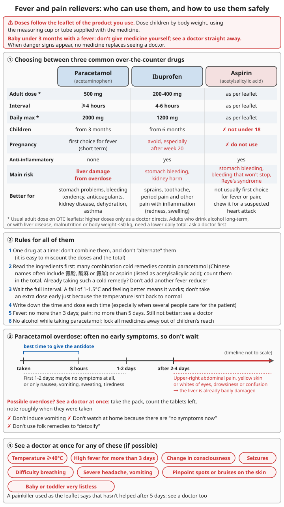

# Fever and Pain Relievers

> **Bringing down fever and relieving pain – common medicines that are hard to make yourself**

## ⚠️ Warning

**Making synthetic drugs is extremely difficult and dangerous!**

- It needs specialist chemical knowledge
- It needs professional equipment and raw materials
- The reaction conditions are demanding
- Purification is difficult
- The dose is hard to control
- **After civilisation collapse it is almost impossible to make them successfully!**

**This chapter is mainly background knowledge; in practice, natural substitutes are recommended!**

**The more practical parts of this chapter are: the principles of use and contraindications for ready-made fever and pain medicines (1.5, 2.3, 2.4, 5.4, 5.5), and non-drug pain relief and when to see a doctor (6.5, 6.6).** When you have stocked finished medicines, use them as the package leaflet says; when danger signs appear, no medicine can replace seeing a doctor.

---

## 1. Aspirin (acetylsalicylic acid)

### 1.1 Overview

**Aspirin:**
- The oldest and most classic fever and pain reliever
- On the market since 1899
- Still widely used today

**Effects:**
- Brings down fever
- Relieves pain (mild to moderate)
- Anti-inflammatory
- Anti-platelet (prevents heart attack and ischaemic stroke)

**Side effects:**
- Stomach and gut irritation (stomach pain, bleeding)
- Allergy (aspirin-induced asthma)
- Reye's syndrome (not for children!)

### 1.2 The active ingredient in willow bark

**How it works:** willow bark contains salicin; in the body it is metabolised in the gut and liver to salicylic acid, which brings down fever and relieves pain.

**Why you cannot simply extract salicylic acid:**
- Salicin hydrolysed in acid or alkali gives **salicyl alcohol** and glucose, not salicylic acid
- Salicyl alcohol must then be oxidised to become salicylic acid, which needs chemical reagents and controlled conditions
- The method circulating online, "boil willow bark in limewater, then add acid to precipitate salicylic acid", does not work chemically

**Conclusion:** after collapse you cannot make salicylic acid from willow bark, let alone go on to make aspirin.
Using a willow bark decoction directly (see 1.4), and letting the body turn salicin into salicylic acid itself, is the only realistic method.

### 1.3 Acetylation (salicylic acid → aspirin)

**⚠️ This needs chemical reagents and is hard to do after collapse! The following starts from ready-made salicylic acid and is for understanding only.**

**Principle:**
```
Salicylic acid + acetic anhydride → acetylsalicylic acid (aspirin) + acetic acid
```

**Materials:**
- Salicylic acid: 10 g
- Acetic anhydride: 20 mL (chemical reagent, hard to obtain)
- Concentrated sulphuric acid: a few drops (catalyst, highly toxic!)

**Steps:**
```
1. Mix:
   - Salicylic acid + acetic anhydride
   - Add a few drops of concentrated sulphuric acid

2. React:
   - Heat in a water bath at 50-60°C
   - 15-20 minutes
   - Stir

3. Hydrolyse the excess acetic anhydride:
   - Add water
   - The acetic anhydride hydrolyses

4. Crystallise:
   - Cool
   - Aspirin crystallises out

5. Filter, wash, dry

6. Purify by recrystallisation:
   - Dissolve in hot water
   - Cool slowly to crystallise
   - Repeat several times
```

**The reality:**
- Acetic anhydride: a controlled chemical, hard to obtain
- Concentrated sulphuric acid: highly toxic, strongly corrosive
- Purification is difficult
- **Do not try it!**

### 1.4 Using willow bark directly (recommended!)

**Since synthesis is so hard, use willow bark directly!**

**Method:**
```
1. Dried willow bark: 15-30 g
2. Add 500 mL of water
3. Bring to the boil, then simmer for 20 minutes
4. Strain and keep the liquid
5. Take in 2-3 doses

Effect: brings down fever and relieves pain (weaker than aspirin)
```

**Cautions:**
- Willow bark contains salicylates; its contraindications are the same as aspirin's:
  - ❌ Not for anyone under 18 (risk of Reye's syndrome)
  - ❌ Not for pregnant women; use with caution when breastfeeding
  - ❌ Not for people allergic to aspirin, or with asthma, stomach ulcers or a tendency to bleed
- Taken on an empty stomach it irritates the stomach; take it after meals
- "Natural" does not mean safe; the dose must still be controlled

### 1.5 Principles of use and contraindications for aspirin

**Its role:** when paracetamol or ibuprofen is available, aspirin is generally not the first choice for fever or pain. The most important use of aspirin kept at home is to be chewed when a heart attack is suspected (see the link below).

```
How to take it (adults; follow the package leaflet):
- Take after meals, with a full glass of water
- For fever, no more than 3 days; for pain, no more than 5 days;
  if there is no improvement, stop and see a doctor
- Do not take it together with ibuprofen or other painkillers

❌ Who must not take it:
- Under 18: taken during flu, chickenpox or other viral infections it can cause
  Reye's syndrome (acute brain disease and liver damage, high death rate)
- Pregnant women (especially late pregnancy)
- People allergic to aspirin or other painkillers, or who have had an asthma
  attack after taking them
- History of stomach ulcer, stomach bleeding or black stools; haemophilia or
  other bleeding disorders
- People taking anticoagulants (such as warfarin) or other anti-platelet drugs
- Before and after tooth extraction or surgery (ask the doctor first)
⚠️ Use with caution: breastfeeding, gout, liver or kidney impairment, long-term heavy drinking

⚠️ Aspirin hidden in other medicines:
- Some combination cold remedies and pain powders contain aspirin; the ingredient
  list calls it "acetylsalicylic acid" (乙酰水杨酸 on Chinese labels)
- Check the ingredient list before giving any cold remedy to a child
- Treat willow bark decoction and medicines containing salicylic acid as aspirin too

Long-term low-dose aspirin prescribed by a doctor (to prevent heart attack and stroke):
- Do not stop it yourself, and do not increase the dose "to treat pain as well"
- For fever or pain, use paracetamol instead;
  ibuprofen may weaken the protective effect of low-dose aspirin; ask a doctor before using it

Stop the drug and see a doctor if:
- Black (tarry) stools, vomiting coffee-ground material or blood → bleeding in the
  digestive tract; see a doctor immediately
- Large bruises on the skin, a nosebleed or bleeding gums that will not stop
- Rash, wheezing, swollen lips or eyelids → allergy; call 120 if severe
- Ringing in the ears, reduced hearing → early signs of salicylate overdose
```

For how to chew aspirin when a heart attack is suspected, and when it must not be used, see [Heart Attack, Stroke and Sudden Illness – Aspirin: when it can be used](../01-first-aid-and-family-health/06-heart-stroke-and-sudden-illness.md#aspirin-when-it-can-be-used).

---

## 2. Paracetamol (acetaminophen)

### 2.1 Overview

**Paracetamol (acetaminophen):**
- Names on Chinese packs: 泰诺林 (Tylenol), 扑热息痛 (an older Chinese name), 百服宁 (Bufferin)
- Brings down fever and relieves pain

**Advantages:**
- Few side effects (does not harm the stomach)
- Can be used in children

**Disadvantages:**
- No anti-inflammatory effect
- Overdose causes liver damage (it can kill!)

### 2.2 Synthesis (almost impossible)

**⚠️ Complex chemical synthesis; needs a professional laboratory!**

**Route (for understanding only):**
```
Phenol → nitration → p-nitrophenol → reduction → p-aminophenol → acetylation → paracetamol
```

**Every step needs:**
- Dangerous chemical reagents (concentrated nitric acid, concentrated sulphuric acid, acetic anhydride, etc.)
- Precisely controlled conditions
- Professional equipment

**Conclusion: impossible to make after civilisation collapse!**

### 2.3 Principles of use

```
Dose (consistent with the "Common Illnesses" chapter; follow the leaflet of the product you use):
- Adults: Chinese over-the-counter leaflets usually say 500 mg per dose, at least
  4 hours apart, no more than 4 times in 24 hours (2000 mg a day); higher doses
  (up to 1000 mg per dose and up to 4000 mg a day) only on a doctor's advice
- Children: 10-15 mg/kg body weight per dose, at least 4 hours apart, no more than
  4 times in 24 hours; can be used from 3 months; for 3-6 months ideally ask a doctor
  first; any fever under 3 months → go straight to a doctor
- Adults who drink heavily over the long term, have liver disease, are malnourished
  or weigh <50 kg: the daily total must be lower; ask a doctor first

✓ People for whom paracetamol is the better choice:
- Children (including children with chickenpox)
- Pregnant women (first choice for fever, short-term, as the leaflet says), breastfeeding women
- People with stomach problems, a history of stomach ulcer or bleeding, taking
  anticoagulants, with asthma or poor kidney function

Key points:
1. First read the ingredient list of every medicine being taken:
   "对乙酰氨基酚", "扑热息痛" or "APAP" (all meaning paracetamol) appear in a great
   many combination cold remedies (the Chinese product name often contains
   "氨酚", "酚麻" or "氨咖")
   → if the person is already taking such a cold remedy, do not add another fever medicine
2. Write down the time and dose of each dose; especially important when several
   people care for the patient, to prevent double dosing
3. No alcohol while taking it
4. It takes effect after about 30-60 minutes; a fall in temperature of 1-1.5°C and
   the person feeling more comfortable means it is working; do not give an extra dose
   early because "it hasn't come down to normal"
5. For fever, no more than 3 days; for pain, no more than 5 days; if still not
   better, see a doctor
6. It only brings down fever and relieves pain; it does nothing for redness and
   inflammation, and does not treat the cause
```

For a children's weight-based dose table and how to convert mg to mL, see [Common Illnesses – Quick dose guide for fever medicines](../01-first-aid-and-family-health/01-common-illnesses.md#fever-medicine-dose-chart).

### 2.4 The danger of overdose: liver damage

**Paracetamol is the drug to be most alert to in household overdoses**: it is common and seems mild, but an overdose causes severe liver damage and even death.

```
Why it is dangerous:
- For the first 1-2 days after an overdose there may be no symptoms at all, or only
  nausea, vomiting, sweating and tiredness
- Only after 2-4 days do pain in the upper right abdomen, yellow skin and whites of
  the eyes, drowsiness or confusion appear
  → by then the liver is already badly damaged
- Hospitals have a specific antidote, but the earlier it is given the better it works
  (ideally within 8 hours of taking the drug)
  → if you wait for symptoms before going, it is often too late

Treat all of these as "possible overdose" and see a doctor immediately:
- A child has swallowed adult tablets, or drunk a bottle of sweet syrup on their own
- Someone has swallowed clearly more than the leaflet's amount in one go
- Every dose has been over the limit for several days, or several medicines
  containing paracetamol have been taken at the same time
- Someone who drinks heavily, has liver disease or is malnourished has reached the
  leaflet's maximum and is still taking more

When going to hospital:
- Take the packet, and estimate how many tablets were taken (count the ones left)
- Note roughly when they were taken

❌ Do not make the person vomit
❌ Do not watch at home because "there are no symptoms now"
❌ Do not use folk remedies to "detoxify"
```

For dealing with accidental ingestion and overdose, see [Poisoning – Drug overdose and accidental ingestion](../01-first-aid-and-family-health/12-poisoning.md#drug-overdose-and-accidental-swallowing). If the overdose may have been deliberate, also pay attention to the person's mental state; see [Mental Health – Suicide risk](../01-first-aid-and-family-health/10-mental-health.md#suicide-risk-recognition-and-response).

---

## 3. Natural fever and pain remedies (recommended!)

### 3.1 Willow bark (see above)

**The natural remedy closest to aspirin!**

### 3.2 Baizhi

*Baizhi* (Angelica dahurica, Dahurian angelica root)

**Actions:** dispels "wind" and releases the "exterior" (traditional terms), relieves pain

**Use:**
```
Baizhi: 3-10 g
Boil into a decoction and drink

For:
- Headache (especially forehead pain)
- Toothache
- "Wind-cold" common cold (with chills)
```

### 3.3 Chuanxiong

*Chuanxiong* (Ligusticum chuanxiong, Sichuan lovage rhizome)

**Actions:** promotes blood circulation and moves *qi*, dispels "wind" and relieves pain

**Use:**
```
Chuanxiong: 6-10 g
Boil into a decoction and drink

For:
- Headache (especially migraine)
- Rheumatic pain
- Pain from falls, blows and injuries
```

### 3.4 Chrysanthemum + mint

*Juhua* (Chrysanthemum morifolium, chrysanthemum flower) and *Bohe* (Mentha haplocalyx, field mint)

**Actions:** disperses "wind-heat", clears the liver and brightens the eyes (traditional terms)

**Use:**
```
Juhua: 10 g
Bohe: 6 g (add near the end of boiling)
Make as a tea or decoction

For:
- "Wind-heat" headache
- Fever
- Red, swollen, painful eyes
```

### 3.5 Fresh ginger + spring onion

*Shengjiang* (Zingiber officinale, fresh ginger) and *Congbai* (Allium fistulosum, the white base of spring onion)

**Actions:** induces sweating and releases the "exterior", brings down fever

**Use:**
```
Fresh ginger: 5-8 slices
Spring onion whites: 3-5
Brown sugar: to taste
Boil into a decoction; drink hot and keep warm
⚠️ Do not "sweat it out" under heavy covers: babies and toddlers wrapped up too
   tightly can have a sudden rise in temperature and become dehydrated

For:
- "Wind-cold" common cold with fever
- Mild fever
```

### 3.6 Yuxingcao

*Yuxingcao* (Houttuynia cordata, fish mint)

**Actions:** clears heat and removes "toxins" (traditional terms)

**Use:**
```
Dried Yuxingcao: 15-25 g (double for fresh)
Boil into a decoction and drink; do not boil for long

For:
- "Wind-heat" common cold
- Fever
- Sore, swollen throat
```

### 3.7 Principles for using herbs for fever and pain

```
- These herbs are weaker and slower than finished fever medicines; they suit
  low fever and mild to moderate pain. Do not rely on them for high fever, fever in
  babies and toddlers, or when danger signs appear (see 5.3)
- Do not give herbal decoctions to babies under 1 year to bring down fever yourself;
  do not use mint or menthol oils near the mouth or nose of babies and toddlers
  (they may cause breathing to stop)
- Pregnant women: Chuanxiong promotes blood circulation; use with caution in pregnancy;
  ask a doctor before using the other herbs too
- If fever medicine has already been taken, drinking a "sweating" decoction as well
  risks too much sweating and dehydration
- Use only herbs you have identified for certain; if you dig them yourself you must
  be sure of the species
- Rash, vomiting or diarrhoea after taking them, or the illness getting worse → stop
```

For identifying herbs and toxic plants that are easily confused with them, see [Medicinal Plants – Toxic plants (avoid mistakes)](../04-farming-and-animal-husbandry/04-medicinal-plants.md#poisonous-plants-do-not-misuse).

---

## 4. Physical cooling (supportive)

> Physical cooling lowers body temperature only a little and only for a short time; it cannot replace fever medicine and cannot prevent febrile seizures. Its main purpose is to make the patient comfortable. For details, see [Common Illnesses – Fever](../01-first-aid-and-family-health/01-common-illnesses.md#fever).

### 4.1 Tepid sponging

**When to use:** as a supportive measure, when it makes the patient feel more comfortable; stop if the patient shivers or feels uncomfortable

**Method:**
```
1. Tepid water (32-34°C, slightly warm to the hand)
2. Soak a towel and wring it out until half dry
3. Wipe:
   - Neck, armpits, groin (where large blood vessels are)
   - Arms and legs
   - Back
4. Wipe every 15-30 minutes
5. Drink plenty

Do not:
  - Use it while the person is shivering (it makes it worse)
  - Use it on newborns without great care
  - Use cold water, iced water or alcohol rubs (alcohol can be absorbed through
    the skin; especially dangerous for children)
```

### 4.2 Cold compresses

**Method:**
```
1. A cool towel (wrap an ice pack in a towel; never put it directly on the skin)
2. Place on the forehead, just enough to make the patient comfortable
3. Change every 10-15 minutes
⚠️ Do not use ice packs on babies and toddlers; stop if the patient shivers
```

### 4.3 Drink plenty

**Important!** Fever causes fluid loss through sweating and faster breathing; dehydration makes people feel worse and makes the temperature harder to bring down.

```
- Adults: about 200-300 mL an hour, little and often; pale yellow urine means
  they are drinking enough
- Good drinks: warm boiled water, rice water, clear soup, fruit juice diluted with water
- Babies: continue breast milk or formula and feed more often
- Heavy sweating, or diarrhoea and vomiting as well: switch to oral rehydration salts (ORS)
- Signs of dehydration: little urine, dark urine, dry lips, no tears when crying,
  listlessness → give fluids more urgently;
  cannot keep fluids down or becoming more and more floppy → see a doctor
```

For how to make oral rehydration salts, see [Common Illnesses – Diarrhoea](../01-first-aid-and-family-health/01-common-illnesses.md#diarrhoea).

### 4.4 Clothing and surroundings

```
- Keep the room at about 22-24°C and well ventilated; do not point a fan
  directly at the patient
- During chills (feeling cold and shivering) a light blanket is fine; once the
  shivering stops and the person feels hot and sweats, take it off
- ❌ Do not "sweat it out" under heavy covers, especially babies and toddlers
- Dry the person after sweating and change damp clothes promptly
```

---

## 5. Principles of fever management

### 5.1 When should fever be brought down?

**Temperature (armpit temperature; consistent with [Common Illnesses – When to bring down a fever](../01-first-aid-and-family-health/01-common-illnesses.md#when-to-bring-a-fever-down)):**
- Adults: medicine can be used at ≥38.5°C with discomfort; ≥38°C for people with underlying illness
- Children: any fever under 3 months needs a doctor; do not give medicine yourself;
  3-6 months: armpit ≥38.2°C or clearly unwell (paracetamol only, ideally ask a doctor first); over 6 months: armpit ≥38.2°C or clearly unwell
- Temperature ≥40°C: see a doctor immediately; while waiting, give fever medicine as the leaflet says, with tepid sponging as support
- Below these thresholds, alert, eating and drinking: medicine is usually unnecessary; drink plenty, rest and keep the patient comfortable

**Special groups:**
- Pregnant women: contact the obstetrician about any fever ≥38°C; paracetamol is the first choice for bringing it down
- Older people: their temperature response is weak; take it seriously if the temperature is 1°C or more above their usual, or if it is not high but they suddenly become listless or stop eating
- History of febrile seizures: manage the fever as usual; neither fever medicine nor physical cooling can prevent seizures; for what to do during a seizure, see Common Illnesses – Fever

### 5.2 What fever means

**Fever is a symptom, not a disease!**

**What fever does:**
- Slows the growth of germs
- Strengthens the immune response
- Signals that something is wrong

**Harm from bringing fever down blindly:**
- Hides the illness
- Delays diagnosis
- Can actually slow recovery

**Principles:**
1. Find the cause of the fever!
2. Treat the underlying illness
3. Only high fever needs bringing down
4. The aim is to make the patient comfortable, not to force the temperature back to normal

### 5.3 Danger signs

**See a doctor immediately (if possible):**
- High fever lasting >3 days
- Change in consciousness
- Fits (seizures)
- Difficulty breathing
- Severe headache, vomiting
- Pinpoint spots or bruises appearing on the skin
- A listless baby or toddler

For when to see a doctor at each age, see [Common Illnesses – When to see a doctor about fever, by group](../01-first-aid-and-family-health/01-common-illnesses.md#when-to-see-a-doctor-for-fever-by-group).

### 5.4 Choosing common over-the-counter fever and pain medicines

| | Paracetamol | Ibuprofen | Aspirin |
|------|------|------|------|
| Adult dose (as commonly on OTC leaflets) | 500 mg | 200-400 mg | As on the leaflet |
| Interval | ≥4 hours | 4-6 hours | As on the leaflet |
| Adult daily maximum (OTC) | 2000 mg | 1200 mg | As on the leaflet |
| Children | From 3 months | From 6 months | ❌ Not under 18 |
| Anti-inflammatory (reduces swelling) | No | Yes | Yes |
| Main risks | Liver damage in overdose | Stomach bleeding, kidney harm | Stomach bleeding, bleeding that will not stop, Reye's syndrome |
| Pregnant women | First choice (short-term) | Avoid, especially after 20 weeks | Do not use |

```
How to choose:
- Children: paracetamol or ibuprofen (ibuprofen only from 6 months); not aspirin
- Pregnant women: paracetamol; breastfeeding: paracetamol or ibuprofen,
  short-term, as the leaflet says
- Stomach problems, tendency to bleed, taking anticoagulants, kidney disease,
  dehydration, asthma: paracetamol
- Liver disease, long-term heavy drinking: ask a doctor before using either
- Sprains, toothache, period pain and other pain with swelling and inflammation:
  ibuprofen usually works better

Common principles:
1. Use only one at a time; do not combine them, and do not "alternate" them either
   (it is easy to miscount doses and totals)
2. For children, work out the dose by body weight, and use the measuring cup or
   syringe that comes with the medicine
3. Wait the full interval; do not give an extra dose early because the temperature
   has not come down to normal
4. Write down the time and dose each time
5. For fever, no more than 3 days; for pain, no more than 5 days; if still not
   better, see a doctor
6. Medicine only relieves symptoms; finding the cause matters more
7. Lock all medicines away, out of children's reach
```



*Figure: Who can use paracetamol, ibuprofen and aspirin, and their main risks; an early paracetamol overdose often has no symptoms, so do not wait. Follow the leaflet of the product you use for the dose.*

### 5.5 Using ibuprofen, and contraindications

```
Dose (consistent with the "Common Illnesses" chapter; follow the leaflet):
- Adults: 200-400 mg per dose, 4-6 hours apart; OTC no more than 1200 mg a day
- Children: 5-10 mg/kg per dose, 6-8 hours apart, no more than 4 times in 24 hours;
  can be used from 6 months

✓ Correct use:
- Take after or with food to reduce stomach upset
- Drink enough water at the same time
- Do not take it together with aspirin or other painkillers

❌ Do not use it yourself if:
- There is a history of stomach ulcer, stomach bleeding or black stools
- Kidney disease; in severe dehydration (diarrhoea and vomiting, hardly passing
  urine) it harms the kidneys → give fluids first and use paracetamol instead
- Allergy to aspirin, ibuprofen or other painkillers
- The person is taking anticoagulants
- Pregnancy (especially after 20 weeks)
- Babies under 6 months
- Children with chickenpox (use paracetamol for fever)
⚠️ In some people with asthma it triggers an asthma attack
⚠️ Heart failure, poorly controlled high blood pressure, older people who need it
   long-term: ask a doctor first

Stop and see a doctor if:
- Worsening stomach pain, black stools, vomiting blood
- Much less urine, swelling
- Rash, wheezing, facial swelling
```

---

## 6. Pain management

### 6.1 Headache

**Common causes:**
- Colds and fever
- Migraine
- Tension headache
- High blood pressure

**What to do:**
```
1. Rest; avoid stimulation (light, noise)
2. Massage the temples
3. Warm or cold compress (whichever helps)
4. Chinese medicine:
   - Chuanxiong Chatiao San (Chuanxiong powder taken with green tea)
   - Baizhi decoction
5. If physical methods do not help → use medicine
```

### 6.2 Toothache

**Emergency measures:**
```
1. Warm salt-water rinse: half a teaspoon of salt in a cup of warm boiled water;
   hold in the mouth for 30 seconds, several times a day
2. Painkiller by mouth: ibuprofen or paracetamol, as the leaflet says
3. Gently remove trapped food with dental floss or a toothpick
4. If there is swelling, put a cold compress on the outside of the cheek for
   15-20 minutes (through a towel)
5. Clove oil (if you have it): dip a cotton bud in a very small amount and dab it
   on the painful tooth; do not spread it over a large area of gum
6. Avoid very cold, very hot or very sweet food; chew on the other side;
   raise the head when sleeping

❌ Do not put garlic, Sichuan pepper, tobacco or tablets (including aspirin) on the gum
   or into a cavity → they cause chemical burns and ulcers of the gum and mouth lining
❌ Do not put warm compresses on a swollen face (it may help the infection spread)

The real answer: treat the dental problem!
```

For details, see [Dental Problems – Toothache](../01-first-aid-and-family-health/09-dental-problems.md#toothache); swelling of the face or neck, or difficulty swallowing or breathing, is an emergency: see [Dental abscess and danger signs](../01-first-aid-and-family-health/09-dental-problems.md#dental-abscess-and-danger-signs). Pain in the lower teeth or jaw with chest tightness and sweating may be a heart attack.

### 6.3 Abdominal pain

**⚠️ The causes are many and must be told apart!**

**Danger signs (surgery may be needed):**
- Persistent severe abdominal pain
- Rigid abdomen (board-like)
- With vomiting and fever
- Unable to pass wind or stools

**→ Possibly appendicitis, bowel obstruction, perforation, etc.; needs surgical care!**

**Ordinary abdominal pain:**
- Warm compress
- Abdominal massage
- Chinese medicine: *Baohe Wan* (Harmony-Preserving Pill), *Huoxiang Zhengqi San* (Agastache Qi-Correcting Powder), etc.

```
⚠️ Note:
- Warm compresses and massage are only for mild abdominal pain with a clear cause
  (such as getting cold, overeating, period pain); do not press or rub abdominal pain
  of unknown cause that is getting worse
- Do not take ibuprofen or aspirin for abdominal pain of unknown cause (they may
  worsen stomach bleeding), and do not use laxatives or enemas
- A woman of childbearing age with lower abdominal pain and a missed period or
  vaginal bleeding → think of ectopic pregnancy; see a doctor immediately
- Feeling better after a painkiller does not mean all is well; if danger signs
  appear, still see a doctor
```

### 6.4 Joint pain, muscle pain

**What to do:**
```
Acute stage (within 48 hours of injury):
  - Ice: through a towel, 15-20 minutes each time, every 2-3 hours; stop if numb
  - Rest the part
  - Raise the injured limb

After 48 hours, once the swelling is stable:
  - Warm compresses
  - Massage
  - Move the joint

External remedies:
  - Rub with Chinese medicinal liquor
  - Red Flower Oil (honghua you, a liniment), if available
  - ⚠️ Blood-moving external remedies are generally used only after 48 hours, once the
    swelling is stable; do not apply them to broken skin

By mouth: ibuprofen usually works better than paracetamol for sprains and muscle
pain (note the contraindications in 5.5)
```

For full sprain care, see [Bone and Joint Injuries – RICE](../01-first-aid-and-family-health/03-bone-and-joint-injuries.md#rice-grade-iii).

### 6.5 Non-drug pain relief

Painkillers are not the only option. The methods below relieve a lot of pain on their own, work better together with painkillers, and matter even more once medicines run out.

```
1. Find and remove the cause
   - Loosen bandages, shoes, belts and rings that are too tight (take rings off
     before an injured finger swells)
   - Straighten a limb that is trapped or twisted awkwardly
   - Clear food from between the teeth
2. Rest and a suitable position
   - Painful arm or leg: raise it above heart level
   - Back pain: lie on your side with knees bent, or on your back with a pillow
     under the knees; acute low back pain generally does not need strict bed rest;
     walk about as much as you can bear
   - Abdominal pain: lying on the side with knees bent is often more comfortable
3. Cold and warmth
   - Cold: for fresh injuries and swollen, red, hot areas; through a towel,
     15-20 minutes each time; stop if numb
   - Warmth: for muscle stiffness after 48 hours, chronic aches, period pain;
     warm but not hot to the hand, through cloth, 15-20 minutes each time
   - ⚠️ Older people, people with diabetes, people with reduced feeling, and babies
     and toddlers are easily frostbitten or burned at low heat; use shorter times
     and check the skin often; do not sleep holding a hot-water bottle or ice pack
   - ⚠️ Do not put warmth on areas that are infected with pus, bleeding, or where
     swelling is getting worse
4. Immobilise
   - Splinting a suspected fracture or dislocation clearly relieves pain in itself
5. Relaxation and distraction
   - Slow belly breathing: breathe in for about 4 seconds, out for about 6 seconds,
     for a few minutes
   - Listen to music, chat, do small tasks with the hands
   - Children: being held by an adult, stories and toys work better than simply
     saying "it doesn't hurt"
6. Sleep well, eat enough, drink enough: tiredness, hunger and anxiety all make
   pain feel worse
7. Gentle movement and massage
   - Chronic muscle aches can be gently massaged and stretched
   - ❌ Do not massage fresh injuries, suspected fractures, or a red, swollen,
     painful calf on one side (possibly a blood clot)
```

For how to immobilise, see [Bone and Joint Injuries – Principles of emergency care](../01-first-aid-and-family-health/03-bone-and-joint-injuries.md#emergency-principles).

### 6.6 Pain that must be seen by a doctor

| How the pain shows | Possible cause | What to do |
|------|------|------|
| Crushing chest pain spreading to the left arm, jaw or back, with sweating and breathlessness | Heart attack | Call 120 immediately |
| Sudden tearing pain in the chest and back | Aortic dissection | Call 120 immediately; do not give aspirin |
| The worst sudden headache of one's life; headache with a drooping mouth, weak limbs or slurred speech | Brain haemorrhage, stroke | Call 120 immediately |
| Headache with fever, stiff neck, rash or change in consciousness | Meningitis | Call 120 immediately |
| Severe abdominal pain, hard abdomen, with vomiting and fever, unable to pass wind or stools | Appendicitis, bowel obstruction, perforation | See a doctor immediately; nothing to eat or drink for now |
| Woman of childbearing age with lower abdominal pain and a missed period or vaginal bleeding; abdominal pain in pregnancy | Ectopic pregnancy, miscarriage, placental problems | See a doctor immediately |
| Pain after injury with a deformed limb, unable to bear weight, numb or cold hands or feet | Fracture, blood vessel or nerve injury | Immobilise, then see a doctor |
| Red, swollen, painful calf on one side | Deep vein thrombosis | See a doctor as soon as possible; do not massage |
| Back pain with loss of bladder or bowel control, numbness around the genitals and anus, weak legs | Nerve compression | See a doctor immediately |
| Severe pain in the side of the back with fever or blood in the urine | Kidney stone, kidney infection (pyelonephritis) | See a doctor as soon as possible |
| Toothache with swelling of the face and neck, difficulty swallowing or breathing | Spreading dental infection | Call 120 or go to A&E immediately |

```
Also see a doctor if:
- Painkillers used as the leaflet says have not helped after 5 days, or more and
  more are needed
- Pain wakes the person at night and gets worse day by day
- Pain with persistent fever or unexplained weight loss
- Babies, toddlers, older people and people who cannot explain clearly: crying that
  will not stop, not letting you touch a certain part, or suddenly refusing to move
  an arm or leg can all be signs of severe pain
```

For on-the-spot care of chest pain, see [Heart Attack, Stroke and Sudden Illness – Heart attack and chest pain](../01-first-aid-and-family-health/06-heart-stroke-and-sudden-illness.md#heart-attack-and-chest-pain).

---

## 7. Stockpiling advice

### 7.1 Commercial medicine stocks (before collapse)

**Fever and pain relievers:**
- Paracetamol (Tylenol): first choice for children
- Ibuprofen: common for adults; can also be used for children
- Aspirin: adults only; not for children

**Storage:**
- Sealed, dark, dry
- <25°C
- Within the expiry date

**Rotate them so they do not expire!**

```
Key points for stockpiling:
- Stock adult tablets and children's forms (suspensions, drops) separately;
  do not break up adult tablets for children
- Drops and suspensions of the same drug may differ in strength by a factor of two
  or more; write the strength clearly on the bottle with a marker
- Keep the original packaging and leaflet: dose, ingredients, batch number and
  expiry date are all on them
- Do not keep them in the bathroom, next to the stove or in the car
  (heat and damp speed up deterioration)
- Lock them away, out of children's reach

Deciding whether a medicine can be used:
- Tablets discoloured, soft from damp, stuck together or crumbling → do not use
- Aspirin with a clear smell of vinegar (acetic acid) → it has broken down; do not use
- Children's suspensions: once opened, use up within the period on the leaflet;
  caked, will not shake evenly, discoloured or smells odd → throw away
- When in-date medicine is available, never use expired medicine
```

For decisions about expired medicines in extreme situations, see [Making Antibiotics – About expiry dates](02-antibiotics.md#65-about-expiry-dates).

### 7.2 Herbal stocks

**More recommended, and sustainable!**

**Dried:**
- Willow bark: 500 g
- Baizhi: 200 g
- Chuanxiong: 200 g
- Juhua (chrysanthemum): 500 g
- Bohe (mint): 200 g

**Fresh (can be grown):**
- Fresh ginger
- Spring onion
- Mint
- Yuxingcao

---

## 8. Frequently asked questions

### Q1: Which is better, aspirin or paracetamol?

**A: Each has strengths and weaknesses**

| Property | Aspirin | Paracetamol |
|------|----------|--------------|
| Brings down fever | Strong | Strong |
| Relieves pain | Strong | Moderate |
| Anti-inflammatory | Yes | No |
| Stomach irritation | High | Low |
| Children | Not to be used | Can be used |
| Liver damage | Low | Severe in overdose |

**Choice:**
- Children: paracetamol or ibuprofen
- Adults: paracetamol or ibuprofen first; aspirin is generally not the first choice (see 1.5)
- Stomach problems: paracetamol
- Inflammatory pain: ibuprofen

### Q2: Can several fever medicines be used at the same time?

**A: No!**
- Higher risk of side effects
- "Alternating" two medicines is not recommended either: it is easy to miscount doses and totals
- If one medicine used as the leaflet says does not work well enough: wait the full interval and give the same one again;
  if the temperature is still very high or the patient is in a poor state → see a doctor rather than adding another medicine
- Never exceed the dose!
- Note that combination cold remedies often contain paracetamol or aspirin; count them in the total

### Q3: Does a fever always need medicine?

**A: Not necessarily!**
- Whether to use medicine depends on the temperature and the person's state; for the thresholds, see 5.1
- Below the threshold, alert and drinking: drink plenty and rest; physical cooling is only supportive
- The aim of bringing fever down is to make the person comfortable, able to drink and sleep, not to force the temperature back to normal
- Fever in a baby under 3 months: do not give medicine yourself; go straight to a doctor

### Q4: Does willow bark really work?

**A: Yes, but it is weaker than aspirin**
- Aspirin was derived from willow bark
- It contains salicin, which the body turns into salicylic acid, so it is weaker
- Sustainable, but it has the same contraindications as aspirin (see 1.4)
- It can be used for mild to moderate pain

### Q5: Are fever medicines addictive?

**A: No**
- Fever and pain relievers are not addictive
- But do not misuse them
- Treating the underlying illness matters most

---

## 9. Practical advice

### 9.1 Do not dream of making synthetic drugs yourself

**The conclusion is clear:**
- Aspirin: possible in theory, extremely hard in practice
- Paracetamol: impossible

**Recommended:**
1. Stock finished medicines before collapse
2. Learn to use natural remedies
3. Master fever nursing care and the principles of medicine use (physical cooling is only supportive)

### 9.2 Priority strategy

**Always do: nursing care**
- Drink plenty, rest, suitable clothing and room temperature
- Tepid sponging, cold compresses and other physical methods are only supportive; just make the person comfortable
- Watch for danger signs, and see a doctor when needed

**Tier 1: Stocked finished medicines**
- Paracetamol, ibuprofen, etc.
- Reliable; the first choice when medicine is needed
- But not sustainable, so use them sparingly, rotate them and prevent expiry

**Tier 2: Natural remedies**
- Willow bark, Baizhi, fresh ginger, etc.
- Weak; suit low fever and mild to moderate pain
- Sustainable, but they also have contraindications

**Tier 3: Home-made synthetic drugs**
- Almost impossible
- Not recommended

### 9.3 Prevention first

**Reduce the chance of fever and pain:**
- Build up health and fitness
- Avoid infection
- Deal with minor illness promptly
- Take care to prevent injuries

**Not getting ill = the best medicine!**

---

## Related chapters

- ⏮️ [Pharmacy Basics](00-pharmacy-basics.md) - extraction and purification techniques
- ⏮️ [Herbal Preparations](04-herbal-preparations.md) - natural fever and pain remedies
- 🔗 [First Aid and Family Health – Common Illnesses](../01-first-aid-and-family-health/01-common-illnesses.md) - managing fever
- 🔗 [First Aid and Family Health – Poisoning](../01-first-aid-and-family-health/12-poisoning.md) - drug overdose and accidental ingestion
- 🔗 [First Aid and Family Health – Dental Problems](../01-first-aid-and-family-health/09-dental-problems.md) - toothache and dental abscess
- 🔗 [Farming and Animal Husbandry – Medicinal Plants](../04-farming-and-animal-husbandry/04-medicinal-plants.md) - growing medicinal herbs

---

**Final summary:**

**Synthetic drugs are hard to make; natural remedies are workable!**
**Nursing care comes first; use medicines as the leaflet says; see a doctor promptly when danger signs appear!**
**Stock finished medicines, learn the alternatives, health comes first!**

**Remember: treat the cause as well as the symptoms. Fever and pain are only signals; finding the cause is what matters!**
