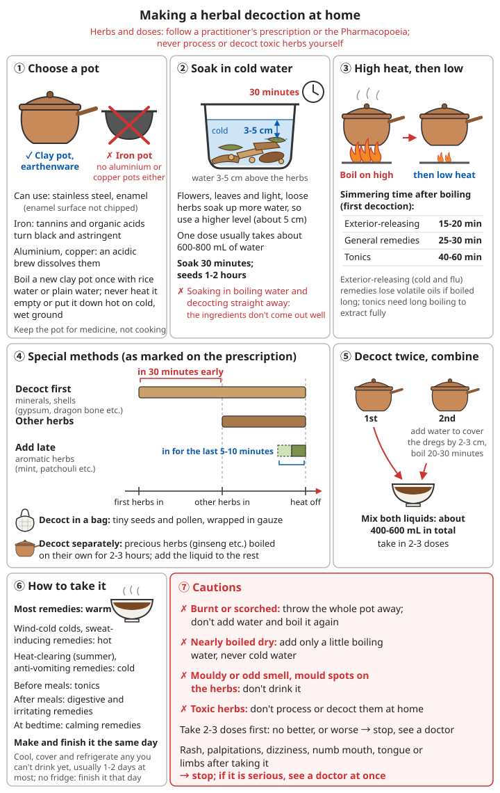

# Traditional Chinese Medicine Preparations

> **Traditional wisdom: the safest and most workable direction for making medicines after a collapse**

## ✅ Why recommend Chinese herbal medicine?

**Its great advantages over making chemical drugs:**

| Comparison | Chinese herbal medicine | Chemical drugs |
|--------|------|--------|
| Getting raw materials | ⭐⭐⭐⭐⭐ gathered in the wild | ⭐ chemical feedstocks hard to get |
| Difficulty of preparation | ⭐⭐ simple | ⭐⭐⭐⭐⭐ extremely difficult |
| Safety | ⭐⭐⭐⭐ fairly high | ⭐⭐ high risk |
| Accumulated experience | ⭐⭐⭐⭐⭐ thousands of years | ⭐⭐ modern technology |
| Side effects | ⭐⭐⭐⭐ fairly small | ⭐⭐ fairly large |
| Success rate | ⭐⭐⭐⭐ 60-80% | ⭐⭐ <20% |

**Recommended as the main direction for making medicines after a collapse!**

The "fairly high safety" in the table above is only in comparison with home-made chemical drugs. **"Natural" does not mean "non-toxic"**: picking the wrong plant, taking too much, taking it for a long time, or taking it together with Western medicines can all cause harm (see [6. Safety precautions](#6-safety-precautions)).

```
How to read this chapter:
- When you can stockpile ready-made medicines and can see a doctor, stockpile them
  and see the doctor first; this chapter is for reference when medicines cannot be
  bought and no doctor can be found
- The amounts given in this chapter are the usual range of dried herb per day for an adult,
  according to the 2020 edition of the Chinese Pharmacopoeia,
  consistent with the chapter on medicinal plants
  (the current edition is the 2025 edition; the current text takes precedence);
  they are only a reminder "not to exceed the dose"; whether to use a herb and how much
  should follow the guidance of a TCM practitioner
- Children, older people, pregnant and breastfeeding women, people with liver or
  kidney disease, and people on long-term Western medicines: ask a doctor first (see 6.2-6.5)
- No improvement after 2-3 days, or any of the situations listed in 6.7 → see a doctor;
  do not switch to another formula and keep waiting
```

For identifying and growing the herbs and the dose of each single herb, see [Medicinal plants: identification and growing guide](../04-farming-and-animal-husbandry/04-medicinal-plants.md).

---

## 1. Chinese medicines for common symptoms

### 1.1 Colds and fever

#### Early cold ("wind-cold" type)

**Symptoms:** feeling cold, clear runny nose, sneezing, no sweating

**Formula:** spring onion, ginger and brown sugar soup
```
Ingredients:
  - Congbai (Allium fistulosum, white part of spring onion): 3-5 pieces (with the roots)
  - Shengjiang (Zingiber officinale, fresh ginger): 5-8 slices
  - Brown sugar: 30 g
  - Water: 500 mL

Preparation:
  1. Bring the water to the boil
  2. Add the spring onion and ginger
  3. Simmer over a low heat for 10 minutes
  4. Add the brown sugar and let it dissolve
  5. Drink while hot
  6. Keep warm; a light sweat is enough; do not bundle up to force sweating

Use: 2-3 times a day
```

```
Notes:
- "Inducing sweating" means a light sweat is enough; after sweating, dry off and change
  into dry clothes; do not sweat heavily
- Do not bundle up babies, young children or people with a high fever to "sweat it out":
  their temperature may shoot up, and they may become dehydrated or have fits
- People with diabetes: leave out the brown sugar or use less
- Still feeling cold and feverish after 1-2 days, or temperature rises above 39°C
  → treat it as a fever
```

See [Common mistakes in caring for a fever](../01-first-aid-and-family-health/01-common-illnesses.md#common-mistakes-in-fever-care) and [When to see a doctor for fever, by group](../01-first-aid-and-family-health/01-common-illnesses.md#when-to-see-a-doctor-for-fever-by-group).

**Formula:** *Mahuang Tang* (Ephedra Decoction; classical)
```
Ingredients:
  - Mahuang (Ephedra sinica, ephedra): 9 g
  - Guizhi (Cinnamomum cassia, cassia twig): 9 g
  - Xingren (Prunus armeniaca, bitter apricot kernel): 9 g
  - Gancao (Glycyrrhiza uralensis, liquorice root): 3 g

Action: induces sweating and releases the exterior
```

```
⚠️ Warning about Mahuang:
- Mahuang contains ephedrine, which speeds up the heart, raises blood pressure and
  causes sleeplessness
- Do not use it if you have high blood pressure, heart disease, an overactive thyroid,
  glaucoma, or an enlarged prostate with difficulty passing urine,
  nor if you are pregnant, or weak and sweating a lot
- Do not use it together with Western cold remedies containing pseudoephedrine
  (the ingredients add up)
- Mahuang may only be prescribed by a doctor and dispensed by a proper pharmacy; do not
  gather it, make up the prescription or decoct it yourself;
  the grams above show the proportions of the formula, not a dose for self-use
- Do not use it if you are taking blood-pressure medicines or antidepressants
  (especially monoamine oxidase inhibitors, MAOIs);
  ephedrine is a banned stimulant: athletes take note
- Palpitations, chest tightness or worse headache after taking it → stop;
  chest pain or a very fast heartbeat → call 120
- Xingren here means bitter apricot kernel, which is slightly toxic; do not exceed the dose,
  and do not chew large amounts raw
```

#### Middle stage of a cold ("wind-heat" type)

**Symptoms:** fever, thirst, sore throat, yellow nasal discharge

**Formula:** *Yinqiao San* (Honeysuckle and Forsythia Powder)
```
Ingredients:
  - Jinyinhua (Lonicera japonica, honeysuckle flower): 15 g
  - Lianqiao (Forsythia suspensa, forsythia fruit): 15 g
  - Bohe (Mentha haplocalyx, Chinese field mint): 6 g (added near the end)
  - Niubangzi (Arctium lappa, burdock fruit): 9 g
  - Jiegeng (Platycodon grandiflorus, balloon flower root): 6 g
  - Gancao: 3 g

Preparation:
  1. Decoct all the herbs except the mint in water for 20 minutes
  2. Add the mint for the last 5 minutes
  3. Strain off the liquid

Use: twice a day, taken warm
```

**Simple version:**
```
Jinyinhua 10-15 g + Juhua (Chrysanthemum morifolium, chrysanthemum flower) 5-10 g
+ Bohe 3-6 g
Pour on boiling water, cover and leave for 10 minutes; drink it in several portions
over one day
```

Doses follow the usual Pharmacopoeia ranges (*Jinyinhua* 6-15 g, *Juhua* 5-10 g, *Bohe* 3-6 g); people allergic to plants of the daisy family (Asteraceae) should not use *Juhua*. See a doctor if the sore throat gets worse, it becomes hard to open the mouth, the person drools and cannot swallow, or a high fever does not come down.

### 1.2 Digestive problems

#### Food stagnation and bloating

**Formula:** *Baohe Wan* (Harmony-Preserving Pill)
```
Ingredients:
  - Shanzha (Crataegus pinnatifida, Chinese hawthorn fruit): 12 g (relieves food stagnation)
  - Shenqu (medicated leaven, a fermented mixture of flour and herbs): 15 g (aids digestion)
  - Chenpi (Citrus reticulata, dried tangerine peel): 9 g (regulates qi)
  - Fuling (Poria cocos, poria): 12 g
  - Laifuzi (Raphanus sativus, radish seed): 9 g

Preparation: take as a decoction
Action: relieves food stagnation and clears accumulation
```

**Simple version:**
- Steep or decoct 9-12 g of dried *Shanzha* in water and drink it (people with excess stomach acid or stomach ulcers should use less)
- Juice raw radish and drink it

#### Diarrhoea

**Formula:** *Huoxiang Zhengqi San* (Patchouli Qi-Correcting Powder)
```
Ingredients:
  - Huoxiang (Pogostemon cablin, patchouli): 9 g
  - Zisuye (Perilla frutescens, perilla leaf): 9 g
  - Baizhi (Angelica dahurica, Dahurian angelica root): 9 g
  - Chenpi: 9 g
  - Houpo (Magnolia officinalis, magnolia bark): 9 g
  - Fuling: 12 g
  - Gancao: 3 g

Action: releases the exterior and resolves dampness, regulates qi and harmonises the stomach
Used for: stomach-flu type colds, upsets from a change of water and climate
```

**Simple remedy:**
```
Garlic: 3-5 cloves, crushed
Take with brown-sugar water
Kills germs, stops diarrhoea
```

```
In diarrhoea the most important thing is replacing fluids, not stopping the diarrhoea:
- First drink oral rehydration salts (ORS), or home-made weak salt-and-sugar water,
  a little at a time, often
- Garlic and Huoxiang-type remedies can only help; raw garlic irritates the stomach,
  so people with stomach trouble should eat less
- Diarrhoea in babies, young children or older people with little urine, listlessness
  or dry lips → see a doctor as soon as possible
- Blood in the stool, high fever, severe abdominal pain, vomiting everything they drink,
  or a dozen or more bouts of diarrhoea a day → see a doctor immediately
```

For how to replace fluids and when to see a doctor see [Diarrhoea](../01-first-aid-and-family-health/01-common-illnesses.md#diarrhoea) and [Recognising dehydration](../01-first-aid-and-family-health/01-common-illnesses.md#recognising-dehydration).

### 1.3 Injuries

#### Stopping bleeding

**Formula:** a substitute for Yunnan Baiyao (a proprietary Chinese wound powder)
```
Ingredients:
  - Sanqi (Panax notoginseng, notoginseng): 30 g (ground to powder)
  - Baiji (Bletilla striata, bletilla tuber): 20 g (ground to powder)
  - Xianhecao (Agrimonia pilosa, hairy agrimony): 15 g (ground to powder)
  - Longgu (fossilised mammal bone, "dragon bone"): 15 g (calcined, ground to powder)

Preparation:
  1. Process each herb separately
  2. Grind to a very fine powder
  3. Mix evenly
  4. Store sealed

Use:
  - External: sprinkle directly on the wound
  - Internal: 1-3 g each time, twice a day, swallowed with warm water
    (for bruising and swelling after a knock or fall)
```

```
⚠️ The order for stopping bleeding:
1. First press a clean cloth hard directly on the wound and keep pressing for more than
   10 minutes without letting go — this is the main way to stop bleeding;
   the powder only helps
2. If you can rinse it, first rinse the wound clean with clean water, then sprinkle on
   the powder and bandage it
3. Deep, large or spurting wounds, or wounds that keep bleeding under pressure: keep
   pressing, call 120 or get to hospital;
   do not stuff powder or leaves into deep wounds
4. Internal bleeding (vomiting blood, coughing blood, black stools, abdominal pain after
   an injury to the abdomen, vomiting and drowsiness after a head injury)
   cannot be stopped by taking powder; get to hospital immediately
5. Pregnant women must not take Sanqi by mouth; people on anticoagulants (blood thinners)
   should ask a doctor before taking it by mouth
6. Use only Sanqi confirmed to be the true Sanqi of the ginseng family (Araliaceae);
   do not use "tusanqi" ("local Sanqi", Jusanqi, Gynura japonica);
   see the table of poisonous plants in the medicinal plants chapter
```

See [Wound care – stopping bleeding](../01-first-aid-and-family-health/02-wounds-and-injuries.md#1-stop-the-bleeding), [Cleaning the wound](../01-first-aid-and-family-health/02-wounds-and-injuries.md#2-clean-the-wound) and [Poisonous plants (to avoid misuse)](../04-farming-and-animal-husbandry/04-medicinal-plants.md#poisonous-plants-do-not-misuse); for telling *Sanqi* from *Jusanqi* see [Jusanqi ("tusanqi") vs Sanqi](../10-chinese-medicinal-herbs/09-toxic-herbs-and-poisonous-look-alikes.md#45-jusanqi-tusanqi-gynura-vs-sanqi-notoginseng).

**Emergency use in the wild:**
- *Aiye* (Artemisia argyi, Chinese mugwort leaf): crush and put on the wound to stop bleeding
- *Pugongying* (Taraxacum mongolicum, dandelion): mash and put on the wound to reduce inflammation
- *Cebaiye* (Platycladus orientalis, Chinese arborvitae leaf): stops bleeding (plug the nostril for a nosebleed)

```
Notes on emergency use in the wild:
- First press to stop the bleeding and rinse with clean water; use leaves only when
  there is nothing else, and only on small, shallow wounds;
  rinse the leaves in clean water first, then mash them
- Raw leaves carry soil and germs; do not put them on deep wounds or wounds made by
  rusty objects or animals; with such wounds, think about tetanus and rabies
  prevention and see a doctor as soon as possible
- Change the dressing every day; if the wound becomes more red, swollen, hot and painful,
  discharges pus, shows a red streak, or there is fever → see a doctor
- Nosebleed: first sit down with the head tilted slightly forward and pinch the soft part
  of the nose firmly for 10 minutes; do not tip the head back;
  leaves used to plug the nostril must be washed and rolled tightly, with a piece left
  outside so you can pull it out;
  still bleeding after pinching for more than 20 minutes → see a doctor
```

See [Nosebleeds](../01-first-aid-and-family-health/00-basic-first-aid.md#nosebleeds), [Preventing tetanus](../01-first-aid-and-family-health/02-wounds-and-injuries.md#tetanus-prevention) and [Signs of infection](../01-first-aid-and-family-health/02-wounds-and-injuries.md#-signs-of-infection-see-a-doctor-immediately).

#### Reducing inflammation

**Formula:** *Wuwei Xiaodu Yin* (Five-Ingredient Detoxifying Drink)
```
Ingredients:
  - Jinyinhua: 15 g
  - Yejuhua (Chrysanthemum indicum, wild chrysanthemum flower): 15 g
  - Pugongying: 15 g
  - Zihuadiding (Viola yedoensis, Yedo violet): 15 g
  - Zibeitiankui (Semiaquilegia adoxoides, tiankui): 15 g

Preparation: take as a decoction
Action: clears heat and removes toxins, reduces abscesses and disperses lumps
Used for: boils, skin infections
```

**External use:**
- Wash the affected area with the decoction
- Or mash the herbs and apply them to the affected area

```
Notes:
- Only suitable for small, localised boils; all five herbs are "cold" in nature,
  so people with a weak, cold digestion who get diarrhoea easily should use less;
  do not usually take them for more than a week in a row
- Do not squeeze boils yourself, especially around the nose and upper lip
  (the "danger triangle")
- See a doctor in these cases; the boil may need to be cut and drained, or antibiotics
  may be needed:
  · the red, swollen area clearly grows within a day or two, or a red streak
    spreads towards the body
  · fever, chills, listlessness
  · a boil in the danger triangle of the face, or wider than about 2 cm and soft and
    fluctuant when pressed (pus inside)
  · skin infections in people with diabetes, people with weak immunity, babies and
    young children
```

For judging wound infection see [Wound care – signs of infection](../01-first-aid-and-family-health/02-wounds-and-injuries.md#-signs-of-infection-see-a-doctor-immediately) and [Danger signs of whole-body infection](../01-first-aid-and-family-health/02-wounds-and-injuries.md#danger-signs-of-whole-body-infection-call-120-immediately).

---

## 2. Processing Chinese herbs

### 2.1 Cleaning

**Purpose:** remove impurities and parts that are not used as medicine

**Methods:**

**Picking over:**
- Pick out impurities and mouldy or insect-eaten parts

**Sieving:**
- Use a sieve to remove sand, soil and fine debris

**Winnowing:**
- Blow away light impurities (hairs, leaves)

**Washing:**
- Rinse quickly; do not soak (active ingredients are lost)

### 2.2 Cutting

**Purpose:** easier decocting, taking and dispensing

**Methods:**

**Slicing:**
- Thickness: 2-3 mm
- Herbs: *Shengjiang*, *Baizhu* (Atractylodes macrocephala, white atractylodes rhizome), *Danggui* (Angelica sinensis, Chinese angelica) and others

**Cutting into sections:**
- Length: 2-3 cm
- Herbs: stems and twigs such as *Mahuang* and *Guizhi*

**Shredding:**
- Herbs: *Chenpi* and others

**Crushing:**
- Herbs: seeds (*Laifuzi*, *Xingren* and others)

### 2.3 Processing (changing the properties of the herb)

#### Stir-frying

**Plain stir-frying (dry-frying):**
```
Method:
  1. Heat the wok
  2. Tip in the herbs
  3. Keep turning them
  4. Fry until slightly yellow or browned
  5. Take out and spread to cool

Purpose:
  - Moderates the herb's action and reduces its "coldness"
    (e.g. stir-fried Shanzha, stir-fried Baizhu)
  - Strengthens its effect on the spleen and stomach
  - Easier to grind (crisp after frying)

Herbs: Baizhu, Shanyao (Dioscorea opposita, Chinese yam) and others
(Huangqi (Astragalus membranaceus, astragalus) is usually honey-fried)
```

**Frying with bran:**
```
Method:
  1. Heat the wok and sprinkle in wheat bran
  2. When it smokes, add the herbs
  3. Stir-fry until yellow
  4. Sieve out the bran

Purpose: moderates the herb's action, strengthens the spleen
Herbs: Cangzhu (Atractylodes lancea, atractylodes rhizome),
Zhiqiao (Citrus aurantium, bitter orange fruit) and others
```

**Frying with earth:**
```
Method:
  1. Grind stove-heart earth (Zaoxintu, baked earth from the centre of a stove hearth)
     (or yellow loess) finely
  2. Heat it in a hot wok
  3. Add the herbs and stir-fry together
  4. Sieve out the earth

Purpose: stops diarrhoea, stops bleeding
Herbs: Baizhu and others
```

#### Frying with liquid adjuvants

**Honey-frying:**
```
Method:
  1. Dilute honey with water (honey : water = 1:1)
  2. Mix with the herbs evenly
  3. Cover and leave until fully absorbed
  4. Fry over a gentle heat until no longer sticky to the touch
  5. Take out and spread to cool

Purpose: strengthens the tonic effect, moistens the lungs and stops coughs
Herbs: Gancao, Mahuang, Baibu (Stemona japonica, stemona root) and others
```

**Ginger-frying:**
```
Method:
  1. Juice fresh ginger
  2. Mix the herbs with the ginger juice
  3. Cover and leave to soak in
  4. Fry dry

Purpose: strengthens the anti-vomiting effect, warms the middle
Herbs: Banxia (Pinellia ternata, pinellia tuber), Houpo and others
```

#### Steaming and boiling

**Steaming:**
```
Method:
  1. Put the herbs in a steamer
  2. Steam thoroughly over a high heat (until a chopstick goes right through)
  3. Take out, slice and dry in the sun

Purpose: changes the herb's properties, strengthens the tonic effect
Herbs:
  - Heshouwu (Reynoutria multiflora, fleeceflower root): raw, it relieves constipation;
    steamed, it tonifies the liver and kidneys
  - Dihuang (Rehmannia glutinosa, rehmannia root): steamed, it becomes
    "Shudi" (prepared rehmannia), which nourishes the blood
```

**Boiling:**
```
Purpose: reduces toxicity
Herbs: Fuzi (Aconitum carmichaelii, processed lateral root of aconite),
Chuanwu (Aconitum carmichaelii, main root of aconite) and others
(highly toxic; need long boiling)
```

⚠️ **Do not process, decoct or take *Fuzi*, *Chuanwu* or *Caowu* (Aconitum kusnezoffii, wild aconite root) yourself**: at home there is no way to tell whether the toxin has been removed properly. The toxicity varies greatly with boiling time, piece size, variety and place of origin. After poisoning, numbness of the mouth, tongue and limbs, abnormal heart rhythm and cardiac arrest can follow within tens of minutes. Even after a collapse it is not worth the risk — none of the common illnesses in this chapter needs them. See [Toxic Chinese medicines](#66-toxic-chinese-medicines).

#### Calcining

**Open calcining:**
```
Method:
  1. Put the material directly on the fire
  2. Heat until red-hot right through
  3. Take out and let cool

Purpose: strengthens the astringent and haemostatic (bleeding-stopping) effect
Materials: Longgu, Muli (oyster shell), Shigao (gypsum) and others
```

**Calcining and quenching:**
```
Method:
  1. Heat the material red-hot
  2. Drop it at once into a liquid (vinegar / rice wine / water)
  3. Take out and dry
  4. Repeat 7 times ("calcined seven times, quenched seven times")

Purpose: makes it crisp and easy to grind
Materials: Zirantong (pyrite) and others
```

Calcining needs temperatures of several hundred °C: beware of burns and of carbon monoxide poisoning from the charcoal fire, and work in a well-ventilated place. Red-hot material dropped into liquid spatters violently; stand to one side and wear eye protection and gloves.

---

## 3. Making simple ready-made Chinese medicines

### 3.1 Pills

**Water pills:**
```
Method:
  1. Grind the herbs into a fine powder
  2. Add water or herb juice as a binder
  3. Make into small pills (the size of a mung bean)
  4. Dry in the shade

Advantage: simple
Disadvantage: go mouldy easily, do not keep well
```

**Honey pills:**
```
Method:
  1. Sieve the herb powder (very fine)
  2. Heat and refine the honey (skim off the foam)
  3. Powder : honey = 1 : 1-1.5 (by weight)
  4. Mix evenly
  5. Roll into a rope and cut into pieces
  6. Roll each piece into a ball

Size:
  - Large honey pills: 9-15 g per pill
  - Small honey pills: the size of a mung bean

Storage: wrap in waxed paper; keep dry
Shelf life: 1-2 years

Advantage: keep a long time; much used for tonics
```

### 3.2 Powders

```
Method:
  1. Process each herb separately
  2. Dry
  3. Grind each one separately
  4. Sieve (100 mesh or finer)
  5. Mix evenly according to the formula

Use:
  - Internal: 3-6 g each time, swallowed with warm water
  - External: sprinkle on the affected area

Storage: sealed, kept dry
Shelf life: 6 months-1 year

Advantages: simple, quick, absorbed quickly
Disadvantage: does not keep well
```

### 3.3 Plasters (external use)

**Black plaster (traditional):**
```
Ingredients:
  - Herbs: 500 g
  - Sesame oil / vegetable oil: 1000 mL
  - Huangdan (red lead, Pb3O4): 500 g
  - Rosin: 100 g

Method:
  1. Soak the herbs in the oil for 3-7 days
  2. Boil until the herbs are withered (charred black)
  3. Remove the residue and let the oil cool to 120°C
  4. Slowly add the red lead, stirring all the time
  5. Boil until "a drop forms a bead in water" (test: a drop of oil in water forms
     a bead and does not spread)
  6. Take off the heat and add the rosin
  7. Pour into water and knead repeatedly to remove the "fire toxin"
  8. Roll into sticks and keep for use

Use:
  1. Take a piece and warm it to soften it
  2. Spread it on cloth or paper
  3. Stick it on the affected area

⚠️ Warning: red lead contains lead and is toxic! Never for pregnant women!
```

⚠️ **Making black plaster at home is not recommended**: boiling oil to several hundred °C easily catches fire (put out a burning pan of oil by covering it with a lid; never throw water on it); adding red lead gives off lead-containing fumes, and both breathing them in and getting them on your hands cause lead poisoning. Children are especially sensitive, and the damage from lead poisoning (anaemia, abdominal pain, nerve and brain damage) is very hard to reverse. When you need an external ointment, use the lead-free simple plaster below. Do not put ready-made plasters containing red lead on broken skin either, and do not use them for children or pregnant women.

**Simple plaster:**
```
Ingredients:
  - Herb powder: 100 g
  - Honey: 200 g
  - Petroleum jelly (Vaseline) / lard: 100 g

Method:
  1. Heat the honey
  2. Stir in the herb powder evenly
  3. Add the fat
  4. Simmer over a low heat until it forms a paste
  5. Let it cool and put it in jars

Use: spread on the affected area
Storage: in the fridge, 3-6 months
```

### 3.4 Tinctures (medicinal wines)

```
Method:
  1. Chop the herbs coarsely
  2. Put them in a container (70% full)
  3. Add baijiu (Chinese spirit) or alcohol of 50-70%vol
  4. Seal
  5. Steep at room temperature for 14-30 days, shaking every day
  6. Strain and bottle

Use:
  - Internal: 10-30 mL each time, 2-3 times a day
  - External: rub on the affected area

Common recipes:
  - Wine for relaxing sinews and invigorating the blood: Danggui,
    Chuanxiong (Ligusticum chuanxiong, Sichuan lovage root),
    Honghua (Carthamus tinctorius, safflower), Ruxiang (Boswellia carterii,
    frankincense) and others
  - Kidney-tonifying wine: Gouqi (Lycium barbarum, goji berry),
    Yinyanghuo (Epimedium brevicornu, epimedium),
    Roucongrong (Cistanche deserticola, cistanche) and others
  - Wine for knocks and falls: Sanqi, Gusuibu (Drynaria fortunei, drynaria rhizome),
    Tubiechong (Eupolyphaga sinensis, ground beetle) and others

Storage: sealed, in a cool place, 1-2 years
```

```
⚠️ Safety of medicinal wines:
- External wines for knocks and falls and for relaxing sinews (containing Ruxiang,
  Honghua, Tubiechong, etc.) are for rubbing on only, never for drinking;
  label the bottle "For external use" and keep it apart from wines taken by mouth
- Do not steep Wutou (aconite), Fuzi, Maqianzi (Strychnos nux-vomica, nux vomica seed),
  Leigongteng (Tripterygium wilfordii, thunder god vine) or Mantuoluo
  (Datura, thorn apple) in alcohol; there are many reports of poisoning from such
  wines, and one mouthful can kill
- Take the internal ones in the amounts above; do not drink them as ordinary drink;
  count them in the day's total alcohol
- People who must not drink medicinal wine: pregnant and breastfeeding women, children,
  people with liver disease, people who are going to drive or operate machinery,
  people allergic to alcohol
- People taking cephalosporin antibiotics, metronidazole or tinidazole must not drink
  anything containing alcohol (including medicinal wine) while taking them and for about
  a week after stopping; it can cause flushing, palpitations, difficulty breathing and
  a fall in blood pressure, and severe cases can be fatal
- People taking sedatives or sleeping pills, antihistamines or diabetes medicines
  should not drink medicinal wine either
- Yinyanghuo in kidney-tonifying wine has been reported to cause liver damage; do not
  drink large amounts over long periods; people with liver disease should not use it
- Steep herbs only in proper grain spirit or medical ethanol;
  industrial alcohol and unbranded loose spirits may contain methanol,
  which causes blindness and death
```

For alcohol and methanol poisoning see [Poisoning – alcohol poisoning](../01-first-aid-and-family-health/12-poisoning.md#alcohol-poisoning) and [Counterfeit liquor (methanol) poisoning](../01-first-aid-and-family-health/12-poisoning.md#-counterfeit-liquor-methanol-poisoning).

---

## 4. Identifying and collecting common Chinese herbs

Only brief features are listed here. For detailed identification comparisons, growing, harvesting and processing, and **the poisonous plants easily mistaken for them**, see [Medicinal plants: identification and growing guide](../04-farming-and-animal-husbandry/04-medicinal-plants.md) and its section [Poisonous plants (to avoid misuse)](../04-farming-and-animal-husbandry/04-medicinal-plants.md#poisonous-plants-do-not-misuse). **Do not pick or use any plant you cannot identify with 100% certainty.**

For systematic herb identification, look-alikes and fakes, processing at the place of origin and Pharmacopoeia doses, see Part X, [Identifying and collecting Chinese medicinal herbs](../10-chinese-medicinal-herbs/README.md). The herbs in this section correspond to: [Pugongying](../10-chinese-medicinal-herbs/04-whole-herbs.md#21-pugongying-dandelion), [Aiye](../10-chinese-medicinal-herbs/05-flowers-and-leaves.md#53-aiye-mugwort-leaf), [Cheqiancao](../10-chinese-medicinal-herbs/04-whole-herbs.md#32-cheqiancao-plantain), [Jinyinhua](../10-chinese-medicinal-herbs/05-flowers-and-leaves.md#11-jinyinhua-honeysuckle-flower), [Sangye](../10-chinese-medicinal-herbs/05-flowers-and-leaves.md#41-sangye-mulberry-leaf), [Juhua](../10-chinese-medicinal-herbs/05-flowers-and-leaves.md#12-juhua-chrysanthemum), [Shanzha](../10-chinese-medicinal-herbs/03-fruits-and-seeds.md#35-shanzha-hawthorn-fruit), [Shengjiang](../10-chinese-medicinal-herbs/02-roots-and-rhizomes-2.md#61-ganjiang-and-shengjiang-dried-and-fresh-ginger), [Danggui](../10-chinese-medicinal-herbs/01-roots-and-rhizomes-1.md#21-danggui-chinese-angelica-root).

### 4.1 Collecting in spring and summer

#### Pugongying (dandelion)

**Identification:**
- No stem above ground; all the leaves grow from the top of the root and lie flat in a rosette, deeply pinnately lobed (the lobes often point back towards the leaf base)
- Flower: a single yellow flower head on top of a hollow, unbranched flower stalk
- Fruit: a white fluffy ball (dandelion "parachutes")
- Root: conical, brown; the whole plant oozes white milky sap when broken

**Collecting:** the whole plant, dug up with the root from spring to autumn when the flowers first open

**Actions:** clears heat and removes toxins, reduces abscesses and disperses lumps
- Mastitis, tonsillitis
- Urinary tract infections
- Boils (external use)

**Use:**
- Fresh: mash and apply to the affected area
- Dried: as a decoction, 10-15 g (according to the Pharmacopoeia / a TCM practitioner)

#### Aiye (Chinese mugwort leaf)

**Identification:**
- Leaves: deeply pinnately lobed, with greyish-white hairs underneath
- Smell: distinctive aroma
- Height: 0.5-1.5 m

**Collecting:** the leaves, picked in summer before flowering (around the Dragon Boat Festival)

**Actions:**
- Warms the channels and stops bleeding
- Dispels cold and relieves pain
- Stops bleeding when used externally

**Use:**
- Decoction: 3-9 g (according to the Pharmacopoeia / a TCM practitioner; *Aiye* is slightly toxic: do not exceed the dose or take it for a long time)
- External: mash and apply, or use as a fumigant
- Moxibustion: made into moxa sticks

#### Cheqiancao (Plantago asiatica, Asian plantain)

**Identification:**
- Leaves: growing from the base, oval, with parallel veins
- Flowers: in spikes
- Habitat: roadsides, field banks

**Collecting:** the whole plant, dug up in summer

**Actions:** promotes urination and relieves painful urination, clears heat and removes toxins

**Use:** decoction, 9-30 g (according to the Pharmacopoeia / a TCM practitioner); it promotes urination, so people taking lithium or diuretics should ask a doctor first

#### Jinyinhua (honeysuckle flower)

**Identification:**
- A twining climber with opposite leaves; young shoots and leaves are often softly hairy
- Flowers: two together on one flower stalk, two-lipped, white when they first open, turning yellow later ("gold and silver" together)
- Smell: delicate fragrance

**Collecting:** the flower buds, picked early in the morning at the start of summer before they open (when the buds turn from green to white and swell at the top)

**Actions:** clears heat and removes toxins, disperses wind-heat
- Colds with fever
- Sore, swollen throat
- Boils

**Use:** as a decoction or tea, 6-15 g (according to the Pharmacopoeia / a TCM practitioner); take care to tell it apart from the poisonous *Gouwen* (Gelsemium elegans, heartbreak grass); see [Gouwen vs Jinyinhua](../10-chinese-medicinal-herbs/09-toxic-herbs-and-poisonous-look-alikes.md#42-gouwen-heartbreak-grass-vs-jinyinhua-honeysuckle)

### 4.2 Collecting in autumn

#### Sangye (mulberry leaf)

**Identification:**
- Leaves: oval, with toothed edges
- Source: the mulberry tree (*Morus alba*, white mulberry)

**Collecting:** after the first frost ("frosted mulberry leaves" are best)

**Actions:** disperses wind-heat, clears the liver and brightens the eyes

**Use:** decoction, 5-10 g (according to the Pharmacopoeia / a TCM practitioner)

#### Juhua (chrysanthemum flower)

**Identification:**
- Flowers: flower heads, yellow or white
- Smell: delicate fragrance

**Collecting:** gathered in several pickings from September to November when the flowers are fully open

**Actions:** disperses wind-heat, clears the liver and brightens the eyes

**Use:** as a tea or decoction, 5-10 g (according to the Pharmacopoeia / a TCM practitioner); people allergic to plants of the daisy family should not use it

#### Shanzha (Chinese hawthorn fruit)

**Identification:**
- Fruit: red, round
- Tree: deciduous, thorny

**Collecting:** in autumn when the fruit is ripe

**Actions:** relieves food stagnation and clears accumulation, invigorates the blood and disperses stasis

**Use:** decoction, 9-12 g (according to the Pharmacopoeia / a TCM practitioner), or eaten raw as fruit in small amounts; people with excess stomach acid or stomach ulcers should use less

### 4.3 Roots and rhizomes (collected in autumn and winter)

#### Shengjiang (fresh ginger)

**Identification:** a rhizome, yellowish-brown, pale yellow when cut

**Actions:** releases the exterior and dispels cold, warms the middle and stops vomiting

**Use:**
- Colds: 3-10 g (a few slices) as a decoction (according to the Pharmacopoeia / a TCM practitioner)
- Vomiting: use the lower amount; decoct a few slices or hold them in the mouth

#### Danggui (Chinese angelica)

**Identification:**
- Root: cylindrical, with a strong aroma
- Habitat: cold, damp, shady high mountains; almost all of the herb on the market is cultivated
- A plant of the carrot family (Apiaceae); in the wild, do not dig up any plant of the carrot family you do not know (highly poisonous plants such as water hemlock look similar)

**Collecting:** dug up at the end of autumn

**Actions:** nourishes and invigorates the blood, regulates menstruation and relieves pain

**Use:** decoction, 6-12 g (according to the Pharmacopoeia / a TCM practitioner); use with caution in pregnancy, heavy periods or diarrhoea; people taking warfarin or other anticoagulants should not use it

---

## 5. How to decoct Chinese herbs

### 5.1 Choosing the pot

**Best:**
- Earthenware pots, clay jars (do not react with the herbs)

**Acceptable:**
- Stainless-steel pans
- Enamel pans

**Do not use:**
- Iron or aluminium pans (react with the herbs)
- Copper pans

```
Why not iron, aluminium or copper pans:
- Many herbs contain tannins and organic acids; reacting with iron turns the liquid black
  and astringent and changes its ingredients
- Acidic decoctions dissolve aluminium and copper out of the pan, which is bad for you if
  you drink it for a long time
- If you have no earthenware pot: stainless-steel and enamel pans (with the enamel
  undamaged) are both fine;
  boil a home-fired clay pot once with plain water first, to make sure it does not leak or
  shed bits of glaze
- Boil a new earthenware pot once with rice water or plain water first, so it cracks less;
  do not put a hot pot down on cold, wet ground, and do not heat it empty
- Keep the pot for herbs only if you can; wash and dry it after use,
  and do not use it for cooking as well (especially if toxic herbs have been decocted in it)
```

### 5.2 Decocting step by step

**Standard method:**

```
1. Soaking:
   - Put the herbs in the pot
   - Add cold water to 3-5 cm above the herbs
   - Soak for 30 minutes (1-2 hours for seeds)

2. Bringing to the boil:
   - Bring to the boil over a high heat

3. Simmering gently:
   - Once boiling, turn the heat down low
   - Herbs that release the exterior: 15-20 minutes
   - Ordinary herbs: 25-30 minutes
   - Tonics: 40-60 minutes

4. Second decoction:
   - Add water to the residue and decoct again for 20-30 minutes

5. Combining the liquid:
   - Mix the liquid from both decoctions
   - Total about 400-600 mL
   - Take in 2-3 portions
```

**Special methods:**

**Decocted first:**
- Minerals and shells (*Shigao*, *Longgu*, etc.)
- Put into the pot 30 minutes ahead of the others

**Added last:**
- Aromatic herbs (*Bohe*, *Huoxiang*, etc.)
- Put into the pot for the last 5-10 minutes

**Wrapped:**
- Tiny seeds, pollen
- Wrap in gauze and decoct

**Decocted separately:**
- Precious herbs (*Renshen* (Panax ginseng, ginseng), etc.)
- Decoct separately for 2-3 hours and add the liquid to the rest



*Figure: Decocting Chinese herbs at home — soak in cold water in an earthenware pot for 30 minutes, bring to the boil over a high heat, then simmer gently; decoct twice and combine; do not process, decoct or take toxic herbs yourself*

#### How much water and how much liquid

```
One dose of herbs is usually decocted twice and drunk within one day:
- First decoction: add water to 3-5 cm above the herbs; flowers, leaves and light, spongy
  herbs soak up a lot of water, so the water level should be higher (about 5 cm);
  one dose of herbs usually takes about 600-800 mL of water
- Second decoction: add water to 2-3 cm above the residue
- Each time, boil down to about 200-300 mL (about one bowl); the two together make
  about 400-600 mL
- For children, make the decoction stronger and smaller in volume so it is easier to give;
  for children's doses see 6.3; do not estimate them yourself
- If the water is nearly boiled away part-way through: you can add a little boiling water;
  do not add cold water
  (sudden cooling hinders extraction, and an earthenware pot may crack)
```

#### How to tell it has been decocted properly

```
✓ The liquid is an even colour and smells of the herbs, with no burnt smell
✓ The residue is cooked through: roots and rhizomes broken open have no dry core
✓ The amount of liquid is close to the range above; too little means the heat was too high
  or the time too long
❌ Scorched or burnt: pour away the whole pot; do not add water and decoct again —
   burnt liquid may be harmful, and the properties of the herbs have changed
❌ The liquid smells mouldy or strange, or the herbs themselves have mould spots: do not drink it
❌ Soaking in boiling water and then decocting straight away, or boiling hard over a high
   heat the whole time: the ingredients are not extracted well
```

### 5.3 How to take it

**Taken warm:**
- Ordinary medicines, taken warm

**Taken hot:**
- Medicines for "wind-cold" colds
- To induce sweating and release the exterior

**Taken cold:**
- Heat-clearing medicines (in summer)
- Medicines to stop vomiting

**Timing:**
- Before meals: tonics
- After meals: medicines for food stagnation, and medicines that irritate the stomach
- Before bed: calming medicines

#### Keeping the decoction and how long it lasts

```
- Ideally decoct it and drink it all on the same day; do not spread one dose over several days
- Liquid you are not drinking straight away: let it cool, cover it, and keep it in the
  fridge if you have one, generally for no more than 1-2 days; without a fridge,
  drink it all on the same day
- Before taking it again, warm it up (in a water bath, or over a low heat until it just simmers)
- The liquid turns sour, bubbles, goes mouldy or smells strange → pour it away
- Usually take 2-3 doses of a formula first to see whether it works:
  if better, you can take a few more doses of the same formula; no better or worse
  → stop and see a doctor
- While taking the medicine, eat plain food, with little raw, cold, greasy or spicy food;
  after taking medicines that release the exterior and induce sweating, avoid wind and chills
- After taking it, rash, itching, abdominal pain and diarrhoea, palpitations, dizziness,
  or numbness of the mouth, tongue or limbs → stop the medicine; if severe,
  see a doctor immediately (see 6.6)
```

---

## 6. Safety precautions

### 6.1 The "eighteen incompatibilities" and "nineteen antagonisms" (combinations to avoid)

**The eighteen incompatibilities (must not be used together; simplified):**
- *Gancao* is incompatible with *Gansui* (Euphorbia kansui), *Daji* (Euphorbia pekinensis), *Yuanhua* (Daphne genkwa), *Haizao* (Sargassum, seaweed)
- *Wutou* (aconite) is incompatible with *Banxia*, *Gualou* (Trichosanthes kirilowii, snake gourd fruit), *Beimu* (Fritillaria, fritillary bulb), *Bailian* (Ampelopsis japonica, ampelopsis root), *Baiji*
- *Lilu* (Veratrum nigrum, black false hellebore) is incompatible with *Renshen*, *Shashen* (Adenophora, ladybell root), *Danshen* (Salvia miltiorrhiza, red sage root), *Xuanshen* (Scrophularia ningpoensis, figwort root), *Xixin* (Asarum, Chinese wild ginger), *Shaoyao* (Paeonia lactiflora, peony root)

**The nineteen antagonisms (avoid using together):**
- *Liuhuang* (sulphur) antagonises *Puxiao* (crude mirabilite, sodium sulphate)
- *Shuiyin* (mercury) antagonises *Pishuang* (arsenic trioxide)
- *Langdu* (Stellera chamaejasme) antagonises *Mituoseng* (litharge, lead oxide)
- *Badou* (Croton tiglium, croton seed) antagonises *Qianniuzi* (Ipomoea nil, morning glory seed)
- *Dingxiang* (Syzygium aromaticum, clove) antagonises *Yujin* (Curcuma, turmeric tuber)
- *Chuanwu* and *Caowu* antagonise *Xijiao* (rhinoceros horn; now banned and replaced by water-buffalo horn)
- *Yaxiao* (refined mirabilite) antagonises *Sanleng* (Sparganium stoloniferum, bur-reed rhizome)
- *Guangui* (Cinnamomum cassia, cassia bark) antagonises *Shizhi* (halloysite clay)
- *Renshen* antagonises *Wulingzhi* (Trogopterus droppings, flying squirrel faeces)

**Rule: if you are not sure, do not combine them!**

### 6.2 Contraindications in pregnancy

**Absolutely forbidden (highly toxic or cause miscarriage):**
- *Badou*, *Qianniuzi*, *Daji*
- *Banmao* (Mylabris, blister beetle), *Shanglu* (Phytolacca acinosa, pokeweed root), *Shexiang* (musk)
- *Shuizhi* (leech), *Mengchong* (Tabanus, horsefly), *Sanleng*, *Ezhu* (Curcuma phaeocaulis, zedoary), *Tubiechong*
- *Wutou*, *Fuzi*

**Use with caution:**
- Blood-invigorating herbs: *Honghua*, *Taoren* (Prunus persica, peach kernel), *Niuxi* (Achyranthes bidentata, achyranthes root)
- Purgatives: *Dahuang* (Rheum palmatum, rhubarb root), *Mangxiao* (mirabilite, sodium sulphate), *Fanxieye* (Cassia angustifolia, senna leaf)
- Qi-regulating herbs: *Zhishi* (Citrus aurantium, immature bitter orange), *Zhiqiao*
- Others: *Guizhi*, *Houpo*, *Chuanxiong*, *Ruxiang*, *Moyao* (Commiphora myrrha, myrrh), *Danggui* (only under a doctor's guidance)

**Relatively safe herbs:**
- *Dangshen* (Codonopsis pilosula, codonopsis root), *Huangqi*, *Baizhu*
- *Shudi* (small amounts)
- *Chenpi*, *Sharen* (Amomum villosum, amomum fruit)

```
More on medicines in pregnancy:
- "Relatively safe" is only by comparison; using any Chinese medicine in pregnancy needs
  the guidance of a TCM practitioner or a doctor;
  avoid medicines as far as possible in the first 3 months of pregnancy
- Others in this chapter that pregnant women must avoid: Sanqi (by mouth), Mahuang,
  Shanzha (large amounts), medicinal wines, plasters containing red lead
- Breastfeeding women: most medicines pass into breast milk; ask a doctor before using any;
  Damaiya and Chaomaiya (germinated barley, raw or stir-fried) may reduce milk supply
- Vaginal bleeding, abdominal pain, headache with blurred vision, worsening swelling or
  fewer foetal movements in pregnancy → see a doctor immediately;
  do not delay by relying on "pregnancy-calming" herbs
```

### 6.3 Medicines for children

**Dose:** see [Basic pharmaceutical knowledge – adult vs child doses](00-pharmacy-basics.md#23-adult-vs-child-doses); the formulas there are only rough estimates, and children's doses of Chinese medicine are best set by a doctor

**Do not use:**
- Medicines containing heavy metals (*Zhusha* (cinnabar, mercury sulphide), *Xionghuang* (realgar, arsenic sulphide))
- Toxic herbs (*Fuzi*, *Banxia*, etc.)

**First choice:**
- Mild medicines
- Mainly food-based remedies

```
More:
- Do not give Chinese medicines on your own to children under 3; do not give babies herbal
  water in place of milk feeds or rehydration
- Children must not have these either: Mahuang (speeds up the heart), medicinal wines,
  bitter Xingren (poisons easily), plasters containing red lead, and ready-made medicines
  of unknown origin such as "infant convulsion powder" or "Baoying Dan"
  (some contain cinnabar, lead or other heavy metals)
- Chinese medicine is bitter; if a child spits some out, do not immediately give a whole
  extra dose, or they may get too much
- Keep herbs, medicinal wines and powders where children cannot reach them
- Children's illnesses change quickly: high fever, listlessness, fast breathing,
  little urine, fits → see a doctor immediately; do not wait for the Chinese medicine to work
```

For when to take children with fever, diarrhoea or cough to a doctor see [When to see a doctor for fever, by group](../01-first-aid-and-family-health/01-common-illnesses.md#when-to-see-a-doctor-for-fever-by-group), [Diarrhoea in babies, young children, older people and pregnant women](../01-first-aid-and-family-health/01-common-illnesses.md#diarrhoea-in-infants-older-people-and-pregnant-women) and [Judging cough and fast breathing in children](../01-first-aid-and-family-health/01-common-illnesses.md#cough-and-fast-breathing-in-children).

### 6.4 Other people who should ask a doctor first

Besides pregnant women and children, the following people must ask a doctor before using any Chinese medicine (including herbal teas, medicinal wines and medicinal foods):

| Group | Why | Medicines in this chapter to watch especially |
|------|--------|-----------------|
| Older people | Liver and kidney function declines; they often take several medicines at once, so build-up and interactions are more likely | Use the lower dose; *Mahuang*, medicinal wines |
| People with liver or kidney disease | Most medicines are broken down by the liver and excreted by the kidneys; some herbs themselves damage the liver or kidneys | *Heshouwu*, *Yinyanghuo*, herbs containing aristolochic acid, medicinal wines |
| People with high blood pressure or heart disease | Some herbs raise blood pressure and speed up the heart | *Mahuang*, *Gancao* (large amounts over long periods) |
| People with diabetes | Formulas often add brown sugar or honey; honey pills contain a lot of sugar | Spring onion, ginger and brown sugar soup; honey pills; honey-fried herbs |
| People prone to allergies | Especially those allergic to plants of the daisy family | *Juhua*, *Yejuhua*, *Pugongying*, *Aiye* |
| People about to have surgery or a tooth out | Blood-invigorating herbs increase bleeding | *Sanqi*, *Danggui*, *Honghua*, *Taoren*, *Chuanxiong*; stop them beforehand and tell the doctor |
| People on long-term Western medicines | Possible interactions | See 6.5 |

For more detail see [Medicinal plants – safe use of medicines](../04-farming-and-animal-husbandry/04-medicinal-plants.md#using-herbs-safely).

### 6.5 Taking them with Western medicines

```
Key points:
- People on long-term blood-pressure medicines, diabetes medicines, anticoagulants
  (warfarin), antiplatelet drugs (aspirin, clopidogrel), digoxin, diuretics, steroids,
  anti-epileptic drugs or immunosuppressants should ask a doctor or pharmacist before
  using Chinese medicines
- Do not cut down or stop your Western medicines on your own because you have started
  taking Chinese medicine
- Chinese and Western medicines are usually taken 1-2 hours apart,
  but this only reduces some of the interaction; it does not remove the risk
- Many ready-made Chinese medicines contain Western drug ingredients: for example, some
  Chinese cold remedies contain paracetamol (acetaminophen) and chlorphenamine
  (chlorpheniramine); taking them with Western cold remedies or fever medicines
  gives an overdose of the same ingredient (paracetamol overdose can cause liver failure);
  read the "ingredients" section of the leaflet before taking them
- No medicinal wine while taking cephalosporins or metronidazole (see 3.4)
- When you see a doctor, tell them about all the Chinese medicines, medicinal wines and
  supplements you are taking, and write them on your medication card
```

For which herbs clash with which Western medicines see [Medicinal plants – warnings on use with Western medicines](../04-farming-and-animal-husbandry/04-medicinal-plants.md#taking-herbs-with-western-medicines); for the medication card and medicines that must not be stopped suddenly see [Chronic disease medication stockpile](../01-first-aid-and-family-health/08-chronic-medication-stockpile.md#the-most-dangerous-medicines-to-stop-suddenly).

### 6.6 Toxic Chinese medicines

The toxic herbs you will meet in this chapter and in common folk remedies: **do not process or make up any of them yourself at home**:

| Herb | Main risk | Key points |
|------|---------|------|
| *Fuzi*, *Chuanwu*, *Caowu* | Aconitine: abnormal heart rhythm, cardiac arrest | You cannot tell whether processing and decocting have removed the toxin; do not steep in alcohol or stew with meat |
| *Maqianzi* | Fits, respiratory paralysis | The therapeutic dose and the toxic dose are very close |
| *Leigongteng* | Toxic to the liver, kidneys, blood and reproductive system | Only under a doctor's monitoring |
| Raw *Banxia*, raw *Tiannanxing* (Arisaema erubescens, arisaema) | Severe numbness and burning pain of the mouth, tongue and throat; swelling of the larynx | Use only processed herb from a pharmacy, on prescription |
| Bitter *Xingren*, *Taoren* | Contain cyanogenic glycosides; too much can cause difficulty breathing and coma | Do not exceed the dose, do not chew large amounts raw, do not give to children |
| *Zhusha*, *Xionghuang*, *Huangdan* (contain mercury, arsenic, lead) | Heavy-metal poisoning; the damage is hard to reverse | Do not take by mouth, do not give to children; do not make plasters containing red lead |
| *Guanmutong* (Aristolochia manshuriensis), *Guangfangji* (Aristolochia fangchi), *Qingmuxiang* (Aristolochia debilis root), *Madouling* (Aristolochia fruit, birthwort) | Aristolochic acid causes kidney failure and cancer | Do not gather plants yourself whose names contain "*mutong*" or "*fangji*" |
| *Heshouwu* (especially raw) | Liver damage | Do not take it on your own for long periods; people with liver disease should not use it |
| *Xixin* | Marked slightly toxic in the Pharmacopoeia; too much can cause fits and depressed breathing | Use only the root and rhizome, not the whole plant with leaves (the leaves contain aristolochic acid); the dose is very small; only on the prescription of a TCM practitioner |
| *Shanglu*, *Mantuoluo* (*Yangjinhua*, Datura metel flower), *Gansui*, *Daji*, *Yuanhua*, *Badou*, *Banmao* | Highly toxic or violently purgative | Do not use |

```
Signs of poisoning (appear minutes to hours after taking the medicine):
- Numbness of the mouth, tongue, hands and feet, palpitations, very slow or very irregular
  heartbeat → typical of aconite poisoning
- Severe vomiting, abdominal pain and diarrhoea
- Dizziness, blurred vision, talking nonsense, fits, coma
- Difficulty breathing, tight throat, blue lips

If these happen:
1. Stop the medicine immediately; call 120 or get to hospital as fast as possible
2. Take the remaining herbs, residue or liquid with you, or photograph them, and tell the
   doctor what was taken, how much and when
3. Unresponsive and not breathing → CPR
❌ Do not use folk "antidotes" such as mung bean soup or liquorice water and then just
   watch at home
```

For recognising common poisonous plants see [Medicinal plants – poisonous plants (to avoid misuse)](../04-farming-and-animal-husbandry/04-medicinal-plants.md#poisonous-plants-do-not-misuse); for treatment see [What to do if a poisonous plant is eaten by mistake](../04-farming-and-animal-husbandry/04-medicinal-plants.md#what-to-do-if-someone-eats-a-poisonous-plant) and [General principles for treating poisoning](../01-first-aid-and-family-health/12-poisoning.md#general-principles-for-handling-poisoning).

### 6.7 When you must see a doctor

Chinese medicine is suitable for mild illness and for building up health. In the following situations **do not delay by relying on Chinese medicine**: see a doctor as soon as possible or call 120:

| Situation | Possible cause | What to do |
|------|-----------|--------|
| Chest pain, difficulty breathing, weakness on one side of the body or a drooping corner of the mouth, sudden severe headache | Heart attack, pulmonary embolism, stroke | Call 120 immediately |
| High fever that will not come down, or with a stiff neck, pinpoint bleeding in the skin or confusion | Severe infection, meningitis | See a doctor immediately |
| Fever in a baby, or a child who is listless or breathing fast | Children's illnesses progress quickly | See a doctor immediately |
| Diarrhoea or vomiting with little urine and listlessness, or blood in the stool or black stools | Dehydration, bleeding in the digestive tract | See a doctor as soon as possible |
| Severe abdominal pain, especially pain in the lower right abdomen, or a rigid abdomen | Appendicitis or another acute abdomen | See a doctor immediately; do not take laxatives |
| Deep wound, bleeding that pressure will not stop, animal bite, puncture by a rusty object | Major bleeding, rabies, tetanus | See a doctor as soon as possible for injections |
| A boil whose redness and swelling spread, a red streak, fever and chills | Spreading infection | See a doctor as soon as possible |
| Cough with phlegm for more than 2 weeks, or blood in the phlegm, with low fever, night sweats and weight loss | Tuberculosis and others | See a doctor for tests |
| Rash, swollen lips or tongue, tight throat after taking a medicine | Allergy | Stop the medicine; if breathing is difficult, call 120 |
| Numb mouth and tongue, palpitations or fits after taking a medicine | Poisoning | Call 120 immediately (see 6.6) |
| No improvement after 2-3 days of medicine, or getting worse | Wrong formula for the condition, or a more serious illness | Stop the medicine and see a doctor |

For judging the various emergencies see [Acute symptoms](../01-first-aid-and-family-health/05-acute-symptoms.md) and [Heart, stroke and sudden illness](../01-first-aid-and-family-health/06-heart-stroke-and-sudden-illness.md).

---

## 7. Common questions

### Q1: Do Chinese medicines always have to be made up from a formula?

**A: Not necessarily**
- Common illnesses: single herbs work well too
  - Colds: *Shengjiang* and *Congbai* are enough
  - Indigestion: *Shanzha*, *Chenpi*
  - Injuries: *Sanqi*, *Baiji*
- Complicated illnesses: herbs need combining to work better

### Q2: Do Chinese medicines have side effects?

**A: Yes, but relatively small ones**
- Toxic herbs: do not use them at home (see 6.6)
- Ordinary herbs: at the usual dose and for a short time, most are fairly safe;
  the risk rises clearly when the wrong herb is used, too much is taken, it is taken for a long time, or it is taken with Western medicines
- Herbs that are also foods: generally safe in ordinary food amounts, but large amounts over long periods can also cause problems
  (for example, *Gancao* can raise blood pressure and lower blood potassium)

**Rule: every medicine is partly a poison!**

### Q3: Is the longer the decoction, the better?

**A: No**
- Herbs that release the exterior: long decoction loses the volatile oils
- Tonics: need long decoction to extract them fully
- In general: 25-30 minutes
- Decocted too long: the liquid becomes too little and too strong, and burns easily; if it burns, pour it away (see 5.2)

### Q4: Can I decoct herbs in an electric kettle cup?

**A: Not ideal, but usable in an emergency**
- An earthenware pot over a gentle heat is best
- The temperature of an electric cup is hard to control
- It burns easily

### Q5: Can Chinese medicine replace Western medicine?

**A: It depends**
- Mild common illnesses (ordinary colds, mild indigestion): Chinese medicine and food remedies can mostly be tried first
- Acute, dangerous or serious illness: you must see a doctor; Western medicine and surgery are faster and more reliable (see 6.7)
- Chronic disease: long-term Western medicines for high blood pressure, diabetes, heart disease, epilepsy and so on cannot be replaced by Chinese medicine,
  and do not stop them on your own; Chinese medicine can only help and support
- Infections: antibiotics are more reliable, Chinese medicine helps; when a bacterial infection is getting worse, do not rely on Chinese medicine alone

**Advice for after a collapse: combine Chinese and Western medicine!**

---

## 8. Recommended stockpile

### 8.1 The most basic herbs (10)

**Exterior-releasing:**
1. *Shengjiang* - releases the exterior and dispels cold
2. *Jinyinhua* - clears heat and removes toxins

**Digestive:**
3. *Shanzha* - relieves food stagnation
4. *Chenpi* - regulates qi

**Tonics:**
5. *Huangqi* - tonifies qi
6. *Danggui* - nourishes the blood

**External use:**
7. *Sanqi* (powder) - stops bleeding
8. *Aiye* - warms the channels and stops bleeding

**Others:**
9. *Gancao* - harmonises the other herbs, stops coughs
10. *Dazao* (Ziziphus jujuba, jujube) - tonifies the spleen, harmonises

### 8.2 Further stockpile (30)

Add to the basic list:
- Exterior-releasing: *Mahuang*, *Guizhi*, *Bohe*, *Chaihu* (Bupleurum chinense, bupleurum root)
- Heat-clearing: *Huanglian* (Coptis chinensis, coptis rhizome), *Huangqin* (Scutellaria baicalensis, Baikal skullcap root), *Banlangen* (Isatis indigotica, isatis root), *Pugongying*
- Food stagnation: *Shenqu*, *Laifuzi*
- Qi-regulating: *Muxiang* (Aucklandia lappa, costus root), *Zhiqiao*
- Blood-invigorating: *Chuanxiong*, *Honghua*, *Taoren*
- Tonics: *Renshen*, *Dangshen*, *Gouqi*, *Shudi*, *Baizhu*, *Fuling*
- Cough and phlegm: *Xingren*, *Baibu*, *Jiegeng*
- External use: *Baiji*, *Ruxiang*, *Moyao*

```
Reminders about stockpiling:
- First stockpile ready-made medicines your family can use (fever medicines, oral
  rehydration salts, long-term medicines for chronic illnesses); Chinese herbs are a
  supplement, not a replacement
- In the further list, Mahuang, Xingren, Taoren, Honghua and others have clear
  contraindications; read 6.2-6.6 before using them; in China Mahuang is sold only on
  prescription and in limited amounts
- Toxic herbs are not part of a household stockpile
```

### 8.3 Storing herbs and how long they keep

Badly stored herbs at best lose their effect and at worst go mouldy and produce toxins (such as aflatoxin, which cannot be boiled away).

```
How to store them:
1. Dry them in the sun or the shade before storing: dry enough to snap crisply, not bend
   (dry flowers and leaves in the shade, so that strong sun does not drive off the aroma)
2. Pack separately: each herb in its own bag or jar,
   in lidded clay, glass or tin jars, or thick plastic bags tied tightly shut
3. Label: name, source (gathered yourself / bought), date gathered or bought
4. Keep in a cool, dry, dark place, off the floor and away from the walls;
   in humid seasons (the plum-rain season, the damp "huinantian" spells in southern China)
   check them once a month
5. Against insects: you can put a few Sichuan peppercorns in the jar; deal separately with
   anything insect-eaten
6. Toxic herbs, medicinal wines, herb powders: store separately, label clearly, lock away
   or put up high, out of children's reach
```

| Type | Usual keeping time (dry and sealed) | Common problems |
|------|------------------|--------------|
| Flowers and leaves (*Jinyinhua*, *Juhua*, *Bohe*, *Aiye*) | About 1 year | Discolour, lose their aroma, get damp and mouldy |
| Roots and rhizomes (*Danggui*, *Huangqi*, *Gancao*) | About 1-2 years | Insect damage, "oil seepage" (surface turns sticky and dark) |
| Fruits and seeds (*Shanzha*, *Gouqi*, *Xingren*) | About 1 year | Oil seepage, mould, insect damage; seeds go rancid easily |
| Herb powders | 6 months-1 year | Absorb moisture and cake, go mouldy |
| Honey pills | 1-2 years | Go mouldy, harden |
| Water pills | Shorter; must be thoroughly dried | Go mouldy |
| Medicinal wines | 1-2 years | Cloudiness, unusual sediment, strange smell |

```
Do not use herbs that show any of the following:
❌ Mould: mould spots, mouldy smell, white or green fuzz — throw away the whole bag;
   do not pick out the bad bits, wash the rest and use it
❌ Badly insect-eaten, crumbling to powder
❌ Obvious oil seepage, stickiness, rancid smell
❌ Colour or smell clearly different from before
❌ Label lost; you cannot tell what herb it is
Herbs kept a long time lose some of their active ingredients, but you cannot make up for
this by "taking more" — the risk of overdosing is greater than that of a weaker effect.
```

For drying and storing food and for aflatoxin see [Food processing and preservation – sun-drying and air-drying](../07-everyday-living-skills/01-food-processing-and-preservation.md#sun-drying-and-air-drying) and [Aflatoxin](../07-everyday-living-skills/01-food-processing-and-preservation.md#aflatoxin).

---

## Related chapters

- ⏮️ [Basic pharmaceutical knowledge](00-pharmacy-basics.md) - principles of extraction and processing
- ⏮️ [Making disinfectants](01-disinfectants.md) - use together
- 🔗 [Farming and animal husbandry – medicinal plants](../04-farming-and-animal-husbandry/04-medicinal-plants.md) - growing medicinal herbs
- 🔗 [Identifying and collecting Chinese medicinal herbs](../10-chinese-medicinal-herbs/README.md) - how to recognise herbs, when to collect them, poisonous look-alikes
- 🔗 [First Aid and Family Health](../01-first-aid-and-family-health/README.md) - situations where medicines are used
- 🔗 [Poisoning](../01-first-aid-and-family-health/12-poisoning.md) - treating drug and plant poisoning
- 🔗 [Chronic disease medication stockpile](../01-first-aid-and-family-health/08-chronic-medication-stockpile.md) - long-term medicines cannot be replaced by Chinese herbs

---

**Remember: Chinese medicine is a treasure house handed down over thousands of years, its raw materials are easy to obtain, and it is the main route for making medicines after a collapse; but "natural" does not mean non-toxic: identify herbs correctly, use the right amounts, and see a doctor whenever you can!**

**Know the herbs, collect the herbs, prepare the herbs, use the herbs - master this craft and you will become your tribe's healer!**
