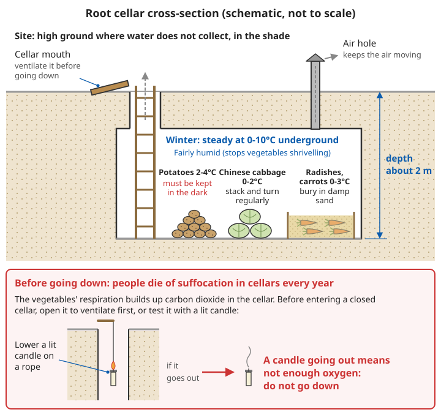

# Food Processing and Preservation

## Contents
- [How preservation works](#how-preservation-works)
- [Sun-drying and air-drying](#sun-drying-and-air-drying)
- [Salting](#salting)
- [Fermenting](#fermenting)
- [Smoking](#smoking)
- [Cellar storage](#cellar-storage)
- [Canning](#canning)
- [Tofu](#tofu)
- [High-risk foods and food poisoning](#high-risk-foods-and-food-poisoning)

---

## How preservation works

Food goes bad because micro-organisms (bacteria, moulds) multiply in it and because of the action of enzymes. Every preservation method works by stopping micro-organisms from multiplying:

| Method | How it works | Suitable for |
|------|------|------|
| Sun-drying, air-drying | Removes water | Grain, beans, vegetables, dried fruit, dried meat |
| Salting | High salt draws water out of micro-organisms | Salted vegetables, cured pork, salted fish |
| Fermenting | Useful bacteria produce acid, which holds back harmful ones | Pickled vegetables, sauerkraut |
| Smoking | Drying + substances in the smoke that hold back bacteria | Meat, fish |
| Cool cellar storage | Slows micro-organisms and the vegetables' own respiration | Potatoes, sweet potatoes, Chinese cabbage, radishes |
| Canning | Heat to kill germs + sealing | Jam, acidic vegetables |

**General rules**:
```
✓ Use fresh ingredients with no rot
✓ Wash containers and tools and scald them with boiling water or dry them in the sun
✓ Make small batches, often; do not make too much at once (if one crock spoils, you do not lose everything)
✓ Label everything: what it is, the date
✓ Check regularly; throw away at once anything mouldy, smelling wrong, or with a swollen bag or can
❌ "Cut off the mouldy part and eat the rest" applies only to a very few foods such as hard cheese;
   mouldy grain, nuts, pickles and fermented sauces must be thrown away, the whole batch
   (mould toxins spread to places you cannot see)
```

---

## Sun-drying and air-drying

The simplest and safest way to preserve food.

### Grain and beans

```
1. Spread out to dry as soon as possible after harvest; spread thinly and turn often
2. Dry until the moisture content is low enough:
   - paddy rice <13%, wheat <12%, maize <14%
   - quick test: a grain bitten between the teeth cracks crisply and does not stick to them
3. Let it cool before bagging (bagged warm, it takes up moisture again)
4. Storage: sealed, dry, safe from rats, in a cool place
```

For long-term grain storage see [Grain crops – key points of storage](../../../docs/04-动植物培育/02-粮食作物.md#储存要点).

### Vegetables and fruit

```
Suitable: green beans, radish strips, aubergine, chillies, mushrooms (only ones confirmed
edible), jujubes (Chinese dates), persimmons, apple slices

Method:
1. Wash and cut into thin slices or fine strips (the thinner, the faster they dry)
2. You can first blanch them in boiling water for 1-2 minutes (keeps the colour, kills
   surface bacteria, reduces enzyme action)
3. Spread on bamboo trays or netting and dry in the sun; bring in at night to keep off the dew
4. Dry until completely crisp or leathery (depending on the kind)
5. Store sealed

In wet weather: put them above the stove, beside the kang (heated brick bed),
or dry them in a low oven (<60°C)
```

### Dried meat

```
1. Choose lean meat and trim off all the fat (fat goes rancid easily)
2. Cut along the grain into thin strips (about 5 mm thick)
3. First cook it through or salt it overnight
4. Dry it in an airy, sunny place protected from flies, or in a low oven
5. When completely dry (it cracks when bent), store it sealed

⚠️ Drying raw meat directly is riskier; cooking it first or salting it thoroughly is safer
⚠️ You must keep flies off while it dries (gauze cover)
```

---

## Salting

### Salted vegetables

```
1. Wash the vegetables (radish, mustard greens, potherb mustard, etc.) and let the
   surface water dry off
2. Layer vegetables and salt alternately and press down firmly
   - use salt at about 10-15% of the vegetables' weight (too little salt and they
     spoil easily; more salt keeps longer but is saltier)
3. Weigh down with a heavy stone so the vegetables give up their water and sit under the brine
4. Seal and keep in a cool place
5. Pickle for more than 20 days before eating (see the note on nitrite below)
```

### Cured and salted pork

```
1. Choose fresh pork and cut it into long strips
2. Rub it repeatedly with salt (6-8% of the meat's weight); you can add Sichuan
   pepper and baijiu (Chinese spirit)
3. Pack into a crock and cure for 5-7 days, turning once a day
4. Take it out and hang it in a cool, airy place to dry, or smoke it
5. Making it in winter (air temperature below 10°C) is safest

⚠️ In hot weather it rots easily; in the fly season you must keep flies off
⚠️ Cured foods are very salty; people with high blood pressure or kidney disease should eat little
```

### ⚠️ Nitrite: give pickles enough time

In the early days of pickling, the nitrite content of pickled vegetables rises, usually peaking on days 3-10, then falls gradually, and **after 20 days** it is generally down to a safe level.

```
✓ Wait at least 20 days before eating pickled vegetables
✓ Use enough salt while pickling and keep it sealed
❌ Do not eat half-raw "quick pickles" salted for only a few days
❌ Do not eat pickles that have rotted or turned slimy
```

Signs of nitrite poisoning: blue-purple lips and nails, dizziness, palpitations, difficulty breathing. Call 120 immediately.

---

## Fermenting

### Pickled vegetables and sauerkraut

```
1. Container: a pickle crock (with a water-sealed rim) or a glass jar, washed and scalded
2. Brine: cooled boiled water with salt, about 5-8% strength
   (about 50-80 g of salt to 1 L of water)
3. Wash the vegetables, let them dry, put them in the crock, and cover them with brine
4. Put on the lid and fill the water channel round the rim to seal it (keeping air out)
5. Ferment at room temperature: about 1 week in summer, 2-3 weeks in winter
6. It is ready when it turns sour and smells fresh; waiting at least 20 days before eating is safer

Day-to-day care:
- Take vegetables out with clean chopsticks that have no oil on them
- Change the water in the rim channel often and do not let it dry out
- A white film on the surface (film-forming yeast): skim it off and add a little salt or baijiu;
  if black, green or pink mould spots appear, or it smells rotten, throw away the whole crock
```

### Other fermented foods

- **Laozao (sweet fermented rice)**: steam glutinous rice, mix in wine yeast (*jiuqu*, a rice-wine starter) and keep it warm to ferment for 2-3 days. Use fresh ingredients; if it turns black, smells foul or grows mould of other colours while fermenting, throw away the whole batch
- **Fermented sauces (broad-bean paste, soybean paste)**: they take a long time to make and carry a high risk of mould and botulism; beginners should not make them; see high-risk foods below

⚠️ **Do not make fermented rice-flour or maize-flour products yourself (*suantangzi*, *chouchazi*, *diaojiangba* and similar)!** See [High-risk foods and food poisoning](#high-risk-foods-and-food-poisoning) below.

---

## Smoking

```
1. Salt the meat or fish first (as for cured pork)
2. Build a simple smoke shed: hang the meat at the top, with a small fire below or
   smoke led in through a flue
3. Fuel: hardwood shavings, fruit-tree wood, pine branches (strong smoky taste),
   tea leaves, sugar-cane waste
   ❌ Do not use painted wood, wood treated with preservative, or plastic
4. Keep it a low-temperature cold smoke (a hand held next to the meat should feel
   just warm; do not cook or char it)
5. Smoke for several days to several weeks, until the surface is dry and hard and dark brown

Eating: it is best to steam or boil smoked foods again before eating them
⚠️ Smoked foods contain polycyclic aromatic hydrocarbons (carcinogens); do not eat
   large amounts over long periods
```

---

## Cellar storage

Suitable for roots, tubers and vegetables that keep well, harvested in autumn and winter.

### Root cellar

```
Site: high ground where water does not collect, in the shade
Depth: about 2 m (in winter the temperature underground stays steady at 0-10°C)
Ventilation: leave air holes and keep the air moving
Humidity: fairly high (stops vegetables losing water and shrivelling)
Suitable for: potatoes, Chinese cabbage, radishes, carrots and other vegetables that like cool conditions
Sweet potatoes and pumpkins do not tolerate cold and cannot share the cellar with them:
  sweet potatoes need a separate, deeper, warmer cellar kept at about 10-15°C;
  onions and garlic need dry, airy conditions and do not go in the cellar

⚠️ Before entering a closed cellar, open it to ventilate first, or test it with a lit candle:
   the vegetables' respiration builds up carbon dioxide in the cellar; if the candle
   goes out, there is not enough oxygen and you must not go down
   Every year people die of suffocation going down into cellars
⚠️ If someone has collapsed in the cellar: do not go straight down to rescue them
   (the rescuer will collapse too); first open the cellar mouth to ventilate it,
   shout for help, and call 119/120
```



*Figure: Root cellar cross-section (schematic, not to scale); storage temperatures for each vegetable are in the table below*

### Storage conditions for different vegetables

| Vegetable | Temperature | Key points |
|------|------|------|
| Potatoes | 2-4°C | **Must be kept in the dark** (in light they turn green and produce solanine) |
| Sweet potatoes | 10-15°C | Do not tolerate cold (below 9°C they are easily chilled and rot); let the skins dry before storing |
| Chinese cabbage | 0-2°C | Dry in the sun and remove the old outer leaves; stack and turn regularly |
| Radishes, carrots | 0-3°C | Bury in damp sand to keep them moist |
| Pumpkins | 10-15°C | Dry and airy; do not stack them on top of each other |
| Onions, garlic | 0-5°C | Dry and airy; hang them up |

For what to do with sprouted or green potatoes see [Vegetable growing – potatoes](../../../docs/04-动植物培育/01-蔬菜种植.md#土豆).

---

## Canning

### First tell acidic foods from low-acid foods

This is the most important safety knowledge in canning:

```
Acidic foods (pH ≤4.6): most fruit, jam, pickles with added vinegar,
tomatoes with added lemon juice
→ can be canned in a boiling-water bath

Low-acid foods (pH >4.6): all fresh vegetables, meat, poultry, fish, beans
→ can only be pressure-canned (must reach 116°C or more)
→ a boiling-water bath (100°C) does not kill botulinum spores!
```

Botulinum spores survive 100°C. In a sealed, oxygen-free, low-acid jar they multiply and produce botulinum toxin. This is the main poisoning risk of home canning.

**If you have no pressure cooker or pressure-canning equipment: do not can vegetables or meat yourself.** Preserve them by drying, salting, fermenting or other methods instead.

### Jam (acidic, boiling-water bath)

```
1. Boil the glass jars and lids for 10 minutes to sterilise them
2. Cook the fruit with sugar (about 50-100% of the weight of the fruit flesh) until thick
3. Fill the jars while hot, leaving 1 cm of space, and screw the lids on tight
4. Put the jars in boiling water, with the water covering the lids, and boil for 10-15 minutes
5. Take them out and let them cool; if the centre of the lid is pulled down, the seal has worked
6. Once opened, keep in the fridge and eat soon
```

### Signs a can has gone bad

```
❌ Any one of the following: throw it away; do not taste it:
- The lid bulges, the can is swollen
- Liquid or gas spurts out when you open it
- It smells wrong, is cloudy, or is bubbling
- The can is badly rusted or leaking
```

---

## Tofu

Soybeans are an important source of protein, and they are easier to digest made into tofu.

```
1. Soak soybeans for 8-12 hours (shorter in summer, longer in winter)
2. Grind into a slurry with water (beans : water about 1:6)
3. Strain through gauze to separate the soy milk from the okara (soybean pulp)
4. Bring the soy milk to the boil, then simmer for another 5-10 minutes
   ⚠️ It must be thoroughly cooked: raw soy milk contains saponins and trypsin
      inhibitors, which cause nausea, vomiting and diarrhoea
   Beware "false boiling": at about 80°C soy milk foams up and looks as if it is
   boiling, but it is not cooked
5. Let it cool to 80-90°C and slowly add the coagulant while stirring:
   - lushui (bittern, magnesium chloride; firm "northern" tofu)
   - gypsum (calcium sulphate; soft "southern" tofu)
   - white vinegar (for emergencies; tastes rather sour)
6. Leave to stand for 10-15 minutes until curds form
7. Ladle into a mould lined with gauze and press under a weight for 1-2 hours to set

⚠️ Bittern is a concentrated salt solution; drinking it by mistake can cause severe
   poisoning and even death; it must be labelled clearly and kept away from children
Okara: can be stir-fried or made into cakes, or fed to chickens and pigs, or composted
```

---

## High-risk foods and food poisoning

⚠️ For the following kinds of poisoning, **heating cannot reliably solve the problem**. Prevent them by "do not make it, do not eat it, throw it away".

### Bongkrekic acid: the most dangerous

| Item | Details |
|------|------|
| Source | Produced when the bacterium *Pseudomonas cocovenenans* contaminates fermented rice-flour and maize-flour products |
| High-risk foods | Fermented rice-flour and maize-flour products (*suantangzi*, *chouchazi*, *gegedou*, *diaojiangba*, *tangyuan* (glutinous rice balls), etc.); wood ear or white fungus (tremella) soaked too long; wet rice noodles, *hefen* (flat rice noodles) |
| Why it is dangerous | **Neither boiling nor pressure cooking destroys it**; there is no specific antidote; the death rate is very high |
| Prevention | **Do not make or eat fermented rice-flour or maize-flour foods**; do not soak wood ear or white fungus for too long, and cook them soon after soaking; throw them away if they are slimy or smell wrong after soaking |

### Botulism

| Item | Details |
|------|------|
| High-risk foods | Home-made low-acid canned food; home-made broad-bean paste, *choudoufu* (stinky tofu) and other fermented soy products; vacuum-packed meat, badly cured meat |
| Signs | A few hours to a few days after eating: blurred or double vision, drooping eyelids, difficulty speaking and swallowing, then weakness all over and difficulty breathing |
| What to do | **Call 120 immediately** (there is an antitoxin; the earlier the better) |
| Prevention | Do not can low-acid foods; cook the ingredients of fermented soy products thoroughly; boiling suspect food for more than 10 minutes before eating destroys the toxin; throw away every swollen can or bag |

### Aflatoxin

| Item | Details |
|------|------|
| High-risk foods | Mouldy peanuts, maize, rice and nuts; bitter-tasting peanuts and sunflower seeds; mouldy home-pressed peanut oil |
| Why it is dangerous | A strong carcinogen; cooking at high temperature does not destroy it |
| Prevention | Dry grain thoroughly before storing it; **throw away mouldy or bitter nuts and grain, the whole batch**; do not pick through them to eat the rest; do not feed them to poultry or livestock "so as not to waste them" (it passes into meat, eggs and milk) |

### Others

- **Nitrite**: wait more than 20 days before eating pickled vegetables (see above); do not mistake industrial salt for table salt
- **Sprouted or green potatoes**: solanine; see [Vegetable growing – potatoes](../../../docs/04-动植物培育/01-蔬菜种植.md#土豆)
- **Undercooked green beans and long beans**: saponin poisoning; they must be stir-fried and cooked through until they lose their raw green colour
- **Wild mushrooms**: never eat any you do not know; see [Forest survival](../../../docs/03-野外生存/02-森林求生.md)

For general treatment of food poisoning see [Common illnesses – food poisoning](../../../docs/01-日常疾病和伤害/01-常见疾病.md#食物中毒).

---

## 📝 Key points of food preservation

```
Safest and most recommended:
1. Drying (grain, beans, vegetables, dried meat)
2. Cellar storage (potatoes, sweet potatoes, Chinese cabbage, radishes)
3. Salting (wait the full 20 days)

Take care with:
- Fermenting: keep it sealed; if mould of other colours appears, throw away the whole crock
- Smoking: do not use painted wood or wood treated with preservative

Do not:
❌ Can vegetables or meat without a pressure cooker
❌ Make fermented rice-flour or maize-flour foods
❌ Eat mouldy or bitter grain and nuts
```

---

**Next chapter**: [Nutrition and Deficiency Diseases](02-nutrition-and-deficiency-diseases.md)
**Back to**: [Part contents](README.md) | [Main contents](../../README.md)
