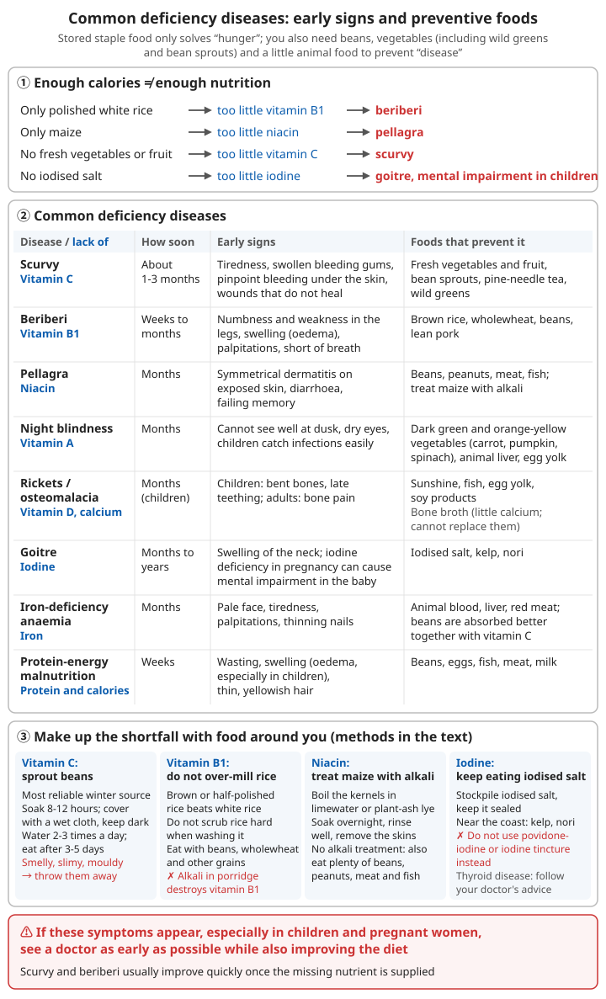

# Nutrition and Deficiency Diseases

## Contents
- [Why stored food can make people ill](#why-stored-food-can-make-people-ill)
- [Common deficiency diseases](#common-deficiency-diseases)
- [Making up the shortfall with food around you](#making-up-the-shortfall-with-food-around-you)
- [Special groups](#special-groups)
- [Eating again after long starvation](#eating-again-after-long-starvation)
- [What to stockpile](#what-to-stockpile)

---

## Why stored food can make people ill

Rice, wheat flour and maize can provide enough calories, but **if you live on them alone, deficiency diseases appear within a few months**. In historical famines, long ocean voyages and wartime sieges, large numbers of people did not starve to death but died of these preventable diseases.

```
Enough calories ≠ enough nutrition

Only polished white rice   → too little vitamin B1 → beriberi
Only maize                 → too little niacin     → pellagra
No fresh vegetables/fruit  → too little vitamin C  → scurvy
No iodised salt            → too little iodine     → goitre, mental impairment in children
```

**Rule: stored staple food only solves "hunger". You also need beans, vegetables (including wild greens and bean sprouts) and a little animal food to prevent "disease".**

---

## Common deficiency diseases

| Disease | Lack of | How soon it appears | Early signs | Foods that prevent it |
|------|------|----------|----------|----------|
| Scurvy | Vitamin C | About 1-3 months | Tiredness, swollen bleeding gums, pinpoint bleeding under the skin, wounds that do not heal | Fresh vegetables and fruit, bean sprouts, pine-needle tea, wild greens |
| Beriberi | Vitamin B1 | Weeks to months | Numbness and weakness in the legs, swelling (oedema), palpitations and shortness of breath | Brown rice, wholewheat, beans, lean pork |
| Pellagra | Niacin | Months | Symmetrical dermatitis on exposed skin, diarrhoea, failing memory | Beans, peanuts, meat, fish; treat maize with alkali |
| Night blindness | Vitamin A | Months | Cannot see well at dusk, dry eyes, children catch infections easily | Dark green and orange-yellow vegetables (carrot, pumpkin, spinach), animal liver, egg yolk |
| Rickets / osteomalacia | Vitamin D, calcium | Months (children) | Children: bent bones, late teething; adults: bone pain | Sunshine, fish, egg yolk, soy products, bone broth (contains little calcium; cannot replace the others) |
| Goitre | Iodine | Months to years | Swelling of the neck; iodine deficiency in pregnancy can cause mental impairment in the baby | Iodised salt, kelp, nori (laver) |
| Iron-deficiency anaemia | Iron | Months | Pale face, tiredness, palpitations, thinning nails | Animal blood, liver, red meat; beans are absorbed better together with vitamin C |
| Protein-energy malnutrition | Protein and calories | Weeks | Wasting, swelling (oedema, especially in children), thin, yellowish hair | Beans, eggs, fish, meat, milk |

⚠️ If these symptoms appear, especially in children and pregnant women, see a doctor as early as possible while also improving the diet. Scurvy and beriberi usually improve quickly once the missing nutrient is supplied.



*Figure: What is missing beyond stored staple food, which disease it causes, the early signs and the foods that prevent it; if symptoms appear, especially in children and pregnant women, see a doctor as early as possible*

---

## Making up the shortfall with food around you

### Vitamin C: bean sprouts are the most reliable winter source

Dry beans contain almost no vitamin C, but once they sprout their vitamin C rises sharply, and sprouting does not depend on the season.

```
Sprouting beans (soybeans, mung beans):
1. Pick out the bad beans and soak the rest in clean water for 8-12 hours
2. Put them in a container with holes in the bottom (or on gauze), covered with
   a wet cloth to keep out the light
3. Water them 2-3 times a day; keep them moist but do not let water collect
4. They are ready to eat in 3-5 days (mung bean sprouts about 5-7 cm long)
5. Stir-fry or blanch them to eat; do not boil them for long (vitamin C is destroyed by heat)

⚠️ If they smell bad, turn slimy or go mouldy while sprouting → throw them away
```

**Other sources**:
- Wild greens: shepherd's purse, purslane, young dandelion leaves and others (you must be 100% sure of them; see [Medicinal plants](../../../docs/04-动植物培育/04-药用植物.md))
- Pine-needle tea: chop fresh pine needles and steep them in hot water (do not boil them for long). ⚠️ Use only trees you are sure are pines; **yew (Taxus) is highly poisonous**, with flat needles and a similar appearance; do not confuse them. Pregnant women should not drink pine-needle tea
- Chillies, Chinese cabbage, radishes and potatoes also contain some vitamin C

**Protecting vitamin C**: wash vegetables before cutting them, cook them soon after cutting, stir-fry quickly over high heat, and add little alkali (soda).

### Vitamin B1: do not mill rice too white

```
✓ Brown rice, or "half-polished" rice milled fewer times, is much better than polished white rice
✓ Do not scrub rice hard over and over when washing it
✓ Eat it with beans, wholewheat and other grains
❌ Adding alkali (soda) to rice porridge destroys vitamin B1
```

### Niacin: treat maize with alkali before eating it

Regions where maize was the staple food once had widespread pellagra. The niacin in maize is in a bound form that the body can hardly absorb.

```
Traditional method: cook the maize kernels in limewater or plant-ash lye
1. Add water to the maize kernels with a little slaked lime (or lye strained from plant ash)
2. Boil until the skins of the kernels can be rubbed off
3. Soak overnight; the next day rinse them clean several times and remove the skins
4. Then grind into flour or cook and eat

Effect: releases the bound niacin, and also improves the taste and texture
```

If you do not treat maize with alkali, you must also eat plenty of beans, peanuts, meat and fish.

### Iodine

- Keep eating iodised salt (table salt in mainland China is generally iodised)
- Near the coast you can eat kelp and nori
- When stockpiling, choose iodised salt and keep it sealed (iodine is lost with damp, heat and light)
- ⚠️ People with thyroid disease should follow their doctor's advice; do not use povidone-iodine, tincture of iodine or other iodine products for external use in place of iodised salt

Home-made salt contains almost no iodine; see [Salt making – iodine](../../../docs/07-日常生活技能/15-制盐.md#碘-自制盐最大的缺陷).

### Protein: beans are the most important plant protein

- Soybeans and soy products (tofu, soy milk, bean sprouts); for how to make them see [Food processing and preservation – tofu](01-food-processing-and-preservation.md#tofu)
- Grain + beans together (e.g. rice with tofu, mixed-grain porridge): the proteins complement each other
- Eggs are the easiest good-quality protein to get; see [Poultry](../../../docs/04-动植物培育/05-家禽养殖.md)
- Insects are also a source of protein (they must be cooked through); see [Basic survival skills](../../../docs/03-野外生存/00-基础生存技能.md)

---

## Special groups

### Pregnant and breastfeeding women

```
✓ Folic acid: from 3 months before pregnancy to early pregnancy, to prevent neural
  tube defects in the baby (stockpile folic acid tablets)
✓ Iodine: more is needed in pregnancy; keep eating iodised salt
✓ Iron: animal blood, liver, red meat
✓ Calcium: soy products, milk, dried small shrimps
✓ Eat somewhat more than usual, especially protein
```

### Babies and young children

For feeding and care of a newborn in the first few days see [Emergency childbirth and newborn care – the newborn's first few days](../../../docs/01-日常疾病和伤害/11-紧急分娩与新生儿护理.md#新生儿最初几天).

```
✓ Under 6 months: breastfeeding is the safest choice (it does not depend on
  supplies of clean water and formula)
✓ From 6 months: start complementary foods, iron-containing ones first (such as
  iron-fortified rice cereal, puréed meat, egg yolk)
✓ Plenty of sunshine (vitamin D)
❌ No honey under 1 year old (risk of botulism)
❌ Do not use rice water or thin gruel in place of milk for long periods
  (severely short of protein)
```

### Older people

- Bad teeth easily lead to eating too little and too narrow a diet; make food soft and finely chopped
- Pay attention to protein and calcium
- The sense of thirst weakens; drink water on purpose at set times

---

## Eating again after long starvation

⚠️ **In a severely starved, extremely thin person, suddenly eating a lot can be fatal** (refeeding syndrome: electrolyte disturbances that can cause heart failure and fits).

```
Applies to: people who have eaten almost nothing for several days or more, or who have
been severely malnourished for a long time

What to do:
1. Start with small amounts of plain, easily digested food (thin rice porridge, rice water,
   noodle broth)
2. Small, frequent meals, only a little each time
3. Increase the amount gradually over several days
4. A little salt can be added
5. If possible, see a doctor as soon as possible and restart eating under medical supervision

Watch for: palpitations, shortness of breath, swelling, fits, changes in consciousness
→ reduce the amount and see a doctor immediately
```

---

## What to stockpile

In addition to the [Long-term collapse survival – stockpile list](../../../docs/03-野外生存/06-末日求生.md#储备清单), add:

```
- [ ] Iodised salt (kept sealed)
- [ ] Several kinds of dry beans: soybeans, mung beans (both protein and a way to sprout
      beans for vitamin C)
- [ ] Peanuts, sesame (fat, niacin)
- [ ] Brown rice or other grains (do not store only polished white rice)
- [ ] Multivitamin tablets (as insurance; watch the expiry date)
- [ ] Folic acid tablets (if a woman in the household is planning a pregnancy or is pregnant)
- [ ] Vegetable seeds (traditional varieties whose seed you can save)
```

---

## 📝 Key points of nutrition

```
1. Enough calories ≠ enough nutrition; besides stored staple food you need beans and vegetables
2. When vegetables are short in winter, sprout beans: the most reliable source of vitamin C
3. Do not mill rice too white; when maize is the staple, treat it with alkali or eat more beans
4. Keep eating iodised salt
5. Make sure pregnant women, babies and young children, and older people are fed properly first
6. After long starvation, small frequent meals; recover slowly
```

---

**Next chapter**: [Sanitation](../../../docs/07-日常生活技能/03-卫生设施.md)
**Back to**: [Part contents](README.md) | [Main contents](../../README.md)
