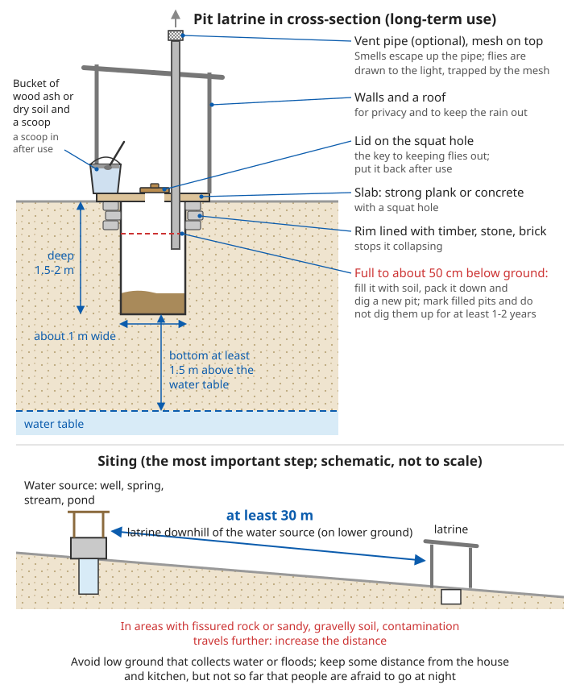

# Sanitation: Toilets, Excreta and Rubbish

## Contents
- [Why this chapter matters](#why-this-chapter-matters)
- [Emergency toilets](#emergency-toilets)
- [Pit latrines](#pit-latrines)
- [Handwashing stations](#handwashing-stations)
- [Using faeces and urine](#using-faeces-and-urine)
- [Rubbish disposal](#rubbish-disposal)
- [Disposing of diseased animal carcasses](#disposing-of-diseased-animal-carcasses)

---

## Why this chapter matters

After a disaster, and during long cuts to water and power, much of the illness and death does not come from the disaster itself. It comes from infectious diseases caused by **faeces contaminating drinking water and food**:

```
Cholera, dysentery, typhoid, hepatitis A, all kinds of diarrhoea,
roundworm and other parasites

Route of spread: faeces → water / hands / flies / food → mouth
```

Breaking this route takes only three things: **keep faeces away from water and food; wash hands before eating and after using the toilet; kill flies**.

This is the most cost-effective public health measure there is. It saves more lives than any stockpile of medicines.

---

## Emergency toilets

For use indoors when the water is off, or in the first few days after taking shelter.

### Two-bucket method

```
Materials: two buckets with lids, bin bags, cover material

1. Line each bucket with two bin bags
2. Use one bucket for faeces and one for urine (keeping them apart greatly
   reduces smell and volume)
   - Pour the urine regularly into a pit in the ground, away from water sources
3. After each use, throw a handful of cover material over it:
   - Wood ash (best: it is alkaline, so it suppresses germs and smells)
   - Dry soil, sawdust, chopped dry grass, quicklime (a little)
4. Close the lid tightly
5. When about 2/3 full, tie the bag shut and move it to a pit latrine
   (see below) or a deep burial pit

⚠️ When the water is off, do not keep using a flush toilet. Blockages and
   backflow are much harder to deal with
⚠️ Wash your hands after use (see Handwashing stations below)
```

### Shallow pit (outdoors, short term)

```
1. Choose the site as for a pit latrine below (at least 30 m from water sources)
2. Dig a hole 15-20 cm deep
3. Fill it back in with soil after use
4. Use a new spot each time
```

---

## Pit latrines

Build one for long-term use.

### Choosing the site (the most important step)

```
✓ At least 30 m from wells, springs, streams and ponds
✓ Downhill of the water source (on lower ground)
✓ The bottom of the pit at least 1.5 m above the water table
  - How to tell: water seeping in at the bottom while you dig → too close
    to the groundwater; move elsewhere or use a shallow pit with cover material
✓ Some distance from the house and kitchen, but not so far that people
  (children, the elderly) are afraid to go at night
✓ Avoid low ground that collects water or floods

⚠️ In areas with fissured rock or sandy, gravelly soil, contamination travels
   further; increase the distance
```

### Building

```
1. Dig the pit: about 1 m wide, 1.5-2 m deep (depending on the water table)
2. Line the rim: edge it with timber, stones or bricks to stop it collapsing
3. Squatting slab: a strong plank or concrete slab with a squat hole
4. Lid: the squat hole must have a cover (the key to keeping flies out)
5. Vent pipe (optional): run a pipe from the pit up through the roof,
   with insect mesh over the top
   - Smells escape up the pipe; flies are drawn to the light at the top
     and trapped by the mesh
6. Screening: walls and a roof for privacy and to keep the rain out
7. Keep a bucket of wood ash or dry soil and a scoop next to it
```

### Use and maintenance

```
✓ After use, throw in a scoop of wood ash or dry soil
✓ Put the cover back on the squat hole
✓ Check and clean the slab every day
✓ When the pit fills to about 50 cm below ground level: fill it up with soil,
  pack it down, and dig a new pit
✓ Mark filled pits and do not dig them up for at least 1-2 years
```



*Figure: top, cross-section of a pit latrine (vent pipe optional); bottom, siting (not to scale). For the values see the siting, building and use points above*

For community water supply, well digging and water purification, see [Water supply](10-water-supply.md).

---

## Handwashing stations

**There must be somewhere to wash hands next to the toilet.** Without handwashing, a toilet does much less good.

### Simple hand-washer

```
How: make a small hole low in the side of a plastic bucket or large bottle,
     and fit a tube with a tap or plug it with a wooden stopper;
     or hang a bottle up and tilt it with a foot-operated string so water
     pours out (your hands never touch the container)

Where: at the toilet exit and the kitchen door
Next to it: soap, or a tin of wood ash
```

### How to wash

```
1. Wet both hands
2. Apply soap (or wood ash) and rub every part: palms, backs, between the
   fingers, fingertips, thumbs and wrists
3. Rub for at least 20 seconds
4. Rinse clean under running water
5. Shake or air dry (do not use a dirty towel)
```

**With no soap**: rubbing with wood ash, or just rubbing carefully under running water for 20 seconds, is far better than not washing. Do not use soil instead (the soil itself may be contaminated with faeces).

For making your own soap, see [Soap making](04-soap-making.md).

### When you must wash your hands

- After using the toilet, and after changing a baby's nappy
- Before cooking, before eating, before feeding a child
- Before and after caring for a sick person
- After handling raw meat, rubbish or animals


*Figure: handwashing station and method; with no soap, use wood ash, never soil*

---

## Using faeces and urine

Human faeces and urine are good fertiliser, but **handled badly, you are growing parasites and dysentery for yourself**.

### Urine (relatively safe)

```
✓ Fresh urine from a healthy person contains very few pathogens
✓ Dilute 5-10 times with water before use (neat urine scorches seedlings)
✓ Pour it onto the soil, not onto the leaves
✓ Best collected separately and stored sealed for 1 month or more before use
✓ Safest on grain crops and fruit trees; stop using it on leafy vegetables
  1 month before harvest
```

### Faeces (must be stored for a long time)

```
Based on World Health Organization guidelines on the safe use of excreta:
- Areas where temperatures are below 20°C: store for 1.5-2 years
- Warmer areas: store for at least 1 year
- Storage kills most bacteria and greatly reduces viruses and parasite eggs
  (roundworm eggs are the toughest)

Method:
1. Seal a pit latrine once it is full, or set up a separate compost bin
2. Do not open it or use it during that time
3. When the time is up, it should look like dark soil and not smell
4. Use it first on fruit trees and grain crops; dig it into the soil and cover it

❌ Never pour fresh faeces directly onto vegetables
❌ Do not use it on vegetables eaten raw (lettuce, cucumbers, etc.)
❌ Isolate faeces especially strictly during a diarrhoea outbreak
```

For using animal manure, see [Farming and animal husbandry – Soil improvement](../04-farming-and-animal-husbandry/README.md#improving-soil).

---

## Rubbish disposal

### Sorting

| Type | What to do |
|------|------|
| Kitchen scraps (vegetable leaves, peel, leftovers) | Feed to chickens, ducks or pigs (⚠️ do not feed swill to pigs, see [Livestock](../04-farming-and-animal-husbandry/06-livestock.md)); or compost |
| Combustibles (paper, wood, dry grass) | Kindling, fuel |
| Plastics | Wash and reuse where possible; ❌ do not burn near where you live (the smoke is toxic) |
| Metal, glass | Collect and reuse (metal can be remelted, see [Metallurgy](../05-metallurgy/README.md)) |
| Anything else that cannot be used | Bury deep |

### Rubbish pit

```
✓ Choose the site as for a pit latrine: at least 30 m from water sources,
  downhill of them
✓ Cover with a layer of soil after each load (against flies, rats and
  dogs digging)
✓ When full, cover with at least 30 cm of soil and pack it down
❌ Do not dump rubbish in or near streams, riverbanks or wells
```

### Getting rid of flies and rats

```
✓ Cover the toilet; throw ash in after use
✓ Bury rubbish promptly; do not leave it in open heaps
✓ Cover food in the kitchen
✓ Empty containers that hold standing water (this also stops mosquitoes)
✓ Store grain sealed in jars or metal drums (against rats)
```

---

## Disposing of diseased animal carcasses

```
✓ Wear gloves; do not touch with bare hands
✓ Bury deep: pit at least 1.5 m deep, away from water sources; sprinkle
  quicklime over the carcass before covering with soil
✓ Or burn (away from houses and woodland)
❌ Do not eat poultry or livestock that died of disease
❌ Do not throw carcasses into rivers or ponds
⚠️ If many animals die within a short time (especially poultry or pigs),
   report it to the local animal husbandry and veterinary authority
   (it may be avian influenza, African swine fever or another epidemic)
```

Human remains are handled differently from diseased animals; see [Handling remains after a disaster](../02-disaster-response/07-handling-the-dead-after-disasters.md).

---

## 📝 Key points on sanitation

```
1. Toilets at least 30 m from water sources, downhill of them
2. After use, throw in wood ash and close the cover
3. There must be handwashing next to the toilet (no soap: use wood ash)
4. Diluted urine can be used; store faeces for at least 1-2 years before
   use, and never on vegetables eaten raw
5. Sort rubbish; bury what cannot be used deep and away from water sources
6. Get rid of flies and rats
```

---

**Next chapter**: [Soap making](04-soap-making.md)
**Back to**: [Part contents](README.md) | [Main contents](../../README.md)
